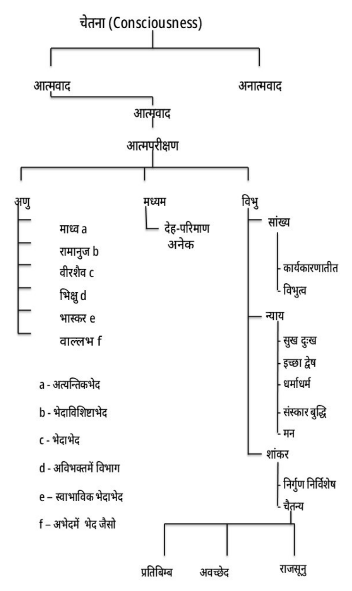
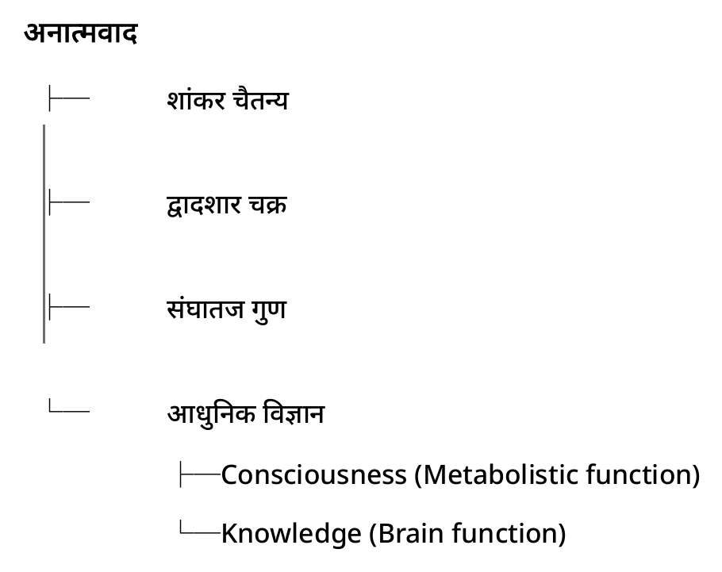

<!-- Opening pages of प्रतिबिम्बवाद (2026, rev. 2) in the house markdown, the build test of vallabh_vani/booklets: text as printed (see SPEC_HINDI_BOOKLET.md), contents and index generated. -->

<!-- p.1 -->

* * *

<!-- p.2 -->

* * *

<!-- p.3 -->

{{अनुक्रमणिका}}

* * *

<!-- p.4 -->

* * *

<!-- p.5 -->

## प्रतिबिम्बादिवादीयाः उपक्रमश्लोकाः

::: verse
| न वेद्म्यात्मन्यात्मानं परमात्मानं कुतो न्वहम् ॥
| प्रियता मयि चान्येषु विषयश्चाश्रयो बृहत् ॥१॥
| आचार्यवचसा भाते कृष्णएव गतिर्मम ॥
| अखण्डे मे मतिरती स्यातां तद्बृहति स्थिते ॥२॥
| शिरः करमनोभिर्मे प्रणम्य पुरुषोत्तमम् ॥
| प्रतिबिम्बादिवादोपक्रमोऽत्र विचिकीर्षितः ॥३॥
| चैतन्यविषये नैका वादिनां विमतिः मता ।।
| आत्मानात्मवादभेदात् परिमाणेषु नैकता ॥४॥
| श्रुतिमूले ब्रह्मवादे श्रुतिव्याख्यानरूपता ॥
| जीवात्मचेतनावाक्यसंग्रहोऽत्र निगद्यते ॥५॥
:::

::: colophon
| इति गोस्वामिश्रीदीतितात्मजेन श्याम मनोहरेण
| निर्मिताः
| प्रतिबिम्बादिवादीयाः उपक्रमश्लोकाः
:::

<!-- p.10 -->
# खण्ड १ — उपक्रम: अवतारवादावली और प्रतिबिम्बवादको परिचय

अपनो ये उत्सव यहाँ कितने सालन्‌सु चल रह्यो हे, याकी मोकु सही-सही याद नहीं हे क्योंके नंबरके बारेमें मेरी थोड़ी याददाश्त कमजोर हे. पर आपकु एक रोचक बात बताऊँ के मगनलाल शास्त्री डेक्कन क्वींस् कॉलेजसु पुरुषोत्तमजीको उत्सव मनावे मुंबई आते हते और उनने एक पुरुषोत्तम मंडल स्थापित कियो हतो, जाके प्रोडक्ट् तेलीवाला, धीरज लाल और बहुत सारे लोग हते. और वा बखत पुरुषोत्तमजीको उत्सव मगनलाल शास्त्री पुरुषोत्तमजीके ग्रंथपे प्रवचनसु करते हते. वाके प्रोडक्ट् तेलीवाला वगैरह हते और अपन् जाने के उनने कितनो काम कियो. लड्डू-पूरी खाके उत्सव मनानो एक प्रकार हे और ये दूसरो प्रकार हे. अपनो भी तीन सालसु ये क्रम चल
<!-- p.11 cont -->
रह्यो हे और मैं अच्छी तरहसु समझूँ के कई लोगन्‌कु विचार आतो होयगो के इन ग्रंथन्‌को प्रवचन करवेको मतलब क्या? कोई भगवान्‌की लीलाकी कथा करो. ये कथा करवेकी जरूरत क्या हे? कई लोग पूछे भी हें मोसु के कैसे आप ऑर्गेनाइज़् करो हो ये सब? पर एक बात समझो के मैं ऑडियंस् ऑर्गेनाइज़् नहीं करूँ, टॉपिक् ऑर्गेनाइज़् करूँ. मेरी ये वीकनेस् हे और ये वीकनेस् दादाजीसु इनहेरिट् भई हे. ऐसी-ऐसी बुढ़ियान्‌के सामने जिनकु कुछ समझ नहीं आवे, दादाजी ब्रह्मवादकी और विद्वन्मंडनकी और बड़ी-बड़ी चर्चाएँ करते रहते. मजेदार बात ये हती के एक बखत उनने बहुत सारे टेबल बनाए ज्ञान-भक्ति-तारतम्य विमर्शके और समझायो के या टेबलमें ये बात हे, वा टेबलमें ये बात हे. तो छेल्ले एक बुढ़ियाने कही के "गुरुजी, आपे आखु प्रवचन कर्यु पण टेबल तो आव्यू नहीं!"

कभी-कभी डर लगे मोकु के कोई ऐसे "टेबल क्यों नहीं आयो" पूछ न ले कहीं. कोई चिंताकी बात नहीं, पूछ भी लोगे तो हरकत नहीं हे मोकु. मोकु तो जो करनो हे सो करनो हे. आपकु समझ आवे, बहुत खुशीकी बात हे; नहीं समझ आवे तो कोई दुखकी बात नहीं हे, क्योंके "श्रुतं हरति पापानि", कानमें तो पड़ेगो ना.

तो जब मैं करीब शायद चौदह-पंद्रह बरसको होऊँगो, तब दादाजीने मोकु आर्डर कियो हतो के प्रवचनमें बैठो करो.
<!-- p.12 cont -->
मेरे पास फोटो हे, मेरे चेहराके हाव-भाव खराब हो रहे हें. पता नहीं क्या बोल रहे हें दादा जी! पर वा बखत कुछ भी नहीं समझ पड़ती हती.

पर आज जब मैंने बोलनो शुरू कियो, तो दादाजीकी बोली भाई सारी बातें याद आवें मोकु, ऐसे आपकु भी कभी याद आएँगी, ऐसे मेरो भी विश्वास हे. आज समझ नहीं पड़ती होंय तो कोई बात नहीं, कभी याद आएँगी जब आप बोलनो शुरू करोगे. बात इतनी फ्रेशली रिवाइव् हो जाए के आश्चर्य होवे के वा बखत क्यों नहीं समझमें आ रही हती, आज कैसे समझमें आ रही हे?

पर दवाईके बारेमें जैसे कह्यो जाए के अपनेकु समझ नहीं आ रह्यो हे के दवाई कैसे असर कर रही हे, पर 'पेट पड़े गुण देय'. ऐसे ये भी कान पड़े गुण देय. ये टॉपिक्स् ऐसे हें, कानमें पड़ेंगे तो कुछ ना कुछ आपमें गुण पैदा करेंगे. So let us hope for good. टॉपिक् बहुत ऐसी हे के जामें अपने पुष्टिमार्गियन्‌कु रस आनो बहुत मुश्किल हे. Its all right अभी अपन् क्या कर सकें? 'कान पड़े गुण देय'- बस ये सिद्धांत पकड़के चलो.

ये अवतार वादावली जो पुरुषोत्तमजीने लिखी हे; अवतार माने चौबीस वादन्‌की एक कड़ी लिखी हे और याको
<!-- p.13 cont -->
जो ऑर्डर् हे, वो इंडक्टिव् ऑर्डर्‌में नहीं हे, डिडक्टिव् ऑर्डर्‌में लिखी हे. सबसु महत्वपूर्ण फ़ॅक्ट् ये हे.

इंडक्टिव् ऑर्डर् मतलब क्या? X is mortal, Y is mortal , Z is mortal, Therefore all are mortal. ये इंडक्टिव् ऑर्डर् कहवावे — from particular to universal.

डिडक्टिव् ऑर्डर् क्या? All men are mortal and so and so is a man, Therefore so and so is mortal. कुछ वाद ऐसे हें के जो जड़ और जीवसु ब्रह्म तक जावें. कुछ वाद ऐसे हें के जो ब्रह्मकु डिसाइड् करवेके बाद, वा ब्रह्मकी जब एक जनरल् प्रमाइस् सिद्ध हो गई, वापेसु डिडक्टिव् ऑर्डर्‌में कन्क्लुज़न् ड्रॉ करें.

पुरुषोत्तमजीने वो स्टाइल् अडॉप्ट् करके सबसु पहलो वाद ब्रह्मके बारेमें लिख्यो और फिर धीरे-धीरे यदि वैसो ब्रह्म हे तो वाके कारण होवेके कारण कैसे, कार्य कैसे हो सकें, कैसे वाके अंश हो सकें, कैसे वाकु पानेकी साधना हो सके, कैसे वाकु पायो जा सके—या तरहसु डिडक्टिव् ऑर्डर्‌में सारे चौबीस वाद लिखे गए.

<!-- p.14 -->
मैं समझूँ अपनो तीसरो साल हे ये, क्योंके ब्रह्मवादके अवतारवादावलीके जो पहले तीन वाद हें, उनसु नहीं शुरू कियो हतो **'ब्राह्मणत्वादिदेवतावाद'**सु शुरू कियो.

डिडक्टिव् ऑर्डर्‌में ये **ब्राह्मणत्वादि-देवतावाद**के बाद **जीवव्यापकत्व खंडनवाद** आयो, **अणुत्ववाद** आयो. अब जीव अणु हे, ये एक बखत डिसाइड् हो गयो तो वाके बाद जीवके अणु न होवेके जो प्रतिपक्षी हें, उन वादनको विचार पुरुषोत्तमजीने या बादमें कियो हे. माने जीव क्या हे? ये नहीं, वो तो याके पहले वादन्‌में आ गयो. पर जीव क्या नहीं हे, जीवात्मा क्या नहीं हे—ये विचार इन वादन्‌में आयो.

याके लिए पुरुषोत्तमजीने या वादको नाम रख्यो**—"जीव प्रतिबिंबादिवाद"**. तो प्रतिबिंबमें सिर्फ प्रतिबिंबको तो प्राधान्य नहीं लियो हे, बाकी सब मिलाके बहुत सारे वादनको पुरुषोत्तमजी ने, जो जीवके बारेमें अणु नहीं होवेके वाद हें, उन सारे वादनको यहाँ विचार कियो हे. और या विचारके तहत सबसु महत्वपूर्ण बात ये हे के जीव क्या हे? याके बारेमें जा बखत अपन् सोचें; तो हर एकके कुछ-कुछ पूर्वाग्रह तो होवें ही हें. जैसे अपन् बोलचालकी भाषामें कहें—"जीव निकल गयो, अब खाली देह बच्यो हे." कोई लोग बहुत दिन तक जीते होंय, तो बच्चा भी कहवें हें के "जीव कहीं अटक गयो हे?" ऐसे जीवके बारेमें अलग-अलग बहुत सारी धारणाएँ हें. कोमामें चले
<!-- p.15 cont -->
जाएँ, तो भी लोग सोचें के कोमामें गयो पर देह छूटी नहीं, जीव क्या अटक गयो?

आजकल तो वो पद्धति नहीं रही, थोड़ी सुधर गई हे. पुराने ज़मानामें गोस्वामी बालककु बुलाते हते के "याको जीव अटक गयो हे, आप याके ऊपर पग धरो. जासु याको जीव छूट जाए. और मोकु कहनो नहीं चहिये , पर हमारे दादाजी बहुत बदनाम हते. कोईके यहाँ पधारते तो सचमुचमें वाको जीव छूट जातो. कोई बीमार होय, जीव छूटतो नहीं होय तो दादाजीकी पधरावनी करावें. और जितने दादाजीके छोटे भाई हते वो दादाजीको चिढ़ाते हते—"आप जा रहे हो, अब वाको देह छूट जायगो."

<!-- p.16 -->
# खण्ड २ — जीव क्या है? — चेतनाको मूल प्रश्न

ये जीवको छूटनो क्या हे? अटकनो क्या हे? क्यों अटक जाए, क्यों जा नहीं रह्यो हे? ये सारे लफड़ा जो हें, वो जीवके बारेमें थोड़ो-बहुत ख्याल अपन् बनावें के क्या हे जीव. स्पेसिफिकली वाको क्लॅरिफिकेशन्, थ्योरेटिकल् जो वाकी स्टेंड् हे, वो बहुत फिलॉसॉफिकल् हे. फिलॉसॉफिकल् हे इतनो ही नहीं, साइंस्‌में भी बहुत यापे रिसर्च् हो रही हे, अभी भी हो रही हे और आगे भी होती रहेगी.

तो सबसु पहले जीवके वा बारेमे या चार्टकु देखोगे तो सब कुछ खुलासा हो जायगो.

<!-- p.17 -->
::: figure
{width=3.3in}
:::

<!-- chart_1:
चेतना (Consciousness)
  आत्मवाद
    आत्मवाद
      आत्मपरीक्षण
        अणु
          माध्व a
          रामानुज b
          वीरशैव c
          भिक्षु d
          भास्कर e
          वाल्लभ f
        मध्यम
          देह-परिमाण अनेक
        विभु
          सांख्य
            कार्यकारणातीत
            विभुत्व
          न्याय
            सुख दुःख
            इच्छा द्वेष
            धर्माधर्म
            संस्कार बुद्धि
            मन
          शांकर
            निर्गुण निर्विशेष
            चैतन्य
              प्रतिबिम्ब
              अवच्छेद
              राजसूनु
  अनात्मवाद
a - अत्यन्तिकभेद
b - भेदाविशिष्टाभेद
c - भेदाभेद
d - अविभक्तमें विभाग
e – स्वाभाविक भेदाभेद
f – अभेदमें भेद जैसो
-->

<!-- p.18 -->
::: figure
{width=3.9in}
:::

<!-- chart_2:
अनात्मवाद
  शांकर चैतन्य
  द्वादशार चक्र
  संघातज गुण
  आधुनिक विज्ञान
    Consciousness (Metabolistic function)
    Knowledge (Brain function)
-->

सबसु पहलो प्रश्न जीवके बारेमें आवे हे, वो चेतनासु रिलेटेड् हे—कॉन्शियसनेस्‌सु रिलेटेड्. क्यों कॉन्शियसनेस्‌सु रिलेटेड् होवे? क्योंके जैसे मैंने आपकु बतायो अभी दादाजीकी बात, दादाजीकी पधरावनी कई लोग तब कराते जब आदमी कॉन्शियस् नहीं रह जावे. पता नहीं क्या हतो दादाजीके चरणमें, आशीर्वाद दे आते और 'चलन चहत अब कृपा निधाना' हो जातो!

अक्सर एक प्राइमाफेसी अपन्‌ने ऐसी एक प्रेज्युडाइस् या एक अज़म्प्शन् कर लियो हे के जीव चेतन हे. चेतना नहीं हे तो अपनेकु लगे के जीव नहीं हे. पर चेतना होनो एक अलग

<!-- p.23 -->
# खण्ड ३ — जीवको परिमाण— अणु, मध्यम और विभु

क्वॉलिटीके प्रश्न तो बादमें उठेंगे के आत्माकी क्वॉलिटी क्या हे, चेतनाकी क्वॉलिटी क्या हे? मुख्य मुद्दा वहाँ जाके ये हो जाए के यदि जीव हे और देहसु अलग हे तो कहाँ हे और कितनो हे वो? क्योंके अपन् अच्छी तरहसु जानें या बातकु; कॉमन-सेंस्‌के आधारपे बात कर रहे हें, सिद्धांतकी बात नहीं कर रहे हें के माथापे एक डंडा लग जाए, तो अपन् मिनिमम् तो बेहोश हो जाएँ और मॅक्सिमम् मर भी सकें. तो डंडा तो माथे पे लग्यो, जीव पे तो लग्यो नहीं, जीव काहेकु भाग गयो? डंडा तो खोपड़ीपे लग्यो, अनकॉन्शियस् क्यों हो गयो?

तो कई लोग ये सोचेंगे के खोपड़ीमें जीव हे. डेकार्ट कहतो हतो के पीनियल्-ग्लैंड् हे यहाँ खोपड़ीके नीचे, वामें जीव हे. कोई लोग कहें—हार्ट्में जीव हे. आजकल तो ओपन् हार्ट् सर्जरी हो रही हे, हार्ट्कु पूरो-पूरो निकालके बाहर रख दें. बाहर
<!-- p.24 cont -->
रख दें, इतनो ही नहीं, दूसरो हार्ट और बैठा दें. तो यदि हार्ट बदल दियो, तो जीव कहाँ गयो?

तो ये बहुत सारे प्रश्न जीवके कन्सर्निंग् ऐसे हें के बहुत ही डिस्प्यूटेड् हें और डिबेटेबल् हें. तो वाके कारण सबसु पहले जो आत्मवादी हें; माने जो सब्स्टेंस् मान रहे हें जीवकु, केवल कॉन्शियसनेस् नहीं मान रहे हें, पर कॉन्शियस् सब्स्टेंस् मान रहे हें, उनके मतमें ये एक प्रभेद पैदा भयो: वाको परिमाण क्या हे? माने साइज़् क्या हे?

वामें तीन ब्रांच् भईं. कोईके हिसाबसु एटॉमिक् साइज़् हे, अणु-परिमाण हे. वो आप देख सको यामें के अणु-परिमाण; जैन लोग कहें के नहीं, मध्यम परिमाणमें जितनो बड़ो देह, चींटीमें चींटी जितनो जीव हे, हाथीमें हाथी जितनो जीव हे, व्हेलमें व्हेल जितनो जीव हे.

एक सच्ची बात बताऊँ, वा दिन जैन मुनिको प्रवचन मैंने भी सुन्यो हो पर ये प्रश्नको खुलासा नहीं भयो के मध्यम परिमाण यदि जीव हे, चींटीमें चींटी जितनो होवे, बहुत सारे जो वायरस् हें और जो जर्म्स् हें, उनमें जर्म्स् जितनो होइगो, बहुत ही नॅनो साइज़्‌के होंगे जर्म्स्, तो उनमें उतनो होइगो, और व्हेलमें व्हेल जितनो बड़ो होइगो; पर आगमें कितनो बड़ो जीव होइगो? ये प्रश्न उनने छेड़्यो भी नहीं.

<!-- p.25 -->
और मूड भी मेरो वा समय ठीक नहीं हतो क्योंके मैं वो जो मेरे साथको भाग गयो हतो और जिनके यहाँ मैं गेस्ट् हतो, तो मैं चिंतामें ज्यादा पड़ गयो के फिलॉसफीकी इम्प्रेशन् कैसी गलत पड़ गई यापे. माने 'प्रथम ग्रासे मक्षिकापातः!' मैं सोचतो हतो के फिलॉसफीमें इंटरेस्ट् वाकु आयगो, पर वाने कही के "अच्छा महाराज, यही फिलॉसफी है? अच्छा, मैं तो जाता हूँ!" वो भाग गयो, तो रॉन्ग इम्प्रेशन् पड़ गई, तो मैं वाकई ज्यादा चिंतित हो गयो के कैसी रॉन्ग इम्प्रेशन् हो गई. पूछवेकी हिम्मत नहीं पड़ी मेरी, पूछवेको विषय भी नहीं हे, क्योंके वो सेमिनार नहीं हतो, वो तो मुनिजी को लेक्चर ही हतो.

पर जैसे अपन् सोचें के आगमें भी जीव हे, तो आगमें कितनो बड़ो जीव हे? क्योंके आगकी कोई साइज़् फिक्स् तो हे नहीं. माने छोटी सी सिगड़ी हो, तो छोटी सी आग होवे; तिनकामें तिनका जितनी आग होवे; बड़ो धूम-धमाको हो जाए, तो बहुत बड़ी आग लग जाए. नागासाकी-हिरोशिमामें आग लगी, तो दो लाख आदमी एक साथ जल गए—बहुत बड़ी आग हती! तो कितनो बड़ो जीव हो गयो? वहाँ भी वही सिद्धांत हे देह परिमाणको के दूसरो ही सिद्धांत हे? क्योंके वहाँ परिमाण आग को...; हमकु निश्चित नहीं पता हे के जैन मतके हिसाबसु ये बात के सिर्फ आग पे ही लागू बात हो रही हे के जल-वायु पे भी लागू हो रही हे और पृथ्वी पे भी लागू हो रही हे के नहीं? पर
<!-- p.26 cont -->
जैन मतको सिद्धांत ये हे के मध्यम परिमाण हे, न अणु हे, न व्यापक हे, देह परिमाण हे. जितनो बड़ो देह, उतनो बड़ो जीव.

खैर, वो एक सिद्धांत हे. तो अणु, मध्यम. और तीसरो सिद्धांत हे के व्यापक हे—माने देहकी जो बॉडीकी जो सीमा हे, वामें जीव घिर्यो हुओ नहीं हे. मेरो जीव मेरे बाहर भी हे और मेरे भीतर भी हे. ऐसे अपन् सबके जीव जो हें, अपने भीतर भी हें, बाहर भी हें, एक सिद्धांत वो हे. वो विभु होवेको सिद्धांत हे के जीव विभु हे. और विभु हे, वाकी फिलॉसॉफिकल् क्या जस्टिफिकेशन् हे, वो सब अपन् फुर्सतसु कभी बादमें सोचेंगे. पर अभी सिद्धांत क्या हे, कितने ओपिनियंस् हें या बारेमें और कितनी कॉम्प्लिकेटेड् ये टॉपिक् हे, वाको आपकु आईडिया दे रह्यो हूँ.

अब वाके अंतर्गत जितने भी शैव और वैष्णव हें; माध्व, रामानुज, वीरशैव, भिक्षु, भास्कर और वल्लभ, ये सब अणुवादी हें. ये सब मानें हें के जीवकी साइज़् एटॉमिक् हे पर वाकी जो क्वॉलिटी हे, वो एटॉमिक् नहीं हे. देखो, बात ध्यानसु समझो! क्वॉलिटी जो हे वाकी, देह-व्यापी हे, जैसे जैन लोग कह रहे हें.

कैसे अपन् समझेंगे या बातकु? द्रव्याधिक-देशवर्ती जो सब्स्टेंस् हे, वासु एक्सटेंडेड् क्वॉलिटी कैसे हो सके? पर एक
<!-- p.27 cont -->
बात ध्यानसु समझो के हर वस्तुकी क्वॉलिटी कन्फ़ाइंड् टू द बॉडी नहीं होवे, कुछ क्वॉलिटीज़् ऐसी होंवें के जो अपने बॉडीके बाहर भी जावें. पहले लोगन्‌कु समझमें नहीं आती हती, पर जैसे अपने बॉडीकी हीट कन्फ़ाइंड् टू बॉडी नहीं हे. आप समझ सको के एक छोटेसु रूममें यदि ज्यादा आदमी भर जाएँ, तो गर्मी क्यों बढ़ जाए? क्योंके अपने बॉडीकी हीट अपने बॉडीके बाहर भी हे.

जैसे एक लाइट. लाइटको छोटो सो बल्ब हे, वह लाइट उतनी ही नहीं हे, सारे रूममें फैले हे—**"प्रकाशाश्रयवद्वा तेजस्त्वात्॥"** (ब्र.सू.३.२.२८)की तरह. तो कुछ सब्स्टेंस् ऐसे होंवें के जिनकी क्वॉलिटी, जैसे फूल—अपन् समझ सकें, प्रसिद्ध उदाहरण फूलको भी हे के फूल डाली पे होवे, पर वाकी खुशबू सारे बगीचामें फैले हे. तो कुछ सब्स्टेंस् ऐसे होवें हें के जिनकी क्वॉलिटी आउटसाइड् द सब्स्टेंस् भी एक्सटेंडेड् होवे हे.

* * *

::: pada-heading
(वल्लभकुल बधाई पद)
:::

::: pada
जुग-जुग राज करो श्री गोकुल, जुग-जुग राज करो!

ये सुख भजन प्रताप ताप तेज ते,

छिन इत उत न टरो! श्री गोकुल जुग-जुग राज करो!

पावन रूप दिखाय महाप्रभु, पतितन ताप-पाप हरो!

विश्व-विदित गति दीनी प्रेत हूँ, क्यों न जगत उद्धरो!

श्री गोकुल जुग-जुग राज करो!

श्री वल्लभकुल-कमल-अमल-रवि, यश-मकरंद भरो!

श्री गोकुल जुग-जुग राज करो!

नंददास प्रभु गुणी-संपन्न, श्री विट्ठलेश वरो!

श्री गोकुल जुग-जुग राज करो!
:::

* * *

{{उद्धृत वचन}}
