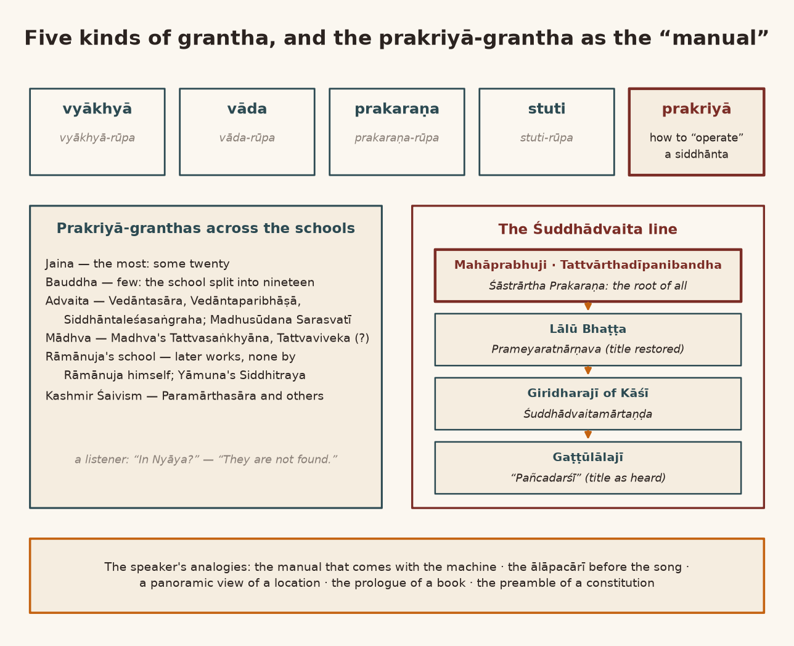
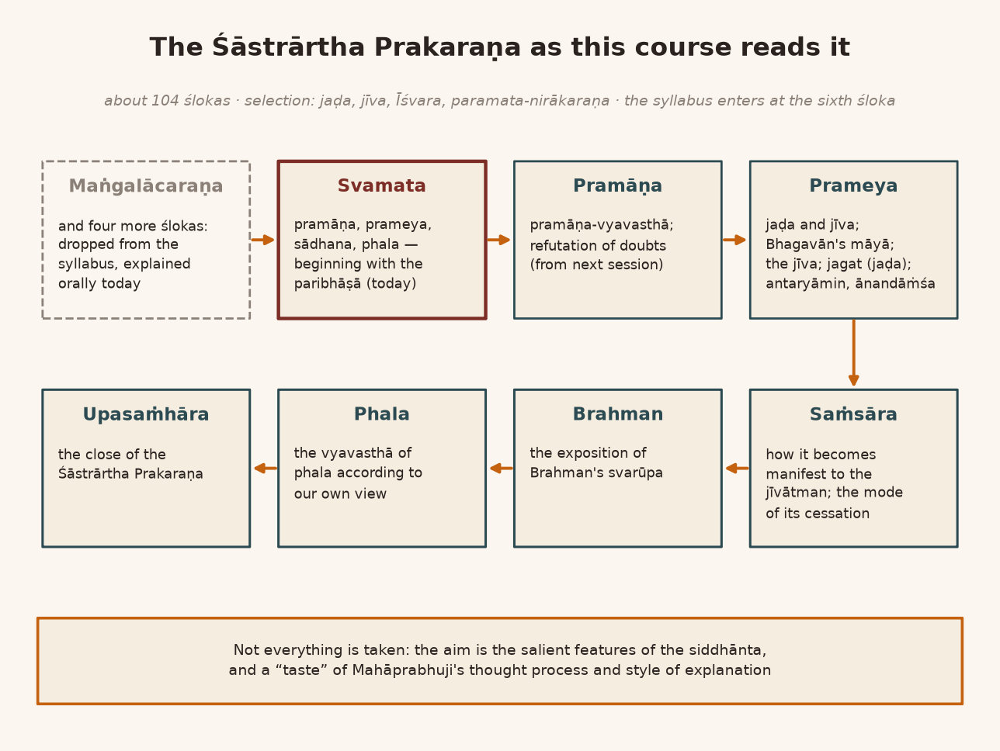
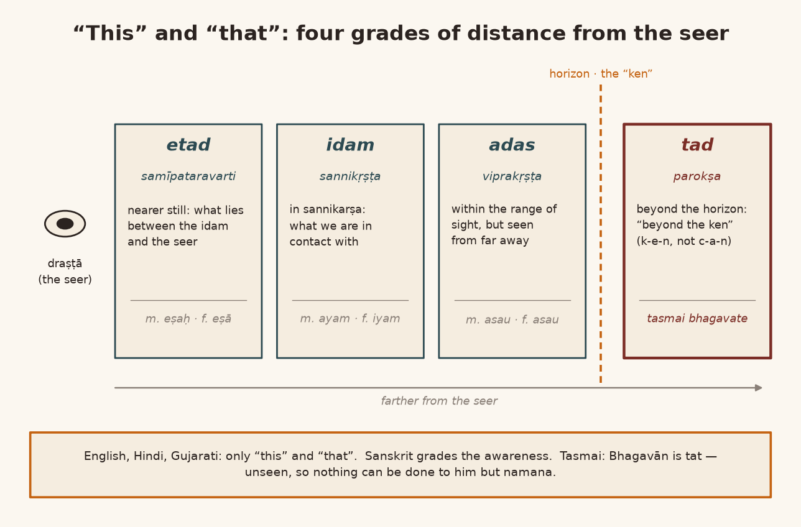
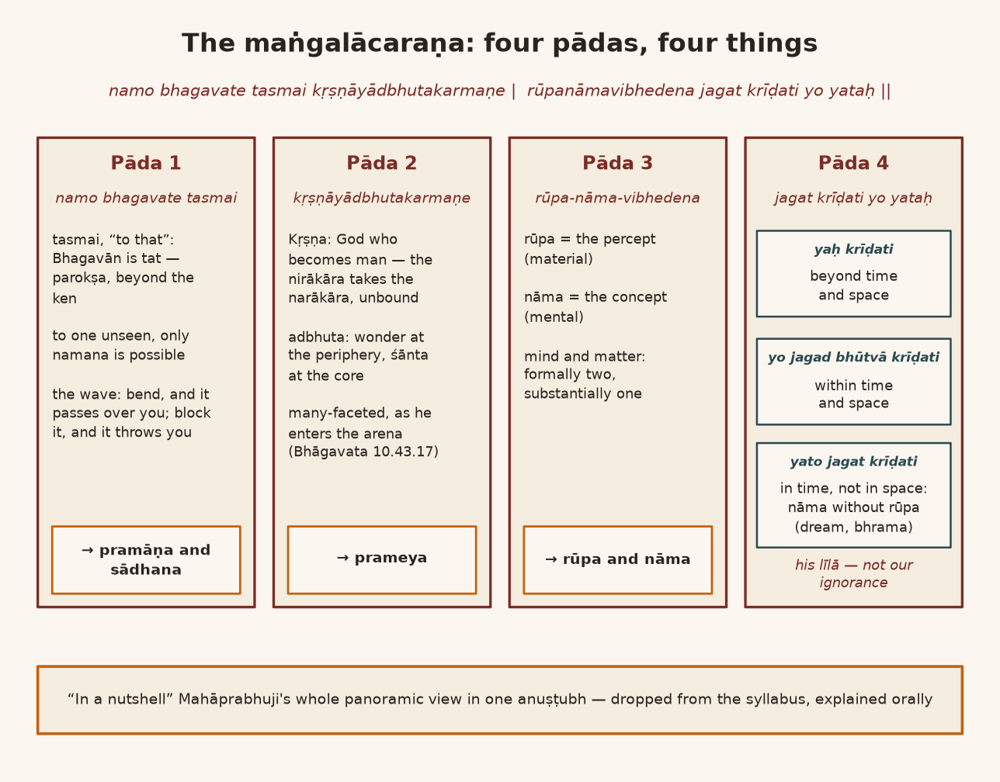
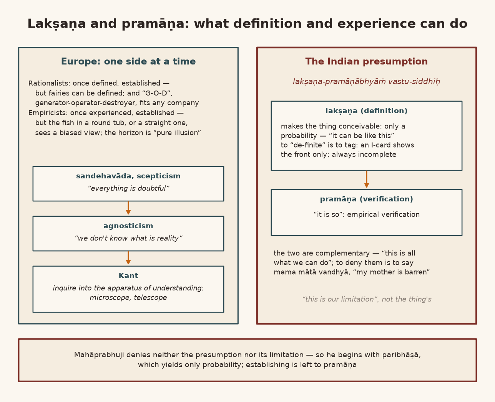
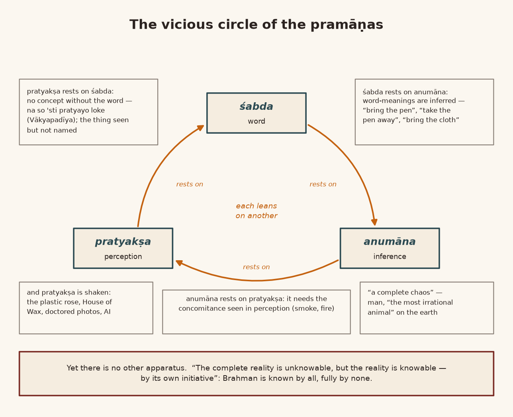
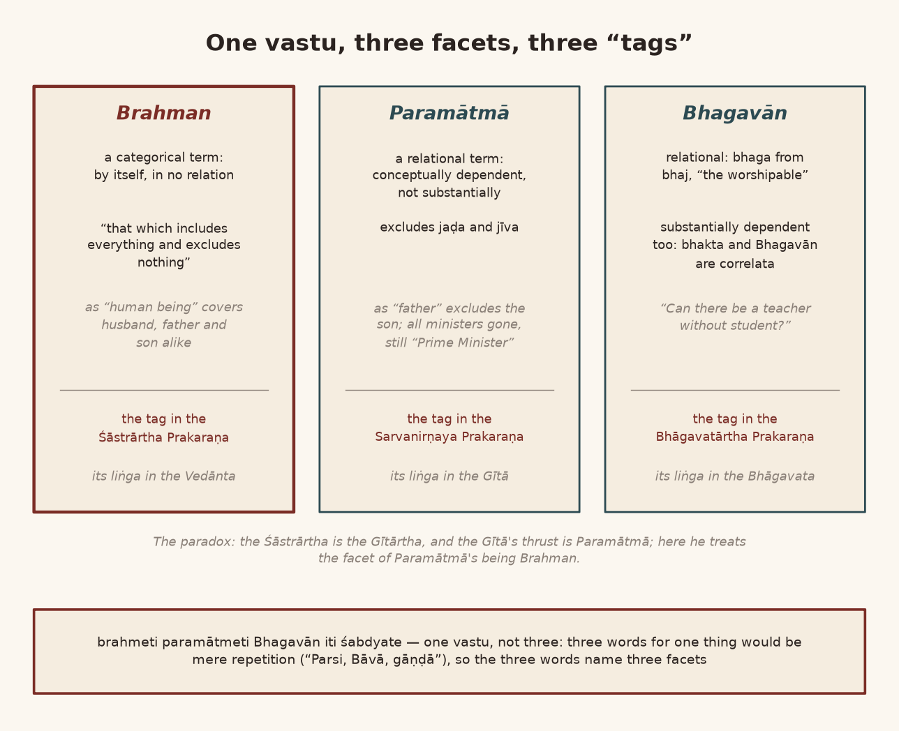
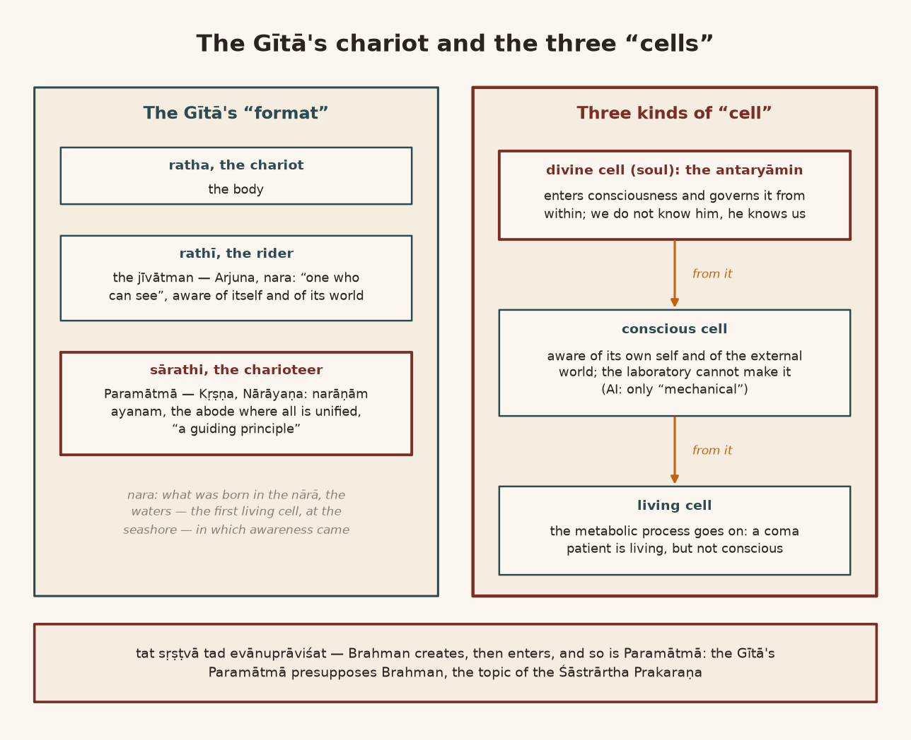

*English rendering of a spoken discourse on the Śāstrārtha Prakaraṇa of the Tattvārthadīpanibandha, translated from a Hindi ASR transcript. The speaker's conversational register, humour, digressions, code-switching, and student exchanges are preserved. Editorial flags: ‹ › conjectural restoration of a garbled reading; ‹?› uncertain reading; ‹…› inaudible or unrecoverable passage; ‹श्रवणाधारित› text given as heard, pending verification against a printed edition. Verses whose standard text is beyond doubt have been silently restored to the received editions.*

# 1. The Kinds of Granthas: The Prakriyā-grantha as Manual, Ālāpacārī and Preamble

**Speaker:** The different divisions of Mahāprabhuji's granthas, those I have already told you. Granthas are of several kinds: in the form of vyākhyā, in the form of vāda, in the form of prakaraṇa, in the form of stuti. Among them, one kind is prakriyā. What does prakriyā mean? Understand carefully. Today, whenever we order any thing, a "manual" comes along with it, doesn't it — how to "operate" this. In the same way, for any siddhānta at all, how to "operate" it: the "manual" for that is what is called a prakriyā-grantha.

And in our Bhārata, practically all the sampradāyas have prakriyā-granthas in good number, in a really good number. Of these, the most prakriyā-granthas are in the Jaina schools; and not one or ten — twenty prakriyā-granthas came about. In the Bauddha school there are rather few prakriyā-granthas. The reason is that Bauddha "philosophy" got divided into nineteen parts; if you write prakriyā-granthas for nineteen parts, there will be nineteen. All right —

**A listener:** In Nyāya?

**Speaker:** They are not found. In Śaṅkara's school, Śaṅkarācāryajī himself wrote ‹…› granthas to explain his own siddhānta. In the later period, after Śaṅkarācāryajī: the *Vedāntasāra*, the *Vedāntaparibhāṣā*, the *Siddhāntaleśasaṅgraha* ‹…›. And Madhusūdana Sarasvatī too wrote granthas; with them also there are many prakriyā-granthas. In the ‹Mādhva› school too there are prakriyā-granthas: the *Tattvasaṅkhyāna* and the *Tattva‹viveka›* written by Śrī Madhvācāryajī. In Rāmānuja's school prakriyā-granthas were written later, but Rāmānujācārya himself did not write any such prakriyā-grantha — *Trayantasāra*‹?›. Rāmānujācārya's guru — his grand-guru, Yāmunācārya: a prakriyā-grantha written by him, the *Siddhitraya*, is found. A very good grantha. In Kashmir "Śaivism" the *Paramārthasāra* and others are very good prakriyā-granthas.

Understand the matter carefully. In "classical music" there is the ālāpacārī, and after that the singing. That ālāpacārī is there to explain the prakriyā of the rāga. How good a singer is — the proof of it is measured by how his ālāpacārī is. Those who are not good singers, that is, not "experts", do little ālāpacārī and sing the song straight off, the way "film" songs are, "without" ālāpacārī. The one who brings out the true svarūpa of the rāga brings it out in the ālāpa style. What is this? In a way we can understand it as giving a "panoramic view" of some "location". That is the method of prakriyā ‹…›.

And if we look under this heading of prakriyā-grantha, the *Tattvārthadīpanibandha* that Mahāprabhuji wrote is a prakriyā-grantha. It is not merely a prakaraṇa-grantha. It is a grantha that explains the whole prakriyā of Mahāprabhuji's darśana. After this, after Mahāprabhuji, in its "continuation", the very first — the second — prakriyā-grantha that came was Lālū Bhaṭṭajī's ‹*Prameyaratnārṇava*›, that prakriyā-grantha. We have kept it in the "syllabus" as "reference": we have not kept it in the "subject", but we have kept it as "reference". Its Hindi — its "English translation" is also newly "available" now. After Lālū Bhaṭṭajī there was Giridharajī of Kāśī, whose *Śuddhādvaitamārtaṇḍa* is — that too is a ‹prakriyā›-grantha. After that, "lastly", a prakriyā-grantha was written by Gaṭṭūlālajī, by the name *Pañcadarśī*‹?›. Such is a prakriyā-grantha: to explain how to understand Mahāprabhuji's siddhānta, how to "operate" it. But the prakriyā-grantha that is the root of them all is Mahāprabhuji's Śāstrārtha.

About the Śāstrārtha Prakaraṇa it is said of Mahāprabhuji that he had drawn up beforehand the "programme" of all the granthas he would write: that I have to write so many granthas. And of all those granthas — some got written and some he could not write — the pratijñā of all of them we find here. So, what today is called the "prologue" of a book: this prakriyā-grantha does the work of that "prologue" for understanding Mahāprabhuji's siddhānta. As in a "constitution" there is a "preamble" — "exactly" of that kind is this prakriyā-grantha. What does "preamble" mean? By which "guiding principle" the "constitution" is to be made: the place where that is disclosed is called the "preamble". First of all we have to understand this in the Śāstrārtha Prakaraṇa.

{width=6.2in}

# 2. One Hundred and Four Ślokas: What the Course Takes and What It Drops

In this Śāstrārtha Prakaraṇa there are about one hundred and four ślokas. In our "course" we have not taken all of them, because then the "course" could not be completed. So we have made a "selection" in it, and under the "selection": jaḍa, jīva and Īśvara, and paramata-nirākaraṇa. ‹…› ślokas we took; a great many ślokas we "dropped", because one hundred and four could not be taken. This many ślokas we have "accepted" in the "course". And you will see that we are not starting from where the grantha starts; we are starting the grantha by dropping that. So from this "angle" we must proceed, understanding that not everything has come into it; very many things have been left out. But the "salient features" of Mahāprabhuji's siddhānta should come to us in full. And what is Mahāprabhuji's "style"? What is his "thought process", and what is his "style" of "explanation"? Of both we should get a little svāda, a "taste": it is from this "angle" that we have taken it. With this disclosure we are beginning the Śāstrārtha Prakaraṇa from today.

If you have the book, you can see it in the "index"; we have given its "index" too. First of all, according to ‹our own doctrine›, the exposition of the svarūpa of pramāṇa, ‹prameya,› sādhana and phala. After that we have taken the śloka on pramāṇa-vyavasthā; after that, after the śloka on pramāṇa-vyavasthā, we have taken — pramāṇa-vyavasthā‹?›. After that, in it, there is the refutation of ‹…› doubts. And after this, in prameya — once this pramāṇa "chapter", "sub-chapter", is complete — in prameya there is the exposition of the svarūpa of jaḍa and jīva; there is the exposition of Bhagavān's māyā; the exposition of the svarūpa of the jīva; the exposition of the svarūpa of ‹jagat›, of jaḍa. And the exposition of the antaryāmin as ‹ānandāṁśa›; the exposition of *cid-advaita*‹?›. And after their kinds‹?›, how saṁsāra becomes manifest to the jīvātman — that is there; and what the mode of the cessation of saṁsāra is ‹…› — that is told. And after the mode of cessation there is the exposition of the svarūpa of Brahman. And after the exposition of Brahman-hood, the vyavasthā of phala according to our view, and the upasaṁhāra of the Śāstrārtha Prakaraṇa. Such are its "chapters". It is divided into these many parts, and this is how we have to "study" it.

One very big thing to understand here: look, in the "syllabus" the grantha starts from the sixth śloka. That means five ślokas we have —

**A listener:** Dropped.

**Speaker:** Although we have "dropped" them, I would like to explain them to you "orally", because the maṅgalācaraṇa that Mahāprabhuji has made for the Śāstrārtha Prakaraṇa is "fantastic".

{width=6.2in}

# 3. Why a Maṅgalācaraṇa? Obstacles, a Lesson for the Son, and Remembering Bhagavān

Maṅgalācaraṇa, with us, means — there are three or four [aims] — the ācaraṇa of maṅgala. Under the ācaraṇa of maṅgala come all such things as setting out the subject to be expounded, setting out the purpose of the subject to be expounded, and setting out the style of exposition. The Naiyāyikas accept one more "purpose" for it: vighna-‹nivāraṇa›, the removal of obstacles. That is the sakāma use of maṅgalācaraṇa. And a third "purpose" of maṅgalācaraṇa remains: to teach the disciple. That is, if the father does namaskāra to his own father, then the son will do namaskāra to his father, won't he? If the father gives his own father a thrashing, then the son, seeing that, will also grasp the siddhānta, won't he — that one should give one's father a thrashing. When the strength comes, that is! So for this reason śiṣya-śikṣā, too, has been considered one of its purposes.

But all this is sopādhika. These are "justifications" of maṅgalācaraṇa that other people have given. With us, these two upādhis have not been given so much importance. Rather, maṅgala means bhagavat-smaraṇa. Because one siddhānta of ours is that one should do bhagavat-smaraṇa at the beginning, at the end and in the middle. By doing bhagavat-smaraṇa at the beginning, the end and the middle — by bhagavat-smaraṇa a work gets completed, and a work should be begun with bhagavat-smaraṇa. This is accepted on its own. Along with it, if an indication of the subject matter also comes in, that is good. Hence the maṅgalācaraṇa. Let us see a little of what Mahāprabhuji is saying:

> नमो भगवते तस्मै कृष्णायाद्भुतकर्मणे ।  
> रूपनामविभेदेन जगत्क्रीडति यो यतः ॥
>
> *namo bhagavate tasmai kṛṣṇāyādbhutakarmaṇe |*  
> *rūpanāmavibhedena jagat krīḍati yo yataḥ ||* (Tattvārthadīpanibandha, Śāstrārtha Prakaraṇa 1)
>
> [Namaskāra to that Bhagavān, to Kṛṣṇa of wondrous deeds, who through the distinction of rūpa and nāma plays as the world, and from whom the world plays.]

**A listener:** Just — first, this —

**Speaker:** An anuṣṭubh has four pādas, four parts, of eight syllables each: thirty-two syllables. But in these four, Mahāprabhuji has said four things. This we must understand particularly about the maṅgalācaraṇa.

# 4. "Namo Bhagavate Tasmai": Ghālib's Sher and the Four Grades of "That"

The first part is *namo bhagavate tasmai*, that is, my namaskāra to that Bhagavān. In this siddhānta — in this, I mean, in this "proposition". I am not calling it a siddhānta yet, I am calling it a "proposition", because a siddhānta is a siddhānta when it is siddha, established; right now it is a "proposition". Mahāprabhuji says: *bhagavati jīvair namanam eva kartavyaṁ nādhikaṁ śakyam iti* (Prakāśa on Śāstrārtha Prakaraṇa 1). If, taking our own "initiative", we want to do something with Bhagavān, want to "involve" ourselves in some kind of "interaction", we cannot do anything other than namana.

There is a very fine sher of ‹Ghālib's›:

> जान दी, दी हुई उसी की थी ।  
> हक़ तो यूँ है कि हक़ अदा न हुआ ॥
>
> *jān dī, dī huī usī kī thī |*  
> *haq to yūṁ hai ki haq adā na huā ||* (Mirzā Ghālib, ghazal *dard minnat-kaś-e-davā na huā*)
>
> [I gave my life — but it was his gift to begin with; the truth is, the debt was not paid.]

Give your life for him — and the life, did I earn it? He granted the life. So the truth is that the debt was not paid. That same thing Mahāprabhuji too wants to say: *namo bhagavate tasmai*.

Now understand one thing carefully: by saying *tasmai*, Bhagavān's parokṣatā has been shown — his being beyond perception has been shown. Write down a śloka — *idamas tu sannikṛṣṭe…* — I will write it here and show you. In English, in Hindi, in Gujarati there are only two, "this" and "that". In Sanskrit it is not so. In Sanskrit there is a little "delicacy" — of "awareness", of its "objective". So there are certain "gradations" of that "awareness", and those "gradations" are explained in this śloka:

> इदमस्तु सन्निकृष्टं समीपतरवर्ति चैतदो रूपम् ।  
> अदसस्तु विप्रकृष्टं तदिति परोक्षे विजानीयात् ॥
>
> *idamas tu sannikṛṣṭaṁ samīpataravarti caitado rūpam |*  
> *adasas tu viprakṛṣṭaṁ tad iti parokṣe vijānīyāt ||* (traditional grammarians' kārikā on the demonstratives)
>
> [Idam is for what is near; the form of etad for what is nearer still; adas for what is far; and know tad to be for what is beyond perception.]

*Idamas tu sannikṛṣṭe*: for what is in our sannikarṣa — with which we have "contact", nearness, sannikarṣa — the word *idam* is used in Sanskrit. The word *idam* is in the napuṁsakaliṅga, the "neuter gender"; in the "masculine" *idam* becomes *ayam*, and in the "feminine" it becomes *iyam*: *idam*, *ayam* and *iyam*. So that is *idam*. But *samīpataravarti*: what lies "between" the *idam* and the seer is not called *idam*; it is called *etat*. ‹…› This is *idam* ‹…› writing instrument; *etat* ‹…›. "Relatively", what is between the two is called *etat*. *Etat* is napuṁsakaliṅga; in the masculine it becomes ‹*eṣaḥ*›, and in the feminine *eṣā*. But what is within our range of seeing, yet is seen from far, from far away — *adasas tu viprakṛṣṭe*: what is far is called *adas*. In the masculine it becomes *asau*; in the feminine too it is *asau*. *Tad iti parokṣe vijānīyāt*: what is outside the range of seeing, "beyond the horizon", is called *tat* — what in English is called "that". In English there are only "this" and "that". But the "delicacy" of Sanskrit is such that these are three different kinds — there are three kinds, and "that" is one kind. "And" by saying *tasmai*, Mahāprabhuji is speaking of some parokṣa tattva that is "beyond the ken". "Ken", that is, k-e-n, not c-a-n. The "boundary" of "knowledge" is called the "ken". What is "beyond the ken" is called *tat*, "that": *tasmai bhagavate*.

To one who is not visible at all — what else can we do to him? All right: [to one who is seen] do anything — tie him up, catch hold of him, catch his feet, catch his hands, catch him by the throat, catch whatever you want to catch. But one who is not seen — what to do with him? He is not seen. But what is he? He is Bhagavān: possessed of aiśvarya and vīrya, yaśasvī, jñānavān. *Tasmai namaḥ* — *namo bhagavate tasmai*. This is the first thing that has come.

{width=6.2in}

# 5. The Wave at the Beach: Bowing as Pramāṇa and Sādhana

By this, Mahāprabhuji has given an "indication" of pramāṇa: bhāī, to know him and to attain him there is no sādhana other than namaskāra.

It is a very old story — "sixty". My brother and I used to come every Sunday to ‹…› [the ASR has "Vṛndāvana"; the story is set on a sea beach]. In those days there was not so much ‹crowd›‹?›, no hurry; very calm, very peaceful. So we were coming along, and a gentleman came from Delhi. He asked me, "Can I come too?" I said, "Why can't you come?" He too took off his clothes and so on, and in his shorts went down into the water like us. He had never bathed in the sea before. So as soon as a wave came, he wanted to stop it with his hands. The wave threw him down — threw him down and filled his mouth, his nose, everything with water. He stood up and asked me, "What fun is there in this?" I said, "None at all. A wave comes; it cannot be stopped with the hands; one has to bend. If you bend, it will go over you; and if you go to stop it with your hands, the wave throws you down, throws you down, throws you down."

*Tasmai ‹…› namaḥ* — *bhagavati jīvair namanam eva kartavyaṁ nādhikaṁ śakyam iti* — that is the siddhānta. What can we say? Coming in front of it, what remedy is there against it? Do you see it? If you do namana, the wave does not throw you down. If you bend before the wave, it does not throw you; you get to swim in the wave. And he wanted to stop it, putting out his hands like this, so the wave simply threw him down. He said he would go. I said, "Your going is the best thing, because you have no experience of how to bathe in the sea. Going is best."

But this pramāṇa Mahāprabhuji has told us. He has explained the svarūpa of pramāṇa and of sādhana. Mahāprabhuji has "indicated" that for attaining him and for knowing him, namana — bending — is the one siddhānta, because he is like a wave. In him there are waves of jñāna, of aiśvarya, of vīrya — of aiśvarya, of vīrya, of yaśas, of vairāgya, of jñāna — waves of all of them are coming, and it is a very fierce wave. Neither do we have that much aiśvarya, nor that much ‹vairāgya›; neither is aiśvarya in us, nor jñāna. That is a very fierce wave. What can we do in front of it?

**A listener:** No, no — quite right.

**Speaker:** So the sādhana for knowing and for ‹attaining› Mahāprabhu has told. How it is "indicated" in the maṅgalācaraṇa, I am telling you. Maṅgalācaraṇa is maṅgala: remembering a worshipped object is called maṅgala.

# 6. "Kṛṣṇāya Adbhutakarmaṇe": God Who Becomes Man, the Professor of Seven Lectures, and Every Rasa in the Arena

*Kṛṣṇāya adbhutakarmaṇe.* *Kṛṣṇāya* — Bhagavān has many forms, after all. All right, let me tell you a very amusing thing; you will understand. My elder girl is sitting in front of me. In her childhood I taught her all the "philosophy" — *parataḥ-prāmāṇya*, all the "philosophy" I got her ready in. She went to her school and began showing off in front of her "classmate". Her "classmate" was ‹a Jain›, [and she told her]: "You people don't believe in God." "No, it's not like that; we too believe in God — what do you know?" Now, she had been going along taking me as her pramāṇa — *bābā-vākyaṁ pramāṇam* — so she came and asked me, "Kākā, you said that the Jains don't believe in God, but my friend says, 'We do believe in God, what do you know?'" I said, "Bhāī, what she says is true. Their "concept" of God is a different one. Our God is God who becomes man; theirs is man who becomes God." ‹the speaker's characterization› So the "concept" changed, didn't it? It did not remain this "concept". So there are many "concepts" of God; one has to give a disclosure of which God, doesn't one? By saying *kṛṣṇāya*, ‹Mahāprabhuji› has disclosed that God — which God is ours. A God who has become God out of man is not ours; ours is man become out of God. The nirākāra has taken on the narākāra; he is not bound in the narākāra. *Adbhutakarmā*.

By *adbhutakarmaṇe* is meant his māhātmya. Understand the word *adbhuta* carefully. In the śṛṅgāra-śāstra, in the rasa-śāstra, many kinds of rasa have been described. And if we look from the "angle" of the maryādā of that rasa-śāstra, at the "core" of all the rasas there is śānta rasa, and at the "periphery" of all the rasas there is adbhutatā, wonder. That is, any "sentiment" that does not give you śānti at the "core" — "you cannot realise it". And any rasa, any "sentiment" — if in the end, at its "periphery", adbhutatā is not experienced by us, then ‹who will› pay attention to it? Because:

> क्षणे क्षणे यन्नवतामुपैति  
> तदेव रूपं रमणीयतायाः ॥
>
> *kṣaṇe kṣaṇe yan navatām upaiti*  
> *tad eva rūpaṁ ramaṇīyatāyāḥ ||* (Māgha, Śiśupālavadha 4.17cd)
>
> [What takes on newness at every moment — that alone is the form of loveliness.]

Until something new comes, it does not feel adbhuta. Today you saw something, today you heard something; tomorrow too you get to hear the same thing — you will keep a little patience; the day after too you get the same thing — you will keep a little patience; and the day after that too you get the same — your patience will break.

When I was studying for my "M.A.", we had a "professor". I have forgotten his name. If you took "notes" of one day's "lecture" of his, the same "topic" would run for seven "lectures". Take one day's "notes", and the same "topic" went on for seven lectures. So when one "topic" goes on — for how long? I would regularly be ‹late› in reaching, in attending the "class". The class had begun when I arrived, and he scolded me loudly: "Why you are always late?" By mistake it slipped out of my mouth: "Sir, not always, that only your class I am there."

**A listener:** Right.

**Speaker:** He had some trouble with his thoughts; they kept drifting. So he would speak, but he did not listen. So often the boys — our "classmates" — would bring a "transistor" with the "cricket commentary" and keep listening, putting on a very serious face like this, and he would not even know a "commentary" was going on; he would go on speaking. Everyone was bored with him, but what to do? You have to "attend" the "class", don't you, to show your "attendance". So he was not adbhutakarmā; poor fellow, he was a "simple"-karmā!

So ‹as to› *adbhutakarmā* — understand one thing carefully: if it becomes śānta right from the start, then the maryādā of rasa is finished. First of all a man wants some adbhutatā at "face value". Within that adbhutatā are all the rasas, but at the "core" there it remains śānta. Because if you do not get śānti, and you become "disturbed", "perturbed", then that rasa will not remain a rasa, and the "sentiment" will not remain a "sentiment".

So with us it is held that the Akṣara Brahman is śānta-rasātmaka and Kṛṣṇa is adbhuta-rasātmaka; between them all the rasas come in. Such are the forms of Kṛṣṇa:

> मल्लानामशनिर्नृणां नरवरः स्त्रीणां स्मरो मूर्तिमान्  
> गोपानां स्वजनोऽसतां क्षितिभुजां शास्ता स्वपित्रोः शिशुः ।  
> मृत्युर्भोजपतेर्विराडविदुषां तत्त्वं परं योगिनां  
> वृष्णीनां परदेवतेति विदितो रङ्गं गतः साग्रजः ॥
>
> *mallānām aśanir nṛṇāṁ naravaraḥ strīṇāṁ smaro mūrtimān*  
> *gopānāṁ svajano 'satāṁ kṣitibhujāṁ śāstā sva-pitroḥ śiśuḥ |*  
> *mṛtyur bhojapater virāḍ aviduṣāṁ tattvaṁ paraṁ yogināṁ*  
> *vṛṣṇīnāṁ para-devateti vidito raṅgaṁ gataḥ sāgrajaḥ ||* (Bhāgavata Purāṇa 10.43.17)
>
> [To the wrestlers a thunderbolt, to men the best of men, to women Love embodied, to the cowherds their own kin, to the wicked kings a chastiser, to his parents a child, to the lord of the Bhojas death, to the unknowing the cosmic form, to the yogīs the supreme reality, to the Vṛṣṇis the highest deity: so known, he entered the arena with his elder brother.]

For the wrestlers he was a wrestler‹?›; *nṛṇāṁ naravaraḥ* ‹…› — in the manner of all the rasas, every "sentiment" ‹…›; *gopānāṁ svajanaḥ* — for the gopa folk he was their own; *asatāṁ kṣitibhujāṁ śāstā* — for the ‹wicked› kings he was the chastiser, fearsome ‹…›; *sva-pitroḥ śiśuḥ* — for his own mother and father he was a child, that is, vātsalya; *mṛtyur bhojapateḥ* — for ‹Kaṁsa›, the lord of the Bhojas, he was death in person, and fearsome; *virāḍ aviduṣām* — for the jīvas who were ignorant he was the virāṭ; *tattvaṁ paraṁ yoginām* — and for those who were yogīs he was the tattva, the śānta rasa; *vṛṣṇīnāṁ para-devateti vidito raṅgaṁ gataḥ sāgrajaḥ*. In this way Bhagavān entered ‹Kaṁsa's› court [the ASR has "Kṛṣṇa's"], carrying so many "multifaceted" aspects. Now, for one avatāra to be so "multifaceted" — that is his being adbhutakarmā. That adbhutakarmā Kṛṣṇa we take as Bhagavān. So we accept him as parokṣa, and we accept him as aparokṣa too.

So this is the description of prameya. Look carefully — do you see the prameya? Our pramāṇa, we said, is namana. The prameya has come: Kṛṣṇa the adbhutakarmā.

# 7. "Rūpa-nāma-vibhedena Jagat Krīḍati Yo Yataḥ": Percept and Concept, and the Threefold Krīḍā

After this, the third thing that comes in it: *namo bhagavate tasmai kṛṣṇāyādbhutakarmaṇe, rūpa-nāma-vibhedena*. Rūpa and nāma: rūpa means ‹the "percept"› [the ASR has "Puruṣottamajī"]; nāma means the "concept". Rūpa is "material", and "perception"; the "concept" is "mental". Now, everywhere such a big "gap" has been assumed between "mind" and "matter" that for the "last" two thousand, two and a half thousand years people have been entangled in this very question, and they are entangled even now. And "science" too has not yet been able to "decide finally" whether "mind" and "matter" are one or two. But Mahāprabhuji tells us: *rūpa-nāma-vibheda* — that is, rūpa and nāma are two at "face value", but somewhere or other they are "substantially one": "formally" two, "substantially one". *Rūpa-nāma-vibhedena jagat krīḍati.*

*Yo yataḥ.* In this Mahāprabhuji is saying: *yo jagad bhūtvā krīḍati* — he who plays by becoming the world; *yato jagat krīḍati*; and *yaḥ krīḍati*. It is there three times. Look, understand carefully: *yaḥ krīḍati*. *Yaḥ krīḍati* is "beyond" "time" and "space". His krīḍā — one krīḍā is such, through the distinction of rūpa and nāma, as is "beyond the time and space"; one is "within the time and space". Is it? So one krīḍā of his is through the distinction of rūpa and nāma — rūpa-nāma meaning "percept" and "concept", rūpa and nāma. Some rūpa-nāmas of Brahman are such as are "beyond the time-space", "transcendental". Some of his rūpa-nāmas are such as are "within the time-space". And some rūpa-nāmas are such that they are not in "space" but are in "time": at some "particular time" that rūpa-nāma is there, but if you go to search for it in ‹space› you will find it nowhere. That is, there is a "corresponding" nāma, but there is no "corresponding" rūpa. When there is a nāma — some "concept" in our mind — and no "corresponding" "percept" is found, then we call it either bhrama or a dream. When we say dream or ‹bhrama›, ajñāna comes in; there is ajñāna in both. What is the ajñāna in a dream? Of sleep. What is the ajñāna in bhrama? Of "non-recognition": "because you could not recognise something, therefore there was any — there comes an illusion". And Mahāprabhuji is saying that because of our "egocentric position" it seems to us that this is due to our ‹ignorance›; it happens as his līlā.

"In a nutshell", Mahāprabhuji has said his whole thing. He has left nothing out. In the four pādas of a single śloka he has not left out one thing that, philosophically, ‹belongs to› Mahāprabhuji's "panoramic view". This — because at that time, when this "syllabus" was made, there was a bit of a rush, I said, "Why take this needlessly? Drop it. It is only the maṅgalācaraṇa." But "lately" it "struck" me that I should have taken it. So it is a "very significant" maṅgalācaraṇa, more than any other maṅgalācaraṇa, in which all the things ‹…›. It does not come in the "syllabus" as accepted, but I am telling it to you "orally". So that śloka we have "dropped", but I have "shared" it with you. After that there are four more ślokas. Then the sixth śloka begins — on pramāṇa.

{width=6.2in}

# 8. "Lakṣaṇa-pramāṇābhyāṁ Vastu-siddhiḥ": Do Fairies Exist, and Is God a "Generator, Operator, Destroyer"?

The name of this "chapter" — the "sub-chapter" — is, look: the exposition of the svarūpas of pramāṇa, prameya, sādhana and ‹phala› according to our own doctrine. Paribhāṣā. Paribhāṣā: with us, in "Indian philosophy", there has been one "presumption". Write it down: *lakṣaṇa-pramāṇābhyāṁ vastu-siddhiḥ*. Is a thing there or is it not there — how shall I establish it? For that there is a "presumption", a "hypothesis": a thing is established by giving its lakṣaṇa and its pramāṇa. "Because this is all what we can do to understand something. If we deny this, we are left with no other means to be sure whether something is there or something is not there." This is not the "limitation" of the thing; this is our "limitation".

Listen carefully. Is the thing there or not? Do not give its lakṣaṇa, do not give its pramāṇa — even then it is there. But if we are to accept the thing, our helplessness is this: if we do not give lakṣaṇa and pramāṇa, we do not come to know whether the thing is there or not. And within this, from lakṣaṇa a possibility is formed, and through pramāṇa its "verification" happens. "So there is a possibility, hypothetical possibility, and then there is an empirical verification." *Lakṣaṇa-pramāṇābhyāṁ vastu-siddhiḥ* — this is not Mahāprabhuji's; it is the "presumption" of the whole of "Indian philosophy".

In Europe it was not like this. Because in Europe, some who were "rationalists", when they had "defined" something, would say it was established. With us that has not been accepted just like that. Some who were "empiricists" said: if there was "experience", it is established. With us this was not accepted either, because even by "defining" — let me give an example. Do fairies exist in the world or not? ‹…› Do fairies exist or not? Well, we can certainly make a definition of fairies: some woman who is not of bone and flesh, but is a woman. The definition is done. And she is beautiful, and she allures you — so all that is a fairy. The definition is done. Does that establish the fairy? We tell children stories about fairies, and by hearing the stories belief awakens in the children; but by giving a lakṣaṇa the fairy is not established. So many who were ‹empiricists› thought this way: in just this way you have given a lakṣaṇa of God too.

**A listener:** Giving a lakṣaṇa means "defining".

**Speaker:** You have given a lakṣaṇa, so you think God will be established? How will he be established by making a lakṣaṇa? "What is God?" We say — it is a foolish thing, this, it is not true, but it is something to understand — many people say, many of our own boys say, that God means "Generator, Operator and Destroyer is God. G-O-D, God."

Many boys say this. God does not mean this at all; God is not some "short form" of "generator, operator, destroyer". And yet — the definition is done, isn't it? What is to be understood is this: whatever is "generator, operator, destroyer" — is that God? I can make some thing. Every "company" makes some product of its own, "operates" it too, and "destroys" it too. So has it become God by that? That is a foolish thing. By this lakṣaṇa Bhagavān is not established.

So all the "empiricists" used to say: "by defining something you do not prove it necessarily. You are making only possibility. Not even possibility — only probability. It is a probable because you have defined. Why probability is there? Because you can conceive it. So it is a conceivable phenomenon." What is not "conceivable" we cannot "define"; what is "inconceivable" we cannot "define". To "define" means that "you have a concept, some sort of concept, and that concept is a — because it is conceivable, so there is only probability. Not even possibility." The satyāpana, the verification, will not happen until then, will it? It will not happen through "definition".

# 9. Definition as "De-finite": The I-Card with a Tail, the Gosvāmī Cousin, and the Luggage Tag

What is the "definition" of "definition"? "De-finite": to confine something within a "finite" ‹"paraphrase"› in one's own mind — a "periphery" ‹…› — within that "periphery", when we make it "finite", the lakṣaṇa is made. To "de-finite". The "de" that is a "prefix" in English — understand this — marks a verb. Whenever you want to convert any "noun" into a verb, put "de" in front, and it is converted into a verb: to make something "finite" that is "infinite". Like "demars"‹?›. Got it? "De" means making it a verb. So something that may be "infinite" or "finite", we are making "finite" in our mind. So to "de-finite" is "definition": you have "de-finited" some thing in your mind.

That is, understand one thing. As when we make an "I-card", we "de-finite" a person. How much gets broken off! An "I-card" is always of the "face", of the "front side"; it is not of the "back side". So the back is left out, isn't it? At the back, who knows what all there may be — there may even be a tail! How can we say that there cannot be a tail? Have we checked? We have not seen it, have we? We have seen only the "front", in the "I-card". *To definition che koī vastu* [So "definition" is: some thing —] does not come fully into view; you, for your own ‹…›, [make it finite].

I had a "cousin". He joined "college". And because our "surname" is Gosvāmī, his "classmates" used to ask him, "What are you, you Gosvāmīs?" *O bicārā gabhrāī gayā ke kyāṁ ‹…›* [The poor fellow got flustered — ‹…›]. "Then are you something like pujārīs?" "No, no, not pujārīs." "Then what are you?" He said, "Dharmaguru." "What does dharmaguru mean — do you give speeches and so on?" "No, we don't give speeches either." "Then what on earth are you?" He became so "nervous" — how to explain, how to "define" Gosvāmī. So I said [to him], "We are Gosvāmīs." "Bhāī, what does Gosvāmī mean? That is exactly what I am asking." The poor fellow got "nervous". So what was not "de-finited" was this: what does Gosvāmī mean? Somehow he should have made it "finite" — then a "picture" comes into the mind. So that "classmate" of his came to our mandir one day, to see what you do, by which you are Gosvāmīs. "So are you sannyāsīs?" "No, no, we are all gṛhasthas." "Then why do you use 'Gosvāmī'?" The poor fellow got "confused" — the classmate too got "confused" — because the "concept" of Gosvāmī was not becoming "finite". If this "finite picture" of it had formed, he would have understood. So he came to our mandir for "verification": what do they actually do? Let me see, after all.

**A listener:** We say we have been given the "title".

**Speaker:** Arre bhāī, then it has become "finite", hasn't it? Then it is "finite".

**A listener:** Because they did a lot for the cows, didn't they.

**Speaker:** Then it has become "finite". So understand one thing: if you make it "finite", there will be a "definition", won't there? Otherwise a Gosvāmī has very many "functions": he eats, he drinks — none of that will be a "definition". He sleeps, he wakes. There are very many "functions". Make him "finite" in any one "function", and it becomes a "definition". "So definition is always incomplete, I think. It is never a complete description. It is never a complete description of a — of phenomenon." It is a kind of "tagging" on your part. As when we go by "plane", they put a "tagging" on your luggage: this luggage will go to Delhi, this to Ahmedabad, this to Jaipur, this to Hyderabad. That is "tagging". So however your mind "tags" something, that is "a definition" — "I am telling". It is always "incomplete"; it is not "complete".

# 10. The Goldfish Bowl and the Horizon: Doubt, Agnosticism, and Kant's Apparatus

Come now to "experience". "Experience" too is a very amusing matter. Suppose we have done the "verification" of some thing — will it be ‹proved› by that? There is a "joke" by a very great "scientist", Stephen Hawking. He says that people started keeping fish in a ‹round› tub, and the "NGOs" there said this is cruelty to the fish, because when it is kept in a round tub, the view the fish gets of the "outside", outside the tub, is round. So you are being cruel to the fish. He said: suppose it is not kept round but "straight" — then is that view true? That too is in some way a false view. Why is it false? Understand carefully. Well, the fish is not of the sky; the fish is of the earth, and the earth is round. Only as much is visible as lies within a three-mile radius ‹…›; the rest we too do not see. So our view, our own view of the earth — is it true, or is it "biased"? The earth we see within a ‹three-mile› radius — is that true or false? In "experience", the earth seen within a three-‹mile› radius — is that to be called true? "What we call a horizon, there is nothing like a horizon. It's only pure illusion." So "how to be sure" that "experience" is giving us reality itself? So lakṣaṇa went, and pramāṇa went too. Does it come to mind? Lakṣaṇa went, pramāṇa went: "definition" went, and "empirical verification" went too.

That is why in Europe there came a sandehavāda: "everything is doubtful". After that "scepticism" there came in Europe an "agnosticism". And "agnosticism" meant: "we don't know what is reality. Then what we know? Are we ignorant? If the philosopher says this, that we — I don't know anything — what the hell is philosophy doing with us?"

So on this, Immanuel Kant said ‹…› "agnosticism". Immanuel Kant said a very interesting thing. He explained this to us: we know only that thing for knowing which our "apparatus" of "understanding" has been made. "Beyond those apparatus" — as when you look through a "microscope", whatever "microscopic structure" there is, that you know; your knowledge of it is only that much. If you look at something through a "telescope", what is seen through the "telescope" is all you are knowing. There could be another ‹purview› too, couldn't there, which you are not knowing? So we know only that for knowing which our "apparatus" has been made. So instead of an "inquiry" into "truth", we should make an "inquiry" into our "apparatus", the "apparatus" of "understanding".

{width=6.2in}

# 11. Perception, Inference, Word: Bhartṛhari and the Plastic Rose

Look, understand carefully. I am not making a "digression" from the "topic". You must be feeling: where has he taken the matter, from where to where? I am not making a "digression". ‹Bhāratīya› darśana "interferes" here: what is our "apparatus"? ‹Pratyakṣa›, anumāna, śabda. The count can be large; it can go up to ten, twelve, thirteen too. Instead of ten, twelve, thirteen, if you "merge" one into another, "merge" one into another, then in brief they become three, become two, even become one.

What is the reason for that? Understand carefully. Like the Cārvāka ‹…›: he used to say that pratyakṣa alone is pramāṇa. The Bauddhas said no, pratyakṣa and anumāna are pramāṇas. What does the Cārvāka say? It is not that he does not speak of anumāna; but the Cārvāka says that anumāna is one "variety" within pratyakṣa itself. Because of what you are seeing — of seeing itself — one "variety" is "immediate perception" and one is "mediated perception". As when you see smoke, that is "immediate perception"; the inference of "fire" you have from the smoke is "mediated perception". But that is a "part" of "perception" itself; it is not anumāna. The Buddha Bhagavān said: no, it is not so. By tādātmya and tadutpatti — something is "identical" with something, or something is born from something — of that we have an anumāna; we cannot "merge" it into pratyakṣa. Pratyakṣa and anumāna are two pramāṇas.

Thirdly, people said: no, śabda too is a pramāṇa, because without "verbal information" you cannot make an anumāna. Because this was said, with us, by the vaiyākaraṇas. Write it down; it is a very good śloka:

> न सोऽस्ति प्रत्ययो लोके यः शब्दानुगमादृते ।
>
> *na so 'sti pratyayo loke yaḥ śabdānugamād ṛte |* (Bhartṛhari, Vākyapadīya 1.123ab; numbering varies by edition)
>
> [There is no cognition in the world that is without the accompaniment of the word.]

"There is no concept as such which is not verb[al]. Every concept is a verbalised. And what verbal information is? Nothing but it provides you the verbal concept. And on the basis of those verbal concepts you can infer, you can perceive, you can do so many things." For example: suppose some thing suddenly appears in front of you whose name you do not know, and someone asks you, "What is this?" What will you say? "I don't know." "Arre, you are looking at it, and how can you say you don't know?" It is visible, and how are you saying you don't know? Because there is no "verbal concept". So "this itself is a proof" that our knowledge — all our "concepts" — are verbal. So if we do not accept the verbal, our śabda, as pramāṇa, then anumāna will not work either, and pratyakṣa will not work either. *Na so 'sti pratyayo loke yaḥ śabdānugamād ṛte*: in which there is no anugama of śabda. And there can be no "concept" that is not "verbally supplied". From here śabda-pramāṇa also came in. ‹…›

Now, when śabda-pramāṇa came in, one more "issue" awoke in "Indian philosophy", and it awoke like this: if all three say one thing, you will attain "certainty" — whether that be "ad hoc" or "absolute". But if the three give "contradictory information", then what to do? Say we made a very beautiful rose out of plastic. It is "as good as" a "real" rose; it looks like a rose ‹…› — it is not a rose, it is plastic. "Perception" says it is a rose. And you "touched" it, and it says it is not a rose. You smelled it and found that it is not a rose. What to do? If you get to "touch" it, you will understand. If you do not get to touch it at all — "see the beauty, not to touch" — then how will you find out what it is?

# 12. The House of Wax, the Pope's Statue, and the Vicious Circle of the Pramāṇas

Many years ago, in the "fifties", a "movie" came out, *House of Wax*. What happens in a "House of Wax"? They make figures of wax. We have them too — in Bombay, and in Poona too; everywhere there is a "House of Wax". ‹…› In some "business" quarrel, the "partner" of that "House of Wax" sets it on fire. After the burning his hands are ruined, so he cannot make "wax statues". So he takes the corpses from ‹…› cremation ground, coats them with wax and stands them up. They are so "real". In it, when people go to see — among those standing there — they showed one very good thing: a man is standing, and someone goes up and examines him closely through an "eyeglass", and he says, "Bhāī, I am a living man, I am not a 'statue'."

**A listener:** I see!

**Speaker:** My "grandson" went to Norway‹?› or somewhere. He was telling me that there they have made a figure of the Pope, in the "House of Wax". He gave very amusing "information" about it. And there, the thing is, taking off one's clothes counts as a sin ‹the speaker's characterization›. So what do people — mischievous people — do there? They go, immediately take off their clothes and ‹click› a "photo" of themselves. They make such mischief — and it becomes "proof": standing beside the Pope with clothes off. The Pope has his hand like this, so he stands under his hand, and so it even looks like "friendship". In the Pope's siddhānta, is taking off clothes a sin or a virtue? They make such mischief, and "photography proof" is obtained as well.

Now, a "photograph" cannot be considered so much of a pramāṇa today. Now — well, nowadays everything has become "digitally possible"; there is no need even to go there. So in such a situation, is pratyakṣa a pramāṇa or not? We consider śabda "dependent": if there is "empirical verification" of śabda, then it is a pramāṇa. But pratyakṣa-pramāṇa itself has landed in one mess after another. And after "AI", pratyakṣa-pramāṇa has got into such a mess that pratyakṣa is perhaps going to become apramāṇa. A great many things have become pratyakṣa. "We are never sure: there is an object such that corresponding object is there or not."

And what is the "difficulty" of anumāna? Understand carefully. That of which you have seen the "concomitance" in pratyakṣa — of that alone there is anumāna. Two things that you have seen together: if you have seen them together, then because of the one there is anumāna of the other. So it is pratyakṣa on which it is "dependent". If pratyakṣa has gone wrong, how will anumāna be a pramāṇa? And if anumāna is not a pramāṇa, then śabda cannot be a pramāṇa either. Why? Because which word has which meaning — this you can never understand through pratyakṣa, ever in your "life". Whatever "vocabulary" you have "developed" has developed because of anumāna. Which anumāna? Say some "papa" said, "Bring the pen," and the wife brought the pen and gave it. The child infers; he does not know "bring the pen" — what "bring" means and what "pen" means. After that the papa says, "Take the pen away." The wife takes the pen away. So in "bring" and "take away", "pen" is common; so he infers that "pen" means this. After that he says, "All right, bring the cloth." So she brings the cloth. Then it "clicks" for him; the anumāna happens —

**A listener:** I see.

**Speaker:** — ‹…› it is "bring". So on "bring", she brought. Therefore "bring" means bringing, and "take away" means taking away. Whatever the "meaning" of a word is, it is grasped through anumāna alone.

Now see what a ‹vicious circle› it is. "Try to understand, please; try to understand seriously." Śabda depends on anumāna; anumāna depends on pratyakṣa; pratyakṣa depends again on śabda, because if there is no śabda you will not have pratyakṣa either. "So there is a complete chaos, complete chaos. We are checking on that: that man is a rational animal. So, man, you are the most irrational animal — most irrational animal ever produced on the earth." Completely in a ‹vicious circle›. Because of this, "‹Indian› philosophy said: yes, this ‹chaos› is there by human understanding vis-à-vis the reality, external reality. But we have no other apparatus besides perception, inference and verbal."

**A listener:** Yes.

**Speaker:** So in *lakṣaṇa-pramāṇābhyāṁ vastu-siddhiḥ*, we "verbalise" the "object", and through pramāṇa we make its "verification". If this is "denied", then Indian "philosophy" holds that it is *mama mātā vandhyā* — "my mother is barren". Arre bhāī, if she is your mother, how is she barren; and if she is barren, how is she your mother? Because of this helplessness of ours, we have here accepted lakṣaṇa and pramāṇa as pramāṇa, because the two are "complementary". "And this is all what we can do. Beyond that there is no possibility. We do not —" Mahāprabhuji says a very good thing. A very good thing Mahāprabhuji has said: that Brahman is such a "phenomenon" as everyone knows. Everyone knows it — from the "insect" to the deva. ‹…› But no one can know Brahman fully. Everyone knows, but fully — what? "The complete reality is unknowable, but the reality is knowable — by its own initiative." Because if reality is not giving you any "signal", then neither our "empirical understanding", nor our "inferential, logical understanding", nor "verbal understanding" — nothing can ‹react› to it. Therefore this is our "presumption": *lakṣaṇa-pramāṇābhyāṁ vastu-siddhiḥ*. Does it come to mind? If you want to ask anything, ask now, before we go ahead; and if your doubts are cleared, shall I go ahead?

**A student:** So for reality it is only śabda-pramāṇa that is accepted, isn't it — ‹…›

**Speaker:** ‹…› Does anyone want to ask something about this?

**A listener:** You can unmute and ask, if anyone wants to ask. No hand is raised as such.

**Speaker:** Acchā — *guros tu maunaṁ vyākhyānaṁ śiṣyās tu chinna-saṁśayāḥ* [the guru's silence is the exposition, and the disciples' doubts are cut away] (cf. the dhyāna-verse of the Dakṣiṇāmūrti Stotra).

**A student:** The questions will come later, as it sinks in; right now just a little —

**Speaker:** So we go ahead. Mahāprabhuji does not reject this "presumption" ‹…›, nor does he "deny" its "limitation". Mahāprabhuji's position I have told you: this "limitation" of our "understanding" he is not "denying", and this "presumption" he is not "denying" either. Therefore Mahāprabhuji first of all gives the paribhāṣā. What will giving the paribhāṣā do? A "probability" will come into your mind. It will not be established.

**A listener:** Yes.

**Speaker:** "Because you can conceive it" — what I want to talk about.

{width=6.2in}

# 13. Brahman, Paramātmā, Bhagavān: Three Tags, the Parsi Joke, and the Teacher Who Needs Students

That is why he gives the paribhāṣā. I have started the grantha from there. So, *paribhāṣām āha*:

> वेदान्ते च स्मृतौ ब्रह्मलिङ्गं भागवते तथा ।  
> ब्रह्मेति परमात्मेति भगवानिति शब्द्यते ।  
> त्रितये त्रितयं वाच्यं क्रमेणैव मयाऽत्र हि ॥
>
> *vedānte ca smṛtau brahmaliṅgaṁ bhāgavate tathā |*  
> *brahmeti paramātmeti bhagavān iti śabdyate |*  
> *tritaye tritayaṁ vācyaṁ krameṇaiva mayātra hi ||* (Tattvārthadīpanibandha, Śāstrārtha Prakaraṇa 6; the second line is Bhāgavata Purāṇa 1.2.11cd)
>
> [In the Vedānta, in the Smṛti, and likewise in the Bhāgavata, the sign (liṅga) is: it is called "Brahman", "Paramātmā", "Bhagavān". In the three, the three are to be spoken of by me here, in due order.]

This is not Mahāprabhuji's own śloka. "Not his own śloka" — meaning it is stolen — I am not saying that. But in the context in which it comes in the Bhāgavata — there it has come in some other context; Mahāprabhuji is "exploiting" it to explain his own "philosophy": "exploiting the" — not in the "negative sense", in a ‹positive› sense. And what is it saying? That the "concept" I am going to speak about here is "three-dimensional": Brahman, Paramātmā and Bhagavān. *Brahmeti paramātmeti bhagavān iti śabdyate.*

**A listener:** Jī.

**Speaker:** When the verb *śabdyate* comes, the verbal form of the Sanskrit language means "it is said". When "it is said" — "we were saying" — a hidden meaning comes out of it: that it is not really so. As when "people consider me a scholar, they say so" — what does that mean? That I am not a scholar. ‹…› Does Mahāprabhuji want to say this? No, he does not want to say this. What Mahāprabhuji wants to explain is this: if all three have one and the same meaning — Brahman, Paramātmā, Bhagavān — then what is the need of ‹three›?

The songs of my *Puṣṭi Asmitā*‹?› were sung by Soli Kapadia. He was telling me a "joke": *kāṁ to Pārsī kaho, kāṁ Bāvā kaho, kāṁ gāṇḍā kaho — Pārsī Bāvā gāṇḍā kaho* [Either say "Parsi", or say "Bāvā", or say "gāṇḍā" — and you say "Parsi Bāvā gāṇḍā"].

**A listener:** How so?

**Speaker:** In the "joke" it was that every Parsi is gāṇḍā, crazy. ‹So›: *kāṁ to Pārsī kaho, kāṁ Bāvā kaho, kāṁ gāṇḍā kaho — ibe vāt kem "repetition" karo cho?* [Why do you make a "repetition" of the same thing?] You have understood the point, haven't you? If it is one and the same tattva, then say "Brahman" and it is covered; say "Paramātmā" and it is covered; say "Bhagavān" and it is covered. What was the need of making three words? If three words are being made, then there are some three ‹facets› of it. But the vastu is one. Its ‹facets› are three; the vastu is one. So three ‹facets› of one and the same meaning of one word were being spoken of with three words: *brahmeti paramātmeti bhagavān iti śabdyate*.

And Mahāprabhuji wants to say this according to paribhāṣā — not according to "philosophy". I have already told you that paribhāṣā is "tagging". In "tagging" there is no disclosure of all the luggage. How much is "tagging"? That, bhāī, it is going from Mumbai to Delhi, or going to Madras, or going to Calcutta, or going to Ahmedabad — just "tagging". Such "tagging" Mahāprabhuji is doing: *tritaye tritayaṁ vācyam* — in the Śāstrārtha Prakaraṇa I will call it Brahman, in the Sarvanirṇaya Prakaraṇa I will call it Paramātmā, and in the Bhāgavatārtha Prakaraṇa ‹Bhagavān›. What I am calling Brahman in the Śāstrārtha Prakaraṇa, that very thing I shall call Paramātmā in the Sarvanirṇaya Prakaraṇa; what I mean to call Paramātmā in the Sarvanirṇaya Prakaraṇa, that very thing I shall call Bhagavān in the Bhāgavatārtha Prakaraṇa.

What is the difference? Just from here you have to think that Brahman is a "categorical term". What does "categorical term" mean? As when we say, "This is a human being." A human being is not a human being in some "relation"; a human being is a human being "by itself". And when we call someone a father — a father is the father of some son, so that is in "terms" of a "relation". Likewise, when we say Brahman, Brahman means "that which includes everything and that which excludes nothing". That is Brahman: that in which everything is "included" and nothing is "excluded" — that is Brahman. But when we say Paramātmā, the jīvātman is "excluded", the jaḍātman is "excluded". ‹Jaḍa is excluded.› By saying Paramātmā, that does not come in. So by calling him Paramātmā, jaḍa and jīva get "excluded". "That's true." But Paramātmā and Brahman are not two; they are one. As when we called some one man a human being, everything came into it; and when we said father, the son got "excluded" — what is not the son's "character". As for the father, there will be the son's "character"‹?›; in the husband, the wife got "excluded" — the wife will not come into it. When we said human being: the husband too is a human being, the father too is a human being, the son too is a human being — all are human beings. Likewise, on saying Paramātmā, the jīvātman and jaḍa get "excluded". "Clear"?

When we say Bhagavān — how is Bhagavān? Understand one thing about Paramātmā first. Paramātmā is not "dependent" "substantially"; ‹it is› "conceptually dependent", because "Paramātmā cannot be understood without knowing the ātmās": in "relation" to which ātman is he Paramātmā? Like the "Prime Minister": in "relation" to which "minister" is he "Prime Minister"? Now suppose all the "ministers" go. In the "Emergency" all the "ministers" went, but Indira Gandhi did remain "Prime Minister", didn't she?

**A listener:** I see — "substantially".

**Speaker:** "Substantially" he is not "dependent"; "conceptually" he is "dependent". But when we say Bhagavān — understand the beauty of this — he becomes "substantially" "dependent" too. Because to say Bhagavān means — the word ‹bhaga› is formed from the root *bhaj*: what is resorted to in bhajana, the "worshipable". So the "worshipable" is "dependent" on something, isn't it: if there is some "worshipper", there will be a "worshipable". If there is no "worshipper" — or there is a "worshipper" and he does not "worship" — then how will he become Bhagavān? Because what is "worshipable" is "dependent" on the "worshipper". So Bhagavān is "dependent" on the bhakta, and the bhakta is "dependent" on Bhagavān, because if there is no Bhagavān, where will a bhakta come from?

**A student:** Those are the six guṇas —

**Speaker:** So if there is no Bhagavān, how will there be a bhakta; and if there is no bhakta, how will there be Bhagavān? So the root *bhaj*, on this side, makes him Bhagavān, and on that side makes a person a bhakta. That is "dependent" on that kriyā. Paramātmā is not dependent on a kriyā. The "exact" example of this is the "teacher". "Can there be a teacher without student?"

**A listener:** "No."

**Speaker:** "Can there be a ‹…› knowledgeable person?" Whether anyone considers him a jñānī or not, considers him ignorant — what difference can that make? Many people consider me a fool — what difference does it make? But "I cannot be teacher unless there are some students". So the one who comes to be because of the prakriyā of "teaching" is called a "teacher". The one who is the "object" of "teaching" is the "student" — because of "study": he is "studying", therefore he is a "student". If he does not "study", how will he be a "student"? "So the student and teacher are correlata." In the same way bhakta and Bhagavān are ‹correlata›.

**A student:** Because of these six guṇas, which "category" is it? The six guṇas — aiśvarya, vīrya, yaśas —

**Speaker:** Yes, that is exactly why he is worthy of bhajana, isn't it? Why are we doing bhajana? Because we are doing bhajana of aiśvarya, vīrya, yaśas, śrī, jñāna and vairāgya, which we do not have: "we lack it" —

**A student:** Because —

**Speaker:** "Because we lack the knowledge, because we lack the knowledge, therefore we seek some teacher who provides us the knowledge, and therefore he is a teacher."

**A student:** No, but because of these, ‹…› became separate ‹…›.

**Speaker:** Yes — so that is coming about because of us, isn't it?

**A student:** *Relationship-cāc āhe nā, relation* [It is a matter of the relationship itself, isn't it — relation].

**Speaker:** Yes, relation. Aiśvarya, yaśas, jñāna and vairāgya he can have by himself, because of being Paramātmā. But Bhagavān he will not be by himself, "unless" —

**A student:** No.

**Speaker:** — not. So Mahāprabhuji has given the paribhāṣā of his "text": in this "text" of mine, the "topic" I am going to "deal" with is Brahman, Paramātmā and Bhagavān.

{width=6.2in}

# 14. Śāstrārtha as Gītārtha: The Chariot, Nara and Nārāyaṇa, and the Cell That Knows Itself

Along with this, there is one more "paradox" here. It is necessary to pay attention to it too. Mahāprabhuji is saying: *śāstrārtho gītārthaḥ*. This Śāstrārtha Prakaraṇa that I have written is the "condensed" form of the siddhānta of the Gītā. The Bhāgavatārtha that he has written is the "condensed" form of the Bhāgavata. In the Sarvanirṇaya all the śāstras have come in. So on this side is the Gītā, on that side the Bhāgavata, and between them all the śāstras. In a way, in this "club" — this two-"clubbing system": on this side the Gītā, on that side ‹the Bhāgavata›; between them all the śāstras have come in. That is, the "validity" of all the śāstras comes in between these two. If the śāstras go against ‹these two› —

**A listener:** — in accepting the Śāstrārtha —

**Speaker:** In the Sarvanirṇaya Mahāprabhuji has given his "opinion" about all the śāstras. Just here a slightly "paradoxical situation" is "created". And what is it? That if the Śāstrārtha is the Gītārtha — then about the Gītā it is said that the main ‹"thrust"› of the Gītā is not on Bhagavān: it is on Paramātmā. So Paramātmā should have been here —

**A listener:** Yes.

**Speaker:** — how did Brahman come here? That is exactly why I explained it to you in detail: that one ‹facet› of Paramātmā is Brahman too, one facet of Brahman is Paramātmā too, and the third facet of Brahman-Paramātmā is being Bhagavān. So it is *śabdyate*. The vastu is only one; the vastu is not three. There is no Paramātmā apart from Brahman, no Bhagavān apart from Paramātmā; the vastu is one. But by these three words, three facets of it are being "dealt" with. So here he is "dealing" with the facet of Paramātmā's being Brahman; in the Sarvanirṇaya he will "deal" with the facet of Brahman's being Paramātmā; and the facet of Brahman and Paramātmā being Bhagavān he will "deal" with in the Bhāgavatārtha. This is the disclosure of it. It is a very "technical" disclosure; otherwise it does not come about without "confusion".

Because if the Śāstrārtha is the Gītārtha — all right, now you will have the question: why is Paramātmā pradhāna in the Gītā? So understand ‹one› clear thing. This body has been taken as the ‹chariot› [the ASR has "deha"], this ātman, the jīvātman, as the rathī, and Paramātmā as the sārathi. That is the Gītā's "format". Because Arjuna is nara, and Kṛṣṇa is Nārāyaṇa. And Nārāyaṇa — understand its definition carefully: *narāṇām ayanaṁ nārāyaṇaḥ*. Today we take nara to mean "male".

**A listener:** Yes.

**Speaker:** In the Sanskrit language nara does not mean "male". "A phenomenon who has an awareness is called —", "one who can see" ‹…› with the cakṣu: one who can see is called nara.

So, there was a very great "professor" of "chemistry". I have a very good book of his. He has explained that making a "living cell" is a game for our left hand; whenever you like, we can make a "living cell" in the "laboratory" and hand it over. What is our "problem" so far? We can make a "living cell", but "a cell which is aware of its own self, as well as aware of the external world" — that cell we still cannot make. Why can it not be made? The reason is this: these "attributes" developed in the cell, in the "living cell", over crores of years. Where will we bring that many crores of years into the "laboratory"? Therefore we cannot make a cell that sees; we can make a "living cell". "What is the difference between living ‹cell› and the conscious ‹cell›?" I am not saying "conscious" in ‹that› sense — "consciousness" — I am saying it in this sense, in the sense of "awareness": "the cell which is aware of its own self, as aware of the external world". To make that is a very difficult thing. The cell we cannot make. "AI" we did make, didn't we — "which is aware of its own self as well as aware of external world". The "mechanical" one gets made, but making the cell — still not, because it is a whole line of "development" over crores of years; it cannot be made. So with us exactly this is said: *‹āpo› nārā iti proktāḥ* ‹…› (cf. Manusmṛti 1.10). "Science" too says this: that the first "living cell" was born in water, on the seashore. And what was born in the nārā is nara. When it was born in the nārā, it was nara: that is, this "awareness" came into it. A stone, for instance, has no "awareness" that you are there. But in the "living cell" this "awareness" came: that I am, and that this "surrounding world" also is. The ayana of that nara, its "abode", where everything is "unified" — that is called Nārāyaṇa. "That is a guiding principle." So the "guiding principle" is Kṛṣṇa. He is Paramātmā. Arjuna is nara: nara and Nārāyaṇa. And the chariot is the "body". This is the "symbol" there.

So is he talking about that "aspect", or is he talking about Brahman? Mahāprabhuji says: no, here I am talking about Brahman. If it is about Brahman, then where did the Gītā go? Understand: the svarūpa of Paramātmā that is in the Gītā — if there were no Brahman, how would Paramātmā come about? Because understand carefully how the Upaniṣad describes Brahman: *tat sṛṣṭvā tad evānuprāviśat* (Taittirīya Upaniṣad 2.6.1). Brahman created the world out of itself. Having created it, it entered into all the "specimens" of the world. When it entered, then it became Paramātmā. As "consciousness" enters the "cell", the "material cell", and it becomes a "living cell" — it became a "conscious cell": what was a "living cell" became a "conscious cell". The one who enters that cell, that "consciousness", making it a body — that is Paramātmā.

Therefore in the description of Brahman one very beautiful description comes:

> य आत्मनि तिष्ठन्नात्मानमन्तरो ‹यमयति› यस्यात्मा शरीरं यमात्मा न वेद एष त आत्मान्तर्याम्यमृतः ॥
>
> *ya ātmani tiṣṭhann ātmānam antaro ‹yamayati› yasyātmā śarīraṁ yam ātmā na veda eṣa ta ātmāntaryāmy amṛtaḥ ||* ‹श्रवणाधारित› (cf. Bṛhadāraṇyaka Upaniṣad 3.7, Antaryāmi-brāhmaṇa, Mādhyandina recension)
>
> [He who, dwelling in the self, controls the self from within, whose body the self is, whom the self does not know — he is your self, the antaryāmin, the immortal.]

He who enters our "consciousness" and "governs" our "consciousness" "from within" — him we call the antaryāmin: whom we do not know, but who knows us. *Eṣa ta ātmāntaryāmī*: he is the "soul" of our "core". This jīva-"soul" is the "conscious soul", and that is the "divine soul". That "divine soul" is the "soul" of the "core". From it a "conscious cell"; from the "conscious cell" a "material soul" is coming — that is the "living soul". "Divine cell", "conscious cell" and "living cell": there are three kinds of cell. The one in which the "metabolic process" goes on is the "living cell". Why do we not take the "metabolic", the "functioning", one to be "conscious"? Look at any person, bhāī, who has gone into a "coma". He is "living", isn't he? The "metabolism" ‹…› is working in him, but there is no "consciousness"; he has become "unconscious". "The metabolic cell, conscious cell and divine cell": this is *brahmeti paramātmeti bhagavān iti śabdyate, tritaye tritayaṁ vācyaṁ krameṇaiva mayā*. This is the paribhāṣā Mahāprabhuji has made. What time is it? ‹…› *mayātra hi*.

**A listener:** *Asmin śāstre paribhāṣām uktvā…*

**Speaker:** *…pramāṇam.* Now he will talk about pramāṇa. He has given the paribhāṣā, he has given the "definition", so that a "probability" arises in us: that, well, it can be like this too. That it *is* — this is not yet established. "It can be like this too": that is lakṣaṇa. Whenever we "define" something, only this "probability" comes: that it can be like this too. That it is so — this will come from pramāṇa, which is the "second half".

**A student:** So this — the Bhāgavata's "definition", utpatti, sthiti and laya — that is the "definition" of Brahman, isn't it?

**Speaker:** No, no, that comes later — pramāṇa — come further along, further along.

**A student:** Further along.

**Speaker:** *Asmin śāstre paribhāṣām uktvā pramāṇam āha*: pramāṇa we shall take in the "next class session". Now, if anyone has a question, you can ask.

{width=6.2in}

# 15. Questions: Hair and Nails, the Two Birds, and the Needle That Does Not Hurt Him

**A student:** No, so this "definition" too — I am saying it like this —

**A listener:** So — there are some questions.

**A student:** Yes-ji. Daṇḍavat praṇām. This Paramātmā and the samaṣṭi-antaryāmin — are they to be counted as one, or as separate?

**Speaker:** One.

**A student:** Jī, jī. And —

**Speaker:** Say Paramātmā, say samaṣṭi-antaryāmin, say Nārāyaṇa — all are one and the same "phenomenon". Say brahmāṇḍa-mūrti, say virāṭ — these are all ‹synonyms›‹?›. These are all that aspect of Brahman in which Brahman, the "creator", has "penetrated" into its "creation". Where the "creator" "penetrates" into its "creation", that we call antaryāmin, we call Paramātmā, we call Nārāyaṇa, we call virāṭ.

**A student:** Daṇḍavat, jī. You said that in relation to Paramātmā, jaḍa and jīva are "excluded". So how he is "excluded" in relation to the jīva — that I did not understand.

**Speaker:** Because Paramātmā is not jaḍa. Let me give you an example. The Upaniṣad has given a very beautiful example of this. The Upaniṣad says: as from a puruṣa, from a "living creature", hair and nails grow, in the same way jaḍa is born from Paramātmā. If the hair is cut, are we cut? If the ‹nail›‹?› is cut, are we cut? There is no "awareness" there.

> यथा सतः पुरुषात्केशलोमानि  
> तथाक्षरात्सम्भवतीह विश्वम् ॥
>
> *yathā sataḥ puruṣāt keśalomāni*  
> *tathākṣarāt sambhavatīha viśvam ||* (Muṇḍaka Upaniṣad 1.1.7cd)
>
> [As hair and body-hair grow from a living person, so from the Imperishable the universe comes forth here.]

That is the Upaniṣad's lakṣaṇa of how jaḍa, jaḍa things, are born: as hair and nails grow in us. Those who go to the "office" have to "shave" every single day. All women used to keep long, long hair before; now it has become the ‹bob-cut›.

**A student:** All right.

**Speaker:** Nobody gets cut by a ‹bob-cut›! Cutting and trimming it makes no difference. In the same way jaḍa makes no difference. Jaḍa is perishable. With the ending of jaḍa, Paramātmā does not end — although jaḍa is born from Paramātmā. Does it come to mind?

**A student:** Jī — I was asking in the "context" of the jīva.

**Speaker:** First you asked in the "context" of jaḍa; now you are changing it.

**A student:** No — you said both, didn't you; but I [meant] in the "context" of both he is "excluded". Jī, jī, so I —

**Speaker:** In the "context" of both he is "excluded". The jīva — the jīva, I told you, didn't I: the jīva is imperishable; *nirvīrya*, *niryaśa*; he is ajñānī; he is anurāgī.

**A student:** Yes.

**Speaker:** The Upaniṣad explains this very well:

> द्वा सुपर्णा सयुजा सखाया समानं वृक्षं परिषस्वजाते ।  
> तयोरन्यः पिप्पलं स्वाद्वत्त्यनश्नन्नन्यो अभिचाकशीति ॥
>
> *dvā suparṇā sayujā sakhāyā samānaṁ vṛkṣaṁ pariṣasvajāte |*  
> *tayor anyaḥ pippalaṁ svādv atty anaśnann anyo abhicākaśīti ||* (Muṇḍaka Upaniṣad 3.1.1; Śvetāśvatara Upaniṣad 4.6; cf. Ṛgveda 1.164.20)
>
> [Two birds, yoked companions and friends, embrace the same tree; one of them eats the sweet pippala, the other, not eating, looks on.]

This body of ours is a tree in which two birds are sitting. One bird is eating the fruit that grows on this tree. The second bird is such that it is not eating; it is only watching what the eater is eating. *Anaśnann anyo abhicākaśīti.* That is Paramātmā. In the body-tree two birds are sitting. One — the fruits growing on the tree, that is, the fruits of our karma — we are undergoing them in the form of pleasure and pain: the good fruit of good karma, the bad fruit of bad karma, we are undergoing. He is sitting on our very tree. But why is he not undergoing the fruit? Because he is not eating the fruit. He is not undergoing that fruit. He is only watching how [the other] eats.

So there the Upaniṣad said only this much; in the Gītā, Bhagavān has said it more "elaborately". If you like, write down the śloka:

> उपद्रष्टानुमन्ता च भर्ता भोक्ता महेश्वरः ।  
> परमात्मेति चाप्युक्तो देहेऽस्मिन्पुरुषः परः ॥
>
> *upadraṣṭānumantā ca bhartā bhoktā maheśvaraḥ |*  
> *paramātmeti cāpy ukto dehe 'smin puruṣaḥ paraḥ ||* (Bhagavadgītā 13.22)
>
> [The overseer and permitter, the sustainer, the enjoyer, the great Lord — he is also called Paramātmā, the supreme person in this body.]

*Upadraṣṭā*: draṣṭā means the one who sees the seen; and the one who sees the draṣṭā is the upadraṣṭā.

**A listener:** Hmm.

**Speaker:** Let me tell you. Right now I am looking at Mahāprabhuji in the picture. Do you come to know or not that I am looking at Mahāprabhuji? Now I am looking like this — do you come to know or not that I am not looking at Mahāprabhuji? You became the upadraṣṭā; I became the draṣṭā. Upadraṣṭā. ‹*Anumantā*›: he does not object. Towards what you are seeing — whether anger comes to you, or love, or indifference — whatever comes, he goes on giving the "NOC". ‹*Anubandha-catuṣṭaya*›‹?›. *‹Upadraṣṭānumantā ca› bhartā*: he is doing your bharaṇa, "maintaining" you. And *bhoktā*: he is enjoying your seeing. He is not enjoying seeing the object; he is enjoying what the seer is seeing. *Upadraṣṭānumantā ca bhartā bhoktā maheśvaraḥ*: he is Maheśvara. His aiśvarya is great; your aiśvarya is only this much, that you can see along with the seen ‹…›. You can "tackle" the seen; he is "tackling" you — he is Maheśvara. Thus *paramātmeti cāpy ukto dehe 'smin puruṣaḥ paraḥ*: Paramātmā sits in our body in this way, such that he —

In the *dvā suparṇā sayujā sakhāyā* only this much was said, that he is only watching. In that process of watching, all these things are included.

**A student:** Exactly.

**Speaker:** In the Gītā Bhagavān has ‹elaborated› the subject [the ASR has "Puruṣottamajī"].

**A student:** Right.

**Speaker:** *Upadraṣṭānumantā ca bhartā bhoktā maheśvaraḥ, paramātmeti cāpy ukto dehe 'smin puruṣaḥ paraḥ.* So this is the "function" of Paramātmā.

**A student:** So this antar— that is —

**Speaker:** The antaryāmin — that very one. Did the point come across?

**A student:** Jī, jī.

**Speaker:** He is not eating the fruit; you are eating the fruit. If even a needle pricks, we feel pain — do we or don't we? He feels no pain from the needle's pricking. Because the needle is pricking you — why is it not pricking him?

**A student:** All right.

**Speaker:** Why does it not prick him? Because the needle too he has become, the pricking too he has become, and you too he has become. There is an idiom like this: if someone else tickles us, we feel ticklish; if we tickle ourselves, no laughter comes. Why does no laughter come? Because the hand is mine and the armpit is mine too — what is there to laugh about in that? If somebody does it like this —

**A student:** — if another does it —

**Speaker:** — if another does it, you feel ticklish, don't you? For Paramātmā, everything is himself. So the ‹needle›‹?› too is he, the ‹jīva›‹?› too is he, the tickling too is he; so no laughter comes, and no pain comes either. When the needle pricks he feels no pain, because he is pricking only himself with the needle; he is not pricking another at all. That is the point. Anything else?

# 16. Tejas-bhāī's Question: Where Is Time Born?

**Tejas-bhāī:** Daṇḍavat praṇām. Jai Jai, Tejas speaking. Jai Jai. I wanted to understand what you explained — *yo jagat*, *yato jagat krīḍati* — and the third one I didn't understand, I mean. One, *yo jagat*, "after time and space"‹?›.

**Speaker:** ‹…› *Yaḥ* ‹…› — the one that is Paramātmā‹?› — because time and space are playing within him ‹…›. Understand one thing carefully. Because before both "philosophy" and "science" the biggest problem is this: that everything happens in "time". Because what is born, what abides and what ends — that is "time". But is "time" born or is it not? People are "confused" about this. Is "time" born or not? Some people say there is no "time" at all. Some "scientists" today are saying there is no "time", there is only "motion". Arre bhāī, "motion" too will be born only in "time", won't it? So is "time" born or not? So if it is born, where is "time" being born? In "time"? Then it is ātmāśraya. In something else? Then where was that born — in "time"? "Outside the time"? Then it is anyonyāśraya. This is a very, very "problematic situation" about "time": "whether time is temporal or non-temporal".

The same "situation" is there about ākāśa too. Because — understand carefully — with us, well, ākāśa has not been taken as "space"; it has been taken as a padārtha. Ākāśa is the "subtle state of the matter". And earlier, people took us for fools because we consider ākāśa to be "matter". Look at all the old books: in all of them you will find us made fun of, because we consider ākāśa "matter". Today "science" too is admitting that "time-space is a matter". Understand the reason carefully: the e, n, p — they are going round one another. So without "space", how will they go round? So is "space" there in the "constitution" of e, n, p or not? So in the most "subtle" state of "matter" too there is "space", and outside it too there is "space". Without deśa, how will they go round — the p, n, e? So "space" is inside as well as outside. So we had already taken it to be "matter": inside "matter" there is "space", outside "matter" there is "space". Everyone used to say: no, "space" is that which is not "matter". "Science" did not understand that earlier, because "science" had first discovered the earth, the sun, the grahas, the "planets", and outside all of them was "space" — such was the guess, out of foolishness. Now "space" has turned out to be in between everything — the earth, everything.

But all right. Understand one thing carefully: the earth's own ball — you know it is a ball of twenty-four thousand miles. Its diameter is twenty-four thousand "miles"; it is that "diameter". If these ‹e, n›‹?› stop spinning, it will become as small as a ball. "Science" is saying it will become as small as a "pocket ball", because it is this big only because those aṇus are going round one another; if they stop spinning, it will become this small. So what do we — do we say there is no "space" in a stone? There is "space" in a stone too. If there were no "space" in a stone, how would sound pass out through a stone? Today such "waves" have come out as "penetrate" the stone and tell what is below. Just now at the Rām Mandir, that is exactly what happened. So "space" is everywhere — "space" is everywhere. So we had already regarded "space" as "matter", but the "scientists" used to make fun of us, [holding] that "space" and "matter" are separate. "We don't share that idea. For us, space is not an issue. But time is still an issue" — "whether time occurred in time". Then it is ātmāśraya: how shall I be able to ride on my own shoulder? And if "time" has not "occurred" — if there is no "occurrence" of "time" at all — then "how can you define anything, any occurrence?"

With us it is said: *ceṣṭām āhuḥ ceṣṭate viśveśvara‹…›* ‹श्रवणाधारित›: the ceṣṭā of the brahma-tattva — that is "time". I shall explain ceṣṭā and "time" to you in "detail" when ākāśa comes. Keep this much understood: this "time" is being born somewhere, isn't it? Because "time" means this one, two, three, four… ‹…› Without zero, one does not come; without one, two does not come; without two, three does not come. So "time" has been born somewhere or other. So "time" has been born, and where it has been born, that we are calling Brahman. Brahman has not been born in "time"; ‹time› has been born in Brahman. Likewise, Brahman has not been born in "space"; "space" has been born in Brahman. It is clearly said in the ‹Upaniṣad›: *tasmād vā etasmād ātmana ākāśaḥ sambhūtaḥ* (Taittirīya Upaniṣad 2.1.1). In this ātman a "space" was born, and in that "space" all things were born.

So "time" and "space": the "scientist" holds that, of "time" and "space", "time" is ‹mono-dimensional› and "space" is "three-dimensional" — altogether a "four-dimensional reality". But we do not hold this. We hold that "time" and "space" both are born in Brahman, "because Brahman excludes nothing, and Brahman includes everything". So time-space is born in Brahman. But the jīvātman is born in "time", is born in "space". Brahman has produced "space" within itself. In this way ‹…›.

**Tejas-bhāī:** So this —

**Speaker:** Yes.

**Tejas-bhāī:** Yes-ji. So this *yato*, *yato* — I mean, *yo jagat* means "beyond time and space", you said, didn't you?

**Speaker:** One is a krīḍā of Brahman that is "beyond time-space"; one — *yo jagad bhūtvā* — is "within time-space"; and in *yato jagat krīḍati* it is said that it is in "time" but not in "space": "if you want to search it — any — in space, any point of space, he will not find it". But it is born in "time". So that makes three kinds of krīḍā of his, doesn't it?

**Tejas-bhāī:** I see — so the *yo jagat* is "beyond time and space", and *yato jagat krīḍati* is "within the —"

**Speaker:** ‹…› *Yaḥ krīḍati* is "beyond time-space"; *yo jagad bhūtvā krīḍati* is "within the time-space"; and the krīḍā of his that is *yato jagat krīḍati* is in "time" but not in "space".

**Tejas-bhāī:** "OK, OK", done. Jai Jai, thank you.

**A student:** Those are all vibhaktis, aren't they — *yad yad*, *yathā yathā* — all of them?

**Speaker:** Did it come to mind?

**Tejas-bhāī:** Jī, jī.

# 17. Gītā's Signature and the Page in the Book: Brahmaliṅga, Vyaṣṭi and Samaṣṭi

**Speaker:** ‹…› Is there any other question?

**A listener:** Someone has raised a hand — ‹…› next time ‹…›.

**Speaker:** Take it. Ask, ask — quickly.

**A student:** Yes-ji. What is the meaning of *brahmaliṅgam*, which is shown in the kārikā?

**Speaker:** Liṅga means "sign". *Vedānte ca smṛtau brahmaliṅgaṁ bhāgavate tathā*: that is, in the Vedānta its liṅga is Brahman; in the Bhāgavata, Bhagavān; and in the Gītā it is Paramātmā. Liṅga means "sign".

**A student:** Yes-ji.

**Speaker:** What is your name?

**Gītā:** Gītā.

**Speaker:** So is "Gītā" your "sign" or not?

**Gītā:** Jī, jī.

**Speaker:** What do you write on a "cheque" — do you write Gītā, or do you write Sītā?

**Gītā:** Gītā.

**Speaker:** There you are — so that is your "sign", isn't it?

**Gītā:** Yes-ji.

**Speaker:** This is Brahman's "sign". In the Vedānta, Brahman's — so in the Vedānta that tattva "signs" "Brahman"; in the Gītā its "sign" is Paramātmā; and in the Bhāgavata its "sign" is Bhagavān. Liṅga means "sign".

**Gītā:** Yes-ji, it is "clear".

**Speaker:** I was very happy that you asked a question. Because I had already said at the beginning: when I explain something, some things get left out. That is a shortcoming in my explaining; but if you do not ask questions, that is your shortcoming, not mine.

**A student:** Jai Jai, ‹…› praṇām. Yes. My question is this: just now, as you explained the antaryāmin, the samaṣṭi form — when Brahman enters into the ātman, then it is called Paramātmā; and all those jīvātmans —

**Speaker:** Yes. So — not into the ātman; it enters into all things.

**A student:** Entering into all, jaḍa and cetana, it is called virāṭ or Paramātmā. So then the antaryāmin of Paramātmā also gets two divisions, samaṣṭi and vyaṣṭi. So then what will the svarūpa of the vyaṣṭi-antaryāmin be, and in what way will its "significance" differ from the samaṣṭi — how will we make the "distinction"?

**Speaker:** Yes — an "interesting" question. As with any "thought" or any "subject matter" — we write it in some "book". So that "thought" of ours — it has come into the whole book, hasn't it? Or hasn't it? What do you think?

**A student:** Any "thought" we write, then —

**Speaker:** Whatever "thought" of ours —

**A student:** Yes.

**Speaker:** — we wrote a "book" on it. So did that "thought" of ours come into the whole book or not?

**A student:** No.

**Speaker:** It didn't come?

**A student:** We wrote a "book" on it, so it came into just that one book. It won't come into all the books.

**Speaker:** No, no — the "books" — "the whole book" does not mean "all the books".

**A student:** "OK, OK, got it."

**Speaker:** "Book in entirety".

**A student:** "OK", yes, I got it.

**Speaker:** Got it, haven't you?

**Another listener:** "Not that page only."

**Speaker:** So, as it came into the whole book — in the same way, did it come into a page or not?

**A student:** Yes.

**Speaker:** It came into the page: that is vyaṣṭi; and the whole book, samaṣṭi. The vyaṣṭi of our "thought" is one page.

**A student:** Hmm.

**Speaker:** And the book is the samaṣṭi. What difficulty is there in understanding that?

**A student:** Jī.

**Speaker:** ‹Saccidānanda›‹?› too, in the same way, has both vyaṣṭi and samaṣṭi.

**A student:** I see.

**Speaker:** Isn't it?

**A student:** Jī. So, as this śruti, *dvā suparṇā sayujā sakhāyā* — this is for the vyaṣṭi.

**Speaker:** Yes. It is for the vyaṣṭi, not for the samaṣṭi. "Fine, fine. I am happy, so happy."

**A student:** Jī, jī, thank you, praṇām.

**Speaker:** Where is its samaṣṭi described? Let me show you:

> ईश्वरः सर्वभूतानां हृद्देशेऽर्जुन तिष्ठति ।  
> भ्रामयन्सर्वभूतानि यन्त्रारूढानि मायया ॥
>
> *īśvaraḥ sarvabhūtānāṁ hṛddeśe 'rjuna tiṣṭhati |*  
> *bhrāmayan sarvabhūtāni yantrārūḍhāni māyayā ||* (Bhagavadgītā 18.61)
>
> [The Lord stands in the heart of all beings, Arjuna, turning all beings by his māyā, as if mounted on a machine.]

All the bhūtas — bhūta means "being", "whether living" or "non-living" — he is within all, and all of them, *bhrāmayan sarvabhūtāni yantrārūḍhāni māyayā*. Acchā: *yaḥ sarveṣu tiṣṭhan sarveṣām antaro yaṁ sarvo na veda yasya sarvaṁ śarīraṁ eṣa ta ātmāntaryāmy amṛtaḥ* ‹श्रवणाधारित› (cf. Bṛhadāraṇyaka Upaniṣad 3.7.15): he who is within all, who controls all from within, whom all do not know, of whom all are the body. He is within you too. So by saying "he is within you too", vyaṣṭi came; and by saying "within all", samaṣṭi came.

**A student:** Jī.

**Speaker:** As you are an individual of your city, and your city, the city you live in — is that your samaṣṭi or not?

**A student:** Yes.

**Speaker:** Just like that. Any one flower, any one leaf of a tree that you plucked: that is the vyaṣṭi of the tree, and the whole tree is the samaṣṭi.

**A student:** Jī.

**Speaker:** Did it come to mind?

**A student:** Jī, jī, jī. So the vyaṣṭi — the samaṣṭi — the samaṣṭi is "equivalent", "homogeneous", in all the bhūtas, jaḍa and cetana.

**Speaker:** Ah — samaṣṭi. A very beautiful "clarification" of this has been given by Dayārām-bhāī. Are you Gujarati?

**A student:** No.

**Speaker:** Then you won't understand. Dayārām-bhāī says:

> मुख इन्द्रियो थड ने डाळां, एम हरि संसार ।  
> वैष्णव भजे, दया, कांई न बाकी, वेद पुराण विचार ॥
>
> *mukh indriyo thaḍ ne ḍāḷāṁ, em hari saṁsār |*  
> *vaiṣṇav bhaje, dayā, kāṁī na bākī, ved purāṇ vicār ||* ‹श्रवणाधारित› (Dayārām, Gujarati pada, as quoted)
>
> [The face and the senses, the trunk and the branches — so are Hari and the world. The Vaiṣṇava does bhajana and nothing is left out, says Dayā: this is the thought of the Vedas and Purāṇas.]

Mukha, and the indriyas — eyes, nose, ears, mouth. *Thaḍ ne ḍāḷāṁ*: thaḍ and ḍāḷ, the trunk of the tree and the "branches" of the tree. *Em hari saṁsār.* *Vaiṣṇav bhaje, dayā, kāṁī na bākī, ved purāṇ vicār.* That is how he has understood the relation between samaṣṭi and vyaṣṭi.

**A student:** Jī.

**Speaker:** Every wave is the vyaṣṭi of the ocean, and the ocean of all the waves —

**A student:** "OK."

**Speaker:** — ‹samaṣṭi›‹?›. Now it has come to mind, surely?

**A student:** Jī, jī, jī.

**Speaker:** Thank you.

**A student:** Thank you.

**Speaker:** Yes, Yogendra-bhāī, end the "session".

**Yogendra-bhāī:** Yes-ji — stop the "recording".

# Brief Summary

**Philosophical Content.** The opening session places the Śāstrārtha Prakaraṇa among the kinds of grantha (vyākhyā, vāda, prakaraṇa, stuti, prakriyā) and defines the prakriyā-grantha as the "manual" that shows how a siddhānta is to be "operated". Every school has such works; Mahāprabhuji's Tattvārthadīpanibandha is a prakriyā-grantha and not merely a prakaraṇa, and its Śāstrārtha Prakaraṇa, which states the pratijñā of all the granthas he planned, is the root of the later Śuddhādvaita prakriyā-granthas and works like a book's prologue or a constitution's preamble. The course reads a selection of its roughly one hundred and four ślokas (jaḍa, jīva, Īśvara, refutation of other views), starting at the sixth; the speaker nonetheless explains the dropped maṅgalācaraṇa orally, because for us maṅgala is bhagavat-smaraṇa (the Naiyāyika's removal of obstacles and the teaching of disciples being sopādhika), and because this one verse states the whole system in four pādas. *Namo bhagavate tasmai*: towards Bhagavān only namana is possible; *tasmai* marks him as *tat*, parokṣa, "beyond the ken" (the grades idam, etad, adas, tad), and bowing, like bending before a wave, is indicated as both pramāṇa and sādhana. *Kṛṣṇāya adbhutakarmaṇe* fixes which God — God who becomes man, the nirākāra taking on a human form without being bound by it — and gives the prameya: Kṛṣṇa as adbhuta-rasātmaka, with all the rasas lying between the śānta Akṣara at the core and wonder at the periphery, accepted as both parokṣa and aparokṣa. *Rūpa-nāma-vibhedena* holds percept and concept, matter and mind, to be formally two but substantially one; *jagat krīḍati yo yataḥ* gives three krīḍās — beyond time and space, within time and space, and in time but not in space (a nāma with no corresponding rūpa, which we call dream or bhrama) — and what our egocentric position takes for ignorance happens as his līlā. Turning to the syllabus's first verse, the paribhāṣā, the speaker sets out the presumption shared by all Indian philosophy, *lakṣaṇa-pramāṇābhyāṁ vastu-siddhiḥ*: a lakṣaṇa makes a thing conceivable and therefore only probable, since to define is to "de-finite", to tag, and is always incomplete; pramāṇa verifies. Europe's rationalists trusted definition and its empiricists experience; when both failed came scepticism, agnosticism and Kant's turn from truth to the apparatus of understanding. The Indian apparatus — pratyakṣa, anumāna, śabda, however counted — is itself caught in a vicious circle (word-meanings are learnt by inference, inference rests on concomitance seen in perception, and perception presupposes verbal concepts), and perception is further shaken by illusions, waxworks, doctored photographs and AI; yet there is no other apparatus, and to deny it is to say "my mother is barren". Mahāprabhuji denies neither the presumption nor its limitation: Brahman is known by all yet fully by none, and is knowable by its own initiative; so he begins with paribhāṣā, which yields only probability, leaving establishment to pramāṇa in the next session. The paribhāṣā verse, borrowing Bhāgavata 1.2.11, tags one vastu with three names for three facets: Brahman, a categorical term that includes everything and excludes nothing (Śāstrārtha Prakaraṇa); Paramātmā, which excludes jaḍa and jīva and is conceptually but not substantially dependent (Sarvanirṇaya Prakaraṇa); and Bhagavān, from *bhaj*, substantially correlative with the bhakta as teacher with student (Bhāgavatārtha Prakaraṇa). Since the Śāstrārtha is the Gītārtha and the Gītā's thrust is Paramātmā — the charioteer of the jīva in the chariot of the body, Nārāyaṇa as the ayana of nara, the being that is aware of itself and its world — the resulting paradox is resolved by facets: here Mahāprabhuji treats the facet of Paramātmā's being Brahman, for Brahman must create and then enter (*tat sṛṣṭvā tad evānuprāviśat*) to be Paramātmā, the antaryāmin who governs consciousness from within (the divine, conscious and living "cells"). In the questions the speaker holds that Paramātmā, samaṣṭi-antaryāmin, Nārāyaṇa, brahmāṇḍa-mūrti and virāṭ are one; that jaḍa issues from Paramātmā like hair and nails, so its loss does not touch him; that the jīva eats the fruits of karma while Paramātmā only watches, as upadraṣṭā, anumantā, bhartā, bhoktā and maheśvara, feeling no pain because the needle, the pricking and the pricked are all himself; that time and space are born in Brahman, not Brahman in them, while the jīvātman is born in time and space; that liṅga means "sign" (in the Vedānta the reality signs as Brahman, in the Gītā as Paramātmā, in the Bhāgavata as Bhagavān); and that the antaryāmin has vyaṣṭi and samaṣṭi aspects, as a page to the whole book, a leaf to the tree, a wave to the ocean.

**Major Analogies and Stories.** The manual that comes with anything we order; the ālāpacārī by which a classical singer is measured, against film songs sung straight off; a panoramic view of a location; the prologue of a book and the preamble of a constitution; the father who thrashes his own father and the son who learns the "siddhānta"; Ghālib's sher on giving back a life that was his gift; English "this" and "that" against the four Sanskrit grades, and "ken" spelt k-e-n; tying up or seizing by the feet or the throat one who cannot be seen; the visitor from Delhi at the beach who tried to stop a wave with his hands; the speaker's girl, schooled in parataḥ-prāmāṇya, and her Jain classmate ("God who becomes man" and "man who becomes God"); patience lasting a day or two with the same thing; the M.A. professor whose one topic ran seven lectures, "Sir, not always…", and the classmates listening to cricket commentary on a transistor; Kṛṣṇa entering Kaṁsa's arena as something different to each onlooker; dream and illusion as nāma without rūpa; fairies, definable but not thereby established; "G-O-D" as generator, operator, destroyer, which any company also is; the "de" of "de-finite"; the I-card that shows only the front, when there might be a tail at the back; the Gosvāmī cousin who could not define "Gosvāmī" and the classmate's visit to the mandir (gṛhasthas, not sannyāsīs; "a title"; "they did a lot for the cows"); airline luggage tags; Stephen Hawking's fish in a round tub; the three-mile horizon as pure illusion; the philosopher who knows nothing ("what the hell is philosophy doing with us?"); the microscope and the telescope (Kant); smoke and fire as immediate and mediated perception; the unnamed thing one sees but cannot say what it is; the plastic rose that passes the eye but fails touch and smell ("see the beauty, not to touch"); the 1950s film *House of Wax*, with corpses coated in wax and the living man taken for a statue; the grandson's report of mischievous people posing undressed beside the Pope's wax figure; digital photographs and AI; the child learning "bring the pen", "take the pen away", "bring the cloth"; man as "the most irrational animal"; "my mother is barren"; *guros tu maunaṁ vyākhyānam* when no hand is raised; "people call me a scholar"; Soli Kapadia's "Parsi, Bāvā, gāṇḍā" joke on needless repetition; luggage tags for Delhi, Madras, Calcutta and Ahmedabad; "human being" against "father", "husband" and "son"; the Prime Minister during the Emergency; teacher and student as correlata, and "many people consider me a fool"; the chariot with its rider and charioteer; nara and Nārāyaṇa; the chemistry professor's living cell against a cell aware of itself, and AI as "mechanical"; the first living cell born in water; the coma patient, living but not conscious; hair and nails, daily shaving and bob-cut hair; the two birds on one tree; looking at Mahāprabhuji's picture (draṣṭā and upadraṣṭā); the witness who gives an "NOC"; the needle that pricks us but not him; tickling oneself; riding on one's own shoulder; e, n, p going round one another and the earth shrinking to a pocket ball; sound through stone and the ground-penetrating waves at the Rām Mandir; counting from zero to one, two, three; Gītā's signature on a cheque; a thought in the whole book and in one page; an individual and her city; a leaf and the tree; Dayārām's face and senses, trunk and branches; waves and the ocean.

**Technical Frameworks and Citations.** Kinds of grantha: vyākhyā, vāda, prakaraṇa, stuti, prakriyā; prakriyā-granthas named: *Vedāntasāra*, *Vedāntaparibhāṣā*, *Siddhāntaleśasaṅgraha*, Madhusūdana Sarasvatī's works, Madhva's *Tattvasaṅkhyāna* and *Tattva‹viveka›*, Yāmuna's *Siddhitraya*, the *Paramārthasāra*, Lālū Bhaṭṭa's ‹*Prameyaratnārṇava*›, Giridharajī's *Śuddhādvaitamārtaṇḍa*, Gaṭṭūlālajī's *Pañcadarśī*‹?›, and a Rāmānujīya *Trayantasāra*‹?›. Plan of the course: svamata pramāṇa–prameya–sādhana–phala, paribhāṣā, pramāṇa-vyavasthā, refutation of doubts, prameya (māyā, jīva, jagat/jaḍa, antaryāmin as ‹ānandāṁśa›, *cid-advaita*‹?›), the appearance and cessation of saṁsāra, Brahman, phala-vyavasthā, upasaṁhāra. Maṅgalācaraṇa: pratipādya-viṣaya, prayojana, pratipādana-śailī; vighna-‹nivāraṇa›; śiṣya-śikṣā; sopādhika; bhagavat-smaraṇa at the beginning, middle and end. Terms: parokṣa and aparokṣa; idam, etad, adas, tad; śānta and adbhuta rasa, vātsalya; rūpa and nāma (percept and concept); three krīḍās; bhrama, svapna, ajñāna, līlā; lakṣaṇa, pramāṇa, vastu-siddhi; pratyakṣa, anumāna, śabda; tādātmya and tadutpatti; ātmāśraya and anyonyāśraya; ākāśa as padārtha; Brahman (categorical), Paramātmā and Bhagavān (relational); bhaga from *bhaj*; rathī and sārathi; nara and Nārāyaṇa; antaryāmin, samaṣṭi and vyaṣṭi, virāṭ; upadraṣṭā, anumantā, bhartā, bhoktā, maheśvara; liṅga as "sign". Verses: Tattvārthadīpanibandha, Śāstrārtha Prakaraṇa 1 (*namo bhagavate tasmai…*); the grammarians' kārikā *idamas tu sannikṛṣṭaṁ…*; Mirzā Ghālib, *jān dī, dī huī usī kī thī…* (poet's name restored as ‹Ghālib›); Māgha, Śiśupālavadha 4.17cd; Bhāgavata Purāṇa 10.43.17; Bhartṛhari, Vākyapadīya 1.123ab; Tattvārthadīpanibandha, Śāstrārtha Prakaraṇa 6, the paribhāṣā verse (*vedānte ca smṛtau brahmaliṅgaṁ…*), embedding Bhāgavata Purāṇa 1.2.11cd; Taittirīya Upaniṣad 2.6.1 and 2.1.1; cf. Manusmṛti 1.10 (*‹āpo› nārā iti proktāḥ*); Bṛhadāraṇyaka Upaniṣad 3.7 (*ya ātmani tiṣṭhan…*) ‹श्रवणाधारित›; Muṇḍaka Upaniṣad 1.1.7cd; Muṇḍaka Upaniṣad 3.1.1 (= Śvetāśvatara 4.6; cf. Ṛgveda 1.164.20); Bhagavadgītā 13.22 and 18.61; cf. Bṛhadāraṇyaka Upaniṣad 3.7.15 (*yaḥ sarveṣu tiṣṭhan…*) ‹श्रवणाधारित›; cf. the Dakṣiṇāmūrti dhyāna-verse (*guros tu maunaṁ vyākhyānam…*); Dayārām's Gujarati pada *mukh indriyo thaḍ ne ḍāḷāṁ…* ‹श्रवणाधारित›. Prakāśa: on Śāstrārtha Prakaraṇa 1, *bhagavati jīvair namanam eva kartavyaṁ nādhikaṁ śakyam iti*; on Śāstrārtha Prakaraṇa 6, *paribhāṣām āha*. Kārikā numbers and the text of the Śāstrārtha Prakaraṇa and its Prakāśa follow the Bombay 1943 edition (ed. Harishankar Shastri). Further items flagged for checking: *ceṣṭām āhuḥ ceṣṭate viśveśvara‹…›* ‹श्रवणाधारित›; *Puṣṭi Asmitā*‹?›; the setting of the wave story (ASR "Vṛndāvana"); and the Gujarati and Marathi asides, transliterated as heard.
