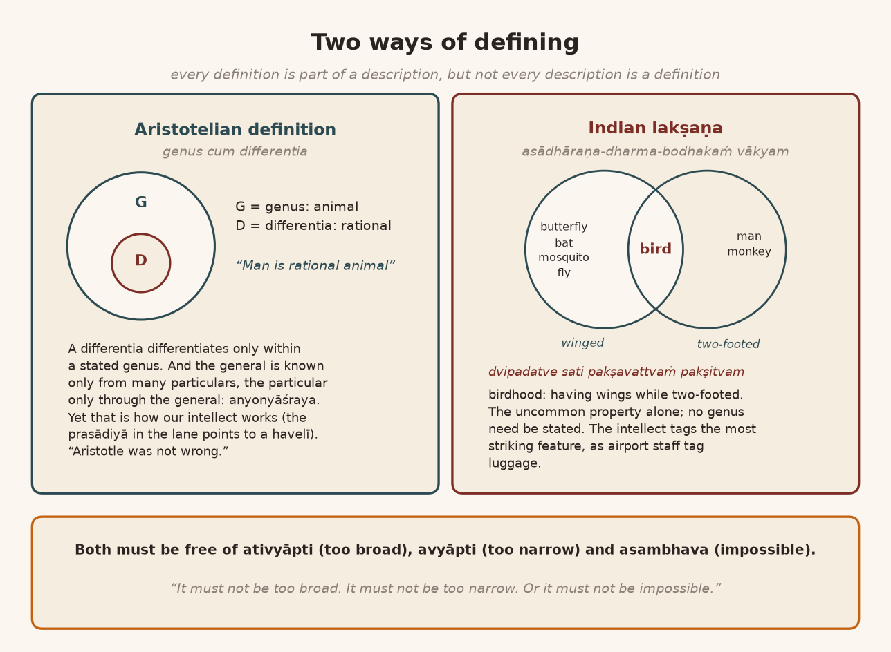
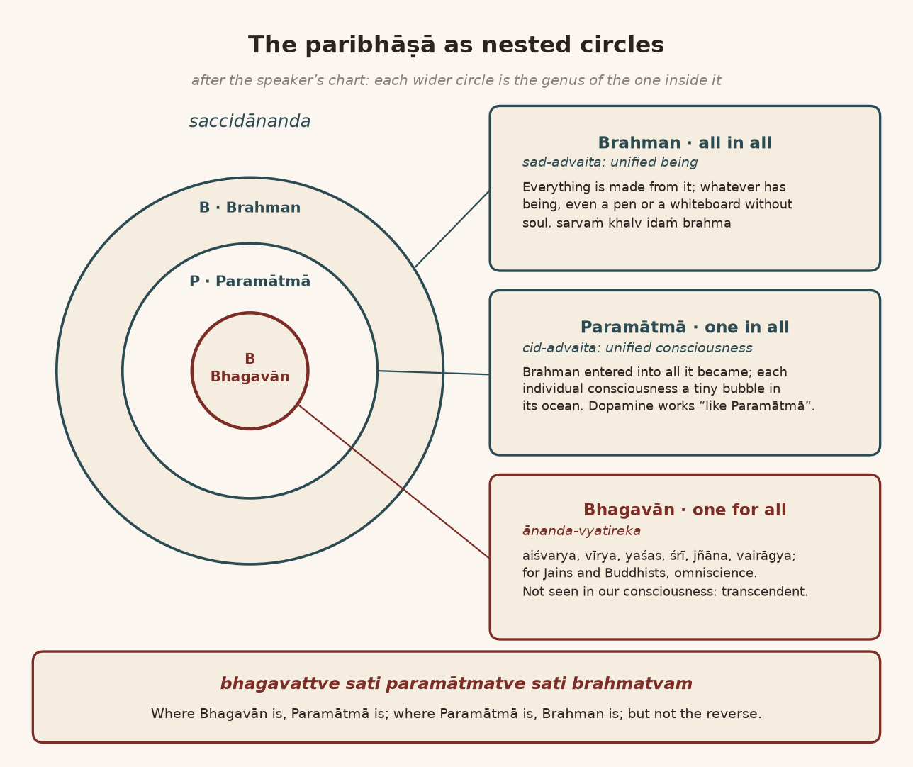
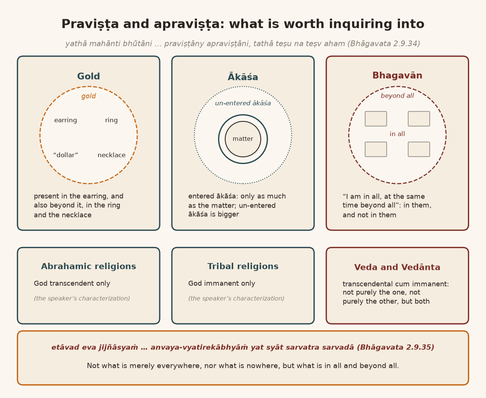
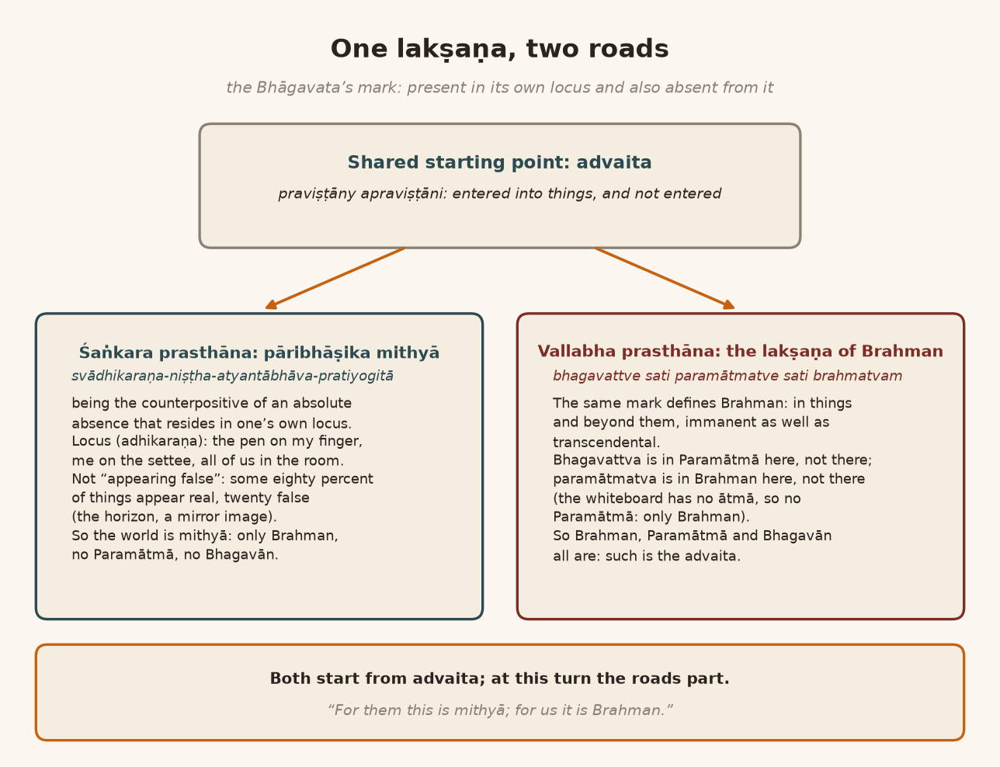
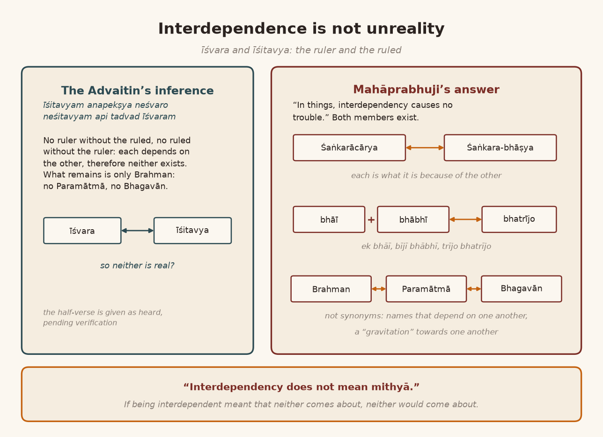
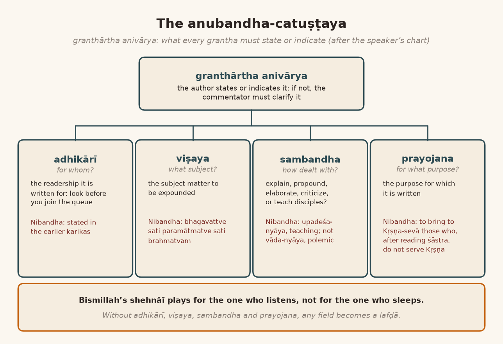
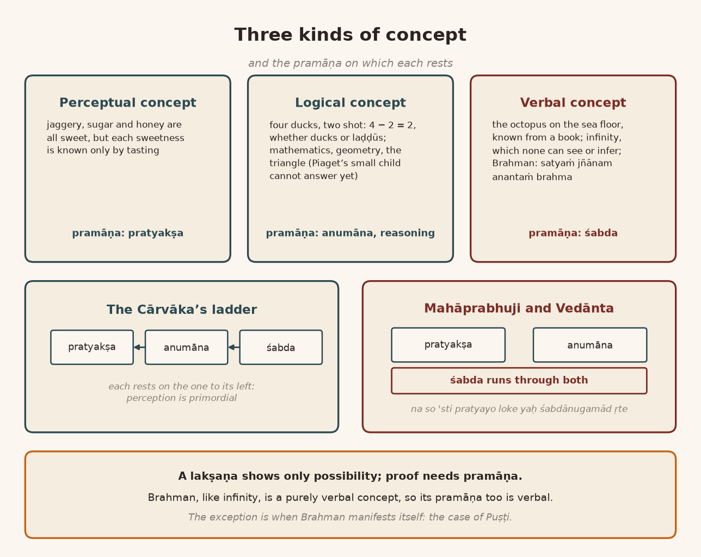
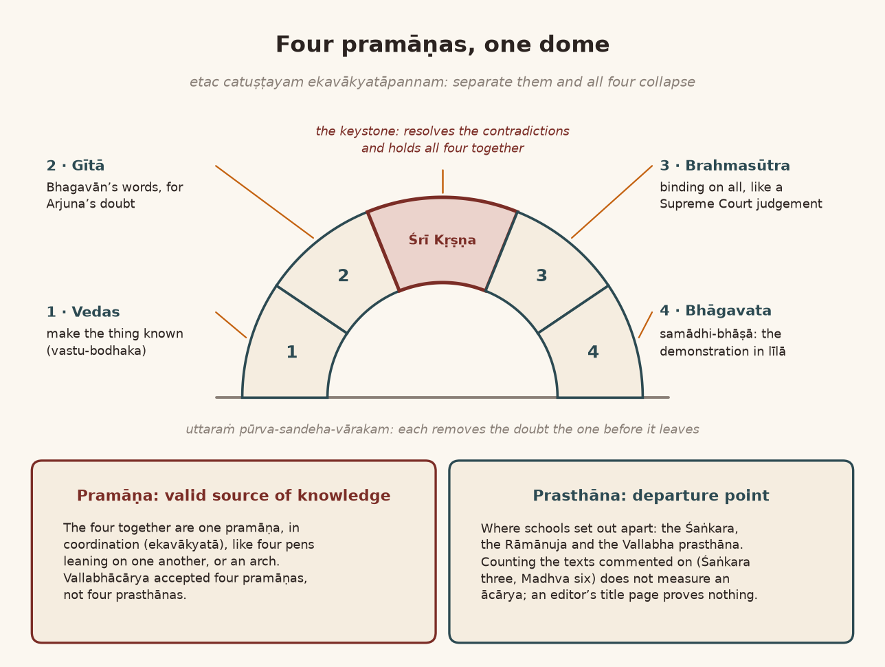

*English rendering of a spoken discourse on the Śāstrārtha Prakaraṇa of the Tattvārthadīpanibandha, translated from a Hindi ASR transcript. The speaker's conversational register, humour, digressions, code-switching, and student exchanges are preserved. Editorial flags: ‹ › conjectural restoration of a garbled reading; ‹?› uncertain reading; ‹…› inaudible or unrecoverable passage; ‹श्रवणाधारित› text given as heard, pending verification against a printed edition. Verses whose standard text is beyond doubt have been silently restored to the received editions.*

# 1. Synonym or Definition? Genus, Differentia and the Prasādiyā in the Lane

‹Last› time, in our exposition, is there anything you want to ask? In what was set out? I have a question to ask. Brahman, Paramātmā and Bhagavān: *tritaye tritayaṁ vācyam*. Mahāprabhuji has stated this as a *paribhāṣā*, and *paribhāṣā* means "definition". This śloka is originally the Bhāgavata's. ‹…› There it is not in the sense of our "definition"; it is there as a "synonym". But Mahāprabhuji is treating it as a *paribhāṣā*. Call it Prabhuji's "insight". Or take the "synonym" that the Bhāgavata "planned". ‹While commenting› on it there, Mahāprabhuji does not say that this is a *paribhāṣā*. There it is stated plainly: *śabdyate*, "it is called". These are only differences of words. Here too the same word is used, *śabdyate*. In spite of that, here Mahāprabhuji says it is a *paribhāṣā*.

So understand one thing carefully. Giving a "synonym" in a "definition" does not make a definition. This much "logical" sense is needed first. Suppose someone asks, "Brother, what is the definition of *manuṣya*?" and we start saying, "*Manuṣya* means 'human being'." Then you have given a "synonym". "*Manuṣya* means *nara*." You gave a "synonym"; you did not define. So how is this "paradox" to be "resolved"? I thought someone would ask, but nobody asked, so come, let me tell it myself. That is why I am telling it.

Because this can "definitely" be taken as a "synonym", and it has been taken that way. The author of the Bhāgavata took it that way, and Mahāprabhuji too took it that way there. And here Mahāprabhuji is treating it as a *paribhāṣā*. Now what is the definition of a definition? "Genus cum differentia." "And within that genus", what is its "differentia", "how it is differentiated". From these two a *lakṣaṇa* is made. With us it is not like this, our *lakṣaṇa* of a *lakṣaṇa*, the *lakṣaṇa* of a *paribhāṣā*.

So there is something to be understood in this. And what is that? That every "description" is not a "definition". "Every definition is a part of this." "Our definition is a part of the description. But all the descriptions are not definitions." I often give an "example" for this. Suppose we ask, "What do you call a bird?" "That which has two wings is a bird." Well, a butterfly also has two wings, a ‹bat› also has two wings.

**A student:** Yes, all right.

**Speaker:** So that is no "definition". A mosquito can have them too. A fly can have them too. So we will have to state the "differentia", not a "description". The "problem" of the "Aristotelian definition" is this: when you state the "differentia", from what are you "differentiating" it, and within what? If you have not stated a "genus", then the "differentia" will not remain a "differentia" at all, whatever "differentia" you have caught hold of. Its famous example in "Aristotelian logic" is this: "Man is rational animal." "Animal, this animality, that is the genus of human beings. Because a human being is a variety of animals. Living, particularly the living feature on the surface of the earth. Not bird, not mammal, so is an animal." And among them there was a "prejudice" of that time, a "popular prejudice", that "man is rational". "That is more irrational prejudice." "Plus", "this sort of prejudice was there", that "man is irrational"‹?›. So, "differentiate": "Animal genus; within that genus rationality is a differentiator. That's how they used to define the human being: Man is rational animal."

"And", on the other hand, let us understand it from the angle of our own logic. One thing comes to mind. Until there is knowledge of the *sāmānya*, the general, there is no knowledge of the *viśeṣa*, the particular; only when the general is known does knowledge of the particular arise. And the "funny part", what the "irrationality" of our intellect's "reasoning power" is, that is what I am explaining to you, is that no knowledge of the particular happens without knowledge of the general, and no knowledge of the general happens without knowledge of the particular. So it is a mutual relation. Because until you have seen ten, fifteen, twenty, twenty-five particulars, how will you understand what their "common feature" is? You have seen a "single instance" of some one thing; then what its "common feature" is does not come to you. When you see ten, twenty, twenty-five, then you "realize": "Ah, in all of these…"

A small "example". Anywhere at all, if you see a man going along with a *chhabaḍā* in his hand, wearing a *baṇḍī*, carrying prasād, then there must be a temple somewhere nearby. You understand that at once. Why do you understand it? Because this does not happen at one temple; it happens at all the havelīs. Somewhere or other prasād has to be distributed, prasād is given: *būndī*, *sev*, *manohar*, ‹*magas*›, ‹*mohanthāl*›, ‹…› *peḍā*, ‹…› *bādām-pāk*, *peṭhā-pāk*, *māvādār gūñjā* ‹…›.

**A student:** And then?

**Speaker:** These are the ‹…› "differentiate". In hotels you go and you are given food to eat. In the temple prasād is given, and it is brought to your home as prasād. So when we have seen the "instance" two or four times, we infer: "A prasādiyā is going round in this lane; there must be a havelī somewhere close by." So the "genus" is understood. Otherwise the general knowledge "depends" on the particular, and the particular "depends" on the general. And *anyonyāśraya*, mutual dependence, is a ‹logical› "term" anyway; it has become a ‹vicious› circle. "But our intellect understands like this. Aristotle was not wrong. That is how we understand, and that is how we neglect the demand of rationality while defining rationalism." This "paradigm", this is a really amazing "paradox".

# 2. The Indian Lakṣaṇa: The Uncommon Property and the Airport Luggage Tag

In our own *lakṣaṇa*, the general is not mentioned. *Asādhāraṇa-dharma-bodhakaṁ vākyaṁ lakṣaṇam*: a *lakṣaṇa* is a statement that makes known an uncommon property. Not the common mark of a thing, which is a "description", but its uncommon, "specific" mark, the one that does not "share" with anything else; that becomes its *lakṣaṇa*. Understand carefully what they say. Having wings: the bird "shares" that with the mosquito, with the ‹butterfly›, and so on, with "insects". Being a "biped" too it "shares", with man, with the monkey. So being a "biped" and having wings do not become a *lakṣaṇa*. But if we catch hold of the uncommon property, *‹dvipadatve› sati pakṣavattvaṁ pakṣitvam*: birdhood is having wings while being two-footed. ‹…› Along with being a "biped", that which has two wings is a bird. ‹…› "insects" ‹…› have wings, but none of them is two-legged. So that will become the *asādhāraṇa dharma*.

This is the definition of our Indian *lakṣaṇa*. Now what is a *lakṣaṇa*, after all? *Lakṣaṇa* means this. The "object" outside, every "object", "stimulates" our "sensation", our "awareness"; but the "tagging" we do from our own point of view, from the angle from which we look. As at the "airport": all the "luggage" that has come in is not "common", and the "airport" people do the "tagging", from the angle of making some "division" of their own. In the same way, how is our intellect "tagging" a thing? It means that it "tags" the "most striking" "feature". What is not a "striking feature" it does not "tag". That is why in the "Indian definition" nobody takes "genus cum differentia": *asādhāraṇa-dharma-bodhakaṁ vākyaṁ lakṣaṇam*. And its definition was given like this: *ativyāpty-avyāpty-asambhava-doṣa-rahitaṁ vākyaṁ lakṣaṇam*, a *lakṣaṇa* is a statement free of the faults of over-extension, under-extension and impossibility. "It must not be too broad. It must not be too narrow. Or it must not be impossible." That was the *lakṣaṇa* of a *lakṣaṇa*. This is there in the "Aristotelian" too: this "requirement" is there for the "definition" of ‹Peripatetic› "logic", and this "requirement" is there for the *lakṣaṇa* of "Indian logic" too. But there, a *lakṣaṇa* is made by making known the uncommon property. Now we have to look at this from the "Aristotelian" angle, or look at it from the "Indian" angle; that is all there is to it.

{width=6.2in}

# 3. All in All, One in All, One for All: *Bhagavattve Sati Paramātmatve Sati Brahmatvam*

What I want to explain, my view is this: look at it from either angle. This is called *brahmatva*. Everything is Brahman: *sarvaṁ khalv idaṁ brahma* (Chāndogya Upaniṣad 3.14.1). So what is the definition of Brahman? What is Brahman? "All in all." What is ‹Brahman›? It is "all in all". What is Paramātmā? "One in all." Why is Paramātmā "one in all"? Because in the midst of all the *ātmā*s there is one Paramātmā. Brahman has become everything, so it is "all in all". What is Paramātmā? Everything was made out of Brahman, and then it entered into all of that; that is Paramātmā. That "aspect" is called Paramātmā. Now look carefully: within the "genus" of Brahman, is this being "differentiated" or not? Just as having wings while being a "biped" became the uncommon property of the bird. Or else they say that whatever has a beak is a bird. That beak is the "tagging". ‹Bees› or other creatures do not have a beak; they have wings. So that became a statement making known the uncommon property, from the "Indian point of view". Isn't it? Man being a "rational animal" is a "definition" from the days of Bābā Ādam. "It does not stand with the scientific analysis of the animal. Nor it stands with the scientific analysis of the human being."

What is Bhagavān? Bhagavān is "one for all", not "one in all". Why "one for ‹all›"? Because the one in whom there are *aiśvarya*, *vīrya*, *yaśas*, *jñāna*, *vairāgya*, *dharma* is called Bhagavān. All those who are without *aiśvarya*, without *vīrya*, without *śrī*, without *jñāna*, without *vairāgya*, without *yaśas*: for all of them, the one who has *aiśvarya*, *vīrya*, *yaśas*, *jñāna*, he is Bhagavān. And even where Bhagavattā is not accepted on account of *aiśvarya*, *vīrya*, *yaśas*, *jñāna* and *vairāgya*, understand one thing carefully there too: the one who knows past, future and present is Bhagavān. *Utpattiṁ pralayaṁ caiva bhūtānām āgatiṁ gatim* (Viṣṇu Purāṇa 6.5.78): the one who knows this is called Bhagavān. Almost as one says "omniscient", that is Bhagavān. This is the "concept" of Bhagavān of the Jains and the Buddhists; so for those people, whoever is *sarvajña* is a Bhagavān. Both kinds of "definition" of Bhagavān are given, of themselves, in the Śāstrārtha Prakaraṇa.

Now look, let it be set in "order". Just as I looked at the "genus" and the "differentia", in the same way, if we marry them together, the B of Bhagavān, the P of Paramātmā, the B of Brahman *[refers to the chart]*, then that which, while being Brahman and while being Paramātmā, can be Bhagavān: not everything can be that. Something may be Bhagavān; ‹…› it is not necessary. Something may be Paramātmā. For instance, many "chemicals" inside us are working like Paramātmā: "dopamine". Many "chemicals" inside us work like Paramātmā; they control us from within. That *brahmatva* is in them, but in them, in a way, there is no *jñāna* or *vairāgya*; they have only as much "function" as their "function" is. Because that which, while being Brahman, while being Paramātmā, can be Bhagavān: that is the "subject matter" of this Śāstrārtha Prakaraṇa; that is its *paribhāṣā*. Mahāprabhuji is defining the ‹subject› in this way. And, if you look at it from our own angle, this has become the uncommon property. If we have to say it in the Sanskrit language: *bhagavattve sati paramātmatve sati brahmatvam*, being Brahman while being Paramātmā while being Bhagavān; *śāstrārtha-pratipādya-viṣayatvam*, that is what it is to be the subject expounded in the Śāstrārtha.

Now we can make many "predications". Just as ‹Mahāvīra› is regarded as Bhagavān, and the Buddha is regarded as Bhagavān. Someone may disagree; someone may not disagree at all. Why should we get into that discussion? So: is he Bhagavān or not? Then, is he Paramātmā? No. They themselves deny it: "We are not within everyone." Everyone is separate. So Paramātmā is gone. Is everything made from them? They themselves deny it: "No, everything is not made from us. Everything has been made, and we too have been made as one among them." So *brahmatva* is not there either. This has become the "definition" of the subject to be expounded, of the "subject matter" of the Śāstrārtha, "from the point of view of Aristotelian logic as well as from the point of view of Indian logic": *brahmatve sati bhagavattve sati paramātmatve sati brahmatve*‹?›, exactly the way "rational animal" was made. And the "format" of "genus" and "differentia" is in it too, and the setting forth of the uncommon property is in it too.

*[A brief aside with someone present in the room, mostly inaudible ‹…›; the speaker remarks that the class is now in progress.]*

# 4. Which Circle Is the Genus? Sad-advaita, Cid-advaita and the Ocean of Consciousness

**Speaker:** Have you understood the point properly? If something has not been understood, ask. If there is some unclarity in my speaking, that is my fault; but if you do not ask, that is your fault. "I remind you again and again."

**A student:** If there is a "differentia" within the "genus" of Brahman, then Paramātmā's "circle" should be separate from Bhagavān's. Why has it been put inside one? That a little ‹…›

**Speaker:** No. Within the "genus" of Paramātmā, Bhagavān has been "differenced".

**A student:** Then, as for Brahman ‹…›?

**Speaker:** That is one "differentia". From the angle of Brahman it is a "differentia"; from the angle of Paramātmā it is a "genus".

**A student:** *Paramātmā jīnas nāhī?* [Paramātmā is not the genus?]

**Speaker:** For Bhagavān, the "genus" is Paramātmā. Paramātmā's "genus" is Brahman. Why? Understand carefully: where Bhagavān is, Paramātmā certainly is; but where Paramātmā is, Bhagavān is not, because that is the smaller "circle" inside it. Where Paramātmā is, Brahman certainly is. And where the "circle" of Brahman is, it is not necessary that Paramātmā be there.

Now, if you have understood this point properly, then understand its "confusion" too. What is its "confusion"? Brahman is called *saccidānanda*. Brahman is *saccidānanda*. So there is the *advaita* of Brahman in the form of being, *sattā*: "infinite being", "infinite beingness". By that, Brahman is "common" with everything. "But anything which has a being, that is to be taken as Brahman." "But all that has ‹being›…" ‹…› "And in this pen there is being, right? In this white board there is being, right? It has its own being. This pen also has its own being. And this does not contain soul." So in it there is ‹*sad*›-*advaita*, relative to Brahman; there is no *cid-advaita*. With respect to *cit*, duality has come about ‹…›. But all the *ātmā*s, in whom Brahman is present as Paramātmā: in them, is there the *cid-advaita* of Brahman or not? So in the "ocean" of *cid-advaita*, "every individual consciousness is like a bubble in the ocean of" ‹*cid*›-*advaita*. *Advaita* means "unity"; it is the "unity of the concept"‹?›. A "bubble"-like "point": that is the "individual consciousness". "Am I clear? Huh? All the individual consciousness are like a bubble in the ocean, ocean of the conscious. So Paramatma is the ocean of the consciousness. And Jivatma is a bubble in that ocean. A very small insignificant bubble. Our consciousness is such a tiny phenomena. It's not a… it does not have an oceanic character. But still it is a made of ocean. It's a part of the ocean. Insignificant part of the ocean." So *cid-advaita* is there, after all.

{width=6.2in}

# 5. What Is Worth Inquiring Into: The Catuḥślokī and the Gold Earring

Mahāprabhuji has explained one thing, on the basis of the Bhāgavata, very delightfully. I will write out the śloka and show you, and then you will understand it. About what is "worthy of inquiry", Bhagavān told this to Brahmājī. This is a really "fantastic" thing. What is the "worthy of inquiry phenomena"? Bhagavān says this: *etāvad eva jijñāsyam*. *Jijñāsyam* means "worthy for inquiry". *Tattva-jijñāsunā*: "if you want to, if you want to know, understand the reality".

> एतावदेव जिज्ञास्यं तत्त्वजिज्ञासुनात्मनः ।
> अन्वयव्यतिरेकाभ्यां यत्स्यात्सर्वत्र सर्वदा ॥
>
> *etāvad eva jijñāsyaṁ tattva-jijñāsunātmanaḥ |*
> *anvaya-vyatirekābhyāṁ yat syāt sarvatra sarvadā ||* (Bhāgavata Purāṇa 2.9.35)
>
> [This much alone is to be inquired into by one who seeks to know the truth of the Self: that which, through *anvaya* and *vyatireka*, is everywhere and always.]

A thing that is "present" everywhere, "immanent"; or, well, what is "transcendental" everywhere: that is not "inquiry-worthy". What is "present" everywhere, why make an "inquiry" into it? What is not "present" anywhere at all, why make an "inquiry" into it? What is the "inquirable phenomena"? That which, while being "immanent", is also "transcendental". That which, while being ‹immanent›, is "transcendental": that is "inquirable". *Anvaya-vyatirekābhyām*. "If A is there, B is there": that is *anvaya*, isn't it? So that which, while being in *anvaya*, is *vyatirikta*, beyond it; which, while pervading everywhere, while being "immanent", is "transcendental": that is "inquiry-worthy". Bhagavān gives four examples in it:

> यथा महान्ति भूतानि भूतेषूच्चावचेष्वनु ।
> प्रविष्टान्यप्रविष्टानि तथा तेषु न तेष्वहम् ॥
>
> *yathā mahānti bhūtāni bhūteṣūccāvaceṣv anu |*
> *praviṣṭāny apraviṣṭāni tathā teṣu na teṣv aham ||* (Bhāgavata Purāṇa 2.9.34)
>
> [Just as the great elements have entered into beings high and low, and yet have not entered them, so I am in them and not in them.]

All the five *mahābhūta*s, understand carefully: these are called *bhūta*. *Bhūta*: as in *bhūta, preta, piśāca*. *Bhūta* means that which has "being". What is going to be is *bhāvī*. What has been is *bhūta*; that is what they call time, isn't it? And what is happening is called *bhavati*. So *bhūta*, *bhavati* and *bhāvī*. So the *mahābhūta*s: how is the *mahābhūta* being defined? That in every one of its "instances" it is present permanently too…

**A student:** And what is the "translation" of this?

**Speaker:** Take any one "instance", of earth. Take any "instance" of a bird: in any ‹entity› of bird, bird is present, and bird is not "confined" to it; there is bird outside it too. As if we took an "earring" of gold: in that gold "earring" gold is present, and it is outside it too, because it is in the "ring" too, it is in the "dollar" too, it is in the "necklace" too. It is in many places, and it is even in the "toilets" of the Arab ‹sheikhs›; those are made of gold. So you have understood, haven't you, that it is *anvita*, present, in every "instance", and also beyond it. *Yathā mahānti bhūtāni*: take water in the same way. In all the "instances" of water there is water, and water is not "confined" to it; it is outside that "instance" too. Take "heat" in the same way: in all the "instances" of "heat", "heat" is present, and "heat" is outside it too. Take "air" in the same way: in all the "varieties" of ‹air›, "air" is present, and it remains outside them too.

# 6. Many Skies: Ākāśa as a Cover, the Flute's Holes and the Space Between Spouses

Take every "variety" of *ākāśa* too. One misconception of people has been opened up. *Bahu tāre philosophī chhe ke ākāśe*‹?› [there are many philosophies which say that *ākāśa* ‹…›]; now "science" has said *Gaṇapati Bāppā Moryā* [the chant at the immersion of Gaṇeśa's image] to it. ‹…› *Ākāśa* too has "multiple instances". Because we cannot "cross" *ākāśa* and look, we feel that *ākāśa* ‹is one›. ‹…› *ākāśa* is one; every *ākāśa* is of one kind. So they say: the "cover", the "cover" of "plasmic, gaseous, liquid and solid matter"; each of these four has a "cover", and that is *ākāśa*. A covering.

And that *ākāśa* extends only that far, and this has now been proved to this extent: as "light" is coming, whatever extent of "cover", of *ākāśa*, a thing has, that much the "light" bends. ‹…› travels too. But if the *ākāśa* is this much, then the "light" comes in bent. That "proves" that that *ākāśa* ‹…›

**A student:** ‹…›

**Speaker:** Every *ākāśa* is separate. As in the "nuclear structure", in ‹e, n, p›‹?›, there is an *ākāśa*. That *ākāśa*, the *ākāśa* in a pot ‹…›

**A student:** Isn't that *avakāśa*, "space"?

**Speaker:** It is. In our ears, in the nose, in the mouth, everywhere there is some "space". That "space" is not the "nuclear" "space". "Spaces" are different from one another. In every hole of the *bansī* there is a "space", so in every hole the note is different. From one, ‹one note› will come out; from the second, ‹another›; from the third, a third; from the fourth, a fourth. Every "space" is different. Earlier "philosophy" had got a mistaken notion about what *ākāśa* is; they could not see it. But now the matter has become absolutely clear "scientifically" that *ākāśa* too is many, because it is a "cover". But how did we know it here with us? ‹Śiva›'s name is Digambara; ‹he› makes *ākāśa* his garment. *Dig-ambara* too is an *ambara*, a garment; every "matter" has its own garment. Even today, when husband and wife quarrel, to the point of "divorce", it happens because there is no "space".

So we need "space"; everyone has a "space". You got the point, didn't you? Where something goes wrong in the "space", yes, the quarrel starts. ‹…› it did not come into "philosophy". And now it is coming to everyone's mind that *ākāśa* too is different in each case. And in this way some people hold that *ākāśa* is not produced; but with the production of every piece of "matter", *ākāśa* is produced as its covering. As the tortoise has a covering, its back; as we have a covering, our skin; as every animal has a hide, that is its covering. In the same way *ākāśa* covers the four elements. This is very necessary to understand, very necessary; without understanding it a great deal of confusion spreads. What I mean to say is: *yathā mahānti bhūtāni bhūteṣūccāvaceṣv anu, praviṣṭāny apraviṣṭāni*. *Ākāśa* has entered into every "matter", and ‹outside› it too.

**A student:** Yes.

**Speaker:** The *ākāśa* that has entered is only as much as that "matter" is. The *ākāśa* that has not entered…

**A student:** …is bigger.

**Speaker:** Bhagavān is explaining to Brahmājī that this is my "nature" too. While having entered into every thing, I have also not entered. "I am in all", ‹at the same› "time beyond all". "That's what the true aspect of ‹mind›‹?› which is to be inquired." All the Abrahamic religions, you see, regarded God "transcendentally". All the "tribal religions" regard God as "immanent" ‹the speaker's characterization›. Our Vedānta, Veda and Vedānta, says: no, God is "transcendental cum immanent". He is not "purely transcendental", not "purely immanent"; he is a "combination" of both. So this Bhagavān, you see, is regarded as "transcendent", "actually" on account of *vīrya*, *yaśas*, *śrī*, *jñāna* and *vairāgya*. Because he has entered into us, into our "existence". We do not see *aiśvarya*; we do not see *jñāna* or *vīrya*, we do not see *śrī*, we do not see *vairāgya*. If we do see them, we do not see them as "permanent"; we see them as "impermanent", we see them as "acquired". We do not see them "by default".

In our "consciousness" too, *aiśvarya*, *vīrya*, *yaśas*, *jñāna*, *vairāgya* are not seen. In this sense the "aspect" of Bhagavān is "transcendental". So *anvaya-vyatirekābhyāṁ yat syāt sarvatra sarvadā*, *etāvad eva jijñāsyam*: this much you should inquire into. And by saying this Mahāprabhuji has made everything clear: that the ‹paribhāṣā› of Brahman, *brahmatve sati bhagavattve sati paramātmatve sati brahmatvam*‹?›, is the "definition" of my subject to be expounded, whether you take it from the angle of ‹Aristotelian› "logic" or from the angle of ‹epistemology›.

**A student:** ‹…› *yathā mahānti bhūtāni bhūteṣu*…

**Speaker:** *Uccāvaceṣu*. Some are high, some are low; some are small, some are fat; some are long, some are broken. So in all of them there is *bhūta*. It is in it, isn't it, but it is not "confined" to it.

**A student:** *Praviṣṭāny apraviṣṭāni tathā*…

**Speaker:** *Praviṣṭāni apraviṣṭāni*: it has entered and also not entered. *Tathā teṣu*: in the same way I am in every thing, and also am not.

{width=6.2in}

# 7. Where Śaṅkara Turns Off: Pāribhāṣika Mithyā and the Absence in One's Own Locus

Now understand one thing carefully. This too is a very important point. Śaṅkarācārya took this *lakṣaṇa* as that of māyā. Where is the "conflict" "starting" from? Why is this "definition" not "possible" in the Śaṅkara doctrine? One ‹…›, "significantly". When Śaṅkarācārya is asked, the Śāṅkaras are asked: "Brother, you are calling the world *mithyā*, you are calling the world *mithyā*; so how do you define *mithyā*?" Because ‹it› does not appear *mithyā*; the "*mithyā*" is appearing as real. So they say: our *mithyātva* is "technical", ‹*pāribhāṣika*›. ‹…› It is not the *mithyā* that appears so, because a *mithyā* thing ought to appear *mithyā*, no? Nothing is appearing *mithyā*. Whatever we look at, wherever we look, everything appears real. If you work out a "percentage", there will hardly be a "twenty to eighty percent" difference. "Eighty percent" of things appear real; hardly "twenty percent" will be such as appear *mithyā* to us, as the horizon appears *mithyā*, as a "reflection" in a "mirror" appears *mithyā*. But what is its "percentage"? In our "experience", what is the "percentage" of what appears *mithyā* and of what appears real? So "relying on the" ‹…› "empirical knowledge, how much is truth and how much is falsity": the "ratio" will hardly go as far as "twenty" and "eighty percent". Śaṅkarācārya says: "No, we are not calling it *mithyā* because of how it appears. Ours is a *pāribhāṣika mithyā*." What is the definition? It is this:

**A student:** *Svādhikaraṇa-niṣṭha*…

**Speaker:** Every thing has some *adhikaraṇa*, a "locus". As the pen is in my hand, so the pen's "locus" is my finger. As I am sitting on this ‹"settee"›, so this is my "locus". We are all sitting in the "room"; that is our "locus". So in whatever is one's *adhikaraṇa*, in that there is my *atyantābhāva*, my absolute absence, and that absolute absence is mine. This is *mithyātva*: *svādhikaraṇa-niṣṭha-atyantābhāva-pratiyogitā*, being the counterpositive of an absolute absence that resides in one's own locus *[refers to the chart]*. Where I am appearing, there is my *atyantābhāva*. ‹…› *vyatireka*. ‹…› And the Bhāgavata says that this is the *lakṣaṇa* of Brahman! So, coming to this point, our ‹…›

It will take time. It has entered and also not entered, so it is *mithyā*; because where it is, in what is its *adhikaraṇa*, there its *atyantābhāva* also is: *atyantābhāva-sāmānādhikaraṇya*, sharing a locus with its own absolute absence. One's own "absence": I am living together with my own "absence". The Bhāgavata is saying that Brahman, Bhagavān himself is saying it to Brahmājī: "Where I live, there I also am not." So this much has come out, hasn't it? So if Brahman is *mithyā*, then a big *pañcāyat* has started! Here there is a "difference" between our own *advaita* and their *advaita*. Their *advaita* is such that wherever all things ‹appear›, there it is not. What is our *advaita* like? That in all the things that ‹appear›, Brahman is, and ‹beyond them› too it is Brahman: "immanent" too "as well as" "transcendental". So, *‹bhagavattve› sati paramātmatve sati brahmatvam*: where *bhagavattva* is, is *paramātmatva* there or not? It is.

**A student:** Yes.

**Speaker:** But is there an absence of *bhagavattva* in it? No. Where *paramātmatva* is, is *bhagavattva* there everywhere? No, no. So *bhagavattva* is present in Paramātmā somewhere, and somewhere it is absent too. So what has happened to *bhagavattva*?

**A student:** I see.

**Speaker:** In the same way: wherever *brahmatva* is, is *paramātmatva* there? We will say no, *paramātmatva* is not everywhere. So where *paramātmatva* is in Brahman, there is also an absence of being Paramātmā. As here, there is no *ātmā* at all, so how will Paramātmā come into the "white board"? So here there is an absence of Paramātmā too. In this there is only Brahman; there is nothing besides Brahman. Mahāprabhuji has given just such a *paribhāṣā*: no, no, Brahman also is, Paramātmā also is, and Bhagavān also is. Such is the *advaita*.

{width=6.2in}

# 8. Ruler and Ruled: Śaṅkarācārya, His Bhāṣya and the Bhatrījo

And over there, what is there? Only Brahman; no Paramātmā, no Bhagavān. There is a very beautiful śloka, from the ‹Saṅkṣepaśārīraka›. They say:

> ईशितव्यमनपेक्ष्य नेश्वरो
> नेशितव्यमपि तद्वदीश्वरम् । ‹…›
>
> *īśitavyam anapekṣya neśvaro*
> *neśitavyam api tadvad īśvaram |* ‹…› ‹श्रवणाधारित›
>
> [There is no ruler without reference to the ruled; nor, likewise, is there the ruled without reference to the ruler.]

If there is no *īśitavya*, is there an Īśvara? ‹*Īśitavya*› means that over which lordship is exercised; that is the ‹*īśitavya*›. The one whose lordship runs is Īśvara. So without the *īśitavya* there is no Īśvara, and without Īśvara there is no *īśitavya*. Neither exists without the other; therefore neither exists. What answer does Mahāprabhuji give to this? He gives a very beautiful answer, not by way of refutation, but to state his own position: that *īśitavya* and Īśvara are both "interdependent". Now tell me, does "interdependency" exist or not?

If you say that "interdependency" is not "possible", that it is an "impossibility", then all right. Look, in one respect "interdependency" troubles us, but in things "interdependency" causes no trouble. What is the reason? Understand a simple thing. If Śaṅkarācārya had not been, would there be the Śaṅkara-bhāṣya? If he had not written the Śaṅkara-bhāṣya, would he be called Śaṅkarācārya? So is it "dependent" on this or not? Then do both not exist? It does not happen like that! Both exist. Because Śaṅkarācārya is Śaṅkarācārya because he wrote the Śaṅkara-bhāṣya, and the Śaṅkara-bhāṣya is the Śaṅkara-bhāṣya because Śaṅkarācārya wrote it. So are they "interdependent" or not? If being "interdependent" meant that neither comes about, then neither would come about. How can that be? This is our "logic".

‹See with what beauty› it is said:

> ब्रह्मेति परमात्मेति भगवानिति शब्द्यते ।
> त्रितये त्रितयं वाच्यं क्रमेणैव मयाऽत्र हि ॥
>
> *brahmeti paramātmeti bhagavān iti śabdyate |*
> *tritaye tritayaṁ vācyaṁ krameṇaiva mayātra hi ||* (Tattvārthadīpanibandha, Śāstrārtha Prakaraṇa 6; line cd is also Bhāgavata Purāṇa 1.2.11cd)
>
> [It is called Brahman, Paramātmā and Bhagavān; in the triad, the triad is to be denoted by me here, in due order.]

These are "definitions". ‹In these› he has explained the whole matter. He has given a *paribhāṣā* of such a kind that it is not "tagging".

**A student:** Yes.

**Speaker:** This is a "description" of the "description" itself. "This is the essence of the description of Brahman." And how does it become a *paribhāṣā*? Otherwise they are "synonymous", because the words are saying it: "These are the words, three words. We are using the term to describe same phenomena." "But they are not synonymous." They indicate a "gravitation" towards one another; they indicate an "interdependency" on one another. They are of that kind. And in Gujarati there is a proverb: *ek bhāī, bījī bhābhī, trījo bhatrījo* [first the brother, second the sister-in-law, third the nephew]. Why is the *bhatrījo* called *bhatrījo*? The *bha* of *bhāī*, the *bha* of *bhābhī*…

**A student:** And the third.

**Speaker:** So the third belongs to the *bhatrījo*. So *ek bhāī ne bījī bhābhī ne trījo bhatrījo*. The nephew: it is an "interdependent" matter, isn't it? As *bhatrījo* he depends on the brother and the sister-in-law, and the brother and sister-in-law depend on the *bhatrījo*. "Interdependency" of that kind. And "interdependency" does not mean…

**A student:** …that it is *mithyā*.

**Speaker:** Yes, *mithyā*. We may have some "difficulty" in understanding, but we ought to "solve" that ourselves, no? If you have understood the matter up to here, shall I go ahead? Tell me.

{width=6.2in}

# 9. Bubbles of Being: Sunītā's Question and the Milk-Froth Bhoga

**Sunītā:** Praṇām, Jejē‹?›. I am Sunītā speaking. What you explained here, that with Brahman there is *sad-advaita*, *sad-advaita*: that I did not understand.

**Speaker:** Yes? What, what did you not understand?

**Sunītā:** You said *sad-advaita* with Brahman, didn't you? How is that *sad-advaita*? Just as with Paramātmā there is *cid-advaita*; that you explained.

**Speaker:** Yes. *Sad-advaita*: the *advaita* of being, of *sat*, "unified being". What does ‹*sad-advaita*› mean? "Unified being". ‹*Cid-advaita*› means "unified consciousness". So, because it is "unified", all the "varieties" of ‹being› in it are being "unified"; and in ‹*cid-advaita*› all the "varieties" of "consciousness" are being "unified". That is why I said "bubble", didn't I? "What is our bubble?"

**Sunītā:** Yes, yes, yes. That of the ocean…

**Speaker:** ‹…› *brahmatva*. "What is the beingness of this napkin? It's a bubble in the unified existence of Brahman."

**Sunītā:** Right.

**Speaker:** "It emerges like bubble, it merges again in Brahman." How, Bābājī? "Like that our consciousness also emerges from the Brahman like a bubble and multiplies also in the Brahman. But that does not mean that it is not unconscious. It is a bubble of the consciousness." Look, understand carefully: does a soap "bubble" clean the hand or not? As soap cleans, the soap "bubble" cleans. And we are Puṣṭimārgīs. You people may not know this, but let me tell you a secret. After the śṛṅgāra of our Ṭhākurjī, a milk bhoga is not offered; a "bubble" bhoga of milk is offered. They make froth of it. They call it *gaiyā*‹?›. *Gaiyā* means ‹…›

‹…› "We are ‹bubbled›" ‹…› "In all respect we are bubblish." Did you get the point?

**A student:** I wanted to clarify one thing. In our own doctrine it is ‹*anvita*›, and ‹…› *vyatireka*. So both possibilities are there?

**Speaker:** ‹…› *vyatireka*: ‹for them› that is *mithyā*.

**A student:** ‹…› they look at it like that. So it cannot be *vyatireka* ‹…›

**Speaker:** Yes, yes. What we said, so it is not *vyatireka* ‹…› no, no. We take it as the *sāmarthya*, the power, of *brahmatva*. So two *prasthāna*s came about: one the Śaṅkara *prasthāna*, and one Vallabhācārya's. Both are of *advaita*; the "starting point" of both is *advaita*. *[He sings a few lines of a Hindi song about two fellow travellers who walked together while the road ran straight, and turned their faces away from each other where the road turned.]* It is of that kind. From here we take separate roads. For them this is *mithyā*; for us it is Brahman. If you have understood this much, shall I go on to the "next step"? You are all silent, so I am getting nervous: you haven't understood more than I have, have you?

**A student:** No, Jejē, it came through. You explained it very well.

# 10. The Anubandha-catuṣṭaya: The Wrong Queue and Bismillah's Two Shehnāīs

One more thing which I have not explained, which "unfortunately" got "dropped" from the "syllabus". And that is the matter of the *anubandha-catuṣṭaya*. Nowadays what happens is that they write an "introduction" to every book, so everything is given in the "introduction". In the old days the "introduction" did not have such a big "major role", so for every author of a *grantha* it was "duty bound" that he should either "indicate" it or say it. And if he could not say it, then it was the duty of the commentator to "clarify" it. That was the *anubandha-catuṣṭaya*. *Anubandha-catuṣṭaya* means that in every *grantha*, whatever "book" it is, "any book"; this is not some subject of Vedānta. Whenever any book is written, it has its *anubandha* and its main "perspective". What was compulsory for a *grantha*, as a "discipline", was that in every *grantha* four things should be "clear", "clearly mentioned or indicated": *adhikārī*. *Adhikārī*, *viṣaya*, *sambandha* and *prayojana*.

*Adhikārī* means for what "readership" it is being written; that is the *adhikārī*. Whose "readership" is it? Because we see a line and stand in the "queue", and later it turns out that ‹what we wanted› is not being sold at all, *ghāsleṭ* is being sold. Then we are late, aren't we? "Time" gets "wasted". So one should look at the line beforehand. It often happens at the bus: there is a bus queue, people stand in it; when the bus comes, someone says, "We have to get to such-and-such a place." They say, "It doesn't go there at all!" He was standing in it, so the "time" was "wasted". In every matter the *adhikārī* should be clear: for which "readership", which "readership", it is being written. What the "subject" is, that should be clear: what is the "subject matter". How the "subject matter" is being "dealt" with, that too should be made plain. What is the *sambandha* of the *grantha*, "how it deals to [the] subject matter": that is, does it want to "explain" it, does it want to ‹"propound"› it, does it want to "elaborate" it, does it want to "criticize" it, or does it want to make disciples understand it? So what is the "nature" of the "book"? That is *sambandha*. "And last": what is the "purpose"? With what "purpose" are you writing? This is called the *anubandha-catuṣṭaya*, the "necessary condition". *Anubandha* means "condition", "terms and conditions": for every book, four "material" things, which are *adhikārī*, *viṣaya*, *sambandha* and *prayojana* *[refers to the chart]*. Under this heading, here Mahāprabhuji has stated the subject to be expounded.

He has stated everything. He stated the *adhikārī* too, in the ślokas before this that got dropped: *bhavānta-sambhavā daivāt* ‹…› *bhagavac-chāstram ājñāya vicārya ca punaḥ punaḥ, yad uktam hariṇā paścāt sandeha-vinivṛttaye*; *ekaṁ śāstraṁ devakīputragītam, eko devo devakīputra eva* (Tattvārthadīpanibandha, Śāstrārtha Prakaraṇa 4). "Relationship also tell, that I will tell this upadeśa-nyāya. This all that is, I am doing this upadeśa-nyāya of Śāstrārtha and Sarvanirṇaya and Bhāgavatārtha Nibandha. Not in the mood of debate nor in the mood of explanation. Just to teach what I believe." *Upadeśa-nyāya*. Huh? So the *prayojana* Mahāprabhuji has stated; he will state it further on. ‹Mahāprabhuji's› is quite clear: *etat śāstram avidyāya‹?› kṛṣṇaṁ ye na sevante* ‹श्रवणाधारित›: those who, even after reading the śāstra, are not serving Kṛṣṇa, are not doing Kṛṣṇa-bhakti, how they are to be engaged in Kṛṣṇa-sevā, that is why I [have written] all the śāstra ‹…›. So Mahāprabhuji has ‹stated› *adhikārī*, *viṣaya*, *sambandha* and *prayojana* in this way. Here we ‹…›, and since that got "dropped" a little, I said it again.

What often happens is that when we join some "activity" without knowing the *adhikārī*, there is a lot of trouble in it. It happened once; it is a little digression, and your "mind" will become lighter hearing something big. Here, at St. Xavier's College, there used to be a "music conference" every year in earlier days. I am fond of "music", of listening to "classical music"; I used to go. Some brother came to know of it somehow, that I "attend" the "music conference" at St. Xavier's every year. I am a good-for-nothing fellow; I need a car ‹…›; I always need somebody or other's car. So he said to me, "Whenever you go, go in my car." Who would not accept such a good "offer"? I said, "All right, brother, we'll go in your car." Now, the man in whose car I went, I can't very well tell him, "Don't come in here." I took his ticket too. At that time, "unfortunately" and "fortunately", it was Bismillah's ‹shehnāī›. And Bismillah started playing the shehnāī, and he dozed off. Dozing off: up to that point there was nothing to worry about. Then his nose started speaking too.

I said, one shehnāī is playing separately over there, and one shehnāī is playing here. What to do? Now he had gone to sleep, so he knew nothing, and everyone was looking at me. So I said, what do I do? So I started saying "*wāh, wāh*" loudly: *wāh wāh, wāh wāh, wāh wāh*, whether I liked it or not, *wāh wāh*. So when I said *wāh* loudly, he would wake up. *‹Phūṅk› upar bahu kābu chhe* [he has great control over his ‹blowing›]. I said, *nā nā, sās upar enā kartāṁ vadhāre kābu chhe* [no, no, here there is even more control over the breath than his]. *Hā hā, bahu kābu chhe!* [Yes, yes, great control!]

That car became a whole *lafḍā* of theirs. Once we went, well, we went; the next time, no taking a lift in his car! How different the *adhikārī*, *viṣaya*, *sambandha* and *prayojana* are: he comes to sleep; ‹he› does not come to listen at all.

The knowledge of *adhikārī*, *viṣaya*, *sambandha* and *prayojana* is very necessary: for which *adhikārī* is that shehnāī playing? Not for the one who sleeps; for the one who listens. What should its *viṣaya* and *sambandha* be, listening or sleeping? He plays the shehnāī, and we start playing our nose! Then where can one go? He goes to sleep, so he won't even know, and all the people beside us will look at me. So how to "control" it? I did it, whether I liked it or not: *wāh wāh, wāh wāh*. ‹…› Yes, very good! They kept saying "over", "over the breath", all of them kept saying it‹?›.

**A student:** *Asaṁ āhe* [so that's how it is].

**Speaker:** So *adhikārī*, *viṣaya*, *sambandha* and *prayojana* are very "necessary factors". In any, any "field", if these are not there, a big *lafḍā* happens. That is why I told you, briefly.

**A student:** The *prayojana* he stated: is it for the whole Tattvārthadīpa Nibandha, or for the Śāstrārtha Prakaraṇa? *Prayojan je batāvyo Mahāprabhujine* [the *prayojana* which Mahāprabhuji stated]…

**Speaker:** The whole Nibandha. It is the whole Nibandha: whatever *prayojana* of the whole Nibandha ‹Mahāprabhuji› is stating. Because it is by *upadeśa-nyāya*, isn't it, not by *vāda-nyāya*. As in the Brahmasūtra it is by *vāda-nyāya*. In an assembly of scholars it is *vāda-nyāya*, a "debating polemic treatise". This is not a "polemic treatise"; this is "teaching".

{width=6.2in}

# 11. A Definition Proves Nothing: The Pandit's Ego and Duryodhana's Confession

So now that this *lakṣaṇa* has been stated, now that we have seen the *lakṣaṇa*, what happens because of the *lakṣaṇa*? Understand the point carefully. Nothing is proved by a *lakṣaṇa*. I told you earlier: from a *lakṣaṇa* the "possibility" is understood. Why is the "possibility" understood? Its root cause is the ego of being intelligent that lives inside us. Because of that ego we feel: if we have understood it, the thing exists; if we have not understood it, the thing does not exist. This is an ego, isn't it, a very big ego of ours. And it is not found in fools; it is found more in pandits, and it is less in all the poor simple folk. So those who are intelligent are packed full of this ego: "If I am not understanding it, then it isn't there."

In Europe "there is a proverb: man is measure of everything".

**A student:** Arre, "who is man? It's only modification of monkey".

**Speaker:** "How can you be measure of everything?" We have set the ego up in front of us, that we are "rational animal", no? "Without being aware" how much "percent" is "animality" and how much "percent" is "rationality". What is the "ratio"? "Animality" "sixty to eighty percent". "And" what is the "percent" of "rationality"? The "ratio" is "twenty percent". Is the "animality" more, or the "rationality"? What we feel through "reasoning"… As in the very famous saying of Duryodhana:

> जानामि धर्मं न च मे प्रवृत्तिर्जानाम्यधर्मं न च मे निवृत्तिः ।
> केनापि देवेन हृदि स्थितेन यथा नियुक्तोऽस्मि तथा करोमि ॥
>
> *jānāmi dharmaṁ na ca me pravṛttir jānāmy adharmaṁ na ca me nivṛttiḥ |*
> *kenāpi devena hṛdi sthitena yathā niyukto 'smi tathā karomi ||* (cf. Pāṇḍavagītā; ascribed to Duryodhana)
>
> [I know dharma, yet I have no inclination to it; I know adharma, yet I do not turn from it. As I am directed by some god seated in the heart, so I act.]

"I know what is true. I know what is my duty but I cannot act accordingly. I know what should I not do. But I always get involved in that only." So I have no control over myself; then how are we rational? The ‹animality› is the greater part, isn't it? But in spite of that there is an ego inside us: if I have understood it, it exists; if I have not understood it, it does not exist. So what does a *lakṣaṇa* do? First it gives us that "assurance": have you understood or not? If you have understood, you will understand that it is at least "possible", because we have understood it, no? A *lakṣaṇa* "invokes" our "rationality". Yes: when we "define" anything at all, what is being "invoked"? Our "egoistic rationalist". ‹…› Then the "ego": we have understood it, so it is "possible". But it has not been "proved" yet, has it? So for "proof", *pramāṇa*: "empirical evidence" is needed. ‹For that›, *pramāṇa* comes in.

# 12. Perception, Inference and Word: The Octopus and Bhartṛhari's Thread

Now the "range" of *pramāṇa* in "philosophy" in India is so large that anything from one *pramāṇa* up to twelve or thirteen *pramāṇa*s has been accepted. One is *pratyakṣa pramāṇa*, the very first. What I see is *pramāṇa*; what is not seen is not *pramāṇa*. With us that has been called the Cārvāka doctrine. "Actually" it is not the Cārvāka doctrine; it is the doctrine of all of us. We heap abuse on the Cārvāka, but quietly we all believe exactly this. It is awkward to say so, but in what we believe we are all Cārvākas.

The second thing that comes, after "perception", is "inference". What is the relation between ‹*pratyakṣa*› and ‹"inference"›? Understand carefully. When you have "perceived" some two things together, then from the "presence" of the one you get an "inference" of the "presence" of the other. That is called "inference". Huh? Any two things placed together ‹…› "inference".

After that comes *śabda*, word. What is the trouble with *śabda*? The trouble with *śabda* is this. Whatever the naming of a thing or a person is, whatever "nomenclature" there is, once you have understood it, then in talking about that thing, in accepting it, in denying it, just by saying that name the "concept" of the thing comes into the "mind", doesn't it?

**A student:** Yes.

**Speaker:** For instance, we at least will not have seen it, and you too will not have seen it, "I am" ‹pretty sure›: how does the "octopus" live on the floor of the sea? We have not seen it; we cannot make an "inference" either. But we are reading some book: the "octopus" lives like this on the sea floor; under the sea, among the rocks ‹…›, it lives by "camouflage", that is, it makes its own body like those rocks by "camouflage", and when something comes near, it catches it. Now this is a "description". After reading this "description", do we get knowledge of the "octopus" or not? ‹Perception› does not happen, "inference" is not happening either, but knowledge is certainly happening, isn't it? "How to deny?" And the real trouble in this, understand it carefully, is this. Those people who do not accept *śabda*, they "criticize". They do not accept "verbal information" as "valid". "That's good, no problem. But how do they criticize those who consider verbal information as valid source of knowledge? How do they know that I believe in verbal information?" Through my words! "They cannot read my mind. They have no capacity to enter my mind. Because I said so." Now, having heard from me what I spoke, they accepted that I accept *śabda* as a *pramāṇa*, and then they "criticize" that *śabda* is not a *pramāṇa*. "It's too late. It's too late."

So "verbal information" too is a "valid source of knowledge". And understand one thing carefully: "without verbal knowledge" there will be no "inference"; and the doctrine of Mahāprabhuji and of Vedānta is that there is no "perception" either. What is the reason for that? What is its reason? Say you are seeing something, you are hearing something, you are touching something. "But if you cannot recollect its name, you will say: I don't know what it is. I am experiencing." "When you proclaim that I know this, when you know it by verbal…"

So "verbal information" has "significance" in "perception" too and in "inference" too. Some people held that ‹…› *pratyakṣa*: if there is no *pratyakṣa*, there can be no *anumāna*; and if there is no *anumāna*… because "how do we know the meaning of a term? By inferring. How can a child know that 'pot' means *ghaḍā*? By inferring." Because when the grown-ups bring a *ghaḍā*, they call it "pot", so we see: "Ah, 'pot' means *ghaḍā*." That came about by "inferring". So "verbal information depends on inference, inference depends on perception; therefore perception is primordial valid source of knowledge. That was Charvaka's stand. Its opposite is Mahāprabhuji's stand: that verbal is such a necessary evil; if it is an evil, it is a necessary evil. It is there immanent in the perception also, as well as in inference also. You just cannot avoid it."

Write down the śloka. It is not Mahāprabhuji's, though; it is Bhartṛhari's. He was a very great "grammarian", Bhartṛhari.

> न सोऽस्ति प्रत्ययो लोके यः शब्दानुगमादृते ।
> अनुविद्धमिव ज्ञानं सर्वं शब्देन भासते ॥
>
> *na so 'sti pratyayo loke yaḥ śabdānugamād ṛte |*
> *anuviddham iva jñānaṁ sarvaṁ śabdena bhāsate ||* (Bhartṛhari, Vākyapadīya 1.123)
>
> [There is no cognition in the world that comes without the accompaniment of word; all knowledge shines forth as though pierced through by word.]

A "percept" means what is seen, the thing that is seen. When our "mind" "uploads" that seen thing into the "mind", it becomes a "concept", after it has gone inside. It becomes a "concept", and a "concept" is called *pratyaya* in Sanskrit. There is no *pratyaya*, no "concept", which comes into being without a word. *Na so 'sti pratyayo loke yaḥ śabdānugamād ṛte, anuviddham iva jñānam*: all knowledge, just as a needle is threaded through a flower to make a garland, is in the same way pierced through by word. Every "variety of knowledge" there is, all of it is pierced through.

**A student:** Yes.

**Speaker:** "Unless you describe it, verbally describe it, or unless you listen it verbally described, you are never sure what is what."

**A student:** The śloka. In the śloka, *śabdān*…

**Speaker:** *Na so 'sti pratyayo loke yaḥ śabdānugamād ṛte*. *Śabdānugamād ṛte* means: in which word has not been threaded.

**A student:** I see.

**Speaker:** *Anuviddham iva jñānam*: as a needle goes into a flower, so in every "variety" of knowledge there is, word has gone in. *Anuviddham iva jñānaṁ sarvaṁ śabdena bhāsate*. Now I am not going into the detail of all twelve *pramāṇa*s, because we had to come to *śabda*, so I came to *śabda*. "Otherwise" there are a great many *pramāṇa*s; we are not discussing all of them here now. We will do that later on. Here I only have to explain this much: some of our "concepts" are "perceptual concepts", some of our "concepts" are "logical concepts", some are our "verbal concepts". "Just try to understand." What is a "perceptual concept"? For instance, jaggery is sweet, sugar is sweet, honey is sweet. The "concept" of their sweetness is "perception" only. Only when you taste them will you know that its sweetness is different, this one's sweetness is different, and this one's sweetness is different. All of them are not sweet in one way. So ‹…›.

# 13. Four Ducks and an Infinite Brahman: Why Brahman Is a Verbal Concept

Some are "logical concepts". What does "logical concept" mean? The "entire mathematics" is "logical concept". When children were asked, "Child…": there was a very great "genetic psychologist", ‹Jean Piaget›, working in "genetic psychology". With his own children he did very fine "experiments" on "concepts" in children, on how children "acquire" "concepts". "Philosophy" comes later; first, how do they "acquire" "concepts"? He did very fine "experiments" about that, gathering together children of different "age groups". He asked the small children: "At the edge of a pond there were four ducks, and a man "fired", and two ducks died. How many ducks were left?" The child said innocently, "I didn't see how many ducks there were, so how can I tell how many were left?" Because the "logical concept" has not yet "developed" in his "mind".

"Four minus two is equal to two." But when someone asks us, we do not need to say, "I didn't see, so how can I tell how many are left?" We go straight to "logic". So "four minus two", here: whether ducks, or *laḍḍū*, or *peḍā*, or *bhākharī*, or *phāphaḍā*, or *gāṭhiyā* [Gujarati flatbread and snacks], "four minus two is equal to two". This is a "logical" ‹concept›. "The entire mathematics", "geometry": all of this is "logical concept". These have nothing to do with *pratyakṣa*. We explain them to children through *pratyakṣa*, but that is only to make it "easy". Otherwise, once you have understood, it no longer has any "relation" with *pratyakṣa*. And all these "concepts" come to be "accepted". Like a "triangle": it is made of three "lines", it has three "angles", so it is a "triangle". What is there to understand in it, and what is there to see? Isn't it so? So these are some "logical concepts".

So now the question is this: is Brahman a "logical concept", or a "perceptual concept", or a "verbal concept"? About this Mahāprabhuji's position is that Brahman is a "verbal concept" only, "unless", because, Brahman does not become manifest. "Our concept of Brahman can never be inferential." As many people prove God "logically", Mahāprabhuji refutes the "logical" "proof" of God. And not only Mahāprabhuji; Śaṅkarācārya too. Śaṅkarācārya has said a very good thing. "We will prove this Īśvara logically!" Śaṅkarācārya says: *yūyaṁ balīvardāḥ śṛṅga-puccha-vihīnāḥ* ‹श्रवणाधारित›. "Arre, what kind of bulls are you, without horns and tail, that you will establish Īśvara "logically"!" So they say, "We will use "logic", *anumāna*: everything that is produced in the world has some maker. The world has been produced, so it must have some maker." Śaṅkarācārya says: "Now, how did you come to know that the world was produced? Did you go to see? When the world was produced, you had not been born. So: nothing in the world is produced without a maker, therefore the world too was produced by a maker, how did you ‹infer› that? You are a big bull!" *Yūyaṁ balīvardāḥ śṛṅga-puccha-vihīnāḥ*.

Śaṅkarācārya says that the "concept" of Brahman is a "verbal concept", and Mahāprabhuji and Śaṅkarācārya are both "closely" of one view about this: that the "concept" of Brahman is a "purely verbal concept". "It cannot be logical, it cannot be perceptual", "unless" Brahman becomes manifest of its own accord. That is the case of Puṣṭi; there, there is no layer of "thought". That becomes a separate story. That is an "exception"; it is not the "rule". When we are talking about Brahman, "we are dealing with only verbal concept, because certain scripture" has said "Brahman". "Forget about the Brahman. Let us forget about them. Can we perceive infinity? Can we perceive, infer infinity? No. Infinity is purely verbal concept."

**A student:** No. Yes.

**Speaker:** "Who can see perfect infinity? Spatial infinity, temporal infinity, who can see? Because to see infinity we have to live in infinite span of time. That's not possible." So we cannot see infinity, we cannot infer infinity. "Infinity is a verbal concept. And Brahman is defined as" *satyaṁ jñānam anantaṁ brahma* (Taittirīya Upaniṣad 2.1.1). "Infinite, infinite conscious being is Brahman. This is a verbal concept." For what is a "verbal concept", its *pramāṇa* too will be verbal only. That is what Mahāprabhuji now brings in, from here. Look at it carefully.

{width=6.2in}

# 14. Pramāṇa, Not Prasthāna: The Editor's Title Page, Four Pens and the Dome

*Asmin śāstre paribhāṣām uktvā pramāṇam āha* (Prakāśa on Śāstrārtha Prakaraṇa 7): having stated the *paribhāṣā* in this śāstra, he states the *pramāṇa*:

> वेदाः श्रीकृष्णवाक्यानि व्याससूत्राणि चैव हि ।
> समाधिभाषा व्यासस्य प्रमाणं तच्चतुष्टयम् ॥
>
> *vedāḥ śrīkṛṣṇavākyāni vyāsasūtrāṇi caiva hi |*
> *samādhibhāṣā vyāsasya pramāṇaṁ tac catuṣṭayam ||* (Tattvārthadīpanibandha, Śāstrārtha Prakaraṇa 7)
>
> [The Vedas, the words of Śrī Kṛṣṇa, and the sūtras of Vyāsa, and the samādhi-language of Vyāsa: that fourfold is the *pramāṇa*.]

"In my śāstra I have given the *paribhāṣā*: Brahman, ‹…› Brahman, Paramātmā, Bhagavān. That which, while being Bhagavān, is Paramātmā, and while being Paramātmā, is Brahman: that is the defined subject to be expounded in my śāstra. What is its *pramāṇa*?" So he says: *vedāḥ śrīkṛṣṇavākyāni vyāsasūtrāṇi caiva hi*: the Vedas, Bhagavān's Gītā, Vyāsajī's Brahmasūtras, and the *samādhi-bhāṣā* of the Bhāgavata; *pramāṇaṁ tac catuṣṭayam*. Every time, every year, I have to say this; I will have to "repeat" it again. Because *[he quotes a popular line to the effect that one will go on raising the cry of* inqilāb*, revolution, whether anyone listens or not]*. Listen or don't listen, it is up to you. However many times I teach it, after the teaching, every time, in the examination the students write *prasthāna-catuṣṭaya*. Arre, keep *prasthāna* separate and keep *pramāṇa-catuṣṭaya* separate!

What happens is that here they do not listen to the *pravacana*, the "lecture". They read all sorts of crooked books, by people who have not studied Vallabha Vedānta. There are many such bālakas, many such śāstrīs, many such "professors", who say: "In the other sampradāyas there were three *prasthāna*s; Vallabhācārya's importance is that he accepted four *prasthāna*s." Arre bhāī, would he accept four *prasthāna*s? He accepted *pramāṇa*s! *Prasthāna* means "departure point". *Pramāṇa* means "valid source of knowledge". So he accepted four "valid sources of knowledge"; he did not accept four *prasthāna*s, "departure points".

What troubles everyone is this. Śaṅkarācārya wrote bhāṣyas on the Upaniṣads, on the Gītā, on the Brahmasūtra, on all three *prasthāna*s; therefore he is an ācārya. Now our ācārya did not write on the three. Is our ācārya an ācārya or not? So they say, "No, you wrote on three; we wrote on four!" So they say ‹…›. Just now a Gosvāmī bālaka has roared that Vallabhācārya's greatness is this, that with us there are four *prasthāna*s. Arre child, you have not even studied it, so why are you proclaiming greatness? Vallabhācārya's greatness will be shattered! Nowhere is it written that it is a *prasthāna*. There are not four "departure points".

Now understand carefully. A *prasthāna*: for instance, the Vallabha *prasthāna* is one Vedānta *prasthāna*, and Śaṅkarācārya's is one Vedānta *prasthāna*, because there are two "departure points". Rāmānujācārya's is one *prasthāna*; that is a "departure point"; he separates from us and says something. Here Mahāprabhuji is not talking about separating at all; he is talking about "coordination": that what is said in the Veda, the same thing is said in the Gītā, the same thing is said in the Brahmasūtra, the same thing is said in the Bhāgavata. Their "coordination" is the *pramāṇa*. If you take them ‹individually›, "segregatedly", they will not remain *pramāṇa*. So where did any talk of *prasthāna* come in? *Prasthāna* would mean four; but there are not four at all. The four together are one *pramāṇa*. However many times you teach it, in the university, in the examination, every time *prasthāna* comes. I don't know what disease people have got. Is it some "Covid virus"? The "HIV" "virus"? Whose "virus" it is I simply cannot understand; who tells them this? In every examination, only this talk of four *prasthāna*s comes.

It has spread so widely. A very senior lady "professor" said to me in our "seminar": "You are not reading the *prasthāna*; I will show you the *prasthāna*." I said, "I have been reading Vallabhācārya for fifty years, and to this day I have not found a *prasthāna*." She said, "I will come tomorrow and show you." I said, "All right, show me tomorrow." The next day she came. She came with a book, of the ‹Aṇubhāṣya›. On it, I mean on the "title page" of that book, it was written (Vallabhācārya had written… no, the "editor" had written): *Prasthāna-catuṣṭaya-ācārya*. So an "editor" may write anything. So has ‹Mahāprabhuji› written it anywhere? She said, "How would I know? The editor must have written it." So this is just what I was telling you: the "editor" will write anything, and you too are saying it. Calling it a *prasthāna* in the introduction does not make it a *prasthāna*! Mahāprabhuji is speaking of "coordination"; he is not speaking of a "departure point". It has spread, Prabhu! A lie told a hundred times becomes the truth.

And if this were true, understand the point carefully, then Madhvācārya wrote on six *prasthāna*s: *śruti*, *sūtra*, *purāṇa*, *smṛti*, and *tantra* and *itihāsa*. He wrote bhāṣyas on six ‹*prasthāna*s›. Then Śrī Madhvācārya has become the greatest ācārya of all! You have written on four only! It is not like that, bhāī. *Prasthāna* has no "value" at all with us. A *prasthāna* is where there is a "departure point". *Pramāṇaṁ tac catuṣṭayam*. Mahāprabhuji says *etac catuṣṭayam*, write it down: *etac catuṣṭayam ekavākyatāpannaṁ pramājanakam* (Prakāśa on Śāstrārtha Prakaraṇa 7). When you can find the "coordination" among these four *pramāṇa*s, then it is *pramāṇa*; otherwise these four are not *pramāṇa* either. Well! And Mahāprabhuji is giving a threat: *etac catuṣṭayam ekavākyatāpannaṁ pramājanakam*. If you can find the "coordination" in it, it is *pramāṇa*; otherwise all four of them will "collapse".

For instance, understand the point properly. I am standing these four pens up. Now these four will rest on one another; so they will stay standing. Now if we separate them, then all four of them…

**A student:** All right.

**Speaker:** "And", what is the principle of the "arch"? How does the arch fall from here? How does it fall from there? If you join the two, this one will not let that one fall, and that one will not let this one fall; both will stand. That is the principle of the arch. This is an "arch" of four, like that. Which is the principle of the dome. What is the principle of the dome? Gradually, gradually, gradually, gradually, join everything together at one "centre point". The "final" one weight that you place on it will hold everything. They will not let this fall; they will not let one another fall. If you do not let them come loose, then the dome will simply stand. So this is the principle of the dome. *Pramāṇam etac catuṣṭayam ekavākyatāpannaṁ pramājanakam*. It is not the principle of *prasthāna*: if it were *prasthāna*, they would "collapse" ‹…›.

# 15. A Garland Without a Thread, and the Fortress Logicians Cannot Enter

Let me first tell you, as its *pramāṇa*, what is clear: in the Śāṅkara doctrine, a very great scholar of the Śaṅkara doctrine, a very great scholar, a very great "advocate", has said something in a hymn of praise to Śaṅkarācārya: *na naumi taṁ vyāsam aśeṣam arthaṁ vināpi sūtrair na babandha samyak*. "I do not bow to that Vyāsajī who wrote the Brahmasūtras." They say, "Then whom do you bow to?" He says, "I am bowing to Śaṅkarācārya, who explained the whole meaning of the śruti without any sūtra at all." That is a *prasthāna*, isn't it? That even without the sūtras, the meaning of the śruti can be given.

> न नौमि तं व्यासमशेषमर्थं विनापि सूत्रैर्न बबन्ध सम्यक् ।
> विनापि तैः संग्रथितः किलार्थस्तं नौमि शङ्करम् ‹…› ॥
>
> *na naumi taṁ vyāsam aśeṣam arthaṁ vināpi sūtrair na babandha samyak |*
> *vināpi taiḥ saṅgrathitaḥ kilārthas taṁ naumi śaṅkaram ‹…› ||* ‹श्रवणाधारित›
>
> [I do not bow to that Vyāsa, who could not bind the whole meaning properly without sūtras; I bow to Śaṅkara, by whom the meaning was strung together even without them. Metrical restoration of a garbled reading; the end of the last pāda is unrecoverable.]

And even without the sūtras it is very "beautiful", "complete". Because to string a garland you need a thread. *Sūtra* means both: it means thread, and it also means the Brahmasūtra. So in making a garland of all the flowers of Brahman, Vyāsa, even after making the sūtras, was not able; and Śaṅkarācārya made the garland without a sūtra. That means there it is a *prasthāna*; it may be. But Śaṅkarācārya himself does not say this, because it is something said in a hymn of praise to him. Śaṅkarācārya does not say such a thing. Śaṅkarācārya says clearly that it is a "verbal concept": *tasmāt tārkika-cāṭa-bhaṭa-rājāpraveśyam abhayaṁ durgam idam alpabuddhy-agamyaṁ śāstra-guru-prasāda-rahitaiś ca* ‹श्रवणाधारित›.

*Tasmāt tārkika*: those who are logicians; the ones who flatter them, the *bhāḍūtī* [hired] singers; *tasmāt tārkika-cāṭa-bhaṭa-rāja*: and the *bhāḍūtī* [hired] soldiers. They can never even enter this fortress of Brahman.

**A student:** Right.

**Speaker:** *Tasmāt tārkika-cāṭa-bhaṭa-rājāpraveśyam*: they cannot get in. *Abhayaṁ durgam idam*: the fortress of Brahman is such a fearless fortress. *Alpabuddhy-agamyam*: it will not come into the understanding of fools either. *Śāstra-guru-prasāda*: without the śāstra this matter is not understood. Why is it not understood? Śaṅkarācārya gives the reason for it clearly: *tad ejati tan naijati* (Īśa Upaniṣad 5) *ityādi-viruddha-dharma-samavāyitva-prakāśaka-mantra-‹varṇebhyaḥ›* ‹श्रवणाधारित›, because of the mantra passages, such as "It moves, it does not move", which make known that it is the locus of contradictory properties. The description of Brahman in the śruti comes out "contradictory". So it is "stable" and it is also "mobile". Now what is "stable" is not "mobile", and what is "mobile" is not "stable"; so how can both things be? So it will be understood only if it is understood as a "verbal concept". This "contradiction" is not "perceivable"; no, it is not ‹"inferable"›, because it is not "logical". What will "logic" say? That what is "stable" is not "mobile", and what is "mobile", ‹not› "stable". Śaṅkarācārya says: *tad ejati tan naijati, tad dūre tad v antike* (Īśa Upaniṣad 5): it is far, and it is near too. So *viruddha-dharma-samavāyitva*: there is the "attribute" of the "contradictory" in it. So it is only a "verbal concept". Poor Śaṅkarācārya says it plainly enough, but in hymns of praise people exaggerate like this. People compose such grand hymns of praise to Mahāprabhuji too, of their own accord. They do it for Śaṅkarācāryajī too; there is nothing bad in that. To praise is a good thing.

So the thing to understand is this: Śaṅkarācārya and Mahāprabhuji are both of one view about this. Brahman is only a "verbal concept". Because it is a "verbal concept", we will have to "accept" it the way it is said in the śruti; we ought to. That is why Mahāprabhuji is stating the *pramāṇa*: *vedāḥ śrīkṛṣṇavākyāni vyāsasūtrāṇi caiva hi, samādhibhāṣā vyāsasya pramāṇaṁ tac catuṣṭayam*. ‹Kṛṣṇa›: Bhagavān gave the meaning of the Veda in the Gītā, to make Arjuna understand. Because it is said of the Gītā that the *vidyā* of thirty-two Upaniṣads, the *vidyā*s of thirty-two Upaniṣads, Bhagavān made a "compilation" of them, on thirty-two *vidyā*s. On that basis Vyāsajī wrote the Brahmasūtras, on those thirty-two *vidyā*s. When, even after writing those sūtras, Vyāsajī did not get "satisfaction", then he wrote the Bhāgavata. So *samādhibhāṣā vyāsasya pramāṇaṁ tac catuṣṭayam*; *uttaraṁ pūrva-sandeha-vārakaṁ parikīrtitam* (Tattvārthadīpanibandha, Śāstrārtha Prakaraṇa 8): the one that comes after the other wards off the doubt about the one before. So the thing to understand in this is that the earlier one is *vastu-bodhaka*, it makes the thing known; and what is its *pramāṇa* is *vastu-sandeha-‹nirākaraṇa›*, the removal of doubt about the thing. ‹*Nirākaraṇa*›.

# 16. The Dummy Lion of Gir and the Keystone Called Śrīkṛṣṇa

How does this happen? Then let us understand its "epistemology". "Epistemology" means the process of knowledge: how does any process of knowledge take place? The śāstra of the process by which knowledge is produced is what they call "epistemology". Like "psychology", "philology", so "epistemology" is a śāstra. So what is its "epistemology"? Understand carefully. At the level of the "percept", at the level of "perception", first of all we get knowledge of the thing; we do not get knowledge of its "qualities". Something comes in front of us, and we see something. When we look carefully, we see some "quality" of it. When we see the "quality", we think, combining it with whether that "quality" is "possible" or not. After thinking, we feel that this "quality" is "possible" in what is appearing in front of us, so we ‹align› the "substance" with that "quality".

**A student:** Yes.

**Speaker:** After that we take the "decision": what this is. This is the process, "epistemology".

Let me tell you a delightful thing. Once I was coming here to Bombay from Rajkot. On the plane a child was sitting with me. That child had gone to Gir, where there is the lion "sanctuary"; Pāṇḍuraṅga Śāstrījī had taken him there, the children. And Pāṇḍuraṅga Śāstrījī gave a "demonstration" there. He goes up to the lion, and the lion roared, and Pāṇḍuraṅga Śāstrī stroked its forehead, its head, standing beside it, and did ‹what› to it. There were other children too, all children. This child who was sitting with me was there too, and laughing, he was telling me that all the children got scared. I said, "Why weren't you scared, son?" He said, "My papa had put the lion's "voice" into the "dummy" lion. I recognized that this is a "dummy" lion, not a real lion; just a lion stuffed full of padding."

And ‹Pāṇḍuraṅga Śāstrījī› put his hand on the head of that "dummy" lion, and the voice that came was from a "record". "My papa had put it there, so I knew." The children all got scared. Look, everyone, at how the ‹"steps"› of knowledge go. Those who did not know this got scared. The one who knew had, first, this "knowledge": that this is a "dummy" lion, a "stuffed lion", not a "real lion". The "voice" that is coming out, that too is "recorded"; it is not a lion's "roaring". That was the "first knowledge". After that, the second, the next: Śāstrījī went and stroked the lion's forehead, it roared loudly, and by Śāstrījī's stroking its head the lion went quiet. So he had ‹step›-wise knowledge, didn't he? So he did not feel afraid. So he laughs and says to me, "No, my papa had put it there, so I knew; but the other children did not know, so all the children got scared", and he himself was laughing at the children. Often our laughter is of just this kind. Because someone has knowledge at one "level", someone at another "level", someone at another "level". Whoever has knowledge at whichever "level" laughs, from above, at the lower "level". That he laughs is natural; it is childhood, isn't it? Nobody can see all the "steps". Whatever has been "revealed" in front of someone, that "step" is what he will see. So one will be afraid and one will not be afraid. That is all there is to understand.

So in the same way, Mahāprabhuji wants to say this, about this "order". We heard something of the Veda; after that a "level" of knowledge came. After that "level" of knowledge, ‹…› there was "confusion": to fight or not to fight. Because of that Arjuna asked, "Bhāī, is fighting dharma, or is not fighting dharma?" Bhagavān, in that discussion, "incorporated" many Vedic *vidyā*s and explained it. Because of that a doubt arose again: "Bhāī, is that for Arjuna, or is it "applicable" to everyone?" Now, just as a "judgement" of a "lower court" is for that case itself, but a "judgement" of the "Supreme Court" is for everyone: so Vyāsajī says it is "binding" on everyone, not only on Arjuna. Even then the doubt ‹was not removed›, because a "demonstration" is needed. In the Bhāgavata, through the description of līlā, a "demonstration" of its principle is also given, of *sarvam api idaṁ brahma*. So the "coordination" of all four came about, an "epistemological coordination". From this Mahāprabhuji says: *pramāṇaṁ tac catuṣṭayam*. If you put these four together and look at the "coordination": Brahman, Paramātmā and Bhagavān, of which I have spoken, and Śrī Kṛṣṇa, whom we get from the Bhāgavata, whom we get from the Gītā and the Bhāgavata. When you put in that fourth "element", it is that stone on top of the dome which stops all of them from falling away from one another. As when you place one stone on top of an ‹arch›, it will hold the sides from both directions. In this way Śrī Kṛṣṇa is a "phenomena" of a name of such a kind that it is a *tattva* which resolves the "contradiction" arising among these three and makes a "coordination" by which they rest on one another. Mahāprabhuji is explaining this together with the *pramāṇa*. We will keep it in mind. Next, our ‹…›. If you have some question to ask, you can ask. Yes, Priyā-jī.

{width=6.2in}

# 17. Questions: The Aunt's Moustache and Bombay's Four Termini

**Priyā-jī:** Daṇḍavat praṇām, Jejē. That *brahmatva* is a "verbal concept", that I understood. But suppose someone has *brahma-jñāna*: then he will be able to bring it into "perception" and "inference" too, won't he?

**Speaker:** Yes. ‹If *phoī*› grows a ‹moustache›, will she be called *kākā* or won't she?

**Priyā-jī:** I didn't understand.

**Speaker:** No, no: if the *phūphī* ‹grows a moustache› on her face, will she be called *kākā* or will she be called *phoī*? [*phoī*, *phūphī*: father's sister; *kākā*: father's brother]

**Priyā-jī:** I couldn't hear. Yes.

**Listener 2:** *Barābar* [exactly].

**Speaker:** As long as there is no moustache, she is ‹*phoī*›; once a moustache has come, she will become *kākā*: *kem cho, kākā?* [how are you, uncle?]

**Listener 2:** Yes.

**Speaker:** Then nobody will call her ‹*phoī*›, will they?

**Priyā-jī:** Yes, Jejē.

**Speaker:** Got it? And, Prārthanā-jī.

**Prārthanā-jī:** Thank you, praṇām, Jejē. I wanted to understand this *prasthāna-trayī*. *Prasthāna* means, as you told us, "departure". So can we understand it like this: that the texts which serve as guidance for beginning a journey are the *prasthāna-trayī*? Should we understand it like that?

**Speaker:** ‹…› But that is "separate", isn't it?

**Prārthanā-jī:** I see.

**Speaker:** As in Bombay: one *prasthāna* is from Bori Bunder, one *prasthāna* is from Bombay Central, the third *prasthāna* is from Dadar, and the fourth *prasthāna* is from Bandra.

**Prārthanā-jī:** Yes.

**Speaker:** Some trains leave from Bori Bunder, some leave from Dadar, some leave from Bombay Central, some leave from Bandra. So there are four *prasthāna*s in Bombay, aren't there?

**Prārthanā-jī:** Yes.

**Speaker:** They have become separate, haven't they?

**Prārthanā-jī:** Yes, I understand.

**Speaker:** And the trains also go to different places; they do not go to one place.

**Prārthanā-jī:** Yes.

**Speaker:** ‹A *prasthāna*› is a "departure point", isn't it?

**Prārthanā-jī:** Yes.

**Speaker:** A *pramāṇa* should not be passed off as ‹something else›, should it?

**Prārthanā-jī:** Yes, I understood.

**Speaker:** And the thing to understand is only this: the "circle" of *pramāṇa* is "wider"; the "circle" of ‹*prasthāna*› is "narrow". Every *prasthāna* is a *pramāṇa*, but every *pramāṇa* is not a *prasthāna*.

**Prārthanā-jī:** Yes, yes, yes. Namaskār.

**Speaker:** And ‹…›

**Listener 2:** Look, there is no "hand raise" now.

**Speaker:** Yes, no matter. Yogendra-bhāī, please "end" the "session".

# Brief Summary

**Philosophical Content.** The speaker opens with a question he puts to himself, since nobody else asked it: the Bhāgavata's *brahmeti paramātmeti bhagavān iti śabdyate* reads as a set of synonyms, and Mahāprabhuji takes it that way when commenting on the Bhāgavata, yet in the Śāstrārtha Prakaraṇa he calls it a *paribhāṣā*, a definition; and giving a synonym is not defining. He sets out two models of definition. The Aristotelian one is genus cum differentia ("man is rational animal"); its difficulty is that knowledge of the general and knowledge of the particular each depend on the other, a mutual dependence our intellect lives with anyway. The Indian *lakṣaṇa* is a statement of the uncommon property, free of over-extension, under-extension and impossibility; the intellect "tags" the most striking feature. Brahman is "all in all" (*sarvaṁ khalv idaṁ brahma*), Paramātmā "one in all", the Brahman that has entered everything made from it, and Bhagavān "one for all", the possessor of *aiśvarya*, *vīrya*, *yaśas*, *śrī*, *jñāna* and *vairāgya*, or, for the Jains and Buddhists, the omniscient one. Drawn as nested circles in his chart, each wider circle is the genus of the one inside it, so the subject of the Śāstrārtha is defined as *bhagavattve sati paramātmatve sati brahmatvam*, a definition that satisfies the Aristotelian and the Indian model alike. Brahman as being is *sad-advaita*, shared even by a pen or a whiteboard that have no soul; Paramātmā is *cid-advaita*, an ocean of consciousness in which each individual consciousness is a tiny bubble, without the ocean's character and yet made of the ocean. The Bhāgavata's catuḥślokī names what alone is worth inquiring into: what is present everywhere through *anvaya* and *vyatireka*, entered into things and yet not confined to them, as the great elements are; this is why Vedānta holds God to be neither purely transcendental nor purely immanent but both. Bhagavān's aspect is the transcendent one: though he has entered into us, his *aiśvarya*, *vīrya*, *śrī*, *jñāna* and *vairāgya* are not seen in us, or are seen only as impermanent and acquired, never by default. Śaṅkara takes exactly this mark, presence together with absence in one's own locus, as the mark of māyā: his *pāribhāṣika mithyā* is *svādhikaraṇa-niṣṭha-atyantābhāva-pratiyogitā*. For Mahāprabhuji the same mark defines Brahman, and his *advaita* is one in which Brahman, Paramātmā and Bhagavān all are. To the Advaitin argument that ruler and ruled, being interdependent, are both unreal, Mahāprabhuji's position is that interdependence is a plain fact of things and does not make them unreal; the three names are interdependent, not synonymous. Both schools start from *advaita* and part company at this turn. The speaker then supplies the dropped topic of the *anubandha-catuṣṭaya* (*adhikārī*, *viṣaya*, *sambandha*, *prayojana*), noting that the Nibandha proceeds by *upadeśa-nyāya*, teaching, not by *vāda-nyāya*, polemic. A *lakṣaṇa* proves nothing: it only shows a possibility, and it appeals to the ego of our rationality. Proof needs *pramāṇa*. Of perception, inference and word, word runs through the other two (Bhartṛhari). Concepts are perceptual, logical or verbal, and Brahman, like infinity, is a purely verbal concept, on which Śaṅkara and Mahāprabhuji agree, since the śruti describes it in contradictory terms, stable and moving, far and near, which neither perception nor logic can hold; the exception is when Brahman manifests itself, which is the Puṣṭi case. A verbal concept needs a verbal *pramāṇa*: the Vedas, the Gītā, the Brahmasūtras and the Bhāgavata. These four are one *pramāṇa* only in coordination, *ekavākyatā*: each removes the doubt left by the one before (the Gītā compiling the Upaniṣadic *vidyā*s for Arjuna, Vyāsa writing the sūtras on them and then, still unsatisfied, the Bhāgavata), and Śrī Kṛṣṇa is the keystone that holds the dome together. They are *pramāṇa*s and not *prasthāna*s, departure points; every *prasthāna* is a *pramāṇa*, but not every *pramāṇa* is a *prasthāna*.

**Major Analogies and Stories.** *Manuṣya* defined as "human being" or *nara*, a synonym and not a definition; the bird as "that which has two wings", which takes in the butterfly, the bat, the mosquito and the fly; "man is rational animal" as a prejudice from the days of Bābā Ādam; the prasādiyā in his *baṇḍī* with a basket of *būndī*, *sev*, *peḍā* and *gūñjā*, which tells you a havelī is near; airport staff tagging luggage; the beak as the bird's tag; dopamine and other chemicals working inside us like Paramātmā; ‹Mahāvīra› and the Buddha, Bhagavān for their followers, though they themselves deny being Paramātmā or Brahman; the pen, the whiteboard and the napkin, which have being but no soul; the ocean of consciousness and its bubbles, which lack the ocean's character but are made of it; the gold earring, ring, "dollar", necklace, and the gold toilets of Arab ‹sheikhs›; water, heat and air in their instances; *ākāśa* as a cover that bends light, the space in the atom, the pot, the ears, nose and mouth, and the different notes from the holes of a *bansī*; ‹Śiva› as Digambara, with space for his garment; husbands and wives who quarrel for want of space; the tortoise's shell, our skin and an animal's hide; the Abrahamic religions as purely transcendental and tribal religions as purely immanent, against Vedānta's both; eighty percent of things appearing real against twenty percent appearing false, like the horizon and a mirror image; the pen on my finger, me on the ‹settee›, all of us in the room as our loci; the whiteboard, which has Brahman but no Paramātmā; the ruler and the ruled; Śaṅkarācārya and his Bhāṣya; the Gujarati proverb *ek bhāī, bījī bhābhī, trījo bhatrījo*; soap bubbles that clean the hands, and the milk-froth bhoga offered to Ṭhākurjī after śṛṅgāra; a song of fellow travellers who part at a turn in the road; the speaker's worry that his silent students have understood more than he has; the queue for kerosene and the wrong bus queue; Bismillah's shehnāī at the St. Xavier's music conference, the snoring car-owner, and the speaker's loud "*wāh wāh*"; "man is measure of everything", answered by "a modification of monkey"; animality at sixty to eighty percent against rationality at twenty; Duryodhana's confession; the octopus camouflaged among the rocks; critics of *śabda* who learn the speaker's belief only from his words ("it's too late"); the child learning that "pot" means *ghaḍā*; the needle threaded through a garland of flowers; the different sweetness of jaggery, sugar and honey; ‹Piaget›'s four ducks and the child who had not seen them; four minus two laḍḍūs, *peḍā*s, *bhākharī*s, *phāphaḍā*s or *gāṭhiyā*s; the triangle; Śaṅkara's bulls without horns or tail; the infinite span of time one would need in order to see infinity; the cry of *inqilāb* that goes on whether anyone listens or not; students writing *prasthāna-catuṣṭaya* in every examination; the Gosvāmī bālaka who roared about four *prasthāna*s; the professor and the editor's title page; the virus that spreads the error, like Covid or HIV; a lie told a hundred times; Madhva's six *prasthāna*s; four pens leaning on one another; the arch, the dome and its final stone; the garland strung without a thread, and the exaggeration natural to hymns of praise, to Śaṅkara and to Mahāprabhuji alike; the fortress of Brahman, closed to logicians, flatterers, hired soldiers and kings; the stable that is also mobile, the far that is also near; Vyāsa, still unsatisfied after the sūtras, writing the Bhāgavata; the dummy lion at Gir, Pāṇḍuraṅga Śāstrī, and the child who laughed because he knew; laughter that looks down from a higher level of knowledge; the judgment of a lower court against that of the Supreme Court; the *phoī* who grows a moustache and becomes *kākā*; Bombay's four railway termini.

**Technical Frameworks and Citations.** *Paribhāṣā* against synonym; genus and differentia; *sāmānya* and *viśeṣa*; *anyonyāśraya*; *asādhāraṇa-dharma-bodhakaṁ vākyaṁ lakṣaṇam*; *ativyāpti*, *avyāpti* and *asambhava*; *‹dvipadatve› sati pakṣavattvaṁ pakṣitvam*; *bhagavattve sati paramātmatve sati brahmatvam* as *śāstrārtha-pratipādya-viṣayatvam*; *sad-advaita*, *cid-advaita* and *ānanda-vyatireka* (the speaker's chart); *anvaya* and *vyatireka*; *praviṣṭa* and *apraviṣṭa*; *bhūta*, *bhavati*, *bhāvī*; *pāribhāṣika mithyā* as *svādhikaraṇa-niṣṭha-atyantābhāva-pratiyogitā*, and *atyantābhāva-sāmānādhikaraṇya*; *īśvara* and *īśitavya*; the *anubandha-catuṣṭaya* of *adhikārī*, *viṣaya*, *sambandha* and *prayojana*; *upadeśa-nyāya* against *vāda-nyāya*; *pramāṇa* (anything from one to twelve or thirteen are accepted), with *pratyakṣa*, *anumāna* and *śabda*; perceptual, logical and verbal concepts; *pratyaya* as concept; *ekavākyatā*; *pramāṇa* against *prasthāna*; *viruddha-dharma-samavāyitva*; *vastu-bodhaka* and *vastu-sandeha-‹nirākaraṇa›*; epistemology. Verses restored and cited: Bhāgavata Purāṇa 1.2.11cd, 2.9.34 and 2.9.35; Viṣṇu Purāṇa 6.5.78 (first line); Chāndogya Upaniṣad 3.14.1; Taittirīya Upaniṣad 2.1.1; Īśa Upaniṣad 5; Bhartṛhari, Vākyapadīya 1.123 (correctly attributed by the speaker); *jānāmi dharmaṁ na ca me pravṛttiḥ* (cf. Pāṇḍavagītā, ascribed to Duryodhana); *vedāḥ śrīkṛṣṇavākyāni* (Tattvārthadīpanibandha, Śāstrārtha Prakaraṇa 7); *ekaṁ śāstraṁ devakīputragītam* (same prakaraṇa, 4); *uttaraṁ pūrva-sandeha-vārakaṁ parikīrtitam* (same prakaraṇa, 8); the third line of the *paribhāṣā* kārikā, *tritaye tritayaṁ vācyaṁ krameṇaiva mayātra hi* (same prakaraṇa, 6); the fragments of the dropped kārikās, *bhavānta-sambhavā daivāt* … *yad uktam hariṇā paścāt sandeha-vinivṛttaye* (same prakaraṇa, 2cd and 3); and the Prakāśa lines *asmin śāstre paribhāṣām uktvā pramāṇam āha* and *etac catuṣṭayam ekavākyatāpannaṁ pramājanakam* (Prakāśa on Śāstrārtha Prakaraṇa 7). Kārikā numbers and the text of the Śāstrārtha Prakaraṇa and its Prakāśa follow the Bombay 1943 edition (ed. Harishankar Shastri). Left ‹श्रवणाधारित› for checking against print: the half-verse *īśitavyam anapekṣya neśvaro neśitavyam api tadvad īśvaram*, assigned to the ‹Saṅkṣepaśārīraka›; the hymn to Śaṅkara, *na naumi taṁ vyāsam* (metrical restoration, last pāda incomplete); the passages attributed to Śaṅkarācārya, *tārkika-cāṭa-bhaṭa-rājāpraveśyam …* and *… viruddha-dharma-samavāyitva-prakāśaka-mantra-‹varṇebhyaḥ›*, and *yūyaṁ balīvardāḥ śṛṅga-puccha-vihīnāḥ*; and *etat śāstram avidyāya‹?› kṛṣṇaṁ ye na sevante*. Conjectural restorations of garbled names and words: ‹Mahāvīra›, ‹Śiva›, ‹Pāṇḍuraṅga Śāstrījī› (where the ASR has *pāribhāṣika mithyā*), ‹"steps"›, ‹Jean Piaget›, ‹Aṇubhāṣya›, ‹Peripatetic›, ‹epistemology›, ‹*phūṅk*›, ‹*phoī*›, ‹bat›; *gaiyā*‹?› for the milk-froth bhoga.
