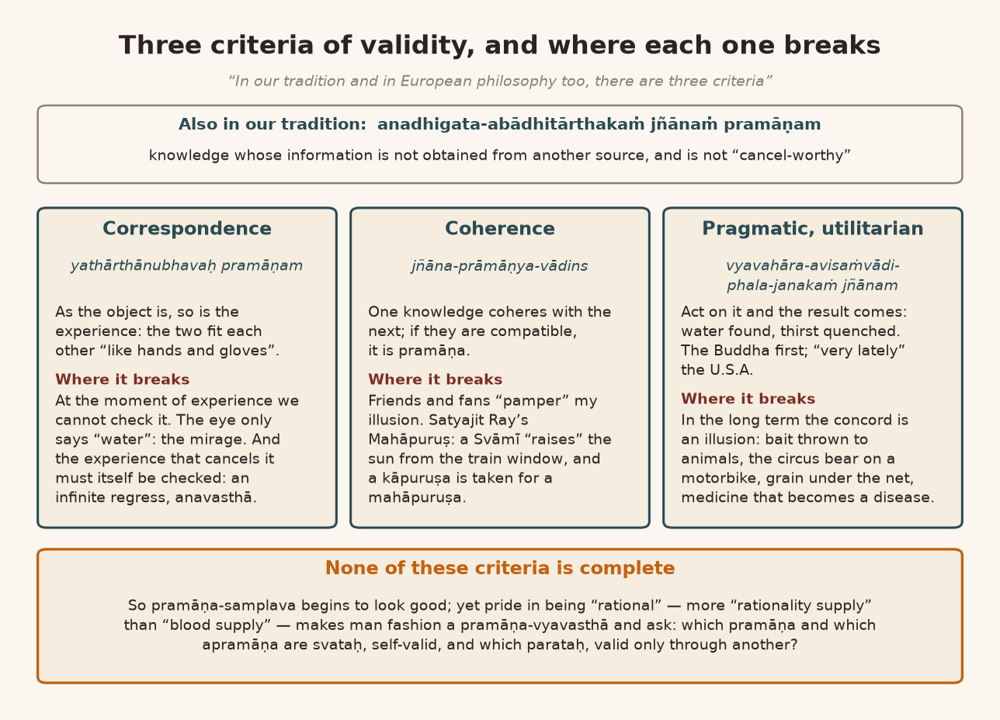
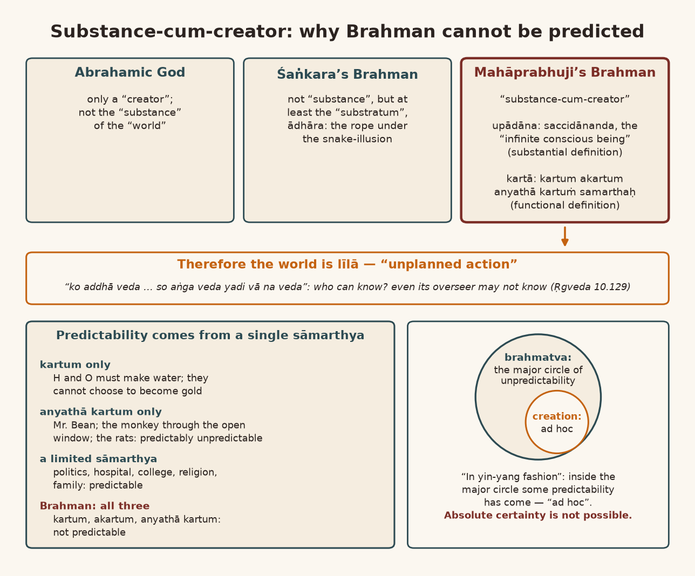
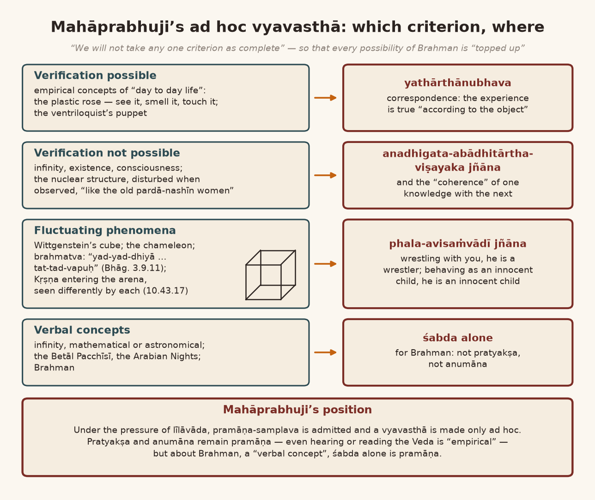

*English rendering of a spoken discourse on the Śāstrārtha Prakaraṇa of the Tattvārthadīpanibandha, translated from a Hindi ASR transcript. The speaker's conversational register, humour, digressions, code-switching, and student exchanges are preserved. Editorial flags: ‹ › conjectural restoration of a garbled reading; ‹?› uncertain reading; ‹…› inaudible or unrecoverable passage; ‹श्रवणाधारित› text given as heard, pending verification against a printed edition. Verses whose standard text is beyond doubt have been silently restored to the received editions.*

*Session of 25 July 2026. Part 1 covers the recording from its beginning to 01:22:56; Part 2 continues from 01:23:00.*

# 1. Pramāṇa-samplava and Pramāṇa-vyavasthā: Pāṇini's Tiger and the Kalbadevi Stampede

*[The session opens with the speaker reciting the kārikā on the four pramāṇas.]*

> वेदाः श्रीकृष्णवाक्यानि व्याससूत्राणि चैव हि ।  
> समाधिभाषा व्यासस्य प्रमाणं तच्चतुष्टयम् ॥
>
> *vedāḥ śrīkṛṣṇavākyāni vyāsasūtrāṇi caiva hi |*  
> *samādhibhāṣā vyāsasya pramāṇaṁ tac catuṣṭayam ||* (Tattvārthadīpanibandha, Śāstrārtha Prakaraṇa 7)
>
> [The Vedas, the words of Śrī Kṛṣṇa, the sūtras of Vyāsa, and the samādhi-language of Vyāsa: that fourfold is pramāṇa.]

After this definition, we look at pramāṇa. In this *pramāṇa-mīmāṁsā* there are some "presuppositions", and we will have to understand these "presuppositions".

The very first thing in this subject — this is an absolutely "fundamental problem" — so the Lord Buddha ‹…›: pramāṇa-samplava or pramāṇa-vyavasthā? Samplava means "chaos". Vyavasthā means "organized". So, are we to take pramāṇa in a "chaotic way", or are we to take it in some "organized form"? Now understand one thing carefully. The "organized form" of pramāṇa is the subject of philosophers, the subject of "scientists". The ordinary man gets his work done with pramāṇa-samplava alone. Whatever is understood at this moment, that is pramāṇa; what is not understood, aprāmāṇya. So what did that make pramāṇa? Our work, our dealings, go on with this. Rather, in practical dealings it is only this that runs — because who is going to do all this fuss?

Understand carefully what the need for pramāṇa is. The need for pramāṇa is this: we have to "interact" with our "surroundings". While "interacting" we are not able to be certain how to "interact", because the "picture" is not clear. What is the "nature" of the "surroundings"? That too we do not fully know. And what is ours — our "aptitude" or "attitude" — that too is not "clear" to us, in "common sense". But work goes on just like this.

And I'll tell you something funny. Pāṇini, who wrote the grammar of Sanskrit — there is a "joke" about him; I don't know whether it is history. It is said that he was going somewhere, and somebody said, "Brother, there is a *vyāghra*, a tiger, ahead." Now, because he was a "grammarian", he began to think about the "etymology" of the word *vyāghra*. How was the word *vyāghra* formed? And in that "etymology" this came to his mind: *viśeṣeṇa āsamantāt jighrati* — the one who smells in a "specific way", "in all respects", is named *vyāghra*. So it smells — it must be smelling. Thinking "etymologically" like this, he reached the very "spot" where the tiger was. And the tiger ate him — so they say. So understand one thing carefully: a lot of this "theoretical knowledge" is "dangerous". And "practical knowledge", "understanding", does not fall into all these messes.

I often give an example: the Hindu–Muslim riot that happened here. Some municipal inspector had come — ‹Khairnar›, or who was it — and at that time he "attached" some of Dāūd's property, and then Dāūd got a riot started. This was at the time of the Rām Janmabhūmi turmoil. At that time I was coming like this from Kalbadevi, and suddenly a stampede started on the road. All the shops shut; everybody started running. I too, "practically", started running. Run — what else to do? But how far to run? Because Kalbadevi Road, from ‹Dhobi Talao› to the Moṭā Mandir, is very long. What happened, what had happened? I asked somebody, I said, "What happened?" And a man said, "A cow butted someone with its horn."

**A listener:** From that?

**Speaker:** From that this stampede has started. And as soon as the stampede started, all the shops shut. I said, "The cow isn't butting us — why are we running, brother?"

That is "practical sense": brother, everyone is running, so run — who knows what's about to happen. Like this, once, on the twenty-sixth of January‹?›, a flood came here in Bombay. The flood came, the water filled up, everything happened, there was a great storm here — at ‹Saccidānanda-jī's›‹?› place, everything there filled with water. So the shopkeepers called for their pumps and had the water emptied. When that water was being emptied — then, a very big flood came! Everybody started running. In our house too, everybody started running: "Run, run, the flood has come!" Then: "Where has the flood come from?" — "It has come out of the sea; it came from the ‹Juhu› side, didn't it — it has come out of the sea." So, running, where will we go — in Bombay? *Bhale hamṇāṁ vicārvānuṁ nathī, bhāgo! Kyāṁ jaśuṁ? Bhale Kāndivalī bhāgo. Mane ke‹?› māro to Kāndivalīmāṁ koī ghar che nahīṁ, kyāṁ kyāṁ bhāguṁ? Ahīṁyā Pārlāmāṁ ja rahuṁ chuṁ* [All right, this is no time for thinking — run! Where shall we go? All right, run to Kandivali. I said, I have no house in Kandivali — where all am I to run? I live right here in Parle]. Later we found out that they had merely put a pump on and were having the cooperative store (*sahakārī bhaṇḍār*) emptied.

**A listener:** They were having the store emptied!

**Speaker:** Practical knowledge is like that: run! Run before you wake up — not *jāgo*, "wake up", but *bhāgo*, "run". A man does survive by that. And the one who starts thinking may even drown. That is true too. There is a saying in Haryanvi: *dhan dhan Mahātmā Gāndhī, jin Aṅgrez bhagāyā, jin Aṅgrez bhagāyā, ciṛiyoṁ bic bhel‹?› bhagāyā* ‹श्रवणाधारित› [blessed, blessed is Mahātmā Gāndhī, who drove the English away, drove them away like a *bhel*‹?› among the sparrows]. The sparrows are all pecking at the grain; at one *bhel* all the sparrows fly off, without thinking, "Brother, what happened?" So what it is, is that we have a "survival kit". It stays "alert" all the time. Because it stays "alert", it doesn't want to take a "risk". So it takes the "action" first; the "cognition" comes later. But those who "apply" a little "mind" — for them "cognition" comes first and "action" comes later; but in that there is a Pāṇini-like "risk". So this is a bit of a "gap" between "common sense" and *viśiṣṭa*, special, "sense". Anyway, this, Prabhu, is the very root of pramāṇa-samplava and pramāṇa-vyavasthā.

If we are doing pramāṇa-vyavasthā, then about what is the pramāṇa-vyavasthā done? For knowing which "object", which kind of "knowledge" is pramāṇa? And for knowing which "object" does which kind of "knowledge" have no prāmāṇya? This is a very important thing. As: for knowing form (*rūpa*) the eye is pramāṇa; for knowing smell the nose is pramāṇa; for knowing Saccidānanda‹?›, ‹śabda› is pramāṇa. Now if we do pramāṇa-samplava in this, the running-about starts — for "safety" — but somewhere or other it "flops". So, to think out the vyavasthā of the pramāṇas — of pramāṇa and prameya, the vyavasthā of the pramāṇas for every prameya — is necessary for the thinking person, and is not necessary for the active person. Now, is the active one more sensible, or is the thinking one more sensible? That can't be said just by looking at people. There are two kinds of people: some people are *kriyāśīla*, active; some people are *vicāraśīla*, thinking. Both have a few "pluses" and a few "minuses". The active have some "plus-minus".

# 2. Lakṣaṇa before Pramāṇa: The Kishangarh Langur, the Crow's Teeth, and the Buddha's Vultures

And pramāṇa-samplava too has some "plus-minus", and pramāṇa-vyavasthā too has some ‹…›. So under pramāṇa-vyavasthā, what was thought out is that first of all we should think this — because not every experience (*anubhūti*) is true. So in our tradition — I told you this — *lakṣaṇa-pramāṇābhyāṁ vastu-siddhiḥ*: this "criterion" was set. Because first of all, before being "guided" by a pramāṇa, we should consider its "possibility" or "probability". If, without considering "probability" and "possibility", we let ourselves be "guided" by pramāṇa, then pramāṇa too can "cheat" us. It is not that pramāṇa does not "cheat". And many times ignorance takes us onto the true path; illusion too takes us onto the true path. It is not that ignorance and illusion or doubt always lead us astray. Because a lot of animals who do not have pramāṇa-vyavasthā — they have pramāṇa-samplava — perform better than man in any "emergency situation". Man gets "trapped"; they don't get "trapped". Try an experiment somewhere — on a pigeon, on a dog, on an elephant, on a ‹cheetah› — they don't get "trapped" quickly. We get ‹trapped› quickly.

I mean, I have seen even this. Let me tell you something from our Kishangarh. A langur — we have a *burj*, a tower, there. On top of the *burj* there are stone eaves (*chhaprā*) fixed like this. The langur went to jump from one eave to another. That langur was so heavy that the eave broke from his jump. Taking the support of the breaking eave itself, he came back over here. If a man had been like that, he would have fallen and died. The monkey didn't die. Because their "reflexes" are so "powerful". Our "reflexes" have become "slow" because of thinking — "slowed down". The "reflexes" don't give their "NOC" that quickly. And since the animal does not have to think, it mostly ‹acts on› "reflex". A man jumps onto an eave like that, the eave falls, breaks — the man's falling becomes inevitable. But the langur did not fall. If you experiment like this with many animals, you will find out. Now all this is pramāṇa-samplava, not that vyavasthā. [A man], at that moment, would sit down to think: why did the stone eave break? Did it break from my weight, or did it break because it was weak? Had the cement worn away, so it broke? Very late, very late! But those who work at the level of "reflex", through the "autonomous nervous system", are more "successful". Not every time — the poor animals get caught too. Because till today I have not heard that any animal trapped a man by making a plan. And man has this capacity: not "relying" on "reflex", making plans, he brought even animals much, much more powerful than himself under his "control". These are the "plus-minus" of both. It is not that it's only like this.

So how to think out pramāṇa-vyavasthā? This is a matter of much thought. And it is not only for philosophy; it is in "day to day life" too — and not only that: in "science" too it has a very big "role". What Indian thought worked out was *lakṣaṇa-pramāṇābhyāṁ vastu-siddhiḥ*. First consider the possibility (*sambhāvanā*). After considering the possibility, then make an effort for its experience. For the possible thing — by what will its experience be true (*yathārtha*)? — make an arrangement for that: that the lakṣaṇa you made of anything — the lakṣaṇa you made, the definition (*paribhāṣā*) you made — according to that definition you have to "interact" with that thing. If the lakṣaṇa is not ‹for practice›, what is the need to make it?

There is a funny ślok in Sanskrit; if you like, read it:

> ‹काकस्य कति वा दन्ताः› मेषस्याण्डे कियत् फलम् ।  
> का वार्ता सिन्धुसौवीरे इत्येषा मूर्खविचारणा ॥
>
> *‹kākasya kati vā dantāḥ› meṣasyāṇḍe kiyat phalam |*  
> *kā vārtā sindhu-sauvīre ity eṣā mūrkha-vicāraṇā ||* (subhāṣita, ‹श्रवणाधारित›; the first quarter, inaudible in the recording, is restored from the speaker's explanation)
>
> [How many teeth has a crow? What is a ram's testicle worth? What is the news in Sindhu and Sauvīra? — This is the deliberation of fools.]

Now look: we eat food, chewing it with our teeth. The crow also eats food — so how many teeth must it have? Just sit down and think it over! ‹…› It doesn't chew with teeth. Every animal has a different way of chewing. One chews with its beak, one chews with its stomach. The python — it chews neither with its stomach nor with a beak. What does the python do? Whatever it eats, it wraps itself around it and breaks it — inside — wrapping it as around a tree. If it didn't wrap, the thing wouldn't break. So it wraps it inside, makes coils, and breaks it. That is its way of chewing. So to sit and think like this — that our teeth themselves chew, are chewing; the crow is also eating, so the crow too — how many teeth must the crow have? Just as we have three kinds of teeth, for gnawing, for biting, for chewing — how many teeth must the crow have? It is *mūrkha-vicāraṇā*, a fool's deliberation. In our "day to day life", in "science", this is not *mūrkha-vicāraṇā* — in "science" this is not *mūrkha-vicāraṇā*. *Kā vārtā sindhu-sauvīre*: brother, you are sitting in Hindustān; what is happening in the Sauvīra country, what is happening in the Sindhu country, what is happening in Pakistan — sit and think it over! Nowadays the whole thing can be seen on "TV", so there is no need for deliberation. But where thought [was needed] before — in old times there was no such "network" at all. So where you cannot reach, where news from there cannot reach you quickly — to sit and think what must be going on there right now: that is *mūrkha-vicāraṇā*. Today, if you don't read the newspaper, you are a fool! Now look, the "criteria" are changing.

All the "criteria" are changing. As of today, every person wants to become omniscient, *sarvajña*, by reading the newspaper in the morning: what is happening "all over world". After knowing that, he begins to do his work in his world. And many people can't even go to the "toilet" without reading the newspaper — they'll take ‹the newspaper› into the "toilet" too!

That is, every person first wants to become *sarvajña*, and then wants to become *kartavyajña*, one who knows his duty. In old times they understood that those who are *sarvajña* must be the jñānīs, the maharṣis. One should become *kartavyajña*: first understand what I have to do; don't get into the quarrel of becoming *sarvajña*. Because the Lord Buddha says this about Mahāvīra:

> दूरं पश्यतु वा मा वा तत्त्वमिष्टं तु पश्यतु ।  
> प्रमाणं दूरदर्शी चेदेत गृध्रानुपास्महे ॥
>
> *dūraṁ paśyatu vā mā vā tattvam iṣṭaṁ tu paśyatu |*  
> *pramāṇaṁ dūradarśī ced eta gṛdhrān upāsmahe ||* (Dharmakīrti, Pramāṇavārttika, Pramāṇasiddhi chapter; the speaker attributes it to the Buddha)
>
> [Let him see far or not; let him see the truth that matters. If the far-seer is the authority, come, let us worship vultures.]

*[The speaker recites the verse in the form* pramāṇaṁ sarvadarśī cet etān gṛdhrān upāsmahe *and* sarvaṁ vetti na vā vetti, iṣṭaṁ vetti *‹श्रवणाधारित›, and explains:]* Whether he knows everything or doesn't know — what is the use of that? Does he know what is wanted (*iṣṭa*) or not — does he have knowledge of what is to be done or not? And *pramāṇaṁ dūradarśī cet*: if you take the far-seer as pramāṇa, then *etān gṛdhrān upāsmahe* — the vulture that is ‹up in› the sky can see a little mouse walking below; so accept it most of all! Why do you accept Mahāvīra? Like this the Lord Buddha made fun of Mahāvīra.

So what is all this? It is the "problem" about different [kinds of] prāmāṇya, which I am telling you. In our tradition it was settled that from lakṣaṇa the possibility becomes manifest, and from pramāṇa comes its experience. Apart from that, we can't do anything more. If there is experience but it is not possible, the knowledge is incomplete. The possibility is felt — the intellect feels the possibility — the problem is "acceptability": "experience and acceptability". So, does it have "acceptability" for us or not? Check this first. A man will say anything at all, and experience too will make you do anything at all. How much "acceptability" does it have? First, on the basis of "possibility", consider its "acceptability"; after that, consider the experience. We have considered two things; more than this we can't do: "there comes our limitation". So Indians kept this "criterion", but from there this "dispute" arose. The "dispute" that arose was this: what kind of anubhūti should have "acceptability"? "Acceptability" means "validity". What kind of lakṣaṇa should have "validity"? What kind of anubhūti should have "validity"?

# 3. Three Theories of Validity: The Mirage, Satyajit Ray's Sun-Raising Svāmī, and the Bear on a Motorbike

For this, in our tradition and in "European" philosophy too, there are three "criteria": "A theory of correspondence. A theory of coherence." And a "pragmatic" one, which is called the "utilitarian theory". In our tradition it was defined like this: *anadhigata-abādhitārthakaṁ jñānaṁ pramāṇam*. *Anadhigata*: whose "information" is not obtained from some other "source". And the "information" we have got should not be "cancel-worthy" either — rely on it, taking it as pramāṇa. This was one "criterion". One "criterion" was *yathārthaṁ jñānaṁ*, *yathārthānubhavaḥ pramāṇam*: the "theory of correspondence". That is: as the "object" is, if the experience is like that, it is pramāṇa. Between the experience and the "object" there should be a relation of fitting each other, like "hands and gloves". The biggest problem that came in this theory was this: at the moment when an experience is happening, at that moment we cannot "check" whether the "object" is as experienced or not. After a while it will have to be "checked" through some other "source of information". As: something is seen by me with the eye —

**A listener:** A mirage is seen in the "desert".

**Speaker:** Now, is it seen as real, or unreal? So I'll ask the eye — "Brother, it says so" — what will the eye do? The eye will say, "Water is seen." So how will we decide whether the experience that is happening is real or not — whether the experience is as the thing is, or something independent is happening? We will run and run. We will run to where the water is seen; there we did not find water. Then we will understand that this experience was not real: aprāmāṇya. This problem, at that time... And the one that is cancelling it — how real, in turn, is that experience? Another question comes. So an "infinite regress" was happening — what is called *anavasthā*.

Some people thought like this — the *jñāna-prāmāṇya-vādins*. There are *vastu-prāmāṇya-vādins* and *jñāna-prāmāṇya-vādins*. The *jñāna-prāmāṇya-vādin* thought: no, that "correspondence theory" is not as "reliable" as the "coherence theory" is "reliable". That is, one knowledge "coheres" with another knowledge, so to speak — is it "compatible" or not? If it is "compatible", it is pramāṇa. In this too there was one trouble. I'm giving an example — "just" for the sake of example. Suppose I got an illusion — he got an illusion — that I am this, I am that; and two or four men together even "pampered" my illusion: these are my friends, or my fans. So "coherence" happened, didn't it? Keep in mind: there was a film by ‹Satyajit Ray›, *Kāpuruṣ Mahāpuruṣ*. In *Mahāpuruṣ* ‹he› shows that there is a four o'clock morning train; a poor husband and wife have gone and sat in the train. Meanwhile‹?› a Svāmījī comes and sits, and from the compartment window on the east side he tells the Sun, "Come up, come up, come up!" After that the Sun comes up. They say, "You brought it up?" He says, "Yes, it was feeling a little shy, so we said, 'Come up,' and it came up." They fall to thinking: brother, he brings up the Sun — who knows what kind of Svāmījī he must be! He was not a mahāpuruṣa; he was a kāpuruṣa.

‹Satyajit Ray› himself showed this in that film. "Very interesting story." "Coherence" happened or not? He was saying, "Come up, come up — no, no, not that much — a little more up, a little more up," and then, exactly — "Sūryadeva, yes, you're all right now" — this he was saying, and it came up. "Coherence" happened, didn't it? Taking it as pramāṇa — what pramāṇa? "Relying" on the "theory of coherence", they took him for a mahāpuruṣa. Now in fact he was a kāpuruṣa. Satyajit Ray showed this there, in that film.

Going the opposite way from this, "dissatisfied" with this, a generation came. The "theory" that came is that the knowledge that is happening — *vyavahāra-avisaṁvādi-phala-janakaṁ jñānaṁ ‹pramāṇam›*: knowledge that does not clash with practice and produces the result. When, after your understanding of the knowledge, you "act", become "proactive" — is it "coordinating" with your "action" or not? Are you paying attention? And the result of that "action" — are you getting that result or not? If you are getting it, it is pramāṇa; if you are not getting it, it is apramāṇa. As we understand by example: we saw water somewhere. Seeing the water, we took the "action" of running there. We got the water. After getting the water, our thirst was quenched. So it is water. This is a "theory of utilitarian" — it is called the "pragmatic theory". This ‹theory› was "proposed" very "lately" by America: the "U.S.A.'s theory" is the "utilitarian theory". ‹Among us›, the Lord Buddha said it first: as for knowledge, its "coherence" too is not "reliable", and its "correspondence" is difficult to know. So what is "possible" is only this: *vyavahāra-avisaṁvādi-phala-janaka jñāna* — what is not "discoordinating" with your "action"; and if the "result" of the "action" is being "fulfilled", then it is knowledge. "By that time" — until this happens — no knowledge is pramāṇa.

At first sight‹?› we now feel that this theory is the best "practical theory", but it is not so. A lot of knowledge, even while being *vyavahāra-avisaṁvādī*, even while producing the result, is not pramāṇa. In the "long term" one finds out — in the "long term" one finds out — that this concord with practice was also an "illusion". As with every animal, poor thing — this is the "problem": to lure every animal, man throws some fodder, and the poor animal thinks man is a friend. When they come near him, he catches them and makes ‹…›. Haven't you seen animals in the "circus"? Is it the bear's wish to wear pants and drive a *paṭpaṭī* in the "circus"? What benefit does it get — if the *paṭpaṭī* runs, so what? Without the *paṭpaṭī* — I mean a "motorbike" — it can run! But man makes it a slave. So that was *vyavahāra-avisaṁvādi-phala-janaka* knowledge. Animals are very often victims of this. How do they catch birds? They spread a net and scatter grain. The birds chirp a bit, and see that there is nothing troubling, so they come and sit; as soon as they sit, they get caught. It was *vyavahāra-saṁvādī*, wasn't it? They had come for grain; they are getting grain. All the medicine companies — that is just what they do: they give you a benefit for a while. As soon as there is a benefit, man is "trapped"; after that the medicine becomes a disease. *Vyavahāra-avisaṁvādi-phala-janaka* knowledge is in every medicine company. What are all the medicine companies doing? This very work. So we can understand this fact very well — that this "criterion" too is not "complete".

Consequently everyone feels that pramāṇa-samplava was good after all; one should not get into the mess of pramāṇa-vyavasthā. But such is the helplessness of man — of the intellect — ‹…›. Amitabh Bachchan's father was Harivansh Rai Bachchan. He wrote a poem, to the effect that man's nature is such that he could never find happiness in heaven, and could never endure the torment of hell: the humanity of man is strange. With the happiness of heaven he is never satisfied, and the torment of hell he cannot "tolerate": such is man's humanity. We can't bear the heat; if it rains, we get upset. The humanity of man is strange. In the same way, we can't bear pramāṇa-samplava, because we are intelligent. Because all of us — "rational" or not — have the pride of being "rational" crammed into our skulls, haven't we? And more "rationality" is being supplied than "blood supply"! The pride of being "rational" is crammed in, so agreeing with any "non-rational" thing is an insult to ourselves. I am not talking of an "irrational" thing; I am talking of a "non-rational" thing. "Non-rational" can mean "super-rational" too, and it can also mean "not rational" — which is the case of animals. And they don't get into "reasoning" there; they get their work done with pramāṇa-samplava.

So this is the root cause — pay attention to this. This is the root cause: man fashioned the "criteria" of pramāṇa-vyavasthā, and in it considered svataḥ and parataḥ. Which pramāṇa is svataḥ pramāṇa? Which pramāṇa is parataḥ pramāṇa? Which apramāṇa is svataḥ, and which apramāṇa is parataḥ? Now if you look at this "chart", you will understand this whole thing *[refers to the chart]*. *Ātā phoṭo pāṭhavto* [I'll send the photo now]. For one thing, from far away the ‹letters› often won't be visible in it; when the ‹photo› reaches you, you'll be able to see it properly.

{width=6.2in}

# 4. Cosmos and Chaos as Yin and Yang: Doubt, Certainty, and the Upgrading of God

I have shown it here *[refers to the chart]*. This "problem" is of "epistemology". "Epistemology" means the *mīmāṁsā* of the prāmāṇya of knowledge. In it the very first difficulty, the "problem", is pramāṇa-samplava and pramāṇa-vyavasthā. About pramāṇa-samplava too I have told you how it works — in a "chaotic way". What does ‹…› mean? Look, understand carefully. It is not bad all the time: "chaos" too has some "plus points". Just now, for instance, the Congress party was making "chaos" — but there was a "plus point", wasn't there? It is not necessary to think that ‹chaos› is always only bad. Even today there is a very big "problem" before "science": whether the "universe" is "cosmos", or what it is. People have different views. My view on this, "personally", is this: that between "cosmos" and "chaos" there is a ‹yin-yang› relation. In every "cosmos" a "chaos" is hidden, and in every "chaos" some "cosmos". ‹…› in the sign ‹…› this rule *[refers to the chart]*.

Yes, yes. So between "cosmos" and "chaos" the relation is ‹yin-yang›. Therefore, to take the side of any one — of "chaos" or of "cosmos" — is a half-baked, incomplete thing. I explain it like this — look, understand carefully: all doubtful (*saṁśayātmaka*) knowledge is "chaos"; all certain (*niścayātmaka*) knowledge is "cosmos". But every certain knowledge is born out of doubt itself, isn't it? And when you produced one certain knowledge, don't other doubts arise because of it? So every certain knowledge is born in doubt, and along with attaining that certain knowledge, some other doubts arise.

Shall I give you an example of this? Many religions which were originally "tribal religions" — those "tribal religions" held God to be the God of their own "tribe", not of the world ‹…›, because the tribal people had never gone outside the "tribe". When their "interaction" happened with "non-tribals", or with some "civilized society", then the "problem" came before them: then who is their God? Is he our God, or is he theirs? Now, consequently, they took their God to be all-doer, all-knowing, all-powerful (*sarvakartā, sarvajña, sarvasamartha*). Then no other God could stand before him. So then they "shifted": he is ours as well as yours. Now the "problem" became this: to stay loyal to our God there are some "criteria"; you don't keep those "criteria"; and if our God is all-knowing and all-powerful, how is he "allowing" you — not keeping those "criteria"? A problem arose, didn't it? First he was a "tribal God"; he became the "God" of "humanity". Look, this was so with Islam too; this was so with Christianity too; this was so with the Jains too, this was so with the Buddhists too; this was so with our own religion too ‹the speaker's characterization›. At first it was not even known that there could be a God of ‹the whole earth›. Then people were devotees of their own countries. When people started going around the earth, it was found: brother, there is Mother Earth too! Then — the earth is very small, because we had no knowledge of "astronomy". When knowledge of "astronomy" came, that doubt — that God is only of the earth — went away. The God of the *brahmāṇḍa* came. Fine — God's "upgradation"! God is of the *brahmāṇḍa*. Then is he only of human beings, or of non-humans too? So out of every doubt one certainty is born; out of every certainty —

**A listener:** Doubt.

**Speaker:** — once again a big doubt is born. ‹…› This is the ‹yin-yang› relation — and doubt and certainty: because of their being in a ‹yin-yang› relation, therefore, to take the side of one — of "cosmos" or of "chaos", of doubt or of certainty — both are incomplete things. Doubt too has just as much of a "role" in "understanding". So, if there were no doubt, no certainty would ever be a firm certainty. The certainty that comes after doubt — that certainty is firm. And the certainty in which you never had any doubt — whether that certainty of yours is a certainty at all, even saying that seems very doubtful. Because we don't even know what the "counter" to it could be. So all this is a "problem" — it is an "epistemological problem", isn't it? Understand this carefully. This "problem" is not "physical". This "problem" is not of "psychology". This "problem" is not "moral". It is not of "law"; it is not "social"; it is "epistemological" — this is a problem of knowledge. "How to be sure. How to acquire certainty. It's a very very big problem, very big problem. If you don't think it's a problem, then it isn't." But start thinking even a little — start thinking even a little — and this problem comes before you with its mouth wide open. Very fearsome.

# 5. Svataḥ and Parataḥ: The Monkey Who Says "After All, You Are My Product"

So what I mean to say is this: in what was thought out in our tradition for pramāṇa, we created a vyavasthā in Indian philosophy. And it said: first decide which pramāṇa and apramāṇa is svataḥ and which is parataḥ. Svataḥ means "self valid". And parataḥ means that whose "validity" must come "through" something else. As: what we see with the eye — "is it self valid knowledge?" If it is "self valid knowledge", then the "horizon" too should be "true". If this "knowledge" is "self valid", then the "rainbow" too should be "true". If this "knowledge" is "self valid", then the "reflection" in the "mirror" too should be "true". The "mirage" too should be "true", because the eye sees all of them. Is it all wrong, or not? No, no: this account of yours is not "self valid"; it needs some other "validation". That "validation" had to be brought. There are two "possibilities". That what is seen by the eye — "define" it: what is its "nature"? If you were able to understand, to give a "definition" well — that what is seen by the ‹eye›, its "definition" is this — [then see whether] what is experienced by the eye "supports" that "definition" or goes "against" it. Now what is the "problem" in this? Look, understand carefully. If it goes "against" the way you "defined" it, you take that "knowledge" as "invalid" — "now that is a" [problem] — because the way you "defined" it: how did you "define" it? You "defined" it on the basis of experience. Without experience you cannot "define" anything. That of which there can be no experience at all — how will you "define" it? You "defined" on the basis of experience. And of experience there are "thousand instances"; catching hold of some two, four, five, ten "instances" from them, you "defined" it. After that, if some experience itself goes "against" it, you will say that this experience is apramāṇa. What a vicious circle it becomes! I have a picture. It's kept here — yes, this — at the "side", at the "side", at the "side" — no, no, here.

**A listener:** Yes, bhāī — the monkey one? Yes? This is the stone one‹?›.

**Speaker:** Yes. Yes, *jī*. It is by an "artist" from Calcutta. He had a "one man show" at the Jehangir Art Gallery. A very amusing "picture". There is a man who is making a monkey dance, having made the monkey [into a] man‹?›, and to ‹make it› dance he has put on a crown like God; he has taken himself to be God. But how little "self-confidence" he has — look at this carefully: in spite of making the monkey dance, he has tied its cord to his foot, lest the monkey run away while dancing. And the "artist" is showing that this man is, after all, only an evolution of the monkey. Look here. And the monkey is telling him, "Brother, have a little patience. 'After all, you are my product.'"

**A listener:** What a thing!

**Speaker:** Seeing this painting, I kept gazing at it for nearly twenty minutes: what is it trying to say? So the "artist" called me: "What, what are you seeing in it so much?" ‹I said›, "I am getting a lot of 'messages' in it." So I said, "If you will sell it, I want to buy it." The "artist" said, "No, this is not for selling, but I will certainly give you a 'copy'." So he gave me a "copy" — this one. "It's a proud possession of mine." This is a "highly philosophical painting". And this is exactly the mess that is happening with us: the knowledge — the certainty — which is the "product" of doubt, wants to make doubt dance: "Now I will decide how you have to 'act'; which side (*koṭi*) of doubt is 'acceptable', which side is 'rejectable' — 'I will decide'." But he doesn't have "confidence". Doubt is telling him, "Hold on, friend, hold on — 'after all, you are my product'. Before guiding me, just think what you are!" A very good painting. Beautiful. So what I mean to say is that it deserves to be kept before every "epistemology". I kept gazing at it for twenty minutes; I said, "He has said a very big thing." The "artist" too became pleased with me: "Of all the 'critics' who have come here, nobody understood what I am trying to say." He gave me "compliments".

**A listener:** Is there something in his hand too? Eh? Is there something in the hand? Like a sword? No — a ḍamaru. A ḍamaru.

**Speaker:** "Yes" — eh? — no, a ḍamaru, a ḍamaru, ‹…› to make it dance.

**A listener:** With the cord.

**Speaker:** And the cord.

**A listener:** This is a ḍamaru.

**Speaker:** And he doesn't have "confidence": with the ḍamaru he is making it dance, all right —

**A listener:** With the ḍamaru he is making it dance, all right.

**Speaker:** — and he has the cord caught on his foot, so that the monkey won't run away. And the monkey is telling him, "Wait, brother, wait."

**A listener:** "Rest is rest"‹?›.

**Speaker:** "Rest is waste"‹?› — "after all, you are my product."

**A listener:** Yes. ‹…› Something like a stick is visible — no, a stick is visible.

**Speaker:** Yes, a stick is visible — he is scaring it too, isn't he? He is scaring it too. So between knowledge and doubt there is this kind of relation. Just as by the darśana of the Virāṭ Puruṣa Arjuna's doubts were cut away, weren't they — in the same way, if you look at this, all your doubts will be cut away!

**A listener:** They were, weren't they! If you look at this, all doubts will be ‹cut away›.

**Speaker:** So — doubt and certainty. All right, put it back later, no "problem". The "problem" of knowledge, of "epistemology", is this. Under this "problem", what can we do? At most — we can "confine" ourselves somewhere or other: brother, "I think this". If I want to become God, I won't be able to become one. Wear the cap too — wear it for free — but the monkey will still make you dance. Even after becoming God, no "solution" is coming to me. And my becoming God — becoming "rational" — has no value in the monkey's eyes, because the monkey "behaves in" pramāṇa-samplava; yes, it doesn't believe in pramāṇa-vyavasthā. That must be why poor Rāvaṇa lost to the monkeys!

**A listener:** No!

**Speaker:** Because the monkey won't keep the rules of war. It will do pramāṇa-samplava, it will do *yuddha-samplava*: one will bite Mandodarī, one will bite him, one will bite someone else. How long will a man fight? Rāvaṇa, so mighty, lost to the monkey army; the main reason for it turned out to be just this: they believed in pramāṇa-samplava, in *yuddha-samplava*; they did not believe in *yuddha-vyavasthā*. A man's moves are fixed; a monkey has no fixed move at all — it will come at you from any move.

# 6. The Four Camps and Mahāprabhuji's Ardhajaratī: Half Old, Half Young

So understand this ‹thirst› of ours for knowledge — understand its "limitation". Understanding this, we have to understand pramāṇa-vyavasthā. If, without understanding this, we jump onto pramāṇa-vyavasthā, then what that monkey is saying is true: "after all, you are my pet"‹?›. "Do whatever you like, but don't forget that you are my product." Keep it in mind.

So in this matter of pramāṇa-vyavasthā that I was explaining to you, there is one more thing to understand: that the Lord Buddha holds that all pramāṇas, "basically", are not svataḥ. "By itself" no "understanding" is "valid" — no "understanding" of ours is "valid". And "invalidity" is "self evident"; "validity" is not "self evident". Some people hold: no, "validity" is "self evident", "as well as" "invalidity" is also "self evident". Some people hold: no, "validity" is not "self evident", but "invalidity" is "self evident". Some people take "invalidity" as "self evident" and do not take "validity" as "self evident". So altogether there are four sides (*pakṣa*) in this. That is what I tried to show here *[refers to the chart]*.

**A listener:** Svataḥ, parataḥ; pramāṇa parataḥ, svataḥ.

**Speaker:** In this — in this vyavasthā — this was the vyavasthā that had become current before Mahāprabhuji: all this knowledge is pramāṇa, all is ‹svataḥ› pramāṇa; the prāmāṇya of knowledge is svataḥ, but aprāmāṇya is parataḥ. This was the "constitution" of Vedānta. Mahāprabhuji ‹…›. The Buddha's siddhānta was — the Lord Buddha's siddhānta was — that aprāmāṇya is svataḥ. "Pramāṇa‹?› is self-evident for you. Unless you check it. And verify it. Don't rely on any knowledge." ‹In Sāṅkhya› a middle vyavasthā was this: that pramāṇa and apramāṇa are both svataḥ. And one vyavasthā was this: that pramāṇa and apramāṇa are both para[taḥ]. So it came to some four ‹camps›, didn't it? About all four of these "camps": Vallabha Vedānta has not accepted the "criterion" of pramāṇa-vyavasthā. It has accepted an *ardhajaratī*; it has accepted pramāṇa-samplava. ‹…› this is the subject. *Ardhajaratī* means half old, half young. How? Understand this carefully: in pramāṇa-samplava and pramāṇa-vyavasthā too, Mahāprabhuji holds an *ardhajaratī* — that *ardhajaratī*, *ardhajaratī* meaning half old, half young. That is why I told you that in every "chaos" there is "cosmos", and in every "cosmos" —

**A listener:** Chaos.

**Speaker:** — "chaos". If you pay a little attention, you will find out where Mahāprabhuji is "deriving" this from — "where lies the beauty of" Vallabhācārya. Mahāprabhuji is a brahmavādin. Now, how is he a brahmavādin? He does not take some "dead matter" as Brahman. Nowadays ‹…› something coming "parallel" to Brahman could be some "dead matter" too. "What does Brahma mean? Which includes everything, which excludes nothing." "Any matter can come." "Which includes everything" — like ‹…› electron, neutron, proton: the whole subject that is made of their "structure". "Which includes everything and which excludes nothing" — it could be Saccidānanda‹?›; it could be Śaṅkarācārya's māyā too. Why can't it be? If you think in terms of "possibility", why can't it be māyā? Everything is māyā; nothing is outside māyā. Yes, sir! If you want to accept neither māyā nor the E-N-P "structure" — today there is no such "proposal" in our country, but in Europe there is also a "Satanic religion", who believe only in Satan and do not believe in God, and even "worship" him ‹the speaker's characterization›. Suppose it is only Satan, and there is no God: "Which controls everything. Nothing is that without his control, which is not within his control — Satan also can." So any thing at all can be "replaced" in the place of Brahman, can't it? What is the difference of Mahāprabhuji's Brahman? Understand this carefully. Mahāprabhuji's Brahman has two special, main ‹aspects›. Saccidānanda — that is one thing — that is its "substantial definition": it is saccidānanda; that is, it is an "infinite conscious being" — an "infinite conscious being". And, because of being an "infinite conscious being", Mahāprabhuji gives one more ‹…› "functional definition" of it.

{width=6.2in}

# 7. Kartum Akartum Anyathā Kartum: Mr. Bean, the Monkey at the Window, the Nāsadīya Hymn, and the Two Deaf Men

That is: *kartum akartum anyathā kartuṁ samarthaḥ*. That is: as he has made, so he can make; and what he has made, if he does not wish, he can also not make. That is, it is not necessary that because Brahman exists there must be creation. Let him not create! He has created — so we see that he has. But if he does not want to make, let him not make. And if he wants to make not this kind but some other kind, he can do that too. This Mahāprabhuji calls *kartṛtva*. So this is the "quality" of kartṛtva of Brahman. So Brahman is upādāna too, and Brahman is kartā too. In what "aspect" is it upādāna? In the sense of being an "infinite conscious being", it is upādāna. And in the sense of being *kartum akartum anyathā kartuṁ samartha*, it is kartā too. So it is both the "substantial cause" and the "creator". The God of the Abrahamic religions is only a "creator"; he is not the "substance" of the "world". Śaṅkarācārya's Brahman is not "substance", but it is at least the "substratum". "There is a difference between substratum and substance." "Substratum" means *ādhāra*, the support. As the rope is the support of the snake: where the illusion of a snake occurs on a rope, that is the ‹substratum›; it is not the "substance" of the snake, of the snake's form. So in Śaṅkara's view it is at least ‹the substratum›‹?›. Mahāprabhuji's Brahman is different from both of these. Now Brahman is different from God, who is "creator", "all creator", and from that which is "all substratum": it is "substance-cum-creator". Because of this, Mahāprabhuji says that the world is a līlā of his.

What does this mean? Certainty here ‹…›. Absolute "certainty" is not "possible" here, because if he were [only] a kartā, he would become "predictable"; but the one who is *akartuṁ samartha* — if he doesn't do it, from where will you "predict"? You understand that H₂O will make water. That "water molecule", poor thing, is necessarily formed as water because of H₂O. But neither does H have so much capacity, nor does O have so much capacity, that if it wants to become [water] it becomes, and if it doesn't want to become, it doesn't. And instead of becoming a "water molecule", if it wanted to become a "gold molecule", a ‹gold atom›, it would become a gold atom. H and O don't have the capacity. Thus they don't have this capacity — not being *kartum akartum anyathā kartuṁ samartha*. Even of the electron and the proton, we too don't know whether they have the capacity of *kartum akartum anyathā kartum* or not. Because — the kind of "universe" that has been "derived" from the "subnuclear" — would it be only like this, or could it be of some other kind too; and if it had not wanted to be, it could also not have been — that too could have been. I mean: has the world arisen from *svabhāva*, its nature, or from *sāmarthya*, a capacity? Right now "science" has no "answer" to this. As far as Mahāprabhu is concerned, Mahāprabhuji says that its svabhāva is of being saccidānanda — of being an "infinite conscious being". "In addition to that", it has a sāmarthya too: *kartum akartum anyathā kartum*. Because of that, this whole world is a līlā. So when it is līlā, it is not "predictable" how the līlā will go. Where does "predictability" come from? From some single sāmarthya. If there is any one sāmarthya, it becomes "predictable". *Akartum*-sāmarthya: like, this one cannot do this work — so "we can predict". "This can do this work" — "there also predictability is possible". He is *anyathā kartuṁ samartha*? There too there is "predictability": brother, if this one comes, he will spoil the work!

Some man is *anyathā kartuṁ samartha* — like "Mr. Bean". If you watch "Mr. Bean", he is capable only of *anyathā kartum*; he is not capable of *kartum* — not capable of *kartum*. He gets no peace; he will do some work upside down. So that too is "predictable": brother, if he comes, he will surely do something *anyathā*, otherwise. That is why there is a saying in Sanskrit: *prasaraṁ na labhante hi yāvat ‹…› markaṭāḥ* ‹श्रवणाधारित›. You left the window open and the monkey got in. Then nothing remains "predictable" about in what form you will get your things back. Because making mischief without reason is the nature of the monkey and of the rat. What isn't food, they'll gnaw that too; and food also they'll gnaw. So of the *kartum akartum anyathā kartum* sāmarthya, the *anyathā kartum* sāmarthya is boundless in the monkey and in the rat. So there, everywhere, "predictability" comes: brother, a monkey has got in, so it must have ‹…›; then no "cosmos" will remain. Likewise any *anyathā kartuṁ samartha* — nowadays in "politics" too many such *anyathā kartuṁ samartha* people are coming. They do spread some "chaos" or other. It is not a question of "politics" alone. In the "hospital" too it is just like this. In "college" too it is the same question; in religion too it is the same question; in the "family" too it is the same question. Someone is *kartuṁ samartha*, someone is *akartuṁ samartha*, or some "family member" is *anyathā kartuṁ samartha*. So in all of them, because of a "limited" sāmarthya, there is "predictability". In Brahman, because there are all three kinds of sāmarthya, he cannot be "predictable".

That is why the Veda said, for the very first time:

> को अद्धा वेद क इह प्र वोचत् कुत आजाता कुत इयं विसृष्टिः ।  
> यो अस्याध्यक्षः परमे व्योमन् सो अङ्ग वेद यदि वा न वेद ॥
>
> *ko addhā veda ka iha pra vocat kuta ājātā kuta iyaṁ visṛṣṭiḥ |*  
> *yo asyādhyakṣaḥ parame vyoman so aṅga veda yadi vā na veda ||* (Ṛgveda 10.129.6ab, 7cd)
>
> [Who truly knows, who here can declare it — from where was it born, from where this creation? He who is its overseer in the highest heaven, he surely knows — or perhaps he does not know.]

‹…› is the "message". Who can know, who ‹…›? *Ko addhā veda ka iha pra vocat*: who can know, who can say this — where this creation is coming from and where it is going. And after that the Veda says a very big thing: *yo asyādhyakṣaḥ parame vyoman* — the one who is its "in-charge officer", in the *parama vyoman*: not in our sky; the one who is in charge of it in "galactical space". *So aṅga veda yadi vā na veda*: he knows — [or] even he does not know. We certainly don't know; he knows — [or] even he does not know. Because when it is līlā, it is not some "planned action", is it? It is "unplanned action". Because of being "unplanned action", which "action" Brahman will take — this cannot ‹be said›. In this sense it is līlā. Now, when it is this līlā — the whole creation is one līlā — it means that whatever is becoming "predictable" in it is becoming "predictable" in ‹yin-yang› "fashion", "in the major circle of unpredictability". The "major circle" is of "unpredictability": brahmatva. And within it, in creation, some "predictability" has come — "ad hoc".

Eh? If I give a simple example, you will understand. Like all our "motor organs": moving those "motor organs" is "voluntary", under the control of our wish. Just let a little illness come, a little old age come, a little "paralysis" happen — every one of these "motor organs" goes out of the control of our wish; they no longer remain "predictable". To many people it happens that when they hold something, they cannot hold everything; it slips. "Unpredictable". So for us — we can see this "unpredictability", can't we? What we were understanding as "predictable" is "predictable" in a "certain condition"; "otherwise, it is unpredictable". As: we hear with the ear — "predictable". When people can't hear, they also do this — "What did you say?" — and the "sound wave" strikes your hand, strikes this [part] of the ear. The "structure" of the ear is made just so that it takes the "sound wave" — look — inside. Now sometimes it is so small that it doesn't take the wave inside, so we enlarge it by doing this, as one enlarges with a "mike" — like this: "What did you say?" — so that the wave strikes here and goes in. So the wave went inside too; but is it necessary that one hears? If deafness has come, then however much you do this — "What did you say? What did you say?" ‹…›

Two deaf men met. One deaf man asked the other, "Brother, where — going to the 'garden'?" He said, "No, no, no, I'm going to the 'garden'." Both of them deaf! This one is asking, that one isn't hearing; this one isn't hearing what that one is saying. So he said, "Oh, oh, I understood that you're going to the 'garden'." — "No, no, I told you!" He said, "No, no, no — going to the 'garden'." ‹He› said, "Oh, oh, I understood that you're going to the 'garden'." So when two deaf men meet, the "dialogue" becomes like this.

**A listener:** They're going, so —

**Speaker:** It is "totally unpredictable" — the "answer" to "Where are you going?" "Going to the 'garden'?" — and the "answer" says, "No, no, no — I'm going to the 'garden'." How so? "Oh, oh, I understood that you're [going to the] 'garden'." The "question" and the "answer" aren't relating at all, are they? They became "unpredictable". So when will this "unpredictability" come and surround us? There is no "predictability" about it. I am not joking. I don't want to make you laugh. The "serious" "problem" of knowledge, of "epistemology" — I am explaining it to you while making you laugh; that is the only difference. It is a very "serious problem", and I am explaining it to you in a very "light way". So in this kind of "situation", Mahāprabhuji says this: that we will not take any one "criterion" as "complete"; we will take it as "incomplete" — so that every ‹possibility› of Brahman —

**A listener:** I see.

**Speaker:** — "top up" the "possibility"!

{width=6.2in}

# 8. Mahāprabhuji's Ad Hoc Vyavasthā: The Plastic Rose, Wittgenstein's Cube, Kṛṣṇa in the Arena, and Śabda for Brahman

That is: no prāmāṇya is svataḥ only; no prāmāṇya is parataḥ only. Svataḥ prāmāṇya can also be parataḥ; parataḥ prāmāṇya can also be svataḥ — or samplava. How Mahāprabhuji has made the vyavasthā — look at that. As far as the "theory of correspondence", the "theory of coherence", and the "pragmatic theory", the "utilitarian theory" go — about these too Mahāprabhuji's view is this: that in a matter where "verification" is "possible", there yathārtha-anubhava is pramāṇa. Where "verification" is not "possible", there *anadhigata-abādhitārtha-viṣayaka jñāna* is pramāṇa. Where the knowledge is ‹*phala-avisaṁvādī*› — that is, the "action" you are doing after the knowledge, the result of that "action" — you are getting that result from that knowledge — then it is ‹*phala-avisaṁvādī*›; then that knowledge is not *anadhigata-abādhitārtha* or yathārtha-anubhava pramāṇa. How has Mahāprabhuji "managed" this? Mahāprabhuji says: as far as the question of our intellect's experience is concerned — in "day to day life", where "verification" is "possible" — that is, you had some kind of experience; is that experience true or not? Is it "according to [the] object" or not? Is the "object" "confirming" it or not? — or if you can do "verification", then *yathārthānubhūti* is pramāṇa. "Normally" such "concepts" are "empirical concepts". As: a plastic rose flower is kept in front of you. Is it a rose or not? You can "verify" it. The eye sees it: a plastic one — rose-coloured‹?› — rose-coloured‹?›. By smelling, by touching, you can "verify". Then you will find out that the rose is not real; it is plastic. Some people produce voices: they produce voices out of a puppet, but the puppet doesn't speak — they keep speaking. ‹…› There is a very amusing word for it in Sanskrit: making a voice. So we feel that the puppet is speaking, but actually it isn't the puppet — those people are speaking. Now there an illusion is happening, isn't it — an illusion is happening — but there "verification" is "possible", isn't it? You can "decide" this. There the experience, the *yathārtha-anubhūti*, is pramāṇa.

Where "empirical verification" is not "possible" — we have many such "concepts" too. "First of all, the very concept of infinity, the very concept of existence, the very concept of the consciousness is empirically not valid. How can you empirically verify what is infinity?" Whatever is "finite", that you can "verify"; how will you "verify" the "infinite"? The matter of Brahman is very far off — [take] "mathematical infinity", "spatial infinity", the "infinity" of "time", the "infinity" of the electron, proton, neutron: there, how will experience be pramāṇa? Because "verification" is not "possible" at all, so how will you know whether it is *yathārtha* or not? "Scientists" say this: that if you go to see the "nuclear structure", it gets "disturbed" by being seen. It gets "disturbed" by being seen — like the old *pardā-nashīn* women! If you looked at them, they would get "disturbed". So the "atomic structure" used to get "disturbed" by being seen: you are seeing it with any "instrument", so, being "disturbed", it does not keep the form that is its true form. How will "verification" happen there? ‹…› So there Mahāprabhuji says that the "coherence" of knowledge is pramāṇa: one knowledge comes after another knowledge; they are "cohering" with each other, "agreeing" with each other. Without taking that knowledge as pramāṇa, it won't work there at all. "There is no choice for us left."

There can also be some "phenomena" like this — of which "phenomenon" an example [was given by] one Wittgenstein. He gave it in the form of a "square". I'll "draw" it and show you: Wittgenstein's "square" *[the cube is drawn on the speaker's chart for this session]*. Understand it. This "square" is a "fluctuating square". What is its "top", what is its "front", what is its "back"? It keeps ‹switching›. I mean: this is the "top" — [but] it can also be that, this not being the "top", this is its real "front". Now this is the "front" — this is the "front" — it is "fluctuating". So there are such "fluctuating objects" in the world too, aren't there — not just one. The biggest example of it is the chameleon: it keeps changing colour. In that circumstance, if you go to tie any one "concept" of yours onto it, it won't be "captured" at all, will it — what is itself "fluctuating"?

Brahmatva is "fluctuating" in this way. Why is it "fluctuating"? The Bhāgavata gives the reason very beautifully:

> त्वं भावयोगपरिभावितहृत्सरोज आस्से श्रुतेक्षितपथो ननु नाथ पुंसाम् ।  
> यद्यद्धिया त उरुगाय विभावयन्ति तत्तद्वपुः प्रणयसे सदनुग्रहाय ॥
>
> *tvaṁ bhāva-yoga-paribhāvita-hṛt-saroja āsse śrutekṣita-patho nanu nātha puṁsām |*  
> *yad-yad-dhiyā ta urugāya vibhāvayanti tat-tad-vapuḥ praṇayase sad-anugrahāya ||* (Bhāgavata Purāṇa 3.9.11)
>
> [O Lord, whose path is seen through what is heard, you dwell in the lotus of the heart of people, contemplated through bhāva-yoga; O widely sung one, whatever form they conceive you in with their minds, that very form you take, as a grace to the good.]

If someone, with his own bhāva-yoga, does your *paribhāvanā*, conceives you, then you take on that kind of body. So how you are — that is your business; what do we know? But we hold you in mind like this, so you come, taking on ten such bodies. It is a "totally instant fluctuating phenomenon". In that kind of case, how are we to make certain what Brahman is? As when Bhagavān entered in Mathurā:

> मल्लानामशनिर्नृणां नरवरः स्त्रीणां स्मरो मूर्तिमान् गोपानां स्वजनोऽसतां क्षितिभुजां शास्ता स्वपित्रोः शिशुः ।  
> मृत्युर्भोजपतेर्विराडविदुषां तत्त्वं परं योगिनां वृष्णीनां परदेवतेति विदितो रङ्गं गतः साग्रजः ॥
>
> *mallānām aśanir nṛṇāṁ nara-varaḥ strīṇāṁ smaro mūrtimān gopānāṁ sva-jano 'satāṁ kṣiti-bhujāṁ śāstā sva-pitroḥ śiśuḥ |*  
> *mṛtyur bhoja-pater virāḍ aviduṣāṁ tattvaṁ paraṁ yogināṁ vṛṣṇīnāṁ para-devateti vidito raṅgaṁ gataḥ sāgrajaḥ ||* (Bhāgavata Purāṇa 10.43.17)
>
> [To the wrestlers a thunderbolt, to men the best of men, to women Love incarnate, to the cowherds their own kinsman, to the wicked kings a chastiser, to his parents a child, to the lord of the Bhojas death, to the ignorant the gross cosmic form, to the yogīs the supreme reality, to the Vṛṣṇis their highest deity: so was he known as he entered the arena with his elder brother.]

*Mallānām aśaniḥ*: the band of wrestlers felt that some lightning had struck, was about to strike. *Nṛṇāṁ nara-varaḥ*: the kings felt that some king was coming. *Strīṇāṁ smaro mūrtimān*: the women felt that Kāmadeva himself had come. *Gopānāṁ sva-janaḥ*: the cowherds felt, here is our own cowherd boy come. *Asatāṁ kṣiti-bhujāṁ śāstā*: those who were kings felt, no, some other king has come, one who punishes. *Sva-pitroḥ śiśuḥ*: the mother and father felt — Devakī and Vasudeva felt — why, this is our child. *Mṛtyur bhoja-pateḥ*: Kaṁsa felt that death itself had come. *Virāḍ aviduṣām*: those who were ignorant found him very unpleasant — what sort of boy is this! *Tattvaṁ paraṁ yoginām*: the yogīs felt that the supreme tattva, paratva itself, had come. *Vṛṣṇīnāṁ para-devatā*: the Vṛṣṇis felt that Viṣṇu himself had come. This kind of "fluctuation" — "fluctuating". Vallabhācārya's Śāstrārtha Prakaraṇa‹?› ‹…› — it cannot be imprisoned in your "definition", can it?

**A listener:** It can't be.

**Speaker:** "You cannot capture him by defining it." In that situation, Mahāprabhuji says: ‹*phala-avisaṁvādi*› *jñānam*. Do you get the meaning?

**A listener:** *Hoy* [yes].

**Speaker:** If he is ‹wrestling› with you, then he is a ‹wrestler›. To someone he seems a child, an innocent boy; and he is behaving like an innocent boy — so he is an innocent boy. ‹…› in ‹vyatireka›‹?› pramāṇa, it is not *anadhigata-abādhitārtha-viṣayaka jñāna*, because it can also be sublated. And it isn't "coherence" either, because I am saying, brother, it is like this, and he is saying, no, not like this, it is like that. Not "coherence" either — not "coherence" either. ‹*Phala-avisaṁvādī*› knowledge too is pramāṇa. Therefore Mahāprabhuji has accepted total ‹*visaṁvāda*›‹?›. "Considering the līlātmaka aspect of Brahman" ‹…›: so whatever old philosophies there were — "epistemological stands" — in them Mahāprabhuji, under the "pressure" of *līlāvāda*, instead of pramāṇa-vyavasthā, has "admitted" only pramāṇa-samplava. But one pramāṇa-vyavasthā — an "ad hoc" pramāṇa-vyavasthā — Mahāprabhuji is telling us in it: that some "concepts" can also be "verbal", can't they? As today there is the "concept" of *ananta*: the "concept" of "infinity" is a "verbal concept" for us. "We cannot verify it empirically, what is infinity." So it is a "verbal concept". Whether it is "mathematical infinity" or "astronomical infinity", that too is a "verbal concept"; whether it is "nuclear wave infinity", that too is a — "verbal concept" for us. So it is a "verbal concept". For a "verbal concept", Mahāprabhuji says that what is "verbal" — that is, "testimony" — that alone is pramāṇa. That is why Mahāprabhuji is saying: let us go on accepting this one vyavasthā — that for Brahman, śabda alone is pramāṇa; pratyakṣa and anumāna are not pramāṇa. Śabda alone is pramāṇa, because it is a "verbal concept".

Now, take this — understand the matter carefully. Nowadays it no longer comes into people's reading and writing. In old times, in our Hindustān, the *Betāl Pacchīsī* was current: the tale of King Vikramāditya and the Vetāla. Likewise there were the "Arabian Nights", current in Arabia. There are many such "stories". Their "characters" — is the "concept" of those "characters" "verbal" or not? Will you get to see such a "character" anywhere? If you want to understand anything about it, you will be able to understand it "verbally", won't you? ‹…› won't happen; it won't work in "logic", because it is "conceived". So "verbal" — "verbal testimony" will be of use, won't it? Therefore the "concept" of Brahman is a "verbal concept". Therefore "verbal testimony" alone is pramāṇa there — not pratyakṣa and the rest.

This does not mean that Mahāprabhuji does not accept pratyakṣa as pramāṇa. Many people, out of foolishness — in "academic circles" too, in our own sampradāya too — do this kind of "boasting", without understanding, without reading Mahāprabhuji: that in Vallabhācārya's view only *vedāḥ śrīkṛṣṇavākyāni vyāsasūtrāṇi caiva hi, samādhibhāṣā vyāsasya pramāṇaṁ tac catuṣṭayam* — only four are pramāṇa, and there is no other pramāṇa at all. Arre bhāī, if there is no other pramāṇa, then if you won't even hear the Veda, how will it be pramāṇa? So hearing — where did it remain a "verbal" pramāṇa? Hearing became an "empirical" pramāṇa! In the old days you heard the Veda; it came through śruti. You can read it too. Arre, "Google Guru" ‹tells› you the Veda — so "Google Guru" is pramāṇa too! ‹…› the pramāṇa of the Veda — "Google Guru" became pramāṇa. ‹…› So it is not that — that Mahāprabhuji takes śabda as pramāṇa does not mean that he does not accept pratyakṣa as pramāṇa, does not accept anumāna as pramāṇa. Mahāprabhuji too has accepted them as pramāṇa. But about Brahman —

*[The discourse continues in Part 2.]*

{width=6.2in}

# Brief Summary of Part 1

**Philosophical Content.** After the kārikā naming the fourfold pramāṇa, the speaker sets out the "presuppositions" of *pramāṇa-mīmāṁsā*. The first and fundamental problem of epistemology is whether pramāṇa is taken chaotically (pramāṇa-samplava: whatever is understood now counts as pramāṇa) or in an organized way (pramāṇa-vyavasthā: which kind of knowledge is pramāṇa for which object). The ordinary person, like the animal, lives by samplava — action first, cognition later — and often survives emergencies better; the thinker reverses the order, plans, and can master far stronger animals, but runs Pāṇini's risk; both have pluses and minuses. Indian thought set the criterion *lakṣaṇa-pramāṇābhyāṁ vastu-siddhiḥ*: the definition shows the possibility, and so the acceptability, of a thing, and pramāṇa gives the experience of it; beyond these two "there comes our limitation". The dispute is over which experience and which definition have validity. The Indian *anadhigata-abādhitārtha* criterion stands beside three criteria shared with European philosophy, and each of the three fails: correspondence (*yathārthānubhava*) cannot be checked at the moment of experience and falls into infinite regress; coherence can be a shared, pampered illusion; the pragmatic test (*vyavahāra-avisaṁvādi-phala-janaka*, first given by the Buddha, "lately" by America) can be a long-term trap. Pride in rationality nonetheless drives man to build a vyavasthā and to ask which pramāṇa and apramāṇa are svataḥ (self-valid) and which parataḥ (valid through another). In the speaker's personal view, cosmos and chaos, certainty and doubt, stand in a yin-yang relation: every certainty is born of doubt and gives birth to new doubt, so taking either side alone is half the story, and "how to acquire certainty" is a purely epistemological problem. Validating what the eye shows (horizon, rainbow, mirror image, mirage) by a definition is circular, since the definition was itself built from a few instances of experience: certainty, the product of doubt, wants to make doubt dance. Four camps answer the svataḥ/parataḥ question: the "constitution" of Vedānta before Mahāprabhuji (prāmāṇya svataḥ, aprāmāṇya parataḥ), the Buddha (aprāmāṇya svataḥ), a "middle" system (both svataḥ), and both parataḥ. Vallabha Vedānta takes none of them as the criterion and holds an *ardhajaratī*, "half old, half young". The ground of this is brahmavāda. Brahman is not merely "that which includes everything" — a slot that dead matter, māyā or Satan could fill — but has a substantial definition (saccidānanda, the infinite conscious being, hence upādāna) and a functional definition (*kartum akartum anyathā kartuṁ samarthaḥ*, hence kartā): "substance-cum-creator", unlike the Abrahamic God (creator only) and Śaṅkara's Brahman (substratum only). The world is therefore līlā, unplanned action. Predictability comes only from a single, limited capacity; Brahman has all three, so absolute certainty is impossible (in the Nāsadīya hymn even the overseer may not know), and whatever is predictable is an ad hoc island inside the major circle of unpredictability. Mahāprabhuji therefore takes no criterion as complete, admits samplava under the pressure of līlāvāda, and makes only an ad hoc vyavasthā: correspondence where verification is possible (empirical concepts); *anadhigata-abādhitārtha* and coherence where it is not (infinity, existence, consciousness, the nucleus disturbed by observation); *phala-avisaṁvāda* for fluctuating phenomena such as brahmatva, which takes whatever form its devotees conceive; and, because Brahman is a verbal concept, śabda alone as pramāṇa for Brahman. This does not reject pratyakṣa and anumāna, which Mahāprabhuji also accepts — hearing or reading the Veda is itself empirical. Part 1 breaks off at "But about Brahman —".

**Major Analogies and Stories.** Pāṇini working out the etymology of *vyāghra* until the tiger eats him; the stampede on Kalbadevi Road at the time of the riots (‹Khairnar›, Dāūd), all because "a cow butted someone"; the Bombay "flood" that was only a cooperative store being pumped out, with "not *jāgo* but *bhāgo*" and the Gujarati exchange about Kandivali and Parle; the Haryanvi saying on Gandhi and the sparrows; the "survival kit" that acts before it cognizes; the eye for form, the nose for smell; the Kishangarh langur saving himself on a breaking stone eave, and reflexes that give their "NOC" late; no animal ever trapping a man by a plan; the crow's teeth, the python's way of "chewing", and the news from Sindhu-Sauvīra as a fool's deliberation; reading the newspaper to become sarvajña, even in the toilet; the Buddha mocking Mahāvīra's omniscience with vultures that spot a mouse from the sky; hand and glove; the mirage and the infinite regress; friends and fans pampering an illusion; Satyajit Ray's *Mahāpuruṣ*, the Svāmī who "raises" the sun from the train window; water found and thirst quenched; bait thrown to animals, the circus bear in pants on a motorbike, birds under the net, medicine companies; Harivansh Rai Bachchan's lines on heaven and hell; more "rationality supply" than blood supply; the Congress party's "chaos"; tribal gods upgraded to the God of humanity, of the earth, of the brahmāṇḍa, and the new doubt about non-humans; horizon, rainbow, mirror image and mirage; the Calcutta artist's painting at the Jehangir Art Gallery — a crowned man making a monkey dance with a ḍamaru, its cord tied to his foot, the monkey saying "After all, you are my product"; Arjuna's doubts cut away by the darśana of the Virāṭ Puruṣa; Rāvaṇa losing to the monkeys' *yuddha-samplava*; dead matter, māyā and Satan as fillers of "that which includes everything"; the rope and the snake; H and O, which cannot choose to become gold; Mr. Bean; the monkey through the open window, and the rats; politics, hospital, college, religion and family; the overseer in the highest heaven; motor organs failing in illness, old age and paralysis; cupping a hand to the ear; the two deaf men "going to the garden"; "top up" every possibility; the plastic rose; the ventriloquist's puppet; the nucleus disturbed by observation "like the old pardā-nashīn women"; Wittgenstein's fluctuating cube ("square"); the chameleon; Kṛṣṇa entering the arena, seen differently by each onlooker; the wrestler and the innocent child; the *Betāl Pacchīsī* and the Arabian Nights; "Google Guru".

**Technical Frameworks and Citations.** Jñāna-pramāṇa-śāstra (epistemology); pramāṇa-samplava and pramāṇa-vyavasthā; anirdhārita-prāmāṇya and prāmāṇya-nirdhārita (from the speaker's chart); prāmāṇya and aprāmāṇya, each svataḥ or parataḥ; lakṣaṇa, anubhūti, adhyavasāya (niścaya); saṁśaya and niścaya; *lakṣaṇa-pramāṇābhyāṁ vastu-siddhiḥ*; *anadhigata-abādhitārthakaṁ jñānaṁ pramāṇam*; *yathārthānubhavaḥ pramāṇam* (correspondence); coherence (jñāna-prāmāṇya-vādins and vastu-prāmāṇya-vādins); *vyavahāra-avisaṁvādi-phala-janakaṁ jñānam* (pragmatic, utilitarian); anavasthā; kriyāśīla and vicāraśīla; sarvajña and kartavyajña; ardhajaratī; brahmavāda; saccidānanda as substantial definition and *kartum akartum anyathā kartuṁ samarthaḥ* as functional definition (kartṛtva); upādāna and kartā; substance and substratum (ādhāra); svabhāva and sāmarthya; līlā and līlāvāda; brahmatva; verbal concepts and śabda-pramāṇa. Verses: *vedāḥ śrīkṛṣṇavākyāni vyāsasūtrāṇi caiva hi …* (Tattvārthadīpanibandha, Śāstrārtha Prakaraṇa 7); *dūraṁ paśyatu vā mā vā …* (Dharmakīrti, Pramāṇavārttika, Pramāṇasiddhi chapter; attributed by the speaker to the Buddha and recited in his own form, ‹श्रवणाधारित›); *ko addhā veda …* and *yo asyādhyakṣaḥ parame vyoman …* (Ṛgveda 10.129.6–7); *tvaṁ bhāva-yoga-paribhāvita-hṛt-saroja …* (Bhāgavata Purāṇa 3.9.11); *mallānām aśanir …* (Bhāgavata Purāṇa 10.43.17). Kārikā numbers and the text of the Śāstrārtha Prakaraṇa and its Prakāśa follow the Bombay 1943 edition (ed. Harishankar Shastri). Flags carried over: the subhāṣita *‹kākasya kati vā dantāḥ› meṣasyāṇḍe kiyat phalam …* ‹श्रवणाधारित›; the Sanskrit saying *prasaraṁ na labhante hi yāvat ‹…› markaṭāḥ* ‹श्रवणाधारित›; the Haryanvi saying on Gandhi ‹श्रवणाधारित›; conjectural restorations ‹Khairnar›, ‹Dhobi Talao›, ‹Juhu›, ‹Satyajit Ray›, ‹śabda›, ‹yin-yang›, ‹svataḥ›, ‹In Sāṅkhya›, ‹substratum›, ‹phala-avisaṁvādī›, ‹wrestling› and ‹wrestler›; uncertain readings marked ‹?›, among them "twenty-sixth of January‹?›", "Pramāṇa‹?› is self-evident", "after all, you are my pet‹?›", "Rest is rest / Rest is waste‹?›", "it could be Saccidānanda‹?›" and "total ‹visaṁvāda›‹?›".
