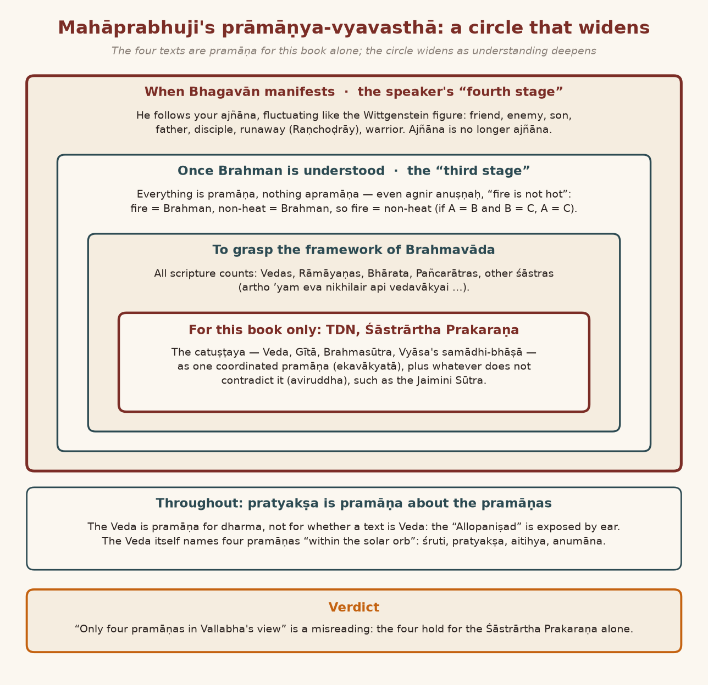
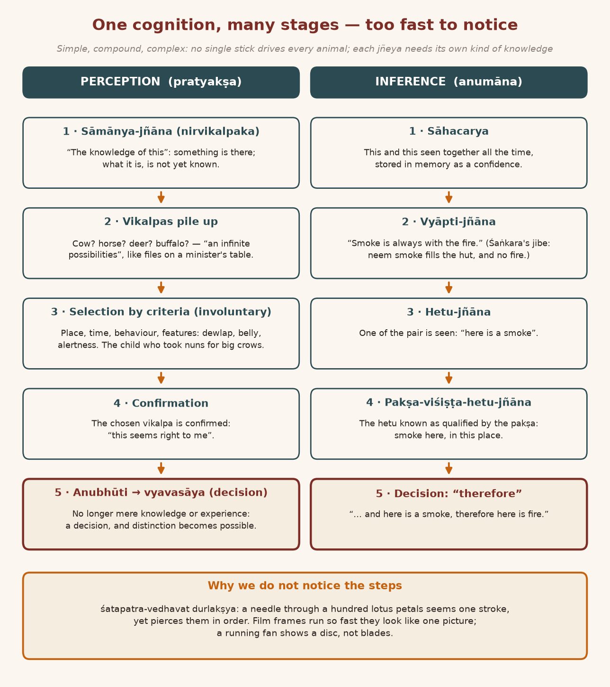
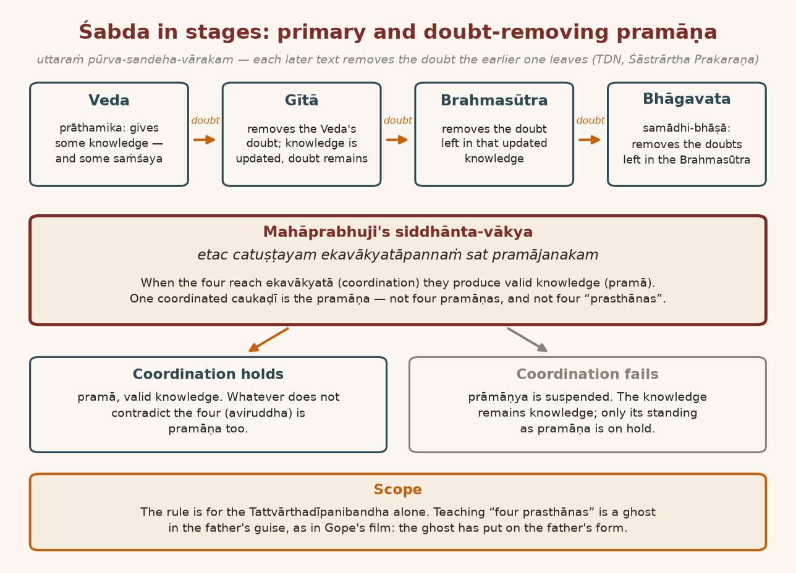
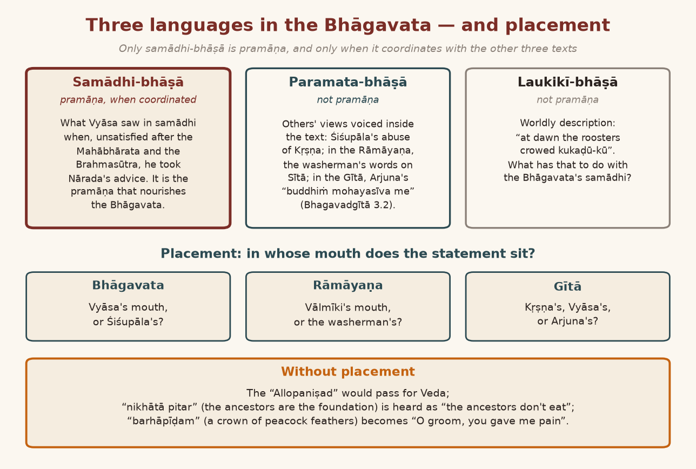

*English rendering of a spoken discourse on the Śāstrārtha Prakaraṇa of the Tattvārthadīpanibandha, translated from a Hindi ASR transcript. The speaker's conversational register, humour, digressions, code-switching, and student exchanges are preserved. Editorial flags: ‹ › conjectural restoration of a garbled reading; ‹?› uncertain reading; ‹…› inaudible or unrecoverable passage; ‹श्रवणाधारित› text given as heard, pending verification against a printed edition. Verses whose standard text is beyond doubt have been silently restored to the received editions.*

*Part 2 runs from 01:23:00 to the close of the session of 25 July 2026 and continues directly from Part 1.*

# 9. The Pramāṇa of the Pramāṇas: Śaṅkara's Mirror and the "Allopaniṣad"

[Perception and inference] are not pramāṇa about Brahman; they are pramāṇa about the pramāṇas of Brahman. The pramāṇas of Brahman are *vedāḥ śrīkṛṣṇavākyāni vyāsasūtrāṇi caiva hi, samādhibhāṣā vyāsasya*. But when you read these, you will read them with your eyes; only then will you understand them, no? If what the eyes see were not pramāṇa — *sarvaṁ mithyā* — then the Veda you are reading, the Veda you are hearing, all of it is mithyā; it is your delusion. As Śaṅkarācārya says, no: *na vedā na yajñā na tīrthaṁ bruvanti* (Śaṅkara, Daśaślokī 3). The Veda too is mithyā, the Purāṇa too is mithyā, the Gītā too is mithyā. Not mithyā in the sense that no knowledge of Brahman comes from them; mithyā in the sense that they themselves do not exist at all. They themselves do not exist, and they simply give you knowledge. Just as a "mirror" is not mithyā in the sense that there is no mirror; but the "reflection" the mirror shows you — by showing you a mithyā reflection it gives you true knowledge of yourself. Vedic pramāṇas are like that: "they do not exist for themselves, but they provide you with good knowledge, valid knowledge. That's what Shankaracharya said." In this way the Veda is mithyā, the Gītā is mithyā, the Brahmasūtra is mithyā, the Bhāgavata is mithyā. "Even" the avatāra is mithyā. And yet they give you true knowledge; they make your sādhanā true. That is his intention.

Mahāprabhuji's intention is not like this at all. In Mahāprabhuji's view the Veda is satya; the Gītā too is satya, the Brahmasūtra too is satya, the Bhāgavata too is satya. So these are satya, and because they are satya, they give knowledge of the satya. Then how will we come to know that they are true? Just —

**A student:** ‹How can one say that the avatāra is mithyā?›

**Speaker:** *Kem ke* [because] the avatāra took birth. Bhagavān does not take birth; he is unborn.

**A student:** I see. Okay.

**Speaker:** *Avatāre to janma līdho, eṭle ‹mithyā› thayo ne. Paṇ jem śaṅkarācārya paṇ mithyā che, paṇ tamne jñān to sācũ āpī rahyā che ke nahī̃, niraharm-mā̃‹?› paṇ. "Mirror"-nũ "reflection" mithyā che, paṇ jñān to sācũ āpe che ne. Tamāro badho "make-up" tame "mirror" sāme karī śako ke nahī̃? E rīte.* [The avatāra took birth, so it became mithyā, didn't it? But just as Śaṅkarācārya too is mithyā, he is still giving you true knowledge, isn't he — even in ‹…›. The mirror's reflection is mithyā, but it does give true knowledge, doesn't it? You can do all your make-up in front of the mirror, can't you? In that way.] That is Śaṅkarācārya's "theory".

Now look, let me show you one thing: pratyakṣa pramāṇa. Now I am going to recite one of your Upaniṣads to you:

> दिव्यानि दत्ते दिव्यानि दत्ते । दत्ते इल्लिल्ला इल्लिल्ला दत्ते ।  
> इल्ला अकबर हो दत्ते ॥
>
> *divyāni datte divyāni datte | datte illillā illillā datte |*  
> *illā akbar ho datte ||* ‹श्रवणाधारित› (cf. the so-called Allopaniṣad)
>
> [*Divyāni datte*, "gives divine things," run together with *illallāh* and *Allāhu akbar*.]

Now, is this Veda or not? Is it from an Upaniṣad? Now — is this Veda or not? Do you need a pramāṇa for it? This is not a "verbal concept". Just by hearing it you can tell that this is not Veda. This is the Qur'an's — ‹the speaker's characterization›

In Akbar's time, to please Akbar, the pandits — Akbar asked, "Does any description of our Allāh come in your Upaniṣads or not? You say the Upaniṣads know everything." Somebody made it up — where does it come? — and recited this to Akbar. In it there came — these pandits were all "AI", so to speak! *Illā illā milille illā ilāho akbar ilāho akbar akbar ho illā* ‹श्रवणाधारित› — these were all "AI"! "Artificial intelligence" — they made it up and set it down. ‹the speaker's characterization› In this way everybody has made up Upaniṣads and set them down. Here among us too, somebody made up an Upaniṣad of the Vallabhākhyāna, which is printed in this [book]. In the same way Śaṅkarācārya too has made up and set down some Upaniṣads, a few here and there. Everybody has made up their own Upaniṣads.

Now this needs pratyakṣa pramāṇa, doesn't it? By looking we can understand that this is not Veda. Anyone who has even a little knowledge of Sanskrit — even a little knowledge — will know at once where this "Allāh akbar" is coming from. So it is only through pratyakṣa pramāṇa that the apramāṇa and the pramāṇa will be sorted out, no? Now if somebody says, "This is an Upaniṣad," how will you say no? "How to deny?" How are we to refuse? So understand the point: in knowing dharma, the Veda is pramāṇa; but in knowing whether the Veda is pramāṇa or not, the Veda will not be the pramāṇa, will it? So one way or another you will have to come into pratyakṣa, anumāna and the rest, no? So that is one problem.

# 10. Four Texts for One Book: The Solar Orb, the Closing Verse, and "Fire Is Not Hot"

The second point in this is that it has been said in the Upaniṣad:

> श्रुतिः प्रत्यक्षमैतिह्यम् अनुमानं चतुष्टयम् ।
>
> *śrutiḥ pratyakṣam aitihyam anumānaṁ catuṣṭayam |* ‹श्रवणाधारित› (cf. Taittirīya Āraṇyaka 1.2.1, which reads *smṛtiḥ pratyakṣam aitihyam anumānaś catuṣṭayam | etair ādityamaṇḍalaṁ sarvair eva vidhāsyate ||*; the line opening with *śrutiḥ* is Bhāgavata Purāṇa 11.19.17)
>
> [Śruti, perception, tradition and inference: these four.]

These are the four pramāṇas in the sūryamaṇḍala. Within the sūryamaṇḍala — that is, in the "solar system" — these are the four pramāṇas: *śruteḥ pratyakṣam aitihyam anumānam*. Śruti, pratyakṣa, aitihya — the historical, itihāsa — and anumāna: these four pramāṇas. And this is there in that very [Veda] which Mahāprabhuji counts as pramāṇa when he says *vedāḥ śrīkṛṣṇavākyāni*. So if the Veda is pramāṇa, then in the Veda these four pramāṇas are accepted within the "solar system". How will Mahāprabhuji deny this? Mahāprabhuji ‹does accept them as› pramāṇa. And those people who do not read Mahāprabhuji's siddhānta fall into this misconception: that in Vallabhācārya's view *vedāḥ śrīkṛṣṇavākyāni vyāsasūtrāṇi caiva hi samādhibhāṣā* are pramāṇa, and there is no other pramāṇa at all. Who said so, bhāī? ‹…› Further on, here, Mahāprabhuji will say this: that the pramāṇa-hood of these four is not for Vallabhācārya; it is for the Śāstrārtha Prakaraṇa of the Tattvārthadīpanibandha — "In the Śāstrārtha Prakaraṇa I am proceeding by taking these four as pramāṇa" — so that after this you come to understand Vallabha Vedānta.

> अर्थोऽयमेव निखिलैरपि वेदवाक्यै रामायणैः सहितभारतपञ्चरात्रैः ।  
> अन्यैश्च शास्त्रवचनैः सह तत्त्वसूत्रैर्निर्णीयते सहृदयं हरिणा सदैव ॥
>
> *artho ’yam eva nikhilair api vedavākyai rāmāyaṇaiḥ sahita-bhārata-pañcarātraiḥ |*  
> *anyaiś ca śāstravacanaiḥ saha tattvasūtrair nirṇīyate sahṛdayaṁ hariṇā sadaiva ||* (Tattvārthadīpanibandha, Śāstrārtha Prakaraṇa 104; the speaker places it at the end of the Nibandha)
>
> [This very meaning is settled, with heart, by Hari always — through all the Vedic statements, through the Rāmāyaṇas together with the Bhārata and the Pañcarātras, and through the other statements of śāstra together with the Tattvasūtras.]

This "meaning" — this is Mahāprabhuji's śloka at the end of the Nibandha; you will come to it when the Nibandha is completed. *Artho ’yam eva nikhilair api vedavākyaiḥ*: this point is in all the Vedic statements. The same point is in the Rāmāyaṇa; it is in the Pañcarātra, it is in the Mahābhārata. *Anye ca* — all the other statements of śāstra there are — the same point is in all of them. So Mahāprabhuji is accepting all of them as pramāṇa. Until when? For as long as one has to understand the "framework" of Brahmavāda. Once Brahman has been understood through the framework of Brahmavāda, Mahāprabhuji says that everything is pramāṇa. Nothing remains apramāṇa at all. How can there be apramāṇa in Brahman? That is to say: fire — "fire" means — ‹*agniḥ śītaḥ*›, ‹*agniḥ śītaḥ*›: this sentence too is pramāṇa. ‹*Agnir anuṣṇaḥ*› — "it is not hot" — this sentence is pramāṇa. Now in "day to day life", fire is certainly hot. And if somewhere you are told, if you find a sentence that says *agnir anuṣṇaḥ*, which is "contradictory", "self-contradictory" — if it is fire, it is not non-hot; if it is non-hot, it is not fire — still, because fire equals Brahman and non-hotness equals Brahman, fire equals non-hotness. "If A is equal to B, B is equal to C, A is equal to C." By this reasoning, *agnir anuṣṇa ity api vākyaṁ pramāṇam* ‹श्रवणाधारित›, because Sarasvatī is never false. This is the "third stage".

In the "fourth stage", Mahāprabhuji says that if Bhagavān has become manifest and is corresponding to your ajñāna — "fluctuating", like Wittgenstein's "squares" *[refers to the chart]* — then Bhagavān is fluctuating according to the fluctuation of your ajñāna. If you take him for your friend, Bhagavān becomes a friend too; if you take him for your enemy, Bhagavān becomes an enemy too. You take him as a son, he becomes a son; take him as a father, he becomes a father; take him as a disciple, he becomes a disciple; take him for a runaway, and he even lets you shout "Raṇchoḍrāy kī jay!" Take him for a hero, and he even fights a war. Whatever you take him to be, Bhagavān is ready to become that. How can "such a fluctuating phenomenon" be apramāṇa? So if he is corresponding to your ajñāna, then ajñāna has not remained ajñāna at all.

**A listener:** It hasn't remained.

**Speaker:** When is ajñāna ajñāna? When you do not understand something about some object. But if that [object] is following your very non-understanding — ajñāna, what is left of ajñāna? Mahāprabhuji has gone to this "extreme" about brahmatva. Without understanding that, people talk nonsense — that in Mahāprabhuji's view there are only four. You will have to come out of this. You will have to understand the Śāstrārtha Prakaraṇa.

{width=6.2in}

# 11. Simple, Compound, Complex Knowledge: The Stick, the Buffalo, and the Crows in Black Gowns

"With this", Mahāprabhuji has "introduced" a new "criteria". I want to write it out and show you. I will run through the "text" too, but before running through the "text" it is necessary to understand that "criteria" as well. If you have studied "grammar" — of Hindi, of Gujarati, of English, any of them — any "statement" or any "proposal", "proposition", is of three kinds: "simple", "compound" and "complex". That is: "He goes. And she is also coming. It's a compound statement." "He goes" — "simple statement". "She is also coming" — "compound statement". "He, the one who has seen the movie, is going" — this has become a "complex statement". Right? So just as "statements" are "simple", "compound" and "complex", in the same way, Mahāprabhuji says, in every knowledge there is a "simple" knowledge, there is a "compound" knowledge, and there is a "complex" knowledge.

Knowledge, then, is knowledge. ‹*Daṇḍena … gardabhaḥ*›‹?› — what does this mean? That if a stick has come into your hand, you can drive off a donkey with that stick and you can drive off a cow too. In the same way, some "theory" of knowledge or other has come before you — [you cannot take it] to measure every quality; you cannot drive every ‹cow› along like donkeys and horses. Because even for driving animals, the stick that serves for a buffalo is of no use for an elephant; for an elephant you have to keep an aṅkuśa. It is of no use for a horse either; for a horse you have to keep a whip. So "*daṇḍena … gardabhaḥ*" never really works. If two cognitions are alike, ‹…›; but with one knowledge you cannot control the whole ‹household›‹?›. So you will have to make a vyavasthā — a vyavasthā in this sense: for which jñeya which kind of knowledge is pramāṇa. And which knowledge is "simple" — which jñeya needs "simple" knowledge, which jñeya needs "compound" knowledge, which jñeya needs "complex" knowledge. And these three [kinds] of knowledge ‹…› — think about it.

"Normally" — understand one thing carefully — about pratyakṣa: on this subject the best "analysis" is the Jains'. I won't tell you that today, otherwise the topic will get long. Perhaps I will tell you in the "next session". But in the "simplest system", the "levels" of knowledge: in it there is one nirvikalpaka knowledge — a "common feature" of knowledge — and some savikalpa knowledge. What does nirvikalpa knowledge mean? "The knowledge of this." What does savikalpaka knowledge mean? "Not only this but thus." When you say "thus", the knowledge has become savikalpa — that is, you are seeing the object of the knowledge, and you are seeing the kind of the knowledge too. So it has become savikalpaka. It is not that with savikalpaka knowledge the whole story is over. There are "multiple stages" of knowledge. In the journey of knowledge from nirvikalpaka to savikalpaka, many "stages" come, which the Jains have "analysed" very beautifully — but it is not that we have no "analysis" of it among us either.

So, the very first thing: among us, the usage for nirvikalpaka knowledge is sāmānya-jñāna. Sāmānya-jñāna of anything: "this". Now you do not know what this is. Anything at all, whatever thing comes before you, you have this knowledge. What this is, you still haven't found out. At the "second stage", when you stay with it — with your knowledge and with the object — then after that you come to know the "thus": what it is. "This is" — and what is it? That is: this is a cow, a horse. Being a cow, being a horse — these are the vikalpas of the "this". This could have been a cow, it could have been a horse, it could have been a deer, it could have been a buffalo. These are all vikalpas, "alternatives", for the "this". Out of these, which vikalpa did you choose? You do not choose. "We can't say it is not voluntary system, it is involuntary system." So out of the vikalpas that are coming before us, the buddhi "assesses" a vikalpa. Because as soon as we saw "this" — "an infinite possibilities" — this could be anything, from an ant‹?› to ‹…›, it could be anything — out of all that, what is this? Just as "files" reach ministers, no, and a heap piles up on the "table" — in the same way a "table" of "files" piles up in our buddhi: this could be this, this, anything. Out of that you "select" what this is. On what basis do you make the "selection"? What could a thing that "behaves" like this, in this place, at this time, be? That is what this will be.

Now suppose someone is having a bhrama there: seeing a cow, the bhrama of a buffalo; or seeing a buffalo, the bhrama of a cow. Then what will the "criteria" for deciding be? "Certain features" of the cow and of the buffalo are different. On a cow's face there is a little "alertness"; on a buffalo's face a certain sheen shows. Whatever it may be. There is a look of ‹caring›. So that is what you will decide by, won't you? A cow — a cow's belly is not as fat as a buffalo's belly. A cow has a dewlap; a buffalo has no dewlap. Black — well, cows are black too, and buffaloes are black too. So "these are the criteria". Now these "criteria" are visible to you from your own side; but when will they be "applied" to the cow? When you consider the "possibility". So first, when the cow appeared like this, you would have saṁśaya — [and yet it seems] it does not happen. That is why it has been said: *śatapatra-vedhavat durlakṣya*. Pierce a hundred lotus petals with a needle all at once — which petal was pierced when? It does not come into view; but they must have been pierced in "order", no? Like that: after the "this", the vikalpas that came, multiple vikalpas — to choose which vikalpa from among them, which "criteria" did you choose? Of place, of time: so, bhāī, can there be a cow here or not? In a country where there are no buffaloes, there can be a cow; where there are no cows, there can be a buffalo. Often, up in the mountains, there are no buffaloes; there is the yak. ‹…› if you take [it] for a buffalo —

I read in a "psychology" book: ‹…› a child — the "mummy", seeing a crow, told him, "This, son, is a ‹'crow'›." ‹Nuns› wear black clothes. A "nun" came to the house, and the child set up a loud shout: "Mummy, all the crow, crow!" She says, "No, no, she is a nun; don't call them crows." The child had not understood the crow by anything but its colour; he understood it as the black colour. They had come wearing black clothes, "gowns". So he thought crows had come — very tall ones. So the child, utterly astonished, said, "Mummy, very big crows have come!" Now what was the mummy to do? She said, "Bhāī, they are not called crows; they are nuns." The child — who knows? Where did he take up the vikalpa for the "this"? That depends on your "capacity", doesn't it, and on your "information". "Unpredictable." We are laughing at the child, but the same thing happens with us. The same thing happens with us — where do we know which vikalpa we will choose? Otherwise, if the power of choosing were "voluntary", why would we see a snake on a rope? Why do we see a "mirage" in the "desert"? "It's an involuntary function." So there are a great many "processes" in it, aren't there — *śatapatra-vedhavat*.

What is it? After that we choose the vikalpa. ‹Choosing the› vikalpa is one "stage". It is *durlakṣya*, but it happens, doesn't it — it happens in a flash. After choosing that vikalpa, we "confirm" it. After "confirming", we also "confirm" that yes, this very thing seems right to me. When you say, "This seems right to me," then that anubhūti of yours has gone into vyavasāya — into "decision" *[refers to the chart]*. Now it has not remained mere "knowledge", it has not remained "experience"; "awareness" ‹…› "of the awareness of the object" — not that any more. That is, you will be able to make the "distinction", to "distinguish" what it is. So you see, that is one "stage" — a "stage" of "empirical knowledge".

# 12. Inference and Śabda in Stages: Neem Smoke in the Hut, Film Frames, and "Stand" versus "Stance"

In the same way there is a "stage" of "logic" too. First of all you get knowledge of the sāhacarya of some thing. There was "one commitment"‹?›: that this and this are together all the time. Of them, you once saw one — it got stored in "memory" that these two are together all the time, whether they are together or not. But you saw them together all the time, so a "confidence" comes to you that they are together all the time.

Now after that, you saw one of the two things somewhere. Then you will feel that where that one is visible, its "concomitance" too should be there — "I can't see it." Śaṅkarācārya has made great fun of this — very beautiful fun. *Maga jātakatā hāca viṣayaca tocaca*‹?› — they say it jokingly for just this; but the thing to understand is that Śaṅkarācārya says: "You say that where there is smoke there is fire. ‹People› burn neem in their huts to drive away mosquitoes, and the neem burns and goes out, and the smoke stays, filling [the hut]. There the smoke certainly comes out, but where is the fire? What kind of logic is this?" What he means is that anumāna is not "reliable". The anumāna-prakaraṇa — that is another story. But the thing to understand is — the thing to understand is that in it too there were "stages", weren't there? First the knowledge of vyāpti. Then the knowledge of the hetu. Then the knowledge of the hetu as qualified by the pakṣa. After the knowledge of the pakṣa-qualified hetu, then comes your "decision": "therefore". "Because he has a — because smoke is always with the fire, and here is a smoke, therefore here is fire." All of this — just now, that was the "first stage" of knowledge, no? It speaks "step by step". But it is so "fast" — just as with a "film": all the "frames" run one by one, and it runs so "fast" that it looks to us like one; the "frame" is not seen; the "frames" stop being seen. As when a fan is running, running ‹"fast"›, you do not see the "blades", you see a disc. "Exactly" — this "impact" comes because it runs ‹"fast"›.

In this way, Mahāprabhuji — in śabda too ‹…› — in śabda too, knowledge does not happen all at once. It does not happen all at once. Mahāprabhuji is saying that in śabda too there are two kinds of knowledge: one prāthamika knowledge, and one sandeha-vāraka. I told you that doubt was arising: is it a buffalo or a cow? Then the vikalpa came before you. Then you "tallied" it: bhāī, in this place, time and circumstance, can it be a buffalo or a cow? With a shape like this, can it be a buffalo or a cow? Just as in "empirical knowledge" there are all these "criteria", in the same way, after hearing a word too, we have to go through all these "criteria". Why? Understand the reason: because one word can have many meanings. One word can have many meanings. And that same one word, used in one "context", will have some meaning; used in another "context", that same meaning becomes a different one. And then again, one meaning can have two words. For instance, understand this: "stand" and "stance" both mean the same thing. "What is your stand?" "What is your stance?" There is a little difference between the two as well. "Stance" is one thing; "stand" is another thing. I tell you two things and say, tell me, what is your "stand" on this? "For instance", on this "agitation" that Koparath‹?› carried out — what is your "stand" about it? That is, do you "like" it or "dislike" it? That is what "stand" means. "Stance" also has a meaning: "stance" means "approach" — what is your "approach"? So both are one word, ‹…› up to a point, and still a little different. In all these, the doubt that arises in us on hearing — in which sense was it used? — so a second knowledge will come, won't it: a "supplementary" knowledge, which will remove the doubt. That is why Mahāprabhuji is saying that the knowledge that comes from hearing the Veda is not undoubted knowledge; some doubt is certainly there. That is why I told you that out of every saṁśaya comes some niścaya, and in every niścaya some saṁśaya stays hidden.

So when you have heard one statement of the Veda, you will "definitely" get some knowledge. "Definitely" you will get some knowledge. Along with that knowledge some saṁśaya will also arise. The Veda is not going to remove that saṁśaya. Who will remove it? The Gītā will remove it. After hearing the Gītā too, there will certainly be some knowledge; some "updating" has come into the knowledge.

**A listener:** I see.

**Speaker:** That "updated" knowledge of the Veda, whose "doubt" the Gītā has "cleared" — in that knowledge too some saṁśaya can certainly arise. Who will remove that? Mahāprabhu says the Brahmasūtra will remove it. In the Brahmasūtra too lots of "doubts" can come. Who will remove those? Then Mahāprabhuji says: the Bhāgavata removes them. This is a "gradation" of "updating" — the "gradation" of updating knowledge, the knowledge of the Veda. That is why Mahāprabhuji says there are two kinds of pramāṇa: prāthamika pramāṇa and sandeha-vāraka pramāṇa. This is a "fantastic criteria": into the old "epistemological criteria", Mahāprabhuji has "introduced" a new one.

{width=6.2in}

# 13. Primary and Doubt-Removing Pramāṇa: Gope's Ghost in the Father's Guise

"And mind it": I have already told you that there is no prasthāna. Prasthāna is a bhrama. It is a "strategy" to create "chaos" — to make it appear — in Mahāprabhuji's "cosmos": "The prasthānas are four." There is no such thing as a prasthāna among us. But for these four pramāṇas, write down one siddhānta-vākya of Mahāprabhuji: *etac catuṣṭayam ekavākyatāpannaṁ pramājanakam*. When there is ekavākyatā — "coordination" — among these four pramāṇas, then these four are pramāṇa; otherwise they will become doubtful. And where it has become doubtful, there will be no [valid] knowledge. Wherever doubt has arisen after knowledge, the knowledge gets "suspended" — the knowledge's being pramāṇa gets "suspended". Knowledge is knowledge; that will not be "suspended".

Long ago, in our childhood, a film came out. There was Gope — a *jāḍiyā* [fat fellow] — a "comedian". He wanted to marry someone, and the marriage was not happening. So somebody told him: "Go to the cremation ground, sit there and do japa, and you will get married. And ghosts will come there. They will ‹…› you — don't grab hold of them." He goes to the cremation ground and does japa. He is also afraid that ghosts will come. His father comes looking for him: "Bhāī, where has my son gone?" Now he takes his father for a ghost. The father says, "What are you doing?" He says, "You are a ghost!" The father gives him a hard thrashing. I saw it in our childhood. Now look: the person who has come — is he the father or a ghost? Doubt is certainly arising, no? Why is doubt arising? There should be no doubt about one's own father. Because somebody had said that a ghost can come even in the guise of a father. So then how to settle whether it is the father or a ghost? So when the thrashing happened — [the father] takes him home ‹by the ear› — then he understood: "Bhāī, it is not a ghost; it turned out to be my father after all." "It could have been bhūt also." "Demand answer"‹?› — got it? The "possibility" is there for everything, isn't it? So one knowledge happens. After that, a removal of doubt happens.

Mahāprabhuji [says this] for the Tattvārthadīpanibandha — only for this text, "not" beyond it. This point will not go even a little beyond this. Those who teach you, the pandits who give you pravacanas, and the "academicians" who teach you that in Mahāprabhuji's view there are four prasthānas — they are all ghosts that have taken the form of the father. So — the father has not taken the form of a ghost; the ghost has taken the form of the father. They are "misguiding" you. There is no prasthāna. These are pramāṇas each of which removes the doubt left by the one before:

> उत्तरं पूर्वसन्देहवारकं परिकीर्तितम् ।  
> अविरुद्धं तु यत्त्वस्य प्रमाणं तच्च नान्यथा ।  
> एतद्विरुद्धं यत्सर्वं न तन्मानं कथञ्चन ॥
>
> *uttaraṁ pūrva-sandeha-vārakaṁ parikīrtitam |*  
> *aviruddhaṁ tu yat tv asya pramāṇaṁ tac ca nānyathā |*  
> *etad-viruddhaṁ yat sarvaṁ na tan mānaṁ kathañcana ||* (Tattvārthadīpanibandha, Śāstrārtha Prakaraṇa 8)
>
> [Each later one is declared to remove the doubt of the earlier. Whatever does not contradict this is also pramāṇa, and not otherwise. Whatever contradicts this is in no way a valid means (*māna*).]

What Mahāprabhuji is saying here is that whatever goes against this is not *māna* for me. So it is not *māna* in this sense: if it contradicts, it is not *māna*; if it does not contradict, then it is *māna*, isn't it?

So in this very śloka Mahāprabhuji is saying that there can be other pramāṇas too, if *aviruddhaṁ tu*. *Viruddham* is not *māna*. And further on here Mahāprabhuji will tell us, *cakārāj jaimini-sūtrāṇi ca* (Prakāśa on Śāstrārtha Prakaraṇa 7) — so he is accepting the Jaimini Sūtra too as pramāṇa.

{width=6.2in}

# 14. Beyond the Four: Pañcarātra Festivals and the Fear of Reading the Mahābhārata

And understand one more thing: further on, in the Sarvanirṇaya Nibandha, Mahāprabhuji says that the Vālmīki Rāmāyaṇa is samādhi-bhāṣā like the Bhāgavata. Therefore it too is pramāṇa. So is it pramāṇa or not? "And besides that": our sevā-prakāra — in our sevā-prakāra the Bhāgavata is like the "structure". A "building" has a "structure", and it has an "interior decoration". So the "structure" of the sevā-prakāra is based on the Bhāgavata. And its whole "interior" is from the Pañcarātra. Its whole "interior work" is from the Pañcarātra. Pavitrā Bāras is a festival of the Pañcarātra; Rathayātrā is a festival of the Pañcarātra; Janmāṣṭamī, Divālī, Rūp Caturdaśī — these are all festivals of the Pañcarātra. So if the Pañcarātra is apramāṇa, how will these become pramāṇa? Among the "four prasthānas" — the Bhāgavata and the rest — the Pañcarātra does not even come in. That is why Mahāprabhuji has said: *artho ’yam eva nikhilair api vedavākyai rāmāyaṇaiḥ sahita-bhārata-pañcarātraiḥ*.

And understand one thing carefully — our "academicians" and our pravacana-givers, how many ghosts there are! — in this sense: you have understood that the Gītā is pramāṇa but the Mahābhārata is not pramāṇa — can that be so? [The Gītā], as you can see, is "part of" the "Mahābhārata".

**A listener:** Of the Bhārata.

**Speaker:** They say the Gītā is pramāṇa but the Mahābhārata is not pramāṇa. And many Vaiṣṇavas believe just this: that the Mahābhārata should not even be read, otherwise a "Mahābhārata" will break out. How will a Mahābhārata break out from this? Who said a Mahābhārata will break out — that by hearing the Mahābhārata a Mahābhārata happens? In the Mahābhārata Bhagavān did not even fight; the Kauravas and the Pāṇḍavas fought. Why will a Mahābhārata happen in your house? In the Bhāgavata, Bhagavān himself has fought everywhere. In the Rāmāyaṇa, Rāmacandrajī himself has fought. So if hearing about fighting caused fighting, then fighting should come first from the Rāmāyaṇa and the Bhāgavata, and only later from the Mahābhārata. And the Pāṇḍavas fought — what did our father lose by it? Bhagavān fought — is anything of ours at stake? Alexander fought Porus — so what am I to do? The Kauravas and the Pāṇḍavas fought, so they fought — is it any crime of mine? So how will a Mahābhārata break out in our house? But such misconceptions arise. That is why I am calling them ghosts, as with Gope. We sit down in some cremation ground and create such misconceptions — that the Mahābhārata ‹is not to be read›, because a Mahābhārata will break out. Bhāī, if a Mahābhārata will break out — well, the Viṣṇu Sahasranāma is in the Mahābhārata. And understand one thing carefully: in the Bhāgavata — in the Bhāgavata many līlās have been taken from the Mahābhārata. Many līlās have been taken from the Mahābhārata. So by the Mahābhārata's being pramāṇa, the Bhāgavata too becomes pramāṇa; and by the Bhāgavata's being pramāṇa, the Mahābhārata remains pramāṇa. So it is a "nonsensical" thing — a "totally nonsensical" thing — that there are only four pramāṇas.

So only for understanding the Tattvārthadīpanibandha is Mahāprabhuji saying: "In the Tattvārthadīpanibandha I am proceeding by 'accepting' these in this way — as prāthamika pramāṇa and sandeha-nivāraka pramāṇa. And here, whatever goes against them I will not accept as pramāṇa. Further on, I will accept everything as pramāṇa. I will accept even ajñāna as pramāṇa."

All right — if one says *agnir anuṣṇa iti vākyam api pramāṇam*, will the Qur'an then become apramāṇa? Will the Bible become apramāṇa? In the Qur'an and the Bible some "contradictory statement" like "fire is not hot" may perhaps be found — if it is found, it is found — or it may not be found. Then how will they become pramāṇa? ‹the speaker's characterization› This point must be understood seriously. So this prāmāṇya-vyavasthā of Mahāprabhuji is a "unique" prāmāṇya-vyavasthā, which Mahāprabhuji has "introduced".

# 15. Samādhi-bhāṣā, Paramata-bhāṣā, Laukikī-bhāṣā: Ācārya Tulsī's Rāmāyaṇa and Arjuna's Complaint

> वेदाः श्रीकृष्णवाक्यानि व्याससूत्राणि चैव हि ।  
> समाधिभाषा व्यासस्य प्रमाणं तच्चतुष्टयम् ॥
>
> *vedāḥ śrīkṛṣṇavākyāni vyāsasūtrāṇi caiva hi |*  
> *samādhibhāṣā vyāsasya pramāṇaṁ tac catuṣṭayam ||* (Tattvārthadīpanibandha, Śāstrārtha Prakaraṇa 7)
>
> [The Vedas, the words of Śrī Kṛṣṇa, the sūtras of Vyāsa, and the samādhi-language of Vyāsa: that fourfold is pramāṇa.]

The samādhi-bhāṣā of Vyāsa — not the whole Bhāgavata. Because in the Bhāgavata there are three kinds of language: samādhi-bhāṣā, paramata-bhāṣā and laukika-bhāṣā. What does samādhi-bhāṣā mean? When, having written the Mahābhārata, the Brahmasūtra and all the rest, Vyāsajī was not satisfied — he felt he had not been able to say what he wanted to say — he was worried, he was worried. Then Nāradajī said, "Bhāī, why do you worry? Go into samādhi and see." So whatever he saw after entering samādhi, he wrote down in the Bhāgavata. Now within that samādhi he also saw certain things — "mind it" — within the samādhi, things that were not related to Bhagavān, but that some ṛṣis had said. Because Bhagavān is the "unified" "grand unification point" of everything. Daityas, dānavas, asuras — all came into it. So some things said by them, anywhere — paramata-bhāṣā. When that paramata comes, within the Bhāgavata it is not ‹…› pramāṇa.

Let me give you an example; then you will understand. There was a Jain muni. Just as we have the Rāmāyaṇa, so the Jains too have a Rāmāyaṇa; just as we have the Kṛṣṇa-līlā, so they too have a Kṛṣṇa-līlā — ‹the *Paumacariu*›. On that, that guru of the Terāpanth wrote a Rāmāyaṇa. In it, suddenly, there were written the abuses of Sītā that the washerman had uttered. Over that an uproar broke out in Madhya Pradesh, and Hindus burned the shops of Jain people — "You abused Sītā," this and that. He had a disciple — here, near our Baḍā Mandir, in Tāmbā Kāṇṭā, a jeweller‹?›. Being his disciple, he brought [the book] and gave it to me: "Read it — what is wrong in this?" I read the whole of it. After reading it all, I saw that he had not abused [her]; what abuse the washerman had hurled at Sītājī — that is what he had written in the Rāmāyaṇa, the Jain Rāmāyaṇa. Among the Jains, Sītājī is regarded as a satī — one of the principal six or seven satīs. So he said, "If you don't find anything wrong in it, write me a letter saying that there is no fault in this." Now, I wrote that letter. I am forgetting the Jain muni's name — what is [his] connection with Tulsī?

**A listener:** ‹…›

**Speaker:** Ācārya Tulsī! Ācārya Tulsī — I wrote that [letter]. Among our Vaiṣṇavas an uproar broke out: "You don't accept our own Rāmāyaṇa — [you accept] the Jains' Rāmāyaṇa!" Somebody went to my grandfather and complained: "Śyām Bābā's mind has gone corrupt. He doesn't accept our Rāmāyaṇa and accepts the Jain muni's Rāmāyaṇa." *Dāī*‹?› called me: "Bhāī, what is this mischief you are up to?" I said, "*Dāījī*‹?›, in it the Jain muni did not abuse Sītā at all. The abuse the washerman hurled — why, the abuse Śiśupāla hurled at Kṛṣṇa is written in the Bhāgavata. That is paramata-bhāṣā. That is not samādhi-bhāṣā. Śiśupāla's abuse is not samādhi-bhāṣā; it is paramata-bhāṣā. So paramata-bhāṣā is not pramāṇa. In samādhi he wrote that too."

In samādhi he saw that too, and so he put it in: bhāī, somebody hurled abuse like this as well — but that is not Vyāsajī's siddhānta. So the language seen in samādhi is the pramāṇa that nourishes the Bhāgavata. Likewise there is laukikī-bhāṣā too: that after dawn broke, the roosters crowed "kukaḍū-kū" — the hens crowed "kukaḍū-kū" — what has the Bhāgavata's samādhi to do with that? So laukikī-bhāṣā too is not pramāṇa. So in the Bhāgavata there are three languages: laukikī-bhāṣā, paramata-bhāṣā and samādhi-bhāṣā. Of these, Mahāprabhuji does not accept the whole Bhāgavata as pramāṇa; he accepts the samādhi-bhāṣā as pramāṇa. And when does he accept even the samādhi-bhāṣā as pramāṇa? When it "coordinates" with the Brahmasūtra, with the Gītā and with the Upaniṣad. When does he accept even the Veda as pramāṇa? When it "coordinates" with the Gītā, with the Brahmasūtra and with the Bhāgavata. When does he accept the Gītā as pramāṇa?

**A listener:** The Gītā too, only then —

**Speaker:** The Gītā too he accepts as pramāṇa only then. Because in the Gītā there are Arjuna's words. Are there or not? What are Arjuna's words? Let me tell you: "Why are you deluding my buddhi, Bhagavān?" ‹…› So is Bhagavān deluding [his] buddhi? So that is paramata-bhāṣā in the Gītā. How will we accept it as pramāṇa? Arjuna is saying to Bhagavān, "Why are you deluding my buddhi?"

> व्यामिश्रेणेव वाक्येन बुद्धिं मोहयसीव मे ।  
> तदेकं वद निश्चित्य येन श्रेयोऽहमाप्नुयाम् ॥
>
> *vyāmiśreṇeva vākyena buddhiṁ mohayasīva me |*  
> *tad ekaṁ vada niścitya yena śreyo ’ham āpnuyām ||* (Bhagavadgītā 3.2)
>
> [With words that seem mixed you seem to bewilder my understanding. Tell me, decisively, the one thing by which I may attain the good.]

To delude my buddhi means: why are you cheating me? Is Kṛṣṇa a cheat, then? No — that statement in the Gītā is not the Gītā's statement; it is a paramata statement. In this way paramata statements come everywhere, laukika statements come, statements of samādhi come. So Mahāprabhuji is saying that the statements of samādhi are pramāṇa. And when are even they pramāṇa? On "coordination": *etac catuṣṭayam ekavākyatāpannaṁ pramājanakam*. So where are there four pramāṇas? It has become just one pramāṇa, hasn't it? Leave aside the talk of four prasthānas — that Gaṇapati Bāppā was given his "*Moryā*!" long ago. *Puḍhcyā varṣī nako*‹?› [next year — don't come]. But even these four pramāṇas did not remain four: *etac catuṣṭayam*. There is a difference between "four" and "catuṣṭaya". Four means four; catuṣṭaya means this: when these four, this catuṣṭaya — when all four are joined to one another, together they are called one *caukaḍī* [a foursome]. That *caukaḍī* is the pramāṇa; it is not four pramāṇas. So where will a prasthāna-catuṣṭaya come from? From this you will get an idea of what kinds of "Gope's fathers" are turning up here —

# 16. Placement: Gītārtha, "Nikhātā Pitar," and the Peacock-Feather Crown

— who can "misguide" us; this has to be understood. So: *etac catuṣṭayam ekavākyatāpannaṁ pramājanakam*. And this pramā-janakatā of theirs is confined to the Tattvārthadīpanibandha. It is not there even in the Sarvanirṇaya. Because if you look in the Sarvanirṇaya, Mahāprabhuji has given the nirṇaya of many śāstras by taking them as pramāṇa: of the Gāndharva-śāstra, of Āyurveda, and so on and so forth — he has given many ‹…›. Where would they go? Perhaps prāmāṇya would not remain [for them] at all. We have the *aṣṭāvi*‹?›-smṛtis. How do all of them have prāmāṇya? In reading the Śāstrārtha Prakaraṇa they have no prāmāṇya, because the body of words that has attained the ekavākyatā of the catuṣṭaya is the pramāṇa. So once you have understood the siddhānta from the Śāstrārtha Prakaraṇa, then that is pramāṇa. Because then you will come to understand where they are to be given "placement". Without that you will not understand where its "placing" is to be done. As in the Bhāgavata — where is the "placing" of ‹paramata›-bhāṣā to be done? In Vyāsajī's mouth? Or in Śiśupāla's mouth? In the Rāmāyaṇa, where is the "placing" of the washerman's words to be done? In Vālmīki's mouth, or in the washerman's mouth? This "issue" will remain, won't it? In the Gītā, where is the "placing" of Arjuna's words to be done — in Kṛṣṇa's mouth, in Vyāsa's mouth, or in Arjuna's mouth? So we must have a "sense" of "placing", mustn't we: bhāī, which statement, who spoke it, where, how — where its "placing" is to be done. There it is pramāṇa; but here it is not pramāṇa, is it? All of this is Mahāprabhuji's "epistemology". On this basis Mahāprabhuji has explained the Śāstrārtha Prakaraṇa. And as for what this Śāstrārtha Prakaraṇa means, Mahāprabhuji is saying: "In this Śāstrārtha Prakaraṇa I am explaining to you the essence of the Gītā." Śāstrārtha and Gītārtha.

Now look, understand carefully. There is a "twist" in this. In the Śāstrārtha Prakaraṇa the Gītā is pramāṇa, and the Gītā is prameya too. It is the "subject matter" too, and it is also the "instrument" of "knowledge" for "acquiring" the "subject matter". But the Gītā that is pramāṇa — that is "as a whole". And the Gītā that comes here is not pramāṇa "as a whole"; it is pramāṇa if it "coordinates" within the four. If it does not ‹"coordinate"›, its prāmāṇya is "suspended". This is Mahāprabhuji's "epistemology". Having understood this, we will do the ślokas further on ‹…›. If you want to ask any questions, you can ask.

Now suppose you suddenly ask me whether the Allopaniṣad is pramāṇa or not — from where am I to tell you whether it is pramāṇa or not? Where is the "placing" of the Allopaniṣad to be done? In the Veda?

**A listener:** "Very much."

**Speaker:** No — the pandits made it up to please Akbar. ‹the speaker's characterization›

It is told — in Haryana, among the Ārya Samājīs and the Sanātanīs. The Sanātanīs, who accept the Purāṇas as pramāṇa and believe in mūrti-pūjā; the Ārya Samājīs, who do not accept the Purāṇas as pramāṇa and do not believe in mūrti-pūjā — those Ārya Samājīs accept the Veda as pramāṇa. Between them a śāstrārtha took place: should śrāddha be performed or not? So the one who was the Ārya Samājī quoted a statement: *nikhātā pitar* ‹श्रवणाधारित›. Now in the language of Haryana, in Haryanvi, "*ni khātā*" means "doesn't eat". *Pitar* means ancestors. So all the Jats stood up: "When it is said in the śāstra that the *pitar* *ni khātā* [does not eat], then why do you perform śrāddha?" In Sanskrit, *nikhātā* means "foundation": our ancestors are our "foundation". [But] somebody ‹…› speaks out some statement — will it become pramāṇa? ‹Śrāddha is not to be done› — *nikhātā pitar*. So we have to understand, don't we, where the "placement" of this sentence is — what the "subject matter" is. And all the Jats stood up: "You are making fools of us! When the *pitar* does not even eat, why should one do śrāddha?" *Ni khātā pitar* — [like] "*nahīṁ jātā maiṁ*". You say, "Go!" — "I'm not going" — *nahīṁ jātā maiṁ*. So what did *nahīṁ jātā* mean? "I don't go." Just so, in Haryanvi *nikhātā* means "doesn't eat" — so why do you have śrāddha done, when the *pitar* do not even eat? People do this sort of thing too.

One bhāī asked me one day — I used to go to give pravacanas in their group —

> बर्हापीडं नटवरवपुः कर्णयोः कर्णिकारं  
> बिभ्रद्वासः कनककपिशं …
>
> *barhāpīḍaṁ naṭavara-vapuḥ karṇayoḥ karṇikāraṁ*  
> *bibhrad vāsaḥ kanaka-kapiśaṁ …* (Bhāgavata Purāṇa 10.21.5)
>
> [A crown of peacock feathers, the form of the finest of dancers, karṇikāra flowers on his ears, wearing a garment golden-yellow …]

He said to me, "Just before you arrived, we were doing the vyākhyā of *barhāpīḍam*." I said, "You carry on; I will do it afterwards." So he gave the meaning: "*Var hā pīḍam*" — "O groom (*var*), you have given me great pain." "*Karṇayoḥ karṇikāram*" — Bhagavān went and said in [her] ear, "I didn't take any such trouble." "*Bibhrad hāsam*" — after that Bhagavān began to laugh. "Now you give the pravacana further." Sāhab, my mind was wrecked! *Barha* means a peacock's feather — *barhāpīḍam*: on his head Bhagavān has put on the peacock feather. *Karṇayoḥ karṇikāram* — in his ears he has tucked kaner flowers. *Bibhrad vāsaṁ kanaka-kapiśam* — it is not *hāsam*, it is *vāsam*: he has put on golden-coloured clothes. That is its meaning — and he was making the meaning "*bar apīḍam*", and "Bhagavān laughed and said, *karṇayoḥ* — no — no, I had said…"‹?› — Bhagavān laughed, *bibhrad hāsam* — and now the pravacana had arrived! So I said, "My mind is wrecked; what shall I do now? You give the pravacana yourself; I will listen." Such absurd pravacana-givers we have among us — they make any meaning at all out of a word. It is not done like that. There is an "epistemology", there is a "coordination"; "scripture" forms one "coordinated unit" — that is *etac catuṣṭayam ekavākyatāpannaṁ pramājanakam*. ‹Bear that in mind.› Yes — if you want to ask something, you can ask.

{width=6.2in}

# 17. Questions: Melbourne in Australia, a Married Palm, and Space Both One and Many

**A listener:** Tejas-bhāī.

**Tejas-bhāī:** Jī, jī, jī — daṇḍavat praṇām. My "question" is related to the "last class": the "model" we saw of Brahmā, Paramātmā and Bhagavān — inside Brahmā's big "circle" is Paramātmā's "circle", and inside Paramātmā's "circle" is Bhagavān's "circle". In it, I understand about Bhagavān and Paramātmā: that Bhagavān — in the "context" of the six dharmas, aiśvarya, ‹vīrya›, śrī, jñāna, vairāgya — is the Bhagavān of an "individual" or of some "group", and Paramātmā too is "included" in it. But when the words *brahmeti paramātmeti bhagavān iti* are said, how are they "equal"? That is what I mean to understand. It was said that each is a side (*pāsā*), no — that each is "synonyms" — so how to understand that? That "dot" is not getting "clear".

**Speaker:** Make your question a little clearer.

**Tejas-bhāī:** I mean, like Brahman, Paramātmā and Bhagavān — the *brahmeti paramātmeti śabdyate* that was explained, no? So it means these are three "facets" of one Brahmā — that's what was said, no?

**Speaker:** Jī. First correct your pronunciation: not Brahmā — Brahman.

**Tejas-bhāī:** Brahman, Brahman. Brahmā.

**Speaker:** Brahmā, Viṣṇu, ‹Maheśa› is a separate [set]. [Brahman,] Paramātmā and Bhagavān is a separate tripuṭī.

**Tejas-bhāī:** "Yeah, yeah, yeah" — hāṁ — "yeah, yeah." No, no, I am talking about Brahman, Brahman.

**Speaker:** Hāṁ.

**Tejas-bhāī:** So it means these three are three sides of Brahman, no — "facets" — three; I mean, we can understand them as "synonyms", that they are one.

**Speaker:** That is, they are three "facets" of one "ultimate reality". One "facet" is Brahman, one "facet" is Paramātmā, and one "facet" is Bhagavān. Just as a "pyramid" has three "facets", no?

**Tejas-bhāī:** Hāṁ, "exactly". That is why the "confusion" is happening: in the "model", something shows that makes it seem as though Paramātmā — Brahman, Paramātmā — and this Bhagavān certainly come inside Brahman. So how are they one?

**Speaker:** Just as in a "pyramid" one "facet" stays on the "back side" and two "facets" are in front of you.

**Tejas-bhāī:** Jī.

**Speaker:** Let me tell you —

**Tejas-bhāī:** No, that I understood; that I understand.

**Speaker:** Two "facets" — the Brahman "facet" is hidden, no; it is not visible to us. Paramātmā we experience in our own ātmā: if I am, then there must be some Paramātmā of mine too. Bhagavān too is visible to us: because I am jñāna — my jñāna is little jñāna, so there must be some great jñānī too; my aiśvarya is little aiśvarya, so there must be some great Īśvara, a Maheśvara, too. So those we understand in relation to ourselves. But Brahman does not come into our relation at all, does it? Because it — "it, it, it, it includes everything and excludes nothing." So —

**Tejas-bhāī:** Hāṁ, that —

**Speaker:** It has become an "infinite" "phenomenon", no?

**Tejas-bhāī:** Hāṁ, that it is; that I understand.

**Speaker:** Hāṁ — so now what didn't you understand?

**Tejas-bhāī:** I see. How to understand these three as "equal" — because a "difference" shows in this, no; that's why.

**Speaker:** Well, bhāī, in a "pyramid" too three "facets" are seen — so are they "equal" or not?

**Tejas-bhāī:** I see — meaning Brahman — meaning, Bhagavān can be Brahman? One can say that too; and Paramātmā too can be Brahman. Brahman it certainly is.

**Speaker:** Bhagavān's prākaṭya has taken place in Brahman. Bhagavān's prākaṭya has taken place in Paramātmā. Paramātmā's prākaṭya has taken place in Brahman.

**Tejas-bhāī:** Right.

**Speaker:** Outside brahmatva there is nothing at all; inside brahmatva there is everything.

**Tejas-bhāī:** Hāṁ jī. Yes, that I understand.

**Speaker:** Well, if you have understood that, then no question is left at all, is it? Because everything is in Brahman, so Paramātmā, Bhagavān — Paramātmā cannot be outside Brahman.

**Tejas-bhāī:** No — not outside; that I understand, that it is not outside, everything is inside Brahman. How it is "equal" — that I don't understand.

**Speaker:** I see, I see — that's the point.

**Tejas-bhāī:** How "equal" ‹…›

**Speaker:** ‹…› *[apparently asking where the student lives]*

**Tejas-bhāī:** Australia.

**Speaker:** Very good. In which city of Australia?

**Tejas-bhāī:** Melbourne.

**Speaker:** In Melbourne. In which "street" of Melbourne?

**Tejas-bhāī:** I mean, in the "West".

**Speaker:** In the "West" — so the "West" is in Melbourne or not?

**Tejas-bhāī:** It is — that I have understood.

**Speaker:** And all of that is in India‹?›, isn't it?

**Tejas-bhāī:** That I have understood.

**Speaker:** And you —

**Tejas-bhāī:** You had given the "example" that it is inside the ‹room›‹?›, inside India — that I didn't understand.

**Speaker:** — is inside, is inside India. The "West" — is it Australia or not?

**Tejas-bhāī:** Jī.

**Speaker:** And is Melbourne Australia or not?

**Tejas-bhāī:** Jī.

**Speaker:** That's it. It has become "identical", hasn't it?

**Tejas-bhāī:** That — yes, that I understand, Jejē; that I understand.

**Speaker:** Are you having trouble ‹grasping› brahmatva?

**Tejas-bhāī:** ‹…› These three — Brahman, Paramātmā and Bhagavān — how are all three called one? One inside the other, one —

**Speaker:** One inside the other, one — and Melbourne and Australia: do you take them as one or not?

**Tejas-bhāī:** Hāṁ — that I do.

**Speaker:** Then if you take these as one, take Brahman too — Bhagavān, Paramātmā and Brahman — as one. Bhagavān is the "West". Melbourne is Paramātmā. Australia is Brahman.

**Another listener:** He isn't [asking about] "identical"; he is asking about "equality".

**Speaker:** "Equality" has come about, hasn't it? Has it become "equal" or not?

**Tejas-bhāī:** How has Melbourne become "equal" to Australia, Jejē? That Melbourne has come inside Australia — that I understand, no?

**Speaker:** Is Melbourne Australia or not? First answer me this. Will all the "rules" of Australia apply there or not?

**Tejas-bhāī:** They will.

**Speaker:** If you are in Melbourne, are you in Australia or not?

**Tejas-bhāī:** That — that — that is so.

**Speaker:** Then if somebody asks you, "You are in Melbourne — where are you in Australia?", what answer will you give? If somebody picks a fight with you over this — "No, no, you are in Melbourne; where are you in Australia?" —

**Tejas-bhāī:** And my —

**Speaker:** But I, yār —

**Tejas-bhāī:** No — what I mean to ask is, how shall I put it — the "level" of the village, the "level" of the state, and the "level" of the whole "continent" — how can you call them "equal"?

**Speaker:** Bhāī, if somebody touches your feet, does he touch you or not?

**Tejas-bhāī:** That's fine, that —

**Speaker:** If somebody slaps your cheek, did he slap you or not? Or do you have so much knowledge [that you will say], "He didn't slap me; he only slapped my cheek"?

**Tejas-bhāī:** "In whole" — I understand. That's fine; that I understand. So how do you —

**Speaker:** So how will you say that he slapped you? The other fellow will say, "I hardly slapped you! I only slapped your cheek. Is your cheek equal to you?" Then what answer will you give?

**Tejas-bhāī:** I mean, from the "facet" of "understanding", that is how we have to understand it. Because it is only one, we have to understand it from that same "angle" — that's it, no? So just as we understand Bhagavān in "relative terms", in the same way we [understand] all this.

**Speaker:** Hāṁ. Isn't that so? If somebody touches your feet, did he touch you, or did he touch your foot?

**Tejas-bhāī:** Hmm — he touched me; I mean, "in whole".

**Speaker:** Did your "marriage" take place or not?

**Tejas-bhāī:** Wah!

**Speaker:** Was it a *hastamelāp* [joining of hands], or a joining of the whole body?

**Tejas-bhāī:** By the *hastamelāp*, it was taken that the whole body's [union] took place.

**Speaker:** [Suppose she says,] "I only held your hand — I never took you." What will you say? "My statement is with your hand, not with you. Because your hand cannot be equal to you." Then what will you say? "I did not marry with you. I married with your palm." Well — may it never happen, bhāī-sāhab, that she says such a thing to you; but if she does, what answer will you give?

**Tejas-bhāī:** No — "technically" I understand it, "sir", but — but, I mean, "technically" I understand it, but it is not getting "digested" — like, how "equal" —

**Speaker:** I mean — when she asks, then you will understand. When your "wife" tells you, "I didn't marry you; I married your hand," you will understand straightaway.

**Tejas-bhāī:** All right, jī. Thank you, "madam"‹?›.

**Speaker:** Hāṁ. Anyone else?

**Hīnā:** Daṇḍavat praṇām, Jejē. Hāṁ. This is Hīnā speaking from ‹Hālol›‹?›. Jejē, last time you said that ākāśa is the "cover" of every "matter" — ākāśa is the "cover" of every "matter", you explained. And you also explained that ākāśa is both praviṣṭa in everything and apraviṣṭa.

**Speaker:** Hāṁ — as — hāṁ — so —

**Hīnā:** So — hāṁ — the ākāśa that is praviṣṭa in matter will be praviṣṭa only that much; the rest — I mean, it will be different in all the matter, the praviṣṭa part. But the apraviṣṭa will then become one ākāśa, no? It will become one ākāśa.

**Speaker:** But they are ‹ākāśa› all the same. That is why ākāśa is one and also many. In the same way Brahman too is one and also many.

**Hīnā:** Jī, jī. Hāṁ, this is just what I wanted to ask, Jejē: in the apraviṣṭa, how will it be? Everyone's ākāśa will remain separate, so in the apraviṣṭa there will be one aikya. And the praviṣṭa — like the maṭhākāśa — that maṭhākāśa has become its own; that is how we understand it.

**Speaker:** Oneness has come into the one and the many, hasn't it?

**Hīnā:** Hāṁ jī, Jejē. Jī, jī, jī.

**Speaker:** Hāṁ.

**Hīnā:** Hāṁ, Jejē, this much I wanted to ask. Daṇḍavat praṇām, Jejē.

**Speaker:** Anyone else?

**A listener:** There is no "hand raise" right now.

**Speaker:** I see. ‹…›, bhāī — "end" the "session".

**A listener:** Jī — shall I "stop" the "recording", jī?

# Brief Summary of Part 2

**Philosophical Content.** Part 2 opens by qualifying the claim that śabda alone is pramāṇa for Brahman: perception and inference are not pramāṇa about Brahman, but they are pramāṇa about the pramāṇas of Brahman, since the Veda, the Gītā, the Brahmasūtra and the Bhāgavata are read with the eyes and heard with the ears. For Śaṅkara these texts, and even the avatāra, are mithyā and yet yield true knowledge, like a mirror's reflection; for Mahāprabhuji they are satya and give knowledge of the satya. The "Allopaniṣad" — in the speaker's account, made up by pandits to please Akbar — shows that the Veda is pramāṇa for dharma but cannot certify whether a given text is Veda; pratyakṣa and anumāna must do that, and the Veda itself names four pramāṇas "within the solar orb". The speaker then attacks the belief that Vallabha admits only four pramāṇas. The catuṣṭaya of the kārikā *vedāḥ śrīkṛṣṇavākyāni* holds only for the Śāstrārtha Prakaraṇa of the Tattvārthadīpanibandha; to grasp the framework of Brahmavāda all scripture counts (*artho ’yam eva nikhilair api…*); once Brahman is understood, everything is pramāṇa, even "fire is not hot", because fire and non-heat are each Brahman (the "third stage"); and when Bhagavān manifests and follows the devotee's ajñāna, fluctuating like the Wittgenstein figure, ajñāna itself is no longer ajñāna (the "fourth stage"). Mahāprabhuji's new criterion is that knowledge, like a sentence, is simple, compound or complex, so a vyavasthā must match each jñeya with the kind of knowledge it needs, as different animals need a stick, an aṅkuśa or a whip. Perception moves from sāmānya or nirvikalpaka knowledge ("this") through an involuntary sifting of vikalpas by criteria of place, time and features, to confirmation and finally vyavasāya; inference moves from sāhacarya and vyāpti through the hetu and the pakṣa-qualified hetu to the decision "therefore"; all this runs too fast to notice. Śabda likewise yields prāthamika knowledge carrying some doubt, which sandeha-vāraka pramāṇa removes in a gradation Veda → Gītā → Brahmasūtra → Bhāgavata (*uttaraṁ pūrva-sandeha-vārakam*). The four are pramāṇa only when they reach ekavākyatā (*etac catuṣṭayam ekavākyatāpannaṁ pramājanakam*): they form one coordinated *caukaḍī*, not four pramāṇas, and there are no "four prasthānas" — those who teach them are ghosts in the father's guise. Where coordination fails, prāmāṇya is suspended, though knowledge remains knowledge. Whatever does not contradict the four is also pramāṇa: the Jaimini Sūtra, the Vālmīki Rāmāyaṇa (samādhi-bhāṣā according to the Sarvanirṇaya), the Pañcarātra, which supplies the "interior" of sevā and its festivals while the Bhāgavata supplies the "structure", and the Mahābhārata, of which the Gītā is a part. Within the Bhāgavata only samādhi-bhāṣā is pramāṇa, not paramata-bhāṣā or laukikī-bhāṣā, and only when it coordinates with the others; the same holds for the Veda and for the Gītā, in which Arjuna's words are paramata. This pramā-janakatā is confined to the Śāstrārtha Prakaraṇa; elsewhere, as in the Sarvanirṇaya's treatment of Gāndharva and Āyurveda, other texts are pramāṇa once the siddhānta shows where to place them. The Śāstrārtha is Gītārtha, and here the Gītā is both pramāṇa and prameya: pramāṇa "as a whole" elsewhere, pramāṇa here only as coordinated within the four. "Placement" — in whose mouth a statement sits — is what keeps scripture from being misread. In the closing questions, Brahman, Paramātmā and Bhagavān are three facets of one reality, like the faces of a pyramid with Brahman's face hidden, and each manifests within the other, so that nothing lies outside brahmatva; containment and identity are shown with Melbourne and Australia, a slapped cheek, touched feet and a marriage by joined hands; and ākāśa, both praviṣṭa and apraviṣṭa, is one and many, as Brahman is one and many.

**Major Analogies and Stories.** Śaṅkara's mirror, whose false reflection gives true knowledge, and doing one's make-up before it; the "Allopaniṣad", which the speaker says pandits composed to please Akbar ("AI pandits"), with a "Vallabhākhyāna Upaniṣad" in the speaker's own tradition and some Upaniṣads he attributes to Śaṅkara; the four pramāṇas "within the solar system"; fire that is not hot, and "if A equals B and B equals C, A equals C"; Bhagavān as friend, enemy, son, father, disciple, runaway (Raṇchoḍrāy) and warrior; simple, compound and complex English sentences; one stick for the donkey and the cow, but an aṅkuśa for the elephant and a whip for the horse; files piling up on a minister's table; cow or buffalo — alertness, sheen, belly, dewlap, both black — and yaks in the mountains; a needle through a hundred lotus petals; the child taught "crow" who took nuns in black gowns for very big crows; the rope-snake and the desert mirage; neem burnt against mosquitoes, leaving smoke without fire in the hut; film frames and fan blades seen as one; "stand" and "stance"; Gope's film, japa in the cremation ground, and the father thrashing the son who took him for a ghost; ghosts in the father's guise; the Bhāgavata as the structure and the Pañcarātra as the interior decoration of sevā, with Pavitrā Bāras, Rathayātrā, Janmāṣṭamī, Divālī and Rūp Caturdaśī; the fear that reading the Mahābhārata will start a "Mahābhārata" at home, Alexander and Porus, and the Viṣṇu Sahasranāma inside the Mahābhārata; Vyāsa's dissatisfaction and Nārada's advice to enter samādhi; Ācārya Tulsī's Jain Rāmāyaṇa, the washerman's abuse of Sītā, the riots in Madhya Pradesh, the speaker's letter, and the complaint to his grandfather that "Śyām Bābā's mind has gone corrupt"; Śiśupāla's abuse of Kṛṣṇa; roosters crowing at dawn; Arjuna asking why Kṛṣṇa bewilders him; Gaṇapati Bāppā sent off with "Moryā"; "four" versus one *caukaḍī*; the Haryana śāstrārtha on śrāddha and *nikhātā pitar* heard as "the ancestors don't eat"; the reading of *barhāpīḍam* as "O groom, you gave me pain"; the pyramid with one face hidden; the "West", Melbourne and Australia; touched feet and a slapped cheek; a marriage by *hastamelāp* and "I married your palm"; praviṣṭa and apraviṣṭa space, and the maṭhākāśa.

**Technical Frameworks and Citations.** Pramāṇa about the pramāṇas; mithyā (Śaṅkara) versus satya (Vallabha); pratyakṣa, anumāna, śabda, aitihya; prāmāṇya-vyavasthā in widening stages; simple, compound and complex jñāna; jñeya; sāmānya-jñāna, nirvikalpaka, savikalpaka, vikalpa, anubhūti, vyavasāya (cf. the chart's *anubhūti* and *adhyavasāya*); sāhacarya, vyāpti, hetu, pakṣa-viśiṣṭa-hetu; prāthamika and sandeha-vāraka pramāṇa; ekavākyatā and pramā-janakatā; catuṣṭaya versus "four prasthānas"; *aviruddha* texts; samādhi-bhāṣā, paramata-bhāṣā, laukikī-bhāṣā; placement; Śāstrārtha as Gītārtha; pramāṇa and prameya; Brahman, Paramātmā and Bhagavān as facets, and their prākaṭya in one another; praviṣṭa and apraviṣṭa ākāśa. Verses: Śaṅkara, Daśaślokī 3 (*na vedā na yajñā na tīrthaṁ bruvanti*); Tattvārthadīpanibandha, Śāstrārtha Prakaraṇa 7 and 8 (*vedāḥ śrīkṛṣṇavākyāni…*; *uttaraṁ pūrva-sandeha-vārakaṁ … na tan mānaṁ kathañcana*); the Prakāśa on Śāstrārtha Prakaraṇa 7 (*cakārāj jaimini-sūtrāṇi ca*; *etac catuṣṭayam ekavākyatāpannaṁ pramājanakam*); the verse *artho ’yam eva nikhilair api vedavākyai…* (Tattvārthadīpanibandha, Śāstrārtha Prakaraṇa 104), which the speaker places at the end of the Nibandha; Bhagavadgītā 3.2 (*vyāmiśreṇeva vākyena*); Bhāgavata Purāṇa 10.21.5 (*barhāpīḍaṁ naṭavara-vapuḥ*); Bhāgavata Purāṇa 1.2.11 (*brahmeti paramātmeti bhagavān iti śabdyate*; also Tattvārthadīpanibandha, Śāstrārtha Prakaraṇa 6cd), echoed by the student. Kārikā numbers and the text of the Śāstrārtha Prakaraṇa and its Prakāśa follow the Bombay 1943 edition (ed. Harishankar Shastri). Flags carried over: *śrutiḥ pratyakṣam aitihyam anumānaṁ catuṣṭayam* ‹श्रवणाधारित› (cf. Taittirīya Āraṇyaka 1.2.1, reading *smṛtiḥ*, and Bhāgavata Purāṇa 11.19.17); the two "Allopaniṣad" recitations ‹श्रवणाधारित›; *agnir anuṣṇa ity api vākyaṁ pramāṇam* ‹श्रवणाधारित›; *nikhātā pitar* ‹श्रवणाधारित›; ‹*daṇḍena … gardabhaḥ*›‹?›; the garbled phrase in Śaṅkara's joke, *maga jātakatā hāca viṣayaca tocaca*‹?›; ‹*agniḥ śītaḥ*›; ‹the *Paumacariu*›; the *aṣṭāvi*‹?›-smṛtis; *Dāī*‹?›; Koparath‹?›; ‹Hālol›‹?›; the Marathi *puḍhcyā varṣī nako*‹?›; the Gujarati *niraharm-mā̃*‹?›.
