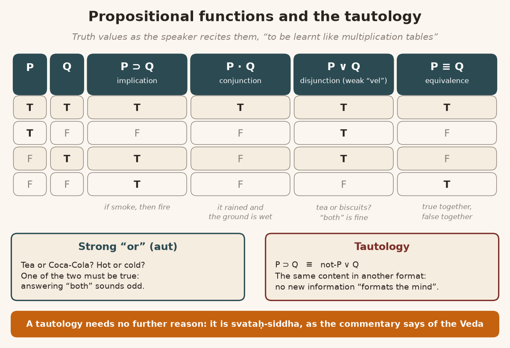
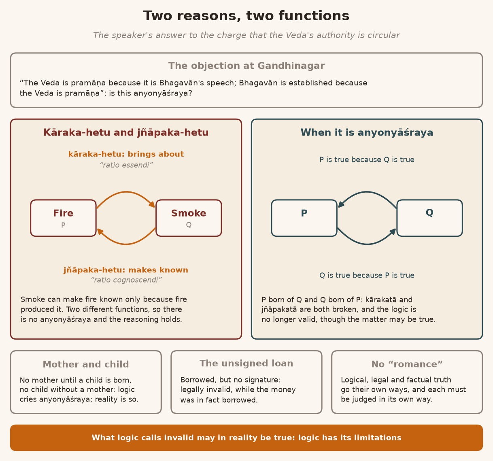
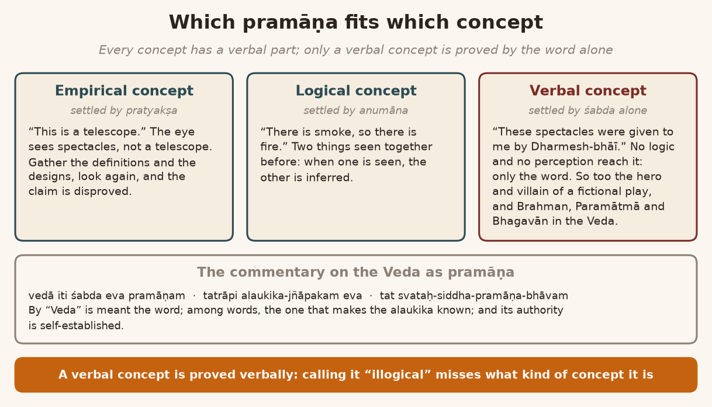
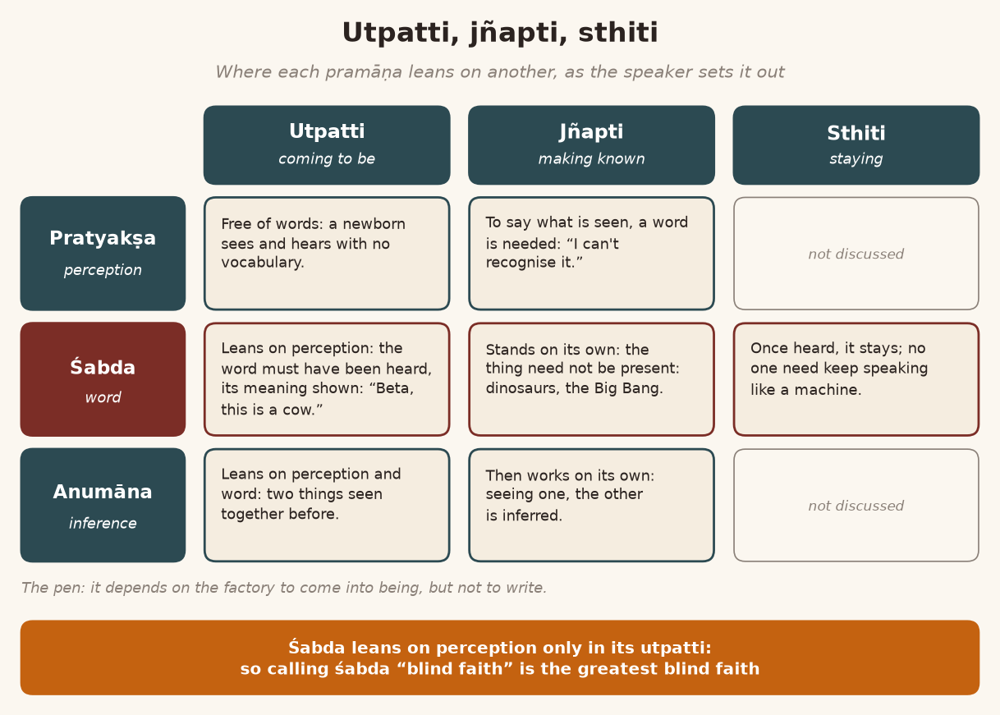
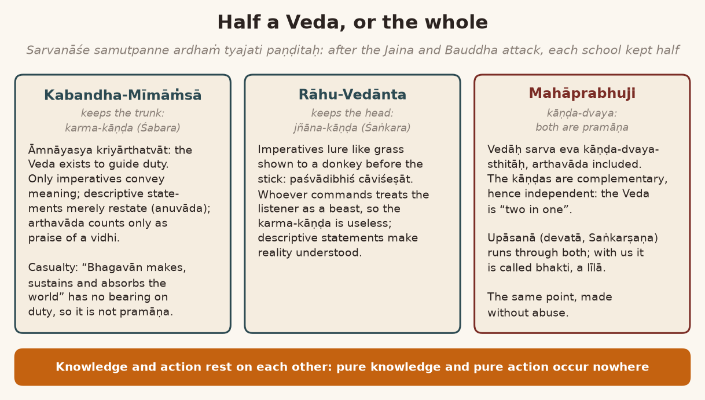
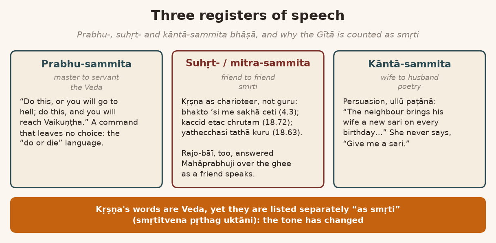
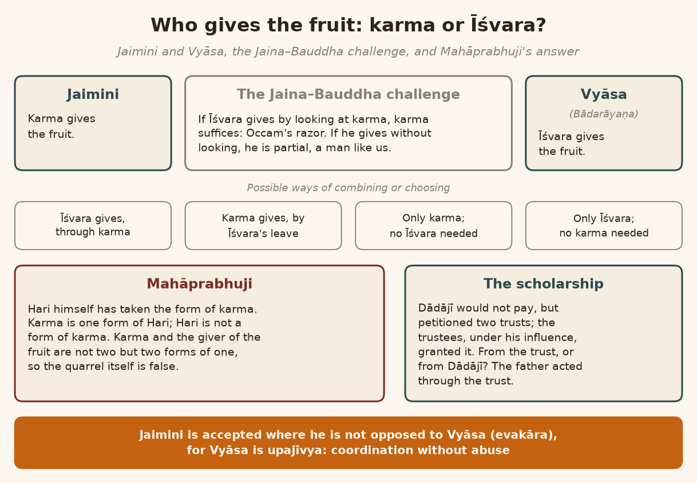
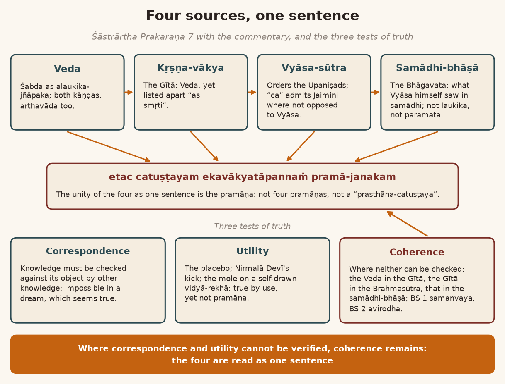

*English rendering of a spoken discourse on the Śāstrārtha Prakaraṇa of the Tattvārthadīpanibandha, translated from a Hindi ASR transcript. The speaker's conversational register, humour, digressions, code-switching, and student exchanges are preserved. Editorial flags: ‹ › conjectural restoration of a garbled reading; ‹?› uncertain reading; ‹…› inaudible or unrecoverable passage; ‹श्रवणाधारित› text given as heard, pending verification against a printed edition. Verses whose standard text is beyond doubt have been silently restored to the received editions.*

# 1. Propositional Functions and Tautology: Tea or Biscuits, Hot or Cold

**Speaker:** So, there is an announcement.

**A listener:** “Hand raise” — or not giving it to anyone ‹…›.

**Speaker:** So first understand these varieties (*prabheda*) of “proposition”; then we will take our text further. What does it mean? That if there is P, there must be Q. That is, if there is smoke, there must be fire. This is called the “implicative function” of a “proposition”. There is a “conjunctive function”, the joining (*saṁyojaka*) function: “P and Q”. P is there and Q is there too. The third “function” is “P or Q”: P or else Q; one of the two is certainly there.

**A student:** All right.

**Speaker:** ‹…› In Sanskrit there are two words, *vā* and ‹…›, for this kind of “function”. But in Sanskrit that “subtle distinction” between them has not been made. In ‹Latin› a very “subtle” “description” of it has been made: they have ‹“vel”›, and ‹…› “aut”. So, P “or” Q: “or” can mean *vā*, it can be “vel”, and it can be “aut”. ‹…› from Sanskrit ‹…›; there, “vel” goes with *vā*. What is the difference between them? One of the two — but both may be false‹?›; both may very well be false‹?›. That one is “weak”: in “P or Q” both may be false‹?›, “alternative”. And one kind is such that, no: if one is false, the other has to be true. That one is “strong”.

**A student:** Yes.

**Speaker:** They call it “aut”. For “aut” there is a “sign” like this. After that, one more “function” of a “proposition”: “equivalence”. Ordinarily two lines are drawn, but in “logic” they draw three lines. Now, in each of these “propositions” something or other new is coming in. For P is not the same as Q: P is something different and Q is something different. But besides this there is a “function” of “tautology”. ‹…› Right now I want to explain it to you with an example, because what comes next in the text is about “tautology”. So what happens in a “tautology”? First: has this “function” come to your attention?

**A student:** Yes.

**Speaker:** ‹…›

**A student:** Now the fourth one, once more: that is, P is there and Q is not. So now it isn't quite clear…

**Speaker:** No…

**A student:** Or in both…

**Speaker:** “Tables” are made for these. One minute, I'll show you. So now I'm telling you; first understand this. Every “proposition” has the possibility of being “true” or “false”. So there is the possibility of ‹“T T”, “T F”, “F T” and “F F”› coming up. Now, in the “function” of “implication”, how does it go? P is “true”, Q too is “true”: then “P implies Q” will be “true”, won't it? Yes.

**A student:** Yes.

**Speaker:** P, Q ‹…›. After that, what is there? “P implies Q proposition: P is true but Q ‹is not›, so ‹the› proposition is wrong, false.” Because what are you saying? “P implies Q: if there is a P, there is a Q.” And if Q is “false”, the “proposition” has become “false”. Is it in your mind? Next is “F T”. “Proposition” P is “false” and Q is “true”. Then on this account, on account of P's being “false”, the “implication” “proposition” does not become “false”. What is the “implication” “proposition” saying? If P were there, Q should have been there.

**A student:** Yes.

**Speaker:** P is not there at all, and still Q is there: so how will “P implies Q” become false? In that condition it becomes true.

**A student:** Yes.

**Speaker:** Is it in your mind? A really terrific “analysis”, this.

And P too is “false” and Q too is “false”: then how will ‹“P implies Q”› become “false” from this? It doesn't happen; yes. It too goes like that: “P implies Q” has not become “false”, has it? Because if P had been there, Q would have been there. P is not there at all, so where would Q come from? So the “truth value” of this “function” of the “proposition” of “implication” is like this: “T F T T”. Got it?

“Next: P and Q. P is true, Q is true, so proposition true.” P, Q: P is “true” and Q is “false”. Then “P and Q” are not both true, are they? It has become “false”. Did it come to mind? In the same way: P is “true”, Q too is “true” — sorry — P is “false” and Q is “true”: then too it has become “false”. And both ‹“false”: “false”› ‹…›. So that is how the “truth value” of the “conjunctive function” of “and” goes. Any “conjunctive” “proposition” there is, its “truth value” is this; it is a “given value”. I have — just as we learn the multiplication tables (*pahāḍā*) by heart, you know, “two ones are two, two twos are four”, in the same way one should learn “logic” by heart.

Is it in mind? After that comes “P or Q”, the “disjunctive function” of a “proposal”, of a “proposition”. Now see: P is “true” and Q too is “true”; then “P or Q” — that is what we were saying anyway.

**A student:** Q is “false”.

**Speaker:** So we were saying “P or Q”; so how will the “disjunctive function” “display”? ‹…› “F T”: that too can be “disjunctive”. A “disjunctive” “proposal”, “proposition”, is “false” when ‹both are false›. For that ‹other “or”›, the “function” stays something else. Is it in mind? That is where the matter of the “strong” comes in.

Suppose I ask you, “Will you have tea or biscuits?” If you say, “I'll take both,” it won't seem odd to me at all. And if I ask you, “Will you have tea or cold water?” — Coca-Cola — and you say, “I'll take both,” it is a bit “shocking”: what's this mess (*lafḍā*)? “Will you have something cold or hot?” and you say, “No, both will do.”

**A student:** Yes.

**Speaker:** That “or” — there the “strong” “or” comes in.

**A student:** Yes, yes.

**Speaker:** And in the same way, how does “equivalence” go? “P is equivalent to Q”: if both are “true”, it is “true”; if even one of the two is “false”, it is “false”; and if both are “false”, it is “true”.

**A student:** No…

**Speaker:** Because we are stating them as “equivalent”. So all these “propositions” there are, their “functions” are different in “logic”. After that: now, this is not “tautology”. Why is it not “tautology”? Because P is saying one thing and Q is saying something else. “For instance”, P says: it will rain. Then the ground will be wet. All right? What does the “and function” say? It has rained, and the ground is wet. And what does “or” say? Either it has rained, or the ground is wet. There too it is the same: “Will you have tea or Coca-Cola?” “Hot or cold?” And someone says “both”: the matter has to be kept both ways‹?›. Like that. “P is equivalent to Q”: what we are saying, we are saying. So if both are “true”, it is true; if both are “false”, it is true. The opposite of “equivalence” is this: if even one of the two is “false”, it was not “equivalence”. So that ‹…›

That is called the ‹truth› “function”. Within it there comes one more trouble (*balā*); it will look small. What happens in a “tautology”? That nothing new is coming in; it is being repeated. And often, in “Western logic”, a “tautological proposition” is not considered “valid”. Now, a “tautology” is in a way a “function” of “equivalence” — see, the very same thing is being repeated. In “equivalence” there is some different “function”, but “tautology” — the “proposition” of “equivalence” is considered “valid”. I am telling you about “tautology” “demonstratively”. If I set out a “proposition” like this, it means: “P implies Q, which is equivalent to either ‹not P, or Q›.” It has become a “tautology”. So I am only saying what “P implies Q” means; I am interpreting it in the “disjunctive function”.

**A student:** Hmm.

**Speaker:** Nothing new is going to come in, is it? The very point that was coming in “P implies Q”, I have said in the “disjunctive function” instead of the “implicative function”. This “equivalence” I am teaching you is a “tautology”. Because “nothing is added. If you know thoroughly well what is P implies Q” — “you should know better” — “there is not… there is a P”‹?›.

**A student:** Hmm.

**Speaker:** “No new information is supplied in this statement.” It has become a “complex statement”; before, they were all “simple statements”. That is the difference in this. No, a “tautology” is not accepted as *pramāṇa*, because you are giving an explanation of something; you are not giving any new “information”. What does “information” mean? “Which formats your mind, with certain concern.” In this no new “formation” of the mind is happening. “So there is nothing new information.” “Information, like, which formats your mind”: what “formats” the mind is “information”. It isn't “formatting” at all; it is “already formatted” in the simple ‹“P implies Q”›. No new “addition” of “information” comes from it. That becomes a “tautology”. Got it?

**A student:** Hmm.

**Speaker:** Now, here, what Mahāprabhuji is saying, the answer — I am not going into all its “detail” now, because otherwise it will turn into a digression. I have only given you an “example” of how a “tautology” happens and how “new information” comes into a “proposition”. Because whenever we “propo-” — one minute more.

**A student:** “Implies Q” — can we [show] it this way…

**Speaker:** …can we or not? Look: with a “Venn diagram”. The same diagram can be “explained” this way too. ‹…› ‹P› “is a major term”, ‹Q› “is a minor”. Where Q is, P will certainly be; but where P is, it is not necessary that Q be there. So we can see it here too. In the same way all of these can be “interpreted” in a “Venn diagram” as well. That is a “possibility”. Like “P and Q”…

**A student:** Done.

**Speaker:** So it's four o'clock‹?›. Good. Right. So when does a “tautology” happen? When no new “information” comes in.

**A student:** It won't come in.

{width=6.2in}

# 2. “Śabda Eva Pramāṇam”: A Self-Evident Tautology, and the Battle at Gandhinagar

**Speaker:** What is Mahāprabhuji saying here? Look, look carefully: *vedā iti — śabda eva pramāṇam*. By “Veda” my meaning is that the word alone (*śabda*) is the *pramāṇa*. Now which “proposition” has this become?

**A student:** “Implies.”

**Speaker:** “*Vedā iti śabda eva pramāṇam*. So this: Veda implies *śabda*. Okay, nothing wrong. It's a new information. Of course we know it, but still it is a something new,” he says. ‹Fresh› “information is given”. *Tatrāpi alaukika-jñāpakam eva*: within *śabda*, not all words are *pramāṇa*. Now he is “distinguishing” the word. Which words are *pramāṇa*? Those words whose meaning is *alaukika*: in this there is *pramāṇa*. Brahman, Paramātmā, Bhagavān: all three things are ‹*alaukika*›. Being an *alaukika-jñāpaka*, one that makes the *alaukika* known, the Veda is *pramāṇa*; and if the Veda is *pramāṇa*, the *alaukika* will be established. Has it become a “tautology” or not? By the reckoning of “Western logic” it has become a “tautology”. Did it come to mind? If there is any doubt, ask it now. When his body starts to itch, then the brain will get “activated”!

After that, what does Mahāprabhuji say? *Tat svataḥ-siddha-pramāṇa-bhāvam*. Look where the matter goes from here. To “prove” a “tautology” there is no need to give any new “reason”; a “tautology” is a self-established (*svataḥ-siddha*) *pramāṇa*. When does one have to give a new “reason”? When we are saying something that is not said in the “subject”, that is being said because of the “predicate”, of the “predication”. But when what is said in the “subject” we simply repeat again in the “predicate” — the “format” has been changed, but the matter is the very same — then it has become a “tautology”. So a “tautology” is *svataḥ pramāṇa*; it hardly needs any *pramāṇa*. “P implies Q” will have to be proved as *pramāṇa*, because its “truth value” is different.

**A student:** “Okay.”

**Speaker:** Its “truth value” is “T F T T”. All the “propositional functions” there are have different “truth values”. But a “tautology” will always come out with the same “truth value”; you'll see when you “work it out”, won't you? We don't have the “time” now, otherwise I would show you by working it out “mathematically”. ‹…› “So P implies Q is equivalent to ‹not P› or Q. Not ‹Q or P›. I'll tell you one idea.” ‹…› it will not come out different: it is *svataḥ-siddha-pramāṇa-bhāva*.

In our Gandhinagar, the very first ‹…›, a regular war broke out over this. Because everybody was saying, “Brother, you call the Veda *pramāṇa*; you proceed by taking the Veda as *pramāṇa*, your Vedānta does.” Because in my “introductory lecture” I had said one thing: that Vallabhācārya's is not a “hypothetical philosophy”. What does “hypothetical” mean? Make some “hypothesis”. As Newton made a “hypothesis”: brother, this apple that is falling, there must be a “law of gravitation” for it. “And” after making that “hypothesis”, to “prove” it he did an “experiment”, and by the “experiment” it was “proved” — so people say; what do we know of the truth of it? But that “philosophy” has become “hypothetical”. Einstein made a great many “hypotheses”, which have only now come to be “proved”. At that time neither had an “experiment” been done, nor an “observation”. So some “philosophy” is “hypothetical”, and some is ‹“hermeneutic”›. What does ‹“hermeneutics”› mean? That you “decode” the “information” you already have. “Because” in that there will be ‹“tautology”›.

**A student:** No…

**Speaker:** As if I tell you, “Decode TWA,” what will you say? “Trans World Airlines.” What is being said in “T-W-A” is said again in “Trans World Airlines”. As if I say “A-I-R”…

**A student:** Yes.

**Speaker:** “Air India.” The very same thing is being said; no “information” is coming in at all. So everyone said: “You hold that the word alone is *pramāṇa*; then what is the *pramāṇa* for the word's being *pramāṇa*?” ‹…› I said, our “stand” on this is this: the word is *svataḥ pramāṇa*, a *pramāṇa* by itself. They said: “How can it be *svataḥ pramāṇa*? How can we accept that? Would you accept a *svataḥ pramāṇa*? And if the Veda is true, then Brahman, Paramātmā, Bhagavān will be established. Whose do you call the Veda? Whose speech are you calling it? You say it is Bhagavān's speech. If it is established as Bhagavān's speech, then the Veda will be *pramāṇa*. If the one whose speech it is, Bhagavān, is not being established, how will the Veda be *pramāṇa*? This has become *anyonyāśraya*, mutual dependence.” ‹…› Over that the quarrel grew a great deal; everyone started stating his own view.

# 3. Kāraka-hetu and Jñāpaka-hetu: The Mother, the Child, and the Unsigned Loan

**Speaker:** The thing to understand in this is that there is a *jñāpaka hetu* and there is a *kāraka hetu*. There is a “ratio essendi” and there is a ‹“ratio cognoscendi”›. Fire is the *kāraka hetu* of smoke, and smoke is the *jñāpaka hetu* of fire. So when the argument is running on the basis of *kāraka hetu* and *jñāpaka hetu*, there is no *anyonyāśraya*. What is the root reason for this? Because a *jñāpaka hetu* will be a *jñāpaka hetu* only if it was produced from that *kāraka*. If it was not produced from it at all — if Q was not produced from P — “let P be the fire, let Q be the smoke” — now if Q has not been produced from P at all, how will Q make P known? P is the *kāraka hetu*, and Q will become the *jñāpaka* element of P. Is it [clear]? Where is *anyonyāśraya* happening in that? It is not one and the same “function”. ‹Between the *jñāpaka* field and the *kāraka* field› there is no mutuality (*anyonyatva*). When the two are *jñāpaka*s of each other, then there is *anyonyāśraya*: Why is P “true”? Because Q is “true”. Why is Q “true”? Because P is “true”. How was P produced? It was produced from Q. How was Q produced? It was produced from P. Then *kārakatā*, being the *kāraka hetu*, and *jñāpakatā*, being the *jñāpaka hetu*, have been broken. In that situation it has become *anyonyāśraya*, and then the “logic” does not remain “valid”.

The matter may be true. “Logic” has its “limitations”: what “logic” calls “invalid” may in reality be “true”. For example — there is no need for an example — when is there a mother? When a child is born. When is there a child? When there is a mother. Is it mutual dependence or not? Can there be a mother without a child being born? Is a child born without a mother? No: *anyonyāśraya*. “Logic” will call it *anyonyāśraya*. But reality is exactly this, isn't it? Reality is exactly this. So “logic” has its “limitations”.

**A student:** Yes.

**Speaker:** If “logic” considers something “invalid”, that does not make the thing false. It is “logically” wrong; it is not “factually” wrong. For example, you borrowed from someone, and after borrowing you did not give a “signature” to the one you borrowed from. So it has become “legally invalid”; it has become “legally invalid”. “Actually” you did borrow. After borrowing you did not give a “signature” saying that I have borrowed. Now he files a claim: “This man borrowed from me.” “Tell me, what is the proof? First, is there a ‘document’? Where is the ‘signature’?” There is no “signature”: the “document” has become “invalid”. This is the thing to understand. What is “legally invalid” is not “factually invalid”; likewise, what is “logically invalid” is not “factually invalid” either. And it is not necessary, either, that what is “factually valid” should be “logically valid”. Between “logical” ‹…› “truth” and “factual truth” there is not the kind of “romance” — there is not the kind of “romance” — that we imagine owing to our little sense. The two go along their own separate ways. The two will have to be judged in different ways.

{width=6.2in}

# 4. Verbal Concepts: Shakespeare's Villain, the Magazine on the Bus, and Dharmesh-bhāī's Spectacles

**Speaker:** In the discussion of the Śabda-khaṇḍa this was debated with great force: how will the *prāmāṇya* of the Veda be established, this Veda that you hold as *pramāṇa*? I often explain this with an example. Take Shakespeare: he wrote many “dramas”. There were “historical dramas”; there were some “fictional dramas” too. “Actually” those dramas are not “historical”. Many who write “drama” write “fictional dramas” too. And in a “fictional drama”, what is the “character” of the “hero”? What is the “character” of the “villain”? For that, the *pramāṇa* will be the words of the “drama”. Whether you take a liking to some “hero” or take a liking to the “villain”, that will be the *pramāṇa*.

The “description” in the ‹“drama”› is what is *pramāṇa*, isn't it? So the “character” is being “proved” from the “drama”, and the “character” is “proving” the “drama”.

**A student:** Yes.

**Speaker:** Once I was going from Āmanch‹?› to Jatipura. I had some book in my hand — I have told this many times. I was going in a public bus. A gentleman was sitting opposite me. He introduced himself to me and asked me, “What are you reading?” ‹…› He put a “magazine” into my hand: “Read this.” Well, in the bus I had to pass the time, so I said, “Come on, let's read it; what do I lose?” I read the “article”. In it this was written: “‘Actually’ Rāmacandrajī was a big rascal.”

**A student:** Yes.

**Speaker:** “And Rāvaṇa, poor fellow, was a simple soul. When he was performing a *yajña*, he was about to receive such divine weapons (*divyāstra*) that Rāmacandrajī could not have defeated him at all, so he had the *yajña* destroyed. From that, Rāma's rascality is proved.” I read the whole “article” properly. After reading it I said to him — he asked me, “How did you like it?” I said, “Brother, I didn't understand the thing.” He jeered at me: “Yes, you won't understand it; that much I understand.” “No, it is not like that,” [I said]. “This says that by performing a *yajña* a divine ‹chariot› comes out, divine weapons come out.” I said, “Even today, pour ghee into a fire and see: does a ‹chariot› come out? Pour ghee into a fire: does a ‹chariot› come out, do weapons come out? Smoke comes out, flames come out. How has it been told to you that a ‹chariot› and weapons will come out?” I said, “That is what your Rāmāyaṇa has said.” Then I said, “My Rāmāyaṇa has also said that Rāma was good and Rāvaṇa was a rascal. Now, are you talking about my Rāmāyaṇa or about your Rāmāyaṇa?”

Take the word as *pramāṇa*! No, friend: if you are talking about my Rāmāyaṇa, then what is written in it is what I will accept. “Worst come worst”, Rāma and Rāvaṇa are both “fictional characters”. Like the “character” Shakespeare wrote, that one is a “hero” and one is a “villain”: that is what will be taken as *pramāṇa*, won't it? Like “The Merchant of Venice”: a “fictional drama”. “Romeo and Juliet” is a “fictional drama”. “Macbeth” perhaps is not “fictional”. And that one — the one who was the queen of Egypt, Cleopatra, and our Roman, the one who was their Julius Caesar — “Cleopatra and Julius Caesar” — that was a “historical drama”. So in it we can check some things against “history”: brother, how much “digression” Shakespeare made from history, what the true “history” was and what this is, and so on. But where there is a “fictional character”…

**A student:** Their…

**Speaker:** …I mean, there Shakespeare's words will be the *pramāṇa*. Will they be *svataḥ pramāṇa* or not? Would it need some other “value verification”? So understand one thing carefully: a “verbal character”, a “verbal concept” — in it, “verbal information” alone will be the *pramāṇa*. What wrong thing have I said in this? If in “empirical information” we take the “verbal” as *pramāṇa*, then a quarrel can arise. Brother, I can see with my eyes that this is a pair of spectacles, and you are saying it is a *dūrbīn*, a telescope. With the eye no telescope is seen; spectacles are seen. So here my “statement”, “in two inverted commas”, “This is a telescope”: for this you can “gather information” — what the definition of a telescope is, what the definition of spectacles is, what the “design” of a telescope is, what the “design” of spectacles is, and so on — and “prove” before me that this is not a telescope; this is a pair of spectacles.

So on this very basis, let me tell you a piece of “verbal information”: “These spectacles”, “in two inverted commas”, “were given to me by Dharmesh-bhāī.” That these are spectacles given by Dharmesh-bhāī: can you “verify” it and show it? That Dharmesh-bhāī gave them: can you infer it? If it were something “branded”, then you might still infer: brother, it's “branded”, so Dharmesh-bhāī gave it. But it isn't “branded”; it's an ordinary run-of-the-mill pair of spectacles. So how do you accept that Dharmesh-bhāī gave them?

So there, my “verbal information” alone is the *pramāṇa*, because the “concept” itself is “verbal”. What I am saying — that these spectacles were given to me by Dharmesh-bhāī, “in two inverted commas” — this is a “verbal concept”. It is not “empirical”. It is not “logical”. “There is no logic behind this: why this fact has been given to Śyām Bābā by Dharmesh-bhāī. Is there any logic? No. Is there any perception? No.” To regard this as “illogical” is in itself proof of an empty “logic” skull. Did you get the point? That is what Mahāprabhuji is explaining: *tatrāpi* — *vedā iti*, *śabda eva pramāṇam*; “thereupon, *alaukika-jñāpakam eva*”; *tat svataḥ-siddha-pramāṇa-bhāvam*. And their *prāmāṇya*, being “tautological”, is self-established. It does not need to be “justified” by some other “proposition”. Yes: did a question come to you, to all of you? Yes.

{width=6.2in}

# 5. Bhakta and Bhagavān: Coca-Cola Japa and the Chanting Machine

**A student:** So this matter — like our “concept” of Brahman, Paramātmā, Bhagavān: to understand a verbal‹?› “concept” the word is the *pramāṇa*, and to establish it, that is, it is *svataḥ pramāṇa*. At one place we had also understood that the “relation” between Bhagavān and the bhakta is mutually dependent (*anyonyāśrita*): that is, if there is a bhakta there is Bhagavān, and if there is Bhagavān there is a bhakta.

**Speaker:** Hm.

**A student:** This is a little “contradictory” — or is it a separate “aspect”? The mutual “nature” of bhakta and Bhagavān, and here what we… to understand Brahman, Paramātmā, Bhagavān, we count the word as *svataḥ* [*pramāṇa*].

**Speaker:** Yes. Look, understand carefully. The relation of bhakta and Bhagavān is mutually established (*anyonya-siddha*).

**A student:** Hmm.

**Speaker:** In it there are two “terms”: one bhakta and one Bhagavān. Normally we have a great many “prejudices”: he has put on a tilak, he has taken a *gaumukhī* in his hand, he is saying “Hare Rāma, Hare Rāma, Hare Kṛṣṇa”, so he must be a bhakta; and the one whose name he is saying, “Hare Rāma, Hare Kṛṣṇa”, must be Bhagavān.

**A student:** Ah.

**Speaker:** But “this is what is called a bhakta”: is there any “verbal” *pramāṇa* for it? What “empirical” *pramāṇa* is there? “This is what is called Bhagavān”? Rajneesh used to say a very good thing: just as you chant “Hare Rāma, Hare Kṛṣṇa” and you get peace, in the same way chant “Coca-Cola, Coca-Cola”; then too you will get peace. Because whatever thing you chant “continuously”, your mind gets fixed there, so you will get peace. Does any Bhagavān get established by that? You find Bhagavān dear, so as a bhakta you chant Bhagavān's name. But that because you chant Bhagavān's name you are a bhakta — that is not necessary, is it? If that were necessary — nowadays these “machines” are coming. Hang up the “machine”, put in a “battery”: in Rani Bagh let the rhinoceros‹?› say *Śrīkṛṣṇaḥ śaraṇaṁ mama*; ‹…› won't it say *Śrīkṛṣṇaḥ śaraṇaṁ mama*? It will just keep on chanting. Is it a bhakta? Does it keep speaking or not?

**A student:** No.

**Speaker:** It will speak for twenty-four hours (*kalāk*). You cannot speak for twenty-four hours. So it hardly becomes a bhakta by speaking. If anyone became a bhakta by speaking, then that “machine” too should become Bhagavān — should become a bhakta. ‹…› Then it has become a merely “verbal” matter.

**A student:** Yes.

# 6. Utpatti, Jñapti, Sthiti: The Pen, the Newborn Child, and the Dinosaurs

**Speaker:** So understand well, in this sense, that this is a “verbal concept”. Because it is a “verbal concept”…

**A student:** Hmm.

**Speaker:** …in our life — I am not coming to that subject now, so today I am just giving you a “hint” — whether it is an “empirical concept” or a “logical concept”, all “concepts” are, after all, “part” of a “verbal concept”.

**A student:** Hmm.

**Speaker:** Because if you are not getting the word, then even after seeing with your eyes you will not be able to recognise the person. If you are not getting the word, you will not be able to recognise the “concomitance” of smoke and fire. So the “verb” has entered in everywhere. How can you deny it? It is another matter that for the “verb” to be a *pramāṇa*, it has to take the support of *pratyakṣa*, perception. Understand this beautifully. For any “verbal information” to be a *pramāṇa*, one “prior” [condition] is this: that you have seen the meaning of that word through *pratyakṣa*; then you understand it. Because only if you have heard the meaning of the word will you understand: this is the meaning of that very word. If you have not heard the word… hearing is a *pramāṇa*, isn't it? So one thing I [say]: this *prāmāṇya* ‹…› “of information” — for it there are these three requirements. *Prāmāṇya*: *prāmāṇya* means being a *pramāṇa*, that any “source of information” is “valid”. So its “dependency” on another will be either in *utpatti*, or in ‹*jñapti*›, or in *sthiti*. *Utpatti*, ‹*jñapti*›…

This is quite a “subtle topic”, but if you try you will understand it. Take this “pen”. The “function” of the “pen” is writing.

**A student:** Hmm.

**Speaker:** In *utpatti* it is “dependent”.

**A student:** Hmm.

**Speaker:** In being produced, this “pen” is “dependent” on someone. But in writing it is not “dependent” on the “factory”. To write letters it does not need to depend on the “factory” now. It depends on the ink; ‹and the ink› is its own “part”. So its *prāmāṇya*, its “validity” — that this “pen” is a good, “valid pen” for writing — in *utpatti* it is “dependent” on the “factory”, but in writing it is “independent”. That is called *svatantra*, independent. ‹…› In *sthiti* it is not “dependent” on that. Being a *pramāṇa* is in *utpatti*, or in *sthiti*, or in ‹*jñapti*›.

**A student:** Hmm.

**Speaker:** So understand carefully that *pratyakṣa pramāṇa* depends on the word in *utpatti*‹?›. Why does it depend on the word? Because you are seeing it, but its word is not coming back to you; so what will you say? “I can't recognise it.” Something is seen and you cannot ‹recollect› what is called what, the thing that is seen. So what will you say? “I can't recognise ‹him›.” So, one: *pratyakṣa* depends on *śabda pramāṇa* in *utpatti*‹?›. In the same way *śabda pramāṇa* too depends on *pratyakṣa pramāṇa*, because if you have never heard the word, how will it be a *pramāṇa*? But see how it is with *pratyakṣa pramāṇa*: once the word has come back to you, after that — in *jñapti*, *pratyakṣa pramāṇa* does not depend on the word‹?›, because first you see it, and after that you think what it is called. So in *utpatti*, *pratyakṣa pramāṇa* is independent; yes, in ‹*jñapti*›‹?› it is independent: at that moment the word is not needed. If even at that moment the word were needed, then a child who does not know how to speak should not have been able to see anything at all; he should not have been able to hear anything.

**A student:** Hmm.

**Speaker:** A newborn child does see and hear; at that time he has no “vocabulary”. So we can understand that in *utpatti*, *pratyakṣa pramāṇa* does not depend on the word. And when the “junction” of *jñapti* comes — what is it that the eye is seeing? — then you will have to give some word or other. There it is “dependent”.

In the same way *śabda pramāṇa* too is “dependent” on *pratyakṣa* in *utpatti*, because if you never heard, never saw what the word is, what will you come to know? But once you have seen, have known the meaning, that this word has this meaning, after that it is not that *śabda pramāṇa* will give its “meaning” only if [the thing] is seen by you. Now this is the “beauty” of *śabda pramāṇa*; understand carefully: whether the thing is in front of you or is not present at all. What happened ten thousand years ago? If we get some “verbal information” about it, do we get knowledge or not? Profit? Like: there were “dinosaurs”. ‹Who› saw the dinosaurs? Someone told us that this creature is called a “dinosaur”, just as we hold a cow by the horn and tell a child, “Beta, this is called a cow.” ‹…› So that there are dinosaurs, we came to know from *śabda pramāṇa*, didn't we? All the “theories” there are — “cosmic theory”, of the “Big Bang”, or whatever, “continuous” — they are all from *śabda pramāṇa* alone. Nobody saw it happen. Because when it happened we were not there, and when we are there it is not happening. So in *utpatti*, *śabda pramāṇa* depends on *pratyakṣa*, but in ‹*jñapti*› *śabda pramāṇa* too does not depend [on it].

In the same way *anumāna*, “logic”, also depends in *utpatti* on the word — depends in *utpatti* on the word and on *pratyakṣa* — because you must have seen two things together somewhere; when one of them is seen, you infer: “Ah, these two always stay together.” You have seen that, and then that inference is happening, isn't it? So in *utpatti* it depends on *pratyakṣa*, but in ‹*jñapti*› it does not depend. *Utpatti*, ‹*jñapti*›, ‹*sthiti*›.

In *sthiti*, the “situation” is this, for *śabda pramāṇa*: look, look carefully. You cannot say that a word is a word only as long as it is being heard, and that after it is no longer heard there is no word. Once it has been heard, even by mistake, then it stays (*sthita*). [It is not that] someone has to keep on speaking “continuously”, like a “machine”.

**A student:** Hmm.

**Speaker:** There's nothing here you are not understanding, is there? ‹…› So out of *utpatti*, [*jñapti*] and *sthiti*, only in *utpatti* is *śabda pramāṇa* dependent on *pratyakṣa*; there the word is dependent on *pratyakṣa*. In ‹*jñapti*› neither is this one dependent nor that one. So those people who hold that taking the word as *pramāṇa* is blind faith (*andhaśraddhā*): there is no bigger blind faith in the world than that.

{width=6.2in}

# 7. The Greatest Blind Faith: The Morning Newspaper and the Two Tongue-Tied Bridegrooms

**A student:** Very [true].

**Speaker:** There is no bigger blind faith in the world than that. Today, when we get up in the morning and read the newspaper — if the word is not *pramāṇa*, then why read the newspaper, brother? And I say, leave all that aside. This person who says, “I do not accept the word as *pramāṇa*” — whom is he saying it to? To one who accepts the word as *pramāṇa*, or to one who does not? If he says it to those who accept it, then how did he come to know that this person accepts the word as *pramāṇa*? Because he spoke, that's how.

**A student:** Yes.

**Speaker:** Because he spoke, that is how he came to know that he accepts the word as *pramāṇa*. If he had not spoken, how would one know whether he accepts the word as *pramāṇa* or not?

In our childhood I read a poem — a story. In those days children used to be married off, you know.

**A student:** Yes.

**Speaker:** So there were two boys who were *bobaḍe*, tongue-tied; they lisped (*totale*‹?›). They were made to wear caps, dressed in good clothes, and sent off to see a girl; but they were given just one “instruction”: “Don't speak.” So the girl's father said, “Brother, the boys are both good.” He [the elder] got the “confidence” that now they had been approved, and said, “What of it? If we had put on [better] caps now, we would look even better!”‹?› The younger brother said, “You spoke! You spoke!” ‹…› Both were cancelled. So [the father] said, “That's how we came to know they are tongue-tied. If they hadn't spoken, how would we have known?” The poor man would have given away his daughter. He is accepting *śabda pramāṇa*. It is from *śabda pramāṇa* itself that he is coming to know, isn't it? So how can it be that accepting *śabda pramāṇa* is improper? “*Pratyakṣa aur anumān hī pramāṇ hai*” [perception and inference alone are *pramāṇa*] — “Not necessarily. Not necessarily. It is your blind faith in perception and logic that makes you think” [so]. ‹Is it› “clear”? Completely.

# 8. Kāṇḍa-dvaya and Upāsanā: Water-Pots on the Head, Drivers on the Phone, and Yamunā-jala

**Speaker:** He is saying: *alaukika-jñāpakam eva; tat svataḥ-siddha-pramāṇa-bhāvam; vedāḥ sarva eva kāṇḍa-dvaya-sthitāḥ*; and all, *arthavādādi-rūpā api*… in the Veda…

**A student:** Yes.

**Speaker:** …there are ‹two› *kāṇḍa*s. Mahāprabhuji spoke of two *kāṇḍa*s, but there are three *kāṇḍa*s in the Veda: the *karma-kāṇḍa*, the *jñāna-kāṇḍa* and the *upāsanā-kāṇḍa*. Now everyone‹?› has taken the *upāsanā-kāṇḍa* as falling within the *jñāna-kāṇḍa*. But Mahāprabhuji himself says that *upāsanā* happens in *jñāna* too, and *upāsanā* happens in *karma* too. Is it separate, or is it a “part”? It is a “function” of the Veda. Because — look, understand the point carefully — *upāsanā* means “meditation”. Does action need “meditation” or not? Mahāprabhuji asks this. Just as “knowledge” needs “meditation”, in the same way action too needs “meditation”. And for practically all the actions of the Veda there are, the Veda has prescribed some “meditation” or other in all of them.

If we look at it from the “angle” of our Puṣṭimārga — understand one thing carefully: with us there is bhakti, and we separate ‹bhakti› from *upāsanā*: *pāribhāṣika mithyā*‹?›. So in bhakti too there is *upāsanā*, isn't there? What does *upāsanā* mean? Understand carefully: near someone —

**A student:** ‹…›

**Speaker:** — “physically”, “mentally”, “emotionally”. Are we sitting “physically” or not? Are we sitting “mentally” or not? If we sit “emotionally” too, then we are doing *upāsanā* of it. As it is, there is a poem in ‹…› language: *jo nāgariko cit gāgarī*‹श्रवणाधारित›. The village women put a pot on their heads and bring water from somewhere far away, and they keep chatting among themselves. Their *upāsanā* goes on, lest the pot on the head should fall: “mentally” they are there, near the pot. I have often seen many drivers who keep talking even while driving. Nowadays the mobile has come, so they talk on that too. Whether the police catch them is another story, but they do talk, don't they? They talk with ‹something› in the ear, so that the police won't catch them; but they do talk, don't they?

Does talking take the “concentration” off the driving? A good driver's doesn't shift. If he is a slapdash (*cālū paṭṭā*) driver, he may perhaps get into trouble. So in bhakti too there is *upāsanā*, isn't there? We place a *thālī* of Yamunā-jala before our Ṭhākurjī. It isn't nearby, so what is it — are you bringing Yamunā-jala? You are only doing “meditation”, aren't you? We place it and do the bhāva of Yamunājī. An “emotional” ‹*upāsanā*›.

**A student:** Yes.

**Speaker:** Some people do not accept an *upāsanā-kāṇḍa*; they accept a *devatā-kāṇḍa*: that is, *karma-kāṇḍa*, *jñāna-kāṇḍa* and *devatā-kāṇḍa*. It is also called the *Saṅkarṣaṇa-kāṇḍa*. There are different names, but the point is one: that there are three *kāṇḍa*s. But that third *kāṇḍa* is present in both, so it is not counted separately; the distinction made is of *jñāna-kāṇḍa* and *karma-kāṇḍa*. Now, what trouble arose in this? Some people are *karmavādī*s, some people are *jñānavādī*s. Wherever *karma* came up, those people think, “*Karma* — it is useless.” Some people are such that [they say], “If you are not doing *karma*, then knowledge too is useless.” Now, is *karma* useless or is *jñāna* useless? Brother, both are useless without each other. The two are “complementary” to each other. Many *karma*s are not merely *karma*: there is knowledge in them too, and there is *upāsanā* in them too. And many kinds of knowledge are such — I am not talking of the knowledge of Brahman; I am not talking about Brahman, nor am I talking about Bhagavān, nor about Paramātmā — there are many kinds of “knowledge” such that until you do its “practical” “exercise”, that “knowledge” “freezes” in your mind.

**A student:** Yes.

**Speaker:** Its “mathematics”. Like “cricket”. Like “painting”, like “music”. You didn't do your *riyāz*: that is *karma*, isn't it? This is *karma*. Without it you will not be able to understand. Understand carefully: the “surgery” a doctor performs — is it knowledge or is it *karma*?

**A student:** What is to be done‹?›…

**Speaker:** If there is no knowledge…

**A student:** All right.

# 9. The Frog Without a Heartbeat, and the Pañcatantra Scholars Who Kept Half

**Speaker:** I keep telling a story from my childhood. When I was ‹…›, a cousin of ours had taken up “medical”. One day he said, “Today I will cut open a frog and show you how a frog's heart beats.”

**A student:** Absolutely.

**Speaker:** We were all very excited: how does a frog's heart beat? We had never seen it; we had seen frogs. Three or four of us cousins all gathered. ‹…› We put the knife into the frog. The frog died. Now he opened up the whole belly, but the heart beating in it just couldn't be seen. What was the trouble? There was no knowledge of where to put the knife. If there had been knowledge of where to put the knife…

We were all crowding round, watching like this: “Now we'll see the frog's [heart] beating!” Only the frog could be seen. After a little while something went wrong for him; he couldn't make out what had happened.

The whole show flopped. What I mean to say is that in “surgery” too there is knowledge and there is action. So the doctrine of abusing one another — “you are a *jñāna-kāṇḍī*, you are a *karma-kāṇḍī*, a *bhakti-kāṇḍī*” — this is a denial of our own brain. Because in bhakti there is “action”, there is “knowledge”, and there is “emotion”, and among the three there is “coordination”. Where their “coordination” ends, something or other starts going wrong. Abuse one another: that is all very well; once you understand it, it is one and the same thing. “We are not *karma-kāṇḍī*s, we are *jñāna-kāṇḍī*s.” Oh brother, he is a *jñāna-kāṇḍī* — so what will you do? You will abuse the *jñāna-kāṇḍī*: “We are *karma-kāṇḍī*s; we don't believe in knowledge; do it and show us.” Scientists are all *karma-kāṇḍī*s. Which “scientists”? The ones who are half-baked “scientists”. The ones who are real “scientists” are *jñāna-kāṇḍī*s as well as *karma-kāṇḍī*s.

So understand this carefully: the two *kāṇḍa*s (*kāṇḍa-dvaya*) that are in the Veda cannot stand by cancelling each other's *pramāṇa*. Because in our intellect, knowledge rests on action and action rests on knowledge, in many “branches of knowledge”. You will see this *anyonyāśraya*. “Pure knowledge” and “pure action”: where do they occur? Nowhere; they occur nowhere. Wherever they are, they are mixed, because the brain's “structure” itself has not been made that way. To accept one as *pramāṇa* and not to accept the other — what was this? They thought of making a “shortcut” in a scramble (*dhāndhal*). And its root cause was this — it is not said like this in ‹our tradition›, but it is said in Rāmānuja Vedānta — that after Jainism and Buddhism came, when they “criticised” the Veda, people hit upon a “shortcut”: “Drop the ‹*jñāna*›-*kāṇḍa*, which we cannot carry through fully; accept the *karma-kāṇḍa* as *pramāṇa*.” Someone said, “If you accept the *karma-kāṇḍa* as *pramāṇa*, the ‘intellectual’ people will get annoyed.” ‹So:› “‹Instead of› the *karma-kāṇḍa*, accept the *jñāna-kāṇḍa* as *pramāṇa*.”

**A student:** Yes.

**Speaker:** So Vedānta Deśika, who belongs to the Rāmānuja school, calls the one a “Rāhu-Vedāntin” and the other a “Ketu-Mīmāṁsaka”. Rāhu means the neck; Ketu means the trunk (*dhaḍ*). One is sitting holding on to the headless trunk (*kabandha*) of Mīmāṁsā. One is sitting holding on to the neck of Mīmāṁsā.

In the Pañcatantra there is a very funny story. A guru taught four students thoroughly. After teaching them he told them, “Now go along; you have done your studying; now go to your homes.” When they set out from the guru's āśrama, a crossroads came on the way. ‹…› They got “confused” whether to go by this road, or by that road, or by that road. So one of them said, “Didn't Gurujī tell us: *mahājano yena gataḥ sa panthāḥ* [the way is the one the *mahājana* has gone by]?” *Mahājana* means a *baniyā*, a merchant, too, and *mahājana* means a guru too. “Gurujī told us that one should go by that road.” A *baniyā* was going along there. They said, “Come, let's go by this very road.” The *baniyā* went and sat down in his shop. Now where do you go?

Now, a camel was running there, running very fast. Then the second disciple remembered: *dharmasya tvaritā gatiḥ*, dharma runs very fast. He went and hung on to the camel's leg — hung on to the camel's leg — and the camel kicked, and he went and fell into a pond. They said, “Today it has all turned out very hard. We caught hold of dharma, and still our companion is drowning in the pond.” Then [one] said, “No, no, remember what Gurujī taught us: *sarvanāśe samutpanne ardhaṁ tyajati paṇḍitaḥ*: when total ruin is at hand, give up half.” He cut off his head and kept it, that's all. Oh brother, you had caught hold of his neck — then pull out the whole of him! No: total ruin; he was drowning completely, wasn't he? So instead of pulling out the whole, he cut off his head and kept it with him. *Sarvanāśe samutpanne.* Of this sort are the ones who are wise!

Vedānta Deśika is saying that these people did this kind of work: when the Jains ‹…› attacked the Veda. So, *sarvanāśe samutpanne ardhaṁ tyajati paṇḍitaḥ, ardhena kurute kāryam*: make do with half, because total ruin would be utterly unbearable. Accept half the Veda as *pramāṇa*, and take half the Veda as not *pramāṇa*. In Rāmānujācārya's school this matter is [called] *Kabandha-Mīmāṁsā* and ‹Ketu›, Rāhu-Vedānta.

> सर्वनाशे समुत्पन्ने अर्धं त्यजति पण्डितः ।
> अर्धेन कुरुते कार्यं सर्वनाशो हि दुःसहः ॥
>
> *sarvanāśe samutpanne ardhaṁ tyajati paṇḍitaḥ |*
> *ardhena kurute kāryaṁ sarvanāśo hi duḥsahaḥ ||* (cf. Pañcatantra, Book 5)
>
> [When total ruin is at hand, the wise man gives up half and gets the work done with the other half; for total ruin is unbearable.]

So it is said: *sarvanāśe samutpanne ardhaṁ tyajati paṇḍitaḥ*. Mahāprabhuji does not say it with abuse like this, but he says the very same thing, without abuse: the two *kāṇḍa*s (*kāṇḍa-dvaya*) are *pramāṇa*, and *arthavāda* and the rest.

# 10. Vidhi, Mantra and Arthavāda: Namaste, “What a Beautiful Garden!”, and Śaṅkara's Grass and Stick

**Speaker:** What is *arthavāda*? Let us understand the point. In the statements of the *karma-kāṇḍa* there is a *vidhi*, an injunction. There is an *apavāda*: an “exception”, where is this “bill” not to be applied? There is a *pratiprasava*, which is called “restoration”. And there is *arthavāda*, and there is *mantra*: *mantra-brāhmaṇayor veda-nāmadheyam*. When we do some work, some *mantra* should be said at that time. What is a *mantra*? In the action you are doing there should be an “element” of “meditation”.

**A student:** Hmm.

**Speaker:** Because if you do some work remembering the *mantra*, your mind too will be “involved” in it; otherwise it will be a mere action on your part. That is why saying the *mantra* is necessary. Just as when we say “namaste” to someone, we don't only fold our hands; we also say “namaste”. So “namaste” is the *mantra*; folding the hands is the “expression” of that *mantra*. When you are “expressing” something “physically”, you will put yourself into it “mentally” too. Then your “total involvement” will become manifest in it. In the same way, in the *karma-kāṇḍa*, by saying the *mantra* our “total involvement” is manifest. The *brāhmaṇa* has three divisions: *vidhi*, *apavāda* and *pratiprasava*; and *arthavāda* — what is it? Why should this work be done: its “justification”.

**A student:** ‹…›

**Speaker:** The “justification” that is given is the *arthavāda*. *Arthavāda*s are of many kinds: *nindārthavāda*, ‹*praśaṁsā*›-*arthavāda*. *Nindārthavāda* means that besides the *karma* you are doing, other *karma*s are censured. ‹*Praśaṁsārthavāda*› means that the *karma* you are doing is praised. Some story is told; when they tell a story, the “moral” of it is told to you: what the “moral” of the *karma* is. Just as we explain a “moral” to children for every “story”, you know: like that.

Now many people held that the *vidhi* is indeed *pramāṇa*, but the *arthavāda* is not *pramāṇa*. What was the reason for this? Understand carefully. Those who were *karma-kāṇḍa*-vādīs, those people said — write it down:

> आम्नायस्य क्रियार्थत्वादानर्थक्यमतदर्थानाम् ।
>
> *āmnāyasya kriyārthatvād ānarthakyam atadarthānām |* (Jaimini, Mīmāṁsāsūtra 1.2.1)
>
> [Since the Veda (āmnāya) has action as its purpose, those parts of it that do not serve that purpose are purposeless.]

*‹Stu›tyarthena vidhīnām* ‹*syuḥ*› (cf. Mīmāṁsāsūtra 1.2.7). *Āmnāya* means the Veda. The main “function” of the Veda is to give you the “guideline” of your “duty”. So in the “story” that it tells to “justify” the “guideline” of “duty”, there is no *prāmāṇya* of the Veda. That is only for *rocanā*, to make it attractive: ‹*stu*›*tyarthena vidhīnām*… *ānarthakyam atadarthānām*. Whichever “statement”, whichever “proposition” does not give you a “guideline” for the “duty” of your “action”, that statement is not *pramāṇa* of the Veda. Saying it was easy enough; where did the blow land? That Bhagavān made the world, Bhagavān sustains the world, the world is going to be absorbed into Bhagavān — what “relation” has this with our “duty”? All these things ‹were dismissed›; they became non-*pramāṇa*. So one doctrine came: that the word's capacity to convey meaning (*artha-bodhakatā*) lies only in its conveying action (*kriyā-bodhakatā*). In an “imperative statement” the word conveys meaning; a “descriptive statement” does not convey meaning, because it is *anuvādaka*, a restatement. Their “epistemology” is this — write it down: *anadhigata-abādhitārtha-jñāpakaṁ vākyaṁ pramāṇam*. Knowledge that you would not get from any other source — and the knowledge that comes from some sentence, as I told you just now about the spectacles — that is *anadhigata*, and *abādhitārtha*; if it is not being cancelled by any other *pramāṇa*, such a sentence is *pramāṇa*.

Their contention is that all the “descriptive statements” there are, are “describing” what is seen by you through *pratyakṣa*; so they are not “imperative statements”. As if I were to say, “Look, what a beautiful ‘garden’!”: that has become “imperative”. So if I don't say “look” — “Oho, what a beautiful ‘garden’!” — then it has become “descriptive”. I am “describing” the “garden” that is being seen. This is not knowledge about an object not already known (*anadhigatārtha-viṣayaka jñāna*); it is knowledge about an object already known (*adhigatārtha-viṣayaka*), because the one I am telling also sees the “garden”. If he did not see it, my telling him would become pointless. He sees the “garden”, so this sentence is not *pramāṇa*. Beyond that ‹…› the matter went as far as this “activity”.

**A student:** Hmm.

**Speaker:** Śaṅkarācāryajī passed a very funny “comment”: that all the “imperative statements” there are, are tempting you. How are they tempting you? The way we show grass to a donkey or a horse and call it to us, and then beat it with a stick and drive it away: in the same way some fruit is shown to tempt you. “If you want this fruit, do this *karma*; if you don't want this fruit, don't do this *karma*.” So: *paśvādibhiś cāviśeṣāt* (Śaṅkara, Brahmasūtrabhāṣya, *adhyāsa-bhāṣya*): they are not making any “differentiation” at all between animal and man. Whoever uses an “imperative statement” — every person who uses an imperative (*ājñārthaka*) statement — takes every listener to be an animal. He treats them as if they were all animals. He puts on the ‹turban› of thinking himself the wise one: “Do this, do that, do this.” Brother, you say so, but we too have some sense, don't we? “You may have sense, but I don't accept it.”

**A student:** Yes.

**Speaker:** I am only telling you now. ‹…› *ājñāpya*‹?›… So all these users of imperative statements: until they take the listener to be a fool, they will not be able to give an order at all. How would they find the nerve to give an order? So Śaṅkarācārya is saying that these are making no distinction between animal and man, whereas there is a distinction between man and animal, isn't there? Therefore the whole *karma-kāṇḍa* is useless: it treats you like an animal. The truth of knowledge, by giving “descriptive statements”, makes you understand reality. These became two “branches”. One ‹…› is *Kabandha-Mīmāṁsā*, one is Rāhu-Vedānta. *Sarvanāśe samutpanne*: the Jains and the Buddhists took the whole Veda as ‹not› *pramāṇa*. So, to save half…

**A student:** Yes.

**Speaker:** …someone kept this half, someone kept that half: Śabara and Śaṅkara, as they are called. Mahāprabhuji does not speak in this way there; and both are *pramāṇa* together. Both are “complementary” *pramāṇa*s of each other. And because they are “complementary”, both are “independent”; otherwise what would they “complement”?

**A student:** Yes.

**Speaker:** That is why there are two. But the Veda is “two in one”.

**A student:** ‹…›

**Speaker:** The Veda is “two in one”: that is, in it there is the *jñāna-kāṇḍa*, and there is the *kriyā-kāṇḍa* too. And the *adhidevatā*s of *kriyā* and *jñāna*: that is the *devatā-kāṇḍa* too, call it the *Saṅkarṣaṇa-kāṇḍa* or the *upāsanā-kāṇḍa*. When a *devatā* comes, some *upāsanā* or other becomes manifest. Because we cannot go near *karma*, we cannot go near *jñāna*; we can go near *upāsanā*. Because of *upāsanā* — as in their tradition there is *mūrti-pūjā*: that is *upāsanā*. With us, *mūrti-pūjā* is not *upāsanā*. Because the word *upāsanā* has become *mahā-rūḍha*, we do not call it *upāsanā*; we call it bhakti. Bhakti, with us, is a līlā. So Bhagavān too is doing a līlā: that he has become a *mūrti*. And then too they are doing a līlā: that they are doing bhakti. He is showing himself ‹…› the *tattva* of *upāsanā*. So that was said about the Veda.

{width=6.2in}

# 11. Kṛṣṇa's Words as Smṛti: The Charioteer Who Would Not Play Guru, and the Neighbour's Birthday Sari

**Speaker:** After that Mahāprabhuji says: *smṛtitvena kṛṣṇavākyāni vedatve ’pi pṛthag uktāni*. The statements of the Veda are *pramāṇa*. If you take Kṛṣṇa to be Brahman, then Kṛṣṇa's words that are in the Gītā have also become Veda. Mahāprabhuji says: true; being Kṛṣṇa's words, they are Veda. And Bhagavān himself does not present it in the form of Veda. He is telling [Arjuna] this: ‹…› “What I am giving you — I am giving you knowledge received through *paramparā*, through tradition.” Knowledge received through *paramparā* is called smṛti, because when, remembering what happened before, something is told after that, it becomes smṛti.

Because Kṛṣṇa has come as Arjuna's charioteer (*sārathi*). Arjuna, for his part, did say, “I am your disciple.” But Bhagavān Kṛṣṇa is not sitting there like a guru; he is sitting like a ‹charioteer›. Not sitting in the capacity of a guru, Bhagavān does not say there, “I am giving you this knowledge.” Bhagavān ‹is saying› that this kind of knowledge used to be imparted before, and so he has told it to you. In this sense the Gītā, even though it is Veda-vākya, ‹became› smṛti‹?›, because Bhagavān's “status” there is not the “status” of a guru; it is the “status” of a charioteer. ‹…› Arjuna made Bhagavān his charioteer. I mean, how will the driver give knowledge to the master? As it is, understand one thing about Kṛṣṇa and Arjuna: there is not just one “relation” between them. Let me tell you in brief. Kṛṣṇa is Nārāyaṇa; Arjuna is Nara. Both are avatāras of Nara-Nārāyaṇa. Think of the inner story. If we think of the outer story, both are friends.

**A student:** Hmm.

**Speaker:** Arjuna is a “cousin” brother; Kṛṣṇa too is a “cousin”. Why “cousins”? Because Kuntī is ‹Vasudevajī's sister›; her son is [his] brother. So the two are brothers too and friends too. And because of that friendship he has accepted being charioteer as well; so [Arjuna] became the master too, and became the *rathī*, the one who rides in the chariot. It is not one “relation”. At one place, then, Arjuna in a panic calls him guru: *śiṣyas te ’haṁ śādhi māṁ tvāṁ prapannam* (Bhagavadgītā 2.7) [I am your disciple; instruct me, who have taken refuge in you]. But Bhagavān is holding on to his own “role”, isn't he? Brother, how many kinds of “roles” one has! Keeping all the “roles” in view ‹…› — in Gujarati they say: don't be a ‹*doḍh ḍāhyo*› [one-and-a-half-wise, too clever by half]; don't become a guru. So Bhagavān too does not want to become a ‹*doḍh ḍāhyo*› and become a guru. In the “status” of a charioteer, Bhagavān tells him:

> एवं परम्पराप्राप्तमिमं राजर्षयो विदुः ।
> स कालेनेह महता योगो नष्टः परन्तप ॥
> स एवायं मया तेऽद्य योगः प्रोक्तः पुरातनः ।
> भक्तोऽसि मे सखा चेति रहस्यं ह्येतदुत्तमम् ॥
>
> *evaṁ paramparā-prāptam imaṁ rājarṣayo viduḥ |*
> *sa kāleneha mahatā yogo naṣṭaḥ parantapa ||*
> *sa evāyaṁ mayā te ’dya yogaḥ proktaḥ purātanaḥ |*
> *bhakto ’si me sakhā ceti rahasyaṁ hy etad uttamam ||* (Bhagavadgītā 4.2–3)
>
> [Received thus through succession, the royal sages knew it; with the long passage of time, O scorcher of foes, that yoga was lost here. That same ancient yoga I have told you today, for you are my bhakta and my friend: this is the highest secret.]

What does Bhagavān say? “Bhakta”: *bhakto ’si me sakhā ceti*. I am not telling you in the capacity of a guru; but you are my bhakta and you are my friend, so I am telling you. Giving a “guideline” to a bhakta…

**A student:** Thank you‹?›.

**Speaker:** …and giving a “guideline” to a disciple make a difference; giving a “guideline” to a friend… That is why, with us, it is said about language that there are three kinds of language: *suhṛt-sammita bhāṣā*, *kāntā-sammita bhāṣā* and *prabhu-sammita bhāṣā*. When a friend tells a friend something, its “tone” is different. When a master tells a servant something, the “tone” of speaking is different. When a “wife” tells her husband something — well, some “wives” are ‹“cylinders”›‹?›, but not all “wives” are ‹“cylinders”› — so she tells it in some other “tone”. This is called *ullū paṭānā* [sweet-talking someone round]. If you want to coax someone round and get something accepted, then the *kāntā-sammita* is a different language.

**A student:** Yes.

**Speaker:** So the language of the Veda is *prabhu-sammita bhāṣā*. The language of *kāvya*, poetry, is *kāntā-sammita bhāṣā*, with us. And the language of smṛti is ‹*mitra*›-*sammita bhāṣā*: “Remember, brother, we used to do it like this.” So these Kṛṣṇa-vākyas were Veda-vacana; even so, *smṛtitvena pṛthag uktāni*; otherwise, in saying “*vedāḥ*”, the Gītā should have been included. Because the thirty-two *vidyā*s of the Upaniṣads — Bhagavān has stated all of them in the Gītā Upaniṣad. Why are you not taking it as Veda? He says: because the ‹“tone”› has changed. And Bhagavān even asks Arjuna:

> कच्चिदेतच्छ्रुतं पार्थ त्वयैकाग्रेण चेतसा ।
> कच्चिदज्ञानसंमोहः प्रनष्टस्ते धनञ्जय ॥
>
> *kaccid etac chrutaṁ pārtha tvayaikāgreṇa cetasā |*
> *kaccid ajñāna-saṁmohaḥ pranaṣṭas te dhanañjaya ||* (Bhagavadgītā 18.72)
>
> [Have you heard this, Pārtha, with a one-pointed mind? Has your bewilderment born of ignorance been destroyed, Dhanañjaya?]

Brother, did you listen to what I said or not? Has your doubt gone or not? *Vimṛśyaitad aśeṣeṇa yathecchasi tathā kuru* (Bhagavadgītā 18.63) [reflect on this fully, then do as you wish]: I have told you; whatever you want to do, you do it. I am your companion; come on, you give the order, I'll carry it out. Now this is no longer the language of a guru, the *prabhu-sammita* language: “Do this work, otherwise you will go to hell. Do this work and you will go to Vaikuṇṭha.” It is not that kind of language, the *prabhu-sammita*. ‹Nor› is this the language of *ullū paṭānā*.

What is the language of *ullū paṭānā*? “The neighbour, you know, gives his wife a new sari on every birthday.” She doesn't say, “Give me a sari.”

**A student:** ‹…›

**Speaker:** “Did you see? Our neighbour brings his wife a sari on every birthday.” ‹…›

**A student:** ‹…›

**Speaker:** “If you didn't give them, you wouldn't be worth looking at‹?›.” *Ullū paṭānā*, once again!

**A student:** ‹…›

**Speaker:** So this language is different. The *prabhu-sammita* language is different, the *kāntā-sammita* language is different, the *mitra-sammita* language is different. Eh? The language of smṛti is the *suhṛt-sammita* language. And the language of the Veda…

**A student:** Yes.

**Speaker:** …is the “do or die” language: *prabhu*‹-*sammita*›.

{width=6.2in}

# 12. Vyāsa's Sūtras and Jaimini's: Gaṇapati Comes Back Every Year, and Pāṇini's Three Kinds of View

**A student:** Hmm.

**Speaker:** [Mahāprabhuji] is speaking: “That which is not‹?› the meaning of the Vedic statements, the statements of the Vedas themselves, the Vyāsa Sūtras.” *Vedāḥ śrīkṛṣṇavākyāni vyāsasūtrāṇi*.

> वेदाः श्रीकृष्णवाक्यानि व्याससूत्राणि चैव हि ।
> समाधिभाषा व्यासस्य प्रमाणं तच्चतुष्टयम् ॥
>
> *vedāḥ śrīkṛṣṇavākyāni vyāsasūtrāṇi caiva hi |*
> *samādhibhāṣā vyāsasya pramāṇaṁ tac catuṣṭayam ||* (Tattvārthadīpanibandha, Śāstrārtha Prakaraṇa 7)
>
> [The Vedas, the words of Śrī Kṛṣṇa, and the sūtras of Vyāsa as well, and the samādhi-bhāṣā of Vyāsa: that set of four is the pramāṇa.]

Because Vyāsajī is writing sūtras on the statements of the Gītā and the Veda. So one thing is said: that Vedānta means the Upaniṣads. The Upaniṣads are not “organised”. Someone has said one thing, someone has said another, someone something, someone something else: whatever any ṛṣi said. The one who “organised” all those sayings and presented them is Vyāsa. Just as people spoke every kind of language, and it was Pāṇini who “organised” language. People used every kind of metre, and Piṅgala “organised” all the metres and set them out. To set things out in an “order” has a separate “significance”, because if they are kept in “disorder”, *ekavākyatā*, the unity of one sentence, will not come. And when we “arrange” them in “order” and look, the *ekavākyatā* becomes manifest. Vyāsajī's Vedānta-darśana is the work that “organises” the statements of Vedānta. The Vyāsa-sūtras too have been accepted as *pramāṇa*.

Now look: it is not *prasthāna-catuṣṭaya*. Mahāprabhuji has made that ‹clear›: *cakārāj jaimini-sūtrāṇi*. He put a *ca*. The word *ca* has three or four meanings in Sanskrit; write them down. One meaning is *aur*, that is, “and”. ‹…› [Gujarati:] ‹… *ne*, *gujarātī mā e j āvaśe*› [*ne*, “and”: that is what it will be in Gujarati].

**A student:** Hmm.

**Speaker:** That will come; that too is a meaning of *ca*. One *ca* is *bhī*, “also”, which in Gujarati is called *paṇ*: *te paṇ āvaśyak che* [that too is necessary]. One *ca* is also *athavā*, “or”. ‹…› There are more meanings than these, but these are the main ones. So one meaning of *ca* is also *ityādi*, “etcetera”. So the *ca* that has been put — Mahāprabhuji makes it clear that here it is put in the sense of *ityādi*. They say “etcetera”; what we call “*vagaira vagaira*”.

**A student:** ‹…›

**Speaker:** So what is to be taken by “*vagaire vagaire*”? Jaimini's sūtras. ‹Got it?›

**A student:** “Yes.”

**Speaker:** *Gaṇapati Bāppā Moryā, puḍhcyā varṣī ‹nako yā›!* [Marathi: Hail, Father Gaṇapati; next year, ‹don't come›!] That's it. Why am I wailing about this again and again? Because I explain it so many times — for nineteen‹?›, twenty-five years — and every time the same thing comes back again. So I too have got rattled: whether my speaking has any effect at all. Should I speak *kāntā-sammita*, speak *prabhu-sammita*, speak ‹*suhṛt*›-*sammita*, speak in some such way to explain it to you, so that you understand this point? I have been telling you for so many years, and every time, in the examination, the same thing comes up again. Which language should I speak: that is the problem before me. Now, “go to hell”: the *prabhu-sammita* language I cannot use.

**A student:** What can one do? Every time, the same thing comes back.

**Speaker:** How clearly Mahāprabhuji is saying it, brother: ‹no› rule of *prasthāna-catuṣṭaya*; *cakārāj jaimini-sūtrāṇi*. And look at the books — of the “academic circle”, of our śāstrīs' “circle”, of the Mahārājas' “circle”, of the “circle” of the bābās' *pravacana*s: “What the *prasthāna-catuṣṭaya* is…” Brother, at least read! You speak without reading. This isn't something of Śyām Manoharjī's, is it? It isn't an “opinion”. No; its ‹text› is: “*Cakārāj jaimini-sūtrāṇi ca; evakāreṇa vyāsasūtrāvirodhenaiva tad-aṅgīkaraṇam*”; “*caiva hi*”: he has put an *eva*. So Mahāprabhuji explains the *evakāra*: that the *prāmāṇya* of Jaimini's statements holds where they are not opposed to Vyāsa; not where they are opposed.

Understand one thing “historically”: that Jaimini and Vyāsa — the one the Mīmāṁsā Sūtras and the other these Brahma Sūtras — wrote them in “collaboration” with each other. So in Jaimini's sūtras there is mention of Vyāsajī too, of Bādarāyaṇa; and in Bādarāyaṇa's sūtras there is mention of Jaimini too. “That proves” there is “collaboration” between the two.

**A student:** I see.

**Speaker:** There is “collaboration”. Now when Vyāsajī accepts that “collaboration”, who are we to reject it? But that it is a “collaboration” means that it is not Vyāsa's view; it is Jaimini's view. So “we have to be careful”. “Collaboration” means cooperation. When is there cooperation? If it were the same view, Vyāsajī would have said, “Brother, it is my own view; it is not Jaimini's view.” And because Jaimini is a “collaborator” in this “conference”, he has “recognised” Jaimini's view too: “This is Jaimini's view, like this.” As with Pāṇini: there is a word, ‹*devāḥ* + *iha*›‹?›. Now in saying it, just as ‹*devā iha*› is heard, so ‹*devā yiha*› is heard too. Say it in a hurry: say ‹*devā yiha*› and still ‹*devā iha*› is heard‹?›. So Pāṇini “recognised” this: when Pāṇini was composing the grammar sūtras, there was another ṛṣi named ‹Śākaṭāyana›; he made him a “collaborator” too. So: Śākaṭāyana was a ṛṣi, and he gave him the ‹“credit”› too. In someone's view there is a *y* there; so he said, “Brother, in that ṛṣi's view a *y* is spoken here; in my view ‹…› is spoken here.”

**A student:** So it is ‹*devā yiha*› as well, and ‹*devā iha*› as well.

**Speaker:** Now it is Pāṇini's accepted view, but it is not Pāṇini's own view. Being accepted, stating one's own view, and being rejected: three “categories”. Understand very carefully. Some view is rejected; some view is accepted, but it is not my view; and some is my view. So there are three types of view. That is why he is saying: *evakāreṇa vyāsasūtrāvirodhena*. When Vyāsa accepts [Jaimini], who are we to reject Jaimini? But we have to see whether it is acceptable to Vyāsa or not.

**A student:** Yes.

**Speaker:** If it is unacceptable to Vyāsa, we will not accept it. ‹…› Let me give you an example of this, and the point will become clear to you.

# 13. Who Gives the Fruit, Karma or Īśvara? The Scholarship Dādājī Arranged

**Speaker:** Jaimini's view is that the *karma* we do… As it is, there are many places where he differs from Vyāsa. And Jaimini is the disciple and Vyāsa is the guru: keep this carefully in mind too; don't forget it. But the disciple's view too has to be given recognition. Vyāsa is “open-minded”; ‹…› one should give recognition.

**A student:** What are they saying? Vyāsa is saying…?

**Speaker:** When we do *karma*, does the fruit come from the *karma*, or does the fruit come from Īśvara? Jaimini's view is: no, the fruit comes from the *karma*. ‹Vyāsa's is:› no, the giver of the fruit is Īśvara. Forget both views here for a moment. Before this, if we look at the “history”, what did the Jains and the Buddhists say? They used to say: if Īśvara too gives the fruit by looking at the *karma*, then accept that the *karma* itself gives the fruit; what is the need to tie on two? This is called “Occam's razor”: why should one multiply what is “unnecessary”? If Īśvara gives the fruit by looking at the *karma*, then take the *karma* itself as the giver of fruit; why take Īśvara as the giver of fruit? The ‹“categories”› are increasing. And if he gives the fruit without looking at the *karma*, then some kind of partiality comes into Īśvara: what work [the man] did, he didn't even look at that. So how will such a partial Īśvara be called Īśvara? He will become a man like us. These “arguments” are the Jains' and Buddhists'. In the face of these “arguments” of the Jains and Buddhists, there is this kind of difference of opinion between the guru and the disciple. Now understand the point carefully: the “camps” that formed — Īśvara the giver of fruit, *karma* the giver of fruit.

**A student:** All yes‹?›.

**Speaker:** But it could also be like this, couldn't it: that the giver of the fruit is Īśvara, but he gives the fruit through the *karma*. That is one type of reconciliation (*samanvaya*). [Or:] the *karma* alone gives the fruit, but gives it with Īśvara's permission; that too can be one. One is that Īśvara is not needed, *karma* is needed; one is that *karma* is not needed, Īśvara is needed: that type too can be. What is Mahāprabhuji's view? *Karma-rūpaṁ hariḥ* [the speaker's wording; cf. Tattvārthadīpanibandha, Śāstrārtha Prakaraṇa 11: *yajñarūpo hariḥ pūrvakāṇḍe*].

**A student:** Hmm.

**Speaker:** *Karma* itself is a form of Hari. So through the *karma*, it is he who is giving you the fruit.

**A student:** I see.

**Speaker:** He has taken on the form of *karma*. He has taken on the form of *karma*, so he gives the fruit; it is Hari who gives. So *karma* is not Hari's form — Hari's… one form of Hari is *karma*; one form of *karma* is not Hari. You'll have a little trouble understanding the point. With a “personal” “example” of my own that I often give, you will understand it.

When I turned twenty, I had the wish that I should not remain a Gosvāmī; I should do such work that I come to depend on my own ‹standing›. Dādājī says, “No, you should remain a Gosvāmī.” As the “youngest son”, I too had a “revolting tendency”. ‹…› So: “I don't want to remain a Gosvāmī. I want to do some business, I want to do some job, anything at all; but I don't want to remain a Gosvāmī.” So I went to study, to sit the “Inter Arts” examination. [Dādājī] told me flatly ‹…›: “If you are going, then don't expect anything from me.” For me too it was a matter of youth; I said, “All right, I won't.” Our condition became such ‹…›: where was the money to come from? My elder sister used to meet my expenses; how much could I load on my elder sister? I managed with great *karakasar* [Gujarati: thrift]. And every day, walking on foot to the “university”: three miles on foot going, three miles on foot coming back. There was no money for a rickshaw. There was no money for milk. I got money only for food. Fortunately I stayed in a ‹*dharmaśālā*›, so there was no expense for a place to live; otherwise ‹…›. My body wasted away; my body wasted away. So when I came back after a year, Dādājī made fun of me: “What have you come back as? Look at you!” Tears came to my eyes: “On the one hand you don't give me money, and on top of that you laugh and make fun of me!” Tears came to my eyes, so Dādājī's heart too melted a little. A father is a father, after all. He said, “Look, I won't give it, son. I'll put in an ‘application’ to a trust: ‘My child has gone to study; give him a scholarship.’” I never passed in any class in my life — ‹…› I used to pass just a little above [the line]: “forty percent”, “thirty-five percent”, “forty-five percent” I used to get. Who would give [such a one] a scholarship?

**A student:** I see.

**Speaker:** So Dādājī, you see, put in petitions to two trusts: “My son is going to study; he should be given a scholarship.” I got that scholarship. My second year went well: I drank milk, I did “exercise”. Now — did the fruit come from the *karma*, or did the fruit come from Īśvara?

The “solution” that comes here is the very “solution” Mahāprabhuji is bringing: Īśvara himself has become the *karma*.

I had not given an “application” to the ‹trust›, because I didn't have the *mājno* [Gujarati: the standing, the face]. With what *mājno* would someone who gets “thirty-five”, “forty percent” ask for a scholarship? ‹Dādā› said, “My son is going to study; give him a scholarship.” They were under ‹Dādājī's› influence, the poor trustees; what would they do? So they gave us the scholarship, and then I had a fine time of it. So you've understood the point, haven't you? Mahāprabhuji is stating that principle: *karma* and the giver of fruit are not two; they are one; they are two forms of the one. So this quarrel itself is false, whether the fruit comes from the *karma* or the fruit comes from Īśvara. What comes from Īśvara also comes through the *karma*; what comes through the *karma*, that too ‹comes from Īśvara›. Here Mahāprabhuji has done the “coordination” of Jaimini and Bādarāyaṇa. In this way the views of both can be “coordinated”. This is Mahāprabhuji's “insight”. Mahāprabhuji has not fallen into that quarrel of who is a Rāhu-Vedāntin and who is a *Kabandha-Mīmāṁsaka*. Without trading abuse in the quarrel, Mahāprabhuji has drawn out a “positive solution” here. You are following what I am saying, aren't you?

*Evakāreṇa vyāsasūtrāvirodhena*; *hi yuktaś cāyam arthaḥ, upajīvyatvāt*: because Vyāsa is the *upajīvya*, and ‹Jaimini› is the *upajīvī*. *Upajīvya* means “reliable”, and he is “relying” on him. Therefore Vyāsa's view gets more weight‹?›. *Vyāsasya samādhibhāṣā bhāgavatam*: here a small “misprint” has crept into the “text”; it has become *bhagavatam*. If you have the “text”, “correct” *bhagavatam* to *bhāgavatam*.

**A student:** Yes, I see.

{width=6.2in}

# 14. Samādhi-bhāṣā and the Hidden Hero: De Facto and De Jure, the Sītāyana, and the Head on the Hill

**Speaker:** Vyāsa's *samādhi-bhāṣā*. Mahāprabhuji says that in the Bhāgavata there are three kinds of language — I have perhaps told you before too — *laukika-bhāṣā*, *paramata-bhāṣā* and *samādhi-bhāṣā*. And that is not “portion-wise”: that from here to here is *samādhi-bhāṣā*, from here to here is *laukika-bhāṣā*, from here to here… The three languages have ‹overlapped› into one. Understand its basic form. When Vyāsajī entered samādhi — because Vyāsajī wrote the Purāṇas, wrote the Brahmasūtra, carried out the division of the branches of the Veda, wrote the Mahābhārata — even after composing all of this, he did not get “satisfaction”. Bhagavān's *caritra* is written everywhere, of course; even in spite of writing Bhagavān's *caritra* in words. As in the Mahābhārata, Bhagavān is not the “hero”; he is a “side character”, because it is the “story” of the quarrel of the Kauravas and the Pāṇḍavas; it is *itihāsa*. In it Bhagavān is not the ‹“hero”›.

Now there is one thing called “de facto” and one called “de jure”. Something is “de facto”, something is “de jure”. Bhagavān is the “hero”, but not “de jure”. In law, that war was not Bhagavān's at all. Bhagavān was lying at ease in Dvārakā, and one day ‹Duryodhana› and Arjuna both arrived: “We want to fight, but we are asking you for cooperation.” Bhagavān said, “Brother, both of you are asking me for cooperation; how can I give cooperation to both?” Bhagavān said, “All right, do one thing: one of you take my army, and one of you take me.” ‹…› Because they were “relatives” too, Duryodhanajī too: so whom to say yes to, whom to say no to? So Duryodhana stepped forward and said, “I want your army.” Arjuna said, “I want you: I need your companionship.” ‹…› Now see in this: Bhagavān himself “adopted” the “role” of the charioteer. After that the Mahābhārata took place.

**A student:** ‹…›

**Speaker:** So “in fact”, why were both asking for Bhagavān's cooperation? Because Bhagavān was the “hero” “in fact”. “De jure” he was not the “hero”, was he? The war was not Bhagavān's at all. Had it been Bhagavān's war, why would Bhagavān have given his army to Duryodhana? It was the war of the Kauravas and the Pāṇḍavas; he did not want to displease either one of the two, so Bhagavān got divided. And being divided, Bhagavān himself made himself “subordinate”: he accepted becoming the charioteer of the *rathī*. So the “glorification” that should have happened “de jure” did not happen. That was the “dissatisfaction”. Otherwise, there is no story of the Bhāgavata that is not in the Mahābhārata, and there is no story of the Mahābhārata that has not been repeated in the Bhāgavata. But who is the “hero”?

**A student:** Hmm.

**Speaker:** On this question — like ‹Piḷḷai Lokācārya›, a very fine scholar in the Rāmānuja school. He wrote a work of sūtras called the Śrīvacana-bhūṣaṇa. Very, very beautiful sūtras. Wonderful. It is full of our Puṣṭimārgīya thoughts, in spite of being of the Rāmānuja school. ‹…› There he says that though the story of the Mahābhārata is of the Kauravas and Pāṇḍavas, it is Kṛṣṇa's. And for the Rāmāyaṇa his “observation” is this: that though it is the story of Rāma and Rāvaṇa, it is the story of Sītā. It is not the Rāmāyaṇa; it is the Sītāyana (cf. Śrīvacana-bhūṣaṇa 5). It is hard to know who is the “hero”, who is the “hero”; one doesn't come to know, because when there are many “characters”, who among them is the “hero” and who is “subordinate”? He was the first to say it: *‹vanavāsa-kartryā› māhātmya-nirūpaṇa*‹श्रवणाधारित›. How will one come to understand why Rāma and Rāvaṇa fought? For whose sake did they fight? For Sītā. One should pay some attention to Sītā's “character”, shouldn't one? We say “Rāmāyaṇa”, but why did the two fight? So there was some such greatness of Sītā that both had to fight. So the greatness of Sītā is right there in the Rāmāyaṇa — in the Sītāyana.

**A student:** ‹…›

**Speaker:** Our [mind] goes along, hearing the name Rāmāyaṇa: Rāma did this, Rāma did that. Oh brother, all those stories are fine; Rāma there is the ‹de jure› “hero”; ‹Sītājī› is the “hero” there, the “de facto” heroine…

**A student:** All right.

**Speaker:** In the Rāmacaritamānasa‹?›, Piḷḷai Lokācārya says, [the heroine is] Sītājī.

**A student:** Yes.

**Speaker:** In the same way, in the story of the Mahābhārata it comes that Ghaṭotkaca's son, Babhruvāhana (so the speaker; the figure is usually known as Barbarīka), came before the Mahābhārata and said, “Brother, what is all this preparation going on? Their war is about to happen.” He said, “Why fight a war? I'll kill everybody right now.”

**A student:** Yes.

**Speaker:** “I'll ‹finish› everybody.” Bhagavān said, “This one will make trouble: he will kill everybody, and then the Mahābhārata won't take place.” So Bhagavān cut off his head. When Bhagavān cut off his head, he expressed his sorrow: “You cut off my head. I wanted to help the Pāṇḍavas in the Mahābhārata, whom you too wanted to help. And I wanted to watch it.” Bhagavān set his head up on a hill and said, “All right, you decide who fought and who lost.” When the Mahābhārata was over and they went to ‹Babhruvāhana›, he said, “I didn't see any two fighting at all. I saw only Kṛṣṇa: on this side, and on that side too.” But “de jure” it is the Kauravas and the Pāṇḍavas; while “de facto” the war of the Mahābhārata is Kṛṣṇa's. Understand it “step by step”. There is a very good śloka; write it down:

> मूलं राजा धृतराष्ट्रोऽमनीषी ।
> मूलं कृष्णो ब्रह्म च ब्राह्मणाश्च ॥
>
> *mūlaṁ rājā dhṛtarāṣṭro ’manīṣī |*
> *mūlaṁ kṛṣṇo brahma ca brāhmaṇāś ca ||* (Mahābhārata 1.1.65–66, closing pādas)
>
> [The root is King Dhṛtarāṣṭra, the unwise. The root is Kṛṣṇa, Brahman, and the brāhmaṇas.]

In the war of the Mahābhārata, the root is the war of Dhṛtarāṣṭra and ‹Dhṛta-brahmāṇḍa›, the one who upholds the universe.

**A student:** Hmm.

**Speaker:** One is a “blind force”: Dhṛtarāṣṭra. And one is an omniscient force, an “all-seeing force”. *Mūlaṁ rājā dhṛtarāṣṭraḥ*, ‹…› *mūlaṁ kṛṣṇaḥ*. That one is Dhṛtarāṣṭra: he is blind. And the one who holds (*dhṛta*) the *brahmāṇḍa*, who is holding up the universe, not a *rāṣṭra*, a kingdom: that is Kṛṣṇa. His gaze is everywhere: *sarvaṁ paśyati*‹?›. But he is Brahman, the one Vyāsajī and the others are describing.

So this is one reason. The second reason: it is the war of the Kauravas and the Pāṇḍavas, isn't it? Why is it the war of the Kauravas and the Pāṇḍavas? Because of the name “Bhārata”. ‹…› Listen to this carefully: these two were both descendants of Bharata. The quarrel that took place among the descendants of Bharata was called “Bhārata”. Both are descendants of King Bharata. Kṛṣṇa is not a descendant of King Bharata.

**A student:** No.

**Speaker:** Kṛṣṇa is of a different lineage. Bharata was separate from them. There was the Soma-vaṁśa; there was a Sūrya-vaṁśa, in which Rāmacandrajī [was born]; there was a Bharata-vaṁśa: there were three lineages. So this Kṛṣṇa was of the Soma-vaṁśa: neither of the Sūrya-vaṁśa nor of the Bharata-vaṁśa. And this quarrel happened among the Bharata-vaṁśīs, so it was called “Bhārata”. Their story, the story of the descendants of Bharata: that is the “Bhārata”. The country of Bharata: that is Bhārata. It is called Bhārata because of the Bharata-vaṁśa, because of Bharata. “Officially” the war ‹…› was the war of Bhārata. That story is a separate one.

This was the dissatisfaction in Vyāsajī's mind: the “glorification” of Kṛṣṇa that should have happened, that “glorification” could not happen in the Bhārata. Because in the war of the Bhārata, the attention goes off to the fighting.

Even today: what “pact” got made? Like Modi goes around making “pacts” in many countries. Do we read that with so much “interest”? But if there has been a war? People read that first.

**A student:** I see.

**Speaker:** In a war everyone's “interest” is greater. In someone's friendship there is not so much “interest” — it is their friendship; as long as it is not our friendship, why take an “interest”? But a fight, anybody's fight at all: the first “interest” comes straight away. I have often seen this: someone picked somebody's pocket, and he got caught. Then people, even those running to catch their train, ask, “What happened? What happened?” “Arre, this fellow picked a pocket.” They land a “charitable punch” and go on. Did that feel good to you? You don't even have the “time” [to know] whether he picked the pocket or didn't! They'll come, push into the crowd, land one “punch”, and catch the train. In a fight we get more “interest”. We say “man is a rational animal”, but “man is” more a “warsome animal”, more a “quarrelsome animal”, rather than “rational”. The fun we get out of a fight, you know…

**A student:** ‹…›

# 15. The Bhāgavata's Glorification: Everyone Else a Side Character, and Naraka at Ṭhākurjī's Back

**Speaker:** So Vyāsajī himself admits this too: *grāmya-sukhānuvāda*‹श्रवणाधारित›. That in which the village folk find pleasure in hearing, like a “story”: “he struck him, he struck that one”. One enjoys it. If the “pressure” is a little “down”, it goes “up”. The Mahābhārata has been told in that manner. In the Bhāgavata that story is not there. In the Bhāgavata: *ādāv ante ca madhye ca hariḥ sarvatra gīyate* [at the beginning, at the end and in the middle, Hari is sung everywhere]. From *sarga*, creation, to *pralaya*, dissolution, it is the story of Kṛṣṇa. How do we come to understand that it is Kṛṣṇa's story? Kṛṣṇa came only in the tenth skandha. Look at the point: when, in the account of Nṛsiṁha, Prahlāda says “Kṛṣṇa” ‹…›, Kṛṣṇa had not even been born; [yet] there is a ‹description› of Kṛṣṇa there. *Ādāv ante ca madhye ca hariḥ sarvatra gīyate*. The Bhāgavata is Kṛṣṇa's story. We think it is somebody else's story; it is no such story. In the Bhāgavata, Kṛṣṇa's *brahmatva*, *paramātmatva* and *bhagavattva* have been established. The Bhāgavata is not a story of Brahman, it is not a story of Paramātmā, it is not even a story of Bhagavān: it is the story of Kṛṣṇa's being Brahman, Paramātmā and Bhagavān. That is the greatness of the Bhāgavata. And when he “glorified” [Kṛṣṇa] in this way, then Vyāsajī was content.

Now, in this contentment that came, the reason for the contentment is that Bhagavān was “glorified” “properly”. So the Bhāgavata, this “glorification” of Bhagavān — Vyāsajī saw Bhagavān “glorified” in samādhi; he saw it in that samādhi. In it he is not there alone, is he? Brahman is there too, Paramātmā too, Bhagavān too: he saw [all] of Kṛṣṇa. When Bhagavān was seen, the bhaktas were seen too. When the bhaktas were seen, the *abhakta*s were seen too. When Paramātmā was seen, the *jaḍa* was seen too. When the *jaḍa* was seen, *ajñāna* was seen too. All those things have come in, in this way. Now all of them became “side characters”.

**A student:** ‹…›

**Speaker:** Some are “side characters” of Brahman: because when there is Brahman, then Brahman's effect (*kārya*), Brahman's part (*aṁśa*), Brahman's power (*śakti*): all these are coming in as “side characters”. If there is Paramātmā, then there is the *jīvātmā* too.

**A student:** So…

**Speaker:** ‹If there is attachment› there is aversion (*dveṣa*) too; all these are coming in as “side characters” of Paramātmā. When Bhagavān is seen, then Bhagavān has some opponents too; they are all coming in as “side characters”. The “main character”, Bhagavān, is being “glorified” in this way: that Kṛṣṇa is Brahman, Parameśvara, Bhagavān. And because of this “glorification”, within the *samādhi-bhāṣā* the *paramata-bhāṣā* too was heard by him, what others are saying; and the *laukika-bhāṣā* too has been used, because in samādhi that world (*loka*) too was seen. Because the world too is in Brahman itself, isn't it?

Let me tell you a funny thing, then you will understand the point. In some of our houses there was a rule that one should take darśana of Ṭhākurjī's mukhāravinda, and not take darśana of Ṭhākurjī's back.

**A student:** Hmm.

**Speaker:** So I asked, “Brother, why? Ṭhākurjī is our very own. What is wrong with taking darśana of his back?” So the elders “justified” it and explained it to me: “In Ṭhākurjī's back there is naraka.” I used to be afraid lest Ṭhākurjī's back should be seen somewhere. The fear left me only after a long time. Its root reason is this: my Ṭhākurjī's back is so lovely, fit to be caressed; there is no naraka to be seen in it anywhere. It looks so lovely, like something to caress. I used to want to see it, like the mukhāravinda; I used to want to see the back‹?›. Later the fear left me. But they did say naraka, didn't they? And in childhood it came to me a lot: “Ṭhākurjī's back mustn't be seen, otherwise it will be naraka.” Look: Ṭhākurjī is the one who is *ānanda-mātra-kara-pāda-mukhodarādiḥ sarvatra ca trividha-bheda-vivarjitātmā* (Tattvārthadīpanibandha, Śāstrārtha Prakaraṇa 44) [hands, feet, face, belly and all of him bliss alone, and everywhere free of the threefold difference]. Is there no ānanda in his back, then? Even if there is naraka, it will be a naraka made of ānanda (*ānandātmaka*).

I am not saying whether there will be naraka or there won't. In the śāstra it is said that in Ṭhākurjī's back (*pṛṣṭha*) there is naraka. In front of Ṭhākurjī there is ānanda; behind, there is naraka. Naraka means — look, understand the point — by naraka we understand some kind of torment. Naraka means: the place where a *nara*, a man, has suffering is called naraka.

**A student:** Done. “Okay.”

**Speaker:** Nowadays we say “*nark*”; “*nark*” is an incorrect word. It is “*naraka*”. Where a *nara* ‹…› has suffering, that is called naraka. *Svarga* means *suṣṭhu arjyate iti svargaḥ*: what is reckoned a good thing to earn is called *svarga*. What is called Vaikuṇṭha? Where no kind of *kuṇṭhā* remains, no “frustration” remains: that is called Vaikuṇṭha. So naraka, *svarga* and Vaikuṇṭha: all three are in Bhagavān alone. All three are in Bhagavān; in the same way *laukika-bhāṣā*, *paramata-bhāṣā* and *samādhi-bhāṣā*: all three are in the Bhāgavata. But which are we to take as *pramāṇa*? Not the *laukika-bhāṣā*, not the *paramata-bhāṣā*: the *samādhi-bhāṣā*. We have to look at it with a “watchful eye”: whether this is saying a *laukika* thing, or whether it is speaking of the *paramārtha*. In the Bhāgavata it is written right there: that ṛṣi said thus, he said thus. Like when Śiśupāla abused Bhagavān: now, was that *samādhi-bhāṣā* or *laukika-bhāṣā*? It is *laukika-bhāṣā*. People quarrel among themselves and abuse each other; all such talk of abuse is *laukika-bhāṣā*. Some is *paramata-bhāṣā*: that ṛṣi held thus, that ṛṣi held thus. We must drop all of those, and take as *pramāṇa* the statements that are of the *samādhi-bhāṣā*. *Tatrāpi samādhi-bhāṣā*. So, because of the *samādhi-bhāṣā*, he says: *vyāsasya samādhibhāṣā bhāgavatam; tatrāpi yan na laukika-rītyā vadati*. What has been said in the *laukika* way, we need not take as *pramāṇa*. In the *laukika* way a hundred abuses were given to Bhagavān. If we take that as *pramāṇa*, then instead of doing ‹bhajan› we too should give Bhagavān a hundred abuses! It would become ‹…›. Yes, or…

# 16. Laukika and Paramata Bhāṣā: The Crowing Roosters, Rajo-bāī's Ghee, and “Laṭakāro” Misheard

**Speaker:** *Athoṣasy upavṛttāyām* (Bhāgavata Purāṇa 10.70.1): now these roosters started crowing. Now what connection does the crowing of roosters have? It was *laukika-bhāṣā*. There is no need to take it as *pramāṇa*. If you take it as *pramāṇa*, what would happen? People would say, “It is written in the Bhāgavata too that the rooster used to crow in the morning, so keep a rooster near Ṭhākurjī.” That is how it happens. There is no need to do that. Here, some seven or ten years ago, there was a sevā “competition” at the ‹…› mandir; there is a mandir on Tenth Road. In it some Vaiṣṇava enthroned Ṭhākurjī even at a party‹?›. ‹…› Another Vaiṣṇava, in the “competition”, enthroned Ṭhākurjī on a “motorbike” and put “green” sunglasses on him too.

**A student:** Yes.

**Speaker:** Now, there is no need to do all this sevā.

**A student:** Yes.

**Speaker:** Brother, they arrange all this; would it be “possible” or not? It may well be. But what need is there for us to do that bhāva? People do such things; ‹…› they think them up, and then [others] think them up again by imitating them. So, in our language: do only as much as has been experienced. What has been said in *laukika-bhāṣā*…

**A student:** Yes.

**Speaker:** …[need not] be taken as *pramāṇa*.

**A student:** ‹…›

**Speaker:** A very beautiful thing comes in our Vārtā. It was the śrāddha of Mahāprabhuji's father. It was his father's śrāddha, and there was no ghee. Mahāprabhuji sent word to Rajo-bāī: “Bring ghee.” Rajo-bāī was Mahāprabhuji's neighbour, and she was a friend of Mahāprabhuji's bahūjī, Mahālakṣmījī. So he sent for ghee. She said, “Brother, isn't there [ghee] in Mahāprabhuji's own house? There is ghee there for ‹Ṭhākurjī› himself. ‹…› I have no ghee.” So [he said], “Go and tell her: he is getting angry; give the ghee.” She said, “There is no question of getting angry at all. When we offer all the sāmagrī with bhāva, what need is there for anger? Offer it with bhāva itself.”

When she came at night, Mahāprabhuji sat with his face turned away. “Why have you become displeased?” He said, “You don't give even a thing like ghee.” She said, “Was there ghee in your house or not?” “Well, in my house, yes; but it was for Ṭhākurjī.” So she said, “And in my house, was it for your father?”

**A student:** No!

**Speaker:** “In my house too the ghee was for Ṭhākurjī. So if you can use the ghee of my house, you can use that of your own house too; because in my house too it was for Ṭhākurjī, and in yours too it is for Ṭhākurjī.” Mahāprabhuji was pleased. Since she was Mahālakṣmījī's friend, she didn't speak in the *kāntā-sammita* language exactly, nor did she speak *prabhu-sammita*; she spoke ‹*suhṛt*›-*sammita*.

**A student:** All right; yes.

**Speaker:** Because she was Mahālakṣmījī's friend; so in friendship, the way one can speak to a friend, that is how she [spoke] to Mahāprabhuji. As they say: *kharī saṁbhaḷāvī dīdhī*; *copḍī dīdhī* [Gujarati: she gave him a real earful; she let him have it].

**A listener:** *Copḍī dīdhī!*

**Speaker:** Like that she let Mahāprabhuji have it: “In my house too — is it for your father, now? In my house too it is for Ṭhākurjī.” So Mahāprabhuji was pleased by this. What I mean to say is that all of this is *laukika-bhāṣā*. *Samādhi-bhāṣā* is a different thing: where the *tattva* is described, where Prabhu is described, where Prabhu's līlā is described.

**A student:** No…

**Speaker:** *Athoṣasy upavṛttāyām*. *Nāpi paramata-rītyā*: *śrutaṁ dvaipāyana-mukhāt*. Now, he heard it from Dvaipāyana's mouth. He spoke; you heard. What did he say? With what intent did he say it? With what intent did you understand it? I composed a song in Puṣṭimārga: *Laṭakāro Śrīgovardhanadhārī*… A Caubejī came and said, “It's very bad.” I said, “What's bad?” He said, “*Laṭakāyo Śrīgovardhanadhārī*” [Govardhanadhārī has been strung up]. I said, “Not *laṭakāyo*: *laṭakāro*.” He said, “We understood it as *laṭakāyo Govardhanadhārī*.”

**A student:** No!

**Speaker:** In Gujarati, *laṭakāro* has some other meaning. And in Vrajabhāṣā, ‹from› *laṭakānā*, to hang up, comes *laṭakāyo*: “*Laṭakāyo* Śrīgovardhanadhārī…” That is not the ‹poet's› meaning! What the speaker is saying, and what the listener heard!

In the same way, when I went to Delhi, an even funnier story happened. *[He cites a Gujarati line of a song that speaks of maun, silence, held to teach the siddhānta, and of maṭhḍī offered in a manoratha to give delight.]* So in Delhi they asked, “*Maun*: the ‹*moyan*› you put in so that the *maṭhḍī* turns soft? That *maun*?” I said, “That very *maun*!” ‹It isn't about *moyan*›. ‹*Moyan*›: put it in and the *maṭhḍī* turns soft, doesn't it; otherwise it turns hard.

“Oho, if you don't explain this, who will?” What the speaker says, what the listener hears, and what he understands: only Bhagavān is the master of that, isn't he? Neither the speaker is *pramāṇa*, nor the listener is *pramāṇa*. When Bhagavān may give what understanding to whom, and what may come out of him: we have no guarantee of that. *Śrutaṁ dvaipāyana-mukhāt*: who went to see, brother? *Jaṅgal meṁ mor nācā, kisne dekhā?* [The peacock danced in the forest; who saw it?]

**A student:** I see.

**Speaker:** Now, did he say it in this sense or in another sense: how did you come to know? Whatever is said in the *paramata* way too is not *pramāṇa*; the *samādhi-bhāṣā* is *pramāṇa*: *yāvat samādhau svayam anubhūya nirūpitaṁ sā samādhibhāṣā* [whatever he himself experienced in samādhi and set forth, that is the samādhi-bhāṣā]. Now look, underline it: *etac catuṣṭayam ekavākyatāpannaṁ pramā-janakam ity arthaḥ* [these four, brought into the unity of one sentence, are what produce valid knowledge]. “Coordinate” these four. This principle of “coordination” came with Mahāprabhuji.

**A student:** ‹…›

# 17. Correspondence, Utility, Coherence: Nirmalā Devī's Kick, the Self-Drawn Vidyā-rekhā, and the Four as One Sentence

**Speaker:** At the beginning of my lectures I told you three “criteria” of *prāmāṇya*: “a correspondence theory, a coherence theory, and a utilitarian theory.” I also told you this: in the “correspondence theory”, “truth” is decided by the “correspondence” of our “knowledge” and the “object”. Is there “correspondence” or not? The “knowledge” itself won't say that. One will have to “consult” some other “knowledge”. So where is it “possible”? Where “verification” is “possible”. Where “verification” is not “possible”, how will the “correspondence” be known? Like: a dream is being seen. While it is being seen, the dream hardly feels as though something false is being seen; it shows itself as true. How do you “check” the “correspondence”?

‹With utility› there is this snag — what in English they call “placebo”, you know. What does “placebo” mean? It isn't getting cured by the medicine. Those of us who get “addicted” to medicine, you know…

**A student:** Medicine.

**Speaker:** …after taking the medicine it feels like ‹relief›. It is that kind of thing. Now, “utilitarian”: we feel, “Hey, it got cured!”

Oh, a close acquaintance of mine, a singer: his “retina” tore. ‹…› the idea of ‹…› “replacement” had not yet come in. So here in Santacruz there was some Nirmalā Devī. She is a miracle-worker. Someone told him, “Go to Nirmalā Devī; Nirmalā Devī will cure you.” So he went to Nirmalā Devī. Nirmalā Devī asked him, “What has happened?” He said, “My ‘retina’ has torn; I can't see.” She said, “Sit down.” She came and kicked him on the back so hard that he felt: the “retina” is torn already, and now the “spine” will break too! So he ran away from there. “Did you get cured?” “Got cured, got cured!”

**A student:** ‹…›

**Speaker:** She kicked his “spine” so hard that he then had to go to America to get it treated. Now this turned out the opposite way. In place of the “utilitarian”, understand: if with some jolt the eye had got cured — if it gets cured by a ‹kick›…

**A student:** ‹…›

**Speaker:** …sometimes an “accident” happens. Understand the point: the *prāmāṇya* of the “utilitarian theory” too depends on “utility”, doesn't it? If there is no “utility” for you, how will the *prāmāṇya* be established?

A very funny incident happened to me. A professor ‹…›, a “chemistry” professor, a “professional”: he was a professor of chemistry (*rasāyan-śāstra*), but on the side he also ran an astrology business. Many people, my friends too, sang his praises a great deal. Once we happened to meet. When we met, I said to him, “I have heard that you look at the hand and make the *kuṇḍalī*,” because in childhood I had learnt a little astrology: not just astrology, but *gaṇita-jyotiṣa*, how to make a *kuṇḍalī*, and looking at the hand and so on. ‹…› Then he looked at my hand. After looking at my hand: “Achchhā, how old are you?” As soon as the age is known, the position of Saturn is known, the position of Jupiter is known, because each moves through one *rāśi* in a year‹?›. So where Jupiter is today — suppose my age today is eighty-six years — then where Jupiter and Saturn were eighty-six years ago can be found. Like this, slowly, he started drawing things out of me. Other people didn't realise it, but because I had learnt *gaṇita-jyotiṣa*, it was “clicking” for me what he was doing. Slowly I said, “The way you are telling it, this *kuṇḍalī* is not coming out of the palm lines.”

**A student:** ‹…›

**Speaker:** “It is coming out ‘mathematically’.” Then he said to me ‹…›: “Mahārāj, astrology doesn't work in front of everybody; it works only in front of those in front of whom it works.” It was clear he had understood.

**A student:** Hmm.

**Speaker:** There is no such quality in the hand from which a *kuṇḍalī* can be made. Now, the gurujī from whom I learnt palmistry used to tell me, “There is no *vidyā-rekhā*, no line of learning, in your hand at all.” So I said, “Then show me the *vidyā-rekhā*.”

**A student:** All right.

**Speaker:** So he said, “There is no *vidyā-rekhā*; how can I show it?” I said, “Then tell me where it is found.” So he showed me: “It is here.” I said, “Fine.” First of all [I thought] I should make the line by cutting with a knife. That drew blood, so I said, “This is a mess.” Then I got an “idea”. I said, “Keep doing it like this, like this.” Sit [and do it].

**A student:** Yes.

**Speaker:** And now there is a very big line in my hand!

**A student:** ‹…›

**Speaker:** “Order placed, *māl* will be supplied: as the order, an item will be supplied.” One who can make the line and hand it over: what is special about him? I told him, “This is the *vidyā-rekhā*, Mahārāj. I made it with my own hand.” He said, “Achchhā.” Now, “fortunately”, what turned up: a ‹mole› has also appeared on it.

**A student:** ‹…›

**Speaker:** So look: he said, “Because of this *vidyā* you are getting abused.” By the “utilitarian theory” the thing is true. If I did not speak the siddhānta, nobody would abuse me. Then the ‹mole› came, didn't it? I am getting abused because I speak the siddhānta; so the thing does make sense. So by the “utilitarian theory” it turned out well. Who knows where the ‹mole› came from? I had made the line; I hadn't made the ‹mole›! Look, I have made the line this big. In an “ordinary” hand it happened; who knows where it came from. So he [says], “Look, that is why you are getting abused.” So the “utilitarian theory” came true! Understand the point.

Just now someone was saying to me, “In your life too there is a lot of ‘tension’.” I said, “There is no ‘tension’ in my life at all. And whatever ‘tension’ there is, I invited it, and it came. I wanted no ‘tension’ to come ‹…›. ‘Tension’ has not come into my life; life has passed in ānanda.” “Then where did this black spot come from?” Where did it come from? Who knows; where it went, nobody knows. So the question should be put to it! So ‹by utility› it turns out true in many places. That is not *pramāṇa*.

Where “utilitarian verification”, that is, “verification” of “utility”, is not “possible”, where “verification” of “correspondence” is not “possible”, there what we have left is “coherence”: that there is a “coherent series”; *prāmāṇya* comes [from that]. So we should look for the “coherence” of the Veda in the Gītā, look for the “coherence” of the Gītā in the Brahmasūtra, and look for the “coherence” of the Brahmasūtra in the *samādhi-bhāṣā*. This is “internal coherence”; there is “external coherence”. And Mahāprabhuji even commands:

> शास्त्रे ‹स्कन्धे› प्रकरणेऽध्याये वाक्ये पदेऽक्षरे ।
> एकार्थं सप्तधा जानन्नविरोधेन मुच्यते ॥
>
> *śāstre ‹skandhe› prakaraṇe ’dhyāye vākye pade ’kṣare |* ‹श्रवणाधारित›
> *ekārthaṁ saptadhā jānann avirodhena mucyate ||* (cf. Tattvārthadīpanibandha, Bhāgavatārtha Prakaraṇa; the second line as quoted in the Āvaraṇabhaṅga, Bombay 1943)
>
> [In the śāstra, the skandha, the prakaraṇa, the adhyāya, the sentence, the word and the syllable: knowing the one meaning in these seven ways, without contradiction, one is liberated.]

Where “verification” is not “possible”, see whether there is “coherence” in the knowledge or not. And to show “coherence”, Vyāsajī in the Brahmasūtra wrote the first *adhyāya* on *samanvaya* and wrote the second *adhyāya* on *avirodha*: to show “coherence”. From here Mahāprabhuji has “derived” the principle of the *ekavākyatā* of the *catuṣṭaya*.

**A student:** ‹…›

**Speaker:** The *ekavākyatā* of these four is the *pramāṇa*; it is not four *pramāṇa*s. If the four are not taken as [separate] *pramāṇa*s, where would four *prasthāna*s come from? If you want to ask anything here, you can ask, because this was a very “technical” subject; it was all an “epistemological” subject. So you must have had some trouble understanding it; I understand that too. ‹…›

**A listener:** Yes, Yogendrajī: shall I stop the “recording”?

{width=6.2in}

# Brief Summary

**Philosophical Content.** The session opens with a primer on propositional logic, because the next words of the commentary turn on the idea of tautology. The implicative, conjunctive, disjunctive (the weak “vel” and the strong “aut”) and equivalence functions each say something new, and the speaker recites their truth values to be learnt “like multiplication tables”; a tautology, such as restating “P implies Q” as a disjunction, only repeats the same content in another format, adds no information that “formats the mind”, and therefore needs no further proof. Mahāprabhuji's commentary on the kārikā *vedāḥ śrīkṛṣṇavākyāni…* is read in this light: *vedā iti śabda eva pramāṇam; tatrāpi alaukika-jñāpakam eva; tat svataḥ-siddha-pramāṇa-bhāvam*. By “Veda” is meant the word, and of words only the one that makes the *alaukika* (Brahman, Paramātmā, Bhagavān) known; its authority is self-established in the way a tautology is. The objection the speaker met at Gandhinagar, that the Veda is valid because it is Bhagavān's speech and Bhagavān is established because the Veda is valid (*anyonyāśraya*), is answered by separating the *kāraka-hetu* (“ratio essendi”) from the *jñāpaka-hetu* (“ratio cognoscendi”): fire produces smoke and smoke makes fire known, two different functions that make no vicious circle; besides, logical invalidity is not factual falsity, as mother and child, or an unsigned loan, show. A verbal concept — a fictional character, a gift of spectacles, Brahman — can be established only by the word, so to call it “illogical” misses its nature; and since every empirical and logical concept also has a verbal part, the speaker analyses the dependence of the pramāṇas in *utpatti*, ‹*jñapti*› and *sthiti*: perception needs no word to arise but needs one to identify what is seen; the word depends on perception only for its origin, and in making known it reaches dinosaurs and the Big Bang, and once heard it stays; inference arises from perception and word. Hence calling *śabda* blind faith is the greatest blind faith. The Veda's two kāṇḍas (with the *upāsanā*, *devatā* or *Saṅkarṣaṇa* kāṇḍa running through both) are complementary, since knowledge and action rest on each other in every real skill; the schools that kept only half, which Vedānta Deśika mocks as *Kabandha*- (or Ketu-) *Mīmāṁsā* and Rāhu-Vedānta, are set out: for the Mīmāṁsaka the Veda exists to guide duty, only imperatives convey meaning and descriptive statements and *arthavāda* are mere restatement (*āmnāyasya kriyārthatvād ānarthakyam atadarthānām*; *anadhigata-abādhitārtha-jñāpakaṁ vākyaṁ pramāṇam*), so that Bhagavān's creating and sustaining the world drops out; for Śaṅkara imperatives treat men like beasts lured by grass and driven by the stick, so the *karma-kāṇḍa* is useless. Mahāprabhuji, without abuse, accepts both kāṇḍas and *arthavāda* together: being complementary they are independent, and the Veda is “two in one”; with us *upāsanā* is called bhakti, which is a līlā. Kṛṣṇa's words are Veda, yet they are listed separately “as smṛti”, because Kṛṣṇa spoke as charioteer and friend, not as guru: the speaker sets out the three registers of *prabhu-sammita* (Veda, command), *suhṛt-* or *mitra-sammita* (smṛti, a friend's advice) and *kāntā-sammita* (poetry, a wife's persuasion), with the Gītā's *bhakto ’si me sakhā ceti*, *kaccid etac chrutam* and *yathecchasi tathā kuru* as evidence of the changed tone. Vyāsa's sūtras organise the scattered Upaniṣads so that their *ekavākyatā* appears; the *ca* in the kārikā admits Jaimini's sūtras “etcetera”, and the *eva* admits them only where they are not opposed to Vyāsa, who is the *upajīvya*; hence the doctrine is a *pramāṇa-catuṣṭaya*, not a “*prasthāna-catuṣṭaya*”, and a view may be rejected, accepted but not one's own, or one's own, as Pāṇini credits Śākaṭāyana. On whether karma or Īśvara gives the fruit (Jaimini against Vyāsa, against the background of the Jaina and Bauddha appeal to Occam's razor and to divine partiality), Mahāprabhuji holds that Hari himself has taken the form of karma: karma is one form of Hari, not Hari a form of karma, so the quarrel dissolves, as the speaker's scholarship came from the trusts and yet from Dādājī. Vyāsa's dissatisfaction after the Mahābhārata, in which Kṛṣṇa is the hero de facto but not de jure and the attention goes off to the fighting, ended only when the Bhāgavata glorified Kṛṣṇa as Brahman, Paramātmā and Bhagavān, with every other figure a side character; *laukika-bhāṣā* and *paramata-bhāṣā* appear within that *samādhi-bhāṣā* as naraka, svarga and Vaikuṇṭha are within Bhagavān, but only what Vyāsa himself experienced and ascertained in samādhi is *pramāṇa*, not the crowing of roosters or what was “heard from Dvaipāyana's mouth”. Finally, of the three theories of truth, correspondence needs a verification that is impossible in a dream, and utility can be satisfied by placebos and lucky accidents; where neither can be checked, coherence remains, which is why Mahāprabhuji makes the *ekavākyatā* of the four the *pramāṇa*: *etac catuṣṭayam ekavākyatāpannaṁ pramā-janakam*.

**Major Analogies and Stories.** The announcement and the raised hands; tea or biscuits (both is fine) against tea or Coca-Cola, hot or cold (both is odd); learning logic like the multiplication tables; rain and the wet ground; information as what “formats the mind”; the Venn diagram of major and minor terms; four o'clock‹?›; the itching body that wakes the brain; Newton's apple and Einstein's hypotheses; decoding TWA and AIR; the battle at Gandhinagar over the Veda's authority; fire and smoke; mother and child; the loan without a signature; logic and fact without “romance”; Shakespeare's fictional and historical plays (The Merchant of Venice, Romeo and Juliet, Macbeth, “Cleopatra and Julius Caesar”); the magazine on the bus to Jatipura calling Rāma a rascal and Rāvaṇa's yajña the source of a divine chariot and weapons, ghee in the fire giving only smoke and flame, and “my Rāmāyaṇa or yours?”; spectacles taken for a telescope; Dharmesh-bhāī's unbranded spectacles; the empty “logic” skull; tilak, *gaumukhī* and “Hare Rāma”; Rajneesh's Coca-Cola japa; the battery chanting machine and the rhinoceros‹?› in Rani Bagh; the pen, its factory and its ink; the newborn child who sees without vocabulary; holding the cow's horn to teach the word; dinosaurs, the Big Bang and the steady state; the morning newspaper; the man who announces that he does not accept *śabda*; the two tongue-tied bridegrooms told not to speak; the village women chatting with pots on their heads; drivers talking on the phone; the *thālī* of Yamunā-jala; mathematics, cricket, painting, music and *riyāz*; the surgeon; the cousin's frog that died without showing its heartbeat; half-baked and real scientists; Rāhu the neck and Ketu the trunk; the Pañcatantra's four scholars, the *baniyā* at the crossroads, the camel taken for dharma and the drowning companion's head; namaste as mantra and folded hands as its expression; the story with a moral for children; “Look, what a beautiful garden!”; Śaṅkara's grass and stick, and the commander who thinks his hearers fools; Kṛṣṇa as charioteer, not guru, and the driver who cannot instruct his master; Nara and Nārāyaṇa; the cousins and friends; the *doḍh ḍāhyo* who plays guru; friend, master and wife speaking in different tones; the wife who is a “cylinder”‹?›; *ullū paṭānā* and the neighbour's birthday sari; “Gaṇapati Bāppā Moryā” and the “prasthāna-catuṣṭaya” error that returns at every examination; the books of the academic, śāstrī, Mahārāja and bābā circles; Jaimini and Bādarāyaṇa as collaborators; Pāṇini, Śākaṭāyana and *devā iha*; the speaker at twenty, refusing to remain a Gosvāmī, walking three miles each way, the elder sister's support, the year without milk, Dādājī's mockery and tears, the scholarship from two trusts; Duryodhana choosing the army and Arjuna choosing Kṛṣṇa; de facto and de jure; Piḷḷai Lokācārya's “Sītāyana”; Ghaṭotkaca's son's head on the hill who saw only Kṛṣṇa fighting; Dhṛtarāṣṭra the blind force and Kṛṣṇa the all-seeing upholder of the universe; Bhārata as the quarrel of Bharata's descendants and the three lineages; Modi's pacts; the pickpocket and the “charitable punch”; man the “quarrelsome animal”; blood pressure going up at a fight story; Prahlāda speaking of Kṛṣṇa before Kṛṣṇa's birth; side characters of Brahman, Paramātmā and Bhagavān; the forbidden darśana of Ṭhākurjī's back, the caressable back, and a naraka made of ānanda; naraka, svarga and Vaikuṇṭha by etymology; Śiśupāla's hundred abuses; the roosters at dawn and the rooster kept beside Ṭhākurjī; the sevā competition on Tenth Road with Ṭhākurjī on a motorbike in green sunglasses; Rajo-bāī's ghee and “was it for your father?”; *copḍī dīdhī*; the song *Laṭakāro Śrīgovardhanadhārī* heard as *laṭakāyo*; the listeners in Delhi who took *maun*, silence, for the ‹*moyan*› that makes *maṭhḍī* soft; “the peacock danced in the forest; who saw it?”; the dream that seems true; the placebo; the singer's torn retina and Nirmalā Devī's kick; the chemistry professor who read horoscopes from palms by working out Jupiter and Saturn from the age; the palmist who found no *vidyā-rekhā*, the line cut with a knife and then rubbed into the palm, and the mole that “explains” the abuse; the invited tensions and the black spot; the recording stopped by Yogendrajī.

**Technical Frameworks and Citations.** Propositional functions: implication (T F T T), conjunction (T F F F), disjunction, weak “vel” and strong “aut”, equivalence (T F F T), tautology, truth value, the equivalence of “P implies Q” with ‹“not P or Q”› (the ASR's “not Q or P” restored conjecturally); Venn diagram; hypothetical and ‹hermeneutic› philosophy; *anyonyāśraya*; *kāraka-hetu* and *jñāpaka-hetu*, “ratio essendi” and ‹“ratio cognoscendi”›; logical, legal and factual validity; verbal, empirical and logical concepts; *prāmāṇya* and its dependence in *utpatti*, ‹*jñapti*› (the ASR repeatedly gives *vyakti*, *vyapti* or *vyaṣṭi*) and *sthiti*, with the speaker's own wavering between *utpatti* and *jñapti* for perception flagged in Section 6; *svataḥ-siddha pramāṇa*; *andhaśraddhā*; bhakti distinguished from *upāsanā* as *pāribhāṣika mithyā*‹?›; *mahā-rūḍha*; *kāṇḍa-dvaya*, *karma-*, *jñāna-*, *upāsanā-*, *devatā-* and *Saṅkarṣaṇa-kāṇḍa*; *vidhi*, *apavāda*, *pratiprasava*, *arthavāda* (*nindā-*, ‹*praśaṁsā*›-), *mantra*, *mantra-brāhmaṇayor veda-nāmadheyam*; imperative and descriptive statements, *anuvāda*, *anadhigata-abādhitārtha-jñāpakaṁ vākyaṁ pramāṇam*, *adhigata-* and *anadhigatārtha-viṣayaka jñāna*; *Kabandha-* or Ketu-*Mīmāṁsā* and Rāhu-Vedānta (attributed by the speaker to Vedānta Deśika); Śabara and Śaṅkara; *prabhu-*, *suhṛt-* (*mitra-*) and *kāntā-sammita bhāṣā*; smṛti as *paramparā-prāpta jñāna*; *ekavākyatā*; the meanings of *ca* (and, also, or, *ityādi*); *evakāra*; *upajīvya* and *upajīvī*; *pramāṇa-catuṣṭaya* against “*prasthāna-catuṣṭaya*”; three kinds of view (rejected, accepted but not one's own, one's own); Occam's razor; *samanvaya*; *karma-rūpaṁ hariḥ*; de facto and de jure; *laukika-*, *paramata-* and *samādhi-bhāṣā*; correspondence, coherence and utilitarian theories of truth; internal and external coherence; the Brahmasūtra's first adhyāya (*samanvaya*) and second (*avirodha*). Commentary read (Mahāprabhuji's, on Śāstrārtha Prakaraṇa 7): *vedā iti; śabda eva pramāṇam; tatrāpi alaukika-jñāpakam eva; tat svataḥ-siddha-pramāṇa-bhāvam; vedāḥ sarva eva kāṇḍa-dvaya-sthitāḥ; arthavādādi-rūpā api; smṛtitvena kṛṣṇavākyāni vedatve ’pi pṛthag uktāni; cakārāj jaimini-sūtrāṇi; evakāreṇa vyāsasūtrāvirodhenaiva tad-aṅgīkaraṇam; hi yuktaś cāyam arthaḥ, upajīvyatvāt; vyāsasya samādhibhāṣā bhāgavatam* (the speaker corrects the printed *bhagavatam*); *tatrāpi yan na laukika-rītyā vadati*; *nāpi paramata-rītyā, śrutaṁ dvaipāyana-mukhāt*; *yāvat samādhau svayam anubhūya nirūpitaṁ sā samādhibhāṣā*; *etac catuṣṭayam ekavākyatāpannaṁ pramā-janakam ity arthaḥ*. Kārikā numbers and the text of the Śāstrārtha Prakaraṇa and its Prakāśa follow the Bombay 1943 edition (ed. Harishankar Shastri). Verses and sūtras restored and cited: *vedāḥ śrīkṛṣṇavākyāni vyāsasūtrāṇi caiva hi | samādhibhāṣā vyāsasya pramāṇaṁ tac catuṣṭayam ||* (Tattvārthadīpanibandha, Śāstrārtha Prakaraṇa 7); *ānanda-mātra-kara-pāda-mukhodarādiḥ sarvatra ca trividha-bheda-vivarjitātmā* (Tattvārthadīpanibandha, Śāstrārtha Prakaraṇa 44); *āmnāyasya kriyārthatvād ānarthakyam atadarthānām* (Mīmāṁsāsūtra 1.2.1), with *stutyarthena vidhīnāṁ syuḥ* (cf. Mīmāṁsāsūtra 1.2.7); *paśvādibhiś cāviśeṣāt* (Śaṅkara, Brahmasūtrabhāṣya, *adhyāsa-bhāṣya*); *sarvanāśe samutpanne ardhaṁ tyajati paṇḍitaḥ | ardhena kurute kāryaṁ sarvanāśo hi duḥsahaḥ ||* (cf. Pañcatantra, Book 5); Bhagavadgītā 2.7 (*śiṣyas te ’haṁ śādhi māṁ tvāṁ prapannam*), 4.2–3, 18.63 (*vimṛśyaitad aśeṣeṇa yathecchasi tathā kuru*) and 18.72; *mūlaṁ rājā dhṛtarāṣṭro ’manīṣī* and *mūlaṁ kṛṣṇo brahma ca brāhmaṇāś ca* (Mahābhārata 1.1.65–66); *athoṣasy upavṛttāyām* (Bhāgavata Purāṇa 10.70.1); the Rāmāyaṇa-as-Sītāyana observation (cf. Piḷḷai Lokācārya, Śrīvacana-bhūṣaṇa 5). Quoted without a source being given: *mahājano yena gataḥ sa panthāḥ* (cf. the Yakṣa-praśna of the Mahābhārata); *dharmasya tvaritā gatiḥ*; *ādāv ante ca madhye ca hariḥ sarvatra gīyate*; *suṣṭhu arjyate iti svargaḥ*. Items left flagged for checking against print: *śāstre ‹skandhe› prakaraṇe ’dhyāye vākye pade ’kṣare |* ‹श्रवणाधारित› *ekārthaṁ saptadhā jānann avirodhena mucyate* (cf. Tattvārthadīpanibandha, Bhāgavatārtha Prakaraṇa; the second line as quoted in the Āvaraṇabhaṅga, Bombay 1943); *karma-rūpaṁ hariḥ* (the speaker's wording of Śāstrārtha Prakaraṇa 11ab, *yajñarūpo hariḥ pūrvakāṇḍe*); *grāmya-sukhānuvāda* ‹श्रवणाधारित›; *‹vanavāsa-kartryā› māhātmya-nirūpaṇa* ‹श्रवणाधारित›; *jo nāgariko cit gāgarī* ‹श्रवणाधारित›; *sarvaṁ paśyati*‹?›; Kuntī as ‹Vasudevajī's sister› and ‹Duryodhana› for the ASR's “Yudhiṣṭhira”; ‹Jaimini› as the *upajīvī* where the ASR has “Bādarāyaṇa”; ‹Śākaṭāyana› for “Poṭāyana”; ‹Piḷḷai Lokācārya› where the ASR first has a stray keyterm; “Babhruvāhana” as the speaker's name for Ghaṭotkaca's son (usually Barbarīka); “Rāmacaritamānasa”‹?›; the Pāṇini example ‹*devā iha*› / ‹*devā yiha*›; the Marathi ‹*nako yā*›; ‹chariot› (*ratha*) for the ASR's “rakta” and “rasa” in the bus story; ‹*moyan*› in the Delhi pun; the Gujarati ‹*doḍh ḍāhyo*›; and the Latin ‹“vel”› and “aut”, with the speaker's description of the weak “or” as one where both may be false‹?›.

