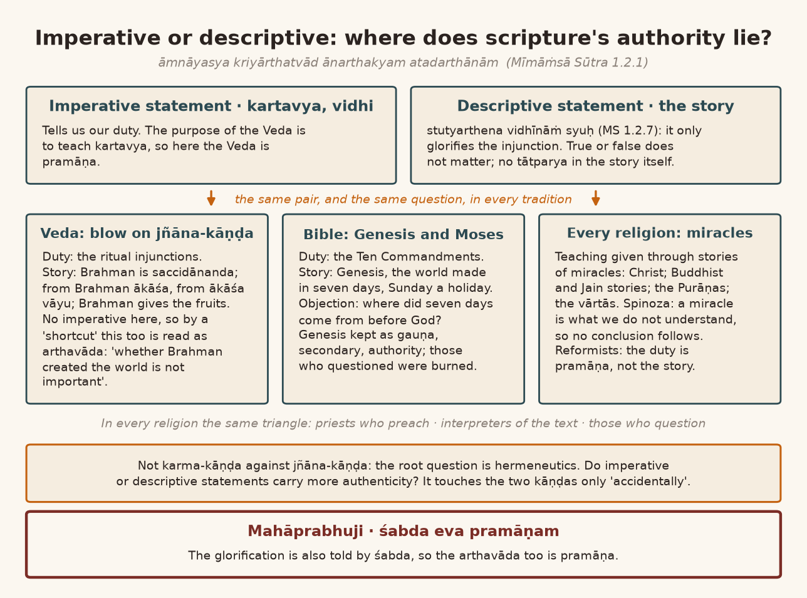
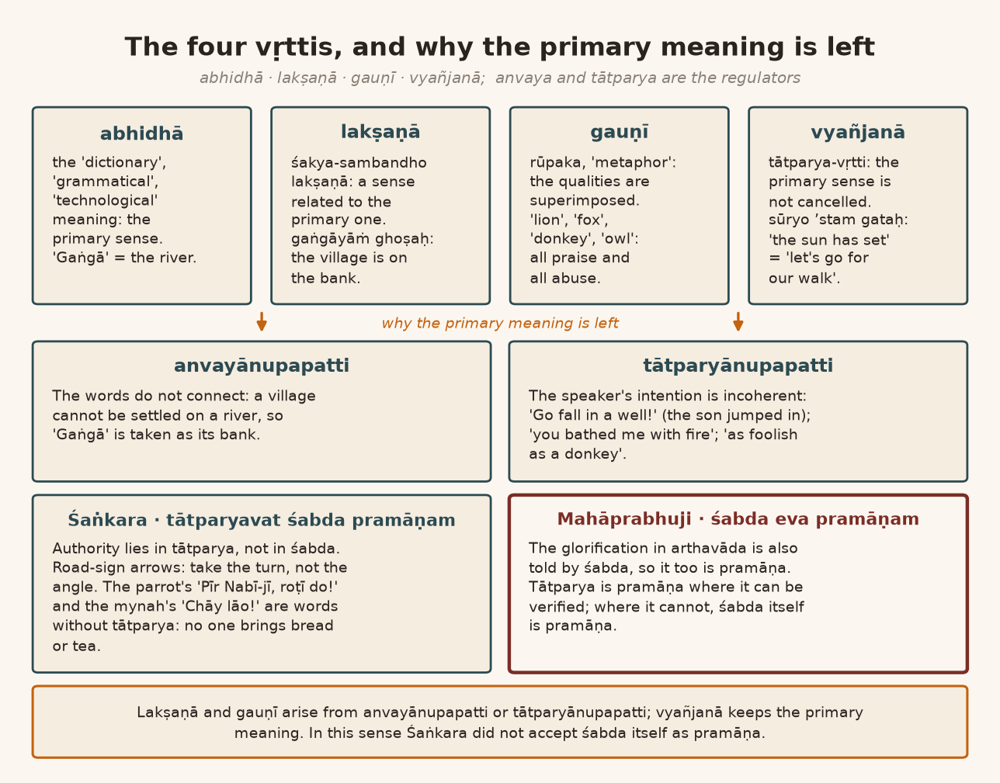
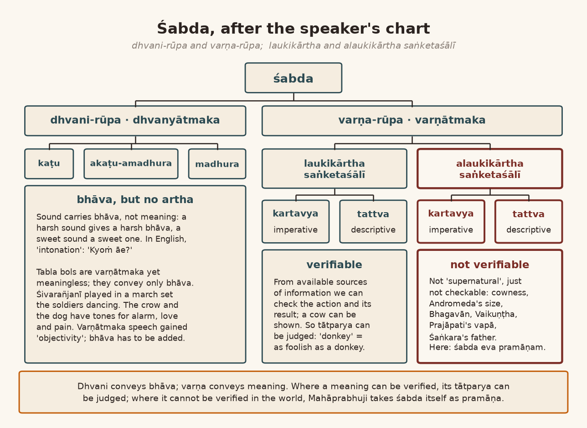
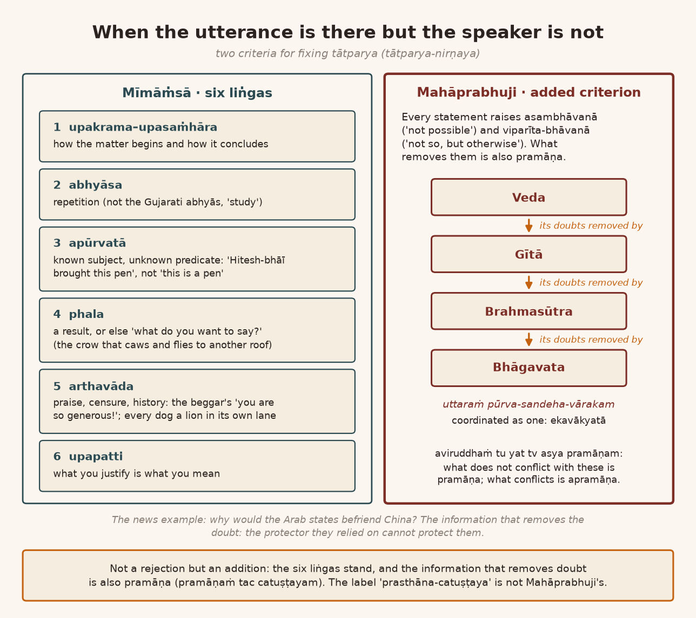

*English rendering of a spoken discourse on the Śāstrārtha Prakaraṇa of the Tattvārthadīpanibandha, translated from a Hindi ASR transcript. The speaker's conversational register, humour, digressions, code-switching, and student exchanges are preserved. Editorial flags: ‹ › conjectural restoration of a garbled reading; ‹?› uncertain reading; ‹…› inaudible or unrecoverable passage; ‹श्रवणाधारित› text given as heard, pending verification against a printed edition. Verses whose standard text is beyond doubt have been silently restored to the received editions.*

# 1. Arthavāda as a Question of Hermeneutics: Genesis, the Ten Commandments, and Miracles

**Speaker:** Yes, jī, jī — "please."

**A student:** Thank you. *Jī jī, Āvaraṇabhaṅga-māṁ Puruṣottamajī-ne ek "sentence" lakhyo che: arthavāda-māṁ gauṇī vṛtti hame svīkārya nahīṁ hai. Āpaśrī-ne arthavāda samajāvyo hato pichle "lecture"-māṁ, par phir bhī e vākya spaṣṭa nahīṁ hai.* [Jī jī, in the *Āvaraṇabhaṅga* Puruṣottamajī has written a "sentence": "In arthavāda, gauṇī vṛtti is not acceptable to us." You explained arthavāda in the last "lecture", but that sentence is still not clear.]

**Speaker:** So — yes.

**A student:** And one more thing: "gauṇī vṛtti is not acceptable to us" — that is Puruṣottamajī's sentence, jī.

**Speaker:** Yes. What did you not understand in it?

**A student:** Jī jī, you had explained arthavāda, so ‹…› I understood it like this: those who follow the karma-mārga count the śrutis of the jñāna-mārga as gauṇa, secondary, and those who follow the jñāna-mārga count the śrutis of the karma-mārga as gauṇa. That is my understanding, but I am still not "confident" whether this understanding is right or not.

**Speaker:** "OK, OK." Look, the thing to understand at the root is this. The "issue" here is not one of jñāna-mārga and karma-mārga; that has come in here "accidentally". The "basic issue" here is this, the issue of arthavāda: *āmnāyasya kriyārthatvād ānarthakyam atadarthānām* (Mīmāṁsā Sūtra 1.2.1). The purpose of the Veda is to make us understand our kartavya, our duty. Certain things have been said in order to explain that duty. Where there is kartavya — that is, an "imperative statement" — there the Veda is pramāṇa. And where there is no "imperative statement" but a "descriptive statement", there no duty is coming, is it? In that situation, what is to be done with the "descriptive statement"? So Jaimini showed a way. The "descriptive statement": *stutyarthena vidhīnāṁ syuḥ* (Mīmāṁsā Sūtra 1.2.7). That is, for the thing that is being said in order to explain a "duty", the "descriptive statement" comes in to "glorify" it. Now whether that "glorification" is true or false does not matter at all. It may be true, it may be false. So arthavāda is the name for this: whatever story is told in a vidhi in order to explain the duty, there is no tātparya in that story. The tātparya of the Veda is not in explaining the story.

Now, because this has been said — that anything whatever is there only so far as it serves the "justification" of an "imperative statement" — the blow of it has fallen on the jñāna-kāṇḍa. Because about the jñāna-kāṇḍa there is a kind of "prejudice", or a "presupposition", call it what you will. In the jñāna-kāṇḍa there are no "imperative statements"; there are "descriptive statements". Brahman is; Brahman is saccidānanda; from Brahman ākāśa was born, from ākāśa vāyu was born; Brahman is the giver of fruits; he is the antaryāmin; and so on and so on. All this too is a story, isn't it? What is to be done with this story? So they simply took a "shortcut": take this too in the same way — what more is there to say — it is *anukta* [unsaid] in the vidhi‹?›, meaning there is no tātparya in telling it. Now where does the blow of that fall? On this: that you should reflect in this way — *śrotavyo mantavyo nididhyāsitavyaḥ* (Bṛhadāraṇyaka Upaniṣad 2.4.5). Listen in this way, reflect in this way, meditate in this way. Whether Brahman created the world or did not create it — that is not important. Think like that.

This "problem" is not only with us. In other religions too this fight goes on. For instance, at the beginning of the Bible there are the chapters of Genesis — three, four, five chapters — in which it is told how the world came into being: first there was only God, then God said, "Let there be light, and there was light", and in this way he made the world, made the world, the whole world got made. In seven days: he began on Monday and by Saturday it was complete. Then Sunday came — a "holiday". This is the Bible's "description". Now there too the same "question" arose: these Sundays and Saturdays, all these seven days, happen in the world — where did these seven days come from before God? What is this nonsense? — many people objected. Now these five chapters of Genesis had been received by Moses, in the Old Testament. Under the same heading comes the account that God made an "MOU" with Adam, of the "Ten Commandments": that if you keep this dharma, then you will be ‹saved›, otherwise man ‹…›. Now there too the same "issue" came up: this chapter of Genesis is there to explain the "Ten Commandments". It has authority, but its authority is gauṇa, secondary. In the beginning, in the "medieval period", when people there began to "question", many people were burned alive. That is, in three hundred years of the "medieval period", thirty-six thousand people were burned alive by the Pope. That kind of "irrational" interrogation ‹the speaker's characterization›. Now the Pope and all of them also hold: no, this is *āmnāyasya kriyārthatvāt*…

**A student:** Achchhā, meaning…

**Speaker:** This is a teaching given to explain the "Ten Commandments". And the most beautiful thing is that some Christian people now even believe that Moses never existed at all — a "fictitious character"; the thing was said in order to explain. Everywhere this "problem" comes up. It has two "sides". There are those who preach religion, the priests; and there are those who interpret the "texture" — the "religious text". Those two, and those who "question": the "triangle" these three make is more or less the same in all religions. Because in all religions, from the "tribal religions" to the religions that are considered very "civilized", one thing is "common". The common thing is this: "religious preaching" has been done through the medium of stories. As in Christianity: all the "doctrines" of Christianity are "based" on Christ's miracles. And from the miracle: this is a miracle, therefore Christ is God. Spinoza and the others, the "rationalist philosophers", said just this: we do not accept miracles. A miracle means that which we do not understand. So from what we do not understand, how can any "conclusion" be drawn? If it is understood, it is not a miracle. In the same way in the Buddhist view, in the same way in the Jain view, in the same way in our own Purāṇas, stories of miracles come. In the Vallabhācārya sampradāya too, in the vārtās, a great many stories of miracles come. So if the miracle is pramāṇa, then the teaching is pramāṇa. There are miracle "stories" in every religion; this "problem" is in every religion. This kartavya-upadeśa, the teaching of duty, has been explained through a story. And in every religion there are those who are called "reformists": they are "reformists" in saying, brother, the story is not pramāṇa, the duty is pramāṇa. And some people say: no, not the duty — the story is pramāṇa. ‹…› It is there in the Veda too. So at its root the "issue" is not one of karma-kāṇḍa and jñāna-kāṇḍa. This whole thing is a subject of "hermeneutics": whether the "imperative statements" have more "authenticity", or the "descriptive statements" have more "authenticity". It applies to karma-kāṇḍa and jñāna-kāṇḍa only "accidentally", and from that those two groups get formed. This is the basic point. Did you get it?

{width=6.2in}

# 2. The Vṛttis of the Word: A Village on the Gaṅgā, and Why We Call a Man a Donkey

**A student:** Yes, jī, jī — meaning we accept both "imperative" and "descriptive" "sentences" as pramāṇa, like that…

**Listener 2:** "Imperative"…

**Speaker:** First understand that one thing ‹…›. At the root of śabda, three or four vṛttis are accepted. One is the abhidhā vṛtti. Abhidhā vṛtti means the "dictionary meaning", the "grammatical meaning", the "technological meaning". Abhidhā. The second is accepted as lakṣaṇā. What does lakṣaṇā mean? Where the things said by abhidhā do not connect with one another, or where the speaker's "intention" is not "justified", there its tātparya lies in some meaning related to the abhidhā. Its example is *gaṅgāyāṁ ghoṣaḥ*: a village is settled on the Gaṅgā. The Gaṅgā is a river. A village doesn't get settled on a river! So villages are not settled on the Gaṅgā; the village is settled on the bank of the Gaṅgā. So there we do not take the meaning of "Gaṅgā" as the Gaṅgā, but as the bank of the Gaṅgā. This is called lakṣaṇā: *śakya-sambandho lakṣaṇā* — whatever is related to the meaning that comes from abhidhā, in that the thing is being said.

What does gauṇī mean? Understand one thing carefully, and then I will explain it to you simply, in everyday speech. In everyday speech, all the praise and all the abuse we hand out is gauṇī vṛtti. For example, we call someone a lion. We call someone a cunning fox. We call someone a donkey, we call someone an owl. Now the one we are calling a lion is not the lion with four legs and a tail; it is a courage like a lion's. By the qualities the lion has — by the quality, the one who possesses the quality is being indicated. Its qualities are being superimposed here; that is āropa. In English this is called "metaphor". What is the difference between "simile" and "metaphor"? Understand this carefully. When, to explain something, an example of something else is given, that is "simile"; in the Sanskrit language this is called upamā. What does upamā mean? The knowledge for knowing this — *mā* means knowledge. For knowing it, a "subordinate word" comes in as well: that is *upa*-mā. Like *upa-nirīkṣaka* [deputy inspector], *upādhyakṣa* [vice-president]: to whoever is "subordinate", the word *upa* is attached.

**A student:** Yes.

**Speaker:** Like upadeśa. A king gives an ādeśa, a command. And a guru does not give an ādeśa; he gives an upadeśa. It is not so "harsh", it is "soft"; that is why it is upadeśa. It comes in the sense of "subordinate". Like upayoga: yoga means joining, but not joining so much that you stick someone on with "adhesive tape". Using a thing for some purpose is called its upayoga. In it, the thing does not get stuck on as with an "adhesive". *Upa* means "subordinate". Upamā: that is, in order to know this, the upamā of that is given, brother. How beautiful the face is — as beautiful as the moon. That's upamā, brother. *Sādharmyam upamā bhede* (Mammaṭa, Kāvyaprakāśa, ullāsa 10), so it is said: between two things that are different, showing a common property, one dharma, is upamā. And rūpaka is called āropa, superimposition: not showing a "resemblance", but superimposing the thing right here. That is rūpaka — which is called "metaphor". So it becomes gauṇī vṛtti: instead of calling someone cunning, calling him a fox, a jackal; instead of calling someone a fool, calling him a donkey. So we gave him the rūpaka of a donkey. In that way he is "rūpita", "nirūpita". So wherever rūpaka comes, gauṇī vṛtti comes. In the śāstra six or seven kinds of it are given, and of lakṣaṇā there are at least seventeen or eighteen kinds. There is a very detailed discussion on this subject. We will not go into it; understand the basic point: abhidhā, lakṣaṇā and gauṇī.

Within this, one thing to understand is: why do we have to take a lakṣaṇā or a gauṇī meaning? Because — with what tātparya did the speaker say it? Lakṣaṇā happens from *anvayānupapatti* and from *tātparyānupapatti*. Two words are not connecting: like "a village on the Gaṅgā" — the village cannot connect with the Gaṅgā, because a village is on land, and the Gaṅgā is a river. So that lakṣaṇā is from anvayānupapatti. And in the same way lakṣaṇā happens from tātparyānupapatti too: the speaker's tātparya is not being made coherent. Because of this lakṣaṇā that happens from tātparyānupapatti, one more idea arose —

# 3. Tātparya and Vyañjanā: "Go Fall in a Well", the Road Signs, and the Parrot's "Pīr Nabī-jī, Roṭī Do"

**Speaker:** — that the authority of śabda lies in tātparya, not in the śabda. That is, the "power" of any word, of any "statement", to "convey" a "meaning" is because of tātparya, not because of the "meaning". Because if it were because of the meaning, then whatever meaning comes from abhidhā ought to be taken. Why do we not take it? We take another because the tātparya is not made coherent.

We had a servant. His father made a division of the fields; he gave the younger brother somewhat more. So the elder brother went and quarrelled with the father: what are we to do — the way you have made this partition of the fields! The father said in anger: "Go fall in a well!" So ‹the son› jumped into the well. And there was no water in it, so the poor fellow broke his leg. If there had been water in the well, the leg would not have broken. So what do I mean to say? The father's tātparya was not falling into the well; it was "don't eat my head" [stop pestering me]. A father wouldn't want to kill his son like that! He said "go fall in a well" — that is an idiom. So ‹the son› could not understand the tātparya. Had he understood the tātparya, the matter would have been settled. So lakṣaṇā happens from tātparyānupapatti; gauṇī happens from tātparyānupapatti — because after calling someone a donkey, do we go looking for the man's four legs, or look for his tail? Where would you find them?

**A student:** On a man…

**Speaker:** So what is the tātparya? As foolish as a donkey is, so foolish are you. As courageous as a lion is, so courageous are you. This is from tātparyānupapatti. So because of this a separate vṛtti came in, a tātparya-vṛtti, and that tātparya-vṛtti was given another name: vyañjanā. What happens in vyañjanā — this is the beauty of vyañjanā — is that the primary meaning, the "dictionary meaning", the "grammatical meaning", does not have to be "cancelled". Without cancelling it, another meaning comes out of it: an "implied meaning". It does not need to be cancelled. Its main example is *sūryo ’stam gataḥ*: the sun has set. Suppose the wife and the husband have made a "programme" that in the evening we'll go out for a walk. And if the wife says, "The sun has set," her tātparya is not in the setting of the sun; it is in "let's go for the walk". That is vyañjanā. In this way four vṛttis are accepted as basic. So because of this, wherever we have to take something by tātparya, we have to see what ‹the speaker's› meaning is — what the *vyaṅgyārtha* is, that is, what the "revealed meaning" is. Now because of this, whatever the meaning of the word is — that is, what comes by abhidhā — there is no need to cancel it; out of it comes another meaning as well. So there are four vṛttis.

So which vṛtti is to be taken here, in arthavāda? So a "mistake" happened, brother: the tātparya is not being made coherent ‹…›. Like, someone bathed you with very hot water: "Arre, you've bathed me with fire!" — we say it like that. Did they bathe you with fire? The water was as hot as fire is hot. So because the tātparya is incoherent there, "bathed with fire" there means "bathed with water as hot as fire". That is the meaning. This is not the vyañjanā meaning, because you have to give up the primary meaning.

‹…› There was some American professor — who he was I can't remember. He came to Chennai — whether he came or not — and there he ate plenty of idli and dosa and that chutney and everything. He liked the food, so he ate it. The next day in the toilet he began to have a terrible burning. So he said: now I have understood why Indian people don't use paper in the toilet, why they use water — because if they used paper, that too would catch fire. That's how much it was burning. He said, I've understood why they wash with water and don't wipe with paper: because it is so hot, burning so much down below, that even the toilet paper would catch fire. It doesn't really catch fire — understand his tātparya. He ate chillies; it will burn this much, sure — he isn't in the "habit", so…

**A student:** Chillies!

**Speaker:** So the thing to understand is just this: four vṛttis are accepted as the main ones — abhidhā, lakṣaṇā, gauṇī and vyañjanā. Among them, tātparya is the niyāmaka, the regulator. "Prima facie", anvaya is the regulator: the connecting of two words is the regulator. If they do not connect at all, then too some lakṣaṇā or gauṇī has to be done. And if they connect but the tātparya is not "justified", then ‹vyañjanā› has to be done. In this sense Śaṅkarācārya did not accept śabda as pramāṇa at all.

**A student:** This is beautiful.

**Speaker:** Because tātparya alone is pramāṇa. If Śaṅkarācārya-jī's point doesn't make sense to us, we have to understand one simple thing. Among all the signs that come up on the road there comes the arrow for "take a left turn", "take a right turn". If you take the left turn at exactly the angle at which the arrow is drawn, there will be an "accident". So the tātparya is not in that angle. The tātparya is that you have to take a left, that's all. For a right, they show an arrow at a right angle, bent — like this. So you are not to turn at exactly that angle. You have to take a right turn — that's all there is to it. So all this is pramāṇa together with its tātparya, isn't it? The "signs" as śabda are not pramāṇa; the signs just as they are drawn are not pramāṇa. There are a great many signs like this on the road: a school is coming, a village is coming, a climb is coming, and so on and so on — a great many signs. So for all the signs there are, their authority is not in the sign. It is in its tātparya.

**A student:** In its tātparya.

**Speaker:** So *tātparyavat śabda pramāṇa*: śabda together with tātparya is pramāṇa. How shall we understand this? Understand a simple thing. I had a friend, a "Mohammedan", who played the sitar. He had a parrot. He had taught that parrot by rote: "Pīr Nabī-jī, roṭī do!" [Pīr Nabī-jī, give bread!] "Pīr Nabī-jī, Pīr Nabī-jī, roṭī do!" Now whenever the parrot felt in the mood, it would keep saying, "Pīr Nabī-jī, roṭī do! Pīr Nabī-jī, roṭī do!" Its tātparya was neither in the giving of bread nor in Pīr Nabī, because what is a Pīr, what is a Nabī — what does the poor parrot know? So there — who will go, as Pīr Nabī, to give it bread? Nobody will go. We will enjoy it: here it is, saying "Pīr Nabī-jī, roṭī do!"

My uncle had a mynah too. Early every morning my cousin sister used to tell her servant, "Chāy lāo!" [Bring tea!] So the mynah too began saying it: "Chāy lāo! Chāy lāo!" The mynah imitates, so it too kept going "Chāy lāo! Chāy lāo!" Did it want to drink tea? ‹No.› Will anyone give it tea because it says "bring tea"? Because one knows that its tātparya simply isn't there; it is only śabda, śabda. If you take the śabda alone, you would have to take its authority, wouldn't you? So if there is tātparya, śabda is pramāṇa; if there is no tātparya, śabda is not pramāṇa. This is Śaṅkara. The authority of śabda — *Gaṇapati Bāppā* ‹*Moryā*›! [the Marathi chant with which Gaṇeśa's image is sent off for immersion] Did you get the idea?

And here we are saying:

> वेदाः श्रीकृष्णवाक्यानि व्याससूत्राणि चैव हि ।
> समाधिभाषा व्यासस्य प्रमाणं तच्चतुष्टयम् ॥
>
> *vedāḥ śrīkṛṣṇavākyāni vyāsasūtrāṇi caiva hi |*
> *samādhibhāṣā vyāsasya pramāṇaṁ tac catuṣṭayam ||* (Tattvārthadīpanibandha, Śāstrārtha Prakaraṇa 7)
>
> [The Vedas, the words of Śrī Kṛṣṇa, the sūtras of Vyāsa, and the samādhi-bhāṣā of Vyāsa: that fourfold is pramāṇa.]

*Vedā iti … śabda eva pramāṇam* (Prakāśa on Śāstrārtha Prakaraṇa 7): śabda alone is pramāṇa. ‹The point at issue›: is arthavāda pramāṇa or not? Mahāprabhuji is saying that śabda is pramāṇa. And arthavāda — the "glorification" of the duty that is being taught, which is told to you through some story for the sake of that teaching of duty — that too is being told by śabda, by śabda alone, isn't it? Its glorification. So the "glorification" too is pramāṇa. Because Mahāprabhu's position is that in laukika śabda we can make this arrangement, whether it is a laukika "description" or a laukika duty. Both "possibilities" are there.

{width=6.2in}

# 4. Dhvani and Varṇa, Laukika and Alaukika: Cowness, the Andromeda Galaxy, and the Donkey as Sthitaprajña

**Speaker:** Look, understand this carefully. Śabda is of two kinds: dhvanyātmaka, of the nature of sound, and varṇātmaka, of the nature of letters. In our tradition — that is, they are not accepted everywhere, but in our tradition — four kinds are accepted: *tata, vitata, ghana* and ‹*suṣira*› ‹…›; four kinds are accepted. It isn't that there are only these four kinds; it is a matter of example. And the varṇātmaka words are like an "alphabet", taken as vowels and consonants. Now dhvani, sound, has no meaning. Sound has bhāva. From a kaṭu, harsh, sound comes some harsh bhāva; from a madhura, sweet, sound comes some sweet bhāva. There can also be an akaṭu-amadhura sound, neither harsh nor sweet; then the bhāva in it will be like that too. In English this is called "intonation". When we speak, we make a tone, don't we? "Kyoṁ āe?" [Why have you come?]

"Kyoṁ āe? Madad karne āe?" [Why have you come? Come to help, have you?] That is dhvani-ja, born of sound; it is one kind of śabda. And in the same way, with that śabda: if you express bhāva, there is bhāva; if you do not express it, there is meaning. That meaning comes in the manner of abhidhā, lakṣaṇā, gauṇī and vyañjanā. Among all those kinds of words, the very first thing to understand here is this: there can be a laukika meaning, and there can also be an alaukikārtha, an alaukika meaning. What does laukikārtha mean? Some duty which is a laukika duty, in which we can "verify" the "action" and its "result". What is a laukika tattva like? We can "verify" it by one or another of our "available sources of information"; then it is a laukika meaning. It is not some alaukika meaning. And there is also some alaukika duty, and there is also alaukika tattva. Alaukika not in the sense that it is "supernatural", but in the sense that, among our "available sources of information", its "verification" is not "possible". That becomes an alaukika meaning. Because we cannot verify its meaning — that this word has this meaning. Well, here we can show it: the meaning of "gāy" is "cow" — we can show a person a picture, or show him a cow, and tell him: this is a cow. Alaukikārtha: now understand carefully. When we say *gotva* — not cow, but cowness — where do you show cowness? Because all the cows there are — Jersey cows, Gir cows, hill cows, Indian cows, African cows — all of them have cowness. And cowness cannot be recognized without a cow.

**A student:** So it isn't done by the laukika meaning.

**Speaker:** ‹…› A cow we can show. Where will we show cowness? We will draw a picture of some one cow and show it: look, a cow is like this. Then it will be a picture of some "particular" cow, whether a Jersey cow or whatever. These have become alaukika matters — not "transcendental" ‹…›. Their "verification" is not "possible". Like, we said that a galaxy, the Andromeda galaxy, is this big. How is its laukika "verification" "possible"? So we will have to understand it from śabda alone.

Now, is tātparya being made coherent there or not? In a laukika meaning we can go and understand the tātparya: brother, its tātparya could be this; its tātparya cannot be this. Like when we call someone, a man, a donkey. So what will the tātparya of calling him a donkey be — why are we able to "decide" that? Because a man is being called a donkey; the meaning of donkey is four-legged, with a tail; and this one has neither four legs nor a tail. Therefore, because the tātparya is not made coherent: "as foolish as a donkey". We have assumed that the donkey is a fool. ‹The donkey perhaps takes us for› fools — don't worry about that! I, instead of taking the donkey for a fool, always call it ‹a sthitaprajña›:

> स्थितप्रज्ञस्य का भाषा समाधिस्थस्य केशव ।
> स्थितधीः किं प्रभाषेत किमासीत व्रजेत किम् ॥
>
> *sthitaprajñasya kā bhāṣā samādhisthasya keśava |*
> *sthitadhīḥ kiṁ prabhāṣeta kim āsīta vrajeta kim ||* (Bhagavadgītā 2.54)
>
> [What is the description of one whose wisdom is steady, who is established in samādhi, O Keśava? How does one of steady mind speak, how does he sit, how does he walk?]

Because — like, when a car goes along the road, a dog will look, a cow will look. The donkey stands just as it was ‹?›. Let a car go, let a buffalo go — the donkey doesn't even look; from its prajñā it is not udvigna, not perturbed. That is the mark of a very great samādhi, isn't it? We take the donkey for a fool; that is why, instead of calling someone a fool, we call him a donkey.

{width=6.2in}

# 5. Where Verification Is Impossible: The Guru as Maheśvara, the Widow's Neighbour, and Prajāpati's Vapā

**Speaker:** ‹In the laukika› "verification" is "possible". How is the verification of an alaukika meaning to be done? Suppose that instead of calling someone a donkey, we called him Bhagavān. What is Bhagavān like? If someone explains in words that Bhagavān means the one who is seated in heaven — well, he isn't in heaven. And where have we seen heaven, to know what heaven is like? Understand: remember the aiśvarya, vīrya, ‹śrī›, jñāna and vairāgya of Bhagavān. Where are we to understand that from? What kind of aiśvarya, what kind of vīrya, what kind of ‹…›? So all these things are not in a laukika sense. But we do say them. As in *gurur brahmā gurur viṣṇur gurur devo maheśvaraḥ*. If he is called Brahmā, he ought to have four‹?› faces. He has one face, so how can he be Brahmā? So there "Brahmā" is said as gauṇārtha, in a secondary sense. He is called Viṣṇu, so he should have four hands. Four hands? He has only two hands. So then take the gauṇārtha. But before taking it, by what will you have to verify it? What Brahmā is like — that too is in śabda. In a laukika sense "verification" is not "possible" "whether" Brahmā really has four‹?› faces or not, and whether Viṣṇu really has four hands or not. We cannot find that out by looking at you. *Gurur devo maheśvaraḥ*: the guru is Maheśvara. Maheśvara means sitting naked in the Himālaya. The guru is living in Bombay, so how is he ‹Maheśvara›? Do a gauṇārtha! Understand one thing: by what will you do the gauṇārtha there? How is the tātparya becoming incoherent there? That we will have to understand. How the tātparya becomes incoherent — we have to understand that, don't we?

So if something is coming in śabda in an alaukika sense, or something about an alaukika duty is coming — like: practise this dharma and you will get Vaikuṇṭha, you will get Kailāsa, you will get svarga. Arre bhāī, where do you go to see the relation between the practice of dharma and Kailāsa or Vaikuṇṭha — whether one gets it or doesn't get it?

There is a famous joke. Brother, there was a beautiful woman; her husband died; her neighbour felt great pity. So he went and asked: may I take your husband's place? She said: why can't you? But for this you will have to go and ask not me, but at the cremation ground. Because the husband had been cremated at the cremation ground. You can take my husband's place, I have no "objection", but asking me won't do. Go and ask at the cremation ground. So in this matter "verification" is "possible": brother, where is the husband's place now? It is at the cremation ground. But — if it is some laukika matter we can do "verification"; in an ‹alaukika› matter, where would verification come from?

Therefore Mahāprabhuji says that arthavāda too is pramāṇa. Because if — like, what is the biggest problem that comes up for an arthavāda? Look, let me tell you. In an arthavāda: *prajāpatir ātmano vapām udakhidat* (cf. Taittirīya Saṁhitā 2.1.1.4). Prajāpati, Īśvara, in order to create the world, offered his own vapā in the homa. Now one who offers his own vapā in the homa — how can he stay alive? And if he can't stay alive, how can he do the homa? So for that reason it was said there that this arthavāda is apramāṇa — because it is not "possible". Understand that carefully: it is not "possible" for a human being. It is not "possible" for a human being. A snake takes off its own vapā, doesn't it? ‹…› A snake takes it off; other animals too; a tree too takes it off — trees too shed it. "Insects" too shed it: from a "larva" they become something else. Now, how did the meaning become incoherent? You "connected" it with a human being, didn't you? A human being cannot do this. In other animals there is the "possibility". You will find a snake's slough completely "intact", "intact".

So Mahāprabhuji's position is: *śabda eva pramāṇam, tatrāpi alaukika-jñāpakam eva* (Prakāśa on Śāstrārtha Prakaraṇa 7) — where "verification" is not "possible", there śabda alone is pramāṇa. That we can see in "multiple places". As when Śaṅkarācārya says that śabda is not pramāṇa, tātparya is pramāṇa — to a "certain extent" that is true. But if someone today says that Śaṅkarācārya's mother's and father's names were such-and-such, that his father was a Kṛṣṇa-bhakta, a pujārī in a Kṛṣṇa temple — now where will you get "verification" of whether he was a pujārī or not? What is the pramāṇa? Śabda.

**A student:** Śabda.

**Speaker:** The tātparya is becoming incoherent ‹…›. So where meanings have become alaukika in this way — why am I explaining this? Alaukika does not mean "transcendental". Alaukika means that whose "verification" is not "possible" in the loka, in the world: that is alaukika. In that sense —

**A student:** Its verification isn't possible in the world.

**Speaker:** *Śabda eva pramāṇam* — this is what Mahāprabhuji is saying. Śaṅkarācārya is saying *tātparyavat śabda pramāṇam*.

**A student:** Śabda pramāṇa.

**Speaker:** So: where there is tātparya, that is pramāṇa. The Mīmāṁsā people are saying that the tātparya of śabda lies only in kartavya-upadeśa, the teaching of duty; in tattva-upadeśa, the teaching of reality, it is not there at all. Whom shall we go and ask about this? Whom to go and ask? Go and ask the Veda — the Veda won't say anything. The Veda is made of śabda. It would say, "What have you ‹done› to me…"

**A student:** One thing in this —

**Speaker:** The Veda —

**A student:** Who is the one speaking?

**Speaker:** Right. So what is the biggest difficulty in this? Some people believe that Īśvara spoke the Veda — so who will go and ask Īśvara? And the Nyāya people — the Mīmāṁsā people — believe that it is apauruṣeya, so the Veda was not spoken even by Īśvara. Śabda is eternal.

For the Buddha Bhagavān too such a thing comes up — a very amusing thing: that at the moment when the Bhagavān attained bodhi, words were coming from the sky on all four sides; they were the bodhi-knowledge. Bhagavān Buddha was not speaking. It was what is called ākāśavāṇī, a voice from the sky. Today the radio is called Ākāśavāṇī — that is a separate story. In those days, ākāśavāṇī meant words came from the sky. Now, who spoke from the sky — how is one to know? So those who criticise — the ‹Mīmāṁsaka› people — they say: if it was an ākāśavāṇī, was it the Buddha speaking, or were ghosts and spirits speaking — how do we know? It will become pramāṇa just because it is an ākāśavāṇī? "Verification" is not "possible", so we do not accept it as pramāṇa. All of these become "debatable issues" of this kind. In this, Mahāprabhuji gave this "criterion" — the one I was telling you about, of śabda and dhvani.

# 6. Bhāva Without Meaning: Tabla Bols, Śivarañjanī on the March, Āṣāḍh kā Ek Din, and Nagīn-bhāī's "Nathī"

**Speaker:** There is another very amusing question before us — as you may often have heard — a question has come, this one. Like the bols of the tabla: the bols of the tabla, the bols of the pakhāvaj, the bols of dance. Now, are those bols śabdātmaka or nādātmaka? Nādātmaka — that is, ‹dhvanyātmaka› — or varṇātmaka? Now look, the beauty is that they are all varṇātmaka. Like ‹*nā dhin dhin nā, nā dhin dhin nā, nā dhin*›: all these are varṇātmaka. What is their "meaning"? Nothing at all. What is the "meaning" of "nā"?

**A student:** Jī.

**Speaker:** Shall I tell you a funny thing? A bol of the tabla: *nāgedhit nāgedhit nāgedhit*. Does it mean anyone *naṅgā* [naked]?

*Nāgedeṭ nāgedeṭ nāgedeṭ nāgedeṭ* — now it doesn't mean naked, does it? So because ‹…› it is a meaningless word. It is a meaningless word. But does it express bhāva or not? It expresses bhāva — by being harsh, by being sweet, by being neither harsh nor ‹sweet›. Let me show you, like this.

**A student:** Jī.

**Speaker:** Suppose there is a gat — take it that there is a gat ‹…›: *da da da nā ta nā nā ta ra nā, ta da da nā ta nā nā ta ra nā*. And you have to play a jugalbandī with it. Look, then: *kitto taka thā* — *siddhā siddhā tirikitaka dhara dharikitaka dhā, siddhā siddhā tirikitaka dhara dharikitaka* *[tabla bols, as heard]* — how are the sounds coming? ‹Harsh›! *Kica taka taka dhā, tidhā tidhā tidhā tidhā tidhā tidhā* — that became a harsh sound. *Jinaka diṁ dhā. Diṁ dhā jinaka diṁ dhā. Jinaka diṁ dhā. Jinaka diṁ dhā* — these too are its soft ones. So bhāva is being expressed, isn't it? In one a suppleness is coming, in one a little "vigour" is coming, in one a kind of slackness is coming. So bhāva is being expressed, but meaning is not being revealed. Like any "tune": in every tune some bhāva is revealed, whether it is of the sitar, of the flute, of the harmonium or of the trumpet. But meaning is not coming; the meaning we are superimposing. Did you get the point?

It is a very famous example. Ours — there is a rāga, Śivarañjanī. On the basis of rāga Śivarañjanī — there was an "artist" from Europe, in the "army", who could play perhaps not the trumpet — the trombone or something like that — to make the army march. Now he had heard Śivarañjanī somewhere. So he played the "Song of India". And he played the "Song of India" in the march. So the soldiers started dancing. Then he was thrown out of the army — a very great ‹…›, Glenn Miller was his name. *[He hums the tune.]* Yes — Śivarañjanī. Śivarañjanī. This is Śivarañjanī. *[He sings a line of a song set in Śivarañjanī; the words are not reproduced here.]* In our Puṣṭimārga: *Manajī musāphira re, cālo ne nija deśa* ‹श्रवणाधारित› [O mind, traveller, come, let us go to our own homeland]. A fine Śivarañjanī ‹…›. He, Glenn Miller, played it, and the army men started dancing. What is the bhāva?

**A student:** Yes.

**Speaker:** There was no meaning "dance!" in it. It was neither tattva-upadeśa nor kartavya-upadeśa. The tune of that rāga was such that a mastī came over them. There was bhāva in it. ‹…› So a great many sounds have no "meaning", but they have bhāva. And understand carefully: all the animals there are — like the crow goes "kāṁv kāṁv", and it goes "kāṁv kāṁv" in different tones. When it has to raise an "alarm", the "kāṁv kāṁv" has a different "nature". When it shows love, it is different. When it is in trouble, it is different. The dog too, when it barks — when it barks in pain it barks in a different way; when it barks in anger it barks in a different way. So in tone there is bhāva; there is no meaning.

And because man has begun to use varṇātmaka words instead of dhvanyātmaka ones, a kind of "objectivity" has increased so much in varṇātmaka words that they have become separated from bhāva — separated from bhāva. Bhāva has to be put into them "additionally". Like a play: a "script" is written. Does bhāva come in it? Only words come, meaning comes. Now bhāva "depends" on the "artist" — whether he expresses it or not. There was an acquaintance of ours — I'll tell you a very amusing thing. Mohan Rakesh had a "drama", *Āṣāḍh kā Ek Din* [One Day in Āṣāḍha]. In it there was the story of Kālidāsa, because:

> आषाढस्य प्रथमदिवसे मेघमाश्लिष्टसानुं
> वप्रक्रीडापरिणतगजप्रेक्षणीयं ददर्श ॥
>
> *āṣāḍhasya prathama-divase megham āśliṣṭa-sānuṁ*
> *vapra-krīḍā-pariṇata-gaja-prekṣaṇīyaṁ dadarśa ||* (Kālidāsa, Meghadūta 1.2)
>
> [On the first day of Āṣāḍha he saw a cloud clinging to the mountain's peak, lovely to look at, like an elephant stooping to butt at a bank in play.]

Kālidāsa said this in the Meghadūta. From that Mohan Rakesh wrote a drama. And the drama is very good; it is great fun to read. A film was made of it. When the film was made, the "director" ‹thought›: if we put tone into it, we will have mixed something into what Mohan Rakesh wants to say. So he explained to all the "artists": don't speak with tone, just speak "flat". Like: "‹…› I am going." "…was to go…" "You didn't come." No tone — "without tone". The whole film went on like this. People cried "Help! Help!" Whoever spoke, there was no tone at all. "I heard today that morning had come." "I heard today morning had come." Put in some tone, won't you! No — no tone, otherwise injustice will be done to Mohan Rakesh's words.

We put in tone because we learned it from animals. Pāṇini goes so far as to say that vowels are hrasva, short, dīrgha, long, and pluta, prolated. Like "ū, ū, ū". What do the paṇḍits say? ‹*vāṁ kāla iva kālo yasya so ’c kramād hrasva-dīrgha-pluta…*› (cf. Siddhānta-kaumudī on Aṣṭādhyāyī 1.2.27). *Kukaḍū-kū*: when the rooster crows, the first "ku" is hrasva, the second dīrgha, and ‹the third pluta›. ‹Hrasva, dīrgha and pluta› — all of that, putting in tone, we learned from animals.

In the neighbourhood lived Nagīn-bhāī. His friends used to call him: "E Nagīn-bhāī!" Two or three times: "E Nagīn-bhāī!" — this is pluta. "E" — this is pluta. "E Nagīn-bhāī! E Nagīn-bhāī! E Nagīn-bhāī!" Three or four times he called Nagīn-bhāī in pluta, and Nagīn-bhāī didn't answer — so suddenly I called out: "E — nahīṁ!" [Hey — he's not here!]

**A student:** Yes, bhāī.

**Speaker:** His sister — Nagīn-bhāī's sister — said: "Who said *nathī*?" — Nagīn-bhāī — I've muddled it, sorry. Three times he kept going "E Nagīn-bhāī! E Nagīn-bhāī!", so I said to myself: he won't be there. He lived in our neighbourhood, so I too joined in and called out: "E, *nathī*!" [Hey, he isn't here!] So Nagīn-bhāī's sister shouted loudly: "Who said *nathī*?"

**A student:** ‹…› Nagīn-bhāī ‹…›

**Speaker:** Arre, I've muddled it up.

So where have we learned all these tones from? We learned them from animals, didn't we? *Kukaḍū-kū*. ‹…› There is tone, but there is no meaning. Understand this point well.

**A student:** So this…

**Speaker:** Has your problem been solved or not?

**A student:** Yes, jī.

**Speaker:** No, no — I mean the one who asked the question about the tabla bols.

**A student:** Yes.

**Speaker:** Do they have meanings or don't they? They don't have meanings. ‹…›?

**A student:** They don't.

**Speaker:** So this whole thing is the web of śabda. The thing to understand in it is that Mahāprabhuji has accepted tātparya as pramāṇa there, where "verification" of the tātparya is "possible". Where "verification" of the tātparya is not "possible", there "śabda with tātparya" is not the pramāṇa; there, as in *Āṣāḍh kā Ek Din*, without "intonation", pure śabda becomes pramāṇa. Whether it becomes pramāṇa or not — how shall we test this point of Mahāprabhuji's, if we want to know the truth?

**A student:** Yes.

# 7. The Six Liṅgas of Tātparya: Hitesh-bhāī's Pen, the Cawing Crow, and Every Dog a Lion in Its Own Lane

**Speaker:** So, like at the "airport", a lot of "information" is written up without tone. Do we understand it or not? We understand: for ‹check-in› you have to go here; the ticket will be available here. There it is all without tone — do they say it with tone? Is there arthabodha, an understanding of the meaning, or not? There is no tātparya, but arthabodha is happening, isn't it? So it isn't that arthabodha doesn't happen. Arthabodha does happen. But where the tātparya is incoherent, there we have to adopt some other means. This was the quarrel at the root.

Mahāprabhuji has one more principle: how the tātparya is to be determined. For the determination of tātparya, Mīmāṁsā gave a "parameter": *upakramopasaṁhārau abhyāso ’pūrvatā phalam* — write it down. That is, where the speaker — Nagīn-bhāī — is not there, but the words are coming, how is the tātparya to be "decided"? The "text" is before us, but the tātparya — the speaker is not there. The vacana, the utterance, is there, but the vaktā, the speaker, is not. If the speaker is there and the utterance too, we can find out by asking; we can do "verification" from "different circumstances". But when the utterance is there and the speaker is not, how is the tātparya to be decided? So the very first thing: upakrama-upasaṁhāra is one "factor", a "parameter". How did the matter "begin", how did the matter "conclude"? What is the upakrama, what is the upasaṁhāra? Upakrama-upasaṁhāra. Abhyāsa: "repetition" — of what was there repetition? Abhyāsa — not the Gujarati *abhyās* [study]; abhyāsa means "repetition". *Upakramopasaṁhārau abhyāsa apūrvatā.*

Because when a man speaks words, one thing worth understanding every time is this: whatever is the "subject" should be "known", and the "predicate" should be "unknown". What is the reason? Understand carefully. Like: this is a ‹pen›. "This is a pen." Now if I — this thing, which you are seeing as a pen — I am calling it a pen. Then both are "known". So will you recognize it from my saying so, or from your own seeing?

**A student:** One minute —

**Speaker:** You will recognize it by seeing. Whether I say it or don't say it, you will recognize it. Here the authority is not that of śabda; it is the authority of pratyakṣa. Who will "rely" on śabda in this? ‹…› "Achchhā, you're saying this is a pen! Oh, we were thinking it was something else!" Arre bhāī, it is visible, so it is a pen. "Achchhā, your word is pramāṇa, therefore it is a pen" — it doesn't happen like that!

**A student:** ‹…› It doesn't happen like that.

**Speaker:** It doesn't happen like that, does it? Because it is visible — it is a pen, so it is a pen. But suppose I say, "Hitesh-bhāī brought this pen." Now see, this you cannot see with your eyes. This "subject" and "predicate" — that Hitesh-bhāī brought this pen — this you cannot see. So in that sense this utterance, because the "predicate" is "unknown" — this utterance is pramāṇa. It is apūrva, new. When I say "this is a pen", it is not apūrva: by pratyakṣa it is already known to you. But this is not known by pratyakṣa: "Hitesh-bhāī brought this pen." So it became apūrva. In the apūrva there is tātparya, isn't there? In any "statement" whatever, being apūrva is very necessary. Otherwise a person — what will he think? That the man is mad, brother: what need is there to say it about what is visible? What need is there to say a thing that is plainly visible? Without seeing, without being told — like when someone doesn't know what this is: we explain to a child, "Child, this is called a pen." So for the child the sentence is pramāṇa. But to a grown-up who knows that this is a pen, if we say "this is a pen", this utterance is not pramāṇa — pratyakṣa is the pramāṇa. Is that in your mind? So apūrva too is a pramāṇa in tātparya-nirṇaya. *Upakramopasaṁhārau abhyāso ’pūrvatā phalam.*

Some matter is "result-oriented", and in some matter no "result" at all comes out. So in what is "result-oriented", in that lies the speaker's tātparya. If someone talks of something from which no result comes out afterwards, how long will anyone listen? How long will he listen? If some "result" comes out, a person will listen. So phala means: a matter should have some fruit. Let me give you an example. This morning — didn't it — a crow is going "kāṁv kāṁv", all "kāṁv kāṁv". What is the fruit of all this? Then the crow flew away, then it flew off and sat on another roof, then there "kāṁv kāṁv"… People will ask: what's the point of saying this, brother? What do you want to say?

**A student:** What do you want…?

**Speaker:** What do you want to say, then? What is the benefit of saying this? There ought to be some fruit, no? If there is no fruit at all and we keep on talking, in a little while a person will get "bored". So phala too determines tātparya. Upakrama, upasaṁhāra, abhyāsa, apūrvatā, phala, arthavāda: you are "glorifying" this matter? Or this matter you are — rather than "clarifying" — "degrading", putting down. So there will be some tātparya in it, won't there? Why are you "glorifying"? Like any beggar who comes — what does he say first of all? "Arre bhāī, you are very generous, you are very good, you have a big heart!" This is arthavāda, isn't it?

**A student:** Very…

**Speaker:** Why is he praising? He wants something. So arthavāda can be ‹stuty-arthavāda›, of praise; it can be nindārthavāda, of censure; and there is also bhūtārthavāda. There is a bhūtārthavāda — not the bhūta of ghosts and spirits; bhūtārtha, that is, it is a "historical" arthavāda. What does historical arthavāda mean? Like, it is said that those who left their own country and entered another country had more strength to fight, and those who were sitting peacefully in their own country had less strength to fight. That is a "universal" "fact". Like the Muslims left their own country and came here — so with what strength they fought! We were sitting in our own country, sitting ‹at ease›; an "unnecessary" trouble came upon us, so we could not fight as much ‹the speaker's characterization›. When Chingiz Khan set out from Mongolia, he trampled the whole of Europe. Why? Because in Mongolia there was nothing. And in Europe, if he did not fight, who would let him live there? So why did the Europeans lose? Because he had left his country and come. One who is used to living in "comfort" cannot fight so well. And one who comes having endured "discomfort", who is ready to endure "discomfort" — what a good fight he can give! One who lives in a "comfort zone" cannot fight such a good fight. It is a "historical fact". So this is bhūtārthavāda, isn't it? Go and look in "multiple places". In "human history" it has happened like this; among animals too it happens like this. An animal that has left its own ground and entered another's — how ferociously it will fight! In our Hindi there is an idiom: in its own lane every dog is a lion, but going into someone else's lane it gets nervous. Why? Because there the "fight" will become very "tough" for it. Here the fight doesn't get tough. The one who can put up a "fight" is "always victorious".

A small digression. Something to understand: why does greater endurance come in women than in men? Because she leaves her own home and comes to her sasurāl, her in-laws' home. A man's endurance is not as great, because men live in their own homes, in a "comfort zone". So one who has the "preparation" to endure "discomfort", who is "prepared" — his endurance is greater. And this is a principle. Arthavāda: bhūtārthavāda.

‹…› Arthavāda, and upapatti: that is, you are "justifying" something, something you yourself have said. So in the thing you are justifying lies your tātparya; in what you are not justifying there is no tātparya. Where the utterance is found but the speaker is not, there the tātparya is determined. "Correct", "no problem".

# 8. Whatever Removes Doubt Is Also Pramāṇa: Arab Oil, Iran and China, and the Chain from Veda to Bhāgavata

**Speaker:** Mahāprabhuji says that for this determination of tātparya the Mīmāṁsakas set up this "criterion". Mahāprabhuji is introducing another criterion "parallel" to it. It has come out of this very one, but it does not "follow" it "hundred percent". And he is saying that in every matter — whatever matter is said, any matter at all, any one statement, "given any statement" ‹…› — one who has doubt will have some doubt or other in it. In the Sanskrit language, as a "technical term", this is called asambhāvanā and viparīta-bhāvanā. "What we are hearing is not 'possible'" — that is asambhāvanā; or, "what we are hearing is not like this, it is like that" — that is viparīta-bhāvanā. So whenever we hear anything, there is some asambhāvanā or viparīta-bhāvanā or other in it, because of the "bias" of the "mind". Should that asambhāvanā and viparīta-bhāvanā be removed, or not? If it isn't, where will arthabodha come from? How will ātmabodha‹?› come? So that which removes asambhāvanā and viparīta-bhāvanā — that too is pramāṇa. So it is not only the "primary information" that is pramāṇa; that which ‹removes› the asambhāvanā and viparīta-bhāvanā in that primary information — is that not pramāṇa too? Yesterday I —

**A student:** Right.

**Speaker:** Like, right now there is a "news" story going on. If you listen carefully you will understand it. America, in order to extract petrol from the Arab world, gave them an "assurance" of "security". ‹…› Their earnings from petrol were so great. The Arabs, without understanding, handed over all their "security" into the hands of the Americans. Now, when Iran is thrashing the Arabs, they have realised that America is not able to provide their security. ‹It is› being beaten; all the bases they had — ten of them — Iran has finished them all. Now what are they doing? They are making friends with China, making friends with Pakistan, making friends with Turkey. Now look: the Arabs are Muslims; China ‹…› — there will be an asambhāvanā, won't there? How can they make friends like this, brother? China, which is killing some Muslims — why are they making friends with it? What won't a dying man do? When they are being beaten by Iran, with whom will they make friends? America isn't able to secure them ‹the speaker's characterization›. Now from whatever "information" you get this — will there be asambhāvanā and viparīta-bhāvanā or not? In every matter — listen to anything at all — there is some asambhāvanā or viparīta-bhāvanā. ‹…› The "secondary information" that removes that viparīta-bhāvanā and asambhāvanā — that too will have to be accepted as pramāṇa. Tātparya-nirdhāraṇa, the determination of tātparya. We cannot just say "prima facie" tātparya. Because suppose we tell you — "in inverted commas" — that the Arab is making friends with China: the one who believes in Islam, and the one who is a staunch enemy of Islam ‹the speaker's characterization›. There will be an ‹asambhāvanā›, won't there: how can this be? So what is the ‹upapatti›, the justification, of this information? Because the one into whose hands they had handed over their security is not able to secure them, so where will they go? They have no preparation of their own. So they will take security from wherever they get it. In politics no friend is a friend and no enemy is an enemy; there is only self-interest, everywhere ‹…›. So this is the "justification": that two enemies too can become friends with each other. Here, for instance, when the Babri Masjid was demolished, all the "Gulf countries" threatened: we will strike — that sort of thing.

The Babri Masjid was a small matter — because they felt it was something anti-Muslim‹?›. China has converted all the mosques into toilets ‹the speaker's characterization›. Yes — why are they not threatening? Because then what security will they get? We were not capable of providing security. ‹…› The one into whose hands they had handed their security is not able to secure them. Isn't all this justification? So these liṅgas are of use in tātparya-nirṇaya — all this "information". ‹…›

That is why Mahāprabhuji accepted four pramāṇas: whatever asambhāvanā or viparīta-bhāvanā you feel after hearing the Veda, remove it with the Gītā. Whatever asambhāvanā or viparīta-bhāvanā you feel after hearing the Gītā, in the words of the Gītā, remove it with the Brahmasūtra. Whatever asambhāvanā or ‹viparīta-bhāvanā› you feel after hearing the Brahmasūtra, remove it with the Bhāgavata. *Etac catuṣṭayam ekavākyatāpannaṁ pramājanakam* (Prakāśa on Śāstrārtha Prakaraṇa 7): if there is "coordination" among these four, the tātparya will be determined. One "criterion" was that of Mīmāṁsā: upakrama, upasaṁhāra, abhyāsa, apūrvatā, phala. Mahāprabhuji has not "rejected" that. And along with it he "introduced" this one "additional" "criterion" — because there, the utterance is there, but the speaker — understand — the speaker is not "available". So this too is a criterion: how the upakrama is, how the upasaṁhāra is, what the abhyāsa is, and so on and so on. But along with that, the "information" that removes asambhāvanā and viparīta-bhāvanā is also pramāṇa. Therefore *pramāṇaṁ tac catuṣṭayam*.

Now, out of this — I have already told you that the talk of a "prasthāna-catuṣṭaya" is completely mithyā, false. That was a thing outside Mahāprabhuji's "imagination", which we people have set up. So the one thing to understand in this is: *uttaraṁ pūrva-sandeha-vārakaṁ parikīrtitam*. The uttara, the later, means: after the Veda comes the Gītā — it is the remover of the Veda's doubts; after the Gītā comes the Brahmasūtra — it is the remover of the Gītā's doubts; and after the Brahmasūtra comes the Bhāgavata — it is the remover of the Brahmasūtra's doubts. *Uttaraṁ pūrva-sandeha-vārakaṁ parikīrtitam | aviruddhaṁ tu yat tv asya pramāṇaṁ tac ca nānyathā ||* (Tattvārthadīpanibandha, Śāstrārtha Prakaraṇa 8) [The later is declared to be the remover of the doubts of the earlier; and whatever does not conflict with these is pramāṇa, and not otherwise.] Whatever is aviruddha, not in conflict, with these — if the matter does not go against these, it is pramāṇa; and if it goes against them, it is apramāṇa. Mahāprabhu has introduced a new "criterion". In this there is "hermeneutics" — which they call "hermeneutics": "how to interpret a scripture". That too was a criterion:

> उपक्रमोपसंहारावभ्यासोऽपूर्वता फलम् ।
> अर्थवादोपपत्ती च लिङ्गं तात्पर्यनिर्णये ॥
>
> *upakramopasaṁhārāv abhyāso ’pūrvatā phalam |*
> *arthavādopapattī ca liṅgaṁ tātparya-nirṇaye ||* (quoted in Sadānanda, Vedāntasāra)
>
> [Beginning and conclusion, repetition, novelty, fruit, arthavāda and upapatti: these are the marks in the determination of tātparya.]

That was like a criterion of "hermeneutics": "how to interpret a statement of which the person is not available". In the same way this too is a ‹criterion›: we have to look for that other śāstra which removes its doubt.

{width=6.2in}

# Brief Summary of Part 1

**Philosophical Content.** A student asks about Puruṣottamajī's sentence in the *Āvaraṇabhaṅga* that gauṇī vṛtti is not acceptable in arthavāda, which she had read as karma-mārgīs and jñāna-mārgīs each treating the other's śrutis as secondary. The speaker moves the question to its root. It is not karma against jñāna but arthavāda itself: for Mīmāṁsā (Mīmāṁsā Sūtra 1.2.1) the Veda exists to teach duty, imperative statements carry its authority, and descriptive statements are read (1.2.7) as glorification of the injunction, true or false, with no tātparya of their own. That reading falls on the jñāna-kāṇḍa, whose statements about Brahman are all descriptive, and ends in the view that it does not matter whether Brahman created the world. The same tension runs through every religion (Genesis and the Ten Commandments, miracle stories and the doctrines built on them, reformists against literalists, the triangle of preachers, interpreters and questioners), so it is a question of hermeneutics: do imperative or descriptive statements carry more authenticity? He then lays out the vṛttis of the word: abhidhā; lakṣaṇā and gauṇī, which arise from anvayānupapatti or tātparyānupapatti (with upamā distinguished from rūpaka); and vyañjanā, the tātparya-vṛtti, which keeps the primary meaning. Tātparya and anvaya regulate them. From this Śaṅkara made tātparya the real pramāṇa (*tātparyavat śabda pramāṇam*), while Mahāprabhuji, on the basis of the kārikā on the four pramāṇas, holds *śabda eva pramāṇam*: the glorification in an arthavāda is also told by śabda and is therefore pramāṇa too. Following his chart, the speaker divides śabda into dhvani, which carries bhāva but no meaning, and varṇa, which carries meaning, either laukika (verifiable from available sources of information) or alaukika (not verifiable, which is not the same as "supernatural" or "transcendental"). In laukika meaning tātparya can be judged and a secondary sense taken. In alaukika meaning (cowness, the size of Andromeda, Bhagavān, Vaikuṇṭha, the guru as Brahmā, Viṣṇu or Maheśvara) there is no way to show that the tātparya is incoherent, so śabda itself is pramāṇa. The objection that the arthavāda of Prajāpati's vapā is apramāṇa because it is impossible only measures it against human capacity, and even facts about Śaṅkara's own life can be known only from śabda. Nobody can be asked whether tātparya lies only in kartavya-upadeśa, because the Veda is apauruṣeya and an ākāśavāṇī has no checkable speaker. Tabla bols are varṇātmaka yet meaningless and carry bhāva the way sound does. Human speech, by moving to letters, gained objectivity and lost bhāva, which now has to be added through tone, something learned from animals. So Mahāprabhuji accepts tātparya as pramāṇa where it can be verified, and pure śabda, "without intonation", where it cannot. When the utterance is present but the speaker is absent, Mīmāṁsā fixes tātparya by six liṅgas: upakrama-upasaṁhāra, abhyāsa, apūrvatā (known subject, unknown predicate), phala, arthavāda (praise, censure, historical) and upapatti. Mahāprabhuji keeps these and adds a parallel criterion. Every statement provokes asambhāvanā and viparīta-bhāvanā, and whatever removes them is also pramāṇa. Hence the four pramāṇas in order, each later one removing the doubts of the earlier (Veda, Gītā, Brahmasūtra, Bhāgavata), and when the four are coordinated in ekavākyatā the tātparya is fixed: *uttaraṁ pūrva-sandeha-vārakam*. Whatever does not conflict with them is pramāṇa. The label "prasthāna-catuṣṭaya" is a later invention, outside Mahāprabhuji's imagination.

**Major Analogies and Stories.** Genesis, creation in seven days and Sunday as a "holiday"; God's "MOU" with Adam over the Ten Commandments; thirty-six thousand people burned by the Pope in the medieval period; Christians who now call Moses a fictitious character; the triangle of priests, interpreters and questioners; Christ's miracles and Spinoza's critique of miracles; miracle stories in the Buddhist and Jain traditions, the Purāṇas and the vārtās; reformists who say the duty, not the story, is pramāṇa; lion, cunning fox, donkey and owl as praise and abuse; *upa* in deputy inspector and vice-president, the king's ādeśa against the guru's upadeśa, and upayoga against "adhesive tape"; a face as beautiful as the moon; the village on the Gaṅgā; the servant's son told "Go fall in a well" who jumped into a dry well and broke his leg; the wife's "the sun has set" meaning "let's go for our walk"; "you have bathed me with fire"; the American professor in Chennai, the chillies and the toilet paper; road-sign arrows and the angle of the turn, and signs for a school, a village or a climb; the sitar-playing friend's parrot crying "Pīr Nabī-jī, roṭī do!"; the uncle's mynah crying "Chāy lāo!"; "Gaṇapati Bāppā ‹Moryā›" for the authority of śabda sent off by Śaṅkara; "Kyoṁ āe? Madad karne āe?" as intonation; a cow that can be shown against cowness that cannot (Jersey, Gir, hill, Indian and African cows); the size of the Andromeda galaxy; the donkey as sthitaprajña, unmoved by passing cars and buffaloes; calling someone Bhagavān; the guru as four-faced‹?› Brahmā, four-handed Viṣṇu, and Maheśvara sitting naked in the Himālaya while the guru lives in Bombay; Vaikuṇṭha, Kailāsa and svarga promised for dharma; the widow who sends her neighbour to the cremation ground; Prajāpati offering his own vapā, set beside the snake's slough, trees and insect larvae; Śaṅkara's father as a pujārī in a Kṛṣṇa temple; the Buddha's bodhi as an ākāśavāṇī, and the radio called Ākāśavāṇī; tabla, pakhāvaj and dance bols, and "nāgedhit" heard as *naṅgā*; a gat, a jugalbandī, and harsh and soft bols; Glenn Miller playing the "Song of India", based on Śivarañjanī, in an army march and setting the soldiers dancing; the Puṣṭimārga pada *Manajī musāphira re*; the crow's and the dog's different tones; the written script of a play; Mohan Rakesh's *Āṣāḍh kā Ek Din* and its flat-toned film; the rooster's *kukaḍū-kū*; Nagīn-bhāī called in pluta, the boy's "E, *nathī*!" and the sister's "Who said *nathī*?"; airport signs read without tone; "this is a pen" against "Hitesh-bhāī brought this pen", and the child being taught the word "pen"; the crow that caws, flies to another roof and caws again; the beggar who praises the donor's generosity; bhūtārthavāda: invaders who left their own lands (the Muslims coming to India, Chingiz Khan trampling Europe), every dog a lion in its own lane, and women's greater endurance from leaving home for the sasurāl; the current news of America, the Arab states, Iran's attacks on the bases, and friendship with China, Pakistan and Turkey; the Babri Masjid and the Gulf countries' threats, and China's mosques; "in politics no friend is a friend and no enemy an enemy".

**Technical Frameworks and Citations.** Arthavāda (stuty-arthavāda ‹conjectural›, nindārthavāda, bhūtārthavāda); vidhi; kartavya-upadeśa and tattva-upadeśa as "imperative" and "descriptive"; the vṛttis abhidhā, lakṣaṇā (*śakya-sambandho lakṣaṇā*, *gaṅgāyāṁ ghoṣaḥ*), gauṇī and vyañjanā (*sūryo ’stam gataḥ*), and vyaṅgyārtha; upamā (*sādharmyam upamā bhede*, Mammaṭa, Kāvyaprakāśa, ullāsa 10) against rūpaka as āropa; anvayānupapatti and tātparyānupapatti; *tātparyavat śabda pramāṇam* (Śaṅkara) against *śabda eva pramāṇam* (Mahāprabhuji); dhvanyātmaka and varṇātmaka śabda; kaṭu, akaṭu-amadhura and madhura; *tata, vitata, ghana* and ‹*suṣira*›; laukika and alaukika artha as verifiable and unverifiable; gotva; apauruṣeya; the six liṅgas of tātparya-nirṇaya; asambhāvanā and viparīta-bhāvanā; ekavākyatā; the rejected label "prasthāna-catuṣṭaya". Verses and citations: Mīmāṁsā Sūtra 1.2.1 and 1.2.7; Bṛhadāraṇyaka Upaniṣad 2.4.5; *vedāḥ śrīkṛṣṇavākyāni vyāsasūtrāṇi caiva hi | samādhibhāṣā vyāsasya pramāṇaṁ tac catuṣṭayam ||* and *uttaraṁ pūrva-sandeha-vārakaṁ parikīrtitam | aviruddhaṁ tu yat tv asya pramāṇaṁ tac ca nānyathā ||* (Tattvārthadīpanibandha, Śāstrārtha Prakaraṇa 7 and 8); *vedā iti … śabda eva pramāṇam*, *śabda eva pramāṇam, tatrāpi alaukika-jñāpakam eva* and *etac catuṣṭayam ekavākyatāpannaṁ pramājanakam* (Prakāśa on Śāstrārtha Prakaraṇa 7); Bhagavadgītā 2.54; Kālidāsa, Meghadūta 1.2; *prajāpatir ātmano vapām udakhidat* (cf. Taittirīya Saṁhitā 2.1.1.4); Pāṇini's hrasva, dīrgha and pluta (cf. Siddhānta-kaumudī on Aṣṭādhyāyī 1.2.27, a conjectural restoration); *gurur brahmā gurur viṣṇur gurur devo maheśvaraḥ*; *upakramopasaṁhārāv abhyāso ’pūrvatā phalam | arthavādopapattī ca liṅgaṁ tātparya-nirṇaye ||* (quoted in Sadānanda, Vedāntasāra). Kārikā numbers and the text of the Śāstrārtha Prakaraṇa and its Prakāśa follow the Bombay 1943 edition (ed. Harishankar Shastri). Still ‹श्रवणाधारित›: the pada *Manajī musāphira re, cālo ne nija deśa*. Conjectural restorations (‹ ›): *suṣira*; *Moryā*; "a sthitaprajña" and "the donkey perhaps takes us for fools" (the ASR has keyterm hallucinations there); "Mīmāṁsaka"; "the point at issue"; *vyañjanā*; "Maheśvara"; "alaukika". Uncertain readings (‹?›): "four" faces of Brahmā; *anukta* in the vidhi; the donkey standing "just as it was"; "ātmabodha"; "anti-Muslim". Neutral markers ‹the speaker's characterization› stand at the remarks on the medieval burnings, the Muslim invasions, the Arab–Iran–China news, Islam's "staunch enemy", and China's mosques. A run of keyterm-list words hallucinated into the ASR at 00:14:36 and isolated keyterm artefacts have been dropped. A song line sung in Śivarañjanī is described, not reproduced.
