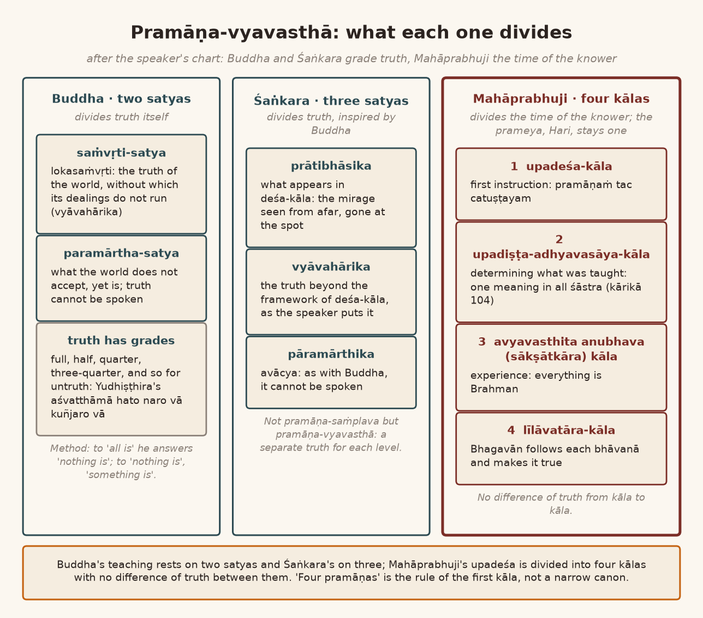
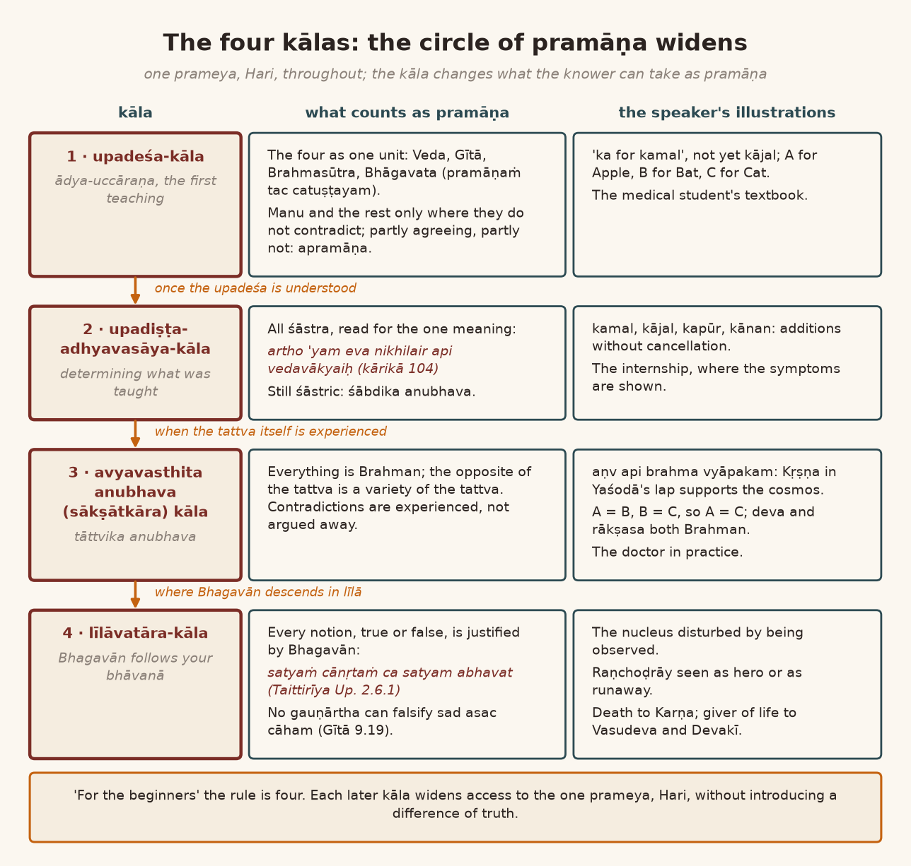
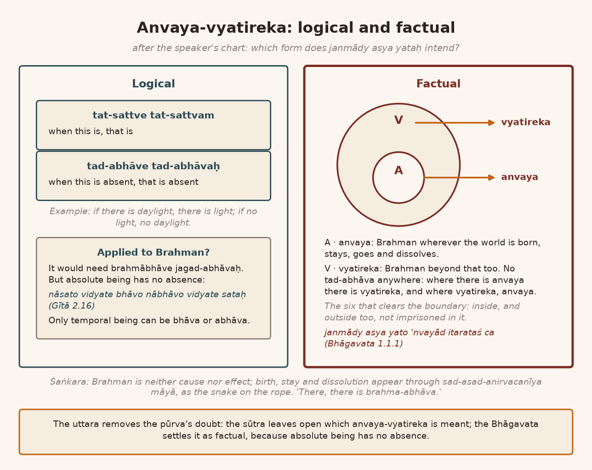

*English rendering of a spoken discourse on the Śāstrārtha Prakaraṇa of the Tattvārthadīpanibandha, translated from a Hindi ASR transcript. The speaker's conversational register, humour, digressions, code-switching, and student exchanges are preserved. Editorial flags: ‹ › conjectural restoration of a garbled reading; ‹?› uncertain reading; ‹…› inaudible or unrecoverable passage; ‹श्रवणाधारित› text given as heard, pending verification against a printed edition. Verses whose standard text is beyond doubt have been silently restored to the received editions.*

# 9. Why Only Four? The Vast Library of Śāstra and "Why This Kolaveri?"

— the one that was the remover of its doubt. *Uttaraṁ pūrva-sandeha-vārakaṁ parikīrtitam, aviruddhaṁ tu yat tv asya pramāṇaṁ tac ca nānyathā.* Now, after that, the question came up: so. The śāstra is so vast. The "literature" of śāstra is so vast. And out of it, to "confine" *pramāṇa* to four: this has become a very ‹"narrow"› "approach". The "approach" has become very "narrow". Because there are eighteen Purāṇas. There are eighteen Purāṇas, and the sūtra is not just one. The Bhāgavata is one Purāṇa out of the eighteen Purāṇas. After that there are eighteen Upapurāṇas besides. Eighteen twice over: thirty-six Purāṇas. There are twenty-eight smṛtis. What will become of them?

The sūtras too are not one. The sūtras of Mīmāṁsā are separate, the sūtras of Sāṅkhya are separate. The sūtras of the Buddhists are separate, the sūtras of the Jains are separate. There are a great many sūtras. Advaita has separate sūtras, Vaiśeṣika has separate sūtras; the *lakṣya*‹?›-sūtras are separate again. What will become of all of these? The Gītā: just as we speak of "the Gītā", in the same way the Gītā too is not one. There are at least twenty-five or thirty Gītās. The Rudra Gītā is separate, the Avadhūta Gītā is separate, the Brahma Gītā is separate. The Gaṇeśa Gītā is separate. The Devī Gītā is separate.

**A student:** Then why are you going first with Kṛṣṇa's Gītā?

**Speaker:** That "issue" too will come up. And as far as the question of the Veda goes: in Mahāprabhuji's time there were eleven śākhās of the Veda. Earlier the Sāma had a thousand śākhās. In Mahāprabhuji's time, eleven śākhās; at present ‹twelve› śākhās, and after that some more have now been found in Kerala, so it has become thirteen. In each śākhā there are four parts: Saṁhitā, Brāhmaṇa, Āraṇyaka and Upaniṣad. And the Ṛgveda is rich with ten thousand mantras. Such a big "literature", and out of it why are you making such a small narrowness? "Why it is narrow?"

"I feel" this question will arise, won't it? There was that song that came out, wasn't there, "Why This Kolaveri Di"? Why are you doing this *kolaveri* [Tamil, "murderous rage"], brother? Does a question arise on this or not? Such a big śāstra; why are you taking such a "narrow approach" out of it?

# 10. Two Truths and Three: Buddha's Insight, Yudhiṣṭhira's Half-Truth, and Śaṅkara's Mirage

On that, Mahāprabhuji is telling us: look, understand one thing carefully, the *vyavasthā* of *prāmāṇya*, the ordering of validity. I had told you that Buddha Bhagavān had said that *pramāṇa*-*viplava* — *saṁplava* — and *pramāṇa-vyavasthā* are two different things. So not *pramāṇa-saṁplava*: how Mahāprabhuji is setting up a *pramāṇa-vyavasthā*, pay careful attention to this.

Buddha Bhagavān had made an "approach" about this: *dve satye samupāśritya buddhānāṁ dharmadeśanā*. Write it down.

> द्वे सत्ये समुपाश्रित्य बुद्धानां धर्मदेशना ।
> लोकसंवृतिसत्यं च सत्यं च परमार्थतः ॥
>
> *dve satye samupāśritya buddhānāṁ dharmadeśanā |*
> *lokasaṁvṛtisatyaṁ ca satyaṁ ca paramārthataḥ ||* (Nāgārjuna, Mūlamadhyamakakārikā 24.8; the speaker attributes the words to the Buddha)
>
> [The Buddhas' teaching of dharma rests on two truths: the conventional truth of the world, and truth in the ultimate sense.]

It is a very great "insight" of Buddha Bhagavān. So what is Bhagavān saying? That there are two truths; there is not one truth. People have a notion that truth must surely be only one. That is a notion. Against that notion Buddha Bhagavān took a different "stand": why can't truths be more than one? So truth too can have several "gradations". As there is a truth: there is a half truth, there is a full truth; there is a half truth, and when there is a half truth, there can also be a quarter truth. Why can't there be? Half of a half is a quarter. There can be a ‹three-quarter› truth too. Can't there?

As we see in the Mahābhārata: to "discourage" Droṇācārya, the "rumour" *aśvatthāmā hataḥ*, "Aśvatthāmā has been killed", was spread. And when everyone said to Yudhiṣṭhira, "Brother, how is this to be 'confirmed'? How is this doubt to be removed, this *asambhāvanā*, whether Aśvatthāmā has been killed or not?" — Yudhiṣṭhira was Dharmarāja. The others, after all, none of them will speak the truth, but Yudhiṣṭhira will not lie. So Bhagavān had already wound his key tight, Yudhiṣṭhira's: "Don't tell a lie, but don't tell the whole truth either." Yudhiṣṭhira said, *aśvatthāmā hato naro vā kuñjaro vā*. This became a half truth, didn't it? "Aśvatthāmā has been killed" — *paṇ* [Gujarati: but] — whether an elephant was killed, Aśvatthāmā, or a man was killed: about that I know nothing.

Now when Yudhiṣṭhira did his *naro vā kuñjaro vā*, the whole did not come out, did it? "Aśvatthāmā was killed": that was a half truth. It was an elephant that had been killed in the battle. Droṇācārya's son Aśvatthāmā had not been killed. So it became a half truth. So in this way there can be a half truth; in this way there can also be a quarter truth, there can also be a three-quarter truth, there can also be a full truth.

"Vice versa", untruth too: a half untruth, there can be a quarter untruth, there can be a three-quarter untruth, there can be a full untruth. So how did you settle it, *nakkī kar liyā*, that truth is only one? Truth too came to have several "gradations". So Bhagavān Buddha says, *dve satye samupāśritya*: "On the basis of two truths I give the teaching of dharma." *Dve satye samupāśritya buddhānāṁ dharmadeśanā, lokasaṁvṛtisatyaṁ*: in the world there is a *vyāvahārika* truth, without accepting which the dealings of the world do not run. And there is a *paramārtha* truth, which the world does not accept but which is: that is *paramārtha*. So *paramārtha-satya* and *saṁvṛti-satya*: there are two truths like this.

Many of Bhagavān Buddha's teachings are based on these two truths. We see "contradiction" in them when we read. But what we have to understand is the "theory" behind it: that this truth, this teaching, is a teaching of *saṁvṛti-satya*, and this one is a teaching of *paramārtha-satya*. So how will we understand? Look, understand carefully. Bhagavān Buddha has one *pāramārthika* truth: that truth cannot be spoken. What is spoken is not truth. So what "approach" does Bhagavān Buddha take? That if you are saying that everything is, we will say nothing is. If you are saying nothing is, then we will say something is. It is a "contradictory statement", making "contradictory statements". Someone went and said that everything in the world is: "All that is there, it exists." "In the other case, nothing exists." ‹…› What does Bhagavān Buddha say? That if you say everything is, then I will say nothing is: the *pāramārthika* truth. If you are saying nothing is, then I will say no, something is: that is the *vyāvahārika* truth. In *vyavahāra* something is true. *Dve satye samupāśritya buddhānāṁ dharmadeśanā.*

In the same way Śaṅkarācārya, "inspired" by that, spoke of three truths: *prātibhāsika* truth, *vyāvahārika* truth and *pāramārthika* truth. What are they? Which is the *prātibhāsika* truth? That which is situated in space and time, in *deśa-kāla*. Whatever is situated in some *deśa-kāla* is *prātibhāsika*: that whose *pratibhāsa*, whose appearing, is taking place in *deśa-kāla*. "That which appears." As a "mirage": "mirage appears in desert". But if you stay at such a distance from it, you will see the mirage; if you go to that "spot", you will not see it. Got it? So *deśa-kāla* too, for truth, is a *prātibhāsika* truth. The truth that is beyond *deśa-kāla*, that is the *vyāvahārika* truth; it is not in the "framework" of *deśa-kāla*. And there is a *pāramārthika* truth which, as with Buddha Bhagavān, is *avācya*: it cannot be spoken. This was Śaṅkarācārya's *pramāṇa-vyavasthā*. Not *pramāṇa-saṁplava*: *pramāṇa-vyavasthā*.

# 11. Mahāprabhuji's Counter-Proposal: Four Kālas of Pramāṇa, "Ka for Kamal", and the Medical Internship

As a "counter-proposal" to this, Mahāprabhuji too is setting out a *pramāṇa-vyavasthā*. That is what I want to explain. Bring it up here *[refers to the chart]*. If we understand this point, then Mahāprabhuji's *pramāṇa-vyavasthā* is of this kind. One is the *pramāṇa-vyavasthā* of the *upadeśa-kāla*. One is the *upadiṣṭa*, what has been taught —

**A student:** *Upadeśa* —

**Speaker:** — the *adhyavasāya-kāla* of the ‹*upadiṣṭa*›.

**A student:** The *adhyavasāya-kāla* of the *upadiṣṭa*.

**Speaker:** One: after the *adhyavasāya* of the *upadiṣṭa*, its *anubhava-kāla*, the *sākṣātkāra-kāla*. And the fourth, the *līlāvatāra-kāla*. Four *vyavasthā*s of *pramāṇa* like this. At every "level" the *pramāṇa* is not one and the same.

What is the "difference", what is the "distinction" of this *pramāṇa-vyavasthā* from the *pramāṇa-vyavasthā* of Buddha and of Śaṅkarācārya? Understand this point: that at every "level", with Mahāprabhuji, no difference of truth is being made in the *pramāṇa*. Because in terms of the *prameya* it is, by itself, Brahman alone. Mahāprabhuji has made it plain that ‹the *prameya* is Hari alone›. To understand that Hari, we have four *kāla*s.

Which *kāla*? The *upadeśa-kāla*. *Upadeśa* is *ādya-uccāraṇa*, the first utterance. Someone has to be made to understand: so, the work of *upadeśa*. As in "*ka* for *kamal*", "*ga* for *Gaṇeś*". At that time someone is teaching "*ka* for *kamal*", and suddenly some clever fellow turns up and says, "Not only *kamal*; *ka* is for *kājal* too." Well, brother, we are just now teaching *ka*; where did *kājal* come into it? In the *upadeśa-kāla*, remember "*ka* for *kamal*". "A for Apple, B for Bat, C for Cat": this belongs to the *upadeśa-kāla*.

Once you have understood what this is, after that comes the *adhyavasāya-kāla* of the *upadiṣṭa*. At that time it can be explained that *ka* is not only for *kamal*. In that, *kamal* will not be "cancelled", but there will be "addition": that there is *kamal*, there is *kājal*, there is *kapūr*, there is *kājalī*, there is *kānan* too; they all came in. ‹"Additions"› go on happening. It is the time of the *adhyavasāya* of what was taught. *Adhyavasāya* means "determination": the means of "determining" it.

And after that comes the third *kāla*: the time of the *anubhava* of the thing that has been ascertained, the *adhyavasita*, in the *adhyavasāya* of the *upadiṣṭa*. As when you are studying "medical science": first you are reading in the book, "This disease has these symptoms, this disease has these symptoms, this disease is removed with this medicine." What is that? The *upadeśa-kāla*. All right. Now what is the *adhyavasāya-kāla*? You are taken there and shown, "Look, are these the symptoms of the disease or not?"

It is shown in the "internship", isn't it? After that you started the "treatment" of the disease: that is ‹the beginning› of *sākṣātkāra*. When your "internship" is complete, the time of *sākṣāt* will come. You yourself are seeing it "practically": "Well, these are the symptoms of the disease. This is the symptom of this disease; give this medicine. Look whether it is being cured or not." Just like that. So there is also a *kāla* of the *anubhava* of the *avyavasthita*.

And there is one at the end: there is *līlā*. In four *kāla*s like this Mahāprabhuji's ‹teachings› too take place. Buddha's is in two *kāla*s, Śaṅkarācārya's in three *kāla*s; Mahāprabhuji's *upadeśa* is divided into four *kāla*s. And this is Mahāprabhuji's *pramāṇa-vyavasthā*. That is why Mahāprabhuji says, for the *upadeśa-kāla*, *pramāṇaṁ tac catuṣṭayam*. If you have understood, then:

> अर्थोऽयमेव निखिलैरपि वेदवाक्यै रामायणैः सहितभारतपञ्चरात्रैः ।
> अन्यैश्च शास्त्रवचनैः सह तत्त्वसूत्रैर्निर्णीयते सहृदयं हरिणा सदैव ॥
>
> *artho 'yam eva nikhilair api vedavākyai rāmāyaṇaiḥ sahita-bhārata-pañcarātraiḥ |*
> *anyaiś ca śāstravacanaiḥ saha tattvasūtrair nirṇīyate sahṛdayaṁ hariṇā sadaiva ||* (Tattvārthadīpanibandha, Śāstrārtha Prakaraṇa 104)
>
> [This very meaning is determined by all the statements of the Veda, by the Rāmāyaṇas together with the Bhārata and the Pañcarātras, and by the other statements of śāstra along with the Tattvasūtras; it is determined wholeheartedly, by Hari, always.]

Your *adhyavasāya-kāla* has come; you have understood what the *siddhānta* is. So this thing has come into all the śāstras. Still, it is limited to śāstra.

{width=6.2in}

# 12. Anubhava and Līlāvatāra: Brahman in Yaśodā's Lap, Shakespeare's "Thou", and the Observed Nucleus

It is limited to śāstra; so far there has been no *anubhava*. Because the *siddhānta* of the śāstra, the *siddhānta* of the śāstra, is the time of *śābdika anubhava*, verbal experience. It is not the time of *tāttvika anubhava*, experience of the reality. When the experience of the *tattva* started — when the experience of the *tattva* started, then the *vyavasthā* will change. Because the *tattva* is only one. The *tattva* is not two at all. So whatever the *tattva* is, whatever is its "opposite" is also some "variety" of the *tattva* itself. Which perhaps I had not told you, had not told Nalakūbara‹?›: *aṇv api brahma vyāpakaṁ bhavati, yathā kṛṣṇo yaśodā-kroḍe sthito 'pi sarva-jagad-ādhāro bhavati* (Prakāśa on Śāstrārtha Prakaraṇa 54).

Brahman is as "nano" as the "atomic", and it is the support of the whole cosmos. So Kṛṣṇa, asleep in Yaśodā's lap, is himself the support of the cosmos in which lies the earth on which Yaśodā is. Now how is the one who is the support becoming the supported? This is a "contradiction". If it is a "contradiction", it is. If you experience it, you will know. It will not come by understanding. In the *adhyavasāya-kāla* this is difficult to understand. So in *adhyavasāya* we are trying to understand. In understanding we have "limitations". Our intellect has "limitations". So we will be able to understand only within the "limitations" of the intellect.

Because the child's intellect has this "limitation": that he has to "correlate" *ka* with some "object", to "correlate" the *ka* "sound" with some "object". If you told him everything at once, the child will get "confused". Tell the child right from the start, "*ka* for *kamal*, *ka* for *kājal*, *ka* for *kānan*, *ka* for *kañcan*, *ka* for *kauvā*", and the child will say, "Brother, I don't want to do anything at all, yār, leave it, ‹I give up›." What did he know?

Bertrand Russell says a very amusing thing: that if Shakespeare had known that his drama would be *vāparā* [Gujarati: used] to teach English, poor Shakespeare would not have written drama at all. He wrote the drama for some other purpose, and we started *vāparing* that drama to teach English. And for the child — when I was doing this, I too had a Shakespeare drama, such strange English: "thou said". Now what is "thou"? One never came to know. In ordinary speaking and talking there is no "thou" anywhere at all.

That kind of English, which is not spoken today, is "compulsory" for learning English. That point of Russell's went down very well with me‹?›: that if Shakespeare had come to know it would be misused like this in teaching English, the poor fellow would not have written the drama at all. It is a very good drama. But for learning English it is very bad English. Nobody at all speaks such English nowadays.

So in the same way we should understand that, to make a child understand, there is only as much understanding as there is, whatever comes within the child's experience: "A for Apple, B for Bed, C for Cat". If you "correlate" with what the child sees and knows, then he will be able to understand. Tell him all at once things the child has not seen, say suddenly "K for ‹chameleon›", and the child says, "What is this ‹chameleon› thing?" Got it?

So the *upadeśa-kāla* is a separate *kāla*, in which one starts with a little. The *adhyavasāya-kāla* is the second: your "understanding" has grown a little, so you can "apply" it everywhere, you can see it everywhere, because of *adhyavasāya*. And still there is no *anubhava*; you are "applying" quite a lot. After that, when the *anubhūti-kāla* comes — in the *adhyavasāya-kāla* Mahāprabhuji has said that all śāstras are *pramāṇa*, but as śāstric *pramāṇa*; nothing non-śāstric is *pramāṇa* — but when *anubhava* came, everything is Brahman. "A equal to B, B equal to C, therefore A equal to C": did it become so or not? Now how will A be equal to C? This one is coming first and C is coming later. "He cannot be equal to C." When will the experience come, this "A equal to C"? The *anubhava-kāla*. "In the time of enlightenment, A is for A, A is A, B is B, C is C. A cannot be B, B cannot be —"

So "how can A, B, C"? But when you get "A is equal to B, B is equal to C, therefore C is equal to A", this came to be a matter of the *anubhava-kāla*. Not otherwise. So Brahman is *deva*; a "product" of Brahman is the *rākṣasa* too. The *rākṣasa* too is Brahman. So did *deva* become equal to *rākṣasa* or not? Now the one to whom the difference between *deva* and *rākṣasa* is being explained will never understand this. He has to come to understand ‹…› and Brahman, ‹…› and the cosmos: "Well, what is the 'unifying factor' of this, of what it is 'unifying'? And what is the 'distinguishing factor'? What is that?" That has to be understood; only then will it be understood. So that is a matter of the *anubhava-kāla*.

And where the *līlāvatāra-kāla* came, there what happens is that Bhagavān is "following" your ignorance. He "justifies" your ignorance. He is "following" your "illusion". So when Bhagavān is "following" your "illusion", then this no longer remains *nija-nija*‹?›, does it? Look carefully, look: people understand this point only with great difficulty.

So today "scientists" hold that if you look at the "nuclear" "structure", it gets "disturbed", because the process of seeing has its influence on it. So what you see is not what you want to see; as your eye can see, so it ‹turns out›. So the *līlāvatāra* is almost of the "nucleus structure" type, isn't it? As you want to see, so it appears to you. You want to see him as an enemy, he appears in an enemy's way; you want to see him as an adversary in combat‹?› — you want to see him in a hero's way, he appears in a hero's way; you want to cry "Raṇchoḍrāy kī jay!", he appears running away too. As you want to see, so he is appearing. *Jākī rahī bhāvanā jaisī, prabhu mūrata dekhī tina taisī* (cf. Tulasīdāsa, Rāmacaritamānasa, Bālakāṇḍa). In it everything is becoming true. So the "differentiation" of truth and untruth that there is, that did not remain in the *līlāvatāra*. Because Bhagavān is "justifying" even the false notion that everyone has. Someone's true notion, he is "justifying" that too. So truth — truth equal to Brahman, Brahman equal to untruth, "therefore" truth became equal to untruth.

How has the Upaniṣad explained it? *Sac ca tyac cābhavat, niruktaṁ cāniruktaṁ ca, nilayanaṁ cānilayanaṁ ca … satyaṁ cānṛtaṁ ca satyam abhavat* (Taittirīya Upaniṣad 2.6.1). He became *satya*, and the *anṛta* too, he became that.

And this is the *līlāvatāra-kāla*. As to Karṇa Bhagavān appeared as death; to someone Bhagavān [seemed] the giver of life: to Vasudeva and Devakī he seemed the giver of life. So is Bhagavān, the giver of life, *amṛta* or "poison"? In the Gītā Bhagavān says *sad asac cāham arjuna*: *amṛtaṁ caiva mṛtyuś ca sad asac cāham arjuna* (Bhagavadgītā 9.19). "O Arjuna, understand that I am *sat* and I am *asat* too, I am death and I am the immortal." It seems to me, yār, that Bhagavān is just spinning tall tales. There ought to be one *tātparya*. Death cannot be *amṛta*; *amṛta* cannot be death. Make a *gauṇārtha*.

When is Mahāprabhuji to make a *gauṇārtha*? When the *tātparya* is *anupapanna*. When is the *tātparya anupapanna*? When it cannot ‹relate› to the "objective", to the "object". Bhagavān himself is saying, "I become both ways." So how will we "falsify" that? That is why in the *līlāvatāra* there is a separate *kāla* of *pramāṇa*. This has not been "confined" to the four; "for the beginners" it is put this way. Now look —

{width=6.2in}

# 13. The Chain of Doubt-Removal: Hands Without Hands, the Blood-Sucking Tree, and Two Cows Fighting

— understand carefully. Look at the "text":

> उत्तरं पूर्वसन्देहवारकं परिकीर्तितम् ।
> अविरुद्धं तु यत्त्वस्य प्रमाणं तच्च नान्यथा ।
> एतद्विरुद्धं यत्सर्वं न तन्मानं कथञ्चन ॥
>
> *uttaraṁ pūrva-sandeha-vārakaṁ parikīrtitam |*
> *aviruddhaṁ tu yat tv asya pramāṇaṁ tac ca nānyathā |*
> *etad viruddhaṁ yat sarvaṁ na tan mānaṁ kathañcana ||* (Tattvārthadīpanibandha, Śāstrārtha Prakaraṇa 8)
>
> [Each later one is declared the remover of doubt about the one before. Whatever does not contradict this is pramāṇa, and not otherwise; whatever contradicts this is in no way a means of valid knowledge.]

What is not contradicted by these is *pramāṇa*, and what is contradicted is not *pramāṇa*: *etad viruddhaṁ yat sarvaṁ na tan mānaṁ kathañcana*. Now Mahāprabhuji is saying this of the *upadeśa-kāla*. He is not saying it of the *adhyavasāya-kāla*, nor is he talking of the *anubhava-kāla* of the *adhyavasita*, nor is he saying it of the *līlāvatāra*. From where will we know? Look, Mahāprabhuji is commenting on it. Just a little: on this point I [will take you through it] again, because I am — "one who has been burnt by milk blows even on buttermilk before drinking it". He drinks. So I want to make this point clear on this, because of what these people are saying, the "academicians": that there are four *prasthāna*s, and Vallabhācārya did not accept any *prasthāna*s at all. So where did they go, brother, the four *prasthāna*s? There is no talk of *prasthāna* anywhere at all. Mahāprabhuji is ‹…› all the *prasthāna*s; and leave aside the talk of *prasthāna*, he is accepting even *apramāṇa* as *pramāṇa*. The system of Mahāprabhuji's philosophy is of a very "wider scope", of a "scope" as wide as Brahman. We have to "pop up"‹?› Brahman, don't we?

*Uttarottaraṁ pūrva-pūrvasya sandeha-vārakaṁ prakarṣeṇa kīrtitam*: each later one is proclaimed, emphatically, as the remover of the doubt about each earlier one. Now in this Mahāprabhuji gives an example: *apāṇipādo javano grahītā* (Śvetāśvatara Upaniṣad 3.19). Brahman has neither hands nor feet. It runs very fast, and it is a great catcher: whomever it wants, it catches. Now this became "contradictory". The *tātparya* is not arising: "contradictory". Or there is *anupapatti*. It is *apāṇipāda*: if it is *apāṇipāda*, how will it be *javana* and *grahītā*? If it is *javana* and *grahītā*, how will it be *apāṇipāda*?

*Ityatra kiṁ prākṛta-pāṇipāda-rahitaṁ brahma, āhosvit sāmānya-niṣedha iti sandehe*: so here a doubt arises: that just as there are hands and feet in the *prākṛta*, it does not have *prākṛta* hands and feet like those, but it could have some *aprākṛta* hands and feet. Doubt of both kinds can arise. In the doubt, which side is to be taken? So what does "*prākṛta* hands and feet" mean? Like our hands and feet. When we run after someone, we run with this foot of ours. When we catch someone, we catch with our hand. So does Brahman not have hands and feet of this kind? So if our hands and feet were cut off, we would not be able to run, would not be able to catch.

Understand carefully. In South America there is a tree like this: whoever passes beneath it, it wraps up in its branches and "blood sucks" him. So it has no hands, and no feet either. Does it do it or doesn't it? Go and see it anywhere. I am giving you "information" about the trees of South America. The "white cells" in our "blood" have neither hands nor feet. The moment any "foreign element" comes in, the "white cells" go after it the way the police go after a thief: they surround it, having surrounded it they catch it, having caught it they stick to it, having stuck to it they eat it up. Where are its hands and feet? *Apāṇipādo javano grahītā.* So when in such small things this *sāmānya* sense is coming out, then why can't Brahman [be so]? There will be doubt, won't there? So because we have no hands and feet, we cannot catch anyone, cannot run. So has Brahman's *tātparya* too become *anupapanna*? But you measured the *tātparya* by your own "parameter", didn't you? You did not measure it by a "universal parameter". The "parameter" of the "plant" is different. The "parameter" of the "white cell" is different.

And — and listen carefully to one more thing — where does the snake have hands and feet? When the python traps [its prey], it catches it, it runs and wraps it up. Without hands or feet it wraps it up. There is so much strength in its body that once it has wrapped, even a lion cannot get free. ‹…› So why should we measure by our own "parameter"? The "narrowness" is there. The "narrowness" is not in our "approach". In the *upadeśa-kāla* there is no "narrowness".

So there will be doubt, won't there? *Asambhāvanā* and *viparīta-bhāvanā* arise. So in this it says, *iti sandehe "sarvataḥ pāṇipādāntam" ityādi gītā-vākyaṁ nirṇāyakam*: the Gītā's statement *sarvataḥ pāṇipādaṁ tat* (Bhagavadgītā 13.13) decides it. Bhagavān's hands and feet are not "confined" to any one place; his hands and feet are "confined" in all places. Our hands and feet are "confined" to one place; that is why, when they are cut off, we cannot catch. His hands and feet are everywhere: wherever it is needed, there he can catch.

*Tathā gītāyāṁ "nityaḥ sarvagataḥ sthāṇuḥ"*: in the Gītā a statement comes, *nityaḥ sarvagataḥ sthāṇuḥ* (Bhagavadgītā 2.24). "Consciousness" is eternal, it is "omnipresent", and it is *sthāṇu*, "stable"; it is not "unstable". Second, Bhagavān states in the Gītā, *mamaivāṁśo jīvaloke* (Bhagavadgītā 15.7): the *jīva*, which is — So is the *jīva* "conscious", or is it "unconscious"? If it is "conscious", then it should be "stable", it should be "omnipresent", and — it should be "eternal" and "omnipresent", and it should be "stable". If it is an *aṁśa*, then it will wander off here and there, will run about. Which statement is true? A doubt is arising, isn't it? The *tātparya* is becoming *anupapanna*. "Cancel" one of the statements. Either "cancel" *mamaivāṁśaḥ* — but then, where is *mamaivāṁśaḥ* small? How will it be small? One meaning of *aṁśa* is this.

*Aṁśa*s are of two kinds. As when we made a heap of one ser of rice, and made a heap of a quarter ser: so that became its *aṁśa*. In that way it ‹can be›. Or how can it be for us that the sun's reflection falls in a pond, and then it falls in a somewhat different way; [if] it falls on the ground, I mean in some pot, then it falls in another way; and its reflection will come in a small "camera", a "digital camera", and then it will come small, and that will become its *aṁśa*. That is "false", the sun's. In this way the *jīva* is a "false" *aṁśa* of Brahman: it is not like that. "Multiple possibilities" of "interpretation": is there only one possibility? What are we to understand? In the Gītā, which statement are we to make *gauṇa*, and which statement are we to take in the sense of *abhidhā*? It is a "contradictory statement".

‹…› How will the doubt about this be resolved, the *asambhāvanā* and *viparīta-bhāvanā*? One of the two statements — our father used to say something, very amusing, ‹often›: suppose a cow and a dog are fighting, and you are a devotee of the cow. Then you will beat the dog with a stick and drive it off. If you are a devotee of the dog, then you will beat the cow with a stick and drive it off. But if two cows are fighting, then what will you do? Will you then beat a cow with a stick? My father had a "patent argument": two cows are fighting each other, locking horns; which one will you beat with the stick? If you beat either cow with a stick, then that cow-*bhakti* of yours is finished, isn't it?

When Indira Gandhi was alive, at one time there was a very big agitation against cow slaughter. Śrīpād-jī‹?› and the Śaṅkarācārya had led it. Rallies went out all over Hindustan. I was in Banaras at that time. I felt, after all, we too are cow devotees. The surname is Gosvāmī, but we are devotees all the same, aren't we? I should go and stand there, and whether we can do anything or not, I should go and stand in that rally. So I went and stood where the rally was going to come from, thinking, well, when it comes, we will join it too. A poor cow, out of hunger, was eating paper: printed newspaper. And when the rally came, then there was a *dham-dhappaḍ, dham-dhappaḍ*, an uproar, and the cow got startled. The cow got startled, so it began to run this way, and the devotees who were standing there hit the cow with sticks. I said, "You run; we too. The cow is running; in the same way we Gosvāmīs too should run from here."

What was the "slogan" of their rally? "*Gāy hamārī mātā hai, deś-dharm kā nātā hai; gāy hamārī mātā hai, deś-dharm kā nātā hai*" ["The cow is our mother; she is the bond of country and dharma"]. The poor thing was eating newspaper. And so much uproar was raised that she got startled. Startled, she began to run, so everyone beat her with sticks and drove her off. So I said, she has fled; now the Gosvāmī too must surely flee. After that I did not join the rally. We say we are cow devotees — as long as the cow has not got startled. Once she is startled, nobody remains a devotee. I immediately ran back home. I said, I don't have to join the ‹rally›. I accept that I am a cow devotee; I accept it with a true heart. But brother, if you are beating the cow with a stick, then what became of cow-*bhakti*? So this is one question.

Mahāprabhuji says, *ityādiṣu sandehe sūtrair nirṇayaḥ "utkrāntigatyāgatīnām" ityādibhiḥ* (Brahmasūtra 2.3.19). What does the sūtra, the Brahmasūtra, say? That the *jīva* is an *aṁśa*, because the *jīva* has *utkrānti*, has *gati*, has *āgati*. So if it were "omnipresent", "omni"-"eternal" and "stable", how could there be *utkrānti*, *gati*, *āgati*? *Utkrānti* means *utkramaṇa*: the *jīva* goes out. And it comes in too, into some "body": so the *jīva* comes, the *jīva* goes, the *jīva* goes to svarga, the *jīva* goes to naraka. Without being an *aṁśa*, how will it go? If you are saying that it is "omnipresent", it is "eternal", then it is in naraka too, and in svarga too. How will there be going and coming? So because of that it is established that it is *mamaivāṁśaḥ*. So then what is to be done with this? So it is *nitya* and *sarvagata*: Mahāprabhuji tells its *vyavasthā*. The *samaṣṭi* of the *puruṣa* is *sarvagata*, it is "eternal"; and the *vyaṣṭi* of the *puruṣa* is the *aṁśa*.

# 14. Samaṣṭi and Vyaṣṭi: The Ocean as the Earth's Garment, Continental Drift, and the Locked Mind

It is a relation of *samaṣṭi* and *vyaṣṭi*. So, as with the ocean — understand this point carefully. The ocean is like the earth's lungī: *samudravasane devi*. In the praise of the Earth this comes: that the goddess Earth has put on the ocean as her clothing, has wrapped it around herself. This is not such an old idea, that the ocean is a "cloth" of the earth. Many people did not understand it at that time; our *śāstrakāra*s understood that the earth has put on the ocean as clothing: *samudravasane devi parvatastanamaṇḍite* (traditional prayer to the Earth). The mountains are her ‹*stana*›; the ocean is her *vasana*, her garment. If the ocean were emptied, the earth would become naked. She has put on the ocean as clothing; that is why the whole "lower portion" of the earth is covered. The "upper portion" is all "continent".

So because of this ocean-garment of the earth, does it make a difference to us or not — whether the ocean is in the earth? Is it on the earth, or is the earth in the ocean? What is the "issue" before us? The "issue" before us is this: that the earth is in the ocean, floating; [or] this ocean is on the earth. Your theory of "continental drift" — look, I am telling you an amusing thing: how "contradiction" comes. The theory of "continental drift" is that "once upon a time" there was a "Gondwana land". All the "continents" that there were, America, Africa and Asia, and Australia, New Zealand, all these were one single island. And around them on all four sides there was only ocean. And what does the śāstra call it? That it was Jambūdvīpa. Even today, when there are weddings and such, they have you recite the mantra, don't they: *jambūdvīpe bharatakhaṇḍe*. That is from that time. After that, "continental drift" began. Even today, if all the "continents" there are were cut out and put together, they would all "set" into one another. They would all "set" into one another: where this one has its groove, its *khāṁcā*, there — here it is "positive", there it is "negative", that kind of thing.

So at that time the ocean was not a garment at all, when the earth was Jambūdvīpa. Now the "upper portions" of the earth came up, so the ocean became the *vasana*, the garment. Earlier it was a *dvīpa*; *dvīpa* means that which has water on all four sides. With us the description comes that the earth is Jambūdvīpa, and around Jambūdvīpa on all four sides is ocean. Today it is not seen. Then they took shape, didn't they, because of "continental drift". We feel that if "continental drift" is happening, then it must be going along floating in the ocean. No. It is going along taking the ocean with it. And perhaps you know, perhaps you don't: right now the "eastern part" of Africa is "breaking"; it is "moving" in this direction. After some thousands of years it will join up with our Asia. And this Himalaya of ours is going "northward"; that is why there are "continuous" earthquakes there, because of the theory of the "plates".

So the earth is a plank, a *paṭiyā*, floating in the ocean; [and the ocean] is the earth's *vasana*. That is visible, isn't it? And whoever has the "key" to the solution gets the solution; for the rest there will be doubt, *asambhāvanā*, *viparīta-bhāvanā*. Because of *utkrānti*, *gati* and *āgati*: the "stability" is not anyone's "absolute stability", and the "mobility" is not anyone's "absolute mobility". Every "mobility" is "mobile" in some "relation" and "stable" in some "relation". "For instance", as today we say that the sun is "stable" and the earth is rotating. "In relation of earth, sun is stable, but in the galaxy the sun is also moving, all around this black hole of ours, the galaxy." "The Earth is stable" — for the "moon". The "moon" is "most mobile". So what is "stable" is "movable", and what is "movable" is "stable".

We have "closed" it in the "mind": as ‹Bachchan› says, doesn't he, "*Lock kiyā jāe*", in the same way we "lock" every "concept". After "locking" it, we forget to understand anything. After "locking" it, we ourselves forget how some "concept" got "locked" in the "mind". Because of that we get *asambhāvanā* and *viparīta-bhāvanā*. Open that "lock". Then you will know. As soon as we hear some "concept" — as "*ka* for *kamal*" was put into the child's head, and the child "locked" it. Now we will say, "Brother, there is *kājal* too." "No, no, no. Our Pappā, our "teacher", taught us that *ka* is only for *kamal*." Oh, brother! Your ‹"mind"› has got "locked".

This is the speciality of the human intellect, that the "lock" happens quickly. It is an "automatic lock". To open it a "key" is needed. It does not open "automatically"; closing happens "automatically". Because ‹our intellect› has this speciality of its own, a great many "problems" arise. Whenever some "conception" comes: "lock". "*Lock kiyā jāe*": it gets "locked". "If it is 'stable', it will not be 'mobile'." All right, brother: the "mobile" too can be "stable", and the "stable" too can be "mobile". There is "continental drift" too, and the earth is stationary too.

A "student" asked a maulvi, "Huzūr, does this earth rotate?" "It is stationary. Is there any doubt in it? The Nabī is resting here. How can there be a ‹disturbance› in his rest? Hence the proof." The Nabī has been buried in it, hasn't he; the Nabī is resting; if the chair‹?› moves, how will he get rest? It is true enough, isn't it: when we sleep on the train we do not get such good sleep, because as it runs there is a rattling, isn't there? So if the earth is moving, how will the Nabī get to sleep? Brother, the "mind" has got "locked". The "mind" has been "washed". ‹the speaker's characterization›

"Stable" and "mobility" are "relative", not "absolute". This "lock" will have to be opened with some "key". And that is *uttaraṁ pūrva-sandeha-vārakaṁ parikīrtitam*: every later śāstra is "secondary information", that means, "Following this information resolves the doubt of *asambhāvanā* and *viparīta-bhāvanā* of the preceding information." This is one "parameter" of Mahāprabhuji's "hermeneutics": "how to interpret text".

# 15. Anvaya and Vyatireka: The Six into the Sea at Marine Drive, Logical and Factual, and Śaṅkara's Māyā

That is why it says, *tathā janmādy asya yataḥ*. *Janmādy asya* is the Brahmasūtra (Brahmasūtra 1.1.2). What does it mean? The *janma*, the *sthiti* and the *laya*, and the *prayāṇa*, of this world: that from which it happens, where it happens, in which it happens — from which it happens, where it happens, towards which it happens — that is Brahman. Well, brother, the question, all of it, became a doubt, didn't it: *janmādy asyeti sandehe*. What does the Bhāgavata explain? *Janmādy asya yato 'nvayād itarataḥ*: the origination of this world happens from Brahman, it is situated in Brahman, it goes towards Brahman and is absorbed. How will this be understood? *Anvayād itarataḥ*. What does *anvaya* mean? That where the world is — *anvaya* has been accepted in two forms, one "logical" and one "fact"ual; in *vyatireka* too there should be two forms.

Understand this well, understand this well: what *anvaya* and *vyatireka* are. *Anvaya* means *anu-āyata*‹?›. *Āyata* is in the sense of motion. That is, where one thing goes, if another thing goes there with it, that is called *anvaya*. *Vyatireka* means remaining over: *viśeṣeṇa atiricyate*, *atireka*, *vyatireka*. What remains over is called *atireka*. "Well, this has become an *atireka*": as when it has crossed over. As when something crossed our "boundary" and went into another "boundary": that became an *atireka*. Uh, as in cricket there is a "boundary", isn't there, a four. So if the ball stayed inside the "boundary", it is not called a four; but if it "crossed" the "boundary", then it's a four. That "crossing", "crossing" the "boundary", is called ‹*vyatireka*›.

Perhaps you don't know. Earlier, when this Cricket Club of India had not been built, everybody used to play cricket on Marine Drive. They would hit "boundaries", and the ball would go and fall right into the sea. ‹…› would stop. Some "player" hit a six hard, the ball went straight and fell into the sea: search where it went! The cricket would stop. Then this stadium had to be built. Of these two stadiums that were built, the second stadium was built because of a quarrel, but the first stadium was built because of this "problem": the ball would fall into the sea. That ground that is there —

What is the name of that ground?

**A student:** Parsee Gymkhana. Yes, Parsee Gymkhana; all this is there, isn't it.

**Speaker:** Yes, Parsee Gymkhana, and all this is there, isn't it — that ground there, everybody used to play cricket there. Hazare and these people, all of them ‹used to play›. And they would hit such sixes that the ball went into the sea, in the cricket. Then these people had the idea: no, there should be a stadium, so that even if someone hits a six, the ball stays right there and does not go into the sea.

So the doctrine of *vyatireka* and *anvaya*: one is "logical". What is the "logical" one? *Tat-sattve tat-sattvam, tad-abhāve tad-abhāvaḥ*: when this is, that is; and if that is not, then that too is not. As: if there is daylight, there is light; if there is no light, there is no daylight either. So *tat-sattve tat-sattvaṁ, tad-abhāve tad-abhāvaḥ* is "logical", for me‹?›. In the same way there is also a "fact"ual *anvaya-vyatireka*. Its example is this: a "subset" and a "major set" *[refers to the chart]*. Now in this there is no *vyatireka* [of that kind], look. There is no *tad-abhāva* at all. ‹…› "Where there is *anvaya*" and "where there is *vyatireka*": wherever there is *anvaya*, there is *vyatireka*; wherever there is *vyatireka*, there too is *anvaya*. So here, in this *anvaya-vyatireka*, there is no *tat-sattve tat-sattvaṁ, tad-abhāve tad-abhāvaḥ*. This is a "fact"ual *anvaya-vyatireka*.

To this Mahāprabhuji drew attention: the "fact"ual *anvaya-vyatireka* is different. Because the *vyatireka* of Brahman cannot possibly be of the absence kind. *Brahmābhāve jagadabhāvaḥ*, "where Brahman is absent, the world is absent": how will you say that? Where will you show the absence of Brahman? What is "absolute being": of "absolute being" there will be no "absence". *Nāsato vidyate bhāvo nābhāvo vidyate sataḥ* (Bhagavadgītā 2.16). Whatever is "temporal being" can be *asat* too; it can be *bhāva* too, it can be *abhāva* too. But what is "absolute being" will have no *abhāva*. So there is no *tad-abhāva*; ‹*tad-abhāve tad-abhāvaḥ*› is the "logical" [form], and then it would be the [logical] *anvaya-vyatireka*. But a "fact"ual *anvaya-vyatireka* can be there: that it is *anvita*, present, everywhere, and it is also outside that in which it is *anvita*. It has a *vyatireka* too. That means it is a six. There is the "boundary"; it goes outside that too. It is not imprisoned in it.

Mahāprabhuji wants to explain this point: *anvaya-vyatirekataḥ*, *janmādy asya yato 'nvayād itarataḥ*. The *janma* of the world, the world's *janma*, *sthiti*, *laya* and *prayāṇa*, happens only where Brahman is; where Brahman is not, it does not happen; and Brahman is outside this too. That means: where the origination of the world is happening, where the world is situated, where the world is making its *prayāṇa*, where the world is being absorbed, there Brahman certainly is; outside that too there is Brahman. This is the *anvaya-vyatireka* that came in the Bhāgavata:

> जन्माद्यस्य यतोऽन्वयादितरतश्चार्थेष्वभिज्ञः स्वराट्
> तेने ब्रह्म हृदा य आदिकवये मुह्यन्ति यत्सूरयः ।
>
> *janmādy asya yato 'nvayād itarataś cārtheṣv abhijñaḥ svarāṭ*
> *tene brahma hṛdā ya ādikavaye muhyanti yat sūrayaḥ |* (Bhāgavata Purāṇa 1.1.1)
>
> [That from which the birth and the rest of this [world] come, through *anvaya* and through the other, knowing in all things, self-ruling; who imparted the Veda through the heart to the first poet, concerning which even the sages are bewildered.]

This Mahāprabhuji explained: that what was not becoming clear in *janmādy asya* became clear from the Bhāgavata. Because *janmādy asya* — *śāstrayonitvāt* — this is the *janma*-sūtra. So in it, in *janmādy asya*, which *anvaya-vyatireka* is to be taken, the "logical" or the "fact"ual? So there is "confusion", isn't there: doubt.

*Asambhāvanā* and *viparīta-bhāvanā* arose. That is why Śaṅkarācārya said — *janmādy asya*, "from which it happens" — that from Brahman nobody's birth happens, nor does Brahman take birth from anyone ‹…› cause. Śaṅkarācārya negates the relation of effect and cause. They said, "Then how does the origination and maintenance of the world happen?" He said, "It is happening from māyā." So they asked, "Brother, where did māyā come from?" He said, "Māyā is eternal; just as Brahman is eternal, so māyā too is eternal." If māyā is eternal, non-duality will be broken. So they say: no, that māyā is *sad-asad-anirvacanīya*, "which cannot be defined in terms of being or non-being". Hence whether the world too is being born or not being born, this is *anirvacanīya*. Whether it is or is not, this too is *anirvacanīya*, because it is the "product" of māyā; it is not the "product" of Brahman at all. Whether it is being absorbed into Brahman or not, that too is *anirvacanīya*, because it is born of māyā.

What is the example? As on the shell, on the rope, a snake is born. It keeps appearing as born, but is it really there? Where is it situated? The snake appears just where the rope is; so it is situated right there too. And then where does it get absorbed? When you have known the rope, the snake stops appearing; so it gets absorbed right there too. In this way the world, through māyā, is appearing on Brahman as being born, as being situated and as being absorbed. "As a matter of fact" it is neither being born, nor is it situated, nor does it get absorbed, because Brahman is neither cause nor effect.

*Lam yalid wa lam yūlad*: that means, neither is He anyone's son nor does He have any son. *Lam yalid wa lam yūlad, wa lam yakun lahū kufuwan aḥad* (Qur'an 112:3–4): He is alone. How can one who is alone be anyone's son or father? And those who do believe it, the Qur'an-people‹?› say ‹*aʿūdhu billāhi mina-sh-shayṭāni-r-rajīm*› (heard as *āmantul śaitānil ajīmā alpātā* ‹श्रवणाधारित›): that it is Satan who has ‹led› us into this hell. That this is what Satan has made us believe, that He is born, or that something is born from Him. He is not born at all. Because Christ used to say, "I — my Father is God; I am His offspring." Muhammad Sāhab is saying, *lam yalid wa lam yūlad wa lam yakun lahū kufuwan aḥad*: neither is He born of anyone, nor does anyone beget Him. ‹the speaker's characterization› In the same way their Brahman is neither born nor produces anything. So then how does it happen? It is happening from māyā; it is not happening from ‹Brahman›. This is one *anvaya-vyatireka*: there, there is the absence of Brahman.

Mahāprabhuji says that Brahman, which is "absolute being", can have no absence at all. So here it is not a "logical" *anvaya-vyatireka* but a "fact"ual *anvaya-vyatireka*, and this we get clarified from the Bhāgavata. In this way: *uttaraṁ pūrva-sandeha-vārakaṁ parikīrtitam*.

**A student:** In māyā there is an unavoidable *vyatireka*‹?›.

{width=6.2in}

# 16. "Whatever Manu Said Is Medicine": The Four-Pramāṇa Rule Belongs to the Upadeśa-kāla

*Etad-avirodhenaiva manvādīnāṁ prāmāṇyam āha*: by this, if the statement of Manu and the rest is not in contradiction, then the statement is *pramāṇa*; otherwise it is *apramāṇa*. Now look what the "problem" is; look, understand carefully. The Manu and the rest whom he is calling *apramāṇa* here — and the Veda which you are calling *pramāṇa* — that Veda itself is saying, *yad vai kiṁ ca manur avadat tad bheṣajam* (Taittirīya Saṁhitā 2.2.10.2). It is written in the Veda that whatever Manu has said is your true remedy. So if the Veda is true, then Mahāprabhuji is false; and if Mahāprabhuji is true, then the Veda is false. ‹Caught›, aren't we?

And this is not the arrangement for every [stage]; it is the arrangement of the *upadeśa-kāla*. Mahāprabhuji is saying: first understand this point thoroughly, that when you are doing the "interpretation" taking these four as one "unit", at that time the statement of Manu and the rest — you are saying "Manu and the rest", you are not saying only Manu. I told you about the twenty-eight smṛtis. Like Manu's there is the Yājñavalkya Smṛti, there is the ‹Hārīta› Smṛti. There are a great many ‹smṛtis›; there is the Nārada Smṛti, there is the Parāśara Smṛti. There are many smṛtis; there are twenty-eight smṛtis. All those smṛtis: when are they *pramāṇa*? When you have understood the *siddhānta*, then they are *pramāṇa*. If you have not yet understood the *siddhānta*, then for now don't fuss, *khaṭpaṭ*, over their smṛtis.

Now where are the *prasthāna*s left? "Four *pramāṇa*s"... The theory of there being four *pramāṇa*s is finished too, isn't it? "Totally." If Mahāprabhuji's statement is true, then Manu and the rest are *apramāṇa*. Then ‹…› the Veda gives Manu and the rest as *pramāṇa*. What does Mahāprabhuji want to say? He does not want to say that Manu and the rest are *apramāṇa*; [he says that] in this *upadeśa-kāla* Manu and the rest are *apramāṇa*. *Etad viruddham* —

**A student** *(reading)*: — *yat sarvaṁ na tan mānaṁ kathañcana*; *manvādīnāṁ prāmāṇyam āha aviruddham iti; vedādinā aviruddham eva manvādikaṁ pramāṇam*.

**Speaker:** Now look: there are no longer four *pramāṇa*s, are there? When not contradicting the Veda, Manu and the rest are *pramāṇa* too. And it is not saying Manu alone; it is saying "Manu and the rest". So how many *pramāṇa*s did that make? Where are four left? When we don't read Mahāprabhuji, how big a "blunder" happens: from this we come to understand. Why does my heart ache? Because I teach it every year; it has been twenty-five years. Still, Prabhuji, when the exam comes, this same thing comes back: "our *pramāṇa*s are only four". Look at whichever "professor", look at whichever paṇḍit: they all say, "Vallabhācārya has four *pramāṇa*s, and everyone else has three *pramāṇa*s." Who said so, brother? He is accepting Manu and the rest as *pramāṇa*. My "tone" is getting a little "harsh". Because I get anxious about this: I am teaching — are you understanding or not understanding? How does the same "answer" come every time?

*Kvacit saṁvādaḥ, kvacid virodha ity ubhaya-sambhave apramāṇam eva*: where there is agreement in some places and disagreement in some places, go on treating it as *apramāṇa*. Where?

**A student:** It is the *upadeśa-kāla*.

**Speaker:** It is the *upadeśa-kāla*.

**A student:** Yes.

**Speaker:** You have understood the *upadeśa*, the *adhyavasāya-kāla* has come: then *artho 'yam eva nikhilair api vedavākyai rāmāyaṇaiḥ sahita-bhārata-pañcarātraiḥ anyaiś ca śāstravacanaiḥ* — are Manu and the rest coming in here or not? — *saha tattvasūtrair nirṇīyate sahṛdayaṁ hariṇā sadaiva*. So this is a new "parameter" of "epistemology" that Mahāprabhuji "introduced". It was "parametric"‹?›.

> द्वापरादौ तु धर्मस्य द्विपरत्वाद्द्वयं प्रमा ।
> विरुद्धवचनानां च निर्णयानां तथैव च ॥
>
> *dvāparādau tu dharmasya dviparatvād dvayaṁ pramā |*
> *viruddhavacanānāṁ ca nirṇayānāṁ tathaiva ca ||* (Tattvārthadīpanibandha, Śāstrārtha Prakaraṇa 10)
>
> [But from the Dvāpara on, since dharma has two supreme authorities, both are pramāṇa; so it is with contradictory statements, and likewise with [differing] rulings.]

Now after this, what is Mahāprabhuji saying? There was an old film song, "Main Koi Jhooth Boliya" *[the speaker quotes a line of it; lyrics not reproduced]*. In the same way Mahāprabhuji is saying that he is not telling any lie *[adapting the song's refrain]*. Why? Because *dvāparādau tu dharmasya dviparatvād dvayaṁ pramā* ‹…›

**A student:** The earlier one got left out.

**Speaker:** The earlier one got left out. *Athavā* — "sorry, sorry, sorry, sorry."

**A student:** *… nāmalīlā …*

**Speaker:** *Athavā sarvarūpatvān nāmalīlāvibhedataḥ.* *Evaṁ pūrṇajñānodayāvadhi* — look, a "misprint" has crept in here. It is not *yadyagrāhyam*; it should be *yad grāhyam*. Make the "correction". In yours, *yad*, *yad* —

**A student:** *Yadā*, *yadā* …?

**Speaker:** Yes, yes: that *yadā* is *yat*. *Evaṁ pūrṇajñānodayāvadhi yad grāhyaṁ pramāṇatvena tan nirūpya tadanantaraṁ yat pramāṇaṁ tad āha*: until you have had full knowledge of the "theory", whatever is to be accepted till then, having set out its being *pramāṇa*, *tadanantaraṁ yat pramāṇam*: if you have understood, then what is *pramāṇa* after that, that I am now telling. Now look: Mahāprabhuji has broken the theory of four *pramāṇa*s, hasn't he?

> अथवा सर्वरूपत्वान्नामलीलाविभेदतः ।
> विरुद्धांशपरित्यागात्प्रमाणं सर्वमेव हि ॥
>
> *athavā sarvarūpatvān nāmalīlāvibhedataḥ |*
> *viruddhāṁśaparityāgāt pramāṇaṁ sarvam eva hi ||* (Tattvārthadīpanibandha, Śāstrārtha Prakaraṇa 9)
>
> [Or else: because he is all forms, and through the differences of his nāma-līlā, everything is pramāṇa, the contradictory part being set aside.]

*Athavā sarvarūpatvān nāmalīlāvibhedataḥ*: Bhagavān is the one in whom all forms are taken on, as many forms as there are in the world, as many "names" and "forms", "names" and "concepts" and "percepts". Because Bhagavān is all those forms, there is *nāmalīlā-vibheda*: so these are the differences of Bhagavān's *nāmalīlā*. *Viruddhāṁśaparityāgāt pramāṇaṁ sarvam*: in it, leave aside the contradictory part. Go on treating everything as *pramāṇa*. Whatever seems "contradictory", "suspend" that too: "For now we will not treat this as *pramāṇa*, because it is 'contradictory'." For now.

A time will come when you will understand that Brahman is *viruddha-dharmāśraya*, the substrate of contradictory attributes; then those too will become *pramāṇa*. *Viruddhāṁśaparityāgāt pramāṇaṁ sarvam eva*: the "four, four" theory — *Gaṇapati Bappā Moryā!*

# 17. "Vāṅmātram eva Pramāṇam": Śiva or Viṣṇu, the Jain Bride, and the Corner Left Out

*Vāṅmātram eva pramāṇam, arthasya bhagavadrūpatvāt*: whatever is said is *pramāṇa*. Because the meaning of any speech whatever will be Bhagavān, won't it? If speech has any meaning — that is, the word you are speaking, the speaking of a word, has some "corresponding meaning" — is there that "meaning" or not? Or is it a "meaningless sound": *dhāte dhāte dhāte dhāte dhāte dhāte dhāte dhāte*…? Is it a "meaningful sound", or a "meaningless sound"? So if it is a "meaningful sound", then the "meaning" will be outside. It won't be here, will it? We say, "What do you mean?": what is its meaning? You are speaking words, after all. What is their "corresponding object"? That is just what I am making "inquiry" about: "What do you mean?" So what is outside, that is all the form of Brahman. When everything is the form of Brahman, then *vāṅmātram eva pramāṇam*: say anything at all, is it not *pramāṇa*? How will it be *apramāṇa*? Because the Bhagavān-ness is outside, it is not inside [the word].

**A student:** Then what is the "concept" of this?

**Speaker:** ‹…› *Tad evāha sarvarūpatvād iti; rūpalīlāvan nāmalīlāyā vibhedānāṁ vaktavyatvān nānāvidhāni vākyāni pravṛttāni*: just as in the *rūpalīlā* one Brahman took on many forms, in the same way one "concept", the "concept" of Brahman, [became] a great many "concepts": "within that subset" there are a great many "concepts", "infinite concepts". *Viruddhavākyatvenaiva parasparaṁ bhāsamāneṣv avirodhaprakāram āha*: and where a statement seems contradictory to you, "Brother, it is a 'contradictory statement'", in that the way of non-contradiction can be of two kinds. One way is: give up the contradictory part. *Viruddhāṁśaparityāgo dvedhā vaktavyaḥ: bhagavat-sāmarthyenālaukika-prakāreṇa, bhagavataḥ sarvarūpatvena vā*. If you have *śraddhā*, then understand it like this: that Bhagavān has *alaukika* capacity. Everything can be; why can't it be?

As, if you read the Śiva Purāṇa, there it is written that whoever does not accept Śiva goes to hell. If you read the Viṣṇu Purāṇa, there it is written that whoever does not accept Viṣṇu goes to hell. So both are going to go to hell; so one should accept neither Viṣṇu nor Śiva. What does Mahāprabhuji say? That brother, it is not like that. The Śaivas should take Śiva alone as *pramāṇa*; the Vaiṣṇavas should take Viṣṇu as *pramāṇa*. Then nobody will go to hell. [If] you are not worshipping the one you accept, [and] not accepting the one you are worshipping, then in both cases you will go to hell. You have to decide whether you are worshipping the one you accept, and whether you are accepting the one you are worshipping or not accepting.

If we are worshipping but not accepting — like that. Shall I tell you a very amusing incident? Here — ‹Bandra›, where that lake is, you know. I had a lecture in someone's house. Many people asked a great many questions; I too, according to my attention, according to my understanding, gave everyone answers. Suddenly, in the middle, a girl stood up and asked, "What should I do?" "What I told everyone, you too should do that." So she says to me, "Not to do that; I'm Jain." "If you call yourself Jain, then don't ask me; ask a Jain muni what you should do." She said, "But my marriage took place among Vaiṣṇavas. That is why I'm sitting here." I got "nervous": now what to say? I only wanted — what answer should I give, what answer should I give? Should I answer according to her marriage, or should I answer according to her being Jain? She understood my "confusion". She said to me, "Mahārāj, let me tell you one thing." I said, "Tell me." "I don't take anything 'seriously'. I recite the Navakār mantra too. I say *Śrī Kṛṣṇaḥ śaraṇaṁ mama* too." I said, "Let me tell you one thing: do you take your 'husband' 'seriously' or not? The rest, you know. Don't go and say that you don't take your 'husband' 'seriously' either. 'At least' — everyone 'seriously', I mean, take your 'husband' 'seriously', that's all. The rest of your story, you know."

Such "problems" come up. Now with many people what happens is that they don't take anything "seriously" at all, so they have no "problem" at all. Who gets the "problem"? The one who takes something "seriously". So she said, "I don't take anyone 'seriously' today." I said, "That's 'all right'." The matter was cut off, wasn't it? "At least" take Bhagavān "seriously"; anything else I cannot say. Whether to take Mahāvīra "seriously" or not, whether not to take Kṛṣṇa "seriously": that is a "secondary issue". The "primary issue" is whether to take your "husband" "seriously" or not.

So ‹Mahāprabhuji› is saying just the same: that it can be in two ways. If there is *śraddhā*, then by *bhagavat-sāmarthya*. Or, if there is no *śraddhā*, then understand one thing: *bhagavat-sarvarūpatva*. Bhagavān himself became all the forms. If all forms are Bhagavān, then will contradictions come in all of them or not? *Paṇ* [Gujarati: but] one cannot say it like that, that in being all forms the contradictory will not come. Contradictory forms will come too.

As it is said — it is a false joke, not a true joke, but this is what they say — that Śāradā-jī‹?› went to give a speech. And he had to say "Brothers and sisters", "*bhāiyoṁ aur bahanoṁ*", and his wife too was sitting there. So a kind of "confusion" arose: now what to do? If he says "sisters", then his wife too will become a sister. So, leaving out one corner of theirs: "Brothers and sisters." Everyone began to look into that corner: "Well, what's going on in the corner?" Like that: leaving out one corner, it will hardly be *sarvarūpa*! If it is *sarvarūpa*, then it will be all forms, won't it?

What "logic" is there in that, brother? No corner gets left out. If it is *sarvarūpa*, then all the forms are his alone. So how can we say that Satan is not his form, and māyā is not his form, and Mahāvīra is not his form, and Buddha is not his form, or Allah is not his form, or Muhammad is not his form? If it is *sarvarūpa*, then leaving out one corner it will not be *sarvarūpa*, will it? Now, if you do not take it "seriously", then your "attach"‹?› — whom one has to take "seriously", one can certainly take him "seriously". Decide what you want: to take it with *śraddhā*, or to "solve" it "logically". If you want to "solve" it "logically", then he is *sarvarūpa*. And if you want to ask the question with *śraddhā*, then where Bhagavān's *sāmarthya* is known, keep it there. If you want to ask anything, ask. Is there any question?

**A listener:** So, since no "hand" is "raised", Jejē.

**Speaker:** ‹All right›, close it.

**A listener:** *Hā, Yogeś-bhāī,* "session end" *karīe* [Gujarati: Yes, Yogesh-bhai, let us end the session].

{width=6.2in}

# Brief Summary of Part 2

**Philosophical Content.** Part 2 takes up kārikā 8 of the Śāstrārtha Prakaraṇa, *uttaraṁ pūrva-sandeha-vārakaṁ parikīrtitam*, against an obvious objection: with thirty-six Purāṇas, twenty-eight smṛtis, the sūtras of every school, twenty-five or thirty Gītās and the Vedic śākhās with their four parts each, confining *pramāṇa* to four texts looks like a narrow approach. The speaker answers by distinguishing *pramāṇa-saṁplava* from *pramāṇa-vyavasthā*. The Buddha's two truths, *saṁvṛti* and *paramārtha* (truth itself admitting gradations, as in Yudhiṣṭhira's half-truth), and Śaṅkara's three, *prātibhāsika*, *vyāvahārika* and *pāramārthika*, order knowledge by grades of truth. Mahāprabhuji's counter-proposal orders the time of the knower instead, while the *prameya*, Hari, remains one, so that no difference of truth enters: the *upadeśa-kāla*, in which the four texts are the *pramāṇa* (*pramāṇaṁ tac catuṣṭayam*); the *adhyavasāya-kāla* of what was taught, in which the same meaning is found in every śāstra (kārikā 104), additions coming without cancellation; the *anubhava* or *sākṣātkāra-kāla*, in which *śābdika* experience gives way to *tāttvika* experience and everything is Brahman, so that the atomic is the support of the cosmos, *deva* and *rākṣasa* are both Brahman, and A equals C; and the *līlāvatāra-kāla*, in which Bhagavān follows and justifies each person's *bhāvanā*, so that true and untrue alike become true and no *gauṇārtha* can explain away "I am death and the immortal". Reading the Prakāśa on kārikā 8, the speaker shows the four texts working as a chain in which each later text removes the doubt, the *asambhāvanā* and *viparīta-bhāvanā*, left by the earlier. The Upaniṣad's handless, footless runner and grasper raises the doubt whether only *prākṛta* limbs are denied, and the Gītā's "hands and feet everywhere" decides it, since our own "parameter" is not the universal one. The Gītā's *nityaḥ sarvagataḥ* against *mamaivāṁśaḥ* is decided by the Brahmasūtra's going out, going and coming of the *jīva*: the *samaṣṭi* of the *puruṣa* is all-pervading and the *vyaṣṭi* is the *aṁśa*, stability and mobility being relative, and the mind's automatic "lock" needing a key. The doubt over which *anvaya-vyatireka* the *janmādy asya* sūtra intends is decided by the Bhāgavata's *anvayād itarataḥ*: not the logical form, *tat-sattve tat-sattvam, tad-abhāve tad-abhāvaḥ*, which would require Brahman to be absent somewhere, but a factual one in which Brahman pervades the world and also exceeds it, against Śaṅkara's reading that Brahman is neither cause nor effect and the world appears through *sad-asad-anirvacanīya* māyā. The remaining lines of the kārikā admit Manu and the rest when they do not contradict, and reject what partly agrees and partly conflicts; but since the Veda itself says that whatever Manu said is medicine, this exclusion holds only for the *upadeśa-kāla*, and the received slogan that Vallabhācārya has "four *pramāṇa*s" is a blunder the speaker has been correcting for twenty-five years. For the time after full knowledge, kārikā 9 and its Prakāśa make all speech *pramāṇa*, since every meaning is a form of Bhagavān. Apparent contradictions are first suspended, then resolved in two ways: by Bhagavān's *alaukika* capacity, for those with *śraddhā*, or by his being all forms, for those who want logic; and being all forms leaves no corner out. Kārikā 10 is read in passing.

**Major Analogies and Stories.** The vast library of Purāṇas, smṛtis, sūtras and Gītās, and the song "Why This Kolaveri Di" (named only); grades of truth and untruth, half, quarter, three-quarter and full; Yudhiṣṭhira's *aśvatthāmā hato naro vā kuñjaro vā*, Bhagavān having "wound his key tight"; the mirage seen from a distance but not at the spot; "*ka* for *kamal*" and the clever fellow who adds *kājal*; A for Apple, B for Bat, C for Cat; the medical student's textbook, internship and practice; Kṛṣṇa in Yaśodā's lap as the support of the cosmos; the child overwhelmed by *kamal*, *kājal*, *kānan*, *kañcan* and *kauvā*; Bertrand Russell on Shakespeare's plays being used to teach English, and "thou said"; "K for chameleon"; A equals B, B equals C, therefore A equals C; *deva* and *rākṣasa* both Brahman; the nuclear structure disturbed by being observed; Raṇchoḍrāy seen as a hero or as running away; Karṇa seeing death and Vasudeva and Devakī seeing a giver of life; the man burnt by milk who blows on buttermilk; the blood-sucking tree of South America; white blood cells chasing a foreign element like police after a thief; the python whose grip even a lion cannot escape; heaps of a ser and a quarter ser of rice; the sun's reflection in a pond, a pot and a digital camera; his father's "patent argument" of two cows fighting; the cow-protection rally in Banaras in Indira Gandhi's time, the startled cow eating newspaper and beaten by the devotees, the slogan, and the Gosvāmī who fled home; the ocean as the earth's garment; Gondwana land as Jambūdvīpa, and *jambūdvīpe bharatakhaṇḍe* recited at weddings; continental drift, Africa breaking away towards Asia, and the Himalaya's earthquakes; sun, earth and moon, each stable or mobile only in relation; "*lock kiyā jāe*" and the mind that locks automatically; the child insisting that *ka* is only for *kamal*; the maulvi's proof that the earth is still because the Nabī is resting in it, and poor sleep on a train; cricket on Marine Drive with sixes landing in the sea, Parsee Gymkhana and Hazare, and the building of the stadiums; daylight and light; the subset inside the major set; the six that clears the boundary; the snake on the rope and the shell; *lam yalid wa lam yūlad*, and Christ's "my Father is God"; the old film song "Main Koi Jhooth Boliya" (named only); the misprint *yadyagrāhyam* for *yad grāhyam*, and "sorry, sorry" for the skipped kārikā; "*Gaṇapati Bappā Moryā*" for the four-pramāṇa theory; the meaningless *dhāte dhāte*; "What do you mean?"; the Śiva Purāṇa and the Viṣṇu Purāṇa each threatening hell; the Jain bride married into a Vaiṣṇava family who takes nothing seriously, and "at least take your husband seriously"; the speaker who said "brothers and sisters" leaving out the corner where his wife sat.

**Technical Frameworks and Citations.** Terms: *pramāṇa-saṁplava* and *pramāṇa-vyavasthā*; *saṁvṛti-satya* and *paramārtha-satya*; *prātibhāsika*, *vyāvahārika* and *pāramārthika*; the four kālas of the speaker's chart, *upadeśa*, *upadiṣṭa-adhyavasāya*, *avyavasthita anubhava* or *sākṣātkāra*, and *līlāvatāra*; *śābdika* and *tāttvika anubhava*; *asambhāvanā* and *viparīta-bhāvanā*; *tātparya*, *anupapatti*, *gauṇārtha* and *abhidhā*; *prākṛta* and *aprākṛta* hands and feet; *samaṣṭi* and *vyaṣṭi*; *utkrānti*, *gati* and *āgati*; logical and factual *anvaya-vyatireka*; *sad-asad-anirvacanīya*; *viruddha-dharmāśraya*; *vāṅmātram eva pramāṇam*; *bhagavat-sāmarthya* and *bhagavat-sarvarūpatva*; "hermeneutics" and "epistemology" in the speaker's own English. Citations: Tattvārthadīpanibandha, Śāstrārtha Prakaraṇa 8, 9, 10 and 104, with the Prakāśa on 8 and 9 and on 54 (*aṇv api brahma vyāpakaṁ bhavati*); Mūlamadhyamakakārikā 24.8 (attributed by the speaker to the Buddha); Śvetāśvatara Upaniṣad 3.19; Bhagavadgītā 13.13 (cited in the Prakāśa as *sarvataḥ pāṇipādāntam*), 2.24, 15.7, 9.19 and 2.16; Brahmasūtra 1.1.2 and 2.3.19; Bhāgavata Purāṇa 1.1.1; Taittirīya Upaniṣad 2.6.1; Taittirīya Saṁhitā 2.2.10.2; Qur'an 112:3–4; the traditional prayer *samudravasane devi parvatastanamaṇḍite*; the saṅkalpa formula *jambūdvīpe bharatakhaṇḍe*; Tulasīdāsa's *jākī rahī bhāvanā jaisī* in its popular form (cf. Rāmacaritamānasa, Bālakāṇḍa). Kārikā numbers and the text of the Śāstrārtha Prakaraṇa and its Prakāśa follow the Bombay 1943 edition (ed. Harishankar Shastri). Flags carried over: the Arabic phrase heard as *āmantul śaitānil ajīmā alpātā* ‹श्रवणाधारित›, tentatively ‹*aʿūdhu billāhi mina-sh-shayṭāni-r-rajīm*›; the name heard as Nalakūbara‹?› before the Yaśodā passage; the *lakṣya*‹?›-sūtras; ‹twelve› śākhās; Śrīpād-jī‹?› as a leader of the cow-protection agitation; Śāradā-jī‹?› in the closing joke; ‹Bandra›; ‹Bachchan›; *nija-nija*‹?›; ‹the *prameya* is Hari alone›; ‹the beginning› of *sākṣātkāra*; the Nabī's chair‹?›; the ‹Hārīta› Smṛti; and several ‹…› passages.
