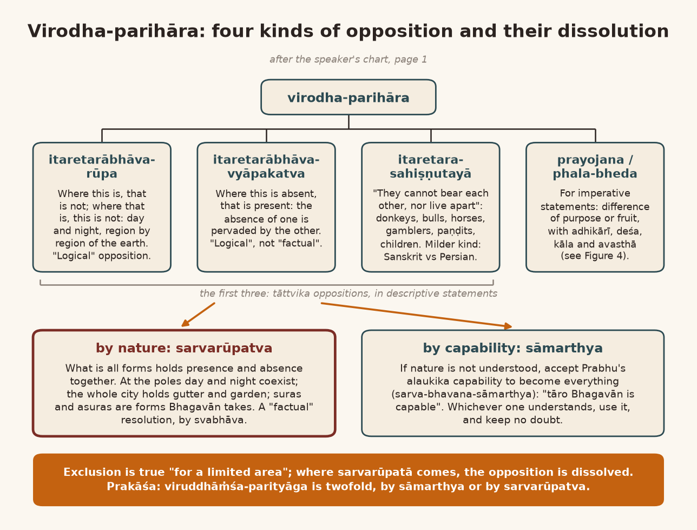
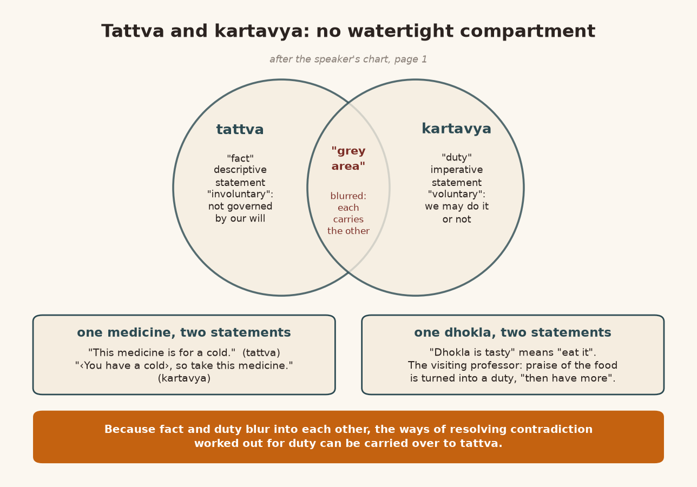
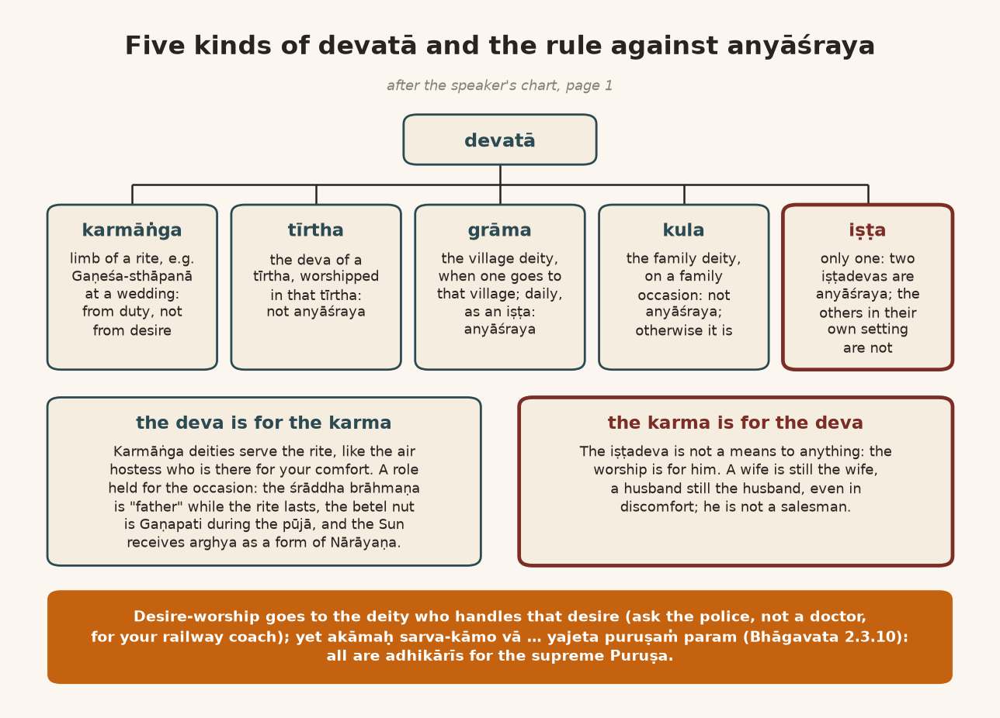
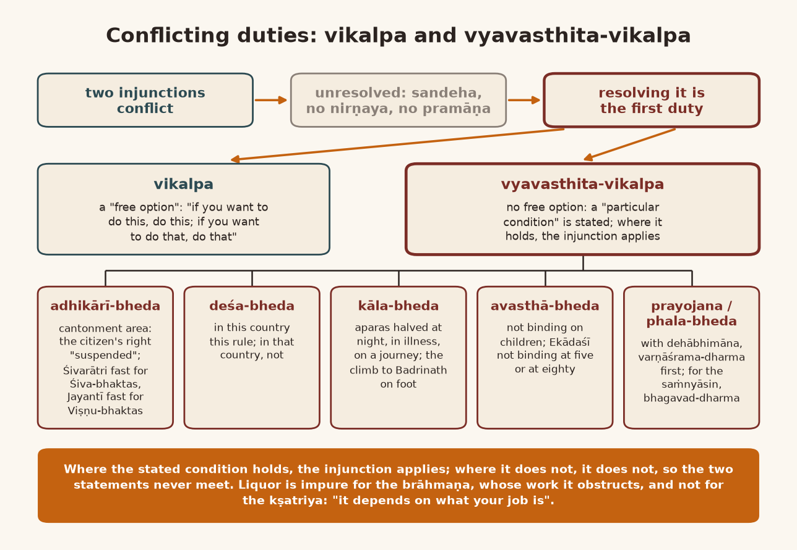
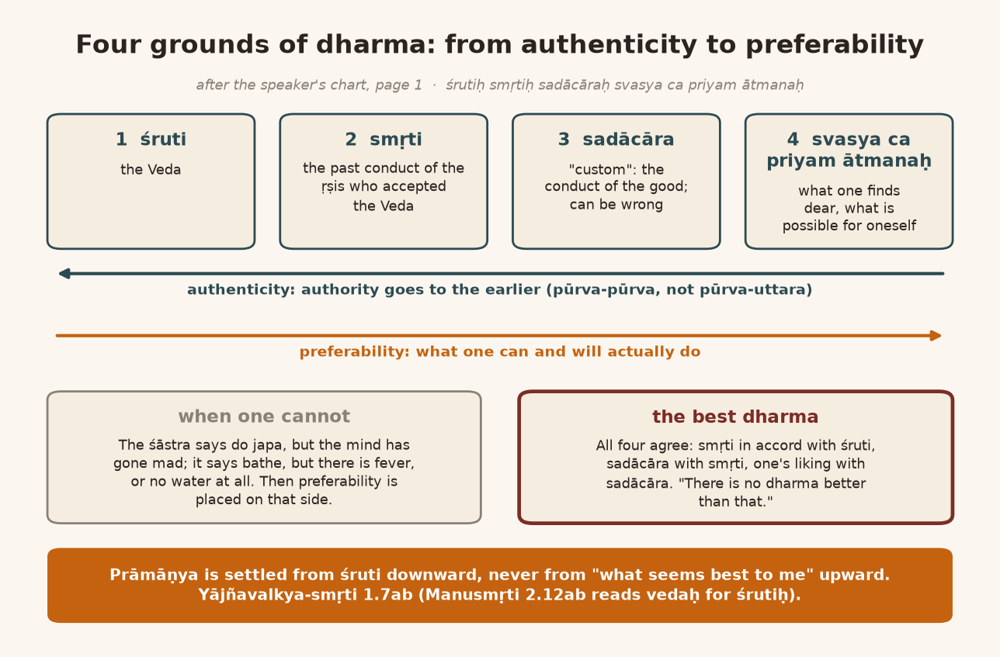
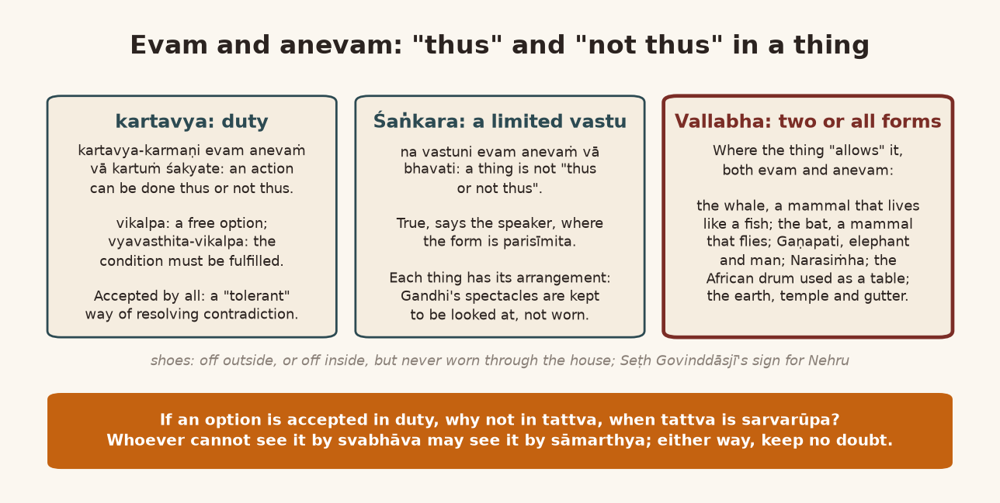
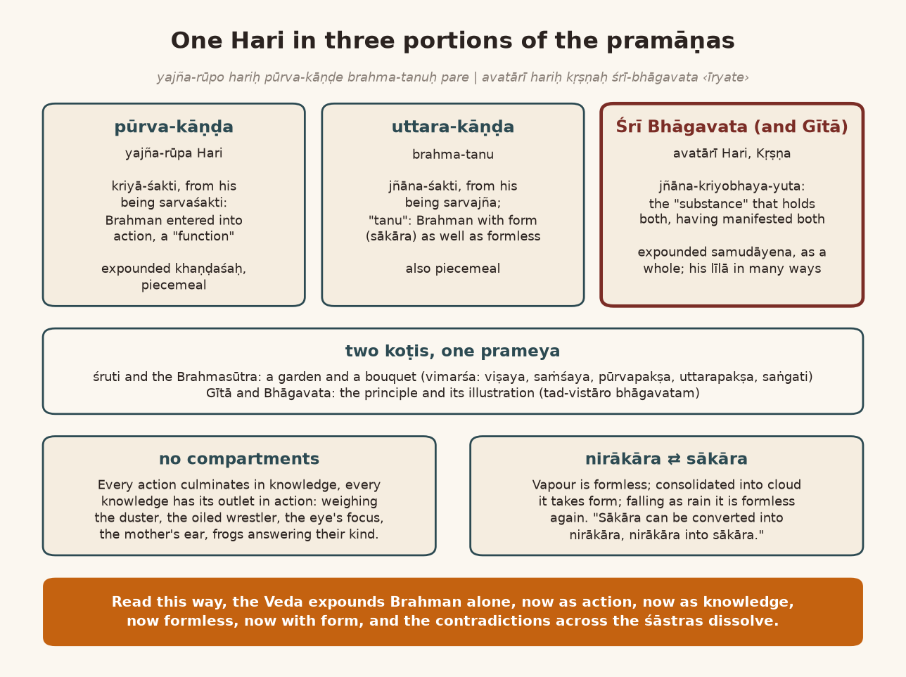
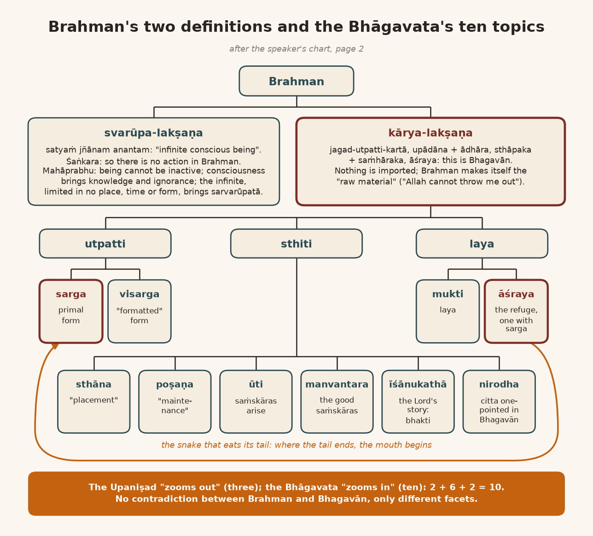

*English rendering of a spoken discourse on the Śāstrārtha Prakaraṇa of the Tattvārthadīpanibandha, translated from a Hindi ASR transcript. The speaker's conversational register, humour, digressions, code-switching, and student exchanges are preserved. Editorial flags: ‹ › conjectural restoration of a garbled reading; ‹?› uncertain reading; ‹…› inaudible or unrecoverable passage; ‹श्रवणाधारित› text given as heard, pending verification against a printed edition. Verses whose standard text is beyond doubt have been silently restored to the received editions.*

# 1. The City That Holds Both Gutter and Garden: Sarvarūpatva and Sāmarthya

**Speaker:** Shall we begin?

**A listener:** Yes, yes, yes, please begin. There is something to ask about last time … is there a question? … All right.

**Speaker:** Yes. One thing we had seen was this: the system of pramāṇa that rests on the pramāṇa-catuṣṭaya is the *upadeśa-kālīna* system of pramāṇa, the system for the time of teaching. It is for the time of teaching; I am repeating it again. It is not *bodha-kālīna*; the system for the time of understanding is different. The *sākṣātkārika* system, for direct realization, is different, and the system for the time of the *līlāvatāra* is different.

In this system of pramāṇa, contradiction (*virodha*) can also arise. And if contradiction arises and you do not resolve it, doubt (*sandeha*) arises; and doubt means no decision (*nirṇaya*). No decision means no pramāṇa. If there is a pramāṇa, there should be a decision. A pramāṇa exists for the sake of decision. In that situation, one arrangement he showed was *uttaraṁ pūrva-sandeha-vārakaṁ parikīrtitam*: the later is declared to be the remover of doubt about the earlier. That gave one kind of non-contradiction. Another arrangement he gives is this:

> अथवा सर्वरूपत्वान्नामलीलाविभेदतः ।
> विरुद्धांशपरित्यागात्प्रमाणं सर्वमेव हि ॥
>
> *athavā sarvarūpatvān nāma-līlā-vibhedataḥ |*
> *viruddhāṁśa-parityāgāt pramāṇaṁ sarvam eva hi ||* (Tattvārthadīpanibandha, Śāstrārtha Prakaraṇa 9)
>
> [Or else: because he is all forms, through the differences of names and līlās, and by setting aside the contradictory portion, everything is pramāṇa.]

**A student:** Yes.

**Speaker:** Bhagavān is all forms (*sarvarūpa*). So in all that is, in everything, the opposed will also come, necessarily.

**A student:** Ji.

**Speaker:** And the contradiction that comes will be resolved *sarvarūpatvāt*, because he is all forms. That is, we can understand it like this: ‹a slaughterhouse› and a temple are opposed, but in a city there is a slaughterhouse and there is also a temple; there is a gambling den and there is also a temple. In a city everything will come, *sarvarūpatvāt*: there is a gutter and there is also a garden. Gutter and garden are opposed, but when you take the whole city, the opposition of gutter and garden does not remain. So, *sarvarūpatvāt*, the contradiction is resolved.

One point that came up there was that if this contradiction, the *pāribhāṣika mithyā*, is not understood, then just accept Prabhu's capability (*sāmarthya*). That's all. That one answer is enough for the contradiction. Because *tāro* [Gujarati: your] Bhagavān is capable. That too had been shown as one form of resolving contradiction.

# 2. Three Kinds of Opposition: The Prakrit Verse of Donkeys, Bulls and Paṇḍits, and a Sister Who Answered in Persian

**Speaker:** Let me remind you of the line: *viruddhāṁśa-parityāgo dvedhā vaktavyaḥ; bhagavat-sāmarthyenālaukika-prakāreṇa, bhagavataḥ sarvarūpatvena vā* (Prakāśa on Śāstrārtha Prakaraṇa 9). The setting aside of the contradictory portion is to be explained in two ways: by Bhagavān's capability, in an *alaukika* manner, or by Bhagavān's being all forms. That is the *alaukika* manner of capability.

At root, contradiction is of three kinds. The first kind is said to be this: where this is, that is not; where that is, this is not. That kind of thing. Then one is the opposition of the form *itaretarābhāva-vyāpaka*: that is, where the absence of this is, that is there. And then one became *itaretara-asahiṣṇutā*, mutual intolerance ‹…›. There is a very funny verse. A joking verse, this one, in Sanskrit, *na sahanti ikkamikkaṁ* … no, it is not Sanskrit, it is a verse in the Prakrit language:

> न सहन्ति इक्कमिक्कं न विना तिष्ठन्ति इक्कमिक्केण ।
> रासह वसह तुरङ्गाः जूआरा पण्डिया डिम्भा ॥
>
> *na sahanti ikkamikkaṁ na vinā tiṣṭhanti ikkamikkeṇa |*
> *rāsaha vasaha turaṅgāḥ jūārā paṇḍiyā ḍimbhā ||* ‹श्रवणाधारित›
>
> [They cannot bear one another, and they cannot stay without one another: donkeys, bulls, horses, gamblers, paṇḍits and children.]

It is very funny; this verse is a joke. *Na sahanti ikkamikkaṁ*: the two cannot stay together with each other. *Na vinā tiṣṭhanti ikkamikkeṇa*: they also cannot stay without each other. Who are such? So the poet tells us. *Rāsaha*: a donkey.

**A student:** One…

**Speaker:** *Vasaha* means a bull. Two bulls will certainly butt each other. *Rāsaha, vasaha, turaṅgā*: a horse. *Jūārā*: a gambler.

**A student:** Wah!

**Speaker:** … *turaṅgā, jūārā*; *paṇḍiyā* means paṇḍits. If two paṇḍits come together, they will certainly quarrel with each other; one or other will pull the other's leg. And *ḍimbhā* means children. So this is one kind of opposition of mutual intolerance, but they do stay together ‹?›, for the sake of quarrelling!

**A student:** I see.

**Speaker:** One could fit husband and wife into it too; it isn't that it can't be done.

**A student:** It can be done!

**Speaker:** *Na sahanti ikkamikkaṁ, na vinā tiṣṭhanti ikkamikkeṇa. Rāsaha, vasaha*: *rāsaha* means a horse, *vasaha* means a bull, a *vṛṣabha*; *turaṅgā* means a horse; *jūārā* means a gambler; *paṇḍiyā* means a paṇḍit; *ḍimbhā*.

**A student:** I see.

**Speaker:** In this there is an opposition of mutual intolerance. They are intolerant of each other, but they stay together ‹?›, to quarrel. So that is one kind of opposition. In our everyday language this is called: where there are vessels, they will clatter against each other. One vessel, as soon as it knocks against another, does produce some sound or other, doesn't it?

Another kind is a tolerant opposition (*sahiṣṇu virodha*). It is not so serious, although whoever has to look after them does have trouble, doesn't he? Like this: I remembered something from my childhood. My father made me memorize Sanskrit ślokas. My elder sister was made to memorize Persian. The two of us quarrelled over exactly this. I could not speak Persian, and she could not speak Sanskrit. If we spoke, we would quarrel. And the way the two of us teased each other was this: if I wanted to annoy her, I would speak Persian, and then the quarrel would start. If she wanted to annoy me, she would speak Sanskrit. In that "competition" both of us remembered our verses perfectly, the Persian ones and the Sanskrit ones. Both of us had learned both! Because they came in useful for teasing, didn't they?

They were drilled into us. It had been arranged ‹?› that one would keep this and one would keep that, but in the quarrel both came in useful, didn't they? In childhood this happened with us a great deal. After that it would all turn into a scuffle, and that whole story would follow. What I mean to say is: there is also an opposition of another kind.

# 3. Day and Night at the Poles: Satan, the Suras and Asuras, and the Limited Area

**Speaker:** In it, the one who looks after them has trouble; otherwise, among themselves, they have no trouble, and they cannot get on without each other either. *Mhaṇaje* [Marathi: that is], the opposition that is of the form *itaretarābhāva*, or of the form *itaretarābhāva-vyāpaka*: in that, it is entirely "logic" that is at work. It is not a "factual" opposition; it is a "logical" opposition. "Logically" too: where there is the absence of this, there is the absence of that; where there is the absence of that, there is the absence of this ‹?›. In the third kind, both remain positive, *bhāva-rūpa*. To "dissolve" that opposition is a very difficult thing. Mahāprabhu has "dissolved" that opposition. He says that what is *sarvarūpa*, all forms, will be both, of the form of presence and of absence, won't it?

How can we see a clear example of this? Again: where there is day, there is no night; where there is night, there is no day. But ‹the earth› is *sarvarūpa*. So we cannot say that where there is day there is no night. On the earth there is day and there is also night. Look at the regions of the earth: in the region where it is night, it is not day; in the region where it is day, it is not night. But if we look at, say, the "North and South Pole", there day and night stay together. So that is the resolution of the contradiction, though both are of the form of absence ‹of each other›. And somewhere their contradiction does get resolved, doesn't it? *Sarvabhāvānām*: because of being all forms.

**A student:** … because of being.

**Speaker:** So this resolution of contradiction is simply "factual". It is by nature (*svabhāva*). A contradiction can also be resolved by capability (*sāmarthya*): brother, accept Bhagavān as capable. If someone has difficulty accepting him as capable, the śāstra has accepted it by nature. So on the basis of capability and nature, two ways of resolving contradiction were given. Where two scriptural statements contradict each other, their contradiction can be resolved by nature and by capability.

That is, understand one thing like this: if Bhagavān has become everything … For example, in the "Abrahamic" religions there is this objection: where did Satan come from? If God is all-capable and all-benevolent, then where did Satan come from? If Satan has come, is God not capable of removing him? If he is not capable of dealing with him, that means God is incapable. If God, despite being capable, is "allowing" him, then it means a kind of "partnership" with him. So it is very "problematic", this "dualism" of "Satan versus God" ‹the speaker's characterization›. Here with us it has been said that all the asuras and all the suras are forms taken by Bhagavān himself. And even so it is a form taken by Bhagavān; even so it is a form taken by Bhagavān. And we have even made a deity whose devotees are both suras and asuras, the one we call Mahādeva. We are Puṣṭimārgīs, so we too can understand: for Yamunājī too it is said, *‹surāsura-supūjita›* (cf. Yamunāṣṭaka 1). Somewhere or other, in spite of being mutually intolerant, the two can stay together somewhere.

That is one thing. But if they are of the nature of presence, staying together does not seem "logically possible". Or else, don't take them as of the form of absence. But what it is, is this: "for a limited area" that statement is true, but where *sarvarūpatā* has come, in that area that statement is not true. So this is a second form of resolving contradiction.

{width=6.2in}

# 4. Fact and Duty Have No Watertight Walls: The Cold Medicine, the Dhokla, and the Professor Who Was Glad Not to Be Pressed

**Speaker:** Now he is giving a third form of resolving contradiction, and try to understand it. Yes, say … The resolution of contradiction given earlier was a *tāttvika* resolution, about what is real: it was resolution of contradiction in "descriptive statements". Now this one: he is giving the kind of *pāribhāṣika mithyā* that concerns "imperative statements". Because every tattva carries something ‹…›, and behind every statement that is "imperative" there is something or other *tāttvika*, "descriptive". Between the two there is no "watertight compartment difference".

When there cannot be a compartment difference between the two, then there are some "blurred areas" between them, aren't there, with every tattva and with every kartavya ‹…›. So how will we understand this? Understand this carefully. Between tattva and kartavya, as such, they become two: kartavya is "voluntary"; tattva is "involuntary". Tattva is not "governed" by our will, and kartavya is "voluntary". ‹If it were governed by our wishes, your kartavya would become tattva; it would no longer remain kartavya›. Kartavya means "duty"; tattva means "fact" ‹…›. But between the two there is a "grey area" too, isn't there? Where tattva takes the form of kartavya, and kartavya takes the form of tattva: there is such a "grey area" too. How shall we understand it? Understand it carefully once.

There is a statement: "This medicine is for a cold." This is a "descriptive statement": it describes a tattva, not a kartavya. "‹You have caught a cold›, so take this medicine": this is a description in the form of kartavya. Now that one medicine is becoming ‹a fact› on that side and ‹a duty› on this side. It happens like this everywhere. We can take dhokla too: "It is tasty."

**A student:** Yes.

**Speaker:** "Dhokla is tasty": "it is tasty" means "eat it". A professor called Richard ‹Barz› came to my place. He wrote a book on Vallabhācārya ‹…›, on Mahāprabhuji. When he came to my place I gave him breakfast and so on. After that he thanked Lakṣmī‹?›: "You did not do it a second time, did not 'insist'; for that I am 'so thankful'." I felt very hurt. I said, does this mean he didn't like it? A little misunderstanding arose. He said, "No, don't take it wrongly. In Hindustan the trouble I have is this. Our 'discipline' is such that whenever anyone serves food, you praise it. When you praise it, Hindustani people say: have a second helping. Now, with that discipline of ours, we say we liked it, and they say: then take a second helping, otherwise how will we know that you liked it? That is why I said it. I did like it. What your wife served, I certainly liked it, but in Hindustan this is our trouble: they don't leave you alone; they chase after you. 'You liked it, didn't you? Then have more.' However much one likes something, it is not necessary to eat it a second time. People here go after you. That is why I thanked your wife, that you did not ask a second time."

This is a thing worth understanding. We do have a little too much insistence (*āgrahaśīlatā*). It is "out of affection", and it is also, you could say, "out of system". So between kartavya and *bodha*-tattva a little confusion of this kind does happen. About kartavya, Mahāprabhuji is giving another resolution of contradiction, and I have told you that. Yes, the resolution of contradiction runs like this. One is by difference of *adhikārī*.

{width=6.2in}

# 5. Adhikāra, Place, Time, Condition and Purpose: The Cantonment, the Climb to Badrinath, and the Wife One Cannot Forsake

**A student:** Ji.

**Speaker:** That is, the *adhikārī* of this duty is this person, not that person. What has been said, "you must do this", will not apply if there is a difference of *adhikāra*. It will apply only to the *adhikārī* to whom it applies. For example, understand it like this: any citizen of India has the right to live in any part of India, hasn't he? Can he live in a "cantonment area"? Now if he says, "I am a citizen of India, so let me build a house in the cantonment area", there the difference of *adhikāra* will be applied.

**A student:** Hmm.

**Speaker:** In the cantonment area your right is "suspended"; "otherwise" you have the right everywhere. In the cantonment area only the army people will reside. ‹…› there are two injunctions (*vidhāna*). What is one injunction? That you cannot live in the cantonment area. One injunction is that all citizens of India can live in any part of India.

**A student:** So …

**Speaker:** A contradiction has come, hasn't it? It has become a contradiction about *adhikāra*. One resolution is by difference of place (*deśa*): in this country this is the rule; in that country this is not the rule.

**A student:** All right.

**Speaker:** One is a resolution by time (*kāla*): that in this time this is the duty; in that time this is the duty, and this is not. Understand it as a general principle ‹?›. For example, with us there is a great fuss about bathing, so the śāstra has given an arrangement for it: that at night, half the *aparas* of the day; on a journey, half the *aparas* of the night …

**A student:** No …

**Speaker:** … from the journey, half ‹…› … from the night, half, in illness; and from illness, half, on a journey.

**A student:** No ‹?›.

**Speaker:** That is, whatever things get touched … For example, we cannot eat without bathing. That is one duty. It will not apply on a journey; it will not apply in illness. At night one should keep half the *aparas* of the day. Because today everybody has taps at home. In the old days there were no taps. To bathe, you would go to a lake or to a river. At night there was no electricity there either. At that time anything at all could happen while keeping *aparas*. So the śāstra had given the arrangement: at night, half the *aparas* of the day ‹…›; half in illness; and from illness, half on a journey. Because on a journey, where will you get all the facilities from? Today, for instance, we reach Badrinath by helicopter. In the old days people went on foot. Now, if you held to this rule, "We will not eat without bathing", you climb the mountain, and after climbing the mountain you will not be able to climb on without eating something or other. If you eat something, then there will also be some passing of stool. Now if you have passed stool and then you go to bathe, you go down to the river, then climb that much mountain again: you will never reach Badrinath! So ‹the śāstra› ruled that out, saying that there it is like this.

Isn't it? So by difference of time the contradiction of very many conflicting statements is resolved. Here it has been said that you cannot eat without bathing; that cannot apply on a journey; it cannot apply in illness. It did not apply to children: difference of condition (*avasthā-bheda*). That too is just a kind of difference of time. In the same way, difference of fruit (*phala-bheda*) or difference of purpose (*prayojana-bheda*) has also been spoken of. What is the fruit or the purpose of some action, some "duty"? By that difference of purpose or difference of fruit, even where duties clash with each other, their contradiction does not remain, because there is a difference of fruit. If you want that fruit, it will apply. If you do not want that fruit, if that is not the purpose, it will not apply. For example, with us one thing has been said very "clearly": *yāvad dehābhimānaḥ tāvad varṇāśrama-dharma eva svadharmaḥ; yadā punar dehādi-vyatiriktam ātmānaṁ manyate tadā bhagavad-dharma eva svadharmaḥ* ‹श्रवणाधारित›. As long as there is identification with the body, the dharma of varṇa and āśrama alone is one's own dharma; but when one regards the self as distinct from the body and the rest, then the dharma of Bhagavān alone is one's own dharma. If you have the body-identification that I am a brāhmaṇa, I am a kṣatriya, I am a vaiśya, then that is the first dharma; do the *bhagavad-dharma* afterwards. That is why with us they say: do sevā after bathing, because you have *dehābhimāna*. If you have no *dehābhimāna*, then for you the *bhagavad-dharma* alone is svadharma.

**A student:** "OK."

**Speaker:** Now, what is this? We look at the purpose. You will have to work out whether you have *dehābhimāna* or not. For example, the śāstra has said that serving one's mother and father is the supreme dharma of the offspring, so long as one keeps *dehābhimāna*. If you have taken saṁnyāsa, leaving *dehābhimāna*, then serving your mother and father is ‹no longer› your duty. Nowadays the arrangement is different; nowadays the arrangement is different. The śāstra's arrangement is so strange: suppose your wife is "debaucherous". You cannot leave her. Maintaining her is certainly your duty. At most, don't keep relations with her; give her a separate room. That much. "You cannot forsake your wife, because you have taken the responsibility in the presence of God", Fire. Nowadays divorce happens. With us there was no divorce earlier, was there? There was no "concept" of divorce at all. The wife whose "responsibility" you have taken on: if ‹…› she is "debaucherous", fine, don't keep relations with her. Her "maintenance" you will certainly have to provide, "because you have taken the responsibility". Now, why does this rule, such a terrible rule, not apply to saṁnyāsa?

**A student:** *Dehābhimāna*.

**Speaker:** *Dehābhimāna* has gone. To whom did this rule apply? To the one who has *dehābhimāna*. So in this way, by difference of purpose, by difference of fruit, by difference of time, by difference of place, by difference of *adhikārī*, the contradictory statements about duty [are reconciled].

# 6. A Thousand Śālagrāmas in One Sprinkle: Which God Must One Worship?

**Speaker:** Now, for example, if you look in the Śiva Purāṇa, whoever does not worship Śivajī will go to hell. If you look in the Viṣṇu Purāṇa, whoever does not worship Viṣṇu will go to hell.

**A student:** No!

**Speaker:** Where is the poor man to go? And suppose he worships both. But Śiva and Viṣṇu are hardly the only gods. There are very many gods. Gaṇapatijī is separate, Kārttikeya is separate, Devī is separate, Sūrya is separate. How many gods will he worship? Let him worship two gods, let him worship three gods; how many gods is he to worship?

In Nashik I had a classmate, from Assam. The poor fellow, for a place to stay, lived in the akhāḍā of the Catuḥ-sampradāya, because he was from Assam and had come to Nashik to study. The akhāḍā people had given him the "duty" of worshipping a thousand śālagrāmas every day. One day I asked him, "How do you do the pūjā of a thousand śālagrāmas?" He said, "Come to me one morning, and I'll show you."

He got up early. One vessel of water, this big. One piece of cloth, like a handkerchief. He would put the thousand śālagrāmas in it and dunk them. He would sit them all down in a line. And the sandalwood paste that has been ground: he would sprinkle it like this, so that a little sandalwood fell on each of them. How can anyone do the pūjā of a thousand? He simply cannot; it is not a "practical" thing. So one will say that is hardly pūjā; it is a kind of disrespect. But what is the man to do? When they become a thousand, how will he do it? So the thing to understand is that where a difference of *adhikāra* arises, it no longer remains possible. So this is a matter of resolving contradiction within the śāstra of duty.

Because here, whatever exposition of tattva there will be ‹…›, as we can see: in the Gītā itself Bhagavān commands, *sarvadharmān parityajya mām ekaṁ śaraṇaṁ vraja* (Bhagavadgītā 18.66), leaving all dharmas, come to me alone for refuge. Now, leaving all dharmas: leaving the dharma of Śaiva pūjā, leaving the dharma of Devī pūjā, leaving the dharma of Sūrya pūjā, leaving the dharma of Gaṇapati pūjā, come to my refuge. So the injunction for their pūjā is being set aside (*bādha*). And if one is doing their pūjā, then this statement, "leave everything and come to my refuge", is being set aside. So where is a man to go? Where, then, is a man to go? So one will have to resolve the contradiction, won't one? The contradiction will have to be resolved. For that, these "parameters" were given in the śāstras: difference of place, difference of time, difference of condition, difference of *adhikārī*, and so on. This point comes in the very exposition of tattva.

A brother used to live in our neighbourhood. One day two people came to me quarrelling. ‹One of them› had asked me whether one should chant "*oṁ namaḥ śivāya*" or not, whether one should do its japa or not ‹…›. And he told me that a very great Vyāsajī had said so. I said, "Why are you asking me? Go and ask him." Then they say, "Then do it ‹?›." Of the two, one was a Vaiṣṇava, and one was a devotee of that Vyāsa. Vyāsa means a kathā-reciter. The kathā-reciter Vyāsajī had told him: "This *śrīkṛṣṇaḥ śaraṇaṁ mama* that you do, you may chant it only if you keep a fast for three days; and *namaḥ śivāya* must be chanted daily, 'compulsorily' ‹…›." So he asked, "Then won't Śiva be insulted?" I said, "He certainly will be insulted. Then do one thing: chant all the mantras. Chant *lā ilāha illallāh* too, otherwise Allah will be insulted. Chant Jesus Christ's, otherwise he will be insulted." He said, "One should keep to one's own dharma." So I said, "Then, for your own dharma, the mantra of your own dharma alone should be chanted. Then *nakkī karo* [Gujarati/Marathi: decide], which is your dharma. If it is Śiva-dharma, chant that of Śiva-dharma; if it is Vaiṣṇava dharma, chant that of Viṣṇu-dharma; if it is the dharma of Islam, chant that of Islam; then the Christian dharma … Either make an arrangement by difference of dharma, or else there will certainly be a quarrel over dharma."

# 7. Manu's Medicine, and Brahmā Who Became a Brāhmaṇa

**Speaker:** So this arrangement we made by difference of *adhikārī*. That is what Mahāprabhuji is doing here ‹…›: *dvāparādau tu dharmasya* … Now look: *uktamāna-catuṣṭaya-virodhe manvādi-smṛtīnām aprāmāṇyam eva iti uktam* (Prakāśa on Śāstrārtha Prakaraṇa 10). It has been said that where they contradict the four stated pramāṇas, the smṛtis of Manu and the others are simply not authoritative. Because in the four stated pramāṇas … this point you raised, I had told you that day too: understand that if some statement among Manu and the rest is contrary to the four ‹…›. Now for Manu and the others it is clearly written in the Veda, *yad vai kiñca manur avadat tad bheṣajam* (cf. Taittirīya Saṁhitā 2.2.10.2), whatever Manu said is medicine. And if you accept ‹?› the statements of Manu and the others as pramāṇa, there will be a contradiction with the Veda's statement; and if something comes against the Veda's statement, then ‹…›. *Iti śruter manvādīnām uktamāna-virodhe 'pi prāmāṇyasyāvaśya-vācyatvāt*: since on the strength of this śruti the authority of Manu and the others must necessarily be affirmed even where they contradict the stated pramāṇas.

Now let me tell you one thing. Yes. In Manu's smṛti, neither is Viṣṇu the supreme deity nor is Śiva the supreme deity: Brahmā is the supreme deity.

**A student:** Yes.

**Speaker:** There the meditation, the remembrance, the worship are all of Brahmā. Now, when one does not worship Brahmā but worships Śiva; or does not worship Śiva but worships Viṣṇu; or worships Devī: what is one to do? ‹Confusion› will come, won't it? Whom to chant, whom not to chant. In the Veda there are no such things. What is in the Veda? Look, understand carefully. Whichever one deity you hold on to, in that one all the deities are:

> स ब्रह्म स शिवः स हरिः सेन्द्रः सोऽक्षरः परमः स्वराट् ।
> तदेवाग्निस्तदादित्यस्तद्वायुस्तदु चन्द्रमाः ।
>
> *sa brahma sa śivaḥ sa hariḥ sendraḥ so 'kṣaraḥ paramaḥ svarāṭ |* (Nārāyaṇa-sūkta, Taittirīya Āraṇyaka 10.13)
> *tad evāgnis tad ādityas tad vāyus tad u candramāḥ |* (Śvetāśvatara Upaniṣad 4.2; Vājasaneyi Saṁhitā 32.1)
>
> [He is Brahmā, he is Śiva, he is Hari, he is Indra; he is the imperishable, the supreme, the self-ruling. That indeed is Agni, that is Āditya, that is Vāyu, that is the moon.]

Hold on to any one deity and it is all the deities. There, this difference of worship by difference of deity does not exist at all. In Manu and the others, Brahmā alone is to be taken as the supreme deity. So there was a Brahmā-sampradāya earlier. That is why, in the Ṣoḍaśa Grantha, in the Bālabodha, Mahāprabhuji said:

> ब्रह्मा ब्राह्मणतां यातस्तद्रूपेण च सेव्यते ।
> … अतः शिवश्च विष्णुश्च जगतो हितकारकौ ॥
>
> *brahmā brāhmaṇatāṁ yātas tadrūpeṇa ca sevyate |* (Bālabodha 10cd)
> *… ataḥ śivaś ca viṣṇuś ca jagato hitakārakau ||* (Bālabodha 11cd)
>
> [Brahmā has gone into brāhmaṇa-hood and is served in that form. … Therefore Śiva and Viṣṇu are the benefactors of the world.]

Śiva and Viṣṇu are the benefactors of the world, because Brahmājī, the Brahmā in the trinity, *brāhmaṇatāṁ yātaḥ*: that is, he is there in the form of a guru; he is not being worshipped as a deva. So the matter changed: his deva-hood ‹divyatva› was set aside. If you are to worship him as a guru, you can worship Brahmājī. Not worship of Brahmājī as a deva.

**A student:** All right.

# 8. Gaṇeśa at the Wedding: Five Kinds of Devatā, the Lost Railway Coach and the Air Hostess

**Speaker:** Now, for example, in many contexts this also comes. In the Bhāgavata itself: brother, if you desire ‹wealth›, worship Lakṣmī; if you desire learning, worship Sarasvatī; if you desire the removal of obstacles, worship Gaṇapati. Suppose someone has no desire at all: then should he worship no one? Or someone has every kind of desire: then what should he do? So the Bhāgavata has made it clear:

> अकामः सर्वकामो वा मोक्षकाम उदारधीः ।
> तीव्रेण भक्तियोगेन यजेत पुरुषं परम् ॥
>
> *akāmaḥ sarva-kāmo vā mokṣa-kāma udāra-dhīḥ |*
> *tīvreṇa bhakti-yogena yajeta puruṣaṁ param ||* (Bhāgavata Purāṇa 2.3.10)
>
> [Whether without desire, or desiring everything, or desiring liberation, one of broad understanding should worship the supreme Puruṣa with intense bhakti-yoga.]

Whether you are without desire, or desiring everything, or desiring liberation: *tīvreṇa bhakti-yogena yajeta puruṣaṁ param*, worship the supreme Puruṣa. Everyone is an *adhikārī* for the worship of the supreme Puruṣa. Now if, in worshipping that supreme Puruṣa, everyone else's worship falls away, that is no obstacle for you. Now, how did it become acceptable? ‹That› is for the *adhikārī* with desire (*sakāma*); and for the one who is not a *sakāma adhikārī*, it is the supreme Puruṣa ‹…›. That is the arrangement.

**A student:** Then, ji, the Gaṇeśa-sthāpanā we do at weddings: should it be done or not?

**Speaker:** It should be done. That is not from desire; that is from duty.

**A student:** Hmm.

**Speaker:** Worship as a matter of duty is separate ‹…›; worship as a matter of desire is something separate. That is why Bhagavān explained in the Gītā:

> येऽप्यन्यदेवताभक्ता यजन्ते श्रद्धयान्विताः ।
> तेऽपि मामेव कौन्तेय यजन्त्यविधिपूर्वकम् ॥
>
> *ye 'py anya-devatā-bhaktā yajante śraddhayānvitāḥ |*
> *te 'pi mām eva kaunteya yajanty avidhi-pūrvakam ||* (Bhagavadgītā 9.23)
>
> [Even those devotees of other deities who worship them, endowed with faith, worship me alone, son of Kuntī, though not according to the ordinance.]

That is, those who, because of some other petty desire, worship some other deity: "rest assured" that you are worshipping me alone, because all those deities are my limbs. But if desire is strong in you, then don't worship me; worship them first. Like when you have gone to the station. You have gone to the station and you can't find your coach: whom will you ask? You'll ask the police, won't you? Will you phone a doctor?

**A student:** This …

**Speaker:** You can't make out which coach it is: what will the poor doctor do? He has no knowledge of reservations at all. Whoever has that problem in hand, it is with him that you have to solve it.

**A student:** Then this Gaṇeśa-sthāpanā that people do: with what bhāva do they do it? For what reason do they do it?

**Speaker:** They do it for this reason: the *karmāṅga* devatās of an action, the deities that are limbs of the rite, are separate; the ‹…› devatās are separate; the *tīrtha* devatās are separate; the *grāma* devatās are separate; the *kula* devatās are separate.

**A student:** They are.

**Speaker:** There are this many sub-kinds of devatā. One is a ‹*karmāṅga*› devatā, a deity worshipped in order to carry out some action.

**A student:** Hmm.

**Speaker:** There the deva is for the action; the action is not for the deva.

**A student:** Hmm.

**Speaker:** "Mind you."

**A student:** Yes.

**Speaker:** The deva is for the action; the action is not for the deva. Opposite to that is the *iṣṭadeva*: for him the action is for the deva; the deva is not for the action. Like the air hostess in an aeroplane: she is there to look after your comfort. Now suppose someone says ‹the wife› is there to look after comfort … why, ji, to look after comfort! The wife is not there to look after your comfort. It is only when there is discomfort that the wife has become a wife!

**A student:** No!

**Speaker:** The husband: is he there to look after comfort? The husband is not there to look after comfort, like a salesman. Even if he is nothing but discomfort, the husband is still the husband. So the relation has changed, hasn't it? So the *iṣṭadeva* is not for the action; the action is for the *iṣṭadeva*. And the *karmāṅga* devatā is for the intended action. Likewise there is the *tīrtha*, the *tīrtha*-deva: different tīrthas have different devas. So worshipping that *tīrtha*-deva in that tīrtha is not *anyāśraya*. Likewise there is the *grāma* devatā: earlier, different villages used to have different devas. Likewise there is the *kuladeva*. So if there is some occasion of the family, worshipping the *kuladeva* is not *anyāśraya*; otherwise it is *anyāśraya*. And there is an *iṣṭadeva*. The *iṣṭadeva*: it is not that we need the *iṣṭadeva* for our worship; the worship is for the *iṣṭadeva*.

**A student:** It is so.

**Speaker:** Yes. These two things should be understood differently. That is why: where *anyāśraya* happens and where *anyāśraya* does not happen. For example, if you made two *iṣṭadevas*, that is *anyāśraya*. The *iṣṭadeva* is only one.

**A student:** Hmm.

**Speaker:** That is the *siddhānta*. And while having one *iṣṭadeva*, you can worship the *karmāṅga* deva. While having the *iṣṭadeva*, you can worship the *grāma* devatā by going to the village, if you have gone to that village. If you worship it every day in the manner of an *iṣṭadeva*, that is *anyāśraya*. The *kuladevatā*: when an occasion of the family comes, worshipping it is not *anyāśraya*; ‹but› if you worship it ‹…›, it is *anyāśraya*. That is the kind of arrangement.

**A student:** Then the arghya that people offer ‹to the Sun›, pouring water: how is that …?

**Speaker:** Understand one thing: with us the Sun is considered a form of Nārāyaṇa.

**A student:** I see.

**Speaker:** That Nārāyaṇa-form of the Sun is one thing; the Sun's being the Sun is another. Like this; understand one thing. Nowadays it isn't so, but in ancient times, to do one's father's śrāddha, a brāhmaṇa was invited. Placing the idea of the father in that brāhmaṇa, they worshipped him. So for as long as the śrāddha was going on, he was the father. After the śrāddha was done he was not the father; he was a brāhmaṇa. His *visarjana* would be done. Just as, for Gaṇapati-pūjā, we install a betel nut and invoke Gaṇapati in the betel nut: for as long as the pūjā is going on, it is Gaṇapati; after the pūjā, it is not Gaṇapati.

**A student:** Right, right.

**Speaker:** "Happens." So the devas who are limbs of the pūjā are separate. ‹…› we are doing it for the sake of performing the pūjā, that is why we are doing it; he is hardly the *iṣṭadeva*. The matter differs. So that was the arrangement.

Anyway, this is only a side topic. The topic we are thinking about is this: how is the contradiction resolved for those statements of Manu and the others that go against ‹the four pramāṇas›?

{width=6.2in}

# 9. Vikalpa and Vyavasthita-Vikalpa: Two Fasts, Liquor for the Kṣatriya, and the Drunken Resident Doctor

**Speaker:** In that, ‹Mahā›prabhujī is saying: in the arrangement I am giving, it is not necessary to take it that some statement has come and is contradictory. *Dvāparādau tu dharmasya dviparatvād dvayaṁ pramā, viruddha-vacanānāṁ ca nirṇayānāṁ tathaiva*. *Codanā-viṣayatvena avaśya-kartavyatākatvena abhimato 'rthaḥ dharma-śabdenocyate* (Prakāśa on Śāstrārtha Prakaraṇa 10). So what does dharma mean? That which the śāstra has commanded, "do this": the object of the command, the duty, is dharma. *Tasya dve śruti-smṛtī ubhe api pare pramāpike yasya*: and śāstra means not only śruti, not only the Veda, but smṛti too.

**A student:** All right.

**Speaker:** Or smṛti. Because in śruti no ‹detailed› description is found about this duty. In that situation, what one should do, how to do the work, how to do the karma: that is said in smṛti. What has not been made clear in ‹śruti› has been made clear in smṛti: *uttaraṁ pūrva-sandeha-vārakam*. Now, somewhere contradiction also comes into it; somewhere contradiction comes. How is the contradiction to be resolved? There this same principle has been given: by difference of *adhikārī*, by difference of fruit, by difference of time. These are all contexts of the kinds of contradiction. For example, Śivarātri came: should one keep the Śivarātri fast or not? If I don't keep the Śivarātri fast, it is an offence (*aparādha*). All right, the Vaiṣṇava Jayantī came: should one keep the Jayantī fast or not? If you don't keep the fast, it is an offence. It is an offence; so how will you keep both fasts? Somewhere it was said that for one who is a Śiva-bhakta, not keeping the Śivarātri fast is an offence; for one who is a Viṣṇu-bhakta, not keeping the fast on the Vaiṣṇava Jayantī is an offence. This is an arrangement by difference of *adhikārī*.

**A student:** Hm.

**Speaker:** As the śāstra says that keeping Ekādaśī is "compulsory", but for a child of five years and an old man of eighty years Ekādaśī is not ‹obligatory›. Then understand the arrangement of time ‹…›: an arrangement has been made by condition (*avasthā*), hasn't it? In this way, a contradictory statement ‹…›: that is not necessary; resolving the contradiction is necessary. Because if there is contradiction, there will be no understanding of the pramāṇa; there will be doubt. And if there is doubt there will be no decision, and ‹without› decision the authority of the pramāṇa will be finished. That is why there is a *vikalpa*, and a *vyavasthita-vikalpa*.

In the "table" I made there is a *vikalpa*. What does *vikalpa* mean? Where you are given a "free option": if you want to do this, do this; if you want to do that, do that. "Free option." In a *vyavasthita-vikalpa* there is no free option. A "particular condition" is stated: in this condition it is this, and if it is in that condition, then there is no need to do that.

For example, for a brāhmaṇa, for drinking liquor, according to the śāstra the expiation is unto death. Die, and you are pure; otherwise impure. For a kṣatriya there is no such expiation of dying. So is liquor impure or pure?

**A student:** Ho.

**Speaker:** How is one to decide? For a brāhmaṇa it is impure. For a kṣatriya it is not impure. For a śūdra it is not impure. Because whatever work the śāstra wants to take from someone: if it obstructs that work, it is impure; if it does not obstruct that work, it is not impure. In fighting and killing, liquor is useful; so drinking liquor is not impure for a kṣatriya. If a brāhmaṇa drinks liquor ‹…›.

Once my little girl fell ill. I took her to the hospital ‹…›. Going before the doctor, I said she was unwell. He said, "Have you two come from Thane?" ‹…› said yes.

**A student:** He himself had been drinking!

**Speaker:** He himself had been drinking. Yes. ‹…› There are "resident doctors" in a hospital at night, aren't there? He asked me, "Have you come from Thane or have you come from Borivali?" I said, "No, no, from nowhere; we are going home." What reliance can you place on him?

**A student:** ‹…› No, no.

**Speaker:** What treatment will this doctor give? There is "risk", isn't there? Now that is a "hairstyle" ‹…›.

*‹A brief exchange here is unclear.›*

**Speaker:** Whether it is an offence or not an offence: this depends on what your "job" is. It is an arrangement by difference of *adhikārī* ‹…›. Wherever it comes in the śāstra of duty, there: difference of *adhikārī*, difference of fruit, difference of place, difference of time …

**A student:** Now …

**Speaker:** By all these the contradiction is resolved.

{width=6.2in}

# 10. From Authenticity to Preferability: Śruti, Smṛti, Sadācāra and What One Likes

**Speaker:** That is what he is saying: *yasya tādṛśatvād dvayaṁ, śrutis tat-saṁvādiny asaṁvādinī ca manvādi-smṛtiś caitad dvayam api pramā pramāṇam ity arthaḥ* (Prakāśa on Śāstrārtha Prakaraṇa 10). *Yadā pūrvokta-dharmasya uttara-rītyā dviparatvāt śruti-saṁvāditva-asaṁvāditva-smārta-dharme kartavyatā ‹…›* ‹श्रवणाधारित›. That is: a smṛti statement can be in agreement ‹with śruti›, and it can also be in disagreement; there is agreement and there is disagreement too; then pramāṇa or not pramāṇa? For all these, ways of resolving the contradiction are given there. *Viruddhayor avirodha-khyāpanārthaṁ sāmprataṁ laukikaṁ dṛṣṭāntam āha viruddha-vacanānām iti; yathā smṛti-vākyāni parasparaṁ viruddhāni*: to make known that two contradictory things are not in contradiction, he now gives a worldly example; as for contradictory statements, ‹it is› as smṛti sentences contradict one another. Smṛti sentences. And it is not that contradiction occurs only between śruti and smṛti; the smṛtis also contradict each other.

And for this the śāstra has given a very amusing arrangement. It has been said:

> श्रुतिः स्मृतिः सदाचारः स्वस्य च प्रियमात्मनः ।
>
> *śrutiḥ smṛtiḥ sadācāraḥ svasya ca priyam ātmanaḥ |* (Yājñavalkya-smṛti 1.7ab; Manusmṛti 2.12ab reads *vedaḥ* for *śrutiḥ*)
>
> [Śruti, smṛti, the conduct of the good, and what is dear to one's own self.]

Śruti, smṛti …

**A student:** Yes.

**Speaker:** … and what one finds dear to oneself, what is possible for oneself. These are the four "factors" for deciding dharma. What is their order of authority in the Śāstrārtha Prakaraṇa? The order of pramāṇa is not of the earlier and the later, it is not *pūrva-uttara*; it is *pūrva-pūrva*, the earlier and earlier. And which is the best dharma? That in which all four agree: smṛti in accord with śruti, *sadācāra* in accord with smṛti, and what you like in accord with *sadācāra*: that is the best dharma. But if you are to determine authority, what you happen to feel is not the best dharma. What ‹…› says, what *sadācāra* says: you should check that. *Sadācāra* too can be wrong somewhere. So you should check what smṛti says. Smṛti too can say something wrong; so what ‹śruti› says, then ‹…›. And the "authenticity" is on that side.

And what is "preferable" ‹…› is of this kind. Because the śāstra is saying … the śāstra is saying, but in spite of what the śāstra says, if you simply cannot do it … the śāstra keeps saying it, and you just cannot manage it. For example, the śāstra says do japa, but your mind has gone mad: how will you do japa?

**A student:** Ho.

**Speaker:** The śāstra says bathe; you can't manage to bathe; you have got a fever. Or it is like this: water is not available at all, so how will you bathe? In that situation the "authenticity" belongs to the earlier ones; now the "preferability" has been placed on that side. That is, what śruti says, smṛti too is in accord with it; as smṛti says, the "custom" too is like that; as the custom goes, you too are inclined that way ‹?›: then it is the best dharma. There is no dharma better than that. The "order" is not from here, that you will decide, "What seems best to me is the best dharma."

**A student:** Right.

**Speaker:** "Please check it." "Custom" can be wrong in a great many ways. So the smṛti-śāstra … because what is smṛti? *Ṛṣīṇāṁ pūrva-caritaṁ smṛtir ucyate* ‹श्रवणाधारित›: the past conduct of the ṛṣis is called smṛti. How the ṛṣis behaved in those "circumstances": that is smṛti. That is, how the ṛṣis who accepted the Veda behaved in these circumstances: that is smṛti. So it is not about the conduct of those who do not accept the Veda; it is about the conduct of those who accept the Veda.

**A student:** So this is the kind of "order" that has been given.

{width=6.2in}

# 11. Five Gods and Their Bodyguards: Pañcadeva Worship, the Four Meanings of Rāmeśvara, and the Yamunā in the Gaṅgā

**Speaker:** Then the resolution of contradiction in duty, in the "imperative statements", can be done in this way. "In any circumstances", keep one thing firmly understood: in scriptural statements, looking for the resolution of contradiction is the very first duty. If you are not resolving the contradiction, a state of non-decision will come. And the resolution of contradiction can happen in two ways: either by *vikalpa* or by *vyavasthita-vikalpa*. These are examples of *vyavasthita-vikalpa*: difference of place, difference of time, difference of *adhikārī*. Yes. *Avirodha-prakāreṇa nirṇīyante, tathā nirṇayānām api paraspara-viruddhānāṁ vaiṣṇava-smārtādi-bhedenāvirodha ity arthaḥ* (Prakāśa on Śāstrārtha Prakaraṇa 10).

Now understand one thing. In smṛti, *pañcadeva-upāsanā* is taught. What does *pañcadeva-upāsanā* mean? Don't worship one deity; worship five deities together. Look: bhakti has not been taught; pūjā has been taught. So pūjā has been taught, and in it, if you have some one *iṣṭadeva*, seat him in the middle and seat the remaining four deities in the four corners. They are called *āvaraṇa-devatās*. They are the *āvaraṇa*, the surround, of your *iṣṭa-devatā*. *Āvaraṇa* means something like a "bodyguard". You will understand it from an ordinary example. Say there is some temple of Rāmacandrajī: is Hanumānjī there or not? He is. There Hanumānjī is not the main one; it will be called a Rāma temple, in spite of Hanumānjī being there.

**A student:** Some …

**Speaker:** If there is a temple of Hanumānjī, Rāma has become secondary there, hasn't he? There Hanumānjī is the chief. Now, Hanumānjī may well be a devotee of Rāma. That is his matter, Hanumānjī's matter; it is not your matter. If you are a devotee of Hanumānjī, it is not necessary for you to go to the Rāma temple; go to Hanumānjī's temple. That's what it means. That Hanumānjī is Rāma's devotee is a matter between Hanumānjī and Rāma.

That is why a verse comes: *rāmeśvara-pratiṣṭhāyām*, when Rāmeśvara was consecrated. Then, about Rāmeśvara ‹…›, someone went and asked, "Brother, what does Rāmeśvara mean?" Then *rāmas tatpuruṣaṁ prāha*: Rāma said, "Rāmeśvara is the one who is the Īśvara of Rāma." Mahādevajī "protested": "No: *rāma īśvaro yasya saḥ*, Rāmeśvara, the one whose Īśvara is Rāma."

Rāmeśvara can have four meanings. The Īśvara of Rāma: Rāmeśvara. The one whose Īśvara is Rāma: Rāmeśvara. Both Rāma and Īśvara: Rāmeśvara. There is a fourth meaning, which had not been said before, but I have added it:

> रामेश्वरप्रतिष्ठायां रामेश्वरविग्रहविचिन्तने ।
> रामस्तत्पुरुषं प्राह बहुव्रीहिं महेश्वरः ।
> कर्मधारयमित्येके … द्वन्द्वार्थं भक्त्यर्थं द्वन्द्वमद्वये ॥
>
> *rāmeśvara-pratiṣṭhāyāṁ rāmeśvara-vigraha-vicintane |*
> *rāmas tatpuruṣaṁ prāha bahuvrīhiṁ maheśvaraḥ |*
> *karmadhārayam ity eke ‹…› dvandvārthaṁ bhaktyarthaṁ dvandvam advaye ||* ‹श्रवणाधारित›
>
> [At the consecration of Rāmeśvara, when the analysis of the compound "Rāmeśvara" was being considered, Rāma declared it a tatpuruṣa, Maheśvara a bahuvrīhi; some said it was a karmadhāraya; and, for the sake of bhakti, a dvandva within the non-dual.]

That is, it can also be a *dvandva* compound: Rāma and Īśvara, both. As we say Rāma-Lakṣmaṇa; we say Sītā-Rāma, Sītārāma; we say Lakṣmī-Nārāyaṇa, and it is a *dvandva* compound: "duality, two in one". For bhakti, this duality has arisen in the Paramātmā who is non-dual (*advaya*). So, of Rāmeśvara …

**A student:** So there can be many ways …

**Speaker:** Accha.

**A student:** … of taking it.

**Speaker:** But when we are doing bhakti, we should look to our "sanctity"; we should look to our "attitude" and our "intentionality", to the way in which we are doing bhajan. As Mahāprabhuji said one thing at the bank of the Yamunā‹?›: "I bathe in Yamunājī; I also bathe in Gaṅgājī, and I get the joy of a Yamunā bath, because Yamunājī has merged into Gaṅgājī." Now, the name of the Gaṅgā is not Yamunājī, is it? Where Yamunājī merges into Gaṅgājī, at Prayāgarāj, after that its name remains Gaṅgā only, not Yamunā. So he has bhakti for Yamunājī, Mahāprabhuji; so he says, "When I bathe in the Gaṅgā, Yamunājī is mixed in it; that is why I enjoy it." Those who are Vraja-bhaktas: for them, in Yamunājī the dust of Bhagavān's feet is mixed, *murāri-pada-paṅkaja-sphurad-amanda-reṇūtkaṭām* (Yamunāṣṭaka 1); that is what they enjoy. Who enjoys what will depend on one's own *iṣṭa*, won't it? So the contradiction is resolved. Isn't it? It is not necessary to go on assuming a contradiction.

Likewise, among the Smārtas there is *pañcadevatā-upāsanā*, and there too this arrangement has been made: brother, whoever is your *iṣṭadeva*, install him in the middle, and all the other deities will become *āvaraṇa-devatās*. Like Hanumānjī: in the Rāma temple Hanumānjī is an *āvaraṇa-devatā*, not the *iṣṭa-devatā*; in the Hanumān temple, Hanumānjī ‹is the *iṣṭa*›.

There are temples of Devī and of Mahādevajī; some temple is Devī's alone.

**A student:** Yes.

**Speaker:** Some temple is Mahādevajī's, so Devī may be in it; but brother, it is not Devī's temple: *mahādevajī sambandhe devīmāṁ āvaraṇa devatā* [Gujarati: in relation to Mahādevajī, Devī is an āvaraṇa-devatā], that is how it is. In this way the śāstra resolved the contradiction in the matter of duty.

# 12. Evam and Anevam in a Thing: Gandhi's Spectacles and Nehru's Shoes

**Speaker:** So, just as the great contradiction was resolved, resolve the contradiction of duty here too in the same way. How will the contradiction be resolved? In the time of teaching (*upadeśa-kāla*), this is pramāṇa; in the time of understanding (*bodha-kāla*), everything is pramāṇa; in the time of direct realization (*sākṣātkāra-kāla*), the question of pramāṇa and non-pramāṇa does not remain at all; and in the time of līlā, just leave it to Bhagavān.

Does the contradiction get resolved or not? Why is Mahāprabhuji telling us this, that if you determine things in this way in the matter of duty, then why can you not determine them so in tattva? What is the problem in this? Look, understand carefully. The argument running at the "back of the mind" of Mahāprabhuji is this: in duty, the option of whether to do this or not to do it is "allowed"; so how can there be an option in a thing (*vastu*)? *Na vastuni evam anevaṁ vā bhavati. Kartavye … kartavya-karmaṇi evam anevaṁ vā kartuṁ śakyate; na vastuni evam anevaṁ vā bhavati* (cf. Śaṅkara, Brahmasūtra-bhāṣya 1.1.2). In a duty, in an action to be done, one can do it thus or not thus; in a thing it is not the case that it is thus or not thus. ‹…› It is Śaṅkarācāryajī's statement. What he says is not wrong. But where does it hold? In which tattva? In that which is not *sarvarūpa*. For that which is not *sarvarūpa*, this is true. Where *sarvarūpatā* has come, or *anekarūpatā*, many-formedness, there both *evam* and *anevam* can be, can't they?

Here there is a Gandhi ‹museum›, where Gandhiji used to come and stay. In it there is Gandhiji's pen, there are Gandhiji's spectacles, Gandhiji's wooden sandals, Gandhiji's yarn that he spun. Now suppose someone wants to wear the spectacles. If they are spectacles, let him wear them; spectacles are for wearing. Those are not for wearing. Now if someone argues, "Brother, why can't the spectacles be worn?" Oh, you can wear spectacles. But where it is a Gandhi-dhām, they are spectacles kept for Gandhiji's memory; they are not for wearing, they are for looking at. Not for looking through the spectacles: for looking at the spectacles, at what kind of spectacles Gandhiji wore.

**A student:** See …

**Speaker:** They have all of Gandhiji's things there.

**A student:** In the same way …

**Speaker:** So everything has its arrangement, what each thing is for. Yes.

**A student:** And at the level of tattva, entirely ‹?› …

**Speaker:** Where there is *sarvarūpatā*, there it will become *evam* and *anevam*, won't it?

**A student:** For duty …

**Speaker:** For duty there is freedom of *evam* and *anevam*; we have an option. If it is not a *vyavasthita-vikalpa*, if it is a *vikalpa*, there is an "option". If it is a *vyavasthita-vikalpa*, there is no option: that condition must be fulfilled …

**A student:** Yes.

**Speaker:** … then you can do it. That is the principle. This is a tolerant (*sahiṣṇu*) kind of resolving contradiction, which is accepted by all. If it is accepted there, in duty, then why is it not accepted in tattva, if tattva is *sarvarūpa*?

Let me tell you something; you will understand it easily now. In "English culture" we can wear shoes and go not only into the house but even into the bedroom. In our "Indian culture" we take them off outside. Now in some house the arrangement is that shoes can be taken off outside the house; in some house shoes are taken off after coming inside. Now, they are taken off after coming inside, but one cannot walk about the house wearing them. The arrangement here is like that. Will that be a resolution of contradiction or not?

I went to Jabalpur. In Jabalpur, Seṭh Govinddāsjī was one of our Vaiṣṇavas, and he was the first Speaker of the Lok Sabha. And Nehrujī came to his house a lot. Nehrujī came a lot, because both were Congressmen. Nehrujī had the habit of Europe, so he would walk in wearing his shoes. Now, you can't say anything to Nehrujī! So he put up a sign outside his house: "This is a Hindustani's house, and with us shoes are taken off outside." He could not say it to Nehru, so he put up a board. One has to resolve the contradiction, doesn't one? This is not a European house. He had the habit of Europe, of walking around the whole house in shoes, so he walked around. Govindjī had written, "This is a house of Hindustan. With us shoes are taken off outside." But one can also say it ‹politely›; it is not that one must say something only by quarrelling.

So, of resolving contradiction: as there is this resolution in duty, so there is resolution in tattva. Where Śaṅkarācārya gives that verdict, *evam anevaṁ vastuni na bhavati*, that is for the thing whose single form is limited (*parisīmita*). That which has unlimited forms: in it *evam* and *anevam* will certainly be, won't they? How shall we understand ‹the unlimited›?

# 13. Two-in-One: The Whale, the Bat, Narasiṁha and the African Drum Used as a Table

**A student:** ‹…›

**Speaker:** Look, understand one thing carefully: the whale is not a fish. It is an "animal". It lives in the sea.

**A student:** Now …

**Speaker:** Now, calling it a fish: its style of living is a fish's. "Species-wise", "genus-wise", it is an "animal", a "mammal".

**A student:** Ho.

**Speaker:** The bat is not a bird. It too is a ‹mammal›.

**A student:** Hmm.

**Speaker:** It flies like a bird. ‹…› both: where a thing has two forms, in it *evam* and *anevam* is not ‹improper›.

‹It is a whale›, isn't it? So there you will have to accept an arrangement, won't you? Now you say that since it is a mammal it should not fly, it should walk on the ground: the bat does not walk on the ground. It doesn't walk on the ground. ‹The whale›, if it walks on land, will die; in water it stays alive. But it is a mammal, an "animal". It is not a "fish". So this is the point for us: in a thing too there are two forms. Like Gaṇapatijī: is he an elephant or a man? Brother, both. He has the form of an elephant, and he has also been given the form of a man. So he has to be treated both ways, doesn't he? Now there is a contradiction: an elephant is not a man, a man is not an elephant. But Gaṇapatijī is both, isn't he? Like Narasiṁha.

**A student:** Hmm.

**Speaker:** What is Narasiṁha? Half man, half lion. In him there will be *evam* and *anevam*, won't there? It is hardly the case that in a thing there is no *evam* and *anevam*. In a thing too there can be *evam* and *anevam*, "provided" the thing "allows" it. If the thing does not allow it, then *evam* and *anevam* do not happen: where the form is limited.

When I was sixteen years old, there were our Vaiṣṇavas from Africa, and in front of them I was just wondering what the drum is like that African people beat to send messages. In the jungle there, they beat drums to give messages. "Bring me a drum that big." I said ‹…›: where do I play it, where do I keep it? Now, is it a table or is it a drum? Brother, as for me, if I play the drum in Bombay, in Bhuleshwar, all of Bhuleshwar will wake up! It wasn't going to be of use for sending messages. So I kept it made into a table. Then a man came to take my interview, Peter ‹Brent›, and the first thing he said was: "Goswami ‹Shyam› uses the African drum as a table." So, brother: "that's not important"; it is not my character. Someone presented a drum; how could I throw it away? It was I who had made the "inquiry", wasn't it? He said, "Why make an inquiry? I'll just give you the drum." A drum that big! What am I to do with it here? How am I to play it? So I made it into a table. It became "two in one", didn't it? So will there be both *evam* and *anevam*, or not?

**A student:** But one more thing, uh: *sarvarūpatā*, I mean, *sarvarūpatā* "implies" the *sāmarthya* of *brahmatva*?

**Speaker:** Yes … no: *sarvarūpatā* can be there in many things, can't it?

**A student:** No, our Brahman ‹…›

**Speaker:** As in the whale there is *ubhaya-rūpatā*, two-formedness, isn't there? Likewise *sarvarūpatā* too can belong to something. For example, the earth has *sarvarūpatā*, doesn't it?

**A student:** ‹…›

**Speaker:** So there is a temple and there is also a gutter; there is a garden and there is also a slaughterhouse.

**A student:** ‹…›

**Speaker:** That is not a capability arising in it; by its very nature (*svabhāvataḥ*) it is *sarvarūpatā*.

**A student:** ‹So how does *sāmarthya* come into use?›

**Speaker:** That is, for those who do not understand *sāmarthya* …

**A student:** ‹…›

**Speaker:** … then that too is a kind of ‹resolving› contradiction: brother, it is his capability.

**A student:** ‹…›

**Speaker:** One who does not understand capability will understand nature. One who does not understand nature: then understand capability. Mahāprabhuji has given some options: whatever you understand, understand by that, and resolve the contradiction. Don't keep doubt.

**A student:** The rest …

{width=6.2in}

# 14. Two Koṭis of Pramāṇa and the Hell of the Other: The Garden, the Bouquet and Sartre's Closed Door

**Speaker:** Yes. The main point of the Śāstrārtha Prakaraṇa is this: there should be no doubt in pramāṇa. When does doubt arise? From contradictory statements. All right: *paraspara-viruddhānāṁ vaiṣṇava-smārtādi-bhedenāvirodha ity arthaḥ* (Prakāśa on Śāstrārtha Prakaraṇa 10). Those who do *pañcadeva upāsanā* do not believe in bhakti; they believe only in pūjā. If they believe only in pūjā, they have no objection to the five devas. Those who believe in bhakti will insist only on the *iṣṭadeva*; they will not insist on the five devas. In that there is no insult to the five devas.

Accha. *Pramāṇa-catuṣṭaye śruti-sūtrāṇi ekā koṭiḥ, gītā-bhāgavataṁ cāparā spaṣṭaiva; tatra ubhayatra prameya-bhedābhāve, dvaya-nirūpaṇārthaṁ bhede virodha iti katham eka-vākyatā ity āśaṅkya dvayaṁ samarthayitum* (Prakāśa on Śāstrārtha Prakaraṇa 11). Now he is saying that in the pramāṇa-catuṣṭaya, which we have "introduced" as a "parameter", the Veda, that is śruti, and the sūtras are one. Śruti and sūtra are one, and the Gītā and the Bhāgavata are the second. Why are they a second class (*koṭi*)? Because the Brahmasūtras are there to decide the meaning of śruti. Ji, ji. And the Bhāgavata: *tad-vistāro bhāgavatam*; what Bhagavān said in the Gītā, the Bhāgavata has explained "with illustration". In the Gītā he explained the "principle"; the Bhāgavata explained its example. There the explanation is by example. Here, in the Gītā and in śruti, the sentences are injunctive (*vidhānātmaka*) sentences. And the sentences in the sūtras are of *vimarśa*, examination; they have been examined. What does *vimarśa* mean? *Viṣaya, saṁśaya, pūrvapakṣa, uttarapakṣa* and *saṅgati*: topic, doubt, the prima facie view, the final view and the connection. So it has been "systematized". "In a way", śruti is a garden, and the Brahmasūtra is a bouquet.

That is why Mahāprabhuji is saying: *pramāṇa-catuṣṭaye śruti-sūtrāṇi ekā koṭiḥ, gītā-bhāgavataṁ cāparā spaṣṭaiva; tatrobhayatra prameya-bhedābhāve*. Ji: in this, don't take it that the *prameya* is different. The *prameya* of all four is one only. But *dvaya-nirūpaṇārthaṁ bhede virodha iti katham eka-vākyatety āśaṅkya* (Prakāśa on Śāstrārtha Prakaraṇa 11), he establishes. Now this contradiction that comes up, that if these are two classes then contradiction will come: as soon as two come, contradiction comes.

**A student:** Hmm.

**Speaker:** Because *na sahanti ikkamikkaṁ, na vinā tiṣṭhanti ikkamikkeṇa* ‹…›: so the quarrel has started!

**A student:** Hmm.

**Speaker:** I remembered: there is a drama by ‹Sartre›. A very good drama. It is named "Closed Door". In that drama, "Closed Door", it is shown that when "war" is going on, there are these "news" people, aren't there, the "reporters" who collect war news; and one news reporter gets hell. And when they are pushing him into hell, the news reporter raises a clamour: "Brother, I have committed no sin; why are you putting me in hell? What is it, why is it?" And he says, "Nothing; first go inside, go into hell." He goes inside, into hell, and there they have done nothing at all: there is one table and one chair. "Oh," he says, "I was raising a clamour because in hell one will be burnt in fire, it's an 'inferno', it's this, it's that." He says, "That is your people's imagination." The officer of hell says, "You people … there is nothing like that; with us there is only a chair and a table." And he says, "In hell, what is there to worry about?" So he will live happily; he starts living happily. After that another reporter comes. He too comes crying and so on, raising a clamour, "protesting": "I have done nothing ‹…›." ‹Then he› sits quietly in hell. When both have arrived, then suddenly a scene opens, on the wall. So what are their family members saying?

**A student:** It comes …

**Speaker:** So the reporter, the first reporter: his wife says, "He used to pose as very brave; he was a great coward, and he used to print false reports." Now he says, "This has opened up; how do I 'switch' it 'off'?" A TV on the wall. There is a TV on the wall there, in hell. How to switch it off? His wife is abusing him: "He used to brag. He was a very cowardly person. I know very well." Now he says, "Brother, if you were not here, I would have put up with this, my wife's comments. So you are hell; I have understood."

**A student:** Yes.

**Speaker:** The second person: is he hell, or what is the torment of hell? He says, "If you were not here, what is there in my wife commenting? I've been hearing it from before, and I'm hearing it now."

**A student:** And …

**Speaker:** "But all this is opening up in front of you," the one who was his "competitor".

**A student:** It is.

**Speaker:** He says, "This is hell; now I have got the proof that this is hell." A very good drama. There is no way at all to get out of it, out of hell. So, don't keep a second person ‹…›. Otherwise, what's wrong with the wife commenting? We've been hearing it, we'll keep hearing it: heard it all our life, and we have to hear it even after death! She is opening it all up in front of the other one. He says, "You are hell"; the other says, "No, you are hell." Both are hell for each other. Otherwise there is nobody in hell. *Dvitīyād vai bhayaṁ bhavati* (Bṛhadāraṇyaka Upaniṣad 1.4.2), the Upaniṣad says: where a second has come …

**A student:** It happens.

**Speaker:** … right, fear arises.

**A student:** I see.

**Speaker:** That is why that second, that it became two, that there is one class which is of śruti and one class which is of smṛti: then śruti will fear smṛti, "You are hell!" Śruti will fear smṛti, "You are hell!" Mahāprabhuji is giving the resolution of that contradiction, again resting on *sarvarūpatā*: *yajña-rūpo hariḥ pūrva-kāṇḍe brahma-tanuḥ pare*.

# 15. Yajña-rūpa, Brahma-tanu, Avatārī: The Donkey, the Grass and the Stick, and the Weight of the Duster

> यज्ञरूपो हरिः पूर्वकाण्डे ब्रह्मतनुः परे ।
> अवतारी हरिः कृष्णः श्रीभागवत ईर्यते ॥
>
> *yajña-rūpo hariḥ pūrva-kāṇḍe brahma-tanuḥ pare |*
> *avatārī hariḥ kṛṣṇaḥ śrī-bhāgavata īryate ||* (Tattvārthadīpanibandha, Śāstrārtha Prakaraṇa 11)
>
> [In the former section Hari has the form of yajña; in the latter he has Brahman for his body; in the Śrī Bhāgavata, Hari as Kṛṣṇa, the source of the avatāras, is declared.]

**Speaker:** Hari is of the form of yajña in the *pūrva-kāṇḍa*; in the *uttara-kāṇḍa* he is of the form of Brahman. And Hari as the *avatārī* is in the Bhāgavata. *Yajña-rūpa iti yaḥ sarvajñaḥ sarvaśaktir iti śruteḥ jñāna-kriyobhaya-yutaḥ sarveṣām arthaḥ* (Prakāśa on Śāstrārtha Prakaraṇa 11). Now, Brahman is *sarvajña*, all-knowing, and also *sarvaśakti*, all-powerful. So, being all-knowing and being all-powerful: that is, from being all-knowing, the power of knowledge is in it; and all-powerful means that every power of action is in it. So that power in the form of all action belongs to Brahman in the *pūrva-kāṇḍa*. The power in the form of knowledge is in the *uttara-kāṇḍa*. And the one endowed with both knowledge and action is Bhagavān, in the Bhāgavata and the Gītā.

**A student:** Yes.

**Speaker:** *Tatra kriyāyāṁ praviṣṭaḥ kriyā-rūpo yajñātmā pūrva-kāṇḍārthaḥ* (Prakāśa on Śāstrārtha Prakaraṇa 11): there, having entered into action, in the form of action, as the self of yajña, he is the meaning of the *pūrva-kāṇḍa*. Now where did the contradiction remain? Now the contradiction comes. What contradiction was coming? Because Śaṅkarācāryajī has a doctrine. In the Brahmasūtra ‹commentary› Śaṅkarācāryajī said: *samānaḥ paśvādibhiḥ puruṣāṇāṁ pramāṇa-prameya-vyavahāraḥ* (cf. Śaṅkara, Brahmasūtra-bhāṣya, adhyāsa-bhāṣya), man's dealings with pramāṇa and prameya and an animal's dealings with pramāṇa and prameya are alike. Why are they alike? He says: show a donkey grass, and it lunges to eat it; show it a stick, and it runs away. Likewise, show heaven and man too lunges to do karma; show hell and he runs away. What is the difference between a man and a donkey? In that "context" Śaṅkarācārya is saying that the dealing with knowledge is not like this.

There, the matter is not in your hands. Knowledge depends on the thing (*vastu-tantra*), not on the person (*puruṣa-tantra*).

And this is person-dependent, because this is man's helplessness: show him a laḍḍū and he will come; show him a ‹stick› and he will run away. So Mahāprabhuji is saying: fine. Action … understand the point carefully … because action is "perishable" and knowledge is "imperishable": there is such a "prejudice". "That's not true." It is a "prejudice". Why does that prejudice "develop"? Because whatever action you do happens in some time.

And that time has, so to say, "moments": A, B, C, D. For example, at B you began some work, and at D the work finished. The action goes on for that long. Knowledge, once it has arisen, remains for ever. So it is long-lasting ‹?›, it is "everlasting". That is why they take knowledge to be eternal (*nitya*) and action to be non-eternal (*anitya*). That is why they do not accept a description of Brahman's form in terms of action, and accept knowledge as the form of Brahman, because *brahmavid brahmaiva bhavati* (cf. Muṇḍaka Upaniṣad 3.2.9): knowledge has been taken as the form of Brahman, Brahman being "everlasting".

Understand one thing carefully: every action "culminates" in knowledge, and every knowledge gives an "outlet" in some action or other. Look, I have done an action: I took the duster in my hand. Now I am measuring its weight. Measuring is an action.

**A student:** Yes.

**Speaker:** How much weight it has: from that, knowledge is arising, isn't it? It is arising; knowledge is arising from it. Now, because of this knowledge that is arising, when I have to lift the duster, once I have come to know its weight, I will apply my force according to its weight. If I want some heavy object, suppose this one is to be lifted …

**A student:** Hmm.

**Speaker:** … in lifting this, and in lifting this, I will have to apply different force. To lift this one a different force will have to be applied, and to lift this one a different force. So is this knowledge of mine getting an outlet in action or not? "Because I know." I will not lift this one so lightly; "I won't". When I have to lift this one, I will have to put in a little force and make my hand firm, so that it doesn't slip.

**A student:** Hmm.

**Speaker:** So every knowledge "culminates" in action, and every action is "culminating" in knowledge. So it is one thing ‹?› that has taken on the forms of two things. The "compartmentalization" that has been made between knowledge and action is not "agreeable" to Mahāprabhuji. That is why he says: *yajña-rūpo hariḥ pūrva-kāṇḍe brahma-tanuḥ pare*, and *avatārī hariḥ kṛṣṇaḥ śrī-bhāgavate*: so in the Bhāgavata there is the exposition of Hari as the *avatārī*, of both knowledge and action.

**A student:** Yes.

# 16. Sākāra and Nirākāra, Knowing and Doing: Vapour and Cloud, the Oiled Wrestler and the Frogs in the Rain

**Speaker:** That is, here there is the exposition of two "functions", and there there is the exposition of the "substance". *Tatra kriyāyāṁ praviṣṭaḥ kriyā-rūpo yajñātmā pūrva-kāṇḍārthaḥ; jñāne praviṣṭo jñānātmā brahma-rūpa uttara-kāṇḍārthaḥ; tanu-śabdaḥ sākāra-brahma-pratipādanāya* (Prakāśa on Śāstrārtha Prakaraṇa 11). So why was the word *tanu* used? *Yajña-rūpo hariḥ pūrva-kāṇḍe brahma-tanuḥ pare*: why did he say *tanu*? He says *tanu* so that nobody takes Brahman to be formless (*nirākāra*). Brahman is also with form (*sākāra*). In the aspect of being Brahman it is formless, and in the form of being a *tanu*, a body, it is also with form. Accha: with form and formless; again a "contradiction" has come, a contradiction has come. How can what is with form be formless, and how can what is formless be with form? For this there are two possibilities: either because of being all forms, or because of capability. As we can see, the vapour that forms is formless. When it becomes clouds, when it becomes clouds, it takes form.

**A student:** Ji.

**Speaker:** "Consolidating", it takes form. When it becomes rain and pours down, it becomes formless again. So the "compartmentalization" you have made between with-form and formless …

**A student:** Hmm.

**Speaker:** … Mahāprabhuji "disagrees" with that. There is no such compartment: "sākāra can be converted into nirākāra, nirākāra can be converted into sākāra". That is why I ‹…› your word …

**A student:** I see.

**Speaker:** *Tanu-śabdaḥ sākāra-brahma-pratipādanāya; pare uttarasmin kāṇḍe*: *pare* means in the *uttara-kāṇḍa*; there the exposition of Brahman with form is given. *Kriyā jñānaṁ ca dvayaṁ prakaṭīkṛtya yo 'vatīrṇaḥ*: and the one who has descended having made both, action and knowledge, manifest, *kṛṣṇaḥ sa śrī-bhāgavate viśiṣṭo nirūpyate* …

**A student:** Yes.

**Speaker:** … he is expounded in a special way in the Bhāgavata. *Ataḥ khaṇḍaśo nirūpaṇaṁ vede, bhāgavate tu samudāyena nirūpya tasya līlā anekavidhā nirūpyante* (Prakāśa on Śāstrārtha Prakaraṇa 11): so in the Veda the exposition is piecemeal; in the Bhāgavata he is expounded as a whole, and his līlās of many kinds are expounded. That is why the exposition of the pieces, of action and of knowledge, is in the Veda, in the ‹pūrva›-kāṇḍa and the uttara-kāṇḍa; and in the Bhāgavata there is the unbroken description of it. *Akhaṇḍaṁ kṛṣṇavat sarvaṁ yathā tattva-nirūpitam* ‹श्रवणाधारित›: all is unbroken, like Kṛṣṇa, as was set out in the exposition of tattva ‹?›.

The description of wholeness (*akhaṇḍatā*) is this: in the two pieces, action and knowledge, he is not being broken; he is unbroken. As if something gets broken into action and knowledge … understand carefully. In our body there is a "sensory system" and also a "motor system". The nerves too are of both kinds: there are "motor nerves" and there are "sensory nerves". Somewhere they divide; somewhere they become one again; in the "brain" they all become one. After leaving the brain they divide. Somewhere there is the sensory system: as in the eye there is the sensory system; in the hand there is the motor system, in the foot there is the motor system. So, brother, at the "outlet" they divide in two; "that doesn't mean" that they are "substantially" two as well. "Substantially" it is this: in the brain … the brain is working both ways. It is working through the motor system too; it is working through the sensory system too. So why don't you grasp that? Why do you grasp only what has become two, divided, "format-wise"?

And often, as we say, *jñānendriya* and *karmendriya*, organs of knowledge and organs of action: understand carefully, there is no organ of action in which there is no knowledge. For walking, for grasping: does knowledge come through the hand or not? Of what you are holding, does knowledge arise or not? Whether you are holding loosely, holding weakly.

In the Baḍā Mandir where we lived, a wrestling match was often organized. A wrestler came who had come with oil smeared all over his body. Now if you went to grab him, he would slip away because of the oil. For a long time that other wrestler, the one trying to grab him, couldn't get a hold, because whatever hold he applied, he slipped out of it because of the oil. So, just as earth used to be spread on the ground before wrestling, what did he do? He covered him thoroughly with earth, sprinkling it handful by handful. Then he got his grip on the oil. Then he threw him. It happens like that, doesn't it? ‹…› So he understood: brother, I just cannot get a grip on him. Whatever hold I apply, because of the oil ‹…› he slips out of it.

**A student:** That is the principle.

**Speaker:** What I mean to say is that even when we are using an organ of action, some knowledge is happening all the same. And when we are using an organ of knowledge, is some action happening or not? Let me show you right now. You are looking at my face with your eyes. Don't move the cornea of the eye; even without moving it, if you want to see my tilak, you can see the tilak; if you want to see the tip of my nose, you can see the tip of the nose; if you want to see the point of my chin, you can see the point of the chin, can't you? There is action, isn't there?

**A student:** Ji.

**Speaker:** There is action in knowledge too. Ten children are crying: how does the mother hear her own child's voice? There is an action of hers there. She hears it; how does she hear it? By action: she is able to "concentrate" there. In "science" it is said that when the rains come, frogs are born. Among frogs there are many "species". And each species, males and females, answer only their own species; they do not answer others. There is a great variety of species among them. ‹…› everyone is hearing everything, everyone is hearing everything; but what we want to hear, we can hear, can't we? Amid all the "noise", what we want to hear, we can hear, can't we? Amid the whole scene, the point we want to see, we can see, can't we? So in every knowledge there is action, and in every action there is knowledge. This difference between knowledge and action is a "superficial" difference. In practice it is for "specialization". ‹…› in knowledge all the variety: action too is a variety of knowledge. So making this distinction is wrong.

That is why the Veda is the expounder of Brahman alone: somewhere the expounder of action, somewhere the expounder of knowledge, somewhere of the formless, somewhere of what has form, somewhere of the "substance" endowed with action and knowledge, somewhere of its "functions". This is what Mahāprabhuji says: if you think in this way, the contradictions that come up in all the śāstras will be resolved. This is one kind of resolving contradiction.

**A student:** Yes, ji.

{width=6.2in}

# 17. Svarūpa-lakṣaṇa and Kārya-lakṣaṇa: Bīrbal's Answer and the Snake That Eats Its Tail

**Speaker:** He is saying: *khaṇḍaśo nirūpaṇam; bhāgavate tu samudāyena nirūpya tasya līlā anekavidhā nirūpyante*. Now, that one Brahman … I am telling you a thing of secret; this is very …

**A student:** Of *brahmatva* …

**Speaker:** … the way it comes: the ‹*svarūpa-lakṣaṇa*› of Brahman comes, that it is *satyam*, it is *jñānam*, it is *anantam* (cf. Taittirīya Upaniṣad 2.1.1): "infinite conscious being". Now, in saying "infinite conscious being", "prima facie" we ‹do not› see action ‹?›.

**A student:** So …

**Speaker:** From ‹consciousness› knowledge comes down, and from "being" too no action comes. But Mahāprabhu says that if it is "being", it cannot be inactive at all. What is "being" will not be inactive; process will come. So if there is "consciousness", knowledge too will come; and as knowledge comes, so ignorance too will come. No consciousness at all can be such that it is only knowledge. Just as there is our "consciousness": so we have "dream", "sleep" and "awakening". ‹Consciousness› too has two "functions": "knowledge as well as ignorance". With both combined, doubt can also happen, error can also happen; all that is a "secondary" matter coming in, "I tell you". And when you make it "infinite", *sarvarūpatā* itself is coming in. That which is not "limited" in any of place, time and form: in it all the "contradictions" will come, won't they?

So, because of taking this as the *svarūpa-lakṣaṇa* of Brahman, Śaṅkarācāryajī said that there is no action in Brahman. It is the *svarūpa-lakṣaṇa*. What is the action-*lakṣaṇa*? That the production of the world, the sustenance of the world, the dissolution of the world are happening in Brahman: that is the action, the "function" of Brahman. That is the "functional definition" of Brahman; this is the "substantial definition". ‹…› the "substantial definition"; then the "functional definition". In the "functional definition" the world comes in. That is not Brahman, because it is the producer of the world; it is the establisher of the world, the world is established in it; it is the dissolver of the world, the world dissolves into it. But this is when? When you have taken Brahman as "disinvolved" in action. Why take it as disinvolved in process? Because of taking it as only of the form of knowledge. Once you understand this, that knowledge does give an outlet to action and action culminates in knowledge, then you will understand that Brahman produces the world. From where does it produce it? There is nothing outside itself ‹?›.

**A student:** No.

**Speaker:** Because it is not going to "import" the "material" from somewhere. If Brahman is importing from somewhere, then something other than Brahman has come into being. And "by definition" we say of Brahman that it is *ananta*, "infinite"; so it simply has no capacity to import.

They say that once a dialogue was going on between Akbar and Bīrbal. Ninety-nine percent of these are false, but the message of the story is amusing. "Do you consider me greater, or Allah?" Now Bīrbal said, "No, Huzoor, I consider you greater." He said, "Why are you flattering me?" He said, "No, I am not flattering." He said, "Why do you say that I am greater than Allah?" He said, "If you get angry, you will throw me out of here. Allah cannot throw me out anywhere: wherever I go, is there any place where Allah is not? You can throw me out; Allah cannot throw me out. That is why you are greater than Allah. I am not flattering; I am stating a fact." You understood the point, didn't you?

So nothing can be outside *brahmatva*. From where will Brahman import the raw material of the world? Wherever from … to make the world, it is making itself the "raw material". When it establishes the world, where will it establish it? It will establish it in itself. When it dissolves the world, where will it dissolve it? It will dissolve it in itself. So then action too came in, and knowledge too came in. Because of being the agent (*kartā*), knowledge came into it; because of being the material cause (*upādāna*), action is in it. Because of being the agent, action; and because of being the material cause, knowledge came.

Now, this description of Brahman in the Upaniṣad has been made in three parts: origination, sustenance and dissolution (*utpatti, sthiti, laya*). What does the Bhāgavata do with it? Understand carefully. This is Brahman; one "packet" of Brahman is Bhagavān. The Bhāgavata is dealing with this "facet". The origination, sustenance and dissolution that were stated of Brahman: that origination the Bhāgavata divides into two parts, *sarga* and *visarga*. Sustenance the Bhāgavata divides into six parts: *sthāna, poṣaṇa, ūti, manvantara, īśānukathā, nirodha*. Did that come through? And dissolution it again divides into two parts: *mukti* and *āśraya*. So two, ‹six›, two …

**A student:** Ji.

**Speaker:** … ‹makes› ten. So the threefold description it makes into a tenfold description. So here we can understand how knowledge is qualified by action. ‹*Sarga*› is the primal form. *Visarga*, that is, its proper "formatted" form. *Sthāna*, that is, "placement". *Poṣaṇa*, that is, "maintenance". In whatever way you maintain it, in that way ‹*ūti*›, that is, saṁskāras of that kind arise in it. As saṁskāras arise, from among them the good (*sad*) saṁskāras: all those are called *manvantara*. Along with *manvantara*, with the good saṁskāras, there is the *īśānukathā*, the telling of the Lord; that is called bhakti. After bhakti there is *nirodha*, that is, the citta becoming one-pointed in Bhagavān. After that there is *mukti*, there is *laya*. So then, in *laya*, that *āśraya* has come. *Laya* …

**A student:** *Mukti* meaning this *laya*.

**Speaker:** And this is good.

**A student:** So what is ‹…›?

**Speaker:** That if you look at the Egyptian pyramids, there is a very interesting thing: wherever time is to be shown, they show a snake eating its own tail. In a circular form, eating its tail. That is, where the tail begins, from there the mouth begins; where the mouth begins, there itself is the tail. In that way *sarga* and *āśraya* are one: Brahman. And all the rest is functional substance. So the very *svarūpa-lakṣaṇa* and *kārya-lakṣaṇa*, that same *brahmatva*, is what the Bhāgavata is doing.

**A student:** Yes.

**Speaker:** It is doing it from the "aspect" of Bhagavān; that is why it is "working it out" in a little detail. It is "zooming out" and "zooming in" on it.

**A student:** Ji.

**Speaker:** The Upaniṣad is speaking of it "zoomed out". The Upaniṣad, it …

**A student:** Thank you.

**Speaker:** … ‹the Bhāgavata› is looking at it "zoomed in": accha, this ‹chart› here *[refers to the chart]*: divide the ‹three› into ten. Divide origination into *sarga* and *visarga*.

**A student:** Yes.

**Speaker:** Dissolution …

**A student:** ‹…›

**Speaker:** … divide into ‹*mukti*› and *āśraya*. Divide sustenance into ‹six›, because it is Bhagavān. This is the full description. So there, in origination, what special Bhagavān is being described … keep it here. In brief, this is the whole of Mahāprabhuji's manner of resolving contradiction. That is, there is no contradiction between Brahman and Bhagavān; that is what it means. You should know how to look at the "facet": from which facet one should look at it. If there is any question, you can ask. Is there any question?

**A listener:** ‹…›

**A listener:** Ji, no hand is raised.

**Speaker:** No matter.

**A listener:** *Hā, Yuvendrabhāī‹?›, seśan enḍ karīe; hā jī, rekorḍiṅg sṭop karuṁ chuṁ* [Gujarati: Yes, Yuvendrabhāī, let us end the session; yes, ji, I am stopping the recording].

{width=6.2in}

# Brief Summary

**Philosophical Content.** The session continues the Śāstrārtha Prakaraṇa's concern that the *upadeśa-kālīna* system of pramāṇa, the four pramāṇas valid for the time of teaching (as distinct from the times of understanding, direct realization and līlā), must leave no doubt, because contradiction breeds doubt, doubt prevents decision, and a pramāṇa exists only for decision. Besides the rule that the later removes doubt about the earlier, the kārikā *athavā sarvarūpatvān …* allows everything to be pramāṇa once the contradictory portion is set aside, and the Prakāśa says this setting aside is twofold: by Bhagavān's *alaukika* capability (*sāmarthya*) to become everything, or by his being all forms (*sarvarūpatva*), which is a matter of nature (*svabhāva*). The speaker distinguishes the kinds of opposition on his chart: mutual exclusion (*itaretarābhāva-rūpa*), mutual exclusion in which the absence of one is pervaded by the other (*itaretarābhāva-vyāpakatva*), which are "logical" rather than "factual" oppositions, and mutual intolerance or tolerance between things that cannot bear each other yet cannot live apart. What is limited in area obeys the logic of exclusion; what is *sarvarūpa*, like the earth with its day and night or the city with its temple and slaughterhouse, holds both, and so the Abrahamic problem of Satan does not arise where suras and asuras alike are forms taken by Bhagavān. He then turns to imperative statements. Tattva (fact, involuntary, descriptive) and kartavya (duty, voluntary, imperative) are not watertight compartments, and conflicting duties are reconciled by *vyavasthita-vikalpa*, in which a stated condition decides which injunction applies (difference of *adhikārī*, place, time, condition, and purpose or fruit), as against plain *vikalpa*, which is a free option. On this basis he reads the kārikā *dvāparādau tu dharmasya …* and its Prakāśa: dharma is what the śāstra commands; śāstra means both śruti and smṛti; smṛtis that agree and that disagree with śruti are both pramāṇa within their domains; and the four grounds of dharma, śruti, smṛti, sadācāra and what is dear to oneself, run from authenticity to preferability, authority going to the earlier (*pūrva-pūrva*) and the best dharma being where all four agree; one's liking is to be checked against sadācāra, sadācāra against smṛti, and smṛti against śruti, since each of the later can be wrong. Worship is similarly ordered: a karmāṅga, tīrtha, grāma or kula devatā worshipped in its own setting is not *anyāśraya*, since there the deity serves the rite, whereas the *iṣṭadeva* is one only and the rite serves him; Smārta *pañcadeva* worship is pūjā, not bhakti, with the *iṣṭa* in the centre and the others as *āvaraṇa-devatās*. Asking why, if duty admits such arrangements, tattva should not, he accepts Śaṅkara's rule that a thing cannot be "thus or not thus" only for things of limited form; a thing with two forms or all forms admits both. The same holds for the pramāṇas: śruti with the sūtras and the Gītā with the Bhāgavata are two classes with a single prameya, and the kārikā *yajña-rūpo hariḥ pūrva-kāṇḍe brahma-tanuḥ pare …* assigns Hari as yajña (action) to the *pūrva-kāṇḍa*, Hari as Brahman, embodied and with form, to the *uttara-kāṇḍa*, and Hari as the *avatārī* Kṛṣṇa uniting both to the Bhāgavata. Against the "prejudice" that knowledge is eternal and action perishable, he argues that every action culminates in knowledge and every knowledge has its outlet in action, and that the formless and the formed convert into each other. Finally, Brahman's *svarūpa-lakṣaṇa*, *satyaṁ jñānam anantam*, already implies action and all forms, since being cannot be inactive and the infinite cannot import its material; its *kārya-lakṣaṇa* of origination, sustenance and dissolution is what the Bhāgavata "zooms in" on as ten topics, so that there is no contradiction between Brahman and Bhagavān, only different facets.

**Major Analogies and Stories.** The city that contains both slaughterhouse and temple, gambling den and temple, gutter and garden; the Prakrit verse of donkeys, bulls, horses, gamblers, paṇḍits and children, who cannot bear each other nor live apart, with husband and wife added as a joke; vessels that clatter when they touch; the speaker's childhood, made to memorize Sanskrit while his elder sister memorized Persian, each teasing the other in the other's language until both knew both; day and night excluding each other region by region yet coexisting at the poles; the problem of Satan in the Abrahamic religions; Mahādeva worshipped by suras and asuras, and Yamunājī; "this medicine is for a cold" versus "you have a cold, take this medicine"; "dhokla is tasty" meaning "eat it"; Professor Richard ‹Barz›, who thanked the speaker's household for not pressing a second helping on him; the citizen's right to live anywhere in India except the cantonment; *aparas* halved at night, in illness and on a journey, and the climb to Badrinath on foot; *dehābhimāna*, the duty to serve parents that lapses with saṁnyāsa, and the wife who cannot be forsaken because the responsibility was taken before God, Fire; the Śiva Purāṇa and the Viṣṇu Purāṇa each consigning the other's non-worshippers to hell; the Assamese classmate in a Nashik akhāḍā who "worshipped" a thousand śālagrāmas daily by dunking them in a cloth and sprinkling sandalwood; the neighbours quarrelling over *oṁ namaḥ śivāya* and *śrīkṛṣṇaḥ śaraṇaṁ mama*, and the speaker's reply that one would then have to chant *lā ilāha illallāh* and Jesus Christ's name too; Brahmā worshipped as a guru, not as a deva; asking the police, not a doctor, for one's railway coach; the air hostess who is there for your comfort, and the wife and husband who are not; the brāhmaṇa who is the father only for the duration of the śrāddha, and the betel nut that is Gaṇapati only during the pūjā; the Śivarātri and Jayantī fasts; Ekādaśī not binding on a child of five or a man of eighty; liquor impure for the brāhmaṇa but not for the kṣatriya; the drunken resident doctor who asked whether they had come from Thane or Borivali; custom that can be wrong; Hanumān in a Rāma temple and Rāma in a Hanumān temple; the four meanings of Rāmeśvara, the fourth added by the speaker; Mahāprabhuji enjoying the Yamunā in the Gaṅgā after Prayāgarāj, and the Vraja-bhaktas enjoying the dust of Kṛṣṇa's feet in the Yamunā; Devī as *āvaraṇa* in a Mahādeva temple; Gandhi's spectacles in the museum, kept to be looked at, not worn; shoes in English and Indian homes, and Seṭh Govinddāsjī's sign for Nehru; the whale and the bat, Gaṇapati and Narasiṁha; the African message drum the speaker used as a table, and Peter ‹Brent›'s interview; the earth's *sarvarūpatā*; śruti as a garden and the Brahmasūtra as a bouquet; ‹Sartre›'s play "Closed Door", in which two reporters in a hell of one table and one chair become each other's hell; the donkey that runs to grass and from the stick; the laḍḍū and the stick; the moments A, B, C, D of an action; weighing the duster; vapour, cloud and rain; sensory and motor nerves meeting in the brain; the oiled wrestler defeated by handfuls of earth; moving the eye's focus to the tilak, the nose and the chin without moving the eye; the mother who hears her own child among ten crying; frogs of many species answering only their own kind; Akbar and Bīrbal, "Allah cannot throw me out"; the Egyptian snake eating its own tail; zooming out and zooming in.

**Technical Frameworks and Citations.** *Upadeśa-kālīna*, *bodha-kālīna*, *sākṣātkārika* and *līlāvatāra-kālīna* systems of pramāṇa; *virodha*, *sandeha*, *nirṇaya*; *uttaraṁ pūrva-sandeha-vārakaṁ parikīrtitam* (Tattvārthadīpanibandha, Śāstrārtha Prakaraṇa 8ab); *athavā sarvarūpatvān nāma-līlā-vibhedataḥ | viruddhāṁśa-parityāgāt pramāṇaṁ sarvam eva hi* (Tattvārthadīpanibandha, Śāstrārtha Prakaraṇa 9); the Prakāśa on *viruddhāṁśa-parityāga* by *sāmarthya* or *sarvarūpatva* (Prakāśa on Śāstrārtha Prakaraṇa 9); *pāribhāṣika mithyā*; the chart's *virodha-parihāra* branches *itaretara bhāvarūpa* and *itaretara bhāvavyāpakatva* (read here, with the speaker's explanation, as *itaretarābhāva-rūpa* and *itaretarābhāva-vyāpakatva*), *itaretara sahiṣṇutayā* (spoken of both as mutual intolerance and as a milder, tolerant opposition) and *prayojana/phala-bheda*; the Prakrit verse *na sahanti ikkamikkaṁ …* (given from the speaker's chart) ‹श्रवणाधारित›; *svabhāva* and *sāmarthya*; *surāsura-supūjita* (cf. Yamunāṣṭaka 1); tattva and kartavya, "descriptive" and "imperative" statements; *adhikārī-*, *deśa-*, *kāla-*, *avasthā-*, *prayojana-* and *phala-bheda*; *vikalpa* and *vyavasthita-vikalpa*; *aparas*; *yāvad dehābhimānaḥ …* ‹श्रवणाधारित›; *sarvadharmān parityajya mām ekaṁ śaraṇaṁ vraja* (Bhagavadgītā 18.66); *dvāparādau tu dharmasya …* (Tattvārthadīpanibandha, Śāstrārtha Prakaraṇa 10) and its Prakāśa; *yad vai kiñca manur avadat tad bheṣajam* (cf. Taittirīya Saṁhitā 2.2.10.2); *sa brahma sa śivaḥ sa hariḥ sendraḥ so 'kṣaraḥ paramaḥ svarāṭ* (Nārāyaṇa-sūkta, Taittirīya Āraṇyaka 10.13); *tad evāgnis tad ādityas tad vāyus tad u candramāḥ* (Śvetāśvatara Upaniṣad 4.2; Vājasaneyi Saṁhitā 32.1); *brahmā brāhmaṇatāṁ yātas tadrūpeṇa ca sevyate* and *ataḥ śivaś ca viṣṇuś ca jagato hitakārakau* (Bālabodha 10cd, 11cd); *akāmaḥ sarva-kāmo vā …* (Bhāgavata Purāṇa 2.3.10); *ye 'py anya-devatā-bhaktā …* (Bhagavadgītā 9.23); karmāṅga, tīrtha, grāma, kula and iṣṭa devatās; *anyāśraya*; *śrutiḥ smṛtiḥ sadācāraḥ svasya ca priyam ātmanaḥ* (Yājñavalkya-smṛti 1.7ab; Manusmṛti 2.12ab reads *vedaḥ* for *śrutiḥ*), "authenticity to preferability", order *pūrva-pūrva*; *ṛṣīṇāṁ pūrva-caritaṁ smṛtir ucyate* ‹श्रवणाधारित›; *pañcadeva-upāsanā* and *āvaraṇa-devatā*; the Rāmeśvara verse on tatpuruṣa, bahuvrīhi, karmadhāraya and dvandva ‹श्रवणाधारित›; *murāri-pada-paṅkaja-sphurad-amanda-reṇūtkaṭām* (Yamunāṣṭaka 1); *na vastuni evam anevaṁ vā bhavati* (cf. Śaṅkara, Brahmasūtra-bhāṣya 1.1.2); *parisīmita* and *aparisīmita* form, *ubhaya-rūpatā*, *anekarūpatā*; the two *koṭis* of the pramāṇa-catuṣṭaya, *vimarśa* as *viṣaya, saṁśaya, pūrvapakṣa, uttarapakṣa, saṅgati*, *tad-vistāro bhāgavatam*; *dvitīyād vai bhayaṁ bhavati* (Bṛhadāraṇyaka Upaniṣad 1.4.2); *yajña-rūpo hariḥ pūrva-kāṇḍe brahma-tanuḥ pare | avatārī hariḥ kṛṣṇaḥ śrī-bhāgavata īryate* (Tattvārthadīpanibandha, Śāstrārtha Prakaraṇa 11), with the Prakāśa on *jñāna-kriyobhaya-yuta*, *tanu-śabda* and *khaṇḍaśaḥ / samudāyena*; *akhaṇḍaṁ kṛṣṇavat sarvaṁ yathā tattva-nirūpitam* ‹श्रवणाधारित›; *samānaḥ paśvādibhiḥ puruṣāṇāṁ pramāṇa-prameya-vyavahāraḥ* (cf. Śaṅkara's adhyāsa-bhāṣya); *vastu-tantra* and *puruṣa-tantra*; *brahmavid brahmaiva bhavati* (cf. Muṇḍaka Upaniṣad 3.2.9); *sākāra* and *nirākāra*; *jñānendriya* and *karmendriya*; *svarūpa-lakṣaṇa*, *satyaṁ jñānam anantam* (cf. Taittirīya Upaniṣad 2.1.1), and *kārya-lakṣaṇa*; *kartā* and *upādāna*; *utpatti, sthiti, laya* and the ten Bhāgavata topics *sarga, visarga, sthāna, poṣaṇa, ūti, manvantara, īśānukathā, nirodha, mukti, āśraya* (cf. Bhāgavata Purāṇa 2.10.1). Kārikā numbers and the text of the Śāstrārtha Prakaraṇa and its Prakāśa follow the Bombay 1943 edition (ed. Harishankar Shastri). Names and readings flagged for checking: Richard ‹Barz›, Lakṣmī‹?›, Peter ‹Brent›, ‹Sartre›, Yuvendrabhāī‹?›, and the order of the *aparas* rule, which the speaker restates with corrections.
