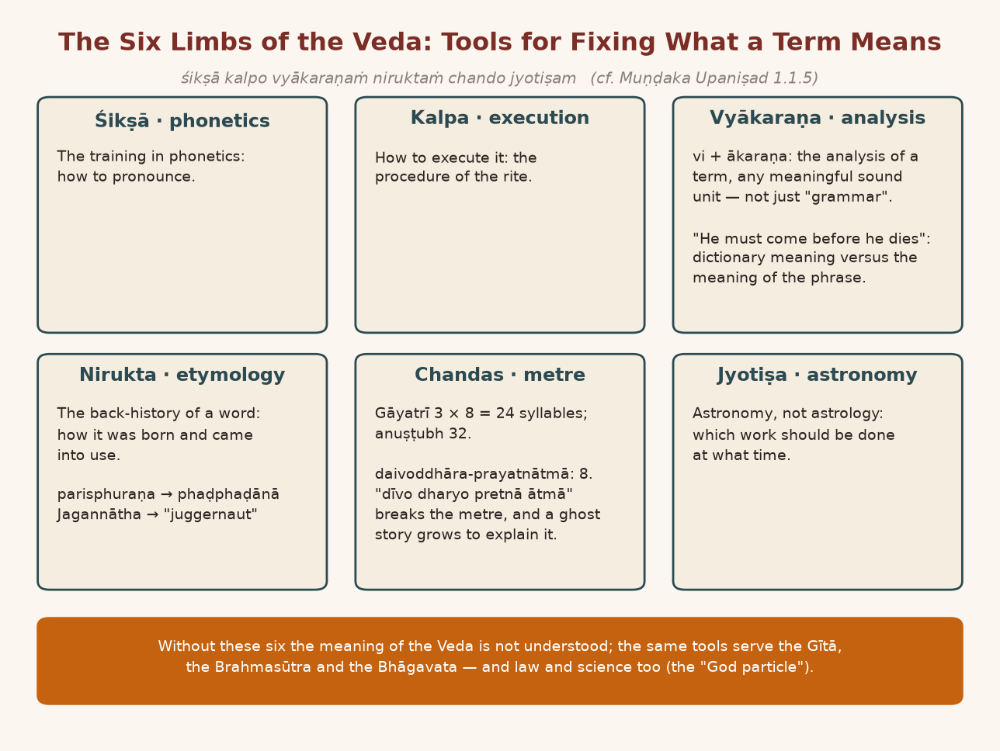
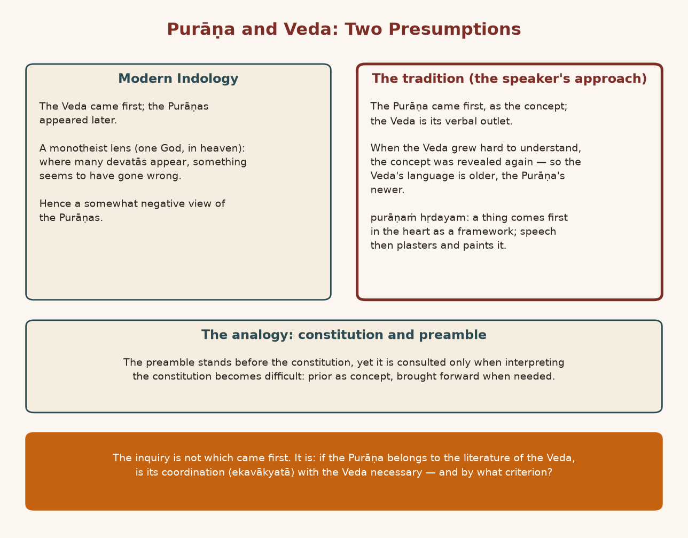
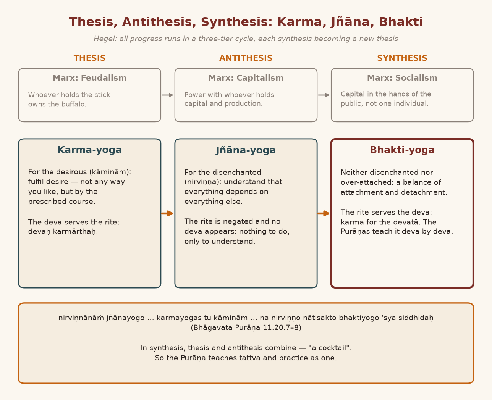
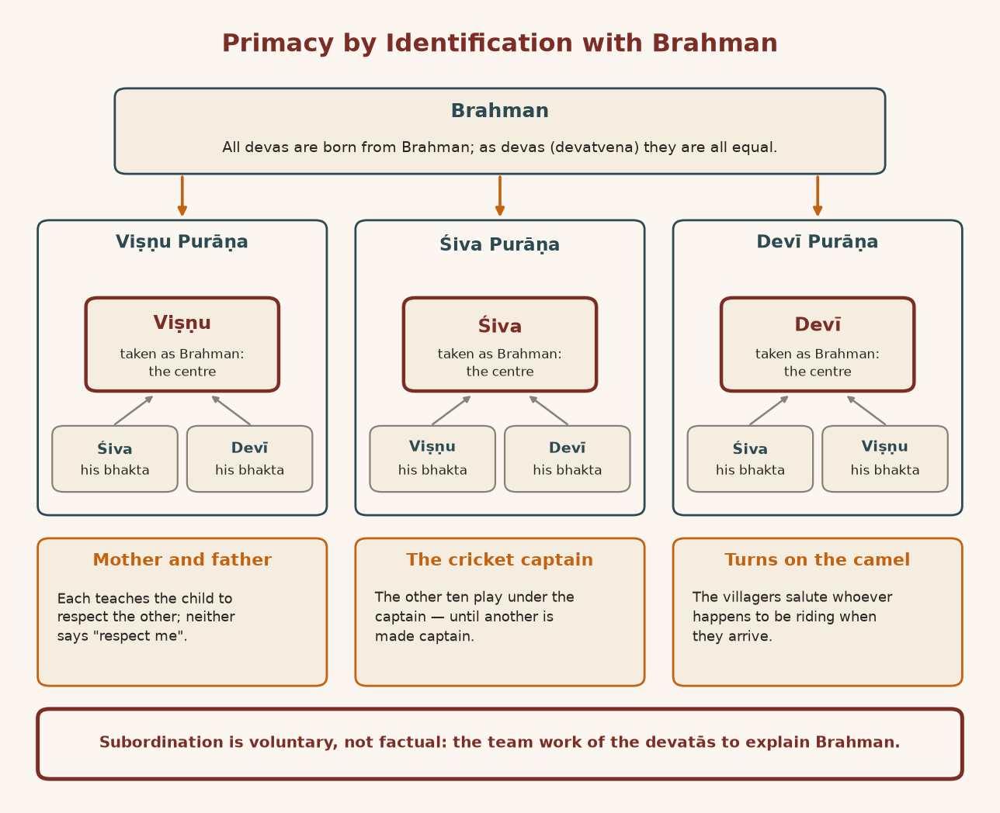
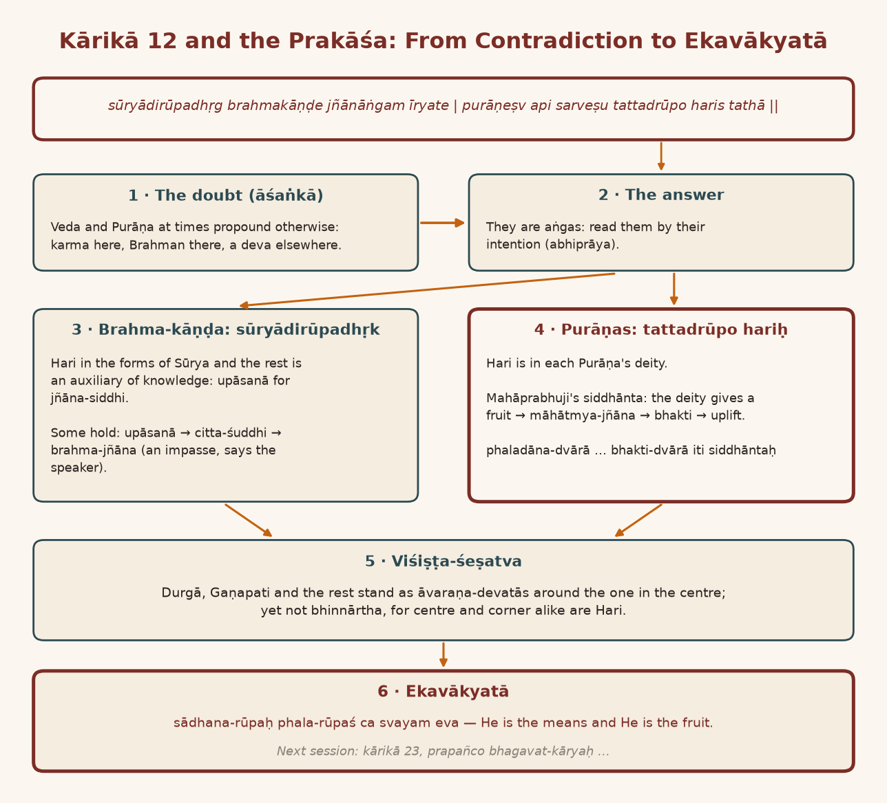
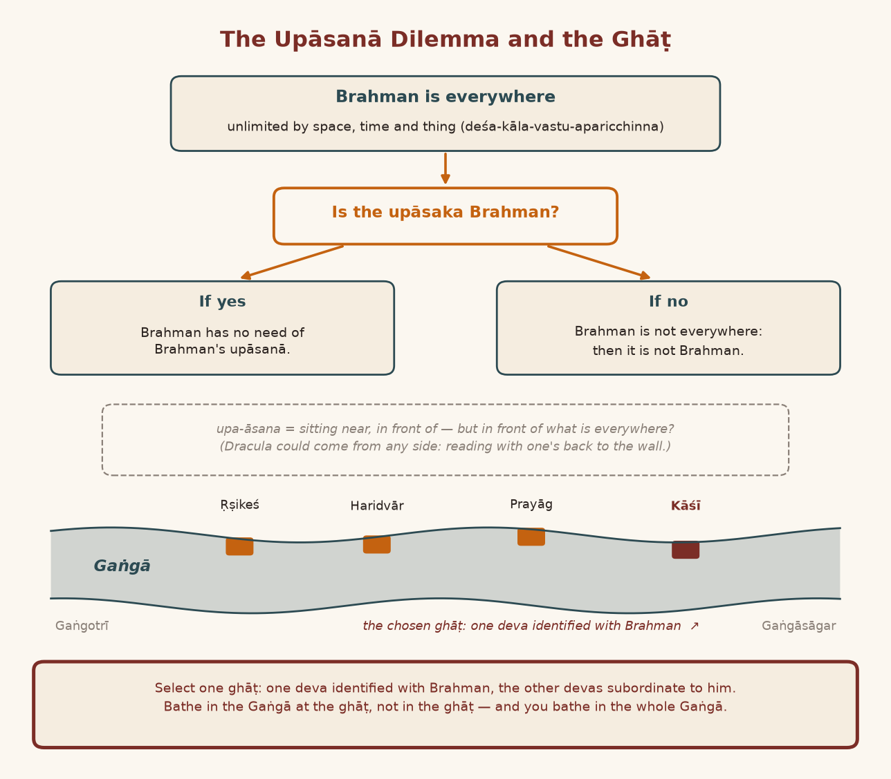
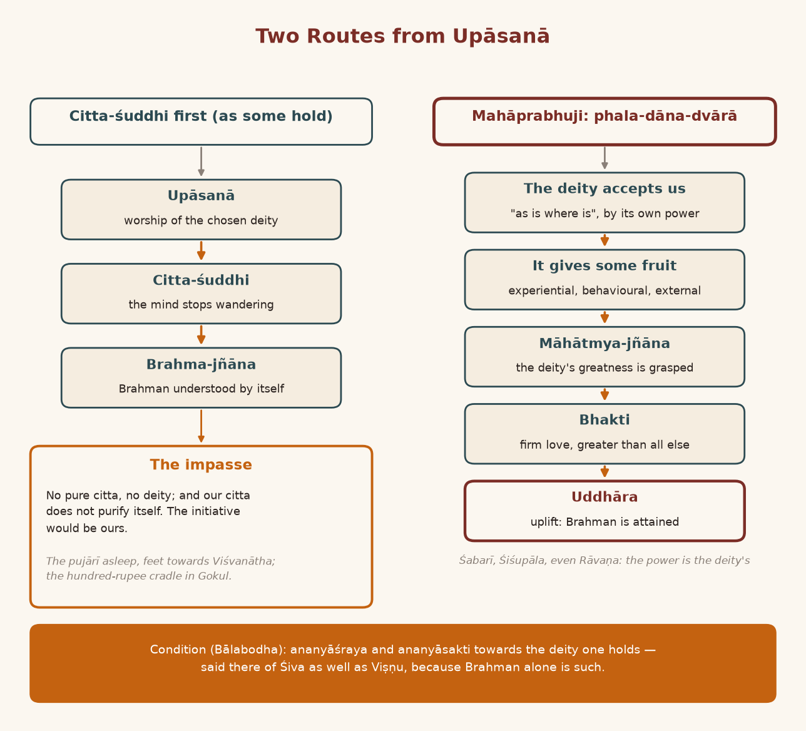
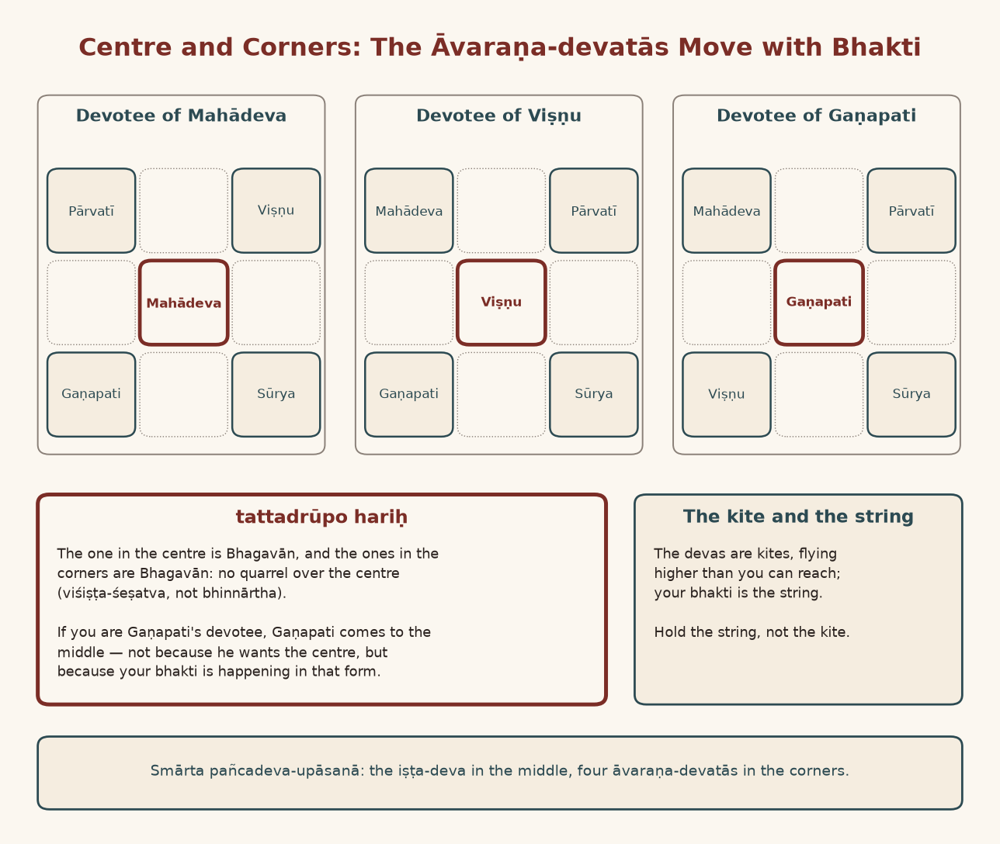

*English rendering of a spoken discourse on the Śāstrārtha Prakaraṇa of the Tattvārthadīpanibandha, translated from a Hindi ASR transcript. The speaker's conversational register, humour, digressions, code-switching, and student exchanges are preserved. Editorial flags: ‹ › conjectural restoration of a garbled reading; ‹?› uncertain reading; ‹…› inaudible or unrecoverable passage; ‹श्रवणाधारित› text given as heard, pending verification against a printed edition. Verses whose standard text is beyond doubt have been silently restored to the received editions.*

# 1. The Six Limbs of the Veda: "He Must Come Before He Dies"

**Speaker:** Is there anything to ask? Nothing at all?

**A listener:** There's no "hand raise", jī.

**Speaker:** Yes. So far we have seen the "aspect" of the ekavākyatā of the pramāṇa-catuṣṭaya, and on that basis the ekavākyatā — the "coordination" — of the three kāṇḍas of the Veda. But the "literature" of the Veda is not "confined" to the Veda alone. Because for the study of the Veda this used to be said: *śikṣā kalpo vyākaraṇaṁ niruktaṁ chando jyotiṣam* (cf. Muṇḍaka Upaniṣad 1.1.5). Śikṣā means the training in "phonetics": how to "pronounce". Kalpa means how to "execute" it. Then vyākaraṇa, which today we call "grammar" — it is not "grammar". Vyākaraṇa means the "analysis" of a word. It is the "analytics" of the "terminology" we are using: *ākaraṇam*, *vi* plus *ākaraṇam*, *vyākaraṇam*. That is, how to "analyse" any "term" that has been put in front of us.

Look, understand one thing carefully. Ordinarily we don't see why a "term" needs any "analysis". In everyday talk the need doesn't arise; we go on using words freely, without a second thought. But every "term" — and a "term" means any one "meaningful sound unit"; any one "meaningful sound unit" is called a "term" — if we don't analyse it, a lot of wrong meanings can come out of it.

I have a "whimsical mind", so this example came back to me. I was studying in Banaras. There was a professor from Germany at the university, and the two of us met when we had gone to some "music conference". He came up on his own and made his "introduction", and then the conversation began: who are you, where are you from, how are you, and so on — the "normal procedure". Then he asked, "Doesn't your father come to Banaras?" — because he had this "information" that every Hindu comes to Banaras at least once. So I told him, I said, "Whether he has come so far or not, I don't know. Perhaps he should come now." And suddenly he said, "He must come before he dies."

**A student:** And so sharp!

**Speaker:** So rude — rude! Behaving so rudely at the very first meeting! He realised I had got a "shock". He said, "Gosvāmī, don't misunderstand me. In our Germany, to say you will do some job 'definitely', one says, 'I must do this before I die.'" And look, the matter was as simple as could be ‹?›. The meaning there was something else. The "formal meaning", the "dictionary meaning", was one thing, and the meaning of the "phrase" was another. But it happened. "He did not have any bad intentions. So, very positive intention" — "positively" he will come. That was the "phrase" in his German: "He must come before he dies." "Naturally, being a son, I was shocked": what is he saying, how can he behave so rudely? He understood too, so he "clarified" at once. So it is very necessary to analyse a "term" — any "term". So in *śikṣā kalpo vyākaraṇam*, the vyākaraṇa we have takes up the "analysis" of the "term".

# 2. Nirukta and Chandas: Juggernaut, and a Lamp in a Ghost's Hand

**Speaker:** Then nirukta means "etymology" ‹…›: what is the "back history" of a word? In what way was the word born? Why did it come into use? Because whenever we use a "term", how its "usage" started — every word has that history. I'll give you an example and you'll understand. In Hindi there is a word *phaṛphaṛānā*; in Gujarati one would perhaps say *‹phaphaḍvuṁ›* [to flutter].

Now look, perhaps you don't know its "etymology"; I'm telling you its "etymology". In Sanskrit the word is *parisphuraṇam* — *parisphuṭanam*; the word *parisphuṭanam* goes back five or ten thousand years, even earlier. After that apabhraṁśa spread in the language, so instead of *parisphuraṇam* it became *paḍitphuraṇam* ‹?›; *paḍiphuḍanam* ‹?› became *phaḍphaḍanam*, and after that, in Gujarati, *phaḍphaḍānā* went on becoming *phaphaḍ*.

Now this is the "backlog". Just as a man has a "history" and a city has a "history", in the same way every word has a "history": how the word went along, why it went along, what its "backlog" is. This is called "etymology". By the way, there is a very famous English word, "juggernaut". "Juggernaut" means some very "colossal" "structure". Actually this word has come from "Jagannātha". At Jagannāthajī in Puri the yātrā would go out, the great ratha would come out, and so they would ask, "What is this? What is this?" The Orissa people would say, "Jagannāth." And they would say, "Juggernaut." From that the word "juggernaut" was made. So when we go into the "backlog", into the history of a word, we learn how the word went along, where it came from, and why. This is called "etymology".

All right, so in Sanskrit this is called nirukta: *śikṣā kalpo vyākaraṇaṁ niruktaṁ chandaḥ*. Chandas means ‹…› any "metre". The Gāyatrī, for instance, is a "metre" of twenty-four syllables. Anuṣṭubh — the Gāyatrī is eight, eight, eight: three eights are twenty-four, no? Yes. The anuṣṭubh chandas is a "metre" of thirty-two syllables. There are such "metres", of so many syllables each. So one should know chandas, because if we don't know chandas, don't know the "metre", there is every chance that corruption will creep into the pronunciation.

Let me tell you a simple thing. It is said that among Mahāprabhuji's Sarvottama names there is the name *daivoddhāra-prayatnātmā*. Now that got corrupted into *dīvo dharyo pretnā ātmā*. You people asked, "Bhāī, *dīvo dharyo pret ātmā* — what kind of name of Mahāprabhuji is this?" And someone sitting there ‹…› [explained]: *Ane emnā Mahāprabhujine tame śuṁ samjo cho? ‹Subodhinī› lakhtā hatā ke nahīṁ? Bole, hā, lakhtā hatā. Paṇ te kyāṁ hatī te vakhte?* [Gujarati: "And what do you take their Mahāprabhuji to be? Was he writing the ‹Subodhinī› or not?" They said, "Yes, he was writing." "But where was it at that time?"] *‹Bhakti› joḍvā māṭe emṇe pret rākhyo hato. Enā hāthmāṁ dīvo rākhtā hatā. Dīvo dharyo pretnā hāthmāṁ.* [Gujarati: "For ‹…› he had kept a ghost. They kept a lamp in its hand. The lamp was held in the ghost's hand."]

And *daivoddhāra-prayatnātmā* — that is what the word became: *dīvo dharyo pret nā ātmā smṛti mārtā tinā caraṇ* [for *daivoddhāra-prayatnātmā smṛtimātrārtināśanaḥ*]. Now this one didn't catch on. But suppose it had caught on: then among Mahāprabhuji's hundred and eight names — *daivoddhāra-prayojanārtha*, *divoddhāra-prayojanārtha* — even a "story" could get made for it. It doesn't take long for a story to get made, does it? Because man's "mind" is "fertile". When he finds nothing, he makes up some story. When no "explanation" is found, making up a story is very "easy". As soon as the story is made, the "explanation" is found, and everybody is "satisfied".

So that is why it is always necessary, when we are considering a word — in considering that word — that we know its history: the history of the word, of the "term", of this "terminology". We should know the "etymology". We should know chandas too, because if you know chandas, such a pronunciation simply cannot happen. The chandas of *daivoddhāra-prayatnātmā* is one thing, and *divo dharyo prayatnātmā* — look, that has become ten syllables, so no chandas is left. *Daivoddhāra-prayatnātmā* is an eight: eight syllables. Now two syllables have been added to the eight — *divo dharyo prayatnātmā* — so the chandas broke, didn't it? By knowing chandas this mess doesn't happen; there is "balance". So training is given in this too.

*Niruktaṁ chando jyotiṣam*: jyotiṣa means "astronomy", not "astrology" — that is, which work should be done at what time; that is called jyotiṣa. So these six were the aṅgas of the Veda. They had to be studied along with the Veda. If you don't study these, you won't understand the meaning of the Veda at all.

{width=6.2in}

# 3. The "Goddamn Particle" and the Preamble: Purāṇa Before Veda

**Speaker:** Now, to study the Veda — the texts that depend on the Veda, which we have seen: there is the Gītā, there is the Brahmasūtra, there is ‹the Bhāgavata›. Won't all six be useful there too? All six will be useful. And understand this carefully: because we are talking about śāstra, it all seems very "bombastic" to us. But if you study law, in law too you will have to understand all this. If you study science, in science too you will have to understand all this: which "terminology" started how, what happened.

Just now, for example, there is the "God particle". Actually the word "God particle" came as a "short form" for a particle — what they call the "hadron" [presumably the Higgs boson, found with the Large Hadron Collider]. When the scientists discovered that "hadron", the name they gave it was the "goddamn particle". In "short form" it became the "God particle". Now everybody started clapping: "We were saying it all along — the world is made of God's particle!" Arre bhāī, that wasn't the point; here it was the "goddamn particle". "Now even science has accepted it" — everyone was happy. In science there is nothing at all to be happy about. The "hadron's" name was "goddamn". "Damn" means: may He throw it into narak. "May God throw it into narak" — that kind of particle: the "goddamn particle". We say "damnful", don't we? "Damn" means narak, in English. It was the "goddamn particle"; it got shortened to "God particle"; and once it got shortened, everyone was happy: "We were saying all along that science would have to accept God one day!" Bhāī, science never said that. This is how "confusion" arises from not knowing the "terminology". This examination of the aṅgas is useful everywhere — useful everywhere.

So — Purāṇa, Nyāya… All right: after this *śikṣā kalpa vyākaraṇa nirukta chandas jyotiṣam*, in the same way: *purāṇa-nyāya-mīmāṁsā-dharmaśāstrāṅga-miśritāḥ* (Yājñavalkya Smṛti 1.3). What is the Purāṇa? On this, the "scholars" of "Indology" — the scholars of "Indology", the "Western scholars" — have a different "approach", and our "approach" is different. What is our "approach"? We take the Purāṇa to be even earlier than the Veda. Purāṇa means "old"; this word *purānā* has come out of *purāṇa*, *purāṇam*. Nowadays the scholars of "Indology" hold that the Veda came first and the Purāṇa came afterwards. Our "approach" on this is that the Purāṇa came first and the Veda came afterwards.

But what difference did it make? The difference is this. Suppose there is some "concept". It has some "expression": "every concept has some expression". Because when there is a "concept" — when we "conceive" something — we give it an "outlet", a "verbal outlet". So the Purāṇa was the "concept", and the Veda was its "outlet".

**A student:** I see.

**Speaker:** But when difficulty started in understanding the Veda — when understanding the Veda became difficult — then they "revealed" the "concept" again. If we want to understand this with an example from today: every "constitution" has a "preamble" in front of it, doesn't it? Is the "constitution" first, or the "preamble" first?

**Listener 2:** No…

**Speaker:** You refer to the "constitution"; when difficulty starts in "interpreting" the "constitution", that is when the "preamble" is referred to, isn't it? "Who refers [to the] preamble? There is no need to refer [to the] preamble." In the same way, the Purāṇa was the "preamble" of the Veda. It was made manifest later, when difficulty began in understanding the Veda. So this much is true "to [a] certain extent": that the language of the Veda is old, and since the Purāṇa was manifested later, its language is new.

{width=6.2in}

# 4. Language Is a River: Pāṇini, Kālidāsa, and the Breathless Sentence

**Speaker:** In the language of Sanskrit too — as I told you, *parisphuraṇam*, *paḍit paḍaṇam*, *paḍ paḍnā*: that is the history of a language — in the same way the language of Sanskrit has a history. In it, the language of the Veda is old. Even within the Veda several languages have come in, which changed form as they developed historically. I'll tell you one thing as an example: in the ancient Veda a "prefix" could be placed anywhere, before or after — two words before, ‹…› after. Because people began to get confused — "Where am I supposed to attach this?" — Pāṇini made a "rule" that the "prefix" and ‹the verb› cannot be written apart; [it goes] ‹with the verb›, [otherwise] "confusion" happens. And we can see that after Pāṇini made the rule — this is about three thousand years ago — Kālidāsa did not accept that rule. Kālidāsa was a poet; he followed the Vedic principle and would put it anywhere.

Language — what is language but a river? It goes along every crooked path. If some obstacle comes in its way, it either sweeps it away or turns aside: "depends on [the] force of water". In this way language keeps changing; it doesn't remain one language. So the Sanskrit of the Veda is old Sanskrit; within the Veda too there are several levels of Sanskrit, changing. And the Sanskrit of the Purāṇa is different again. In the "medieval period" a Sanskrit came up that was full of compounds and "without punctuation of the statement". Just giving you one example: *asamaskaram adataskaram mahāmahān maskarī raivatakagirim upaskarute; tasya namaskaraṇam asmākaṁ śreyaskaraṇam iti purodho janabodhanā kutūhalinā alinā nagaram āmī konā bhikṣu* ‹श्रवणाधारित›. Shankar Mahadevan sang a song like that a while back, didn't he? [presumably his "Breathless"]. One "statement", this long!

**A student:** Yes!

**Speaker:** *"Statement"-c nāhī!* [Marathi: no "statement" at all!] This "style" developed in the "medieval period". People said, bhāī, there's fun in this "style"; it's fun to say. *yā khalu purā kuru‹dharādhipa›-‹aparādha›-samedhita-krodhena ‹hala›dhareṇa nijāyudhena ‹haṭhāt›-karṣaṇa-śikṣayā samu‹cchrita›-dakṣiṇa-kṣiti-bhāgā tadīya-bhuvana-bhūṣaṇāyamānāṁ bhogavatīṁ ‹…› vijetuṁ kila bhāgīrathī-pātaḥ ‹…› prasthāne ‹…› paridṛśyate* ‹श्रवणाधारित›. Some of the people here are ‹…›. No "punctuation" anywhere in between.

**A student:** Yes, yes.

**Speaker:** In language the "style" keeps changing. Perhaps this is what ‹she› was saying: lots of ‹tails› get attached in front and behind ‹…›. I too got flustered. Like ours: in front and behind they attach "108 Pūjyapāda", "108 ‹Pū. Śrī›", "‹Pū. Śrī›" — nobody can make out what it means — "‹pū-pū-pūpā›, 108, 108…" Arre bhāī, why are you attaching all this?

**A student:** (laughing) Ho, ho — Śrī!

# 5. The Birudāvalī Contest: Caesar's Short Answer and Karpātrījī's Whisper

**Speaker:** It happens like this: the "format" of a language changes. It comes like this in history. I don't know ‹how far back› it started. When Caesar defeated Ptolemy and defeated ‹…›, then ‹…› Cleopatra's brother was the king, and Cleopatra was his ‹queen›. So he came to make a "compromise", and in just this way he [gave] a great long string — of Egypt, of the Nile that flows there, the one that comes from the south to the north, king of there and of all this, so-and-so, such-and-such, so-and-so — long and wide. After that he asked ‹Caesar›, "And who are you?" He said, "The one who defeated you." Short — ‹short and sweet›. "You are talking with such a long ‹tail› attached. My 'introduction' is only this much: 'I have won ‹…›' ‹?›. 'Not a problem.'"

**A student:** No…

**Speaker:** …all those long tails…

The "style" changes. I went to Amravati. Karpātrījī was there — a very great sannyāsī of the Hindu dharma — and a Śaṅkarācārya: Kṛṣṇabodha[āśrama], let's say, the Śaṅkarācārya of Badrinath at that time. I'm talking about the "sixties". There were three of us. ‹I› had nothing of that kind. In writing too they used to attach long, wide ones. Kṛṣṇabodhāśramajī had come, and he started off long and wide in this way, before his name and after it, in both places — very, very, very ‹…›. After that, the Rāmānujācārya: he felt very "insulted". The next day he lengthened his name, putting on "suffixes" and "prefixes" half as long again as that. In the end, growing and growing, the "competition" grew so much that before the questions began, ten minutes went on the names alone. For ten minutes only the names went on; the "audience" couldn't make out what they were saying. Poor Karpātrījī got "confused" about what to do, so he asked me in my ear, "Gosvāmījī, do you have one or not?" — this kind of thing is called a birudāvalī. I said, "I have neither a birudāvalī nor anyone to sing it." He said, "I'll provide the singer, but you write the birudāvalī." I said, "I don't know how to write such a long one. I only write 'Gosvāmī Śyām Manohar'."

**A student:** No, no!

**Speaker:** So such is the business of the birudāvalī. Ten minutes — four ācāryas at ten minutes each: forty minutes of the assembly "wasted" on this. Such a long, wide birudāvalī — the public understood nothing; they just looked on, poor things: what has happened, what is he saying? Someone takes a staff and starts declaiming, "So-and-so, such-and-such, so-and-so, such-and-such Ācārya so-and-so, this, that" — arre, what has happened, bhāī?

**A student:** (laughing) Arre, what has happened!

**Speaker:** What is there to say? Just say the name, no? Those who have no "confidence" in their own name make the birudāvalī long and wide: *dharma-dhurandhara*, *pūjyapāda*. Who asks you ‹…›? They attach these because they have no "confidence" in the name. There are different "styles". What I mean to say is that in language too there are different "styles". So the "style" of the Purāṇa is different, and the "style" of the Veda is different. But there was "irregularity", and Pāṇini later "regularised" it.

# 6. Cleopatra, Queen and Sister: Why the Purāṇas Need a Criterion

**Speaker:** So: Purāṇa, Nyāya. Nyāya means its "logical analysis" — not ‹"etymological"›, not "grammatical", not "astrological", but the "logical analysis" of the "statement": what are its "criteria"? That was called nyāya. So Purāṇa, Nyāya, Mīmāṁsā, Dharmaśāstra — this much is the literature of the Veda. So when we are considering this matter of "terminology": bhāī, without knowing the "terminology" we won't be able to "ascertain" which word means what.

Now, for example — I'll tell you a simple thing and you'll understand. Just now I said that Cleopatra was a queen and also a sister. Then if she was a sister, how can she be the queen? How can the queen be a sister? In our India it can't be: one who is the sister can't be the queen, and one who is the queen isn't the sister. In Egypt, real brothers and sisters used to marry. You need to know that history, don't you — who became queen there? Otherwise there will be "confusion"; it will look like a "contradiction" to you. There, real brothers and sisters used to marry, so she was the queen as well. If it looks like a "contradiction", you will say it is a wrong "statement". It is not a wrong "statement"; the "statement" is true. But if you don't know a little history, it will look wrong — like this.

So what I mean to say is that a lot of "analysis" has to be done to "ascertain" any "terminology", to "ascertain" a "meaning". In everyday talk there is no need; but when we want a specific "ascertainment" — what its specific "meaning" is — then a lot of "parameters" have to be used. And all of them have been used in the Vedas. Having used them, Mahāprabhuji — just as he is stating the ekavākyatā of the Veda, the Gītā, the Brahmasūtra and the Bhāgavata, and talking of their "coordination" — in the same way Mahāprabhuji is talking of "coordination" with the Purāṇa too. Because the Purāṇas — our "presumption" here is that they are "before [the] Veda", and were made manifest later.

And the "presumption" of the "modern" "Indologists" is that the Purāṇas appeared later. But in the end, whether they are earlier or later, which is true — we are not making that "inquiry" here. The "inquiry" we are making here is this: if the Purāṇa too is some "part" of the "literature" of the Veda, is the Veda's "coordination" with it "necessary" or not? And if it is "necessary", what is its "criterion"?

Mahāprabhuji stated one "criterion" for the Veda: *yajñarūpo hariḥ pūrvakāṇḍe brahmatanuḥ pare | avatārī hariḥ kṛṣṇaḥ śrībhāgavate* … (Tattvārthadīpanibandha, Śāstrārtha Prakaraṇa 11). In the pramāṇa-catuṣṭaya he stated one "criterion": where the Veda has "imperative statements", there Hari in the form of yajña is described; where the Veda has "descriptive statements", there Hari in the form of knowledge is described — brahmatva, in the later [kāṇḍa]; and combining both kriyā-śakti and jñāna-śakti, in the Gītā and the Bhāgavata. If you look from this "angle", you will see the ekavākyatā of these śāstras; otherwise you won't see the ekavākyatā.

# 7. For Whom Is the Rite? Autocracy, Democracy, and Who Studies the Veda for Whom

**Speaker:** Because *prima facie* it seems to us like this: the "procedure" of yajña is one thing, ‹the "procedure" of jñāna› is different, and the "procedure" of bhakti is different. In the "procedure" of yajña, Brahman is not seen anywhere at all. In the "procedure" of jñāna, Brahman is seen and yajña is not seen; or if yajña is seen at all, what is seen is a yajña made of knowledge. Here, where there is the "procedure" of bhakti, the devatā becomes primary.

Understand the point carefully. In karma the devatā is secondary and karma is primary, because karma is not *devārtha*, for the sake of the deva; the deva is *karmārtha*, for the sake of the karma. Like the old "autocracy" that used to run: in it the "government" was for the king, for the "autocracy". What came with "democracy"? That the "government" is for the *demos*, that is, the "public". The "public" is not for the "government"; the "government" is for the "public". This new principle came. The country is the very same, the very same country, but the "method" changed. There the subjects were for the king; here the king became for the subjects. In karma, in the karma-kāṇḍa, as for all the devas there: karma is not for the deva; the deva is for the karma.

You can understand this matter like this — it's a bit of a digression, but you'll get a ‹"clarification"›, so I'm telling it. In the śāstra there is a very "debatable issue": why should one study the Veda? Why should the Veda be studied? In that, one "opinion" is this: because it is written in the Veda that one should study the Veda, therefore one should study the Veda. What "objection" comes up here? That one who hasn't studied the Veda — how will he read that one should study the Veda? Then he will never study the Veda at all. A second "opinion" came, Prabhākara's: no, no — not because "one should study the Veda"; one should study because "one should teach the Veda". Teaching can't happen without someone who studies; for this reason one should study the Veda.

One statement was *svādhyāyo 'dhyetavyaḥ*: "the Veda should be studied". It is written in the Veda — so without studying the Veda, how will he study the Veda? One statement was *brāhmaṇena niṣkāraṇo dharmaḥ ṣaḍaṅgo vedo 'dhyeyo jñeyaś ca* (quoted in Patañjali's Mahābhāṣya, Paspaśāhnika): it is necessary for a brāhmaṇa that he study the Veda together with all its "paraphernalia", "without any motivation" — *niṣkāraṇa*. Arre bhāī, then how will the brāhmaṇa find out that he should study "without motivation"? So another statement comes in the Veda like this: *aṣṭavarṣaṁ brāhmaṇam upanayīta tam adhyāpayīta* — perform the upanayana of an eight-year-old child, and after the upanayana, teach him. So: the Veda should be studied, and it is the teacher's "duty" to teach. Because of that, when the teacher is teaching the Veda, the student has become for the teacher. ‹…› And when you are proceeding by the injunction "one should study the Veda", the teacher has become for the student. Got the point? By which command have you come to study the Veda? If you are studying the Veda by the command "one should study the Veda", then the teacher is for the student; and when it is being said, "No — one should teach the Veda", then the student has become for the teacher.

In the same way, in karma the deva is for the karma; the karma is not for the deva. And in jñāna there is no mention of karma at all. There's no mention of karma in jñāna because there you don't have to do karma; you have to understand ‹…›. And what has happened in bhakti? In bhakti karma has become for the deva; the deva is not for the karma. If there is some karma of bhakti, for whom should we do it? For the deva. So, coming into bhakti, karma and jñāna got "synthesised". Look carefully: in jñāna, karma had been negated.

**A student:** Jī.

# 8. Hegel's Triad: Karma as Thesis, Jñāna as Antithesis, Bhakti as Synthesis

**Speaker:** If I give you an example, you'll understand the point. There was a German "philosopher" named Hegel. The German "philosopher" named Hegel had a siddhānta, that whatever "development" happens — this was Hegel's "principle" — whatever "progress" happens, happens in a "cycle" of "thesis", "antithesis" and "synthesis". That "synthesis" then becomes a "thesis"; then some "antithesis" of it comes; and because of that "antithesis" a "synthesis" comes again. In this way, whatever "progress" is happening in the world — any "progress" at all, this is Hegel's siddhānta — if any "progress" is happening, it is happening by a "three-tier system". "This is antithesis and…"

From this Marx drew out "dialectical materialism", "dialectical development". The root principle of Marxism was this. First of all there was feudalism, *sāmantavāda* — *sāmanta* means rājās and mahārājās: whoever holds the sword, whoever holds the stick, owns the buffalo. That was the feudal lord. Against him came "capitalism" — the "antithesis". Because now power no longer lay in might; [it lay with] whoever had charge of "production". So — the "capital" is his own; he used to provide "capital" even to the feudal lords. So the "antithesis" came: "capitalism". Because of that "capitalism" came Marxism, "socialism": that "capital" should be not in the hands of one "individual" but in the hands of the "public". Now that became the "synthesis" — of feudalism and "capitalism". Of "capitalism" — in our times. Now what its "paradigm" will be, what will come after that — [that is] "development". All "development" goes on in this way.

So what I mean to say is: in the "dialectical system" of "development", if we look from that "angle", karma was a "thesis". Its "antithesis" came in jñāna. And the "antithesis" that came in jñāna, bhakti "synthesised". Why did it do so? We can understand. The Bhāgavata explains this very beautifully:

> निर्विण्णानां ज्ञानयोगो … कर्मयोगस्तु कामिनाम् ।  
> … न निर्विण्णो नातिसक्तो भक्तियोगोऽस्य सिद्धिदः ॥
>
> *nirviṇṇānāṁ jñānayogo … karmayogas tu kāminām |*  
> *… na nirviṇṇo nātisakto bhaktiyogo 'sya siddhidaḥ ||* (Bhāgavata Purāṇa 11.20.7–8)
>
> [For the disenchanted, the yoga of knowledge … for those who have desires, the yoga of action. … For one who is neither disenchanted nor over-attached, the yoga of bhakti brings success.]

Those who are very "full of desire", "full of wants", "always running after the wants and desires" — for them there was karma-yoga: fulfil your desire, but don't do it any way you please; do it in the way the śāstra lays down. That was karma-yoga. "If you desire, if you have certain wants, it is to be fulfilled. But not any way — the way you like. You have some prescribed — you should have some prescribed course." And karma told you: do it this way, and fulfil that wish. So: *kāminām*, karma-yoga. Then one who has no desire at all — why will he do karma? So the śāstra says: *nirviṇṇānām*, jñāna — ‹…› you have no desire at all for anything. So "try to understand", because if you don't understand, there will be a mess.

Because when there is no desire — look, understand the point carefully — we keep abusing desire a lot. But actually desire is the thing because of which we "depend" on one another. "And that's a truth of his ‹?› humanity." One who is not "dependent" on anyone — it's "just possible" that that man will become cruel. If he is "dependent", his cruelty gets somewhat "diluted". If he is completely "independent" — "I'm not 'dependent' on anyone" — it won't take him long to become cruel, because he won't ask anyone anything. So jñāna-yoga would explain to him: bhāī, if you are *nirviṇṇa* — you are not "dependent" on anyone — then "try to understand the truth": that "everything depends on any other thing; you cannot be independent". [Without that] this jñāna cannot happen. *Nirviṇṇānāṁ … kāminām karmayogaḥ; nirviṇṇānāṁ jñānayogaḥ.* And after that he says: *na nirviṇṇo nātisakto bhaktiyogaḥ*: the "balance" you have of kāma and nirveda — nirveda means "detachment", kāma means "attachment" — "if you have a balance of the attachment and detachment, then ‹…› bhakti is for you." See, this got "synthesised".

So in karma-yoga, jñāna-yoga and bhakti-yoga there is a "dialectical development" of "thesis", "antithesis" and "synthesis".

{width=6.2in}

# 9. Team Work Among the Gods: Mother, Father, and the Cricket Captain

**Speaker:** And all these Purāṇas are propounders of bhakti, because they run on the primacy of the devatā, not on the primacy of karma. If you accept Śiva, do bhakti this way; if you accept Viṣṇu, do bhakti this way; if you accept Kālī, do bhakti this way; if you accept Gaṇapati, do bhakti this way — how to do the bhakti of the different devatās. There the devatā is not for bhakti; bhakti is for the devatā, because there it has been "synthesised". In karma-yoga it was the devatā for the karma; in jñāna-yoga no devatā came in at all, ‹nor karma›. Now how did it get "synthesised" the second time? ‹Karma› for the devatā.

All the Purāṇas we have proceed basically on this point: first decide whose bhakta you are. If you are Śiva's bhakta, do Śiva's bhakti this way — the Śiva Purāṇa will tell you. If you are Viṣṇu's bhakta, Viṣṇu's bhakti this way; and if you are the Devī's bhakta, the Devī's bhakti. Variety can come into it. There was no question of a quarrel in it. The "Indologists" think that we used to quarrel; there was no question of a quarrel at all.

Understand one simple thing. If a child has to be taught to respect mother and father, will the mother say, "Respect me"? No, no. The father has to say it, no — "Bhāī, respect your mother." Will the father say, "Respect me"? The mother will explain, "Bhāī, respect your father" — only then will the child understand. So whoever are Śiva's bhaktas, whoever are Viṣṇu's bhaktas, whoever are the Devī's bhaktas — in their Purāṇas it is written in this way. In the Viṣṇu Purāṇa it is written that Śivajī, the Devī, all are bhaktas of Bhagavān Viṣṇu. If you read the Śiva Purāṇa, it will be written that Viṣṇu, the Devī, all are Śivajī's bhaktas. If you ‹read› the Devī Purāṇa, it will be written that Śiva and Viṣṇu are both the Devī's bhaktas ‹…›.

**A student:** Jī.

**Speaker:** It isn't like that [a quarrel]. It's a way of explaining, no? How to do bhakti — that has to be explained. I mean, Śaṅkarācāryajī goes so far as to say:

> शिवः शक्त्या युक्तो यदि भवति शक्तः प्रभवितुं  
> न चेदेवं देवो न खलु कुशलः स्पन्दितुमपि ।
>
> *śivaḥ śaktyā yukto yadi bhavati śaktaḥ prabhavituṁ*  
> *na ced evaṁ devo na khalu kuśalaḥ spanditum api |* (Saundaryalaharī 1)
>
> [Only when Śiva is joined with Śakti is he able to act; otherwise the god is not able even to stir.]

The "i" that is in "Śiva" is the Devī's "i"; and because it is the Devī's, Śiva is Śiva. Take that out and he becomes *śava*, a corpse. *Śivaḥ śaktyā yuktaḥ*: Śiva is joined with Śakti; *yadi bhavati śaktaḥ prabhavitum*: if he is able to do anything, it is because of the "i". Take out the "i" and he becomes [a corpse]. Now this is not a censure of Śivajī; it is praise of the Devī: that if you want to do the Devī's bhakti, do it taking the Devī as primary. If you want to do Śiva's bhakti, then the Devī is his dāsī — the wife is his dāsī. If you want to do Viṣṇu's bhakti, then Śiva too is Viṣṇu's bhakta, the Devī too is a bhakta — all are bhaktas. So this is a matter of explaining, isn't it? Because among themselves they are one; we are the ones quarrelling. How to explain? The way of explaining is this. So the Purāṇa adopted that way in order to explain bhakti.

This was the secret of the Purāṇa. So how to make their ekavākyatā with the Veda — this "issue" is "major". Now Mahāprabhuji is explaining it in the twelfth śloka. If you have any question at all, ask it now — "but" it is a "technical issue". And if you don't understand it, you'll go on getting angry.

**A student:** Hmm.

**Speaker:** Mahāprabhuji explained the matter on three levels. On the first level he explained how to understand the ekavākyatā of the pramāṇa-catuṣṭaya; in that, *yajñarūpo hariḥ pūrvakāṇḍe brahmatanuḥ pare, avatārī hariḥ kṛṣṇaḥ* — he stated that as one "parameter". After that he stated how to do it when the ekavākyatā of śruti and smṛti has to be made. There he said, *dvāparādau tu dharmasya dviparatvād dvayaṁ pramā* (Tattvārthadīpanibandha, Śāstrārtha Prakaraṇa 10): proceed taking both as pramāṇa, and look for their non-contradiction; don't look for contradiction. If you can't understand [how to remove] a contradiction, put it in the "cooling chamber" for a while: until we understand it, we'll think later about how to deal with it. Now comes the Purāṇa: after smṛti, the Purāṇa. The Purāṇa too is a way of understanding the Veda, isn't it? Because how the old people lived the Veda — that the smṛti explains. And the "preamble" of the Veda is the Purāṇa, from our "angle". Because of this "preamble" the Veda was written. How to understand it? So Mahāprabhuji says, *veda-purāṇānām* ‹…›

**A student:** So ‹should we› take ‹the Purāṇas› as chiefly propounding bhakti?

**Speaker:** …is an "extension".

**A student:** Yes, the Purāṇa is an "extension" of the Veda. And they are being "synthesised" again in bhakti.

**Speaker:** In bhakti — what is there?

**A student:** ‹They are› chiefly propounding bhakti.

**Speaker:** Take any Purāṇa — it is devatā-centred, isn't it? The Śiva Purāṇa, the Skanda Purāṇa, the Devī Purāṇa, the Brahma Purāṇa, the Viṣṇu Purāṇa: all deva-centred.

**A student:** Jī.

**Speaker:** That is, the embodied ‹?› "aspect" of Brahman is what is told here.

**A student:** How so?

**Speaker:** The embodied "aspect" of Brahman was made secondary in the karma-kāṇḍa — made secondary in the karma-kāṇḍa. In the brahma-kāṇḍa its "central point" was stated: bhāī, all these devas, all these karmas — all of them have come out of Brahman itself, so they are all "good for nothing". Got it? Now this became "nothing" — it became the "antithesis". Now how was this "synthesised"? That the deva too is one facet of that same Brahman, and for him one should do karma in the form of bhakti. So it got "synthesised", didn't it — karma-mārga and jñāna-mārga. Worship that deva ‹as Brahman›: no Purāṇa says that you should degrade the deva and worship him. No Purāṇa says that. But to promote the deva whose Purāṇa it is, that Purāṇa certainly explains this much: take this deva as Brahman, and if you take him as Brahman, all the devas there are become his "subordinates".

That is not a "contradiction". I told you, didn't I: Mummy won't explain, "Accept me, give me 'respect'." Whose job is it to explain that? It's the father's job. And the father won't say, "Accept me." If the father says that, the father is egotistic. So who has to explain this? If it has to be explained to us, then that is "team work". In the same way, it is the "team work" of the devatās, to explain Brahman. So whoever comes to the fore at a given time, all the other devatās become his "subordinates" from the "angle" of Brahman; the devatā who becomes the chief becomes the chief. Isn't it just like this in a cricket team? It's "clear" — when — what do they call it in cricket?

**A student:** Captain.

**Speaker:** "Captain", "captain". The cricket "captain" — when someone becomes "captain", all the ten below him in cricket work under him. That's not fixed, is it? He's removed, another comes, and then he comes under that one.

**A student:** Wah!

# 10. Turns on the Camel and the King of Morbi: Voluntary Subordination

**Speaker:** In the same way, in the biography of ‹Muhammad› there is a very amusing episode. Once Muhammad Sāhab, worn out with fighting, had to go to some other village to make a "compromise" with the big men there. He had to go, and it was quite a long road. So ‹he› booked a camel — the way today we book a taxi; in those days the camel was the taxi of the "desert". Now, over that whole "distance": if Muhammad Sāhab alone sits on the camel, then in the "desert" the camel-man will get tired; if the camel-man is seated, Muhammad Sāhab will get tired. So the two made a "compromise": you sit for a while, I'll sit for a while. When they reached that village, the turn happened to be Muhammad Sāhab's: Muhammad Sāhab was driving the camel, and the camel-man was sitting on the camel. So the headman of the village came and gave the camel-man a salām — "‹Bā-adab, bā-mulāhiza, hoshiyār!›" — everyone saluted him. He said, "Bhāī, I'm the camel-man. Muhammad Sāhab is down there, driving the camel." Now, was this a "degradation" of Muhammad Sāhab or an "upgradation"? ‹"Upgradation"›! Bhāī, the two had made a "pact" between themselves, so turn by turn it came round such that when they reached the village, Muhammad Sāhab had become the camel-man and the camel-man was riding the camel. [In the usual telling this story is about the Caliph ʿUmar's journey to Jerusalem.] There's no question of low or high in it. No deva is lower on account of another devatā; no deva is higher on account of another devatā. All devas are equal. They are doing "team work", having made a "compromise". Now not everyone understands that.

Let me tell you a very amusing thing from the history of our Puṣṭimārga, although it is not the subject of the Nibandha. There was a king in Kathiawar — I don't forget, I think — the name of it is… where the Machchhu dam is…

**A student:** ‹…›

**Speaker:** Morbi. Once at the king of Morbi's [court] there was some pandit called Hāthīrām-bhāī ‹?›. He had written a play: that Kṛṣṇa — that all of Kṛṣṇa's "prosperity" had grown because of Śiva-pūjā. The king of Morbi was a Vaiṣṇava. "How can that be? Kṛṣṇa is the true Brahman, Bhagavān; how can he worship Śiva?" He said, "I haven't written it; it is written in the śāstra." "Bring the śāstra." When it was found written ‹in the śāstra› that Kṛṣṇa used to worship Śiva, the king left the Vaiṣṇava dharma — ‹became a Śaiva›. There was a lot of controversy over it. This is a matter about a hundred and fifty years old. There was a lot of controversy, and then a *khaṇḍana-maṇḍana*, refutation and counter-refutation, went on between the Śaivas and the Vaiṣṇavas. Bhāī, the quarrel is pointless. Śiva worships Viṣṇu, Kṛṣṇa; Kṛṣṇa worships Śiva — what is there to quarrel about? What happens is that when we don't know what the Purāṇa's "style" of "preaching" is, a quarrel arises. And a great quarrel arises; people leave their dharma one by one; someone converts someone, and someone else converts somebody else.

So what I mean to say is that the Purāṇa is bhakti-propounding and deva-centred. Then how does the primacy of a deva come about? Understand the point carefully. The primacy of a deva does not come from his devatva, his being a deva, because all the devas there are have been born from Brahman.

**A student:** Yes.

**Speaker:** The primacy of a deva comes when you make Brahman "identical" with the deva. So when you have made some deva "identical" with Brahman, all the other devatās will remain [mere] devas. When you have thought of some deva as "identical" with Brahman, all the devatās become his "subordinates". Now that "subordination" is a "voluntary subordination", not a "factual subordination" — like ‹Muhammad› Sāhab and the camel-man. They made a "pact" between themselves: "Bhāī, when you want to ride, I'll drive the camel; when I ride, you'll drive the camel." That "subordination" comes from mutual "compromise"; it is "voluntary"; it is not "factual subordination". But the village people didn't understand that, did they? "So the camel-man himself must be Muhammad Sāhab!" Understood one thing?

Now, because of [not] understanding that matter of the ‹Purāṇa›, many people keep getting "misguided" like this — like the king of Morbi: he left the Vaiṣṇava dharma itself. He said, "Away! We used to be Kṛṣṇa's bhaktas, and Kṛṣṇa ‹himself› worshipped Mahādeva. So why should we do Kṛṣṇa's bhakti? Why not worship Mahādeva himself?" Arre bhāī, you saw one thing, but you didn't see the other: Mahādeva too used to do Kṛṣṇa's bhakti — that you never saw at all. A great muddle comes of this. So for how to make ekavākyatā with the Purāṇas, we must have some "system", no? There must be some "parameter". That is what Mahāprabhuji is showing. Now my point must have become clear to you.

{width=6.2in}

# 11. Kārikā 12: The Groom on the Horse and Daśaratha's Labour

**Speaker:** *Vede purāṇe ca kvacid anyārtha-pratipādanam āśaṅkya teṣām aṅgatvam ity abhiprāyeṇāha* (Prakāśa on Śāstrārtha Prakaraṇa 12). In the Veda and in the Purāṇa, here and there the description comes in "contradiction" with each other.

**A student:** Yes.

**Speaker:** What is the "nature" of that "contradiction"? That Brahman — the Veda, in the pūrva-kāṇḍa, propounds karma and makes the deva "subordinate"; in the jñāna-kāṇḍa it makes even karma "subordinate", makes the deva "subordinate" too, and does [this for the sake of] Brahman. In the Purāṇa, karma came in for the sake of the deva; and the karma that came in for the deva came because of [the deva's] "identification" with Brahman. Has the "identification" of the deva with Brahman come in there? It has not come in the sense that the deva is a deva *devatvena*, as a deva. The deva is Brahman *brahmatvena*, as Brahman; that is why all the devas are his "subordinates".

I'm giving you a thoroughly laukika example. Bhāī, when the groom's procession sets out for a wedding, the groom's father walks on foot in the procession too, doesn't he? And the groom, the king [of the day], sits on the horse. That *varatva* of his — *vara* means "the best" — is a best-ness given by the father, isn't it: the father walks on foot and the son goes on the horse? Now that is a "voluntary subordination", to "hype" him up. Otherwise — here's a bit of fun of ours — there's a saying: *Rām Rām sab koī kahe, Daśrath kahe na koī; Daśrath kasrat nā kare to Rām kahāṁ se hoe* [Everyone says "Rām, Rām"; nobody says "Daśaratha". If Daśaratha hadn't put in the exercise, where would Rām have come from?]. Is Rām greater or Daśaratha greater? That's a "practical issue", isn't it, bhāī? *Rām Rām sab koī kahe, Daśrath kahe na koī; Daśrath kasrat nā kare to Rām kahāṁ se hoe.* Is Rām greater, or Daśaratha? Bhāī, wah! The "subordination" of the two is not "factual"…

**A student:** Wah!

**Speaker:** …it is "voluntary". In many village people's sayings a lot of truth lies hidden.

So that is the point he is making: *vede ca purāṇe ca kvacid anyathā* … *pratipādanam* — somewhere Brahman is propounded, somewhere karma is propounded, somewhere the deva is propounded — *āśaṅkya teṣām aṅgatvam abhiprāyeṇa iti* [the 1943 edition reads *vede purāṇe ca kvacid anyārtha-pratipādanam āśaṅkya teṣām aṅgatvam ity abhiprāyeṇāha*]: understand their *abhiprāya*, their intention. What is the intention? The intention is this:

> सूर्यादिरूपधृग् ब्रह्मकाण्डे ज्ञानाङ्गमीर्यते ।  
> पुराणेष्वपि सर्वेषु तत्तद्रूपो हरिस्तथा ॥
>
> *sūryādirūpadhṛg brahmakāṇḍe jñānāṅgam īryate |*  
> *purāṇeṣv api sarveṣu tattadrūpo haris tathā ||* (Tattvārthadīpanibandha, Śāstrārtha Prakaraṇa 12)
>
> [In the brahma-kāṇḍa, Hari bearing the forms of Sūrya and the others is declared an auxiliary of knowledge; and likewise in all the Purāṇas Hari is in those several forms.]

*Sūryādirūpadhṛk*: many devatās, Sūrya and the others, have been promoted — not one devatā. There are eighteen Purāṇas, and for those eighteen Purāṇas there are again eighteen Upapurāṇas, that is, eighteen twice over: thirty-six. Understood properly? Thirty-six Purāṇas in all. Now in them, whichever devatā one wants, one identifies him with brahmatva and does it. Now which devatā is big and which is small? Bhāī, the bigness of any devatā lies in his "identification" with Brahman. When they "identify" him with Brahman, all the other devatās become smaller than him. When they don't "identify" him with Brahman and you are knocking devatā against devatā, then all the devatās are "equal": none is big, none is small.

**A student:** Do we presuppose the Bhāgavata here too, or will we take the Purāṇas other than the Bhāgavata?

**Speaker:** That will come later. Here — the pramāṇa-catuṣṭaya has already come, no? The Bhāgavata has come there already, so [here] it isn't the Bhāgavata. Now the Purāṇas after that — where there are Purāṇas other than the Bhāgavata — those are what is being discussed.

**A student:** So it isn't about the Bhāgavata.

{width=6.2in}

# 12. Where Do You Sit Near the Omnipresent? The Cow, the Bull, and Count Dracula

**Speaker:** *Sūryādirūpadhṛg iti — brahmakāṇḍe jñānasiddhyartham upāsanā nirūpyante* (Prakāśa on Śāstrārtha Prakaraṇa 12): in the brahma-kāṇḍa, upāsanā is described for the attainment of knowledge. Now look, understand the meaning of upāsanā. That is why I told you at the beginning that we should understand the "backlog" of every "terminology" — what it is. A "term" that is being used: we should understand what the "backlog" of that "term" is — what its "etymological backlog" is, what its "grammatical backlog" is, what its "logical backlog" is, what its "historical backlog" is; how that "term" has been used. Upāsanā. Because Brahman is everywhere.

**A student:** Hmm.

**Speaker:** Brahman is everywhere; how is one to do His upāsanā? If you take Brahman to be everywhere, then the upāsanā of Brahman — because you too are Brahman; if you are not Brahman, then Brahman should not be everywhere. Understand the "dilemma". Brahman is everywhere; Brahman is unlimited by space, time and thing (*deśa-kāla-vastu-aparicchinna*). Once you have defined Brahman this way: is the upāsaka Brahman or not?

**A student:** I see.

**Speaker:** Is Brahman's upāsaka Brahman, or not? If he is Brahman, what need has Brahman of Brahman's upāsanā? And if the upāsaka is not Brahman, then Brahman is not Brahman at all — because Brahman means that which is unlimited by space, time and thing. It's a "dilemma", isn't it? Understood properly?

**A student:** No.

**Speaker:** As we go on, the "confusion" will clear. There was a professor at ‹K. C. College› ‹…›.

**A student:** Yes.

**Speaker:** Arre, the professor wrote a poem [paraphrased here, not quoted], about a cow and a bull. We call the cow "mother", don't we? So is she "mother" to the bull?

**A student:** (laughing) Yes!

**Speaker:** She says to the bull, "Why are you staring, bhāī? Don't you see the world calls me mother?" Why are you staring? The bull says, "Get lost — I'll give you a *dulattī*" — I'll give you two kicks. "I'm a four-footed one, you're a four-footed one; the world takes you as mother, so why should I take you as mother?"

So the bhakta is taking some deva as Brahman; that deva cannot say to another deva, "Bhāī, take me as Brahman," because all are Brahman.

**A student:** Because — I see.

**Speaker:** The upāsaka too is Brahman, the upāsya too is Brahman. So "technically" there can be no upāsanā of Brahman at all. So when upāsanā has to be done, a deva has to be set up, hasn't he? Otherwise how will you do upāsanā?

**A student:** Yes.

**Speaker:** ‹U›pāsanā means sitting near (*pās*) someone. Where is one to sit near Brahman, who is everywhere? In which direction is one to sit near Him?

I'm telling you about the "sixties". There was a novel, "Count Dracula". In "Count Dracula" there is a castle, and in it there is Dracula. He sucks people's blood. At that time a film had come out too, that "Dracula". I wasn't very fond of going to films, but I said, at least I should read the novel. So I sent for the novel and read it, "Count Dracula". In it there is a hero called Jonathan. Dracula writes Jonathan a letter: come and meet me; I need [you for] some work. That Jonathan is a man who deals in buying and selling old houses, so he thinks, it's an old castle; perhaps Count Dracula wants to sell it. He goes; he goes there. After that he finds out that the Count is not a human being — he's Dracula — and he thinks about how to slip away. Because once or twice he even sinks his teeth in ‹…›. So Jonathan was a prisoner in the castle. He tries to find out where Dracula goes, because all day he isn't seen, and as soon as night falls he appears. So there, in a ‹vault›, he finds Dracula's grave. Searching and searching, he gets there by evening. And when he finds the grave, he opens the lid of the grave — it has become evening, so Dracula sits up. Then Jonathan was in a terrible state. Jonathan was in a terrible state — and I'm telling you what state I was in! Dracula can come from anywhere; Dracula can come from anywhere. So I said, if he comes from behind, what then? So I started reading ‹with my back against the wall›.

I went on reading for a while; but when it came to where evening fell, and suddenly the graveyard door shut, and Dracula sat up — my hair stood on end. I ran straight to Lakṣmī. We had been married that very year. Lakṣmī said, "What happened?" "Don't ask just now; I'm in a bad way." And such an "incident" happened that the door of my room too shut with the wind at that very moment. I said, "Aha — Dracula's come!" ‹…› It was evening time, just then. Reading and reading — I had started the novel "Count Dracula" in the afternoon, and by evening I had reached that point, and that door shut, and Dracula standing there. I said, "Now run, yaar; I can't read any more."

**A student:** I see.

**Speaker:** Understand — just as Dracula comes at the "last moment"… What was I saying?

**Listener 2:** That's it — about upāsanā.

**Speaker:** About upāsanā. So in upāsanā — I was doing nothing but the upāsanā of Dracula, wasn't I? So if I do it leaning against the wall, then from behind ‹…›; but if a door shuts in front of you, what then? Then you can't read at all. Otherwise, where is one to do Brahman's upāsanā? Where to do it so that Brahman is seen in front of you? *Upa-āsana*: sitting in front of someone. Where is one to sit in front of Brahman, who is everywhere? That is the "problem". It's come home to you, hasn't it? That is why the devatā is needed, and Brahman has His devatā-forms.

As I always tell you a simple thing: bathe in the Gaṅgā. Where are you to bathe in the Gaṅgā? If you do it from Gaṅgotrī to Gaṅgāsāgar, instead of bathing you'll die of pneumonia. So you'll have to "select" some ghāṭ, won't you?

**A student:** To bathe…

**Speaker:** Where the Gaṅgā is flowing — whether it's Haridvār or Kāśī, Allahabad or Ṛṣikeś — you'll have to "select" some one ghāṭ; going there, you'll do Gaṅgā-snāna. In the same way, if Brahman's upāsanā is to be done, you'll have to "select" some one deva. You'll have to "identify" that deva with Brahman. And when you "identify" Brahman with that deva, then without taking all the other devas as "subordinate" to him, he will not be "identified" with Brahman. This was the whole "policy" of the Purāṇa. People don't understand this. They think that we Hindus sometimes exalt this one and sometimes that one. We don't exalt this one or that one; [we exalt] our Brahman. We are "proposing" Brahman, and for Brahman's upāsanā there is a devatā-kāṇḍa as well.

{width=6.2in}

# 13. One Ghāṭ on the Gaṅgā: The Sleeping Pujārī, the Hundred-Rupee Cradle, and "As Is Where Is"

**Speaker:** That is what Mahāprabhuji is explaining: *sūryādirūpadhṛg brahmakāṇḍe jñānāṅgam īryate, purāṇeṣv api sarveṣu tattadrūpo haris tathā*. *Brahmakāṇḍe jñānasiddhyartham upāsanā nirūpyante* (Prakāśa on Śāstrārtha Prakaraṇa 12): upāsanā is described for the attainment of knowledge. And how will knowledge come? If you keep doing upāsanā, the citta will become pure — "it will become pure": that is what some people say. That is, upāsanā doesn't happen directly of Brahman. Understand the point: by upāsanā the citta becomes pure, and when the citta is pure there will be brahma-jñāna. Upāsanā of Brahman directly cannot happen at all — the "difficulty" I described. So what is the benefit of upāsanā? They say the citta will become pure. What does citta-śuddhi mean? That your citta will stop wandering. When it stops wandering, then the citta has become ‹fixed on› Brahman, so Brahman will be understood by itself. That is their "procedure".

Mahāprabhuji says: my siddhānta is this — *phaladāna-dvārā māhātmya-pratipādanena bhakti-dvārā iti siddhāntaḥ* (Prakāśa on Śāstrārtha Prakaraṇa 12). The one whose upāsanā you are doing — you will get some fruit of that upāsanā, a "result", whether or not the citta becomes pure. Because of the deva you worship, you will get some such fruit — fruit meaning an "experiential" fruit, or some "behavioural" fruit, or some "external" fruit — some fruit you will get through which the deva's māhātmya becomes manifest to you: "Here — this really is a deva, a great one." What does māhātmya mean? Understanding the greatness of the devatā. So when the greatness of the devatā is being understood, then you will have bhakti, and through bhakti Brahman will be attained. This is Mahāprabhuji's siddhānta. Because [citta-śuddhi] is not Mahāprabhuji's siddhānta — because this is the great meaning of the devatā. Understand carefully: for doing citta-śuddhi, the "initiative" is ours. And if the devatā says, "Purify your citta [first]", then an "impasse" is created. Because without the citta becoming pure the devatā won't be attained, and our citta doesn't become pure on its own. If the citta became pure on its own, man would have had no need of the devatā at all. These people don't accept Īśvara — the Jains' and the Bauddhas' citta perhaps becomes pure on its own ‹the speaker's characterization›. Our citta doesn't become pure on its own. As you saw just now: the Rām Mandir money — the Rām Mandir people themselves ate it up, didn't they? ‹the speaker's characterization› Where is the citta becoming pure?

**Listener 2:** Yes.

**Speaker:** Mind you, I had no "purpose" in finding out, but a curiosity arose. Bhāī, a Viśvanātha temple was to be built in the Banaras Hindu University, ‹so I thought,› "Come on, let's at least have darśana of Viśvanāthajī one day." You won't believe it: with his feet towards Viśvanāthajī, the pujārī was asleep with his head resting on the ‹ledge› that ran all round. When I went in there was a rattle, so ‹he started up›: "Śivāya namaḥ śivāya!" I said, "No, no, sleep on in bliss. Your Śivajī has a 'pact'. Śivajī has lots of asuras with him. Nothing to worry about — sleep with your feet on Śivajī; Śivajī will bear it. I've only come to look; I haven't come to do pūjā or anything."

Where have I run off to? If the citta became pure by doing pūjā, why would ‹he be sleeping with his feet that way›? It doesn't happen ‹by pūjā› at all. So we think that the citta becomes pure by doing pūjā; the citta does not become pure. If the citta became pure by our [effort], everyone's citta should have become pure. Why didn't it happen?

I had a sitar friend, Abdul Halim Jaffer Khan. One day he said to me, "Shyām-bhaiyā, we went to your Gokul." ‹…› "Achchhā, very glad [to hear it]." Khān Sāhab said, "We swung Bhagavān Kishan's cradle." "Achchhā," I said, "what's this about swinging the cradle? How did you swing it?" He said, "He asked for a hundred rupees, and we swung it. Gave a hundred rupees, swung it." Such shops run there: "Bhagavān was born here — swing the Lord's cradle for a hundred rupees." They don't even know where Bhagavān was born. There are lots of such shops in Gokul. "Swung it." What can one say to him? It's a disgrace to one's own dharma. ‹…› "Everybody has opened a shop, because Bhagavān was born in Gokul, no? In every house there's a cradle." They say, "Bring a hundred rupees, swing it." Now, if their citta is pure — is it pure for Kṛṣṇa, or pure for the hundred rupees?

It's a simple, straightforward matter, isn't it? So our citta does not become pure by doing upāsanā. The devatā can "accept" our impure citta.

**A student:** Yes.

**Speaker:** Let the devatā "accept" us by his own power. Like it's written for goods: in whatever state it's lying, "as is where is" — if you can pick it up, pick it up; the goods are ready to be sold. In the same way the devatā is ready to pick us up. *Duṣṭatamo 'pi dayā-rahito 'pi dharma-viśeṣa-kṛti-‹…›-to 'pi durjana-saṅga-‹…›-to 'pi kṛṣṇa tavātmana cāpi* ‹श्रवणाधारित› [Even the most wicked, even the merciless, even ‹one …› in the special works of dharma, even ‹one …› the company of the wicked, O Kṛṣṇa ‹…›]. "As is where is": that is where Bhagavān, in the form of a devatā, can pick us up, can purify us. That is, Bhagavān can meet even Śabarī, can meet even Śiśupāla. That is the power of the devatā — the power of the devatā. Kṛṣṇa — Śivajī — was pleased even with Rāvaṇa. So it is the power of the devatā.

So understand: Rāvaṇa was very learned. Rāvaṇa was no fool; he was very learned, learned in all the śāstras. And Rāvaṇa was not a rākṣasa; he was the son of a ṛṣi. But son of a ṛṣi though he was, his disposition was a rākṣasa's. And he certainly did Śivajī's upāsanā — so much that he wanted to lift Śivajī ‹…› and carry him off to Laṅkā ‹…› with Pārvatī. And ‹Śivajī› would have known: if he would carry off Sītājī, why wouldn't he carry off Pārvatījī? He never decided to go at all. So the devatā has the power — as we are, whatever we are — to uplift us. We don't have the power to purify our own citta. That is why Mahāprabhuji is not on the side of citta-śuddhi. Mahāprabhuji says the devatās will show you some fruit. Now, whether they show an "internal" fruit, show an "external" fruit, show it "introspectively", show it "extraspectively", show it "heterospectively" — that depends on the devatā. But the devatā will show you some fruit, and from that you will come to know his māhātmya: that every devatā is a form of Brahman. Because of that māhātmya you will have bhakti, and because of bhakti your uddhāra will happen. This is Mahāprabhuji's siddhānta about the devatā. This isn't talking about Kṛṣṇa — ‹or are you minding›?

**A student:** About the Purāṇas.

{width=6.2in}

# 14. Stone as God or God as Stone? The Bālabodha on Śiva and Viṣṇu

**Speaker:** That is why Mahāprabhuji has said clearly in the Bālabodha: *brahmaiva tādṛśaṁ yasmāt … ataḥ śivaś ca viṣṇuś ca jagato hitakārakau, brahmaiva tādṛśaṁ yasmāt sarvātmakatayoditau*. And there he says this — about what mokṣa is:

> अतः शिवश्च विष्णुश्च जगतो हितकारकौ । …  
> ब्रह्मैव तादृशं यस्मात्सर्वात्मकतयोदितौ ।  
> निर्दोषपूर्णगुणता तत्तच्छास्त्रे तयोः कृता ॥  
> भोगमोक्षफले दातुं शक्तौ द्वावपि यद्यपि ।  
> भोगः शिवेन मोक्षस्तु विष्णुनेति विनिश्चयः ॥
>
> *ataḥ śivaś ca viṣṇuś ca jagato hitakārakau | …*  
> *brahmaiva tādṛśaṁ yasmāt sarvātmakatayoditau |*  
> *nirdoṣapūrṇaguṇatā tattacchāstre tayoḥ kṛtā ||*  
> *bhogamokṣaphale dātuṁ śaktau dvāv api yadyapi |*  
> *bhogaḥ śivena mokṣas tu viṣṇuneti viniścayaḥ ||* ‹?› (Bālabodha 11cd, 12cd–14ab, as recited; 12ab not recited)
>
> [Therefore Śiva and Viṣṇu are benefactors of the world … since Brahman alone is such, the two are declared to be the self of all; in their respective śāstras faultless, full excellence is ascribed to them. Though both are able to give the fruits of enjoyment and liberation, the settled view is: enjoyment through Śiva, liberation through Viṣṇu.]

What is the condition? *Tadāśraya-tadīyatva-buddhyai ‹?› kiñcit samācaret* (Bālabodha): whichever devatā you hold on to, take his ananyāśraya, his exclusive refuge; keep ananyāsakti, exclusive attachment, to him. Then the devatā will…

**A student:** Yes, jī.

**Speaker:** …show you some fruit through bhakti — through the bhakti of ananyāśraya and ananyāsakti. Now if you have no ananyāśraya, no ananyāsakti, why should the devatā bother about you?

Mahāprabhuji has not said this for Kṛṣṇa; he has said it for Śiva. This is a very difficult thing, ho! Though he is an exclusive bhakta of Kṛṣṇa, Mahāprabhuji is saying this about Śiva, because Mahāprabhuji knows what the Purāṇa's "style" of explaining is. The Purāṇas explain in this way — this is what Mahāprabhuji wants to explain. *Ataḥ śivaś ca viṣṇuś ca jagat… brahmaiva tādṛśaṁ yasmāt sarvātma…* Because Brahman is everything, Śiva too is Brahman, Viṣṇu too is Brahman, the Devī too is Brahman. So the deva you hold on to — through the fruit [that brings] knowledge of his māhātmya, you'll get some small fruit in the beginning, and from that you'll come to know his māhātmya. You'll get some small fruit: for instance, you couldn't concentrate your citta, and by doing some devatā's bhajan your citta becomes concentrated. You didn't want Brahman, your citta was wandering — then through the medium of the devatā you'll start wanting Brahman. Because the devatā is to be wanted as Brahman, not Brahman as the devatā.

This problem often comes before us: do we worship stone like God, or God like stone? Think about it. The Muslims have an "objection" that we worship stone ‹the speaker's characterization›. The question is not whether we are worshipping stone or worshipping God. The question is whether we are worshipping stone like God, or God like stone.

**A student:** I see.

**Speaker:** We won't worship stone.

**A student:** God…

**Speaker:** We are worshipping God, like stone — because God is all-form (*sarvarūpa*). Stone is not all-form. God being all-form, why can't He be stone? Has there been the Śālagrāma or not? Has there been the Śivaliṅga or not? God has this power: worshipped in the form of stone, He can draw us towards Himself. Stone doesn't have this power — stone doesn't have this power. It's a small matter: whether you say "mother" or "father's wife". That's all it is. You can call her "father's wife" too.

**A student:** (laughing) Yes.

**Speaker:** And you can call her "mother". Saying "mother" expresses respect; saying "father's wife" expresses disrespect.

**A student:** No…

**Speaker:** In the same way: are we worshipping stone like Bhagavān, or Bhagavān like stone? We are worshipping Bhagavān alone. We aren't worshipping stone at all. Understand one thing: the people who thought this much — were they such fools that they would worship stone? Not worship stone… And suppose you didn't worship stone — whom would you worship? ‹…›

**A student:** Now that's a point!

**Speaker:** If you make an image in your mind — arre, an image in the mind: by the time you hold it in attention, it will slip away. An image in front of you will at least stay put.

**Listener 2:** Yes.

**Speaker:** You thought, "There's the image" [in my mind]; then if some band-bājā starts playing alongside, the ‹citta› will wander. Somebody came, some apsarā came — it will wander. How long will an image made in the mind last? The poor image [in front of you] will at least stay there; your citta may wander, but it won't wander. So this is worth understanding: there is stability in it.

And whether Bhagavān is everything or not — that is a "secondary" matter. The "primary" matter is whether Bhagavān is everywhere or not.

**A student:** Hmm.

**Speaker:** The "primary" matter is whether Bhagavān is everywhere or not. If Bhagavān is not everywhere — if Brahman is not everywhere — then what is the need to take such a Brahman as Brahman, who is not everywhere? If He is everywhere, then He is also everything — also everything. ‹Why› can't He be stone? So the distinction we made between *jaḍa* and *cetana*, inert and conscious, we made out of our own "narrow mentality". Removing that "narrow mentality", you don't take the stone as stone; you take it as a form of Brahman — if you are worshipping Brahman there. Like — not bathing at the ghāṭ…

# 15. Centre and Corners: Āvaraṇa-devatās, the Devī Bhāgavata, and the Kite String

**Speaker:** …if you are bathing in the Gaṅgā, you are not bathing at the ghāṭ. If you are bathing at the ghāṭ, then you are bathing at the ghāṭ only — [or] are you bathing in the Gaṅgā? But for bathing in the Gaṅgā there are many ghāṭs. So the ghāṭ you are bathing at — that is a devatā. That ghāṭ. This is the siddhānta. Mahāprabhuji, having understood this point, wants to explain it: not through citta-śuddhi, but through *phaladāna*, [then] māhātmya-jñāna, and through māhātmya-jñāna the gift of bhakti. Because *māhātmya-jñāna-pūrvas tu sudṛḍhaḥ sarvato 'dhikaḥ | sneho bhaktiḥ* … (Tattvārthadīpanibandha, Śāstrārtha Prakaraṇa 42): the firm love, greater than all else, that comes after māhātmya-jñāna is called bhakti.

And therefore: *iti siddhāntaḥ. Tathā purāṇoktānāṁ durgā-gaṇapati-prabhṛtīnāṁ viśiṣṭa-śeṣatvam* (Prakāśa on Śāstrārtha Prakaraṇa 12). These — Durgā, Gaṇapati — all the devas there are: there are many devas, not one deva, because there are many ghāṭs. How many ghāṭs the Gaṅgā has, from Gaṅgotrī to Gaṅgāsāgar! At whichever ghāṭ you bathe — don't bathe in the ghāṭ; bathe in the Gaṅgā. If you bathe in the ghāṭ there is no fruit; the fruit is the Gaṅgā's. Isn't it? And if you didn't know how to "identify" the ghāṭ with the Gaṅgā, you are bathing in the ghāṭ; and if you knew how to "identify" it with the Gaṅgā, then even though you are bathing at a ghāṭ, you are bathing in the whole Gaṅgā — although nobody can bathe in the whole Gaṅgā. *Viśiṣṭa-śeṣatvam.*

They are called āvaraṇa-devatās, because all the devatās — this "concept" of āvaraṇa-devatā I told you about: among the Smārtas there is pañcadeva-upāsanā. The deva who is your iṣṭa-deva is installed in the middle, and in the four corners are his four āvaraṇa-devatās. So all [the others] become āvaraṇa-devatās; there is a "compromise" among them — like ‹Muhammad› Sāhab: "When you ride on me, when I'll come into your 'corner'; when you're in the 'centre', when you'll 'acquire' the 'centre', when I'll come into the 'corner'." If you ‹have› bhakti in ‹them›… There's no quarrel among them over this. There's no quarrel between Mahādevajī and Pārvatī about who is in the "centre". If you are a bhakta of Mahādevajī, Pārvatījī will go into the "corner"; if you are a bhakta of Pārvatījī…

**A student:** Mātājī's…

**Speaker:** …what is there to quarrel about? If you are Viṣṇu's bhakta, Mahādevajī and Pārvatī will both go into the "corners"; Viṣṇu will go into a "corner" if you are a bhakta of Gaṇapati. "Abe, Gaṇapati is Mahādevajī's son — so why has he come into the middle?" Arre, he's come, so he's come! He didn't come because [he wanted] the "centre"; [he came] because you want to do his bhakti — in that form bhakti is happening to you; in that form bhakti is happening. The *Rām Rām sab koī kahe* thing has come back, hasn't it — *Daśrath kahe na koī* — in the śāstra. This is the straightforward siddhānta of the Purāṇas. And the way Mahāprabhuji has explained it — "I mean, fantastic" — no "contradiction" can arise here at all. A "contradiction" arises when we don't understand this secret, or understand it "haphazardly". If you have understood it well, there is no question of a quarrel.

**A student:** When someone explains some Purāṇa to someone — say someone is a Śiva-bhakta: he'll do Śiva's upāsanā, and in that Purāṇa there is this kind of description…

**Speaker:** By rule…

**A student:** …does it give him the kind of understanding that Mahāprabhuji has explained?

**Speaker:** No, but this — the Purāṇa won't say it, will it?

**A student:** Yes, exactly. So this…

**Speaker:** Understand one thing carefully. Will Mummy say, "Because Papa can't say it, I'm explaining to you that you should respect Papa"? If Mummy opened up this road in front of the son…

**A student:** Then what?

**Speaker:** …why would the son respect his father? She has to say it just like this: "My son — look, he's so dear to me — one should respect Papa; I respect him too." Respect Papa — then the son will understand: "Mummy, whom I love, respects my Papa, so I should respect him too." Papa won't explain it like that.

**A student:** No, but naturally, then that becomes the reason for quarrelling — for the "contradiction".

**Speaker:** The "contradiction" will come; but we should know how to "resolve" it, shouldn't we? That is exactly the "technique" Mahāprabhuji is showing — how to "resolve" the "contradiction".

**A student:** Look, it's like this: just as there is the Śrīmad Bhāgavata Purāṇa, there is also a Devī Bhāgavata, and in that Devī Bhāgavata everything is written making the Devī primary. So, as you're explaining now about āvaraṇa-devatās, those who take the Devī as the main one will follow the Devī Bhāgavata, right?

**Speaker:** Yes, they will.

**A student:** Yes, yes. So once, a long time ago, I saw it like this in a "book shop", and I couldn't understand it at all: this is the Śrīmad Bhāgavata Purāṇa, so how has this Devī Bhāgavata become a second Bhāgavata? How can that be? I just "glanced" at it.

**Speaker:** Yes — so don't get flustered like ‹others›.

**A student:** Not fully, even now; but at that time I couldn't understand: the Bhāgavata Purāṇa we have understood, as much as we've read — and here everyone "addresses" the Devī. This "doubt" was in my mind for a long "time".

**Speaker:** Arre, it's written like this; the Devī says this:

> यं कामये तं तमुग्रं कृणोमि तं ब्रह्माणं तमृषिं तं सुमेधाम् ।
>
> *yaṁ kāmaye taṁ-tam ugraṁ kṛṇomi taṁ brahmāṇaṁ tam ṛṣiṁ taṁ sumedhām |* (Ṛgveda 10.125.5; the speaker recites the close as *taṁ mahendram*)
>
> [Whom I desire, him I make mighty — him a brahmā, him a ṛṣi, him wise.]

"Whomever I wish, I make Viṣṇu; whomever I wish, I make Mahādeva; whomever I wish, I make Indra — everything is in my hands."

**A student:** *Hā, ekdam pradhān, yes. Hā, evuṁ che.* [Gujarati: Yes, completely primary, yes. Yes, it's like that.]

**Listener 2:** Yes, sir.

**Speaker:** Yes, go on.

**A student:** What I…

**Speaker:** Now that same Devījī comes before Bhagavān as a dāsī. Among themselves they have a "pact"; they're doing "team work".

**A student:** Achchhā — now this will make sense.

**Speaker:** We shouldn't get flustered by that. What need is there to get flustered? We should understand our own bhakti.

**A student:** That's right.

**Speaker:** You can't understand the kite; you should understand the kite's string. The devas are all kites, and your bhakti is the string. If you keep that safe, the kite will stay safe. The kite has flown so high — how will you manage it? You don't have to manage the kite; you only have to manage your *māñjā*, your string — so that the kite doesn't go into a dive.

**A student:** For years I had this — I didn't know this, so…

**Speaker:** You just understand properly: you don't have to manage the kite. You can't manage the kite, because you can't fly as high as the kite flies. So you can fly it by holding the string of bhakti that the kite is tied to.

**A student:** Yes — very fine indeed.

**Speaker:** *Viśiṣṭa-śeṣatvam; tathāpi bhinnārthatvam āśaṅkya tattadrūpa…* (Prakāśa on Śāstrārtha Prakaraṇa 12) — then it would become *bhinnārtha*, of a different meaning: *viśiṣṭa-śeṣatva*. So the *viśiṣṭa* is in the "centre" and they come into his "corners", no? This won't make them "different from different", because *tattadrūpo haris tathā*: the one in the middle is Bhagavān too, and the one in the "corner" is Bhagavān too. *Sādhana-rūpaḥ phala-rūpaś ca svayam eva iti ekavākyatā*. The one who raises [the devatā's] importance for you by giving you a sādhana, or raises the māhātmya by showing you the hope of a fruit — the sādhana is He, and the fruit is He too. If you think in this way, the "contradiction" with the Purāṇas will be "resolved"; otherwise the "contradiction" will remain.

*Evaṁ svapravṛttim upapādya…* Look, from twelve I've taken a leap to twenty-three — how much "stock" I've dropped!

**A student:** Dropped eleven.

**Speaker:** Dropped eleven. Because we have to tell this in brief. So now I — Mahāprabhuji says, *evaṁ svapravṛttim upapādya* — there are many more ślokas in this; we'll look at them. As for the siddhānta, you'll understand this much ‹for now›. *Evaṁ svapravṛttim upapādya*: having established what my undertaking is — *bādhaka-śāstrāṇāṁ nivṛttyartham*: the other śāstras that are shaking this "set-up" — so that their śāstra doesn't shake it, I now state my own siddhānta. *Śāstram ārabhate*:

> प्रपञ्चो भगवत्कार्यस्तद्रूपो माययाऽभवत् ।  
> तच्छक्त्याऽविद्यया त्वस्य जीवसंसार उच्यते ॥
>
> *prapañco bhagavat-kāryas tad-rūpo māyayābhavat |*  
> *tac-chaktyāvidyayā tv asya jīva-saṁsāra ucyate ||* (Tattvārthadīpanibandha, Śāstrārtha Prakaraṇa 23)
>
> [The world is the Lord's work; of His form, it came to be through māyā. Through His power, avidyā, the jīva's saṁsāra is spoken of.]

We'll do this next time. If there is some question, ask it.

{width=6.2in}

# 16. The Heart Before the Voice: Purāṇa as Preamble, and Ellora's Single Stone

**Listener 2:** Priyā-jī, you have raised your hand.

**Speaker:** Yes.

**Listener 2:** One "hand raise" has come, jī.

**A student:** Jī — you spoke of understanding the Purāṇa like a "preamble". Could you explain that a little more? Because the Veda is regarded as the breath of Brahman; so how are we to understand the Purāṇa as its "preamble"?

**Speaker:** Mahāprabhuji says, *purāṇaṁ hṛdayaṁ smṛtam* ‹श्रवणाधारित› — the Purāṇa is the heart of the Vedas. So does a thing come first in the heart, or first in speech?

**A student:** In the heart.

**Speaker:** Yes. The Purāṇa is the heart. This isn't Mahāprabhuji's own statement; it is the śāstra's statement. And as for the Veda's own statement on this, it is clearer still: *itihāsa-purāṇaṁ pañcamaṁ vedānāṁ vedam* (Chāndogya Upaniṣad 7.1.2). Itihāsa and Purāṇa are the Veda even of the Vedas. "Veda of the Vedas" means: know Brahman from the Veda, and know the Vedas from the Purāṇa. Itihāsa and Purāṇa are the fifth Veda of the Vedas: among the four Vedas, these are the fifth Veda. The Veda itself is saying this. So they are the fifth Veda — in what sense? In the sense of the heart, because a thing comes first in the heart. That is why in the maṅgalācaraṇa of the Bhāgavata it is written:

> जन्माद्यस्य यतोऽन्वयादितरतश्चार्थेष्वभिज्ञः स्वराट्  
> तेने ब्रह्म हृदा य आदिकवये मुह्यन्ति यत्सूरयः ।
>
> *janmādy asya yato 'nvayād itarataś cārtheṣv abhijñaḥ svarāṭ*  
> *tene brahma hṛdā ya ādikavaye muhyanti yat sūrayaḥ |* (Bhāgavata Purāṇa 1.1.1)
>
> [From whom is the birth and so on of this [world], directly and indirectly; who knows all things, self-ruling; who through the heart spread out *brahma* to the first poet, over which even the wise are bewildered.]

*Tene brahma hṛdā ya ādikavaye*: in the heart, first the Bhāgavata was made manifest, and after that the Veda was made manifest ‹…›. That is, the framework was made, the "structure" was made…

**A student:** All right.

**Speaker:** …on which the outer paint and polish of the Veda can be done. The Veda came and did the paint and polish. Just as speech — the framework that becomes manifest in our heart…

**A student:** Ho.

**Speaker:** …speech adorns it: does the "plastering", puts on the colour, and so on.

We don't hold the view of the Purāṇas that the "Indologists" hold, because the "Indologists" have a somewhat "negative" view; that is not our view. Because their trouble — the trouble with all the "Indologists", understand this point carefully — their trouble is this: their Bible, their Qur'ān — in them there is one "God"; they are all "monotheists". So where many devatās come in, they feel something has gone wrong. But we have many devatās, and yet they are all "expressions" of one Brahman. Their "God", whom I call the "Abrahamic God" — meaning the "God" of Abraham, and "a-brahmic" meaning the "God" who is not related to Brahman. The trouble with the "Abrahamic God" is that he is only in heaven; he isn't here in the world. Even in the church where you are praying, he isn't there. He only listens; he isn't in the church. ‹the speaker's characterization› And with us — the temple where you worship, that temple too is Brahman; and the image in the temple too has become Brahman.

The "best example" of it is the Kailāsa temple at Ellora. Out of one stone the ‹floor› has been made, the temple has been made, the Śivaliṅga has been made, Nandī has been made, and all the āvaraṇa-devatās have been made. ‹The floor› is one single stone, not two stones. The ground you stand on is that same stone; the Śivajī you are worshipping is that same stone; the canopy over that Śivajī is that same stone; Śivajī's bhakta, Nandī, is that same stone; and all the āvaraṇa-devatās — [scenes] of the Rāmāyaṇa and the Mahābhārata carved as Śiva's āvaraṇa-devatās — all of that is the same stone. They didn't bring two stones. No stone has been joined, neither with cement nor with nails; the whole "structure" stands up out of one stone. *Sarvaṁ khalv idaṁ brahma* (Chāndogya Upaniṣad 3.14.1). ‹Go to Ellora and see,› and you will understand brahmatva.

So this is our siddhānta. They have a trouble, because their ‹…› "God" lives only in the sky; he doesn't live in the church, nor in the mosque. So what can we do about it? Our Brahman has become everything, so He is everything. *Sarvaṁ samāpnoṣi tato 'si sarvaḥ* (Bhagavadgītā 11.40), Arjuna says in the Gītā: You pervade everything, therefore You are everything.

**A student:** ‹…›

**Speaker:** Now if yours doesn't pervade, what have we to do with that, bhāī? Why get angry for nothing (*kālī-pīlī*)? They do get angry, because they don't understand how it happened: "Where did so many devatās come from?" Some keep making up "patterns" to make fun of it. We shouldn't get flustered by that. If you understand Mahāprabhuji's siddhānta, then even their jokes will make sense to you — why they are getting angry, that too will make sense: that brahmatva — that too is a līlā.

**Listener 2:** Yes.

**Speaker:** Has the point come home?

# 17. Mortal Stories for the Immortal: Smṛti, Purāṇa, and the Vitamin Capsule

**A student:** Yes jī, jī — very beautiful. I mean, the importance of the Purāṇa has grown even more in our eyes.

**Speaker:** Yes.

**A student:** And there is also a little "confusion" between smṛti and purāṇa — how exactly to "differentiate" them.

**Speaker:** Yes. *Ṛṣīṇāṁ pūrvacaritaṁ smṛtir ucyate* ‹श्रवणाधारित›: how the ṛṣis acted in that "situation" — the smṛti is those who remember that. And that isn't what the Purāṇa is; the Purāṇa is not about the conduct of the ṛṣis. The Bhāgavata has given a very beautiful *khulāsā*, a clear account, of this. Write it down, all of you:

> कथा इमास्ते कथिता महीयसां  
> विताय लोकेषु यशः परेयुषाम् ।  
> विज्ञानवैराग्यविवक्षया विभो  
> वचोविभूतीर्न तु पारमार्थ्यम् ॥
>
> *kathā imās te kathitā mahīyasāṁ*  
> *vitāya lokeṣu yaśaḥ pareyuṣām |*  
> *vijñāna-vairāgya-vivakṣayā vibho*  
> *vaco-vibhūtīr na tu pāramārthyam ||* (Bhāgavata Purāṇa 12.3.14, spoken by Śuka to Parīkṣit; the speaker ascribes the words to Vyāsa)
>
> [These stories I have told you, O mighty one, of great souls who spread their fame through the worlds and passed on, were told with the intent of speaking of knowledge and detachment: riches of speech, not the ultimate truth.]

Vyāsajī is saying: I have told you many stories — *kathā imās te kathitāḥ*. *Mahīyasām*: stories of great, great mahāpuruṣas. What kind of mahāpuruṣas? *Vitāya lokeṣu yaśaḥ*: whose fame spread all over the world — stories of such mahāpuruṣas. Their fame spread, and then afterwards they died. So these who have died — what is their fame, bhāī? Their fame has been told to explain this point: *vijñāna-vairāgya-vivakṣayā vibho*. If ‹one who dies› has this much fame — which is a mortal fame — then what must the immortal fame be like? Know that; "concentrate" on that. For "concentration" on it, for its vijñāna, have vairāgya for everything else. Don't have vairāgya because you see the world as bad. *Vijñāna-vairāgya-vivakṣayā*: vairāgya rooted in vijñāna, not vijñāna rooted in vairāgya. *Nahīṁ milī nārī to bābā brahmacārī* [didn't get a wife, so the bābā is a brahmacārī] — it isn't that. Vairāgya rooted in vijñāna — what kind of vairāgya is it? That you have understood there is nothing at all apart from Him. When there is nothing at all apart from Him, then pay attention to Him. That is why I have told all these stories: through these stories your attention should go to Him. I haven't told their stories for the sake of telling their stories.

As it is said in the Bhāgavata, we can understand why the stories were told. Stories of everyone have been told: stories of rākṣasas, stories of ṛṣis, stories of kings, stories of bhaktas. All are mortal stories. Mortal stories have been told to explain the immortal.

**A student:** Jī.

**Speaker:** They have been told for the vijñāna of the immortal; and from that vijñāna of the immortal, if vairāgya towards the mortal comes to you, that is true vairāgya. If vairāgya came because of death, because of fear, it is cremation-ground vairāgya. In that cremation-ground vairāgya — in that vairāgya — there is nothing to it. We don't have to become detached from the world by hating the world.

Mahāprabhuji has a very beautiful statement: *‹brahmarūpaṁ jagaj jñātavyam›* ‹श्रवणाधारित› — know the world as having the form of Brahman. *Brahma jagato 'tiricyate*: Brahman has not become confined to the world alone; Brahman is outside the world too, and inside too. *Āsaktir brahmaṇi kartavyā*: attachment should be to Brahman.

When we take a vitamin capsule, should we be attached to the capsule or attached to the vitamin? "The capsule is very colourful — come on, take a vitamin B12 capsule!" What benefit will that give? Some people open up the capsule and do like this…

**A student:** Ho!

**Speaker:** The capsule isn't for eating, bhāī — the capsule is filled with vitamin, bhaiyā; that vitamin is what's worth eating. You're saying, "What's in the vitamin? ‹…› Just eat the capsule." What does that mean? The world is a capsule, isn't it, in which Brahman is filled. So *brahmarūpaṁ jagaj jñātavyam* — *vitamin-rūpaṁ capsule jñātavyam*! The vitamin *atiricyate*, exceeds, the capsule — *iti na tatra āsaktiḥ*: don't be attached to the capsule. The simple point is this: what, we like the colour of the capsule, and it's smooth, smooth, round, round — eat it! No benefit at all will come of it. That is the point. Now, really — the point about smṛti and purāṇa.

**A student:** Jī, jī, jī.

**Speaker:** "In a nutshell": in the smṛti, what you should do — because what the ṛṣis did in that "awkward position", that is what the smṛti explains. And the Purāṇa, more than "what to do", explains both things: it explains tattva too, and it explains what to do as well. And not because it is explaining tattva for the sake of doing. It is not explaining tattva for the sake of doing; tattva and doing are both one. They have become "synthesised" with each other. If you understand it by the "Hegelian principle", you'll get the point: in "synthesis", the "thesis" and the "antithesis" both "combine".

**A student:** ‹…›

**Speaker:** Otherwise, at the level of "thesis" and "antithesis", the two are "contradictory". What does "synthesis" mean? Where the two have "combined". They call it a "cocktail", don't they?

**A student:** (laughing) Ho, ho, ho!

**Speaker:** Yes — so it's a "cocktail". That's all; understand it like that.

**A student:** Absolutely.

**Speaker:** Keep it in mind.

**Listener 2:** *‹…› ben, session end karīe? Hā jī, recording stop karuṁ chuṁ.* [Gujarati: ‹…›-ben, shall we end the "session"? Yes jī, I'm stopping the "recording".]

# Brief Summary

**Philosophical Content.** Having coordinated the pramāṇa-catuṣṭaya and the three kāṇḍas of the Veda, the speaker turns to the wider literature of the Veda. The six aṅgas — śikṣā, kalpa, vyākaraṇa, nirukta, chandas, jyotiṣa — are presented as tools for ascertaining what a term means; without them neither the Veda nor the texts that depend on it (Gītā, Brahmasūtra, Bhāgavata), nor law or science, can be read without confusion. The Yājñavalkya Smṛti adds Purāṇa, Nyāya, Mīmāṁsā and Dharmaśāstra. Against the Indologists' presumption that the Purāṇas are late, the tradition holds that the Purāṇa came first as the concept and the Veda as its verbal outlet; the concept was revealed again when the Veda became hard to understand, as a preamble is consulted only when a constitution becomes hard to interpret, which is why the Veda's language is older and the Purāṇa's newer. The real question is not which came first but whether, if the Purāṇa belongs to Vedic literature, its coordination with the Veda is necessary, and by what criterion. In karma the deva serves the rite (*karmārtha*); in jñāna rite and deva are both set aside; in bhakti the rite serves the deva. Read through Hegel's thesis, antithesis and synthesis and Bhāgavata 11.20.7–8, karma-yoga for the desirous, jñāna-yoga for the disenchanted and bhakti-yoga for those balanced between attachment and detachment form a dialectic in which bhakti is the synthesis. The Purāṇas are bhakti-propounding and deity-centred: each makes its own deity supreme and the others his devotees. This is a method of teaching, as a mother teaches respect for the father, and not a quarrel; the deities do "team work". A deity's primacy does not come from his being a deva, since all devas are born from Brahman, but from his identification with Brahman, and the others' subordination is voluntary, not factual. Kārikā 12 says that in the brahma-kāṇḍa Hari bearing the forms of Sūrya and the others is declared an auxiliary of knowledge, and likewise in all the Purāṇas Hari is in those forms. Because Brahman is everywhere, the upāsaka either is Brahman (then no upāsanā is needed) or is not (then Brahman is not Brahman); one cannot "sit near" the omnipresent, so one deity is selected and identified with Brahman, as one ghāṭ is chosen for bathing in the Gaṅgā. The view of some that upāsanā works by first purifying the citta is set aside: the initiative would be ours, and an impasse follows, since our citta does not purify itself. Mahāprabhuji's siddhānta is that the deity, by its own power and accepting us "as is where is", gives some fruit; the fruit brings knowledge of its greatness (māhātmya-jñāna), that knowledge brings bhakti, and bhakti brings uplift. The Bālabodha says this of Śiva as much as of Viṣṇu, on condition of exclusive refuge and attachment. The real question is whether one worships stone as God or God as stone; since Brahman is everywhere it is also everything, and the divide between inert and conscious is a narrow mentality. The other Purāṇic deities are *viśiṣṭa-śeṣa*, āvaraṇa-devatās around the iṣṭa-deva; they change places with the devotee's bhakti, and since centre and corner alike are Hari, who is both the means and the fruit, the contradictions resolve into ekavākyatā. The speaker then leaps to kārikā 23 (*prapañco bhagavat-kāryaḥ …*) and defers it to the next session. In the questions, the Purāṇa is the heart of the Vedas and the "Veda of the Vedas": a thing appears first in the heart as a framework that speech then plasters and paints; the Indologists' discomfort with many deities comes from a God located only in heaven, whereas for this tradition temple, image and devotee are all Brahman, like Ellora's Kailāsa temple cut from one stone. Smṛti records what the ṛṣis did in difficult situations, while the Purāṇa gives tattva and practice together, synthesised; its mortal stories are told for knowledge of the immortal, so that vairāgya grows out of vijñāna rather than fear, and the world is known as Brahman's form without becoming the object of attachment.

**Major Analogies and Stories.** The German professor in Banaras and "He must come before he dies"; *parisphuraṇa* becoming *phaṛphaṛānā*; Jagannātha's ratha at Puri giving English "juggernaut"; *daivoddhāra-prayatnātmā* corrupted into *dīvo dharyo pretnā ātmā*, and the story made up of a ghost holding a lamp while Mahāprabhuji wrote; the "goddamn particle" shortened to "God particle"; the constitution and its preamble; language as a river; Kālidāsa ignoring Pāṇini's rule on prefixes; two unpunctuated medieval Sanskrit sentences and Shankar Mahadevan's song; the "108 Pūjyapāda" honorifics; Caesar's short answer to a king with a long list of titles; the birudāvalī contest at Amravati with Karpātrījī, Kṛṣṇabodhāśrama and a Rāmānujācārya, and "I only write 'Gosvāmī Śyām Manohar'"; those with no confidence in their own name; Cleopatra as queen and sister; autocracy and democracy; whether the student studies for the teacher or the teacher teaches for the student; Hegel's triad and Marx's feudalism, capitalism and socialism; whoever holds the stick owns the buffalo; desire as what keeps us dependent on one another and less cruel; the mother teaching respect for the father; Śiva without the "i" becoming *śava*; the cricket captain; Muhammad Sāhab and the camel-man taking turns, and the villagers saluting the rider; the king of Morbi who became a Śaiva over Hāthīrām-bhāī's play; the groom on the horse and his father on foot; "Rām Rām sab koī kahe, Daśrath kahe na koī"; the professor's poem of the cow and the bull; reading "Count Dracula" with his back to the wall, and the door that slammed; bathing in the Gaṅgā at one ghāṭ rather than from Gaṅgotrī to Gaṅgāsāgar; the Rām Mandir money; the pujārī asleep with his feet towards Viśvanātha at BHU; Abdul Halim Jaffer Khan and the hundred-rupee cradle in Gokul; goods sold "as is where is"; Śabarī, Śiśupāla and Rāvaṇa; stone as God or God as stone; "mother" or "father's wife"; the image in the mind that slips when the band plays; the Devī Bhāgavata seen in a bookshop; the kite and its string; Ellora's Kailāsa temple cut from a single stone; the "Abrahamic" ("a-brahmic") God who only listens; "nahīṁ milī nārī to bābā brahmacārī"; cremation-ground vairāgya; the vitamin and the capsule; the cocktail.

**Technical Frameworks and Citations.** The Vedāṅgas, *śikṣā kalpo vyākaraṇaṁ niruktaṁ chando jyotiṣam* (cf. Muṇḍaka Upaniṣad 1.1.5); *purāṇa-nyāya-mīmāṁsā-dharmaśāstrāṅga-miśritāḥ* (Yājñavalkya Smṛti 1.3); *daivoddhāra-prayatnātmā smṛtimātrārtināśanaḥ* (Sarvottama names); Gāyatrī (24 syllables) and anuṣṭubh (32); Pāṇini's rule on the place of prefixes; *devārtha* and *karmārtha*; the adhyayana debate: *svādhyāyo 'dhyetavyaḥ*, Prabhākara's view, *brāhmaṇena niṣkāraṇo dharmaḥ ṣaḍaṅgo vedo 'dhyeyo jñeyaś ca* (quoted in Patañjali's Mahābhāṣya, Paspaśāhnika), *aṣṭavarṣaṁ brāhmaṇam upanayīta tam adhyāpayīta*; Bhāgavata Purāṇa 11.20.7–8; Saundaryalaharī 1; the earlier kārikās *yajñarūpo hariḥ pūrvakāṇḍe brahmatanuḥ pare …* (Tattvārthadīpanibandha, Śāstrārtha Prakaraṇa 11) and *dvāparādau tu dharmasya …* (Tattvārthadīpanibandha, Śāstrārtha Prakaraṇa 10); Tattvārthadīpanibandha, Śāstrārtha Prakaraṇa 12, *sūryādirūpadhṛg brahmakāṇḍe jñānāṅgam īryate | purāṇeṣv api sarveṣu tattadrūpo haris tathā ||* (heard three times as *rūpadhṛk*, which completes the metre); Prakāśa phrases read in the session: *vede purāṇe ca kvacid anyārtha-pratipādanam āśaṅkya teṣām aṅgatvam ity abhiprāyeṇāha*; *brahmakāṇḍe jñānasiddhyartham upāsanā nirūpyante*; *phaladāna-dvārā māhātmya-pratipādanena bhakti-dvārā iti siddhāntaḥ*; *purāṇoktānāṁ durgā-gaṇapati-prabhṛtīnāṁ viśiṣṭa-śeṣatvam*; *tathāpi bhinnārthatvam āśaṅkya*; *sādhana-rūpaḥ phala-rūpaś ca svayam eva iti ekavākyatā* (Prakāśa on Śāstrārtha Prakaraṇa 12); *evaṁ svapravṛttim upapādya bādhaka-śāstrāṇāṁ nivṛttyartham śāstram ārabhate* (Prakāśa on Śāstrārtha Prakaraṇa 23). *Deśa-kāla-vastu-aparicchinna*; upāsanā as *upa-āsana*; citta-śuddhi against phala-dāna, māhātmya-jñāna, bhakti and uddhāra; *māhātmya-jñāna-pūrvas tu sudṛḍhaḥ sarvato 'dhikaḥ | sneho bhaktiḥ* (Tattvārthadīpanibandha, Śāstrārtha Prakaraṇa 42); Bālabodha 11cd, 12cd–14ab (*ataḥ śivaś ca viṣṇuś ca jagato hitakārakau …*, with *bhogaḥ śivena mokṣas tu viṣṇuneti viniścayaḥ* ‹?›) and *tadāśraya-tadīyatva-buddhyai* ‹?› *kiñcit samācaret* (Bālabodha); ananyāśraya and ananyāsakti; āvaraṇa-devatā and Smārta pañcadeva-upāsanā; Ṛgveda 10.125.5 (recited with the close *taṁ mahendram*); Tattvārthadīpanibandha, Śāstrārtha Prakaraṇa 23, *prapañco bhagavat-kāryas tad-rūpo māyayābhavat | tac-chaktyāvidyayā tv asya jīva-saṁsāra ucyate ||*, announced for the next session; Chāndogya Upaniṣad 7.1.2 and 3.14.1; Bhāgavata Purāṇa 1.1.1 and 12.3.14 (Śuka's words, ascribed by the speaker to Vyāsa); Bhagavadgītā 11.40; Hegelian synthesis. Kārikā numbers and the text of the Śāstrārtha Prakaraṇa and its Prakāśa follow the Bombay 1943 edition (ed. Harishankar Shastri). Items left for checking against print: *purāṇaṁ hṛdayaṁ smṛtam*, *ṛṣīṇāṁ pūrvacaritaṁ smṛtir ucyate*, *‹brahmarūpaṁ jagaj jñātavyam› … brahma jagato 'tiricyate … āsaktir brahmaṇi kartavyā*, the stotra fragment *duṣṭatamo 'pi dayā-rahito 'pi …* and the two medieval prose sentences (all ‹श्रवणाधारित›). Other flags carried over: the "hadron" (presumably the Higgs boson); the camel story (usually told of the Caliph ʿUmar); the Gujarati explanation of the corrupted name (*‹Subodhinī›*, ‹bhakti›); and keyterm artefacts of the ASR (Śāstrārtha Prakaraṇa, Sac-cid-ānanda, Śrī Śyām Manoharjī, Puruṣottamajī) restored from context or dropped where they replaced silence.
