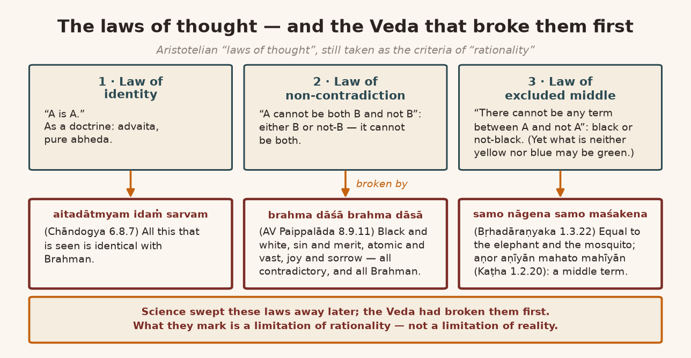
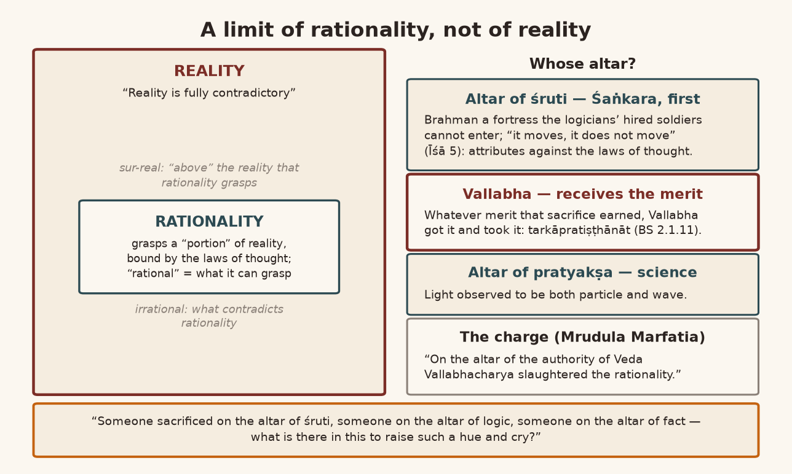
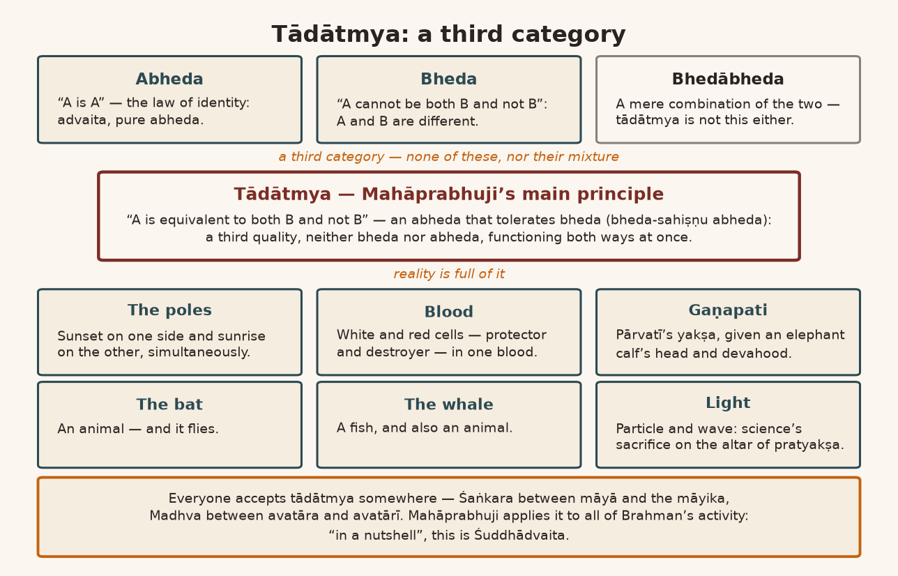
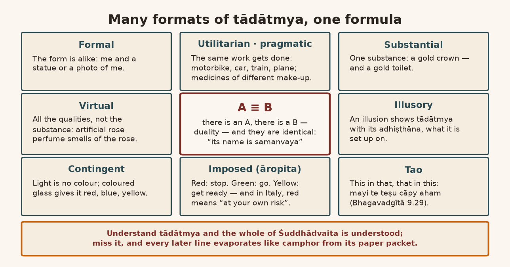
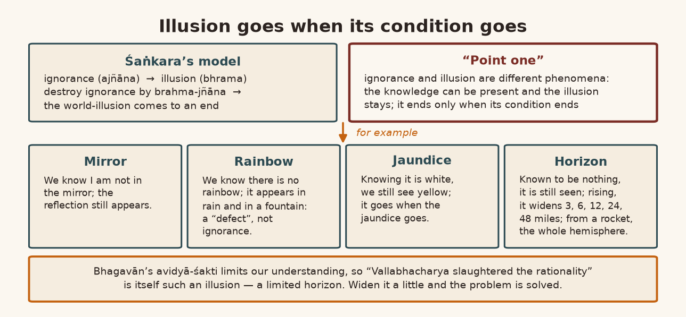
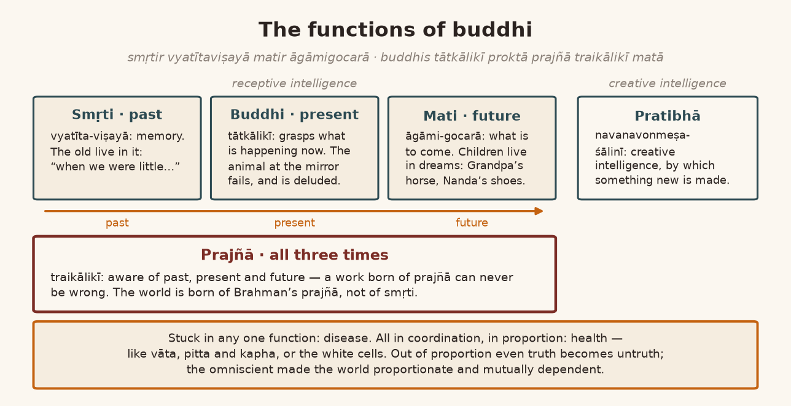
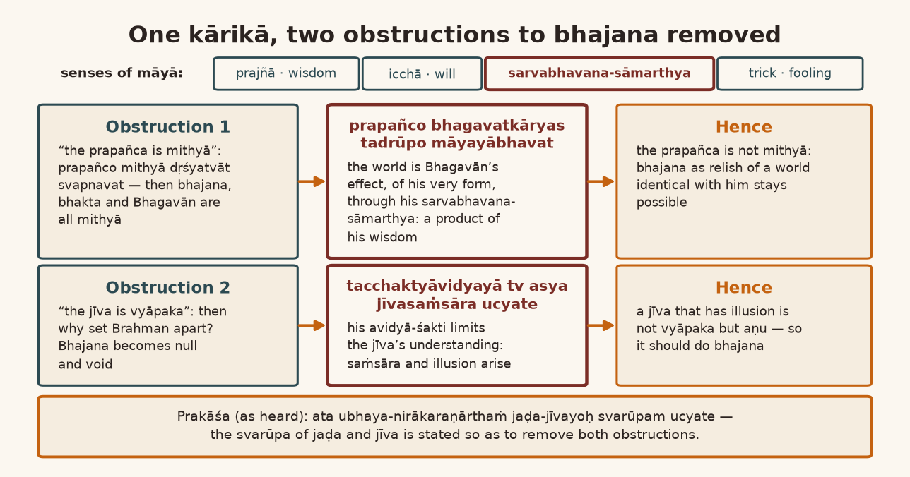
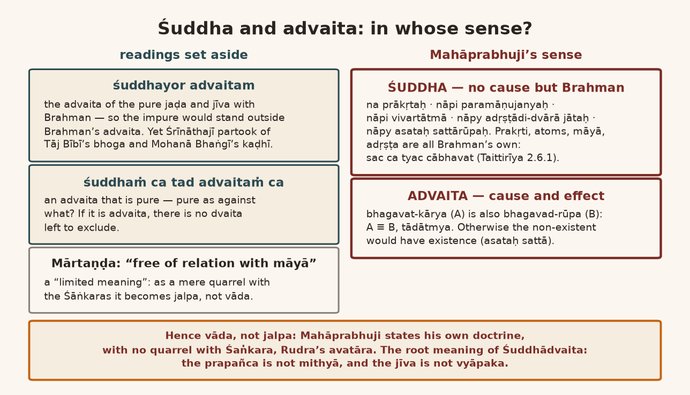

*English rendering of a spoken discourse on the Śāstrārtha Prakaraṇa of the Tattvārthadīpanibandha, translated from a Hindi ASR transcript. The speaker's conversational register, humour, digressions, code-switching, and student exchanges are preserved. Editorial flags: ‹ › conjectural restoration of a garbled reading; ‹?› uncertain reading; ‹…› inaudible or unrecoverable passage; ‹श्रवणाधारित› text given as heard, pending verification against a printed edition. Verses whose standard text is beyond doubt have been silently restored to the received editions.*

# 1. Opening Questions: Why the Four Pramāṇas Come in This Order

**Speaker:** Anything to ask? Seems there's no "hand raised."

**A student:** All right, all right.

**Speaker:** Yes, Tejas-bhāī.

**Tejas-bhāī:** Daṇḍavat praṇām. I wanted to ask — I mean, I was trying to understand it, so I wanted to ask: the four pramāṇas that are given — first the Veda — the "order" is Veda, Gītā, Brahmasūtra and Bhāgavata. Why were they taken in this "order"? What I understood is that there are two categories: the Veda and the Brahmasūtra are one category, the Gītā and the Bhāgavata are another; and the Gītā is the "summarize" of the Bhāgavata, the Brahmasūtra is the "summarize" of the Veda — so is that why they were taken "opposite" like this? Why not ‹…›?

**Speaker:** No. The Bhāgavata is the explanation of the Gītā. *Tad-vistāro bhāgavatam* ‹श्रवणाधारित› — don't you remember that one?

**Tejas-bhāī:** I see. Then why was it taken in this "order"?

**Speaker:** In "chronological order" too it goes like this. The Veda first; after that the Brahmasūtra was written; after that Bhagavān spoke the Gītā; after that — even after dividing up all the śāstras Vyāsajī was not satisfied — he wrote the Bhāgavata, *chelle* [Gujarati: last]. "Chronologically" too the Bhāgavata comes *chelle*, and from the "angle" of "text" and "interpretation" too the Bhāgavata comes last. Because in the Bhāgavata the meaning of the Gītā has been explained. And in the Gītā it is said about the Brahmasūtra: *brahmasūtrapadaiś caiva hetumadbhir viniścitaiḥ* (Bhagavadgītā 13.4). The Brahmasūtras had already come before.

**Tejas-bhāī:** So for us, I mean —

**Speaker:** I mean — and the Brahmasūtra is a reflection on the meaning of the Veda. So the Veda is first, then the Gītā after it, before the Brahmasūtra — no: the Brahmasūtras come before the Gītā.

**Tejas-bhāī:** Oh, so the Brahmasūtra is to be taken before the Gītā? I thought the "order" was Veda, Gītā, Brahmasūtra and Bhāgavata.

**Speaker:** No, no. What you're asking is why it was taken in this "order", isn't it? So I'm telling you: the Veda and the ‹Vyāsa›-sūtras are one category, that of śruti.

**Tejas-bhāī:** Right.

**Speaker:** The Gītā and the Bhāgavata come in the category of smṛti.

**Tejas-bhāī:** "OK." And these two names that come up — Maharṣi Bādarāyaṇa Vedavyāsajī and Kṛṣṇa Dvaipāyana — are they one and the same?

**Speaker:** According to the view of the "Indologists" they are different. Śaṅkarācārya is perhaps somewhat "double minded" on this. But from Rāmānujācārya right down to Mahāprabhuji, all are of one view: these two are one and the same.

**Tejas-bhāī:** "OK, OK," fine. "Done." With praṇām.

**Speaker:** Anything else?

**A student:** Yes — daṇḍavat, ‹Jejē›.

**Speaker:** Yes.

**A student:** Yes. For the Gītājī it says *śrīkṛṣṇavākyāni*. Now in the Gītājī there are a great many verses — Dhṛtarāṣṭra asking, or Sañjayajī's, or Arjuna's. Are those also to be taken as pramāṇa, or only *kṛṣṇavākyāni*, only what Kṛṣṇa Bhagavān said?

**Speaker:** Kṛṣṇa's. Only that, only that, only that.

# 2. The Proper Text Begins: Tādātmya, and the Charge That Vallabha "Slaughtered Rationality"

So far we have been told how to do virodha-parihāra, and several "models" of it were given: in the bodha-kāla — in the upadeśa-kāla, in the bodha-kāla — and in the bodhottara-kāla, and in the līlā-kāla. Now, after that, comes the subject that is to be made known. About that he now wants to tell us. Because as far as Mahāprabhuji's doctrine in this text goes, until now the upakrama was going on. Now the "proper" text begins from here.

In this, the most important thing is tādātmya. Understand the reason why tādātmya was taken up. Because contradiction (virodha) becomes the proof of difference (bheda); where there is non-difference (abheda) there is non-contradiction. If the two are one, there is no question of contradiction; if the two are contradictory, then there is difference between them. This is a "prejudice" of ours. Śruti breaks this "prejudice," and Mahāprabhuji "accepts" that.

There was a "PhD scholar" named Mrudula Marfatia; she was a disciple of our Dādājī. Her PhD — which even now runs in the "M.A.," the "M.A.," here in Bombay University — her "text" — in it she has written that Vallabhācārya sacrificed reason (tarka) on the altar of the authority of śruti. "Vallabhacharya slaughtered the rationality." "Slaughtered" — that's how she puts it; it is her "allegation." Because she finds Śaṅkarācārya more "appealing." That's the "problem." "Nothing wrong."

And the thing to understand is: which reasoning — the reasoning of which side — this reasoning that Vallabhācārya is supposed to have sacrificed on the altar of śruti's authority — that we'll have to look into, won't we? "On the altar of the authority of Veda Vallabhacharya slaughtered the rationality" — that is her "statement." So what is that ‹altar›? This we will have to look into, have to understand. So first of all we need to cast a glance, "conceptually," at tādātmya. Tādātmya is such a "concept" that everyone holds about it that it "coordinates" both bheda and abheda. Write this down properly.

# 3. The Laws of Thought, and the Flood That Swept Them Away

These are called the "laws of thought." If you are thinking anything at all, you cannot think without accepting these. This is the "limitation" of our thinking; that is what is called the "laws of thought." This is "Aristotelian law." At one time their bullying (*dādāgirī*) was very great. In philosophy too it was broken, but more than philosophy, science has "sabotaged" all these rules a great deal. Just think of it like this: just now, in Nepal, everything was swept away, wasn't it? Village after village. Fifteen hundred, sixteen hundred people swept away. In the same way science has swept away all the "laws of thought." No "standing" left at all for the old, orthodox notion. Even now these are taken as the "criteria" of "rationality" — that this is what "rationality" is.

Among them the first law is the "law of identity." It says "A is A." "A is A" — "law of identity." The second law is "A cannot be both" — "A cannot be —"

**A student:** "Both B and not B."

**Speaker:** Say it: "B and not B." Either it is B or it is "not B"; it cannot be both, cannot be both.

**A student:** "Logic — non-logic —"‹?›

**Speaker:** "Non-contradiction." "Laws of non-contradiction." "Law of non-contradiction." The third is the "law of excluded middle." "There cannot be any term between A — between A and not A, or B or not B." So "A cannot be — there cannot be any other term." Like "black" and "not black": the whole world has come into that. When we say "black" and "not black" — one thing is black, the other thing is not black — there is no "middle" term in this.

Just understand carefully. When we say yellow and "blue," then something that is neither yellow nor blue can still be green, can't it — "which is either both": blue and yellow mixed together make green. And if you won't accept green, don't; it can certainly be red. There are ‹many› "possibilities." But the "law of excluded middle" says that once you have "negated" one thing, the "middle" is "excluded" — "middle term excluded. There cannot be any term between A and not A. Between A and not A or between B and not B. So if A is either B or not B, there cannot be third term, middle term." This is the "law of excluded middle." This is the basis of "rationality." A great deal of our mathematics, a great many of our "thoughts," the "rules" of "logic" — all are based on this. ‹In fact›, this is the "foundation" of "rationality."

Science has broken these only now. Science has broken them now. The Veda had broken them from before — when the Veda says *aitadātmyam idaṁ sarvam* (Chāndogya Upaniṣad 6.8.7): all this that is seen is *aitadātmya*, "identical with" Brahman. So the principle of "A is A" ‹went› too, and the principle of the "laws of non-contradiction" too. Because what is this world? Something is black, something is white. Something is sin, something is merit. Something is atomic, something is vast. Something is "omnipresent," something is, like this, "temporal," in time. Something is "limited," something "unlimited"; something is happiness, something is sorrow — all of it is "contradictory." And all of it is "contradictory," completely. ‹The world› is giving us just this, "contradiction." And this is Brahman. So the "middle term" has also come in, in between.

Between the "contradictions" a "middle term" has come in too. What does the Upaniṣad say? *Samo nāgena samo maśakena* (Bṛhadāraṇyaka Upaniṣad 1.3.22): Brahman is equal to a mosquito and equal to an elephant too. Where did that go? *Aṇor aṇīyān mahato mahīyān* (Kaṭha Upaniṣad 1.2.20): it is subtler than the atom and greater than the great.

*Brahma dāśā brahma dāsā brahmeme kitavā uta* (Atharvaveda Paippalāda 8.9.11; quoted under Brahmasūtra 2.3.43). ‹We take› Brahman to be auspicious, beneficent. After that the Veda says: no, it isn't so that everything is only auspicious. Brahman is a *dāśa* too, that is, a fisherman. Brahman is a "slave" too; Brahman is a *kitava*, that is, a "fraud," too. Because whatever there is in the world, all of it is Brahman. A big one, isn't it? Everything has turned into a jumble (*kabāṛā*). So these "laws of thought" science itself had "sabotaged" before. But before Vallabhācārya there was no science; so Vallabhācārya "sabotaged" them first, and science "sabotaged" them later — we can understand it that way.

The thing to understand is that this tarka, this "rationality," is "based" on this. There is no doubt about that. Mrudula Marfatia's point is true up to here. But this is a "limitation of rationality." It is not a "limitation of reality." "We must distinguish between limitation of reality and between limitation of rationality."

{width=6.2in}

# 4. A Limit of Rationality, Not of Reality: Surrealism and Śaṅkara's Fortress

"This is a limitation of rationality, not the reality. Reality is all contradictory." "Reality is fully contradictory." So the "difference" between "rationality" and "reality" is this: "rationality" "grasps" some one "portion" of "reality," but it cannot "grasp" the whole of "reality."

And now, well, it isn't so much any more, but fifty, a hundred years ago in Europe the "concept" of the "rational," the "irrational" and the "sur-rational" came up. "Rational means that which is in the limitation of rationality, that which can be grasped in the limitation of rationality. That which is contradicted to the rationality is irrational." And "something" like this was also "proposed": the "sur-rational," which was also called the "sur-real" — "surrealism." Meaning, "which is above the realism": above the reality that we grasp through "rationality" is this. So, "surrealism." Sometime, in our own time, I'll show you how the "surrealism" "movement" went and what its "principles" were. Quite "interesting." It went on in "art," it went on in the "novel," it went on in "poetry," it went on in "philosophy" — in every "field" the "surrealism" "movement" went on. So the thing to understand is that "rationality" does not "grasp" "total reality"; it "grasps" some "portion of reality," you see. This is the "limitation" in it.

Now as for the point that on the "altar of the scriptural authority" — that on the "altar of the scriptural authority" "rationality" was "slaughtered": on the "altar" of "scriptural authority" — "altar" meaning the sacrificial altar, the *balivedī* — if reason was sacrificed, then Śaṅkarācārya did it first, the very one whose side she is taking. Why? Understand this carefully: Śaṅkarācārya said this first of all. It is a very amusing "statement" of Śaṅkarācārya's: *tasmāt tārkika-cāṭa-bhaṭa-rājāpraveśyam abhayaṁ durgam* ‹श्रवणाधारित›. This fortress of Brahman is such that the hired soldiers, the "mercenaries," who flatter the logicians can never "enter" this fortress of Brahman. *Tasmāt tārkika-cāṭa-bhaṭa-rājāpraveśyam abhayaṁ durgam*: come into the fortress of Brahman — no "mercenary," no hired soldier who flatters a logician, will "enter" at all. It troubles you‹?›. *Alpabuddhy-agamyam*: it will not be "grasped" by a "limited intellect." *Śāstra-guru-prasāda-rahitaiś ca*: those who have no understanding of the words of śāstra, those who don't have the guru's prasāda — they won't understand it either.

Why? What reason does Śaṅkarācārya give? He gives a very amusing reason: *tad ejati tan naijati* — it moves, and it also does not move; *tad dūre tad v antike* (Īśā Upaniṣad 5) — it is far, and it is also near. So where are the "laws of thought" now? *Ityādi-viruddha-dharma-samavāyi‹tva›…* — "contradictory attributes" of this kind have been "narrated" of it — *…mantra-varṇebhyaś ca* ‹श्रवणाधारित›.

What ‹sort of intellect› Mrudula herself had, I can't say — which it was, "limited" or "unlimited," who knows — so it seemed to her that Vallabhācārya had sacrificed reason. Vallabhācārya did not sacrifice reason; Śaṅkarācārya sacrificed reason. Whatever merit (puṇya) came from that sacrifice, Vallabhācārya got it. That much is true. If some merit comes from a sacrifice, then Vallabhācārya certainly got the benefit of that merit — and Vallabhācārya took it, too. Because Vallabhācārya also says that it is beyond the reach of tarka: *tarkāpratiṣṭhānāt* (cf. Brahmasūtra 2.1.11).

{width=6.2in}

# 5. Ignorance Is Not Illusion: The Mirror, the Rainbow, and Yāmuna's Runaways

So the very first "concept," tādātmya — is it established by tarka or not established by tarka? When this "issue" comes before us, then understand one thing carefully. Śaṅkarācārya did not accept the tādātmya of Brahman and the world. Śaṅkarācāryajī did not accept the tādātmya of Brahman and the jīva. And Śaṅkarācāryajī did accept the tādātmya of māyā and the māyika things. Because if he did not accept tādātmya, how would the illusion be destroyed by the destruction of ignorance? Śaṅkarācārya says: destroy ignorance — destroy the ignorance of Brahman by the knowledge of Brahman — and this illusion in the form of the world will come to an end. "Well and good."

Illusion is one "phenomenon," ignorance is another "phenomenon." Listen carefully. "Ignorance" is one thing, "illusion" is another. It isn't necessary that "illusion" always happens only because of "ignorance." Many times it happens because of "ignorance"; many times "illusion" happens even without "ignorance." For instance, we know very well that I am not in the mirror. And stand in front of a mirror — does the "illusion" of the "reflection" happen or not? We know that there is no rainbow as such; in the rainy season a rainbow appears, it appears in a fountain too. Now that is not "due to ignorance"; it is a "defect." It isn't so that "illusion" is "always due to ignorance."

What does Śaṅkarācārya say? That "illusion" happens because of "ignorance," and wipe out "ignorance" and "illusion" will come to an end. If wiping out "ignorance" ended "illusion" — well, today we have come to know that there is nothing besides Brahman, so the "illusion" of "ignorance" should have ended.

That is — there was Yāmunācārya, the dādā-guru of ‹Rāmānujācārya›. Most probably it is his saying:

> अहमर्थविनाशश्चेन्मोक्ष इत्यध्यवस्यति ।
> अपसर्पेदसौ मोक्षकथाप्रस्तावगन्धतः ॥
>
> *ahamarthavināśaś cen mokṣa ity adhyavasyati |*
> *apasarped asau mokṣakathāprastāvagandhataḥ ||* (cf. Rāmānuja, Śrībhāṣya 1.1.1; the speaker ascribes it, "most probably," to Yāmunācārya)
>
> [If one concluded that liberation is the destruction of the "I," one would run from the merest whiff of any talk of liberation.]

"I — I am Śyām Gosvāmī; this is Hitesh, this is Manish, this one is this, that one is that" — all these are illusions, because only Brahman is. So how will this illusion go away? By saying "I am Brahman," by saying *ahaṁ brahmāsmi* (Bṛhadāraṇyaka Upaniṣad 1.4.10), does the ‹illusion› go? Does that happen? And if it did happen — then, as ‹Yāmunācārya›, most probably Yāmunācārya, says: *ahamartha-vināśaś cen mokṣa ity adhyavasyati* — if the "I" (ahamartha) is going to be finished off… If you tell someone, "When you come to know Brahman, you will be finished," people won't even like to hear about mokṣa; they will run away. *Apasarped asau mokṣa-kathā-prastāva-gandhataḥ*: if someone just starts a discussion of mokṣa, people will run — "Run, run, run!" — the way people run when a "flood" comes, to save themselves. They will run like that. So "illusion" is not "removed" by the "removal" of "ignorance" — "point one."

# 6. Day and Night at the Poles: Gaṇapati, the Bat, and Light as Tādātmya

And this "identity" — what is it? It is so "flexible" that it is bheda as well as abheda. It is neither "pure" bheda nor "pure" abheda. Why it is not "pure" bheda, we can understand. Look at this carefully. The "laws of thought" we saw: in them, when we say "A is A," the "law of identity," that is advaita — ‹kevala›-advaita came. When we say "A cannot be both B and not B," then there is bheda of A and B. Got it? The "third" "category" is the tādātmya one. "What does tādātmya say? A is equivalent to both B and not B."

**A student:** "…and not B."

**Speaker:** Is this "logical" or not? ‹God knows›. "Logical" or not — whether it is "factual," whether it is "real," let us see. On the earth, aren't day and night "contradictory"? When it is day in one hemisphere of the earth, it is night in the other hemisphere. Day and night don't happen together. At the north pole, do the hemispheres come together or not? At the north pole — at the "North Pole," at the "South Pole" — day and night happen together: here the sun sets, there the sun rises. On this "side" the setting and on that "side" the rising happen "simultaneously." So in tādātmya they do not cancel each other out‹?›. It "depends" on from which "angle" you are looking, from which "part" you are looking. If you are looking on one hemisphere, it is "contradictory"; and if you are looking from the "North Pole" and the "South Pole," they no longer remain "contradictory."

So whatever "contradiction" there is — say we look "biologically": the "white cell" is not the "red cell," the "red cell" is not the "white cell," in the "blood." Are both "cells" in the "blood" or not? Do the two have "opposite" "tasks" or not? One is a protector, one a destroyer, and both are in one "blood" — ‹completely› "opposite" — are they there or not?

Understand another thing. In śāstra the distinction of deva and asura is taught. Those who are devas are suras, and those who ‹…› are asuras. Why are they suras? Because *suṣṭhu ramante*: their "modus operandi" is *suṣṭhu*, good. Why are asuras asuras? Because they are not suras: their "modus operandi" is not *su*, it is *dur*. That is why they are asuras. Who all come among the asuras? Yakṣas, rākṣasas, bhūtas, pretas — all these come among the asuras.

So listen carefully: Gaṇapatijī is "originally" a yakṣa. Not a deva. Because Pārvatījī had a yakṣa whom Pārvatījī had kept in her "service." And she had told him, "I'm bathing, so don't let anyone come in." That poor yakṣa was standing guard. ‹Mahādevajī› came; he stopped ‹Mahādevajī›: "Bhāī, you can't go in now, Pārvatījī is bathing." ‹Mahādevajī› got angry: "Bhāī, who are you to stop me?" He cut off his neck. Pārvatījī loved him like a child, the way a mother does; so she began to grieve. ‹Mahādevajī› said, "All right, I'll ‹bring him back to life›." ‹On the way› he found an elephant calf; he cut off its neck, ‹set it on the yakṣa›, and granted him devahood. So he is a yakṣa and also a deva. Now a yakṣa is not a deva, and a deva is not a yakṣa — but Gaṇapatijī is both. Neither bheda nor abheda‹?›.

We know very well that the bat (*cāmācīḍiyuṁ*) is an "animal." "Animals" don't fly; "birds" fly. The bat is an "animal," and it flies too — so the two are one. Where is there not "contradiction" in "reality"? Where is there not "contradiction"? Science said much later that "light" is a "particle" and also a "wave." A "wave" is not a "particle," a "particle" is not a "wave"; and "light" "behaves" both ways, in the "wave pattern" and in the "particle pattern" — isn't that a "contradiction"? So science made its sacrifice much later. On whose altar did it make the sacrifice? Not on the altar of śruti — on the altar of pratyakṣa. Max Planck "observed" "light" and proved that light is "contradictory." So, "Bhāī, you have sacrificed ‹reason› on the altar of pratyakṣa." Someone has made the sacrifice on the altar of śruti, someone has made the sacrifice on the altar of "logic," someone has made the sacrifice on the altar of "fact." What is there in this to raise such a hue and cry? And it is a man's habit to raise a hue and cry — so ‹Mrudula raised one›. One should take her as *mṛdu* [soft]; one shouldn't take it very "seriously." That is what I mean.

So this doctrine of tādātmya is the doctrine of an abheda that tolerates bheda (*bheda-sahiṣṇu abheda*). Understand this at the root: everyone has accepted it. Everyone has accepted it. Someone accepted it in māyā and the māyika; someone accepted it in "fact"; someone accepted it in "biology"; someone accepted it in "life." Madhvācārya, the dvaitavādī — he did not accept it between the world and Brahman, did not accept it between jaḍa and Brahman, did not accept it between jīva and Brahman; he accepted dvaita. But between the avatāra and the avatārī he accepted tādātmya. So who has not accepted tādātmya? Somewhere or other, everyone has to "accept" tādātmya.

That tādātmya Mahāprabhuji has applied to all of Brahman's activities. And "in a nutshell," if Śuddhādvaita is anything, it is Śuddhādvaita in this sense: that tādātmya is not mere bheda, it is not mere abheda. It is not even a "combination" of bheda and abheda; it is a "third quality" of its own — which is neither bheda nor abheda, but which, in between, "functions" both ways, as bheda and as abheda — like the bat. Like the "whale": it is a fish and also an "animal." Like Gaṇeśajī, through whom all auspicious works get done: he is a yakṣa and he is a deva too.

{width=6.2in}

# 7. The Many Kinds of Tādātmya: Gold Crowns, Rose Perfume, and the Italian Red Light

So Mahāprabhuji has taken that tādātmya as his "main principle," and the whole exposition will be on this basis. And when it is on this basis — what are the kinds of this tādātmya? Say it to me again. How many kinds of tādātmya can there be? First pay attention to this. To say it, tādātmya is one word, but there can be so much "variety" in it. Tādātmya means "A is equivalent to B" — "A is equivalent to B, where there is an A and there is a B, both, but they are equivalent to each other. Its name is samanvaya. A is equivalent to B." What the Upaniṣad has said is then completely true. Like "particle is equal to wave." It's like that — "the question of light is there," "light's behaving."

So the very first is "formal" tādātmya: the "form" of both is alike. As with me — if someone makes a statue of me, or there is a "photo" of me — in that there is "formal" tādātmya. It isn't one's own tādātmya‹?›. Whatever we see of this sort, we can see as "formal" tādātmya: someone made one of someone. That is called "formal" tādātmya.

Second comes usefulness (*upayogitā*): the work that gets done by this also gets done by that. So "utilitarian" tādātmya — what we call "pragmatic" tādātmya: the work that one thing does can also be done by another. For instance, understand this: all the "vehicles" there are — they all have "speed." Is there "utilitarian" tādātmya among them all or not? Where you can't go on foot, you can go by motorbike, you can go by car, you can go by train, you can go by plane — there are so many "vehicles." Among them there is "utilitarian" tādātmya. A motorbike is not a car, a car is not a motorbike; and a train is not a car or a motorbike; and a plane is not a train or a car or a motorbike. But there is "utilitarian" tādātmya, isn't there? ‹They serve› "the purpose." Many medicines are made of different "composites," and the disease goes away with them; it isn't that it goes away with only one medicine. There too "utilitarian" tādātmya comes in. So there is some tādātmya.

After that there is "substantial" tādātmya. Like an ornament made of gold. Or a royal crown made of gold. And, say, a "toilet" made of gold — in ‹some› "countries" many people have gold ‹toilets›. Now "formally" there is no tādātmya in that, is there? The crown sits on the head, but the "toilet"… But it is there, isn't it?

There can also be "virtual" tādātmya: what was not there before but has now come about. We do not call "virtual" tādātmya "illusionary." It has all the qualities that are in the "real" "substance," but it is not "real" — and it has all its qualities. Like nowadays artificial ‹rose perfumes› come; they are not made from roses, but they have the "smell" of the rose. That is "virtual" tādātmya, isn't it? It has all the "virtues" that are in the rose.

There can be an ‹illusory› tādātmya too: somewhere we have set up an "illusion"; that "illusion" too shows tādātmya with its adhiṣṭhāna, doesn't it — with that on which the "illusion" was set up. And likewise there can be "contingent" tādātmya. What is "contingent" tādātmya like? We can understand it this way: "light" is not blue-coloured, not red-coloured, not yellow-coloured; but whatever ‹glass› you put on it, because of that, a "contingent" tādātmya comes into the light — with red-coloured light, with blue-coloured light, with yellow-coloured light. That is "contingent." It is not from the "nature" of the light; but because of the "contingent," that nature comes into it — tādātmya. So tādātmya is not of one kind; this much we should understand.

Whenever we are talking of tādātmya, tādātmya is also imposed (*āropita*). Like: the "red signal" says, "Stop." The "green signal" says, "‹Go›." The "yellow signal" says, "Get ready." Now where did this "meaning" of yellow, green and red come from? We are "utilizing" it this way.

I read an American tourist's ‹travel› diary. When he went to Italy, he booked a taxi — yes, ‹I'll tell about the Tao kind›…

**A student:** Jī.

**Speaker:** ‹Wait, I'll tell the Tao one after this›. So he booked a taxi from the airport to go to the hotel. There was no green signal, it was a red signal — and just then [the driver] crossed. The American, as per his "habit," raised a fuss: "Bhāī, why are you doing this? There's no green signal right now, it's a red signal — how are you crossing the road?" [The driver] said, "It must be like that in your America. In our Italy it doesn't have that "meaning."" He asked, "What's the "meaning" in Italy?" He said, "With us, a red signal means going is forbidden — but if you want to go, you can go."

**A student:** Very good!

**Speaker:** "Then what does a green signal mean?" "That you can go — but don't think you'll be "safe." There may be an "accident.""

**A student:** Yes.

**Speaker:** The poor American panicked — what did the red signal mean then, what did the green signal mean? Meaning, "at your own risk": if you want to go, you can go. "There is a risk." The green signal says you ‹can› go — but there's no "guarantee." So red and green had no meaning left in it at all. Like that.

One is the Tao one — tādātmya. What is it? That this is in that one's "part," and that is in this one's "part." Which Bhagavān has said in the Gītā: *mayi te teṣu cāpy aham* (Bhagavadgītā 9.29) — I am in every thing and every thing is in me. This too is a "format" of tādātmya; this is the ‹Tao› "format." So tādātmya can have "multiple formats." There is no denying that. But along with it, one thing to understand is this: that all these different "formats" of ‹tādātmya› "signify" one and the same thing — "A is equal to B": "formally, virtually, substantially, utilitarian from the point of view, or ‹Tao› point of view, or contingent point of view, or illusionary point of view. Their symbolic expression is: A is equivalent to B, where there is an A, there is a B — duality — and they are identical to each other."

This is Mahāprabhuji's doctrine. Just this: if you understand it in brief, you have understood the whole of Śuddhādvaita. And if you have not understood this, then even if you have learned a lot of Śuddhādvaita by rote — if tādātmya isn't understood, all the lines that follow will turn to camphor for you. "Turning to camphor" means: camphor is kept in a packet, and it flies off. And the box remains, the paper packet remains — the camphor doesn't remain.

**Students:** Oh — the camphor isn't there!

**Speaker:** If you have understood tādātmya, your camphor will stay safe in its little packet; otherwise it will turn to camphor. In tādātmya lies the whole subject of Vallabhācārya.

{width=6.2in}

# 8. Prapañco Bhagavatkāryaḥ: The Kārikā and the Meanings of Māyā

Now look: *evaṁ svapravṛttim upapādya bādhaka-śāstrāṇāṁ nivṛtty-arthaṁ śāstram ārabhate* (Prakāśa on Śāstrārtha Prakaraṇa 23). Mahāprabhuji is saying — he has told why he spoke this text; after explaining what the purpose of setting out on it was, then which śāstras are obstructions to this śāstra — for their removal Mahāprabhuji first states his own doctrine.

**A student:** For their removal, first…

**Speaker:** What is it?

> प्रपञ्चो भगवत्कार्यस्तद्रूपो माययाऽभवत् ।
> तच्छक्त्याऽविद्यया त्वस्य जीवसंसार उच्यते ॥
>
> *prapañco bhagavatkāryas tadrūpo māyayābhavat |*
> *tacchaktyāvidyayā tv asya jīvasaṁsāra ucyate ||* (Tattvārthadīpanibandha, Śāstrārtha Prakaraṇa 23)
>
> [The prapañca is Bhagavān's effect; through māyā it came to be of his very form. What comes about through his power, avidyā, is called the saṁsāra of the jīva.]

*Prapañco bhagavatkāryaḥ*: between the prapañca and Brahman there is tādātmya — the relation of effect and cause, kārya-kāraṇa-bhāva. How is there tādātmya in the relation of effect and cause? Like an ornament made of gold — is it gold or isn't it? It is. ‹So› bhagavattva.

Now the question is: why did Bhagavān become the prapañca? So: *tadrūpo māyayābhavat* — he became it through māyā. The word māyā has many meanings in śāstra. One meaning of māyā is Brahman's prajñā — "wisdom." One meaning of māyā is Brahman's will (icchā). One meaning of māyā is sarvabhavana-sāmarthya. One meaning of māyā is a "trick" — a "‹fooling› trick," a "trick" for making a ‹fool› of someone, the way a "magician" does. By which māyā has Brahman here become everything? Mahāprabhuji says: in Brahman there is a sarvabhavana-sāmarthya. "There is a substantial potentiality that he can become everything and anything." By that he becomes the form of the prapañca.

*Tacchaktyāvidyayā tv asya*: and Brahman's śakti is avidyā too — meaning, "He can fool also." Now understand: he does not make a fool of you with a "malafide intention." Mahāprabhuji says something very amusing: *alpānām* ‹…› ‹श्रवणाधारित›. One whose understanding is small, on seeing some very great, weighty thing, starts to think, "I am a fool." Like when we go to see "magic": we don't know what the "trick" of the "magic" is; we feel some great "magic" has happened; but when we come to know the "trick," we feel — no, we've been made fools of; ‹they› do it by cleverness. In the same way, whoever is small, of small understanding, is bound to have illusions about one who is very wise. So *tacchaktyāvidyayā tv asya*: because of his avidyā-śakti. Meaning, he does not let you know what he — what he is doing. He doesn't let you know what he is doing. Because of that — because of that ignorance — "illusion" arises in you.

# 9. Knowledge Does Not Cure Jaundice: The Horizon and the Alt-Key Keyboard

And by your knowing, that "illusion" will not go away; only when he removes the ignorance will it go. That example I gave you earlier: "illusion" is not removed by knowledge. Like when we get "jaundice": white looks yellow. Suppose we know, "Bhāī, this is white, it's white." Will that stop the "jaundice" yellow from showing? It will show all the same. Because it will go when the "jaundice" goes. Not every "illusion" goes away by knowledge.

As we know very well — "there is nothing like horizon." But is the "horizon" seen or not? Does it go away by knowledge? Cover the "distance" to where the "horizon" is, and look: the "horizon" will come again, there. So "illusion" does not go away by knowledge. If the "conditioning" — the "condition" because of which the "illusion" is happening — if that "condition" goes, the "contingent," then it goes. Like where we see the "horizon": on the earth there is a three-"mile" "radius" — within every three-"mile" circle the earth is flat; by the second, third mile it takes a little "curve." So within every three-"mile" "radius" on the earth we see a "horizon" — Bhāī, from "ground level." Rise a little and instead of three "miles" it becomes six "miles." Rise a little more and it becomes twelve "miles." A little more, and the earth becomes twenty-four "miles"; it becomes forty-eight "miles." Go up high in a "rocket," and at last the earth's hemisphere will appear in front of you. So the horizon (*kṣitija*) can expand. But it has arisen because of our "limited capacity" to see. We cannot see the whole; that is why the horizon is arising. If we could see the whole, no horizon would arise. Simple thing. So it goes when the "condition" goes; it does not go when "ignorance" goes. Understand this as a principle.

That the avidyā-śakti by which Bhagavān has made — meaning, made our "understanding" "limited"; "in other words," has "bound" it in the "laws of thought," as with Mrudula Marfatia — so it is natural to have the "illusion" that "Vallabhacharya slaughtered the rationality on the altar of the scripture." It is a "limited understanding"; the "horizon" needs to be widened a little, and the "problem" will be "solved." It isn't [really] so.

For this I often give a "fun" example. In our computer we have "fed" three "languages": Hindi, Gujarati and English. They come on with the Alt-1, Alt-2, Alt-‹3› keys. The keyboard itself is English. A bhagavadīya came, ‹looked›, and said, "Arey, how are you printing Hindi with this English keyboard?" "It's the computer's program, like that." He said, "No, no — you're doing ‹something›." He got an illusion, didn't he?

**A student:** Right.

**Speaker:** There is no ‹miracle› in it. It's the Alt-1, Alt-2, Alt-3 business. He said, "No, no — from an English-type keyboard you print something like Gujarati and Hindi!" Illusion happens. In the same way, seeing every act of Bhagavān, we get the illusion — what is he doing, how is he doing it, how can such a thing be? ‹…› illusion happens. So this is worth understanding. So: *tacchaktyāvidyayā tv asya jīvasaṁsāra ucyate*. It happens to the jīva as with Mrudula Marfatia — "this one has sacrificed reason on the altar of śruti." That is an "illusion." You've got the point, haven't you? This much is said in the mūla kārikā itself.

{width=6.2in}

# 10. Why Say "Prapañca": Śaṅkara's Dream Inference and the Seed of Bhajana

After that we look at Mahāprabhuji's Prakāśa: *prapañca iti. prapañcam eva mithyety uktvā śuddhaṁ bhajanaṁ vārayanti* (Prakāśa on Śāstrārtha Prakaraṇa 23). In *prapañco bhagavatkāryaḥ*, why did he use the word prapañca for the prapañca? Mahāprabhuji is saying: why am I using "prapañca"? Because the great scholar Śaṅkarācārya says this: *prapañco mithyā dṛśyatvāt svapnavat* — the prapañca is mithyā because it is seen, just as a dream is seen. A ‹dream› too is seen — but where does it exist? In the same way the prapañca too is seen; therefore it is mithyā.

What does this mean — that what is not seen is real, and what is seen is not real? Look, understand this carefully: we do see māyika things — māyā is seen — so we will have to accept māyā as real too —

**A student:** Ho.

**Speaker:** Māyā is seen —

**A student:** No, no.

**Speaker:** Māyā isn't seen. The illusion is seen. Māyā isn't seen; so if what is not seen is real, then māyā too will become real.

And Śaṅkarācārya says that when the prapañca is being seen, then in its being seen, the existence (sattā) that is seen in it — whose is it? He says it belongs to the adhiṣṭhāna. As when a snake is seen on a rope, where did its sattā come from? The snake's came because of the rope. So it is Brahman's sattā that is being seen — that too eternal, imperishable. ‹Then› Brahman's sattā will become mithyā. Brahman may well be real — Brahman's sattā will become mithyā. A big mess will result.

That is why Mahāprabhuji is saying: *prapañcam eva mithyety uktvā śuddhaṁ bhajanaṁ vārayanti*. If it happens, let it happen — what difference will it make? So Mahāprabhuji says the difference will be this: then the seed-bhāva of doing bhajana will be finished for you. Because if the prapañca is mithyā, then the bhajana of Bhagavān that you are doing in the prapañca — that bhajana too is mithyā. You too are mithyā. And the Bhagavān whose bhajana you are doing is mithyā too. So the "possibility" of śuddha bhajana will become "null and void." That is why I say the prapañca is Bhagavān's. Once you understand the prapañca as bhagavat-kārya — being bhagavat-kārya, it will not be mithyā; it becomes mithyā by being an effect of māyā. "I mean, if it is a product of ignorance then it can be an illusionary. But it is a product of God himself, or it's a product of the wisdom of the God." So how will a product of "wisdom" be mithyā? Of prajñā — the meaning of māyā is also prajñā.

# 11. Smṛti, Mati, Buddhi, Prajñā, Pratibhā: The Old Man, the Child on Grandpa's Back, and the Animal at the Mirror

Write down a verse:

> स्मृतिर्व्यतीतविषया मतिरागामिगोचरा ।
> बुद्धिस्तात्कालिकी प्रोक्ता प्रज्ञा त्रैकालिकी मता ॥
>
> *smṛtir vyatītaviṣayā matir āgāmigocarā |*
> *buddhis tātkālikī proktā prajñā traikālikī matā ||* (traditional definition; cf. Vidyācakravartin, Sampradāyaprakāśinī)
>
> [Smṛti has the past for its object, mati what is yet to come; buddhi is said to be of the present moment, prajñā is held to span all three times.]

*Pratibhā navanavonmeṣaśālinī ucyate param* ‹श्रवणाधारित› (cf. Bhaṭṭa Tauta's line *prajñā navanavonmeṣaśālinī pratibhā matā*).

What we call "memory" or "recollection" — its "reference" is "always" to the "past." *Vyatīta-viṣayā*: vyatīta, that is, it is in "reference" to the "past." *Matir āgāmi…*: when we get "awareness" of what is going to happen in the "future," that is called mati. And buddhi is called *tātkālikī*: what "refers" to the "present" is buddhi. But what is prajñā? That which is *traikālikī*, meaning, which "refers" to all three times, "past, present, future" — that is prajñā. So the world has been born of Brahman's prajñā. The world has not been born of smṛti.

Look, understand one thing carefully — it is a slight digression, but the point will become clear. When we are children — when we become old, only memory is left as a support for living: "In our childhood it was like this, in our time it was like this, in our time it was like this." Because old people have no "future," so they have to live in memory. *Ame nānā hatā tyāre āvuṁ hatuṁ, ame āvī rīte ramatā hatā* [When we were little it was like this; we used to play like this]. *Are bhāī, e to gaī vāt ho; rātnā bhāv rāte gayā* [Oh brother, that's a thing gone by; the night's prices went with the night]. What is the poor old man to do? If he doesn't live in memory, where should he live?

Children live in "dreams" — by mati — because they keep "dreaming" that in the "future" I'll be like this. There used to be an old Gujarati book; in it was *Dādājī no ghoḍo* [Grandpa's horse] — a poem. Now the child doesn't get a horse, so he climbs on Grandpa himself and makes him the horse. Because they "always" look at the "future." In our Ṭhākurjī's līlā too it comes that Ṭhākurjī put on Nandarāyajī's shoes and started wandering about the Nanda-bhavana. ‹They told him›, "Bhāī, going inside ‹in shoes› is forbidden" — he said, "No, no, it'll do." Because in putting their feet into the elders' shoes, children see their own "future."

So, *matir āgāmi…*. *Buddhis tātkālikī proktā*: what is buddhi? It "refers" to the "present": that you understand what is happening in the "present" — then you are intelligent. ‹Otherwise›, what is appearing in the "present," you are not able to understand. Like — put a "mirror" in front of an animal, and the poor animal goes crazy. Why does it go crazy? It doesn't understand — what's this business? Where has this animal come from? Many times the animal goes behind the glass to look. First it strikes with its paw; it wants to ‹scratch›, wants to bite, but can't bite; so it thinks there's some "cover" ‹…›. So it goes behind the glass and looks — but there it isn't to be seen, and still it is seen. Now, does it understand that what it is seeing is its own "image"? So, because it cannot understand what is happening in the present moment, the poor animal is deluded. So when we cannot understand what is happening in the moment, we get deluded. But prajñā is traikālika. Buddhi is tātkālika, and prajñā is traikālika — traikālika meaning that which has "awareness" of all three, "past, present, future." A work born of this prajñā can never be wrong.

*Pratibhā navanavonmeṣaśālinī parikīrtitā* ‹श्रवणाधारित›: pratibhā is "creative intelligence," by which you can "create" something. These three — four — "intelligences" are not "creative" but "receptive intelligence." What are you "receiving"? From the "past," from the "present," from the "future," or from "all the three bases of time." This is "receptive intelligence." And pratibhā is "creative intelligence": that by which you "create" something new, something, is called pratibhā. All these are functions of buddhi itself.

Among these, getting "stuck up" in any one "function" is a disease. And running all the "functions" in "coordination" is health. Understand this carefully. If you got caught, got "stuck up," in the "creative" alone, that too is a disease. If you got "stuck up" in pratibhā alone, or in prajñā alone, that too is a disease. But one in whom the "functions" of all three — all five — are balanced, running in "proportion" in buddhi, that is health. As, according to Āyurveda, vāta, pitta and kapha — all three are in our body, but an increase of any one is a disease, of vāta or of pitta or of kapha, "et cetera," like that. As according to the modern śāstra: if the "white cells" in us increase, it is a disease; if the "white cells" decrease, it is a disease. Everything is running "proportionately." "Out of proportion," even truth becomes untruth, and "within the proportion" even untruth becomes truth.

This is a symbol — whenever we say anything "out of proportion." Because the world has been made "proportionately." So whenever anything at all is said or done "out of proportion," it goes wrong — this is the principle. So the world Brahman made, he made because he is omniscient (*sarvajña*); he did not make it "out of proportion." He has made everything "mutually dependent."

Just yesterday a child was asking me — very amusing — he says, "Why did Bhagavān make this, why did he make that?" Now, "Why did Bhagavān make this, why did he make that" — the question doesn't even arise. Why doesn't it arise? Because Bhagavān has made everything. We see "this" and "that"; Bhagavān doesn't see this and that — he sees everything as himself. He has made himself. Why did Bhagavān make death? Well, bhāī, Bhagavān did not make death; Bhagavān himself became death. Why did Bhagavān make life? Bhagavān did not make life; Bhagavān himself became life. Why did Bhagavān make knowledge, why did Bhagavān make ignorance? Bhagavān did not make knowledge and ignorance; Bhagavān himself has become knowledge and ignorance. This is the "basic difference." So we teach children that Bhagavān made things, and then the question arises in the children: why did Bhagavān make this? So we should not teach them that. We should teach children: *prapañco bhagavatkāryas tadrūpo māyayābhavat; tacchaktyāvidyayā…* — we are not able to understand that, and so saṁsāra arises for us there. That is our "limitation of understanding." It is not a "limit" in Bhagavān's "understanding." Got it? So this is what he is explaining.

{width=6.2in}

# 12. "The Elephant Is Mithyā, So Is My Running": Bhajana as Relish, and the Jīva That Is Not All-Pervading

*Śuddhaṁ bhajanaṁ vārayanti* — what does *bhajanaṁ vārayanti* mean? Understand this carefully. That you won't be able to play the jhāṁjh [cymbals] — if the prapañca is mithyā, it is not like that; even if the prapañca is mithyā, you can still play the jhāṁjh. It is not that you won't be able to offer flowers; it is not that you won't be able to place a bhoga of laḍḍū and pūrī. You can offer laḍḍū and pūrī as bhoga too.

Among the Śāṅkaras a very amusing "joke" goes around. The king — Paṇḍitjī was saying "jagat mithyā," the world is mithyā. The king got angry. The king was going out riding on an elephant. The king said, "Let loose a mad elephant on him — on this paṇḍit!" The paṇḍit started to run; the elephant came. The king said, "Why, Paṇḍitjī? You were saying the world is mithyā — why are you running? The elephant is mithyā." He said, "You are a fool. If the elephant is mithyā, is my running real?" *Gaja mithyā*, he said, *palāyana mithyā* [the elephant is mithyā, the running away is mithyā].

So it is not that you won't be able to do bhajana. Bhajana means "relishment." You won't be able to "relish" Bhagavān. You'll be able to play the jhāṁjh; you'll be able to have darśana in the havelī; in a manoratha you'll be able to go *jhin-chin, jhin-chin*; you'll be able to place laḍḍū, pūrī, maṭhaḍī — all as bhoga. ‹But› you won't be able to "relish" ‹it›. To "relish" Bhagavān you will have to hold him "identical" with the world. Because if you hold him "identical" with the world, then the world too is bhagavad-rūpa, you too are bhagavad-rūpa, your bhakti too becomes bhagavad-rūpa; so the "relish" of Bhagavān you are having will also be a bhagavad-rūpa "relish." In this sense, *prapañcam eva mithyety uktvā śuddhaṁ bhajanaṁ vārayanti*. The rest is all "symptoms" of bhakti, not bhakti.

**A student:** "OK."

**Speaker:** A "disease" is one thing, a "symptom" is another. So all these are "symptoms": playing the jhāṁjh, offering a bhoga of laḍḍū and pūrī, doing manorathas and so on and so forth — all are "symptoms" of bhakti. What is the "disease"? To "relish" him. ‹But› the "relish" of Brahman you won't be able to have, because you are making the prapañca mithyā; so whatever you "relish" is all mithyā, and what is "irrelishable" is real. That is what Mahāprabhuji is explaining, so this is worth understanding very carefully: *prapañcam eva mithyety uktvā śuddhaṁ bhajanaṁ vārayanti, tathānye jīvaṁ vyāpakam uktvā* (Prakāśa on Śāstrārtha Prakaraṇa 23).

Some people, by calling the prapañca mithyā, make the "relishment" of Bhagavān in the world "null and void." Other people, by calling the jīva vyāpaka, make the bhajana of Bhagavān "null and void." Because if the jīva is vyāpaka, then Brahman is vyāpaka and the jīva is vyāpaka too — so why set Brahman apart? Why not set yourself apart? These two doctrines are obstructions (*bādhaka*). These two doctrines being obstructions, how were these two doctrines refuted? How were they warded off? So: the prapañca and bhagavat-kārya —

**A student:** Hmm.

**Speaker:** — by saying the prapañca is bhagavat-kārya, the prapañca is not mithyā: bhagavat-kārya is not an effect of ignorance, mithyā. And if the jīva were vyāpaka, why would it have saṁsāra? The jīva is not vyāpaka; that is why saṁsāra is happening. *[The speaker recites a few lines of an old Bollywood film song, in which the heart asks where it should go: tears on this shore, and no one knows what lies on the other.]* That is because of not being vyāpaka. If ‹it were vyāpaka›, how ‹could this be›? It wouldn't even come to know — saṁsāra wouldn't happen at all. The jīva has saṁsāra; "that proves" it is not vyāpaka. It is not vyāpaka; that is why it should do bhajana.

So: *…jīvaṁ vyāpakam uktvā; ata ubhaya-nirākaraṇārthaṁ jīva-jaḍayoḥ svarūpam ucyate* (Prakāśa on Śāstrārtha Prakaraṇa 23). So, because both these doctrines are obstructions to our bhakti, he is stating the svarūpa of the jaḍa and the jīva.

{width=6.2in}

# 13. Where the Word "Śuddhādvaita" Came From: Vijayanagara, the Flying Kamaṇḍalu, and the Mārtaṇḍa

Now another important thing comes up here. The thing is this: that our school is called Śuddhādvaita — this is actually not a "term" given by Mahāprabhuji. We have fabricated ‹little› "stories": that Mahāprabhuji went to Vijayanagara, won the śāstrārtha there, and at the time of his winning a ‹birudāvalī› was read out for him — "Śuddhādvaita-pratiṣṭhāpanācārya." Mahāprabhuji himself never used the word Śuddhādvaita anywhere. Gosāīṁjī ‹did not use it›. The word started of its own accord from the sixth generation. In fact Puruṣottamajī goes so far as to say that *śuddhābhedavāda*‹?› is the most wicked of all. And the Śāṅkaras all call themselves Śuddhādvaita. So this is not ‹our› "standpoint." Well after the sixth generation we began calling ourselves Śuddhādvaita — but however many times you tell people… And just as there is a misconception about the prasthāna-catuṣṭaya, so there is a heavy misconception about Śuddhādvaita too: that Śuddhādvaita is our original doctrine.

In the Sarvottama Stotra there are a hundred and eight names of Mahāprabhuji. Nowhere does the word Śuddhādvaita come. *Sākāra-brahmavādaika-sthāpako vedapāragaḥ* (Sarvottama Stotra 8). In the Aṇubhāṣya, Śuddhādvaita does not come anywhere; in the Nibandha Śuddhādvaita does not come anywhere; in the Ṣoḍaśa Grantha Śuddhādvaita does not come anywhere. The "term" was "coined" much later. I'm not saying it is ‹contrary›, but it is much later; it is not Mahāprabhuji's, sir. So what is the meaning of Śuddhādvaita according to Mahāprabhuji? This is a "basic issue."

**A student:** Hmm.

**Speaker:** Now what happened was this. There was Giridharajī Mahārāja of Kāśī; he wrote the Śuddhādvaita Mārtaṇḍa, about two hundred years ago. After that Śuddhādvaita became current among us, and then the stories and such all got made — "the Śuddhādvaita school, Vallabhācārya," and this and that, ‹so on›. When Kṛṣṇadevarāya was king, Mahāprabhuji did not go to Vijayanagara; and when he did go, Kṛṣṇadevarāya was not king.

And the amusing thing in it is that it comes there that Mahāprabhuji sent his kamaṇḍalu ahead. A kamaṇḍalu is a vessel kept in the hand. How did his kamaṇḍalu go? They say it flew there through the sky. Having flown there, what did Kamaṇḍalujī do? A "human voice" started coming out of it. By making up all such stories Mahāprabhuji's greatness (*māhātmya*) decreases; it doesn't increase. Mahāprabhuji had a disciple named Kamaṇḍalu.

**A student:** ‹The vessel›?

**Speaker:** Vessel. Who keeps the vessel called kamaṇḍalu? Sannyāsīs keep it. Mahāprabhuji is hardly a sannyāsī, that he would keep a kamaṇḍalu! So stories like these all get made, of every variety. Once a man becomes "popular," lots of "stories" get built up around him; and then everyone gets angry — why don't you accept the "story"? Because our faith rests more on the "story" than on the siddhānta. Because the "limitation" of buddhi is such that a point is understood quickly through a "story," whereas with siddhānta it becomes a bit "abstract." The "concrete" is understood. This is the "problem" of the "human mind."

But the thing to understand is this: had Mahāprabhuji used the word Śuddhādvaita, what would Mahāprabhuji have meant by Śuddhādvaita? That, now, is not explicit here in Mahāprabhuji.

# 14. Nothing Is Impure to Brahman: Tāj Bībī, Mohanā Bhaṅgī's Kaḍhī, Ṭhākurjī's Back, and Bāla Mukunda's Toe

Because the author of the Śuddhādvaita Mārtaṇḍa, ‹Mahārāja›jī, used the word Śuddhādvaita in this sense: *śuddhayor advaitaṁ śuddhādvaitam* — the non-duality with Brahman of the pure jaḍa and jīva is Śuddhādvaita. Or *śuddhaṁ ca tad advaitaṁ ca śuddhādvaitam* — the advaita that is pure is Śuddhādvaita.

The thing to understand in this — look, write down the "point" at your ease: by saying *śuddhayor advaitaṁ śuddhādvaitam*, the meaning comes out that for the impure there is no advaita; there will be no advaita. Is there anything in the world whose Brahman-ness is not immediate (*avyavahita*)? Even with what is impure, Brahman's advaita is there, isn't it? If Brahman had no advaita with the impure, then how could Tāj Bībī have done sevā? How could ‹he› have partaken of the bhoga Tāj Bībī placed? How could he have partaken of ‹…›'s? How could he have partaken of Mohanā Bhaṅgī's kaḍhī? When Śrīnāthajī was ‹partaking of› Mohanā Bhaṅgī's kaḍhī, Govindasvāmī gave him a bath in the kuṇḍ — forcibly. Then ‹…› asked, "Bhāī, does the Brahman-ness go away?" What did Govindasvāmī say? "No — Brahman doesn't get touched. It's your *meṇḍh* [boundary-ridge] that gets touched, because you keep up the Brahmin's *meṇḍh*. That's what got touched; Brahman isn't touched." Do you get the point or not? He said a thing worth knowing: Brahman isn't touched — so for Brahman there is no untouchability (*chuāchūt*) at all. For Brahman everything is all one. Because *mayi te teṣu cāpy aham*. It is the ‹Tao› advaita: I am in all, and all is in me.

In our childhood we used to be told this — I'm telling you about myself: that one should have darśana of Ṭhākurjī's mukhāravinda, not darśana of Ṭhākurjī's back. Because in Ṭhākurjī's back there is naraka, and in front there is Vaikuṇṭha. We used to avoid looking very carefully. If ever Ṭhākurjī's back came into view, we would shut our eyes at once — lest we see naraka. Arey bhāī, but the difference between naraka and svarga — in Bhagavān it is all of the nature of bliss, isn't it?

**A student:** For a man, though — lest he see ‹naraka›.

**Speaker:** For us, that naraka — naraka is a form of suffering. For Bhagavān, naraka is one kind of bliss and svarga is one kind of bliss; both are Bhagavān's own kinds. Both are kinds of bliss. They used to frighten us: don't look at the back, or it's naraka. So is Bhagavān's back in naraka, or is naraka in Bhagavān's back? Bhagavān's back is not in naraka; in Bhagavān's back there is naraka too. Everything is there.

Naraka means *narāṇāṁ kam, duḥkhaṁ yatra* ‹श्रवणाधारित›: where a man gets suffering, that is naraka. *Suṣṭhu arjyate iti svargaḥ* ‹श्रवणाधारित›: what a man "earns," "desirously," "voluntarily," that is svarga. Meaning, the "fulfilment" of "ambition" is svarga, and the "flop" of "ambition" is naraka — that's all there is to it. Both are in Bhagavān. He "fulfils" "ambition," and he also makes "ambition" "flop."

Just now a ‹flood› came there. At Kailāsa many must have had "ambitions." Earlier people used to go to Kailāsa on pilgrimage; nowadays they go there to celebrate their "honeymoon" too. Many got swept away. People don't think — afterwards comes this trouble. The more we go, the warmer the "climate" there gets. The warmer the "climate," the faster the snow melts. The faster the snow melts, the more the "glacier" will melt. If the "glacier" melts, a "flood" is bound to come. And we, to promote "tourism" — here's a car, here's a helicopter, here's a plane! Now what is the poor Himālaya to do? It is not a mountain of stone; it is a mountain of earth. So while the snow stays frozen, the earth too stays firm; if the snow melts, the earth falls, and it falls too. The trees fall too. No one has the sense that one shouldn't go there like this — so people go.

The Himālaya lets everyone do anything, doesn't it? It's hardly going to — if you go there for a honeymoon, it won't stop you; it won't slap you, "Why are you having a honeymoon?" Go to do tapasyā — you can do that too; want a honeymoon, you can have it. Go to drink liquor, you can do that too; go to fight, you can do that too. What does the Himālaya care about these "limited" "wants" of yours there? It can't do anything to ‹you›, fine — that the snow will melt and ‹sweep› you ‹away›, that's another story. Brahman does everything: it kills too, and it saves too.

Understand carefully what Śuddhādvaita means — what does Mahāprabhuji say? We do not say "śuddha advaita." Because if the advaita is the advaita of the pure, then what will become of the impure? It will be dvaita. ‹But it is not› dvaita: it is dvaita and also advaita — dvaita "into" advaita, that is our "format." Dvaita within advaita — this is our "form"; dvaita *and* advaita is not our "form." Like the principle of the "two-in-one": in a "two-in-one," the one is a "unit," a "singularity," and in it "duality" has become manifest — like a two-in-one. So there is dvaita within advaita; so there is nothing impure there at all. From our "angle" there is pure and impure, "of course"; and from Brahman's "angle," nothing is pure and nothing is impure — everything is Brahman.

Understand one thing carefully: we consider the foot impure and the head pure. The child knows this:

> करारविन्देन पदारविन्दं मुखारविन्दे विनिवेशयन्तम् ।
> वटस्य पत्रस्य पुटे शयानं बालं मुकुन्दं मनसा स्मरामि ॥
>
> *karāravindena padāravindaṁ mukhāravinde viniveśayantam |*
> *vaṭasya patrasya puṭe śayānaṁ bālaṁ mukundaṁ manasā smarāmi ||* (Bālamukundāṣṭaka 1, traditionally ascribed to Bilvamaṅgala)
>
> [With his lotus hand placing his lotus foot in his lotus mouth, lying in the fold of a banyan leaf — the child Mukunda I call to mind.]

So Bhagavān sucks the big toe of his own foot. What does sucking the big toe mean? A "complete cycle" — a "cyclical" round of "head ‹and toe›." A "cyclical" round of "head and toe": where the "toe" ends, from there the "head" begins; where the "head" begins, it goes back to the "toe." It is a "cycle." *Bālaṁ mukundaṁ manasā smarāmi.* For ‹him› there's no pure or impure, is there? The mouth isn't pure, the "toe" isn't pure; the mouth isn't impure, the "toe" isn't impure — so the child just sucks his toe. We have made it impure because we are afraid that dirt will go into the mouth. Is the child afraid? The child is being Brahman.

Understand this carefully: there is no pure and impure. *Śuddhaṁ ca tad advaitaṁ ca*: that which is advaita and also pure — then what impurity could there be in advaita? You can't say two things, can you — that it is advaita and also pure? Then pure as against what? From what are you "excluding" the advaita? If it is advaita, there is no dvaita; if it is advaita, there is no dvaita; so from what are you making this "exclusion" of the advaita by "pure"? "Excluding" it from what are you attaching the "adjective" śuddha? This "term" was just "coined" like that. Had Mahāprabhuji used the word Śuddhādvaita, how Mahāprabhuji would have "interpreted" it — that Mahāprabhuji is explaining here. He would not make this kind of "interpretation."

# 15. What "Śuddha" Means for Mahāprabhuji: Unmixed Milk, Pure Gold, and a Joke About Vivarta and Vikāra

As a working meaning, the meaning of Śuddhādvaita in the Śuddhādvaita ‹Mārtaṇḍa› is fine. But how Mahāprabhuji would have done it, Mahāprabhuji is explaining: *ayaṁ prapañco na prākṛtaḥ, nāpi paramāṇujanyaḥ, nāpi vivartātmā, nāpy adṛṣṭādi-dvārā jātaḥ, nāpy asataḥ sattārūpaḥ* (Prakāśa on Śāstrārtha Prakaraṇa 23) — this is the pure cause.

Śuddha has two meanings. The "unmixed" is called *viśuddha*, and the "solely" is also called *viśuddha*: what is one, alone, is śuddha. ‹Śuddha› has two meanings. Śuddha jñāna means knowledge alone. A śuddha thing means one that has not been "mixed" with anything. What does pure milk mean? That in which no water has been mixed. Once water is mixed in, it is no longer pure milk, no longer pure milk. What does pure gold mean? That which is not an "alloy" — not an "alloy" of "gold" — that is pure.

**A student:** So —

**Speaker:** If there were something other than Brahman, there would be an "alloy" with it, wouldn't there? That cannot be. Mahāprabhuji's meaning of śuddha is: *ayaṁ prapañco na prākṛtaḥ*. This prapañca is not born of prakṛti — in this sense: there is no prakṛti such that it is not brahmātmaka. Brahman is in the form of prakṛti too. *Ayaṁ prapañco na prākṛtaḥ. Nāpi paramāṇujanyaḥ*: it is not born of atoms. Of which atoms? Those that are not of Brahman's form — it is not born of such atoms. *Nāpi vivartātmā*: it is not "illusionary" either. Which "illusion"? That which arises not from experiencing Brahman — where there is no "awareness" of Brahman, but it arises from the "awareness" of some other thing. That is "illusion."

I had written a joking verse; I would like to "share" it. If you want to write it down, you write it too:

> को विवर्तो विकारः को भेदः स्पष्टं विधीयताम् ।
> पृष्टवान् प्राश्निकः ‹…› ॥
> ‹विवर्तः प्रणयप्राप्तौ› विवाहोर्ध्वं विकारता ॥
>
> *ko vivarto vikāraḥ ko bhedaḥ spaṣṭaṁ vidhīyatām |*
> *pṛṣṭavān prāśnikaḥ ‹…› ||*
> *‹vivartaḥ praṇayaprāptau› vivāhordhvaṁ vikāratā ||* (the speaker's own humorous verse ‹श्रवणाधारित›)
>
> [Which is vivarta, which vikāra? Let the difference be made clear — so a questioner asked ‹…›. ‹Vivarta when love is won›; after the wedding, vikāra.]

"What do you call vivarta, what do you call vikāra? Explain the difference between them." Some questioner put the question before a student of Vedānta: "Bhāī, what is called vivarta and what is called vikāra?" The ‹teacher› of Vedānta explained to the student: the love before "marriage" was vivarta. And the love of husband and wife after "marriage" is vikāra.

**A student:** *Bekār!* [Useless!]

**Speaker:** This is a joke verse; it is not "serious." The love before "marriage" between the ‹two sides› — that is, between the boy and the girl — that was vivarta. See, in two or three months the "illusion" comes to an end. The love after "marriage" is vikāra — "transformation." Vikāra means "transformation"; and ‹vivarta› means "illusion."

**A student:** "Transfor—" — vikāra means "transformation."

**Speaker:** *‹Vivartaḥ praṇayaprāptau› vivāhordhvaṁ vikāratā* — so I had written. So, coming back: this is not vivarta either. Brahman's world: *nāpi vivartātmā. Nāpy asataḥ sattārūpaḥ. Nāpy adṛṣṭādi-dvārā jātaḥ.* Many people say that the prapañca is born from the karma of our adṛṣṭa. Arey bhāī, you were born in the world; how will the world be born from your karma? You were born in the world, and that is why you are doing some work; so how can the world be born from your karma? You are running the thing backwards! Mahāprabhuji says: *nāpy adṛṣṭādi-dvārā jātaḥ, nāpy asataḥ sattārūpaḥ* — nor is it that it was not there and is now appearing. This is the pure cause. That's all.

**A student:** All right.

**Speaker:** And what is the purity in this? Understand carefully: any "element" whatsoever that he has counted — prakṛti, paramāṇu, māyā meaning vivarta, adṛṣṭa, or non-existence — all these are *brāhmī*. Because the Veda, the Upaniṣad, says: *sac ca tyac cābhavat … satyaṁ cānṛtaṁ ca satyam abhavat* (Taittirīya Upaniṣad 2.6.1). Whatever has come to be, Brahman has become all of it. So Brahman has become prakṛti; Brahman has become māyā; Brahman has become the atoms; Brahman has become ākāśa; Brahman has become adṛṣṭa. Brahman has become everything; so these are not *abrāhmika*. This is the pure ‹cause›.

# 16. Vāda, Not Jalpa: Why the Quarrel With Śaṅkara Is No Quarrel

Because if we say *māyā-sambandha-rahitaṁ śuddham ity ucyate budhaiḥ* (cf. Giridhara, Śuddhādvaitamārtaṇḍa 27–28) — what is the "objection" in that? Understand carefully. I have no quarrel with Giridharajī of Kāśī. But the doctrine of Śuddhādvaita in that sense does not remain vāda; it becomes jalpa. Write it down. There were three "procedures" of "debate": vāda, jalpa and vitaṇḍā. Vāda meant where both "parties" have some "opinion," and both, placing their "opinions" before each other, test what is true and what is false. That is called vāda. But when both, instead of testing their "opinions" for truth and falsehood, want to make — want to prove — each other fools, that is called jalpa. And when one man says, "I won't tell you anything at all about what my "opinion" is; what you are saying is wrong" — that is *Pappu-vāda*‹?›. "What "program" do I have? Nothing at all. But yours is wrong." That is called vitaṇḍā.

Discussion went on in these three "styles." The style of vitaṇḍā was started first of all by Lord Buddha — by the Buddhists, first of all ‹the speaker's characterization›. After that the Advaitins also adopted it a little — not much did they adopt it; mostly they did vāda. But if Mahāprabhuji's doctrine consisted only in refuting the Advaita doctrine, and not in establishing his own doctrine, then it would have become jalpa, not vāda.

**A student:** Hmm.

**Speaker:** Is Mahāprabhuji criticizing only Advaita? Mahāprabhuji is not "criticizing" only Advaita. Look carefully: *ayaṁ prapañco na prākṛtaḥ, nāpi paramāṇujanyaḥ, nāpi vivartātmā, nāpy adṛṣṭādi-dvārā jātaḥ, nāpy asataḥ sattārūpaḥ*. He is ruling out every "possibility" other than Brahman as the cause of the world. Bhagavat-kārya. What does bhagavat-kārya mean? *Māyā-kāryo nāsti, paramāṇu-kāryo nāsti, vivarta-kāryo nāsti, adṛṣṭa-karma-kāryo nāsti, asat-kāryo nāsti* — not an effect of māyā, not an effect of atoms, not an effect of vivarta, not an effect of adṛṣṭa and karma, not an effect of the non-existent. This meaning is Mahāprabhuji's. In this sense Mahāprabhuji's vāda is vāda; it is not ‹jalpa›. He is not merely "criticizing" Śaṅkarācārya; he wants to state his own doctrine — that it is born of Brahman: bhagavat‹-kārya›.

It is not an effect of māyā, not an effect of atoms — which māyā, which atoms? Those that are not brahmātmaka. ‹Never›. Because Mahāprabhuji has gone on to clarify this in the Siddhāntamuktāvalī. What does Mahāprabhuji say in the Siddhāntamuktāvalī?

> मायिकं सगुणं कार्यं स्वतन्त्रं चेति नैकधा ।
> तदेवैतत्प्रकारेण भवतीति श्रुतेर्मतम् ॥
>
> *māyikaṁ saguṇaṁ kāryaṁ svatantraṁ ceti naikadhā |*
> *tad evaitat prakāreṇa bhavatīti śruter matam ||* (Siddhāntamuktāvalī 4–5)
>
> [Māyika, saguṇa, an effect, independent — so it is described in many ways; but the view of śruti is that it is that very [Brahman] which becomes in this way.]

To some people it seems māyika. To some people it seems made from prakṛti; to some people it seems made from atoms; to some people it seems independent; to some people it seems born of adṛṣṭa. So whatever "hypothesis" of a cause you are making — Brahman has come about in the form of that cause. There is nothing here other than Brahman. Here Mahāprabhuji has done the "preliminary" of this point; its latter half Mahāprabhuji has written there, in the Siddhānta‹muktāvalī›. So this is vāda; this is not jalpa. There is no quarrel with Śaṅkarācārya. This is vāda — meaning, placing the truth or falsity of one's doctrine before each other is vāda: "Bhāī, is your doctrine true or is my doctrine true?" There is no quarrel over "you're a fool and I'm a scholar."

Because understand one thing carefully: Mahāprabhuji's sampradāya is the Rudra sampradāya, and Śaṅkarācāryajī is an avatāra of Rudra. Mahāprabhuji's sampradāya is the Rudra sampradāya; Śaṅkarācārya is an avatāra of that Rudra. What gain would there be in proving him a fool? If you prove your own guru a fool, you will prove yourself a fool. Mahāprabhuji would not want to do that. Those things are not the point here; the point here is vāda: "Bhāī, what is the true doctrine, what is the false doctrine?" ‹…› The view of the Śuddhādvaita Mārtaṇḍakāra becomes "limited": as a mere quarrel with the Śāṅkaras it becomes jalpa; it does not remain vāda.

# 17. The Effect Is Bhagavat-rūpa: Asann Eva Sa Bhavati, and the Neighbour's Half-Quarter of Milk

All right, after that came: śuddha "plus" advaita "equals" Śuddhādvaita. So what is advaita? Explaining advaita, Mahāprabhuji says: *bhagavatkāryaḥ paramakāṣṭhāpanna-vastu-kṛti-sādhyaḥ* (Prakāśa on Śāstrārtha Prakaraṇa 23). What does bhagavat-kārya mean? That it has been produced by the act of the thing that has reached the utmost limit — the "ultimate reality." And having been produced: *tādṛśo 'pi bhagavadrūpaḥ*. It is not [only] bhagavat-kārya; it is bhagavad-rūpa too. This is the meaning of advaita. Because to be bhagavad-rūpa while being bhagavat-kārya — this has become "A is equivalent to B," hasn't it? "A" "equals" bhagavat-kārya, and "B" "equals" bhagavad-rūpa. So it is bhagavat-kārya and it is bhagavad-rūpa too: "A is equivalent to B." How will what is an effect be of the form of its cause? If it is, that is tādātmya; if it isn't, there is no tādātmya.

*Anyathā asataḥ sattā syāt* (Prakāśa on Śāstrārtha Prakaraṇa 23): if you do not accept this, you will start saying "it is" of what is not. It isn't only that Brahman ‹is denied›; because for Brahman this comes in śāstra:

> असन्नेव स भवति असद्ब्रह्मेति वेद चेत् ।
> अस्ति ब्रह्मेति चेद्वेद सन्तमेनं ततो विदुः ॥
>
> *asann eva sa bhavati asad brahmeti veda cet |*
> *asti brahmeti ced veda santam enaṁ tato viduḥ ||* (Taittirīya Upaniṣad 2.6.1)
>
> [If one knows Brahman as non-existent, one becomes non-existent oneself; if one knows that Brahman exists, then they know him as existent.]

"If you deny the reality of Brahman, you are not denying Brahman, you are denying yourself, because you are part of the Brahman. So if you are part of Brahman, if you deny the whole —"

**A student:** Hmm.

**Speaker:** "— how can you be real? *Asann eva sa bhavati asad brahmeti veda cet. Asti brahmeti ced veda* — if you admit that there is a Brahman — *santam enaṁ tato viduḥ* — then you are not affirming Brahman's existence, you are affirming your own existence, you are confirming your own existence." This the Upaniṣad says about Brahman. So this is the meaning of advaita. So śuddha means: there is no other thing besides Brahman that is the cause. Advaita means: Brahman is in the form of the cause and also in the form of the effect.

**A student:** The cause…

**Speaker:** If you want to make it śuddha in this sense, you may. Otherwise, if you only say "free from relation with māyā," it becomes a very "limited meaning" of Śuddhādvaita. So "limited" a "meaning" is not in Mahāprabhuji's doctrine. When Mahāprabhuji is called [the founder of] sākāra-brahmavāda — what has form (*sākāra*) is not Brahman, because it is not "unlimited." Whatever has form is "limited," and what is "unlimited" has no form. By sākāra-brahmavāda Mahāprabhuji is saying "limited-cum-unlimited." He is showing tādātmya: these "limitations" are the "limitations" of the "unlimited." So there is tādātmya in it — between the "limits" and the "unlimitedness." This is Mahāprabhuji's *sākāra-brahmavādaika-sthāpako vedapāragaḥ*.

*Sā cāgre vaināśika-prakriyā-nirākaraṇe nirākariṣyate; vaidikas tu etāvān eva siddhāntaḥ* (Prakāśa on Śāstrārtha Prakaraṇa 23). And that sattā of the asat — can the non-existent have existence, or can it not? So Bhagavān says in the Gītā: *nāsato vidyate bhāvo nābhāvo vidyate sataḥ* (Bhagavadgītā 2.16) — what is not cannot come to be, and what is never comes to an end. "Transformation" keeps happening: "energy cannot be destroyed, energy gets transferred from one form to the other." This is our very doctrine, which science too is saying: what is sat does not become asat; what is asat does not become sat.

Further on, Mahāprabhuji says he will tell about it, explain it. So for now, understand this much — as much as is the Vedic doctrine. We'll keep it here. This is the root meaning of Śuddhādvaita: *prapañco bhagavatkāryas tadrūpo māyayābhavat* — meaning, the prapañca is not mithyā, and the jīva is not vyāpaka. Because if the jīva were vyāpaka, it should never have had illusion at all. How can the vyāpaka have illusion? The vyāpaka is "everywhere." Where does illusion happen? Illusion happens like this: we saw some thing somewhere, and it appears in another place, where it is not — that is illusion. So for what is vyāpaka there is no "other place"; every place is within it. How will it have illusion? So, illusion is happening to the jīva: "that proves" that the jīva is not vyāpaka; it is aṇu. That is why illusion is happening to it. The small is bound to have doubts about the great — as I told you with Alt-1, Alt-2, Alt-‹3›.

I had a friend in the neighbourhood. In my "young age," when I used to do a lot of ‹muscle-building›, my "body" was fairly good — a "fit body." So one day he came and said to me, "*Śyām Bāvā, tamāruṁ mast śarīr che*" [Shyām Bāvā, you have a terrific body]. Like today ‹…›. "*Kevī rīte thaśe?*" [How will it happen (for me)?] "*Tamāro paṇ thaī jaśe*" [Yours too will become so]. "*Eṭle kevī rīte thaśe?*" [Meaning, how will it happen?] He was a skinny, scrawny avatāra of Mahātmā Gandhi. *Em ke, thoḍuṁ dūdh piyā karo, thoḍī kasrat karyā karo* [I said: drink a little milk regularly, do a little exercise]. *Em ke, bhale* [He said: all right].

So — he lived in our neighbourhood — he started walking from his house along Marine Drive up to Nariman Point. Then he came and gave me the good news: "*Śyām Bāvā, have meṁ exercise-māṁ walking śarū karī dīdhī che — gharthī, Bhuleśvarthī Narīmān sudhī cālīne jāuṁ ne cālīne āvuṁ*" [Shyām Bāvā, I've now started walking as exercise — from home, from Bhuleshwar to Nariman, I walk there and walk back]. A very happy thing. "*Dūdh pīo cho ke nahīṁ?*" [Are you drinking milk or not?] He said, "*Ā ādhā pāv dūdh pīuṁ chuṁ*" [I drink this half a pāv of milk]. *Kāy tar ho!* [Marathi: what's this now!] You'll go *dubaḷe* [Marathi: thin] — bhāī, stop the exercise!

**A student:** He'll get thinner, bhāī!

**Speaker:** "*Enāthī vadhāre to dūdh mane phāvtuṁ j nathī*" [More milk than that just doesn't suit me]. I said, "*Rahevā do ne yār, exercise — tame dubalā j sārā cho*" [Leave it, yaar, the exercise — you're better off thin]. Half of a pāv, mind you! A "quarter" — "half" of a "quarter"! "*Enāthī vadhāre to mane phāvtuṁ j nathī*" [More than that doesn't suit me at all]. And I: "*Exercise pahelāṁ baṁdh karo; dūdh pachī jeṭluṁ letā ho, letā rahejo. Exercise pahelāṁ baṁdh karī do, walking — nahīṁ to vadhāre dubalā thaī jaśo, kemke eṭlī badhī calorie burn thaī jaśe ane calorie supply nahīṁ thaśe, to vadhāre tame dubalā thaī jaśo*" [Stop the exercise first; as for milk, keep taking however much you take. Stop the exercise first, the walking — otherwise you'll get thinner still, because so many calories will burn, and if the calories aren't supplied you'll get even thinner].

**A student:** If there's no "supply," he'll get even ‹thinner›.

**Speaker:** "*Mast che tamārī body ho, mane paṇ evuṁ thavuṁ che*" [Your body's terrific, you know — I want to become like that too]. "*Dūdh pījo*" [Drink milk].

**A student:** I see.

**Speaker:** So this is how it goes. Anyway, let's keep it here. Anything to ask? Stop it here.

**A listener:** Yes — Yogendra-bhāī, end the session.

**Another listener:** Yes, stop the recording.

**Speaker:** Yes.

{width=6.2in}

# Brief Summary

**Philosophical Content.** The session opens with two questions on the four pramāṇas. Their order follows the division into śruti (Veda and the Vyāsa-sūtras) and smṛti (Gītā and Bhāgavata), and also chronology, with the Bhāgavata, the explanation of the Gītā, coming last; Bādarāyaṇa and Kṛṣṇa Dvaipāyana are one person for every ācārya from Rāmānuja to Mahāprabhuji; and in the Gītā only Kṛṣṇa's own words are pramāṇa. With virodha-parihāra finished, the text proper begins, and its key is tādātmya. The assumption that contradiction proves difference is a prejudice which śruti breaks. Answering Mrudula Marfatia's charge that Vallabha "slaughtered the rationality" on the altar of scriptural authority, the speaker sets out the Aristotelian laws of thought (identity, non-contradiction, excluded middle) as the foundation of rationality. Science has since swept them away, and the Veda had broken them first (*aitadātmyam idaṁ sarvam*; *samo nāgena samo maśakena*; *aṇor aṇīyān mahato mahīyān*; *brahma dāśā brahma dāsā*). What these laws mark is a limitation of rationality, not of reality: reality is fully contradictory and rationality grasps only a portion of it. If anyone sacrificed reason on the altar of śruti it was Śaṅkara, with his fortress of Brahman closed to the logicians' mercenaries, and Vallabha only received the merit (*tarkāpratiṣṭhānāt*). Śaṅkara admits tādātmya only between māyā and the māyika, so that destroying ignorance should destroy illusion. But ignorance and illusion are separate phenomena, and illusions persist alongside knowledge; Yāmuna's verse shows that a mokṣa which destroys the "I" would only make people flee. Tādātmya is a third category. It is not bheda ("A cannot be both B and not B"), not abheda ("A is A"), and not a combination of the two: "A is equivalent to both B and not B," an abheda that tolerates bheda. Reality is full of such cases, and everyone accepts tādātmya somewhere (Madhva between avatāra and avatārī); Mahāprabhuji applies it to all of Brahman's activity, and this is Śuddhādvaita in a nutshell. Tādātmya comes in many formats (formal, utilitarian, substantial, virtual, illusory, contingent, imposed, Tao), all expressing "A is equivalent to B," and without it every later line evaporates like camphor. The kārikā *prapañco bhagavatkāryas tadrūpo māyayābhavat; tacchaktyāvidyayā tv asya jīvasaṁsāra ucyate* states Mahāprabhuji's own doctrine against the obstructing śāstras. The prapañca stands to Bhagavān in the tādātmya of effect and cause. Māyā here means sarvabhavana-sāmarthya, among its other senses of prajñā, will and trick. Bhagavān's avidyā-śakti limits the jīva's understanding, and from that limitation saṁsāra and illusion arise. Illusion ends only when its condition ends, not when ignorance ends, so Marfatia's charge is itself an illusion of limited understanding. The Prakāśa explains the word prapañca against Śaṅkara's *prapañco mithyā dṛśyatvāt svapnavat*: if the unseen were the real, māyā would be real, and the sattā of the adhiṣṭhāna, Brahman's own sattā, would become mithyā. If the world is mithyā, the seed of bhajana, the bhajana, the devotee and the Bhagavān are all mithyā. As bhagavat-kārya, the product of Brahman's wisdom, the world is not mithyā. A digression on smṛti, mati, buddhi, prajñā and pratibhā places the world's origin in Brahman's traikālika prajñā and makes health a matter of proportion. It adds that the world is made proportionately and mutually dependent, and that Bhagavān did not make death, life, knowledge or ignorance but became them. Bhajana is relish, not its outward symptoms. The world-as-mithyā makes that relish null and void, and so does the view that the jīva is all-pervading; the two halves of the kārikā answer these two obstructions, since a jīva that has saṁsāra cannot be vyāpaka. The speaker then shows that "Śuddhādvaita" is not Mahāprabhuji's own term. It is absent from the Sarvottama Stotra, the Aṇubhāṣya, the Nibandha and the Ṣoḍaśa Grantha; it became current after Giridhara's Śuddhādvaita Mārtaṇḍa, about two hundred years ago; and the Vijayanagara and flying-kamaṇḍalu stories reduce rather than raise Mahāprabhuji's greatness. The Mārtaṇḍa's readings, *śuddhayor advaitam* and *śuddhaṁ ca tad advaitaṁ ca*, with śuddha as "free of relation with māyā," either exclude the impure from Brahman's advaita (refuted by Tāj Bībī's sevā and Mohanā Bhaṅgī's kaḍhī) or leave "pure" with nothing to exclude, and they turn the critique into jalpa. In Mahāprabhuji's sense, śuddha means that nothing but Brahman is the cause: prakṛti, atoms, māyā, adṛṣṭa and even non-being are all Brahman's own (*sac ca tyac cābhavat*). Advaita means that the effect is also bhagavad-rūpa, bhagavat-kārya and bhagavad-rūpa at once, "A is equivalent to B"; otherwise the non-existent would have existence. So the critique of Śaṅkara, Rudra's avatāra in a Rudra sampradāya, is vāda and not jalpa. Sākāra-brahmavāda means the limited-cum-unlimited, and the sat never becomes asat. The root meaning of Śuddhādvaita is that the prapañca is not mithyā and the jīva is not vyāpaka: its very liability to illusion proves it aṇu.

**Major Analogies and Stories.** Tejas-bhāī's question on the order of the pramāṇas; Mrudula Marfatia's PhD and her "altar" charge; the Nepal flood sweeping away whole villages as science swept away the laws of thought; black and not-black, and yellow and blue making green; Brahman equal to the mosquito and the elephant; Brahman as fisherman, slave and cheat; the surrealism movement in art, novel, poetry and philosophy; Śaṅkara's fortress of Brahman closed to the logicians' flattering mercenaries; the pun on Mrudula as *mṛdu*; the mirror and the rainbow in the rains and in a fountain; "I am Śyām Gosvāmī, this is Hitesh, this is Manish"; people running from talk of mokṣa as from a flood; day and night together at the poles; white and red blood cells; deva and asura; Gaṇapati as Pārvatī's yakṣa guard, beheaded and given an elephant calf's head; the bat; the whale; light as wave and particle, "observed by Max Planck"; the altars of śruti, logic, fact and pratyakṣa; Madhva's avatāra and avatārī; my statue and my photo; motorbike, car, train and plane; medicines of different composition; the gold crown and the gold toilet; artificial rose perfume; coloured glass on light; red, green and yellow signals; the American tourist and the Italian taxi driver's red light "at your own risk"; the Tao format; camphor flying off and leaving the paper packet; the gold ornament; the magician's trick; jaundice making white look yellow; the horizon widening from three miles to forty-eight and to a rocket's view of the hemisphere; the Alt-1, Alt-2, Alt-3 keyboard and the astonished bhagavadīya; the dream and the rope-snake; old people living in memory, with the Gujarati lament *rātnā bhāv rāte gayā*; the child riding Grandpa in *Dādājī no ghoḍo*; Ṭhākurjī in Nandarāyajī's shoes; the animal at the mirror; vāta, pitta, kapha and the white cells; the child asking why God made this and that; jhāṁjh, flowers, laḍḍū-pūrī bhoga and manoratha as symptoms of bhakti; the king, the paṇḍit and the mad elephant (*gaja mithyā, palāyana mithyā*); the old film song of a heart with nowhere to go; the Vijayanagara birudāvalī; the kamaṇḍalu that flew through the sky and spoke with a human voice, and the disciple named Kamaṇḍalu; Tāj Bībī's sevā and bhoga; Govindasvāmī bathing Śrīnāthajī in the kuṇḍ after Mohanā Bhaṅgī's kaḍhī, and the Brahmin's *meṇḍh*; not looking at Ṭhākurjī's back for fear of naraka; honeymoons at Kailāsa, melting glaciers and floods; the Himālaya that lets everyone do as they please; the two-in-one; Bāla Mukunda sucking his toe; pure milk and pure gold; the joke verse on love before marriage as vivarta and after marriage as vikāra, with the student's *bekār*; the world not born of our own adṛṣṭa; *Pappu-vāda*; the Rudra sampradāya and Śaṅkara as Rudra's avatāra; the conservation of energy; the skinny neighbour on half a quarter-pāv of milk, walking from Bhuleshwar to Nariman Point.

**Technical Frameworks and Citations.** Pramāṇa-catuṣṭaya divided into śruti and smṛti; *tad-vistāro bhāgavatam* ‹श्रवणाधारित›; Bhagavadgītā 13.4; virodha-parihāra in bodha-, upadeśa-, bodhottara- and līlā-kāla; tādātmya as bheda-sahiṣṇu abheda, neither bheda, abheda nor bhedābheda; the laws of identity, non-contradiction and excluded middle; rational, irrational, sur-rational; Chāndogya Upaniṣad 6.8.7; Bṛhadāraṇyaka Upaniṣad 1.3.22 and 1.4.10; Kaṭha Upaniṣad 1.2.20; Atharvaveda Paippalāda 8.9.11 (quoted under Brahmasūtra 2.3.43); Śaṅkara's *tārkika-cāṭa-bhaṭa-rājāpraveśyam…* and *…mantra-varṇebhyaś ca* ‹श्रवणाधारित›, with Īśā Upaniṣad 5; Brahmasūtra 2.1.11; *ahamarthavināśaś cen…* (cf. Rāmānuja, Śrībhāṣya 1.1.1; ascribed by the speaker to Yāmunācārya); Bhagavadgītā 9.29; the formats of tādātmya (formal, utilitarian or pragmatic, substantial, virtual, illusory, contingent, āropita, Tao) and samanvaya; the kārikā *prapañco bhagavatkāryaḥ…* (Tattvārthadīpanibandha, Śāstrārtha Prakaraṇa 23); Mahāprabhuji's Prakāśa on Śāstrārtha Prakaraṇa 23: *evaṁ svapravṛttim upapādya…*, *prapañcam eva mithyety uktvā śuddhaṁ bhajanaṁ vārayanti, tathānye jīvaṁ vyāpakam uktvā; ata ubhaya-nirākaraṇārthaṁ jīva-jaḍayoḥ svarūpam ucyate*, *ayaṁ prapañco na prākṛtaḥ… nāpy asataḥ sattārūpaḥ*, *bhagavatkāryaḥ paramakāṣṭhāpanna-vastu-kṛti-sādhyaḥ; tādṛśo 'pi bhagavadrūpaḥ*, *anyathā asataḥ sattā syāt*, *sā cāgre vaināśika-prakriyā-nirākaraṇe nirākariṣyate; vaidikas tu etāvān eva siddhāntaḥ*; kārya-kāraṇa-bhāva; the senses of māyā (prajñā, icchā, sarvabhavana-sāmarthya, trick); avidyā-śakti; *alpānām* ‹…› ‹श्रवणाधारित›; *prapañco mithyā dṛśyatvāt svapnavat*; adhiṣṭhāna and sattā; bhajana as relish; the smṛti–mati–buddhi–prajñā verse (cf. Vidyācakravartin, Sampradāyaprakāśinī) and the pratibhā line ‹श्रवणाधारित› (cf. Bhaṭṭa Tauta); receptive and creative intelligence; the etymologies of naraka and svarga ‹श्रवणाधारित›; Bālamukundāṣṭaka 1; the compound readings *śuddhayor advaitam* and *śuddhaṁ ca tad advaitaṁ ca*; *māyā-sambandha-rahitaṁ śuddham ity ucyate budhaiḥ* (cf. Giridhara, Śuddhādvaitamārtaṇḍa 27–28); Sarvottama Stotra 8; the two senses of śuddha (unmixed, sole); the speaker's joke verse on vivarta and vikāra ‹श्रवणाधारित›; Taittirīya Upaniṣad 2.6.1 (*sac ca tyac cābhavat* and *asann eva sa bhavati*); vāda, jalpa and vitaṇḍā; Siddhāntamuktāvalī 4–5; the Rudra sampradāya; sākāra-brahmavāda as limited-cum-unlimited; Bhagavadgītā 2.16. Kārikā numbers and the text of the Śāstrārtha Prakaraṇa and its Prakāśa follow the Bombay 1943 edition (ed. Harishankar Shastri). Unresolved ASR readings carried over: ‹Mahādevajī› in the Gaṇapati story; ‹Rāmānujācārya› as Yāmuna's grand-disciple; ‹Mahārāja›jī for the Mārtaṇḍa's author; ‹contrary›; *śuddhābhedavāda*‹?›; *Pappu-vāda*‹?›; the unrecoverable name in the list with Tāj Bībī and Mohanā Bhaṅgī, and the questioner in the Govindasvāmī story ‹…›. The film song is described, not quoted.
