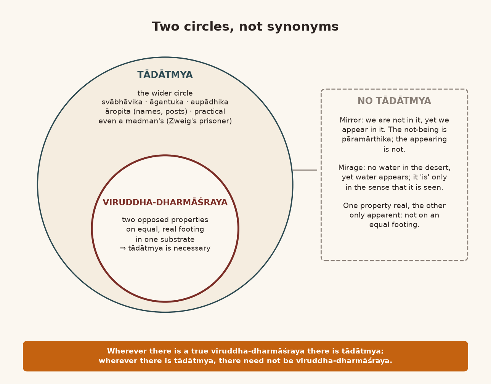
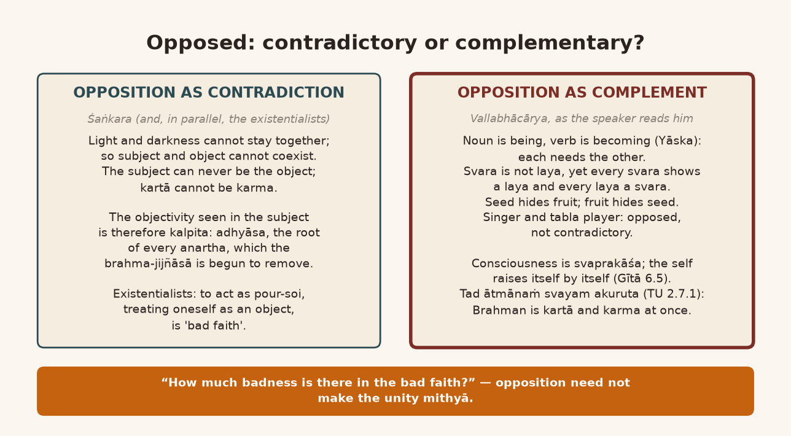
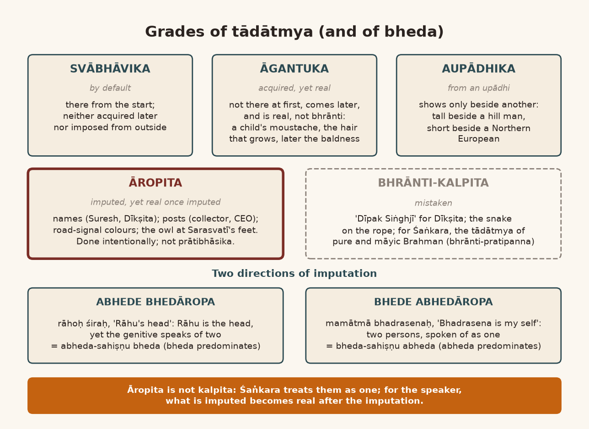
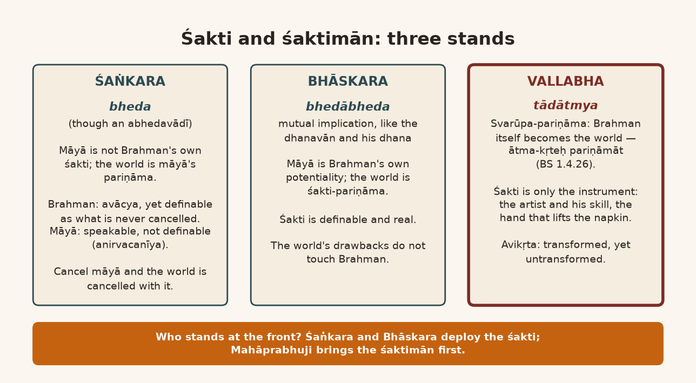

*English rendering of a spoken discourse on the Śāstrārtha Prakaraṇa of the Tattvārthadīpanibandha, translated from a Hindi ASR transcript. The speaker's conversational register, humour, digressions, code-switching, and student exchanges are preserved. Editorial flags: ‹ › conjectural restoration of a garbled reading; ‹?› uncertain reading; ‹…› inaudible or unrecoverable passage; ‹श्रवणाधारित› text given as heard, pending verification against a printed edition. Verses whose standard text is beyond doubt have been silently restored to the received editions.*

# 1. The Mirror and the Mirage: Is Viruddha-dharmāśraya the Same as Tādātmya?

‹…› A question has come: are viruddha-dharmāśraya and tādātmya one and the same thing?

As such, it is quite an important question. But we need to understand the "shades of meaning" of the two, in their different "states". If there is a viruddha-dharmāśraya in the real sense — when I say viruddha-dharmāśraya, what I mean is that two opposed properties (dharmas) reside on an "equal status" in some one substrate (āśraya) — then they cannot stay there without tādātmya. Because there is opposition between the two, and the substrate of both is one. If we do not accept tādātmya between the two, how will they manage to stay in one substrate? But from this very thing we come to understand that ‹tādātmya is necessary› wherever there is viruddha-dharmāśraya.

Where, of the two properties, one property is true (satya) and the other property is false (mithyā), there will be no tādātmya. As in a mirror. Are we there or are we not? We are not there ‹…›, and yet, even while not being there, we appear there. So the not-being there is pāramārthika, and the appearing is not pāramārthika. In that situation tādātmya cannot be accepted between the mirror and our reflection. As in the "desert" a "mirage" appears. In the desert there is no mirage; there is no water. Still, water appears. So the water both is not and is. It is, in the sense that it appears; in reality it is not. So what is there will not be accepted as tādātmya — of the water's being and the water's not-being.

So if both are pāramārthika, and are also opposed, and the basis of both is one — the "substance" is one — then without ‹tādātmya› it cannot be "justified" logically. So the reality is this: wherever there is a viruddha-dharmāśraya in the true sense, tādātmya will have to be accepted. But wherever there is tādātmya, it is not necessary that there be viruddha-dharmāśraya. Therefore the "circle" of tādātmya is a little "wider", and ‹the circle of viruddha-dharmāśraya› is a little "narrow". They cannot be called "exact synonyms". But ‹partially› ‹…›. And we cannot say that in a viruddha-dharmāśraya the two opposed properties are ‹…› like the "reflection" we see in a "mirror" — that we are not ‹really› in the mirror, and still we are seeing [ourselves] in the mirror. They are not on an "equal footing" there. There is no question of tādātmya there.

{width=6.2in}

# 2. Śaṅkara's Subject and Object, and the Existentialists' "Bad Faith"

It is a simple matter. As in Śaṅkara's view there is a deep problem. That problem is this ‹…›. To "justify" why the Brahma-jijñāsā has begun at all, Śaṅkarācārya says this: that darkness and light — these two cannot stay together. In the same way "subject" and "object" also cannot "coexist". What is "subject" cannot be "object"; what is "object" cannot be "subject". "In spite of that", in our "subjectivity" we also see an "objective character". Consequently, since it is only seen, it cannot be "real" on an "equal footing". In that situation our "subjectivity" is pāramārthika, and the "objectivity" of ours that we are seeing is "imagined" — it is kalpita — and because of this we are undergoing, bearing, enduring all our sorrow.

Quite "lately", in "Europe", "nearly" around the "First World War", a "philosophy" took shape which was called "existential". Very great, very fine scholars came, śāstrakāras — ‹Jean-Paul Sartre›‹?› — and many such ‹…›. Their idea was that "existence" is of two kinds: one *en-soi* and one *pour-soi*. *En-soi* meant that which is present within itself, and *pour-soi* meant ‹"that is absolutely true"›‹?›. And "always" there was this one "problem" there: whether our "consciousness" is *en-soi* or *pour-soi*.

**A student:** All right.

**Speaker:** "Whether our consciousness exists within itself, or our consciousness exists for something else." And going into this "analysis" — Śaṅkarācārya too said it — the "existentialist philosophers" drew out a "conclusion"‹?›. If our "consciousness" is *en-soi* — meaning "that which exists within itself, not for other" — but when we do some act in which this property of our consciousness shows itself, that it is *pour-soi*, then that is called "bad faith". "Bad faith."

**A student:** I see.

**Speaker:** "That says…"

**A student:** I see, I see. Right.

**Speaker:** Some wrong faith (śraddhā) is working inside us. So exactly the same thing Śaṅkarācārya also wants to say. Śaṅkarācārya did it long before these people. So far, I don't think anyone has made a "comparative study" of "existentialism" and Śaṅkara Vedānta. Had someone done it, perhaps this point would have been "revealed". Śaṅkarācārya-jī said this long, long ago: that the "subject" can never be the "object". And when we "treat" ourselves "as an object", that is "bad". And to "remove" that "bad faith" there is the Brahma-jijñāsā:

> एवम् … अस्यानर्थहेतोः प्रहाणायात्मैकत्वविद्याप्रतिपत्तये सर्वे वेदान्ता आरभ्यन्ते ।
> यथा चायमर्थः सर्वेषां वेदान्तानां तथा वयमस्यां शारीरकमीमांसायां प्रदर्शयिष्यामः ॥
>
> *evam … asyānartha-hetoḥ prahāṇāyātmaikatva-vidyā-pratipattaye sarve vedāntā ārabhyante |*
> *yathā cāyam arthaḥ sarveṣāṁ vedāntānāṁ tathā vayam asyāṁ śārīraka-mīmāṁsāyāṁ pradarśayiṣyāmaḥ ||* (Śaṅkara, Brahmasūtrabhāṣya, introduction [Adhyāsabhāṣya])
>
> [Thus … for the removal of this cause of evil, and for the attainment of the knowledge of the oneness of the self, all the Vedānta texts are begun. And as this is the purport of all the Vedānta texts, so we shall show it in this Śārīraka-mīmāṁsā.]

So says Śaṅkarācārya-jī. This is the anartha: that the "subject" should "objectify" itself. This anartha is the root of all the anarthas. Because as you "objectify" yourself as an "object", you will have to hand over the "status" of "subject" to somebody else. "We are losing [our] status of subjectivity", because you are making yourself into an "object". And when you are making yourself that, then the "uniqueness" that appears in your "subjectivity"…

**A student:** Now then…

**Speaker:** …that is finished. But it cannot be finished, if it is true. Therefore it is "bad faith".

# 3. Metaphysical Innocence: "Why Wear Clothes?" and the Noun That Needs a Verb

To hear it, this "philosophy" seems very… it seems to have a "metaphysical innocence" about it. And because of a "metaphysical innocence" there comes a "social innocence"; there is a "psychological innocence"; there is a "metaphysical innocence". A "metaphysical innocence" seems to be in this. But the point to understand in it is this: "innocence" means ajñāna, a naivety; the prefix "in-" in it has become negative. ‹…› This "innocence" of ours — how terrible the "implications" of this "metaphysical innocence" became as "social innocence", you can see. Many people at that time began to believe: "Why wear clothes? What need do we have to wear clothes? We are wearing clothes for somebody else. In front of yourself you don't wear clothes." What all the consequences of this social, metaphysical innocence were!

Even now — many — I can't recall the name — "recently", only a short while ago, some "heroine" said: "My body is for myself. Not for yourself. I can, I can act as I like. Because I am not object. I am subject. I don't want to suffer with the bad [faith]." Now, many girls started wearing torn clothes ‹the speaker's characterization›. Many "implications" of this kind, of this "metaphysical innocence", came — they came in "personal life", they came in "society", they came "even" in "politics". So at every moment there remains this one problem. Bad faith is a bad thing, "no, no doubt about it". But "how much badness is there in the bad faith" — that too we should look at. Because just because it is "bad", we should not simply take it that it is "totally bad".

And this too is not necessary: "object" and "subject" — that the "duality" between them is "contradictory". It can also be "complementary". If the "reality" of "object" and "subject" — whether it is only "contradictory" or is "complementary" — then to "objectify" the "subject" or to "subjectify" the "object" ‹…›. If we think of a simple example we can understand it: a "noun" needs some "verb"; a "verb" needs some "noun". They are "complementary to each other". Where did "contradiction" come in? "Ram is going. Lakshman is coming. Now Ram and Lakshman are names. His coming, his going here. One way." Is this "contradictory" or is it "complementary"?

That is why Maharṣi Yāska made a very beautiful analysis in the ‹Nighaṇṭu›‹?›, and in it he explained that the meaning of the noun is "being" and the meaning of the verb is "becoming". Whenever we say a noun, its meaning is not "becoming" but "being". And whenever we say a verb, its meaning is not "being" but "becoming". That is, a kind of "fluidity" is seen in it — in the verb. And in the "name", in the "existence" of the name, a kind of "solidity" is seen. "Mass" is seen; "motion" is not seen. But at that time Maharṣi Yāska too had made this clear, and "science" too makes it clear, that the very nature of "mass" being mass is because of "motion". And every "motion" "creates" a "mass" — "to the extent that" when a "plane" is in some "motion", in the direction in which it is moving its weight is more, and in the direction in which it is not moving its weight is less.

**A student:** That is talking with science.

**Speaker:** ‹…› The "difference" that is there — "difference [is] very [much] there"; "definitely" there is a "difference". It is not "contradictory"; it is complementary (pūraka).

# 4. Can the Agent Be Its Own Object? Svara and Laya, and the Man Caught in a Tree

In the same way the "difference" between "subject" and "object" too is not "contradictory"; it can also be "complementary". And if it is "complementary", then the opposition of two opposed properties need not be taken as "contradictory"; it can also be "complementary". They can be opposed, and it can be complementary.

If I want to give the very clearest example of this, I will give it like this. What is svara (sur) is not laya; what is laya is not ‹svara›. That is the "face value". But in every svara some laya does manifest, and in every laya some svara or other manifests. I used to do one "experiment" every time — now of course I don't travel any more. Say you are sitting in an aeroplane. At the speed at which the aeroplane is flying, a "sound" is "created". Take that "sound" as *sā*. Think which rāga is coming out of it. Take it as *sā*, and a rāga can manifest. Because in any "sound" whatever, you can take a ‹*sā*› anywhere in it, and from it laya too manifests. What does laya mean? "Motion". ‹…› Laya means "becoming"; "sound" means "being". Because the "sound" — "āāā" — no "motion" is seen in it; ‹it is just there›. And when we "punctuate" it, laya comes. So between laya and svara there is opposition, but the opposition is not of being "contradictory"; it is of being "complementary".

As between the seed and the fruit — "seed and fruit" — there is opposition too. What is seed is not fruit; what is fruit is not seed. But in every seed a fruit lies hidden, and in every fruit a seed lies hidden. So there is opposition. "Is it contradictory or complementary? That's where the question [is]. How much badness is of the bad faith?" This "analysis" did not happen "on the part of [the] existential[ists]".

This same thing Vallabhācārya found "objectionable" in Śaṅkara's view as well. And watch carefully where Mahāprabhuji catches hold of this point from. In Śaṅkara's view too "consciousness" is called svaprakāśa — svayaṁ-prakāśa, "self-revealing". As in the Gītā the Lord says — which Buddha Bhagavān has also said:

> उद्धरेदात्मनात्मानं नात्मानमवसादयेत् ।
> आत्मैव ह्यात्मनो बन्धुरात्मैव रिपुरात्मनः ॥
> बन्धुरात्मात्मनस्तस्य येनात्मैवात्मना जितः ।
> अनात्मनस्तु शत्रुत्वे वर्तेतात्मैव शत्रुवत् ॥
>
> *uddhared ātmanātmānaṁ nātmānam avasādayet |*
> *ātmaiva hy ātmano bandhur ātmaiva ripur ātmanaḥ ||*
> *bandhur ātmātmanas tasya yenātmaivātmanā jitaḥ |*
> *anātmanas tu śatrutve vartetātmaiva śatruvat ||* (Bhagavadgītā 6.5–6)
>
> [Let one raise oneself by oneself and not let oneself sink; for the self alone is the friend of the self, and the self alone is the enemy of the self. The self is a friend to the one by whom the self has been conquered by the self; but for one who has not [conquered] the self, the self itself stands in enmity, like an enemy.]

*Uddhared ātmanātmānam*: raise your ātmā by yourself. The one who raises it is also the ātmā. ‹…› What the Bauddhas say — this was our doctrine; who knows whether it was the Bauddha doctrine or Kṛṣṇa's doctrine. Both are the same avatāra. They took ours, so we took theirs. Whoever took from whom, that is not the "issue" here. The "issue" here is this: can one ātmā be both the kartā and the karma, or can it not?

When the Upaniṣad says *tad ātmānaṁ svayam akuruta* (Taittirīya Upaniṣad 2.7.1) — it made itself, by itself, in the form of creation — that is Brahman. So when Brahman made itself in the form of creation, then of the act of becoming creation the kartā too is itself and the karma too is itself. Śaṅkarācārya says the kartā cannot be the karma; the karma cannot be the kartā; the "subject" cannot be [its own] object (viṣaya). At "face value", [yes]. In "intrinsic value" it can also be one. And if it can be one, then it is not necessary that "subjectifying" the "object" or "objectifying" the "subject" is a viruddha-dharmāśraya on account of which the oneness must be mithyā. This Vallabhācārya-jī said. That is why, as far as the "issue" of tādātmya goes, it is the "wider circle". And as for the "circle" of viruddha-dharmāśraya — there is no need to "jump" into it the moment the word *viruddha* comes up.

*Mane saṁskṛtmāṁ ek muhāvarā che*‹?› [In Sanskrit there is an idiom]: *magnaś cet pātālaṁ niviśet* ‹श्रवणाधारित›. That is, if we slip from one step, we will go only downward. Not necessarily — we can also get stuck in between. Just three or four days ago someone made an "attempt" to commit "suicide". He jumped from the ten- or fifteen-storey building there and got stuck in some tree. He did not die; ‹his legs…›. It is not necessary that if he fell he will end up at the bottom; he can also get stuck in between. *Magnaś cet pātālaṁ praviśet* — all right. "As per rule" that is right, but there is surely an "exception" to it too, isn't there?

So it is not necessary that if there is opposition between "subject" and "object", the opposition is so much that it becomes "contradictory". Opposition can also be "complementary". And often we see this: in any music "concert" there is the one who sings and the ones who play. The singer has come. The one who plays sounds the svara on the instrument. And the tabla player gives saṅgati — he accompanies; and when he accompanies, he accompanies with laya, with tāla. That is opposed, certainly, but it is not "contradictory". Did my point come to mind? ‹…› Is someone "absent"? Yes?

**A student:** Yes, yes, yes ‹…›.

{width=6.2in}

# 5. The Kinds of Tādātmya: Rāhu's Head, "Bhadrasena Is My Self", and the Clock's Battery

**Speaker:** No — so this point is especially worth understanding: that the "circle" of viruddha-dharmāśraya is "narrow". ‹…› One basic reason for this is also that tādātmya can be svābhāvika, it can be āropita, it can be aupādhika. Many kinds of tādātmya are "possible". Until it becomes clear which of these tādātmyas we are talking about, we go on assuming every time that tādātmya is only abheda.

Let me give you one example and it will become clear: *rāhoḥ śiraḥ*, "Rāhu's head". Actually the name of the head is Rāhu. And all heads are not separate from the torso; Rāhu's head is one that is separate from the torso. Because the demon who was cut — his torso came to be called Ketu, and the head came to be called Rāhu. Which head? They say, *rāhoḥ ‹śiraḥ›*, Rāhu's head. But Rāhu does not *have* a head — Rāhu himself is the head, isn't he? Now to express this we are using a "duality": "Rāhu's". That means Rāhu is not the head; it is Rāhu's head. This too has been accepted as an example of tādātmya. Here there is an imputation of bheda in abheda (*abhede bhedāropa*). Although there is abheda between the head and Rāhu, here bheda is being imputed.

"Vice versa": just as here there is an imputation of bheda in abheda, so somewhere there can also be an imputation of abheda in bheda. Its example, they say, is *mamātmā bhadrasenaḥ*: "Bhadrasena is my self" — "my friend is my life". Arre bhāī, if he is your life, then when he dies will you die? In ordinary speech too we say prāṇapriya, prāṇapriya — "he is my very prāṇa". If he is your prāṇa, will you die when he dies? You won't die. So there abheda is being imputed in bheda. That too is within tādātmya.

Now if we understand one simple example, it will become very clear to you. Look at it from the angle of the body and the ātmā. What is the body is not the ātmā; what is the ātmā is not the body. How do we think about this? I am telling you about the way of thinking. The body remains, as a corpse; the ātmā is not there at that time. "That's true." So the body is not the ātmā. Now, when the body is not the ātmā, then whom are you calling "I" — are you calling the body "I", or the ātmā? As I call myself — say, I say "Shyam Manohar". In what sense am I saying it? If I am saying it in the sense of the ātmā, then I am not the body; the body is mine. And if I say it in the sense of the body, then I am not the ātmā; the ātmā has become mine. We don't even know whether it is an imputation of abheda in bheda or an imputation of bheda in abheda. "Total confusion" — "total confusion". "That is an utter ‹confusion›." Because if I am the body, then ‹I am not the ātmā›; the ātmā is mine.

Exactly how? As in a clock we put a ‹battery›. That is the ātmā; the clock is the body. That is how it appears. Now, are we to take the clock and the battery as bheda, or take them as abheda? The point to understand is only this much: if you are taking bheda, it is still not "contradictory". If you are taking abheda — even then it is not as if without the clock the battery will tell you the time, or without the battery the clock will tell you the time. So "there is a mutual dependency. There is a mutual dependency; in spite of that, that mutuality and the dependency and the difference — this difference is not contradictory but complementary."

So we can understand that in tādātmya there is the imputation of abheda in bheda and the imputation of bheda in abheda. This is āropita tādātmya. Likewise there can also be anāropita tādātmya. It can also be aupādhika. It can also arise in the sādhaka out of bhrānti.

As there are road "signals": "green", "yellow" and "red". Now "red" means stop. "Red" means stop, "green" means go, "yellow" means be prepared. Now this is the "meaning" of the "colour"; this difference is imputed onto the colour. Will we call this bhrānti? All right, sir: we have "ascribed" this "role" to the colour. "Ascribed."

# 6. Stefan Zweig's Chess Prisoner, and Suresh Who Is No Lord of the Gods

There was a very great German "story writer", ‹Stefan Zweig›. He has written amazing stories. So Stefan Zweig imagined a "character". In the time of the Nazis, they stuff a poor man into jail. And the Nazis want to make him confess something. To make him confess, they work on him psychologically in many ways ‹…›: they keep him standing for hours, they make him "wait". In the same way he was told to "wait". And inside, a big "officer" had come; his "overcoat" was hanging there. While waiting and waiting, he "suddenly" put his hand into the pocket of the overcoat. A book came into his hand. He hid the book and kept it against his belly. When the time of the "torture" was over — stand outside ‹…› — after that, when he came back to his "cell", he began ‹reading› it, and found that it was "different maps" of "chess". Because he had nothing at all to read ‹…›. He said, "This is the best means of keeping the mind occupied." He began reading it, reading it, reading it. A "junction" came where he knew all the maps "by heart". Because what was the poor man to do in jail? Now there was no point in reading the book any more. On that basis he began to play "mentally".

Playing chess, mentally playing chess, his "consciousness" got "split": "black and white". The "white consciousness" says to the "black consciousness": "Why are you taking so much time? Move!" The ‹black› consciousness says: "Brother, at least let me think a little — how should I do it?" And after that he starts fighting with himself, because his "consciousness" had "split" into "black and white", thinking out chess moves. He knew all the maps "by heart"; the grandmaster's maps he knew by heart; and after that came "further development" of that kind. Because of it he went mad. He went mad, so consequently they let him go: "Brother, he has gone mad; there is no "sense" in torturing him any more." This became his state: you know the black-and-white marble pieces on a "floor"? If he saw someone standing [on them], he would feel, "This is check! This is mate!" So he would pick the man up and set him aside: "Arre, you'll be mated!" That is how mad he became.

Now look: is this tādātmya or not? This tādātmya is the tādātmya of a kind of "mental illness". Here too there is tādātmya. Every man — in his madness he began to take them as nothing but chess pieces. That is, if somebody was standing: "Arre, arre, you're getting "check"!" ‹…› People would get bothered: "Brother, what has happened to him?" And what could the poor man do? Because in his whole way of thinking no other kind remained. He got a "singularity mania". Every person he sees as nothing but a chess piece — like *sarvaṁ khalv idaṁ brahma* (Chāndogya Upaniṣad 3.14.1). It is an amazing story, like that, ‹Zweig's›. What I mean to say is that tādātmya can be of many kinds. It can be svābhāvika. It can be āropita.

It can also be "practical". As all the names we give someone — to someone "Suresh", to someone "Ramesh", to someone "Bhavesh". Now is this Suresh some *sureśa*? Is he the lord (*īśa*) of the suras? *Rameśbhāī ‹ramā-kā-īś› che atyāre? Bhāveśbhāī ‹bhāv-kā-īś› che atyāre?* [Is Rameśbhāī at present the lord of Ramā? Is Bhāveśbhāī at present the lord of bhāva?] But whenever we say "Suresh", then at once the one whose name we have set as Suresh will say, "Yes sir." Is this tādātmya or not? Which tādātmya is this? Is it svābhāvika? Is it aupādhika? Is it bhrānti? No. In this way the "range" of tādātmya is very big, and the "range" of viruddha-dharmāśraya is not so big.

Yes, there was a second question — this:

> ‹स्मृति›र्व्यतीतविषया मतिरागामिनी मता ।
> बुद्धिस्तात्कालिकी ‹प्रोक्ता› प्रज्ञा त्रैकालिकी मता ॥
> प्रतिभा नवनवोन्मेषशालिनी … ‹श्रवणाधारित›
>
> *‹smṛtir› vyatīta-viṣayā matir āgāminī matā |*
> *buddhis tātkālikī ‹proktā› prajñā traikālikī matā ||*
> *pratibhā nava-navonmeṣa-śālinī …* ‹श्रवणाधारित› (subhāṣita; the first word is heard as *matir*)
>
> [Smṛti has the past for its object; mati is held to look to what is coming; buddhi is said to be of the present moment; prajñā is held to span the three times; pratibhā is that which shines with ever-new unfoldings.]

This śloka is a subhāṣita in Sanskrit — a subhāṣita. To find any "source" for it is difficult, because it is a saying, a very "meaningful" saying of theirs, so the right people "quote" it. Who would have said it the first time? And there is no other question?

**A student:** No, sir. From where [do we start]?

**Speaker:** ‹…› Page number… page number seventeen, ‹…› śloka, Prakāśa, ‹one, seven›‹?›.

# 7. "Vaidikas tu Etāvān Eva": A Human Being Seen from Afar, Male or Female Seen Up Close

**A student:** ‹Earlier too — that was said earlier.›

**Speaker:** *Vaiṣṇavānusāreṇa*. Yes. So we have seen the meaning of Śuddhādvaita. Now Mahāprabhu is saying, *vaiṣṇavānusāreṇa kiñcit sādhanam adhikam āha*. *Vaidikas tu etāvān eva siddhāntaḥ*: so the Vedic doctrine is only this much, and according to the Vaiṣṇava view something more is being said.

Now I have a bit of a "hangover" — the ‹Śuddhādvaita›‹?› prakaraṇa. Keeping that "hangover" in view, I want to raise one more point: between the Vaiṣṇava view and the Vedic view, is there viruddha-dharmāśrayatā, or what is the business going on between them together? ‹…› Because if *vaidikas tu etāvān eva siddhāntaḥ* — *etāvān* means "only this much" — and *vaiṣṇavānusāreṇa kiñcit sādhanam adhikam*, according to the Vaiṣṇava view he will tell us something more, then a different thing is being said. And is this differentness "complementary" or "contradictory"? "Once again" — from the place where we had set out, we have come back to the same place; we went round and round, and again we have come back there.

If the Vedic doctrine is only this much, and nothing beyond it, then the Vaiṣṇava view, which is going somewhat beyond it, is not the Vedic doctrine. And if it is not the Vedic doctrine, then it is anti-Vedic. About whether it is anti-Vedic, one point is especially worth understanding.

As, for any X, Y, Z, I use one sentence, "in inverted commas": "X is a human being". X is a human being. Looking from far away, only this much is understood. Looking from close by, one finds that "X is not only [a] human being" ‹but male or female›. So: "human being" and "male" and "female" — are they "contradictory" or "complementary"? Different they certainly are. Because looking from far away, male or female is not known; "human being" is known. With human beings you may still know even from far away, but often in animals it is very difficult to recognize male and female. Not in all animals: lion and lioness, tiger and tigress, you can recognize even from far away. As in "birds": there are some "birds" where we can tell that the male's colour is different and the female's colour is different, as with the peacock and the peahen. In the sparrow you can't tell. Often in parrots you can't tell ‹…›. In the kite you can't tell, in the crow you can't tell ‹…›.

So when, for some reason, we recognize it — that this is a "human being", and that this is "male" or this is "female" — then, when it is shown from far away, the doctrine is only this much: that it is a ‹…› "human being". Looking from close by, observing it, one finds whether it is male or female. So is this "contradictory" or is it "complementary"? Viruddha-dharmāśraya has certainly happened.

**A student:** Yes.

**Speaker:** In the same way, between the Vaiṣṇava view and the Vedic view too, the "issue" of tādātmya stays attached.

# 8. The Drop of Blood in the Laboratory: Bheda-sahiṣṇu Abheda and Abheda-sahiṣṇu Bheda

The question is this. Be it Brahmā, be it Viṣṇu, be it Śiva, be it Gaṇapati, be it Durgā — in several ślokas we had seen *brahmaiva tādṛśaṁ yasmāt sarvātmakatayoditau* (Bālabodha). All the devas — the story of the devas is that they are worshipful; that is a separate story, worshipful and not worshipful. But what is not worshipful — a horse, a donkey, or a dog, or a pig and so on — is that not Brahman too?

**A student:** Right.

**Speaker:** But the question here is the same once again. When we recognize these as Brahman, that is one *modus operandi* of our recognizing. And recognizing Brahman in their form is another *modus operandi*. In it the "mindset" changes; the "framework" of the "mind" too changes; it does not remain the same "framework".

Understand it like this. There is a drop of "blood". We are recognizing it as a drop of blood. And in "pathology", in the "laboratory", they "analysed" it and worked out all its "details": what is in it, what is not. Those "details" that we are getting — are they the drop of blood or not? Between them and the drop of blood, in their tādātmya, is there bheda or abheda? If there is bheda, fine. If there is abheda, then why was it not ‹seen› before? Why are the "details" that the "laboratory" gets not found in "perception"? If they are not found in "perception", then "perception" is "illusion". If they are not found in "perception", then "perception" is "illusion". And if "perception" is "illusion", then in the "laboratory" too, will he "perceive", or will he speak "without perceiving"?

**A student:** Right.

**Speaker:** "Such other questions [as] can be raised", philosophically. In the "laboratory" he won't do anything without "perceiving". In that situation, when we "perceive" the "elements" of the blood, and when we "perceive" the drop of blood — between the two "perceptions" is there "contradiction", or is it "complementary", or what is it? If there is even "contradiction", then viruddha-dharmāśrayatā will have to be accepted in the drop of blood. If it is "complementary", even then there is a relation between the two: "Okay — each other cannot complement each other without having a common substance, [a] substantial identity."

So the definition of tādātmya that has been given — that just as *bheda-sahiṣṇur abhedas tādātmyam*, an abheda that tolerates bheda is tādātmya, so too an *abheda-sahiṣṇu bheda*, a bheda that tolerates abheda, has been accepted as tādātmya — this we should properly…

**A student:** Yes.

**Speaker:** …see with the eyes and bring down into the intellect. Not only into the intellect — bring it down into the heart too; then the thing will be right. Otherwise the "confusion" will just remain. Tādātmya can be of both kinds: bheda-sahiṣṇu abheda and abheda-sahiṣṇu bheda. ‹With Rāhu's head› I told you — Rāhu's head — that is abheda-sahiṣṇu bheda ‹…›. And the usage *mamātmā bhadrasenaḥ* — that is a usage of bheda-sahiṣṇu abheda. That is, in one place bheda predominates; in the other place abheda predominates.

# 9. Svābhāvika, Āgantuka, Aupādhika, Āropita: The Moustache, the Tall Man, and Grandfather's Letter

And this bheda and abheda — then again, *magnaś cet pātālaṁ niviśet*, it is not like that. There are many "grades" of it. First of all, one of them is that it can be svābhāvika: "by default".

Second: bheda and abheda both can also be āgantuka. That is, it is not svābhāvika, not "by default"; it is "acquired". Originally it was not there; later it was "acquired"; but it is "real", not "unreal". Understand this point carefully. Āgantuka means — as a child grows a moustache. The moustache comes; it doesn't come "unreal". Because it was not there before and came later, so where did it come from? On a child's head there isn't even full hair; then the hair comes. He grows old; then baldness comes too. One logic is this: that what was not there before and was not there afterwards is not there in the middle either. Would anyone say that ‹these› are bhrānti-kalpita? Not bhrānti-kalpita — they are āgantuka. "They are not by default. They are not substantially there. Substantially. But they [are] acquire[d] as and when it grows." So āgantuka is a different thing; it is "artificial", not "essential". So just as there is svābhāvika, there can also be āgantuka.

After that, what is the third? Aupādhika. Aupādhika bheda or abheda — of what kind? That in itself it is neither svābhāvika nor āgantuka, but the bheda comes because of the proximity (sannidhi) of something else. Now understand it like this. Whether a person is tall or short, we cannot say of the person in himself, without "compar[ing]". Because people of "Northern Europe" are six to seven feet tall. People of the hill regions are short; they are even four to five feet. So am I tall or am I short? Arre bhāī, if some person from "Northern Europe" comes, I am short. If some hill person comes, I am tall. This bheda is happening from an upādhi, isn't it? It is not āgantuka; it is not svābhāvika. Someone's being tall or short — being "tall" or being "small" — is not āgantuka either; it is not ‹…› svābhāvika either; but it is aupādhika — it is because of some upādhi. On "compar[ing]" with this one, that property manifests; otherwise it does not manifest.

The same story is of bheda too. The same story is of bheda too. Third — and what is the fourth?

**A student:** What is it?

**Speaker:** Āropa. Now there is a slight difference between āropita and kalpita. In Śaṅkara's view āropita and kalpita are taken as one. In fact it is not so. It is not necessary that what is āropa be kalpita every time. ‹…› As all our names — they are not kalpita names; they are āropita names. Our mother and father, or whichever of our elders named us — that name has been imputed (āropa) on us. It came about because of that.

**A student:** I see.

**Speaker:** That, through bhrānti, someone — oh, I just remembered. Our Dādājī's name was Dīkṣita. Someone wrote Dādājī a "letter" from Rajasthan: "Mahārāj Śrī Dīpak Siṅghjī." Now this is bhrānti-kalpita, bhāī! The name was Dīkṣita, and you made it "Digdag Siṅghjī", because in Rajasthan every person is a Siṅgh. Dādājī's ‹temper› shot up — I still remember it — "Who does he think he is?" There will have been no ill intent; he will have understood it like that ‹…›.

Often many "European" people come. They cannot say "Śyām"; they say ‹"Śiyām"›‹?›: "Mister ‹Śiyām› Goswami." What is the reason? Because for them, while spelling the name, I have to put "S-H-Y". Now that can be ‹Śyām›, and it can also be ‹Śiyām›, can't it? Because "Y" is pronounced both as "ī" and as "ya". So they say ‹Śiyām›. ‹…› And Śyām will remain āropita. "Dīkṣitjī" is an āropita name, the name given by Grandfather to my father‹?›. And if someone takes it as ‹"Dīpak Siṅghjī"›, that is wrong. There is a slight difference between āropita and kalpita too.

**A student:** Āropa.

**Speaker:** What is āropita — what is āropita is not "unreal"; it is "real". "After" the āropa — on whomever we have imputed whatever — its "status" becomes the "status" of "reality". "Before" the āropa it is not so, but "after" the āropa it is.

**A student:** So understanding this is a matter of "common sense"; there's nothing big in it.

**Speaker:** As when one of our people goes to some "post" — the "post" of "manager", or the "post" of "CEO", or the "post" of "police", or the "post" of "minister", or the "post" of "collector" — then he becomes "collector". Now that is not his svābhāvika property. We have imputed it on him: "Bhāī, now you are on this "post", so your name is Collector." Now that is ‹not› prātibhāsika mithyā; it is "real". It is not ajñāna-kalpita. So āropita is a different thing. As with all the meanings of words: about them, this same consideration ‹…›.

{width=6.2in}

# 10. Is Meaning Imputed on Words? The Knife, the Crow, and Vālmīki's Krauñca

The meanings of words — are they āropita, are they bhrānti-kalpita, or are they svābhāvika? In "linguistics" there is a very big inquiry (mīmāṁsā) about this. Some people think that all the meanings of words — especially Buddha Bhagavān: he holds that all the meanings of words are kalpita; they have nothing to do with the thing meant. What is their "argument"? If the relation of word and meaning were "real", then saying ‹"knife"› should have cut the tongue, and saying "guḍa" should have made it ‹sweet›. Saying "knife" doesn't cut the tongue, does it? And on saying "guḍa" no ‹sweetness› is experienced on the tongue. Buddha Bhagavān's doctrine is that all meanings — there is no meaning-relation of theirs with the word. The word has been imputed on the meaning ‹…›.

In "linguistics" this "problem" too has come up. At the root the word is dhvani, sound — because when we "specify" a dhvani in some way, it becomes a word. As — we don't know—

**A student:** We don't know.

**Speaker:** —whether the crow goes "kāṅv kāṅv" or goes "crow, crow". Actually, in whatever way the crow speaks, it manifests dhvani; it does not manifest a word. But we "interpret" that dhvani in our own way. Someone says the crow goes "kāṅv kāṅv"; someone says the crow goes ‹"krā krā"›; that is why they also say "crow". The Sanskrit people thought the crow speaks like "kāk, kāk, kāk, kāk"; that is why they call the crow *kāka*. In English there is ‹"croak"›; people say it goes "caw caw". So is it "kā kā", or ‹…›, or what is it doing? When we "convert" dhvani into "sound", into a "word", into varṇa, then it becomes a different meaning. So the "meaning" of a word — is it coming from dhvani or from varṇa? This too is an "issue", from the "point of view" of "linguistics".

And this we can understand well: that every dhvani is the carrier of some meaning or other. As whether the crow is cawing out of grief, ‹giving out a call›, or calling its "beloved", or calling its "lover" — that dhvani we can understand ‹…›. Even a child — the dhvani a child manifests when it is not speaking clear words — from its dhvani, from the dhvani of its crying, from the dhvani of its babbling, we can understand whether the child is pleased or not. So the "meaning" is coming from there; it is not coming from varṇa.

**A student:** Yes.

**Speaker:** Varṇa, which we call the "alphabet" — when we "translate" any "sound" into the "alphabet", the "meaning" that comes into the "alphabet" is coming from there, from the "sound"; it is not coming from the "alphabet". This is called "onomatopoeia". What does "onomatopoeia" mean? As we call a motorbike ‹"phaṭphaṭī"›, we call a car "pam-pam" — all this is "onomatopoeia". The "meaning" the "sound" had "acquired" — and that was not ‹…› at all; it was spontaneous (sahaja-sphūrta).

That is why, when Vālmīki wrote the first śloka from which the Rāmāyaṇa came into being — it comes in its history that a Niṣāda killed one bird out of a krauñca [pair]. Yes, exactly. So the krauñca — the other bird that was there — was crying. It was manifesting the dhvani of grief. From Vālmīki's mouth suddenly this ṛc came out:

> मा निषाद प्रतिष्ठां त्वमगमः शाश्वतीः समाः ।
> यत्क्रौञ्चमिथुनादेकमवधीः काममोहितम् ॥
>
> *mā niṣāda pratiṣṭhāṁ tvam agamaḥ śāśvatīḥ samāḥ |*
> *yat krauñca-mithunād ekam avadhīḥ kāma-mohitam ||* (Vālmīki Rāmāyaṇa, Bālakāṇḍa 2.15)
>
> [O Niṣāda, may you never find rest through endless years, since from the pair of krauñcas you killed the one lost in love.]

Arre Niṣāda! Niṣāda means a Bhīl. ‹You killed the krauñca.› The krauñca is a variety of haṁsa. So he killed the female ‹…›. ‹You› did no good deed. From that came the Rāmāyaṇa ‹…›. In the Rāmāyaṇa too this is what happened. And this was the first śloka, so Vālmīki himself was amazed: "How did this śloka get made by me?" So when this śloka had been made, he then wrote the whole Rāmāyaṇa, because from it he made a "correlation": that Rāvaṇa too did nothing but the Niṣāda's deed, and in the "story" of Sītā and Rāma too the same thing happened — that poor Sītā was "kidnapped" for nothing, and a "life" was "spoiled". And the whole Rāmāyaṇa… Where is the meaning of *mā niṣāda pratiṣṭhāṁ tvam agamaḥ śāśvatīḥ samāḥ, yat krauñca-mithunād ekam avadhīḥ kāma-mohitam* coming from? We can't find out.

But one who doesn't know will then say, like Buddha Bhagavān: "Saying ‹"guḍa"› doesn't make it sweet; saying ‹"knife"› doesn't cut the tongue; so there is no relation between word and meaning." But word and meaning have no relation — in what sense? At what "level"? This again is a thing to think about, isn't it? At the "sound level"? At the "alphabetic level"? And if the "sound level" itself is manifesting in the "alphabet", then the "sound" is certainly carrying the meaning. It is being "carried forward"; it reaches it ‹…›. Because that "sound" — the "sound" that was there — we ‹…› today we are "convert[ing]" all of it into ‹"alphabet"›‹?›. Will it be "carried" or will it not? In this way there are very many "issues" in tādātmya. And these "issues" of tādātmya ‹…›. "Yes, yes."

# 11. The Owl at Sarasvatī's Feet, and the Gatekeeper at Marāṭhā Mandir

**A student:** Which is the last one — kalpita?

**Speaker:** ‹What is› vyāvahārika ‹…› bhrānti.

**A student:** Like when you impose the snake on the rope — you can't call that āropita, can you? That too would be bhrānti-kalpita.

**Speaker:** ‹…› You do it "intentionally". Because — understand the point like this — I have placed an owl there. Look, it is visible at Sarasvatī's feet.

**A student:** Yes.

**Speaker:** This owl I take to be the trustees of the havelīs, the temples of the Puṣṭimārga. And my good wish (sadbhāvanā) is that, sitting at Sarasvatī's feet, they may mend their ways. And this is āropita; it is not bhrānti-kalpita. ‹It is not bhrānti;› it is a good wish of mine: the trustees of the Puṣṭimārgīya havelīs are all owls. So where to seat them? Someone gave me that figure as a "present". I said, the very best place for it will be this: seat it at Sarasvatī's feet, so that it may improve. It is my sadbhāva. It is hardly bhrānti! Look, there it is, sitting at Sarasvatī's feet. This is not bhrānti; this is my sadbhāva — for the trustees of the havelīs of the Puṣṭimārga. So this is āropita: that ‹these trustees› are owls. This is my āropa. "And else" ‹…› there is none on my part.

So in the same way we have to think about the Vaiṣṇava view and the Vedic view. Mahāprabhu says "Vaiṣṇava" here. But in the Bālabodha Mahāprabhuji has made it clear: *ataḥ śivaś ca viṣṇuś ca jagato hitakārakau* (Bālabodha) — therefore Śiva and Viṣṇu are both benefactors of the world. And before this, in a kārikā too, Mahāprabhu has made it clear:

> सूर्यादिरूपधृग् ब्रह्मकाण्डे ज्ञानाङ्गमीर्यते ।
> पुराणेष्वपि सर्वेषु तत्तद्रूपो हरिस्तथा ॥
>
> *sūryādirūpadhṛg brahmakāṇḍe jñānāṅgam īryate |*
> *purāṇeṣv api sarveṣu tattadrūpo haris tathā ||* (Tattvārthadīpanibandha, Śāstrārtha Prakaraṇa 12)
>
> [In the brahmakāṇḍa, He who bears the form of Sūrya and the rest is declared to be an auxiliary of knowledge; so too, in all the Purāṇas, Hari is there in the form of each [deity].]

That same Brahman — in the karmakāṇḍa, ‹jñāna›, karmakāṇḍa ‹…›, in the Purāṇas. In the brahmakāṇḍa, in the form of Sūrya and so on: to worship Brahman in the form of Sūrya, or the worship of the devatās described in the Purāṇas — in all those worships the object of worship (upāsya) is Brahman alone.

"And" now, what was the problem in Śaṅkarācārya's view? That the jijñāsā was being made of Brahman, and they don't accept Brahman as kartā — because accepting it as kartā brings in "duality" between kartā and karma, that same "duality" of "subject" and "predicate". Therefore he said that the lakṣaṇa that has been given of Brahman — *janmādy asya yataḥ* (Brahmasūtra 1.1.2), *śāstra-yonitvāt* (1.1.3) — is not the lakṣaṇa of Brahman but the lakṣaṇa of māyā. Arre bhāī, the jijñāsā — you had "start"ed it: *athāto brahma-jijñāsā* (1.1.1). The sūtra came: what is that Brahman? Then *janmādy asya yataḥ*: that from which the origin — the birth — the sustenance and the dissolution of the world takes place is Brahman. Is the Brahman of the jijñāsā that Brahman, or is it this Brahman? So the jijñāsā was of some pure Brahman, and the lakṣaṇa given is of a māyic Brahman. An āpatti comes in here; an "objection" comes here: how did this happen? Now in these too Śaṅkarācārya has accepted tādātmya. Because the tādātmya — because it is bhrānti-pratipanna, established through error, you see. That is why I said ‹in the eighth›‹?›: in tādātmya there can also be bhrānti, can't there? There can be a bhrānti of ‹tādātmya›.

I often tell one thing; I have told it several times here in lectures too. A friend of mine and I were to go to see a film at Marāṭhā Mandir ‹…›. He lived in Dadar; I lived in Bhuleshwar. So he had said, "I'll get the tickets." [I said,] "I'll come." And I got late leaving home, so when [the film] had started a little, the gatekeeper said to me, "Shyam Goswami?" I said, "Yes." He said, "Your friend has gone in. He's left your ticket." I asked my friend — I said, "What sort of description of me did you give, that the gatekeeper recognized me the moment he saw me?" So he said, "I told him: one about whom you can't make out whether he is a man or a rākṣasa — if you see a man the like of whom you have never seen in Bombay, take him to be Shyam Goswami." I can't tell whether I am a man or a rākṣasa! But the gatekeeper recognized me, didn't he, on the basis of that "description"?

In the same way Śaṅkarācārya too recognizes ‹…›: how the pāramārthika is, is not known; *ato brahma-jijñāsā* happened; he gave a lakṣaṇa. ‹…› There are many kinds of tādātmya.

What Mahāprabhuji wants to explain here is very straight and simple. This bheda that is coming, between the Vedic view and the Paurāṇika view — because *purāṇeṣv api sarveṣu tat-tad-rūpo haris tathā*. Right now we don't have to deal with all the Purāṇas; we are dealing with the Vaiṣṇava Purāṇas. That is why Mahāprabhuji is saying *vaidikas tu etāvān eva siddhāntaḥ*; *vaiṣṇavas tu* — *vaiṣṇava-śāstreṇa kiñcit sādhanam adhikam āha*. [The 1943 edition reads *vaiṣṇavānusāreṇa*.] *Vaiṣṇava-śāstreṇa*. As in pathology, in the laboratory, the details of the blood get worked out — which are not known by looking, but are known by doing the "analysis" — so when the Vaiṣṇava śāstra does the "analysis" of Brahman, it does it of Viṣṇutva.

{width=6.2in}

# 12. Māyā as Sarva-bhavana-sāmarthya: Śaṅkara, Bhāskara, and Vallabha on Śakti and Śaktimān

*Māyā hi bhagavataḥ śaktiḥ sarva-bhavana-sāmarthya-rūpā*. Māyā is the Lord's śakti. What kind of śakti? That there is in it the "potentiality" of being able to become everything. *Tatraiva sthitā, yathā puruṣasya karma-karaṇādau sāmarthyam.* And that śakti is the Lord's śakti and is situated in the Lord — *yathā puruṣasya karma-karaṇādau sāmarthyam* — as there is in us the capacity (sāmarthya) to do some work. *Tena sva-sāmarthyena anyānupajīvanena svātma-rūpaṁ prapañcaṁ kṛtavān*.

Here this "issue" will have to be understood a little carefully. In Vedānta, before Mahāprabhuji, there was a Bhāskarācārya. This Bhāskarācārya was the ācārya who, for the first time, [stood up] against Śaṅkarācārya. Vallabhācārya, Rāmānuja, Madhva — all of these became opponents later. For the first time, in Śaṅkarācārya's own time — because Bhāskarācārya and Śaṅkarācārya were almost "contemporary", "junior and senior": Śaṅkarācārya would have been two or four years older, Bhāskarācārya two or four years younger, but both were contemporaries. Because both "mention" each other; both of them are mentioning each other, so it seems that both are contemporaries. He said: "This world being produced from māyā that you are talking about — this world has been produced from māyā; that māyā is a śakti of the Lord. And the world is the pariṇāma of māyā's śakti; it is not the pariṇāma of Brahman." So, being the pariṇāma of śakti, that śakti — the "potentiality" — is in Brahman, and the result of that "potentiality" is the "world". Māyā is not such that it is not Brahman's śakti.

According to Śaṅkarācārya, māyā is not Brahman's śakti. Māyā is a ‹prātibhāsika›‹?› śakti, which is apāramārthika. What is the speciality of Brahman? That Brahman is avācya, ‹yet› nirvacanīya — I am explaining the opposition ‹…›. That is, Brahman cannot be spoken, but it can be "define"d. But māyā is vācya but anirvacanīya: you can talk about māyā, but "you cannot define" it. "Now how to differentiate between the" ‹…›? According to Śaṅkarācārya, Brahman is avācya — Brahman cannot be spoken — because whatever is spoken is all mithyā. But it can be "define"d. How do they "define" it? They "define" it this way: that of which there is never any ‹sublation› is Brahman. That which never gets "cancel"led — "under any circumstances" — that which cannot be "cancel"led, its name is Brahman.

How is māyā? It can be spoken. "You can talk about māyā." Why can one speak of māyā? Because māyā is its own opposite "duality". And when you talk about something, then of whatever you talk about you have to "presuppose" dvaita, don't you? Because there is the speaker, the act of speaking, and the "object" of speaking. "Suppos"ing ‹that›, you can at least speak about māyā. You cannot "define" it. That is why māyā has been called anirvacanīya: "indefinable". Brahman is nirvacanīya, but it is not fit to be spoken. Māyā is fit to be spoken, but it is not "definable". And from the "collaboration" of these two the world was produced. Brahman, the kartā — it acts like ‹…›. That is, the avācya has been "define"d in this way: that on it there is a bhrānti of the vācya. Why that happens, we cannot "define".

Now look: in the "subtle difference" between Bhāskarācārya and Śaṅkarācārya, understand carefully that [for Śaṅkara] the world is not the pariṇāma of Brahman; the world is the pariṇāma of māyā. That is why, when we "cancel" māyā, the world will get "cancel"led "automatically". "Brahman can never be cancelled." What is not "cancellation-worthy" is Brahman; what is "cancellation-worthy" is māyā. Bhāskarācārya "modif"ied that thing. "Yes": the world is the pariṇāma of māyā, but that māyā is Brahman's own "potentiality". And the world is the pariṇāma of that māyā which is Brahman's "potentiality". From that came the doctrine of śakti-pariṇāma-vāda, not svarūpa-pariṇāma.

What is the difference between svarūpa-pariṇāma and śakti-pariṇāma? Did Brahman itself become the world, or did Brahman's śakti become the world? When we say that Brahman did not itself become the world, that Brahman's śakti is what became the world, then we make a "differentiation" between Brahman and Brahman's śakti. Which "differentiation"? That Brahman is pāramārthika and śakti ‹is› apāramārthika. How did Bhāskarācārya counter this? "No — don't make a "differentiation". Between Brahman and Brahman's śakti there is both bheda and abheda." ‹…› The bhedābheda doctrine came. Right now we are not bringing in, in between, the Viśiṣṭādvaita of ‹Rāmānuja› and the Dvaita doctrine of Madhvācārya, because the "topic" will "digress".

Let us come straight to Vallabhācārya. Mahāprabhuji says that the world is not the pariṇāma of śakti; it is the pariṇāma of Brahman itself. Śakti is only an "instrument". As an "artist" has an "artistic skill", and with that "artistic skill" the "artist" produces some "artifact". Did the "artist" produce it, or did the "skill" produce it? So he is using the "skill" "as an instrument": *yathā puruṣasya karma-karaṇādau sāmarthyam*. So it is not the pariṇāma of śakti; it is svarūpa-pariṇāma. Here the difference will become clear to you — what the "subtle difference" is in the "stand" of Śaṅkarācārya "vis-à-vis" Bhāskarācārya "vis-à-vis" Vallabhācārya. So *yathā puruṣasya karma-karaṇādau sāmarthyam*.

As — this I lifted. Did I lift it, or did strength (śakti) lift it? For this reason it can be said that if the strength in my hand were finished, then even this napkin would not lift from me. Sometimes in "paralysis" the strength is finished, and one is no longer able to lift even the ‹naivedya›‹?›. So did the hand lift the napkin, or did strength lift it? When we "differentiate" this, some people say strength lifted it; some people say the hand lifted it. Mahāprabhuji says that between śakti and śaktimān there is tādātmya. Śaṅkarācārya says that between śakti and śaktimān there is no tādātmya — there is bheda — even though he is an abhedavādī, because between śaktimān and śakti there is bheda. Bhāskarācārya says there is bhedābheda. Mahāprabhuji says: there is neither bheda nor bhedābheda, but tādātmya. Here it is "lock"ing.

Keep this point well in view, and how the gradual development (kramika vikāsa) of the three views took place will become clear to us. Right now we have "drop"ped Madhvācārya and Rāmānujācārya, because in this aspect it is not necessary to bring them in between. These three ācāryas of Vedānta — Śaṅkara, Rāmānuja‹?›, Bhāskara and ‹Vallabha› — on śakti and śaktimān: is it bheda, is it abheda, or is it bhedābheda?

# 13. The King at the Head of the Army: Bringing the Śaktimān First

Śaṅkarācārya says that there is bheda. Because there is bheda, the one you are calling śaktimān is the Paramātmā, and there is no such thing as śakti — that is, the śaktimān is devoid of śakti. To produce the world — from such a śakti — for this śakti he is not śaktimān; for producing that, he is not śaktimān. From such a śakti the world was produced; therefore that śakti is anirvacanīya, not "definable". A "fantastic concept"! From some such śakti, the power for which is not in him — from that the world was produced. So it does not remain ‹definable›, ma'am. So, because māyā too did not turn out "definable", therefore the world too is not "definable". And Brahman, while being avācya, ‹…›.

How did Bhāskarācārya "modify" this "statement" — "beautifully"? "No, no, it is not so. Between śakti and śaktimān there is bheda too and abheda too." What does "bheda too and abheda too" mean? That if there is śakti, there will be a śaktimān; if there is a śaktimān, then there will surely be śakti, won't there? As: if there is a dhanavān, a wealthy man, then there will surely be dhana, wealth; only then is he a dhanavān. So if there is a dhanavān there will be a dhanika too, and if there is a dhanika there will be a dhanavān too. So between the two there is bheda too and abheda too: a "mutual implication". Not a "one-way implication". "They mutually imply each other." That is why it is bhedābheda. And because it is bhedābheda, we can say that the world is not the pariṇāma of Brahman; it is the pariṇāma of Brahman's śakti. Therefore whatever "variations" come in the world because of that śakti, Brahman is not "affected" by them.

The example is a little ‹non-philosophical›‹?›, but you will get the point. Every king's "army" is his śakti. A king doesn't go to fight himself; men fight. But what used to happen — it is an irony of Hindustan's "history" — in our country the king was made [to stand] at the front of the "army". And if the first arrow struck the king, the army would run away. Had the king stayed alive, the men would have fought. All the people who won here, who came from outside — their "commander"s stood at the back, and the "army" stood in front. So until the whole army died, the "commander" didn't die, so he kept on giving "guideline"s. What did our people put their trust in? "Keep the king in front." The first arrow struck him, he died first, and the men ran off: "He's dead, he's dead, he's dead! Run, run, run, run!" ‹And so› we lost. Now the demand of being a hero is this: you are the "leader", so you should die first.

But we know that in Gāndhījī's satyāgraha, Gāndhījī never died; the satyāgrahīs died. He adopted the "Western technique" ‹the speaker's characterization›. ‹"Go and fight, son — may God look after the soldier!"›‹?› Make the whole army fight, and stand at the back yourself — that is why he is "protected". Likewise all the "Westerner"s who came to us: even when Alexander came, he did not stand in front. Porus was the one who stood in front; the first arrow struck him, and the poor fellow lost. So for us, every time, the reason for losing was not that we were weak, or didn't know how to fight, or had no courage, or had no "technique". ‹There was› one foolishness — a "headed" foolishness, this: "A leader must lead the army. Must lead the army." So when you say, "The leader must lead the army," then [they said], "Kill the leader first, and the army ‹…›." There, the leader "lead" from behind. So until the army had died, the ‹leader› didn't die; that is how they won. Read our own history, look: many people say we were cowards, we couldn't fight. We were neither cowards nor ‹unable to fight›; we were very brave, we fought a great deal. But our ‹…›. And — "Kill the leader first, that's it; then there's no need to kill the army." So that was a separate story.

So what is the point of saying this? Between śakti and śaktimān — is it bheda or abheda? Be it bheda or be it abheda. But one thing to understand is this: should the śakti be deployed first, or should the śaktimān be deployed? Śaṅkarācārya-jī deployed the śakti. Bhāskarācārya too deployed the śakti. So Mahāprabhuji, in the manner of our own "Indian army", is bringing the śaktimān first. Śakti is only his "instrument". Now, just as we lost in "warfare" — are we losing or winning in the ‹śāstra›‹?› of Vedānta? This we have to consider. It is a very "subtle" point of mine. But I hope that what I want to say has come to your mind.

Mahāprabhuji brings the śaktimān first, because śakti is only an "instrument". Whether to keep it in front, or keep it at the back, or keep it at the "side", or not bring it at all — all these "options" are in the hands of the śaktimān, not in the hands of the śakti. As we can see: even if it is Dārā Siṅgh, if he fights ‹some giant›‹?›, he will use his strength; if he plays with his own child, he will use his strength [too] ‹…›; he will put on the "aeroplane spin" ‹…›. So whether to use strength or not, to use more or to use less, is in the hands of the śaktimān: it is his "liberty", his "freedom". Śakti does not have this "liberty", to "compel" the śaktimān.

In foolishness it happens that a little power comes to us, and the power starts controlling us — ‹for what›? Do you understand or not? ‹…› A little power of speech comes, and ‹…›. That is another story. But in foolishness that is possible; in good sense it is not possible. Where it is a question of good sense, there it is not possible. That is why Mahāprabhuji says that it is ātma-pariṇāma.

And Vyāsajī too — because Mahāprabhuji's darśana is not some independent darśana; Mahāprabhuji's darśana is the darśana of Vyāsa. And Vyāsajī for the first time said this: *ātma-kṛteḥ pariṇāmāt* (Brahmasūtra 1.4.26). This world is ātma-kṛti, the doing of the ātmā itself; it is not the doing of the ātmā's śakti. And whatever ātmā there is, it will not do anything without śakti, will it? It will not do anything without śakti. So it is using śakti "as an instrument"; it is not using it "as a substantial cause". As the "substantial cause", it is making itself.

{width=6.2in}

# 14. Something out of Nothing, or out of Itself: Hegel's Triad and the Spider's Parachute

Against this, all the Abrahamic religions that there are — the Jewish religion, the Christian religion, Islam — their saying is that Brahman does not use its own śakti ‹…›. They don't say "Brahman"; they say Allah, they say Yahweh, they say God, and so on — whatever name; the name makes no difference. Their doctrine is that "God created this world out of nothing." "How someone can create out of nothing — somehow — how can someone create something out of nothing? So they say that God has this potentiality, that he can create something out of nothing also." And "even" that is one speciality of all three religions: they do not take [the world] as the pariṇāma of the śaktimān, and they do not take it as the pariṇāma of śakti either. They take śakti to be such a śakti that "you can create something out of nothing". And that the śakti itself — of Brahman, of God — has transformed into the form of the world: they don't [hold] that either ‹the speaker's characterization›. This I have given you after making a whole "survey" — what the different "notions" are about how "creation" happens.

That is why he is saying: *svātmā‹?› karma-karaṇādau sāmarthyaṁ, tena sva-sāmarthyena anyānupajīvanena*. *Sva-sāmarthya* means: without taking the support of anyone else. *Svātma-rūpaṁ prapañcaṁ kṛtavān*: the prapañca in the form of His own self — *tad ātmānaṁ svayam akuruta*. It is svarūpa-pariṇāma, not śakti-pariṇāma. Like whose [is śakti-pariṇāma]? Like Bhāskara's and Śaṅkarācārya's. In Vallabhācārya, svarūpa ‹…› is sufficient (paryāpta)‹?› — not svabhāva-pariṇāma.

That is — there was a "Hegelian principle", a "principle" of "development". That "principle" was "three point development: thesis, antithesis [and] synthesis". Everything first comes in the form of a "thesis". Its "antithesis" comes. And then the "synthesis" — the third "development stage", which "synthesize"s the "thesis" and the "antithesis".

**A student:** Yes.

**Speaker:** If we look from that angle, from the "Hegelian principle", the "thesis" was Śaṅkarācārya's: the world is the pariṇāma of śakti — of such a śakti as is not "definable" — therefore the world too is not "definable"; it is "unreal". Bhāskarācārya explained its "antithesis" to us. Which "antithesis"? It is "definitely" the pariṇāma of śakti, but that śakti is not "indefinable"; it is "definable". Because "śakti implies śaktimān and śaktimān implies śakti. So there is a mutual implication. So neither of them is unreal." But because it is the pariṇāma of śakti, whatever "defaults" there are in the world, whatever "drawbacks", Brahman is not ‹affected› by them. So it is only the pariṇāma of śakti.

Mahāprabhuji's darśana is "synthesizing" ‹the thesis and the antithesis›: avikṛta-pariṇāma-vāda. What does avikṛta-pariṇāma mean? That it is Bhagavān's pariṇāma — a pariṇāma, and such a pariṇāma — it is the pariṇāma of Brahman itself. And Brahman's śakti is such — there is this śakti in Brahman — that while transforming into the form of the world, it can remain untransformed. To remain untransformed while transformed: that is, while "transform"ing — while being "immanent" in the world — it can remain "transcendental". There is such a viruddha-dharmāśraya in it.

This, the ‹Abrahamic› religions had thought out "in this way": "He created something out of nothing because of his divine power. They also use divine power. So the world is not a modification of divine power, nor is the world a modification of divinity. But due to divine power he can create something out of nothing." Mahāprabhuji says: by saying "something out of nothing", the world will not become of the form of Brahman, and Brahman cannot be recognized in the world. "If you have something — if you have — if you create something out of nothing, then, looking at that something, you cannot recognize ‹nothing›. Should you recognize [that] something has ‹come out of› nothing?" So if, after seeing the world — after seeing the world "as a something" — you were realizing "nothing" ‹…›. "That's a fair point. He created something out of nothing." But is Brahman's world a sat-pariṇāma or not? The jaḍa is sat. ‹…› If the world is the sat-pariṇāma of the sat-aṁśa of saccidānanda Brahman, then on seeing the world, even if you do not see Brahman, you can at least understand: "Bhāī, this too is sat, and that is sat. So where did this sat come from?" Where did the world's sat come from? It won't come "out of nothing".

Do you feel "consciousness" in yourself or not? Whether or not you feel the world's "consciousness" — "it's a matter" [apart]. "And if my consciousness you don't feel, nothing wrong. At least [do] you feel your own consciousness or not? If you feel that you are conscious, how you came to" — how ‹did› a "conscious phenomenon" ‹come about›? That is the "issue". So there has to be some "consciousness" or other: "causal consciousness is your resultant consciousness". In that way Brahman "created something, not out of nothing, but out of itself".

For this Mahāprabhuji gives the example, following the Upaniṣad, of the spider's web (cf. Muṇḍaka Upaniṣad 1.1.7) — the "spider"'s web. Where does that web come from? The spider's web — as we… what is it — like at the seashore, what they make for sleeping, that thing of cord, of rope, which they tie to the trees and sleep on—

**A student:** Hammock — hammock, hammock.

**Speaker:** When we make a "hammock", we don't make it out of ourselves; we make it out of rope. The spider makes its web — the "web" — and it makes it out of itself. Made out of itself — so much so that some spiders even make a "parachute", and having made the "parachute" they hang from it, and that "parachute" flies on the wind. So the spider can fly from here to there ‹without› wings. There are such "spider"s too: they make a proper "parachute". Air fills that "parachute", and ‹…› it goes off, the spider hanging from it, from here to there. There are such "spider"s too. So it has the capacity (sāmarthya). It is not taken from anyone else; it is not "imported"; it is not "acquired" either. That capacity is in it "by default". In this way, in Brahman, "by default", there is this capacity. It is karma too, and kartā too; it is knower too, and known too; "subject" too and "object" too; and "subjectivity" too and "objectivity" too. That's all: this "synthesis" is Mahāprabhuji's "philosophy".

One speciality of Mahāprabhuji is that Mahāprabhuji's "text" seems very "innocent" in itself. How much "backlog" there is behind it comes to mind only when we read the "history" of "philosophy". Just by reading Mahāprabhuji, Mahāprabhuji is not understood. That is why the "translation" of Mahāprabhuji is "damn easy". But to understand Mahāprabhuji's bhāva in the "translation" is very "difficult". Why is it "difficult"? Because until you know what the "back history" was, you will not be able to understand what Mahāprabhuji wants to say and what he has said. The "beauty" of Mahāprabhuji's "text" — call it "beauty" or call it "difficulty" — is just this: that the "translation" is "damn easy", because its "backlog" is very large.

{width=6.2in}

# 15. Realism and Idealism: The Dog in the Glass Temple, Hume's Sunrise, and Kant's Slumber

That is why he says: *svātma-rūpaṁ prapañcaṁ kṛtavān iti phalitam* — the upshot is that He made the prapañca in the form of His own self. *Atra saṁsāra-prapañcayor bhedājñānāt kecin mugdhā bhavanti* — so Mahāprabhuji says.

Now this is one "issue"; another "issue" is this. In "Europe" two quarrels went on. One quarrel was of "realism versus idealism": the "object" outside, which we experience — is it "real" or is it "ideal"? This has been going on since "Plato"'s time. Even now, in "science" too, that quarrel is going on: is the "object world" we see "real" or is it "ideal"? Some scientists too say that what is seen is "ideal", not "real". "Like beauty is — the beauty lies in the perception of the person who looks at it." Is "beauty" in the "perception", or is there a "perception" of "beauty"? So if the "perception" is a "perception" of beauty, then "beauty" is "real"; "or" if there is no "perception" of beauty, [and] the "perception" itself is beauty — "the way of perceiving something as a beauty" — "that is, then beauty is not subjective, but beauty becomes objective, and beauty is[n't] become ideal".

‹…› That quarrel was going on there too. In Hindustan too this quarrel went on a great deal: is the world "real" or is it "ideal"? In this, the history of Europe is very entertaining. Many sub-varieties (prabheda) of "realism" arose, and many sub-varieties of "idealism", because when they got "involve"d in "argument" with each other, each came to know the "weakness" of the other's "stand". So, as in "realism": "realism" came; after that "neo-realism" came; after that "critical realism" came; "condition[al] realism" came. In this way many realisms came. Likewise in "idealism" too many "development"s took place. What our Mahāprabhuji's "strength" is — this we have to see.

What does "naive realism" mean? Whatever appears, take it "naively" as "real". "Naively" means foolishly; "naive" in English means foolish. "Naive realism." ‹People› took whatever was seen as "real". It is like a pada of Sūradāsajī: *jaise svāna kāṁca-mandira meṁ bhrami bhrami ‹bhūṁki maryau›* ‹श्रवणाधारित› (Sūradāsa; cf. the pad *apunapau āpuna hī bisaryau*). If you put a dog in a room of glass, it will see a dog on every side. And — dogs will appear to it on all four sides — so the poor thing, ‹barking› and ‹barking›, will die. That is "naive realism". Because one dog cannot bear another dog, so if dogs appear on all four sides, how anxious the dog must get! Like that, we get anxious ‹…›.

One is "critical realism". What does it mean? That not everything that appears is true, but not all of it is mithyā either. "Try to analyse every incident critically": "critical realism". One is "condition[al] realism". What does "conditional realism" mean? That every "reality" has some "condition". By that "condition" it is "real"; if that "condition" is not being "fulfil"led, it is "unreal". So "reality", instead of being "objective", became "conditional". How will we understand this point? As a human being's being a human being is "categorically real". A human being's being an uncle (kākā), being a nephew (bhatījā), is not "categorically real"; it is "conditional[ly] real". When a nephew is born, some person will be called uncle. When there is an uncle, some person will be called nephew. "By default" no one is an uncle and no one is a nephew. There is a "concept" of "conditional reality" — how the "development" took place.

In the same way many things came in "idealism" too. In "idealism" too the point came up: one can be "naive idealism" — that everything is nothing but "idea". Śaṅkarācārya-jī's was almost the same "principle"; Buddha's. All this is naive idealism: "Everything belongs to idea; nothing exists outside our mind." Whatever appears to us is all ours — as a dream appears to us — it is all nothing but "idea"; there is no "reality" in it. In that too came "critical idealism" — that is not a name, "critical idealism", but many idealists had "critical approach"es. In them they said: "Bhāī, even what appears in a dream is not a "hundred percent" ideal, because you have seen something outside and you are dreaming of that. ‹If› you have not seen something, you don't dream of it. So "assess" the "idea" too "critically". Don't take it "as it is" that everything is "idea". "Assess" the "idea" too." Many "varieties" of "critical idealism" came. After that came the "variety" of "conditional idealism": that the "idea" too is an "idea" under some "condition"; or, if you don't "fulfil" that "condition", it can be "real" too. In this way there are three "development"s there too.

In all this "development", in this "universal", "panoramic view", what is Mahāprabhuji's "approach"? This we have to understand. So Mahāprabhuji explains. As — in the quarrel of "critic[al]", "realism" and "idealism", having come to a "junction" — in Europe there was a ‹Hume›. Hume had "suggest"ed one thing: "Everything is doubtful." That is, Hume went so far as to say: you think that tomorrow the sun will rise; [you think] this is a "certainty". "Even sunrise is a doubtful issue." Because ever since you were born till now you have been seeing "sunrise" every day, so a "bad faith" has been "create"d in you that tomorrow too there will be "sunrise". Tomorrow something may happen suddenly so that there is no "sunrise". You will feel: how can that happen? It can happen. Because suppose some ‹meteor› comes and falls on the earth, with such a bang that the earth stops rotating. Then "sunrise" will stop happening. Why does "sunrise" happen?

‹…› Because the earth is rotating. ‹If something› makes a bang on the earth with such force that the earth stops rotating, then "sunrise" will stop happening. Now a "meteor can come any time". In our Latur‹?› a ‹meteor› fell; its crater is still there. Near Nainital, there at Pokhara‹?›, a "meteor" fell; the whole thing has become a crater there. Meteors keep falling in many places like that; one fell in Siberia. Meteors keep falling. If some powerful, big bang lands, it will stop the earth ‹rotating›; it will keep going round the ‹sun›. "Mind" you, "sunrise" doesn't happen on the moon, because one part stays facing ‹…› and one part stays facing the earth; there "sunrise" doesn't happen at all. Such a situation too can come about. So don't think that Hume is "totally wrong". Anyway. What Hume says — that "everything is doubtful; even sunrise is doubtful" — "that too" [holds] "to some point".

And Kant said a very entertaining thing — Immanuel Kant was a German ‹British› philosopher — Kant was a German philosopher. Kant said one thing: "I was [a staunch]‹?› realist. After reading Hume, I came out of dogmatic ‹slumber›." A very famous sentence. Out of a "dogmatic slumber" I came. To come out of a "dogmatic slumber" means — dozing: what one calls dozing over a doctrine. I was not fully awake; after reading Hume, full wakefulness came into me. After wakefulness came, what did he say — his "philosophy"? Kant says: "My philosophy now is this: that thing as it is is unknowable, and thing as it appears is knowable." What the thing is in itself we cannot know, but the way in which it is appearing — that alone we can know. Because the "appearance" is not a "hundred percent" "objective", and the "appearance" is ‹not› a "hundred percent" "subjective" either: "That depends on the mechanism of the appearance and the perception." Therefore what the thing is "as it is" is "unknowable".

In this, Mahāprabhuji's is a different ‹stand›‹?›. Mahāprabhuji says: "Thing as it is is partially knowable; ‹the› thing as it appears ‹is› knowable, but it [is] not real." Why? Because in the "appearance" you are not "refer"ring to "objective reality"; you are "refer"ring to "interactive reality": "how subject interacts with the object". And in that "interaction" you are "add"ing a little of your own. *[The speaker quotes a line from the Bollywood song "Dil Ka Haal Sune Dilwala", about putting chilli and masālā into little things.]* So when we "interact" with the "object", we put some chilli-masālā of our own into it. That chilli-masālā we have put in is not "objective", because our "capacity" to understand is "limited". With that "limited capacity" we do not get the whole "picture" of "reality". We don't get the whole picture; so we get only as much of the "picture" as our "limited understanding capacity" can "grasp".

Now if you understand this much — if you understand just this much — then you will have no trouble understanding that the "thing as it is is real", "absolutely real". "But thing as it appears" — "because it depends on the interactive mode; not solely you are responsible for it, not solely [the] object is responsible, but" in that "interaction" some mess has been produced; because of that it is "unreal". And this is Mahāprabhuji's doctrine.

So is this "critical realism" or "conditional realism"? From the "European angle", from that "point of view", which "realism" should this be taken as? Or is it "critical idealism", or "conditional idealism"? "Naive" it is not — it is not "naive realism", and not "naive idealism" either — but is it "critical" or is it "conditional"? That we will have to think about some day at leisure. When we "dialogue" with them, then we will understand. As of today's date it is hard to understand whether it is "naive" — well, "naive" it certainly is not: it is neither "naive idealism" nor "naive realism" — but is it "critical" or is it "conditional"? If it is "idealism", and if it is "realism" too — is it "naive" or "critical"? So if there were a full "dialogue" with them… But we don't do "dialogue" with them; that is the whole trouble. As, so far, what have we done? We have done a great deal of "dialogue" with Śaṅkarācārya. ‹With them› we haven't done "dialogue", sitting down with them. Or when we make Vedānta "dialogue" with what "science" is saying today, then the "picture" will become clear — what our "stand" is. Let's go on. But what Mahāprabhuji is saying we can understand well: "in any condition", Mahāprabhuji is neither a "naive realist" nor a "naive idealist".

{width=6.2in}

# 16. Prapañca and Saṁsāra: The Termites, the DNA Test, and the Frog in the Well

That same point Mahāprabhuji is explaining: *atra* [*saṁsāra-prapañcayor*] *bhedājñānāt*. Between saṁsāra and prapañca there is bheda. The prapañca is "objective[ly] real", and saṁsāra is an "interactive sense" — the saṁsāra that comes from the "interaction" that "consciousness" has had with the prapañca.

Now look, understand carefully. Saṁsāra — I am not talking "philosophy" just now; I am talking "etymology". Prapañca: prapañca means *prakṛṣṭa pañca* — earth, water, fire, air, ākāśa. That we should take these — earth, water, fire, air, ākāśa — to be our imagination: there can be no bigger foolishness than that. Because we ourselves are the "product" of earth, water, fire, air, ākāśa. So how will they be our imagination? [As if] a pot were to get up tomorrow and say, "Clay is my imagination." Arre bhāī, you are made of clay; how can clay be your imagination? The prapañca is "real". That is, clay is certainly "real"; for the pot to think that clay is its imagination — that is wrong. Up to here the point is understood.

But the second "step" in this is very "interesting": saṁsāra. *Saṁsāra* means *saṁsarati*: that which comes creeping in slowly. As white ants get into the ‹wall›; as a cockroach gets in — when it gets in, you don't know; as a "virus" gets into the body. It comes creeping slowly; it does not come "suddenly". So what comes slowly, one doesn't know when it came, when it spread. When the termites spread in the house, you don't know. That is saṁsāra. That saṁsāra Mahāprabhuji is calling "unreal". Why is it "unreal"? Because we "interact"ed with it. So we "contribute"d a little to it, and it "contribute"d a little of its own. It "contribute"d "reality"; we "contribute"d our "imagination" to it. And the khichḍī that has been cooked of "imagination" and "reality" — its name is saṁsāra.

What is a "concrete example" of this? Understand carefully. I am giving a quite gross example. That a child was born to us. As far as the question is that a child was born, that is a subject in itself. And I say, "It is my child" — in what sense is it mine? ‹…› There is no "guarantee". N. D. Tiwari was a "minister"; he had a child. He himself did not even know that he had a child. Likewise Ravi Shankar's Anushka, who is playing the strings now — she was Ravi Shankar's. When she was in the womb, her mother, "pregnant", got married to a doctor of England. And the poor doctor thought that Anushka was his daughter. After she grew up, Anushka's mother claimed: "No, she is not the doctor's daughter; she is Ravi Shankar's daughter. I was pregnant, and my marriage took place." There was a dispute over it for many days, over whose daughter she was; on doing a DNA test it was found that she was Ravi Shankar-jī's ‹the speaker's account›. What do we know about who is ours? What we take as our own is ‹…›. Who knows who is whose son, what is what?

So it is a little "reality" too; it is not "totally unreal". It is not "total imagination" either. It is a khichḍī of "imagination" and "reality". Now the poor doctor went on believing for years that she was his daughter. Afterwards it came out: no, she is Ravi Shankar's daughter. N. D. Tiwari's son made a claim: "Bhāī, I am your son." He fought it in a case: "No, you are defaming me." So ‹it was› said, "Get a DNA test done." So N. D.'s DNA test was done, and it came out that he was N. D. Tiwari's son. What a mess! So this is saṁsāra. Not "totally unreal", not "totally real"; a little "hotchpotch", sir. Because there is a little "objective" "element" in it, and a little "subjective" "element" too; the khichḍī of the two has cooked and some one thing has got ready, and that is what is being called saṁsāra.

It comes in very slowly and goes out very slowly. *Saṁsarati*: creeping. Creeping means it does not walk; it creeps. A thing that walks can be seen; a thing that creeps cannot be seen. The minute hand, the second hand walks, and the hour hand doesn't walk; it creeps. Slowly — when it got from nine to ten we don't know. But—

**A student:** No — it is not "real" ‹…›.

**Speaker:** —it is creeping, isn't it? What runs is seen at once. What walks is seen a little more. What creeps, one can only infer — but there's no problem about it, is there? When did it come! Like that, it is not in our hands to be able to understand whether it is real or unreal. That is Mahāprabhuji's saṁsāra. So because we do not understand the bheda between saṁsāra and prapañca, there is trouble.

This is Mahāprabhuji's comment for Śaṅkarācārya-jī: "Bhāī, saṁsāra is mithyā"; *prapañca mithyā nāhī, tar prapañca kevhā "product" hoto*‹?› [the prapañca is not mithyā; then when does the prapañca become a "product"?]. *Tan-moha-nirākaraṇāya bhedaṁ nirūpayati*. And that saṁsāra — because of the ajñāna of the bheda, they are ‹deluded›‹?›; he explains the bheda: *tan-moha-nirākaraṇāya bhedaṁ nirūpayati*, to remove that delusion, he sets out the difference. *Tac-chaktyāvidyayā tv asya*. So among the Lord's śaktis — as there is the śakti of sarva-bhavana-sāmarthya — so the Lord has a śakti named avidyā. It is a "magical power". With a "magical power" ‹…› you do see the "magic", but how it is happening you don't understand. If you came to understand how, it would no longer remain "magic". So when you see that it is happening, and you don't understand how it is happening, that is called a "magical power". Like that, we are "conscious". In spite of being "conscious", we are not able to understand something — what is happening. So that avidyā-śakti of the Lord is at work, because our "consciousness" is not "all-encompassing"; it "encompass"es partially. So because of the "partiality", the whole "picture" doesn't come into it; a half, incomplete picture comes. A half, incomplete picture came — its "reality" is "real", ‹but› it can also be "unreal": if you took it that what is partial is all the "reality" there is.

Which in Sanskrit is called *kūpa-maṇḍūka-nyāya*. What is the maṇḍūka-nyāya? The frog of a well knows only as much expanse as the expanse of the well. Tell it about the expanse of the ocean, and it will go round three hundred times and say, "Is the ocean this big?" Arre bhāī, you are going three rounds of the well; go three hundred rounds — the ocean is not this big; it is bigger. That is called *kūpa-maṇḍūka-nyāya*. *Maṇḍūka* means frog; *kūpa* means well. So when the information about the ocean is given to it, it goes round three times: "This big?" "No — very big." "All right, I'll go three more rounds. How big?" "Arre, no." So it says, "I'm ‹…›. But you haven't seen the ocean, so it sounds like a tall tale." Once you see the ocean, you'll know how big the ocean is. The ocean cannot be measured by going round a well. Like that, the "infinity" of "reality" cannot be measured by our "finite intellect". In the well of our skull, the "intellect" we have there is the size of a frog. So, having gone round three or four times, it wants to think that perhaps "reality" will be this big. "Reality" cannot be according to our thinking. There saṁsāra is produced. Keep this in mind.

**Listener 2:** If there is any question, you can ask. Are there some questions? Look, there's no "hand raise" right now.

**Speaker:** All right, then.

**Listener 2:** *Āve che ne? Seśan enḍ karuṁ chuṁ. Hā, sṭop karīe rekorḍiṅg.* [It's coming through, isn't it? I'm ending the session. Yes, let's stop the recording.]

{width=6.2in}

# Brief Summary

**Philosophical Content.** The session opens with a student's question: are viruddha-dharmāśraya and tādātmya the same thing? The speaker answers that where two opposed properties reside, on equal and real (pāramārthika) footing, in one substrate, tādātmya has to be accepted; but where one of the two is real and the other only appears, as with a reflection in a mirror or water in a mirage, there is no tādātmya at all. So every genuine viruddha-dharmāśraya implies tādātmya, but not every tādātmya is a viruddha-dharmāśraya; tādātmya is the wider circle, and the two are not synonyms. He then sets out Śaṅkara's ground for the Brahma-jijñāsā: subject and object, like light and darkness, cannot coexist, so the objectivity seen in the subject is kalpita, and this adhyāsa is the root of all anartha. He finds a parallel in the existentialists' *en-soi* and *pour-soi* and their "bad faith". He calls this a "metaphysical innocence", criticizes its social consequences, and asks "how much badness is there in the bad faith". Opposition need not be contradiction; it can be complementary, as with noun and verb (being and becoming in Yāska), mass and motion, svara and laya, seed and fruit, singer and accompanist. Vallabhācārya objected on exactly this point. Consciousness is self-revealing; the Gītā has the self raise itself by itself; and the Upaniṣad has Brahman make itself (*tad ātmānaṁ svayam akuruta*). So kartā and karma can be one, and opposition does not force the unity to be mithyā. The speaker then sorts tādātmya into grades: svābhāvika (by default); āgantuka (acquired but real); aupādhika (arising from an upādhi); āropita (imputed, yet real once imputed); and bhrānti-kalpita. He adds the two directions of imputation (bheda imputed on abheda, abheda imputed on bheda) and the two definitions, bheda-sahiṣṇu abheda and abheda-sahiṣṇu bheda. Against Śaṅkara, who treats them as one, he insists that āropita is not kalpita. Against the Buddhist view that all word-meaning is imputed, he argues that meaning is carried by dhvani before it reaches varṇa. Turning to the Prakāśa (*vaidikas tu etāvān eva siddhāntaḥ; vaiṣṇavānusāreṇa kiñcit sādhanam adhikam āha*), he asks whether the Vaiṣṇava "something more" makes the Vaiṣṇava view anti-Vedic. His answer is that it relates to the Vedic doctrine as close observation relates to a distant view, or laboratory analysis to a perceived drop of blood: different, even opposed, but complementary. The Vaiṣṇava śāstra analyses Brahman as Viṣṇutva, and the Bālabodha makes Śiva and Viṣṇu alike benefactors of the world. He notes that Śaṅkara has his own tādātmya-through-bhrānti: the jijñāsā is of pure Brahman, but the lakṣaṇa *janmādy asya yataḥ* is read as that of māyic Brahman. On the Prakāśa's account of māyā as the Lord's *sarva-bhavana-sāmarthya*, abiding in Him like a person's capacity to act, he sets out three stands. For Śaṅkara, māyā is not Brahman's śakti: Brahman is avācya but nirvacanīya, māyā vācya but anirvacanīya, the world is māyā's pariṇāma and is cancelled with it, and śakti and śaktimān are in bheda. For Bhāskara, the world is a śakti-pariṇāma, śakti and śaktimān stand in bhedābheda as mutual implication, and Brahman is unaffected. For Vallabha, it is svarūpa-pariṇāma: Brahman itself becomes the world, śakti is only its instrument, śakti and śaktimān are in tādātmya, and *ātma-kṛteḥ pariṇāmāt*. Read through Hegel's thesis–antithesis–synthesis, Śaṅkara is the thesis, Bhāskara the antithesis, and avikṛta-pariṇāma-vāda the synthesis: Brahman is transformed yet untransformed, immanent yet transcendent. Against creation out of nothing (the Abrahamic view, in his characterization), a world that is sat-pariṇāma lets one infer sat from sat and a causal consciousness from one's own consciousness, as the web points back to the spider. Mahāprabhuji's text is "damn easy" to translate, he says, and very hard to understand without its back history. Finally, on the Prakāśa's difference between saṁsāra and prapañca, he places Mahāprabhuji against the European realisms and idealisms (naive, critical, conditional), Hume's doubt and Kant's unknowable thing-in-itself. For Mahāprabhuji the thing as it is is real and partly knowable, while the thing as it appears is an interactive product and not real. The prapañca (*prakṛṣṭa pañca*, the five elements) is real, since we are its products. Saṁsāra (*saṁsarati*, what creeps in) is a khichḍī of reality and imagination, produced when our partial consciousness meets the prapañca under the Lord's avidyā-śakti. Failing to know the difference between the two is the whole trouble.

**Major Analogies and Stories.** The reflection in a mirror and the water in a mirage; light and darkness; the existentialists' "bad faith"; people asking "why wear clothes for others?", the heroine's "my body is for myself", and torn clothes; "Ram is going, Lakshman is coming"; the plane that weighs more in the direction of its motion; taking the aeroplane's drone as *sā* to find a rāga; seed and fruit; the Bauddhas and Kṛṣṇa "taking from each other"; *magnaś cet pātālaṁ* and the would-be suicide caught in a tree; the singer and the tabla player's saṅgati; Rāhu's head; "Bhadrasena is my self" and prāṇapriya; "Shyam Manohar": body or ātmā?; the clock and its battery; red, green and yellow road signals; Stefan Zweig's prisoner who memorizes a stolen chess book, splits into black and white, goes mad, and lifts people off marble floors; Suresh, Ramesh and Bhavesh answering "yes sir"; a human being seen from afar, male or female up close (lion, tiger, peacock, sparrow, parrot, kite, crow); the horse, donkey, dog and pig as Brahman; the drop of blood in the pathology laboratory; the child's moustache, hair and later baldness; tall or short beside a Northern European or a hill man; grandfather Dīkṣita addressed from Rajasthan as "Dīpak Siṅghjī"; Europeans saying ‹"Śiyām"›; the collector, manager, CEO, police officer and minister; "knife" not cutting the tongue and "guḍa" not sweetening it; the crow's "kāṅv kāṅv", "caw" and *kāka*; the baby's crying and babbling; the motorbike's ‹"phaṭphaṭī"› and the car's "pam-pam"; Vālmīki, the Niṣāda and the krauñca; the snake on the rope; the owl at Sarasvatī's feet and the trustees of the havelīs; the friend's description that let the gatekeeper at Marāṭhā Mandir recognize "Shyam Goswami"; the artist and his skill; lifting the napkin, and paralysis; the dhanavān and his dhana; Indian kings at the head of their armies, foreign commanders at the back, Gāndhījī and the satyāgrahīs, Alexander and Porus; Dārā Siṅgh's "aeroplane spin" versus playing with his child; a little power controlling the foolish; God creating something out of nothing; the spider's web, the hammock and the spider's parachute; beauty in perception; Sūradāsa's dog in the glass temple; uncle and nephew; dreams of things once seen; Hume's sunrise, meteors (Latur‹?›, Pokhara‹?›, Siberia) and the moon without sunrise; Kant waking from his dogmatic slumber; the Bollywood song on chilli-masālā; the pot calling clay its imagination; white ants, the cockroach, the virus and termites; "my child", with N. D. Tiwari and Ravi Shankar–Anushka DNA tests ‹the speaker's account›; the hour hand that creeps; the magician whose trick vanishes once understood; the frog in the well measuring the ocean.

**Technical Frameworks and Citations.** Viruddha-dharmāśraya; tādātmya and its grades: svābhāvika, āgantuka, aupādhika, āropita, anāropita, bhrānti-kalpita (vyāvahārika bhrānti). The two directions of imputation: *abhede bhedāropa* (*rāhoḥ śiraḥ*) and *bhede abhedāropa* (*mamātmā bhadrasenaḥ*); bheda-sahiṣṇu abheda and abheda-sahiṣṇu bheda. Pāramārthika, prātibhāsika, apāramārthika; svaprakāśa; kartā and karma; adhyāsa and anartha; vācya/avācya, nirvacanīya/anirvacanīya. Śakti-pariṇāma (Bhāskara), svarūpa-pariṇāma, avikṛta-pariṇāma-vāda (Vallabha); bheda, bhedābheda, tādātmya of śakti and śaktimān; ātma-kṛti; sarva-bhavana-sāmarthya; avidyā-śakti; prapañca (*prakṛṣṭa pañca*) and saṁsāra (*saṁsarati*); *kūpa-maṇḍūka-nyāya*. Yāska's noun as "being" and verb as "becoming" (cf. Nirukta 1.1, *bhāva-pradhānam ākhyātaṁ sattva-pradhānāni nāmāni*). Verses and texts: Śaṅkara, Brahmasūtrabhāṣya, introduction (Adhyāsabhāṣya), *asyānartha-hetoḥ prahāṇāya …*; Bhagavadgītā 6.5–6, *uddhared ātmanātmānam …* (also ascribed by the speaker to the Buddha's teaching); Taittirīya Upaniṣad 2.7.1, *tad ātmānaṁ svayam akuruta*; Chāndogya Upaniṣad 3.14.1, *sarvaṁ khalv idaṁ brahma*; Brahmasūtra 1.1.1, 1.1.2, 1.1.3 and 1.4.26 (*ātma-kṛteḥ pariṇāmāt*); Vālmīki Rāmāyaṇa, Bālakāṇḍa 2.15, *mā niṣāda …*; Bālabodha, *brahmaiva tādṛśaṁ yasmāt sarvātmakatayoditau* and *ataḥ śivaś ca viṣṇuś ca jagato hitakārakau*; the spider's web (cf. Muṇḍaka Upaniṣad 1.1.7); Tattvārthadīpanibandha, Śāstrārtha Prakaraṇa 12, *sūryādi-rūpa-dhṛg brahmakāṇḍe … purāṇeṣv api sarveṣu tat-tad-rūpo haris tathā*. Prakāśa passages read in the session (Prakāśa on Śāstrārtha Prakaraṇa 23): *vaidikas tu etāvān eva siddhāntaḥ*; *vaiṣṇavānusāreṇa kiñcit sādhanam adhikam āha*; *māyā hi bhagavataḥ śaktiḥ sarva-bhavana-sāmarthya-rūpā tatraiva sthitā, yathā puruṣasya karma-karaṇādau sāmarthyam; tena sva-sāmarthyena anyānupajīvanena svātma-rūpaṁ prapañcaṁ kṛtavān iti phalitam*; *atra saṁsāra-prapañcayor bhedājñānāt kecin mugdhā bhavanti*; *tan-moha-nirākaraṇāya bhedaṁ nirūpayati*. The kārikā fragment *tac-chaktyāvidyayā tv asya* belongs with the Śāstrārtha kārikā discussed in Lecture 8 (Tattvārthadīpanibandha, Śāstrārtha Prakaraṇa 23, *prapañco bhagavat-kāryas tad-rūpo māyayābhavat | tac-chaktyāvidyayā tv asya jīva-saṁsāra ucyate ||*). Kārikā numbers and the text of the Śāstrārtha Prakaraṇa and its Prakāśa follow the Bombay 1943 edition (ed. Harishankar Shastri). Western references: ‹Sartre›‹?› (*en-soi*, *pour-soi*, bad faith); Plato; realism, neo-realism, critical and conditional realism; naive, critical and conditional idealism; Hume ("everything is doubtful", the sunrise); Kant ("dogmatic slumber", Prolegomena, Preface; thing in itself and appearance); Hegel's thesis–antithesis–synthesis; creation ex nihilo; onomatopoeia. Items left for checking against print: the subhāṣita *‹smṛtir› vyatīta-viṣayā …* (‹श्रवणाधारित›; first word heard as *matir*; source untraced, as the speaker himself says); the idiom *magnaś cet pātālaṁ niviśet / praviśet* (‹श्रवणाधारित›); Sūradāsa's *jaise svāna kāṁca-mandira meṁ bhrami bhrami ‹bhūṁki maryau›* (‹श्रवणाधारित›); the page and śloka reference given at the start of the reading (‹?›); the conjectural restorations ‹Stefan Zweig›, ‹Abrahamic› (heard as "aprāmāṇika") and ‹Śiyām›; and the uncertain place-names Latur‹?› and Pokhara‹?›.
