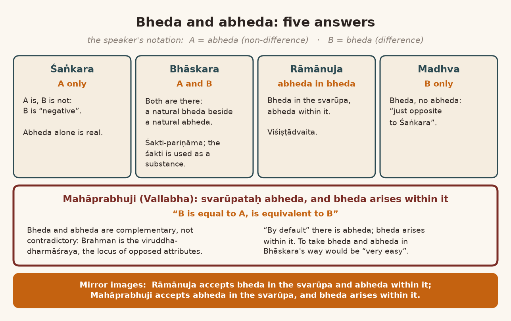
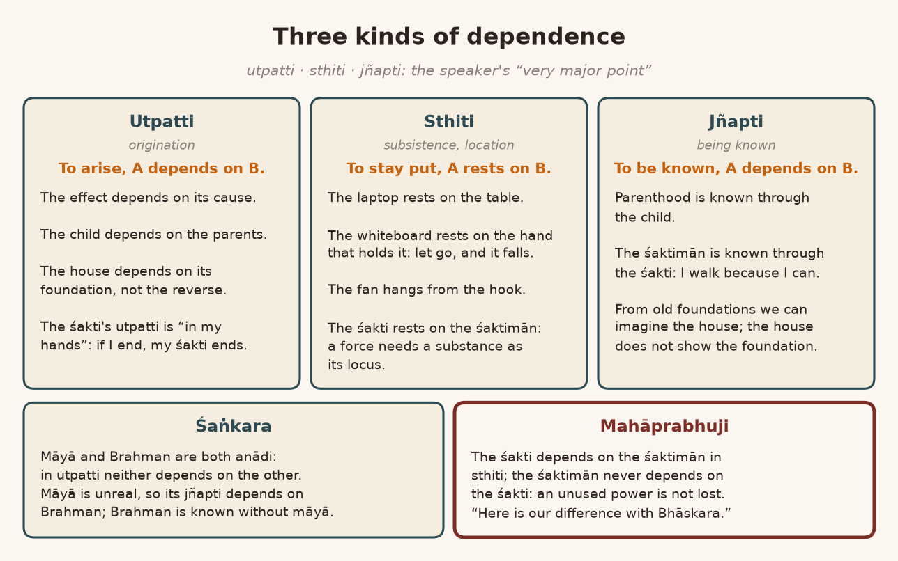
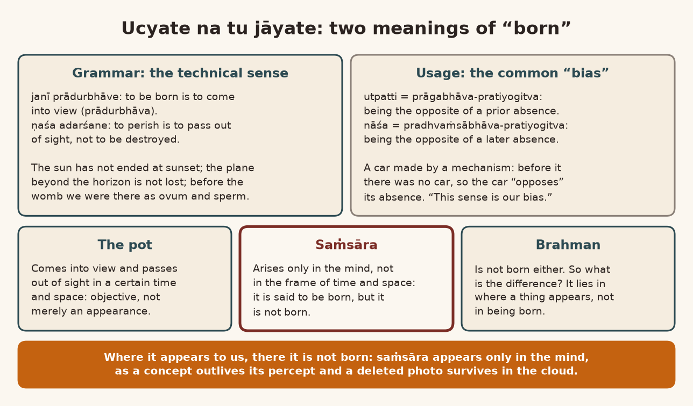
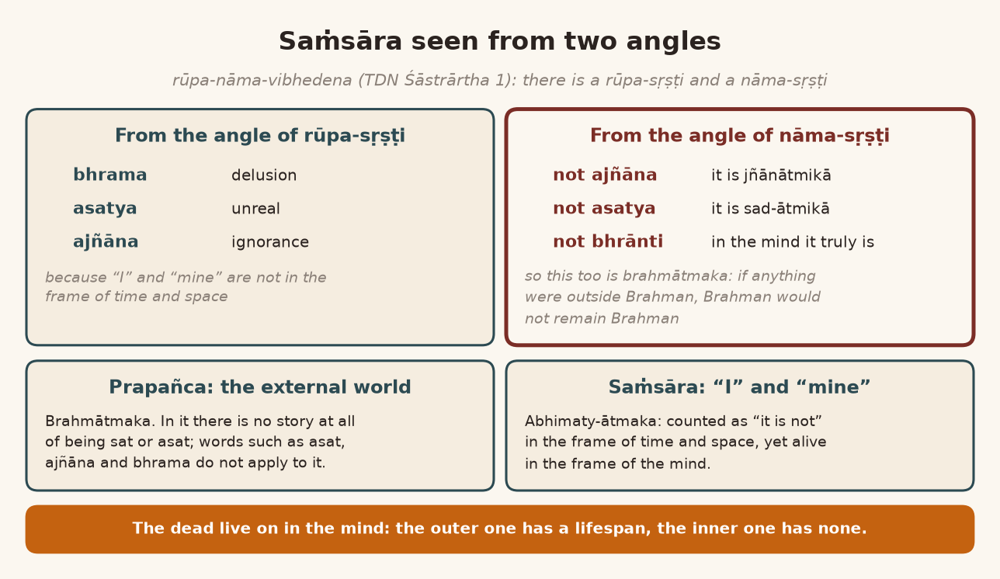
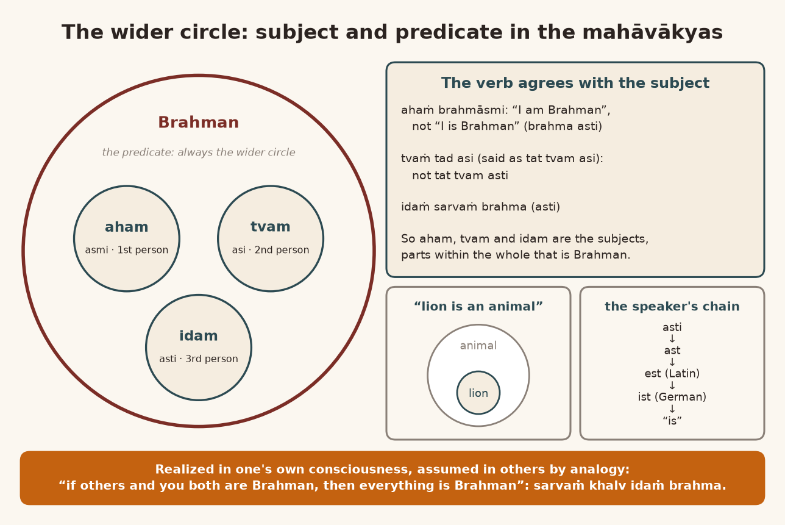
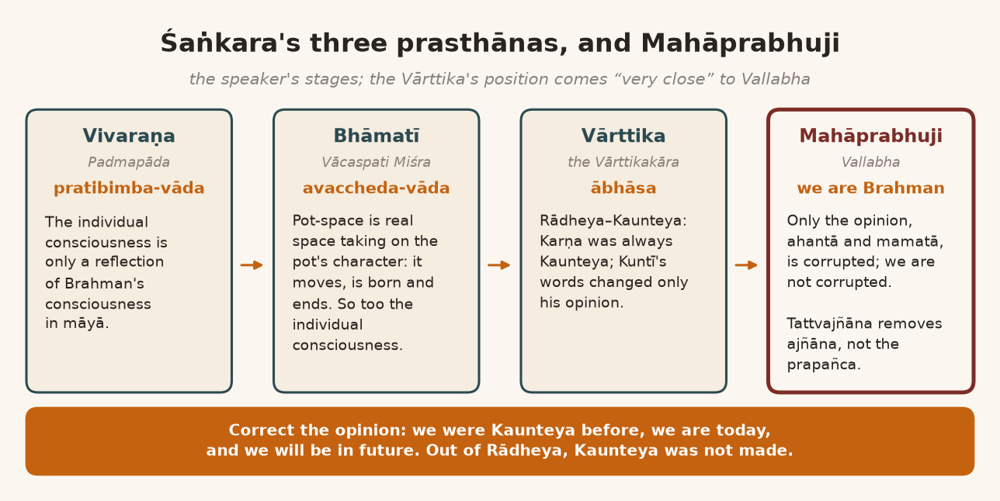
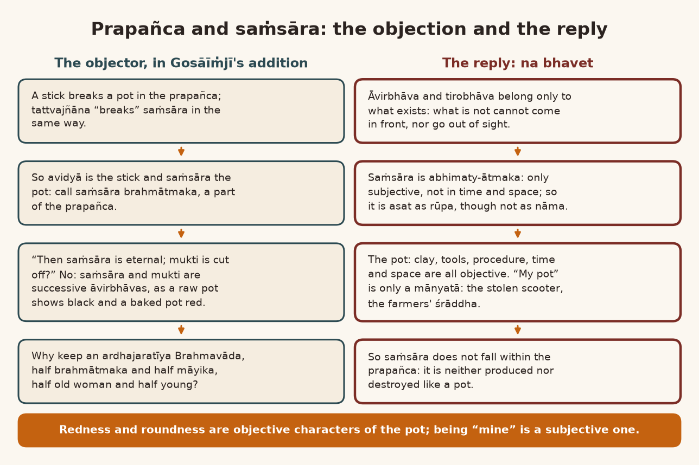
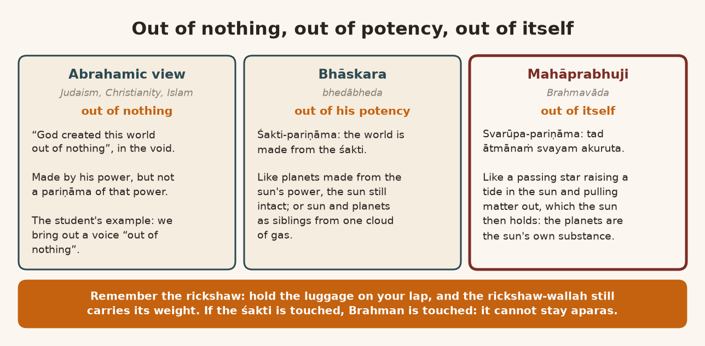

*English rendering of a spoken discourse on the Śāstrārtha Prakaraṇa of the Tattvārthadīpanibandha, translated from a Hindi ASR transcript. The speaker's conversational register, humour, digressions, code-switching, and student exchanges are preserved. Editorial flags: ‹ › conjectural restoration of a garbled reading; ‹?› uncertain reading; ‹…› inaudible or unrecoverable passage; ‹श्रवणाधारित› text given as heard, pending verification against a printed edition. Verses whose standard text is beyond doubt have been silently restored to the received editions.*

# 1. A for Abheda, B for Bheda: Bhāskara's Bhedābheda and Mahāprabhuji's Tādātmya

**Speaker:** Any questions?

**Listener 1:** No hand is raised yet.

**Speaker:** All right, yes.

**Listener 2:** Look, at the beginning, I mean, we were all understanding Bhāskarācārya's view, Śaṅkarācārya, and Mahāprabhuji. In that, Bhāskarācārya's bhedābheda "versus" tādātmya: in that, I mean, what is the "subtle difference" between the two views? I mean, this much has come into my mind, that Bhāskarācārya counts the śakti as …

**Speaker:** … as the pariṇāma.

**Listener 2:** Mahāprabhuji is saying that Brahman itself, using Brahman as a śakti, is ‹manifesting›‹?› the world within itself. Up to there it is the same; only, independently, it is bhedābheda and tādātmya. So what does the "difference" between them actually mean? ‹…› and "same". Thank you.

**Speaker:** We take A for abheda and B for bheda. Śaṅkarācārya is saying that A is and B is not; B is "negative". Bhāskarācārya says that both A and B are. ‹Rāmānujācārya› is saying that there is abheda within bheda: ‹Viśiṣṭādvaita›‹?›. ‹Madhvācārya›-jī is saying that there is bheda and there is no abheda, "just opposite to Śaṅkara". Mahāprabhu Vallabhācārya is saying that "B is equal to A, is equivalent to B". Bheda and abheda are not such that they would be "contradictory". They are complementary.

A "basic difference" has come in here. For Mahāprabhuji, to accept bheda and abheda the way Bhāskara's view does would be very "easy"; then there would be no accepting of the *viruddha-dharmāśraya*. *Ek tar bhed āhe, viruddha abhed āhe, viruddha-dharmāc āhe brahmatva, mahāprabhūnnī ‹nā›‹?› keleleṁ āhe* [On the one hand there is bheda; opposed to it there is abheda; Brahman-hood consists precisely of opposed attributes; this is what Mahāprabhu has done]. Because ‹svarūpataḥ› it is abheda, and within it bheda arose. Likewise Rāmānujācārya accepts bheda in the svarūpa, and within that he accepts abheda. In the same way Mahāprabhuji is saying that svarūpataḥ it is abheda, and within it bheda arose. So if we want to illustrate it for you graphically, we can do it like this. *[He draws the positions; the drawing is not captured in the recording.]*

**Listener 2:** That line, I mean, in itself it isn't a line. That … I mean, what is its importance?

**Speaker:** No, no. This means: are bheda and abheda both there "by default"? We are saying that "by default" it is not both bheda and abheda. "By default" it is abheda; that comes to us through bheda ‹…›.

**Listener 2:** "By default" … there I make the bheda, he is saying ‹…›.

{width=6.2in}

# 2. Svarūpa or Śakti? Brahma-jijñāsā, Not Śakti-jijñāsā

**Speaker:** All right. Now the remaining matter is this: is it svarūpa-pariṇāma or is it śakti-pariṇāma? *Tad ātmānaṁ svayam akuruta* (Taittirīya Upaniṣad 2.7.1): it made its own self, it itself made itself, in the form of the world. Did it make itself, or did it make its śakti? Now what is the "problem" in this? If it did not make itself, and made its śakti, then one ought to do a jijñāsā of the śakti. Not *athāto brahma-jijñāsā* (Brahmasūtra 1.1.1); one ought to do "athāto śakti-jijñāsā", not of Brahman. The definition *janmādy asya yataḥ* (Brahmasūtra 1.1.2) will not apply to Brahman; it will apply to the śakti. If it is to be applied to Brahman, then one will have to accept bhedābheda between the śakti and Brahman.

All right, then they accept bhedābheda. Then a question comes. Where the ‹bhedāṁśa›, the part of difference, of the śakti is, there Brahman's causality will be broken. The śakti's causality will remain; the abhedāṁśa will remain. For this no "answer" is found in bhedābheda. You are saying that even if there is a śakti, the śakti has been used "as an instrument", not ‹…› "as a substance". In Bhāskara's view it has been used "as a substance".

Because śakti and substance, meaning "energy" or "substance", "matter": is there "interchangeability" between energy and matter or not? If there is "interchangeability", then there is bheda‹?›. And ‹…› there is no "interchangeability". Now …

**Listener 1:** It is … this question …

**Speaker:** … troubles science too. Because: is the world made of "force", or of ‹"matter"›? Up to now we have understood ‹the condensing of "force" into "matter"›‹?›, but ‹"matter" dispersing from "force"›‹?› we have not yet been able to make. No: the condensified form of śakti is "matter"; that we have not been able to make.

**Listener 1:** Śakti …

**Speaker:** By "fusion" of "matter" we have certainly obtained śakti. But "practically", "theoretically", science does regard it as "possible", doesn't it? There too it is the same "issue". This subject stands before ‹…› in the same way as it stands before Vedānta. Has that opened up?

**Listener 2:** Yes.

**Speaker:** Because "transformation from matter to matter" and "a transformation from energy to matter" are two different modes of "transformation", aren't they?

# 3. The Rickshaw Fare: Why a Śakti-pariṇāma Brahman Still Gets "Touched"

**Speaker:** What is the trouble? The point to understand in this is just this. Everyone has an objection: they have made Brahman the way the ‹marjādīs› are, haven't they? "Don't touch anyone! Don't touch! Don't touch!" Completely ‹aparas›. So whatever evil there is in the world, it is like a Brahmamārgī‹?› Vaiṣṇava: "Don't touch me." Brother, I am not touching you; I am touching your śakti. So is there bheda or abheda between you and your śakti? If, by touching your śakti, the evil of the world (by touching the śakti) does not touch Brahman, then there is bheda. And if, by touching the śakti, it touches Brahman too, then there is ‹abheda›.

Like this: at a Puṣṭimārga ‹…› seminar a very great scholar of Nyāya had come, Balirām Śukla, and a very great scholar of the Rāmānuja school had come, Kākācārī-jī‹?›. The two got caught up in a debate with each other. Balirām-jī said a very good thing. Balirām-jī was in Banaras. Balirām-jī said: in Banaras a person got off the train, and to go to his destination he engaged a rickshaw. The rickshaw-wallah said, "If you want to ride alone, it will cost five rupees. If you also want to put the luggage, it will cost ten rupees." So the man said, "All right, I'll lift the luggage myself, and I alone will ride. Then will it be five or ten?" You lifted the ‹weight›. But the one who has to haul it is still the rickshaw-wallah, isn't he?

**Listener 2:** No …

**Speaker:** Now, fine, you have lifted the weight; you haven't put it in the rickshaw. But having lifted the weight, you sat in the rickshaw. So does the rickshaw-wallah have to haul the weight of one person alone, or the weight of both? So this is the mess in śakti-pariṇāma.

**Listener 2:** This is the mess.

**Speaker:** Brahman says, "No, no, no evil of the world will touch me. I am in aparas. It will touch the śakti." But if that śakti is touching Brahman, then will it touch it or not? Now, say a sūtak has come: you have become "touched". If you came here, wouldn't we get touched? If …

**Listener 2:** Achhā.

**Speaker:** Never mind. There are quarrels of this kind, a bit. As is said among us by the ‹marjādīs›: if you lifted water with your own hand and bathed, the water got touched, so how will you become pure? If water is not to be lifted with your own hand, then how is it to be lifted? So tie a datun to the water tank …

**Listener 1:** Yes …

**Speaker:** … to open the tap. All right, fine: you tied a datun. If you open it with the datun, the datun got touched; through it the tank got touched; through that the water will get touched. So what to do? Then keep a ‹…› for touching the datun! So you never get free of it‹?›. It is like that everywhere, a little. In the śāstra it is clearly written that you can take water in your own hand and bathe; the water does not get touched by that. If you rinsed your mouth and so on into the water, then the water gets touched. Otherwise, if you took clean water ‹…›, it does not. It happens: the marjād people run their own separate marjād. A crooked marjād.

In the same way the śakti-pariṇāmavādīs are all a bit marjādī too. ‹Their› Brahman gets touched. Our Brahman does not get touched, because Mahāprabhuji clearly commands:

> यच्चापि दूषणं किञ्चिद् दूष्यं चापि हरिः स्वयम् ।
> विरुद्धपक्षाः सर्वेऽपि सर्वम‹त्रैव› शोभते ॥
>
> *yac cāpi dūṣaṇaṁ kiñcid dūṣyaṁ cāpi hariḥ svayam |*
> *viruddha-pakṣāḥ sarve 'pi sarvam ‹atraiva› śobhate ||* ‹श्रवणाधारित› (cited by the speaker as Mahāprabhuji's words)
>
> [Whatever fault there may be, and whatever is faulted, is Hari himself; all the opposing positions too: everything fits right here.]

If some "objection" comes to stating this Brahmavāda, that "objection" too is brahmātmaka. And if because of the "objection" something is "questionable", then the "questionability" too is Brahman's own, not from another. Because the one has to become everything. If "by default" there is "unity", and some "duality" has arisen in it, then "that duality is a part of the unity". And what are they saying? That "duality" and "unity", by ‹…›.

**Listener 2:** So ‹…› that too I read only later. But this is "strict".

**Speaker:** Yes.

**Listener 2:** Yes.

# 4. "He Did Not Delight Alone": Nearest Neighbours, and the One That Splits Itself for Play

**Speaker:** Did something come through? One thing is certain: of all the doctrines of Vedānta (all right), among which, I feel (Puruṣottamajī, by the way, has a different view about this), but I feel that by Puruṣottamajī's reckoning the nearest is Rāmānujācārya, and by my reckoning the nearest are ‹Bhāskarācārya› and ‹Vijñānabhikṣu›. Bhāskara, Vallabha and ‹Vijñānabhikṣu›: these are very close. For the rest there is a little distance each, and the distance keeps increasing. The distance increases most of all from our Śaṅkarācārya. He runs in the opposite direction.

*[Reading the Prakāśa:]* *Evaṁ sati "sa vai naiva reme, tasmād ekākī na ramate, sa dvitīyam aicchat", "sa haitāvān āsa" iti śrutau ramaṇārtham eva prapañca-rūpeṇāvirbhāvokteḥ, vaicitryaṁ vinā tad-asambhavo yataḥ, tasmād dhetor asya bhagavataḥ śaktyā avidyayā jīvasya saṁsāra ucyate, na tu jāyate* (Prakāśa on Śāstrārtha Prakaraṇa 23; the śruti is Bṛhadāraṇyaka Upaniṣad 1.4.3).

What does the śruti say? It did not want to stay alone. *Tasmād ekākī na ramate*: therefore no one stays alone. *Sa dvitīyam aicchat*: it desired an object; it desired a second. So it desired a second; it did not "import" some second into its own "unity". It "split" its own self into two. And having split, *sa haitāvān āsa*: it became all this, this much ‹…›. Because of this, *ramaṇārtham eva prapañca-rūpeṇāvirbhāvaḥ*: when Brahman became manifest in the form of the prapañca, it became manifest in the mood of ‹krīḍā›. *Vaicitryaṁ vinā tad-asambhavo yataḥ*: without variety, that is not possible. So the vaicitrya that has become manifest in this (vaicitrya means "multiplicity", "variety"), the "variety" that has become manifest, has become manifest by the Lord's will. Otherwise, "by default", it is Brahman alone.

*Tasmād dhetor asya bhagavataḥ śaktyā*: and to make that "variety" manifest, the Lord has used his śakti, in which by vidyā there is knowledge, by avidyā there is ignorance, by puṣṭi there is bhakti, and so on. Creation is the capacity of becoming many (*bahu-bhavana-sāmarthya*), by the use of different śaktis. The śaktimān of all those śaktis is one. And between the śakti and the śaktimān too there is not bhedābheda but tādātmya: that is, bheda manifested within abheda.

How do we understand this? Is it bhedābheda, or is it tādātmya? Then this question will come, won't it? ‹Bhāskara› would say that it is bhedābheda: there is bheda and there is abheda too. But the question is this. Then between śakti and śaktimān, that is, between "energy" and "matter", if there is bhedābheda, then there should be no "conversion" of the two into each other. We can see it with our own śakti. Whatever work we have to do, whichever śakti we want to use, we work with that śakti. We are doing the work; the śakti is not doing it. We are using the śakti "as an instrument". Like if there is a hot tavā, we cannot lift it with the hand, so we lift it with tongs. That by itself is an "instrument". The bheda we have with that "instrument" is an aicchika bheda, a difference by choice; it is not a svābhāvika bheda. The natural thing is abheda. In Bhāskara's view there is a natural bheda and a natural abheda: that's all, here.

**Listener 2:** This matter has also come up with pariṇāma …

**Speaker:** That is another "aspect", of avikṛta-pariṇāma. That is not the "issue" here right now.

**Listener 2:** ‹…› would be established, no?

**Speaker:** That is an "issue" in kārya-kāraṇa-bhāva. This one is in the "issue" of "whether it is singularity or plurality".

*[The text is read again here; the transcript renders this stretch only as an English paraphrase: "The world is an appearance; without the distinction of non-duality, how could that be possible? Therefore," and then:]* *… bhagavataḥ śaktyā avidyayā jīvasya saṁsāra ucyate …* (Prakāśa on Śāstrārtha Prakaraṇa 23)

**Speaker:** So the Lord used one such avidyā-śakti by which we see some "variety", "prima facie", between us and the Lord's "substance". In the "core" there is no "variety", but in the "format" "variety" has come. *Avidyayā jīvasya saṁsāra ucyate na tu jāyate.*

Now this is a very big thing. There is also a "paradox" here, to which attention should be paid. Because we hold (I mean, Vallabhācārya holds) first of all that Brahman is one; on the unity of Brahman ‹our› view is completely tight. There is nothing apart from Brahman. Because if there is anything apart from Brahman, then Brahman does not remain Brahman. It is the "all-encompassing phenomena"; outside it there is nothing; whatever there is, is within it, and that is Brahman.

# 5. Laptop, Fan and Foundation: Three Kinds of Dependence

**Speaker:** But three koṭis are formed of Brahman: the svarūpa-koṭi, the kāraṇa-koṭi and the kārya-koṭi. Svarūpataḥ, everything has become Brahman alone. But it divided itself into cause and effect. Because in it there is the śakti of being the cause, and there is also the śakti of being the effect. So when there is the śakti of being the cause and also the śakti of being the effect, it divided itself. After dividing, there is the śakti of becoming the effect; because of that, the effect remains dependent on the cause. The effect depends on the cause in utpatti. In ‹jñapti› the cause depends on the effect. ‹Utpatti› and jñapti are two phenomena; rather, there are three phenomena. Nirbhar, that is, "dependency". Wherever there is any "dependence", it is of three kinds. One is in utpatti: in order to be produced, A is "dependent" on B. One "dependency" comes in ‹jñapti›: brother, without knowing A we cannot know B. So ‹jñapti›, that is ‹…›. Hence …

And one is the "dependence" of sthiti.

**Listener 1:** Achhā.

**Speaker:** Right. Because, like, this laptop is situated on the table: ‹it› is "dependent" on the table. This whiteboard is situated on me right now; so in sthiti it is "dependent" on me. I am not "dependent" on it. I can put it away and still remain, but this one, I'm holding it; ‹if I let go›, it will fall down. To that extent it depends on me. Because of ‹…› the fan is hanging, so it is "dependent" on the hook in sthiti; it is not "dependent" on it in utpatti. The parents are not "dependent" on the child in utpatti; the child is "dependent" on the parents in utpatti. But the parents' parenthood is understood because of the child. So the parents are "dependent" on the child in the sense of ‹jñapti›.

**Listener 1:** Because of it … understood …

**Speaker:** What is utpatti? Like this, "dependency" is of three kinds: utpatti, jñapti and ‹sthiti›. Now the question here is just this: is advaita "dependent" on dvaita, or is dvaita "dependent" on advaita? Is the śaktimān "dependent" on the śakti, or ‹is the śakti "dependent" on the śaktimān›? So when we say śakti, it must have some "locus". Where is that śakti? Whatever "force" there is, it must have some "substance", some "locus". So the śakti is "dependent" on the śaktimān in sthiti. The śaktimān is not "dependent" on the śakti.

Like, suppose we did not use some śakti. If we did not use it, we will not become powerless. Now we can understand: in us there is the śakti of seeing, the śakti of hearing, the śakti of smelling, the śakti of speaking. Now suppose I am not hearing, only seeing: has my śakti ended in that? Whichever śakti I want to use, I am using that śakti. In me there is the śakti of walking. In me there is the śakti of speaking: right now I am speaking but not walking, so has the śakti of walking ended? If I end, then my śakti will end. So the utpatti of the śakti is in my hands. And in ‹jñapti› I become ‹known› through the śakti: because I am walking. Why am I walking? Because there is the śakti to be able to walk. The "dependency" of jñapti is different; the "dependency" of utpatti is different. This is very necessary to understand.

Like any house we build: it is "dependent" on the foundation; the foundation is not "dependent" on the house. Mohenjodaro, Harappa, and all the sites found here now: there we all see that the foundations are still left there, and the houses have all fallen. The foundation is still being found; the house has fallen. That means the house, the "structure", is "dependent" on the foundation; the foundation is ‹not› "dependent" on the "structure".

**Listener 2:** Yes.

**Speaker:** Now here it has become "reverse". The foundation, in the jñapti of the house …

**Listener 2:** *Āṇi tec* [And that very thing] …

**Speaker:** For ‹jñapti›, the "structure" is "dependent" on the foundation. From the foundation we are getting knowledge of it; the house is not there now at all.

**Listener 2:** Yes ‹…›.

**Speaker:** And even if ‹the› house is there, we don't know whether the foundation is strong or weak. By seeing the house we do not get knowledge of the foundation. Knowledge of the foundation is not "dependent" on the house. If ‹the foundation› … if knowledge of the "structure" were ever "dependent" on the foundation‹?›, then bridges would not fall. But bridges do fall when a flood comes; the foundation remains below. "That means looking at the structure you cannot be absolutely sure of its foundation, but by looking at foundation you can some imagine what sort of thing."

**Listener 1:** Achhā.

**Speaker:** Utpatti, sthiti and jñapti: this is a very "major point". They have a role in all of this. In "dependency", some "dependence" is in being produced, some "dependence" is in jñapti, some "dependence" is in sthiti.

Here is our difference of opinion with Bhāskara. What did Śaṅkarācārya say on this account? According to Śaṅkarācārya, māyā, which is a śakti, the māyā-śakti, is anādi. Brahman too is anādi. So neither is Brahman "dependent" on māyā, nor is māyā "dependent" on Brahman; both are "independent". But māyā is not "real"; it is "unreal". Therefore the jñapti of māyā cannot happen without Brahman; the jñapti of Brahman can happen without māyā. That is the "difference" in all this. ‹Śaṅkara›: "because you cannot know reality on the basis of the superimposition; ‹…› you can know the superimposition on the basis of the subject." There it is "dependent" in jñapti; in utpatti māyā is ‹independent›‹?›. This is the doctrine of Śaṅkara's view; ours is a separate doctrine. Just saying the true thing‹?›.

{width=6.2in}

# 6. The Sun Does Not Die at Sunset: *Ucyate na tu Jāyate*

**Speaker:** So what is Mahāprabhu saying? That *śaktyā avidyayā jīvasya saṁsāra ucyate na tu jāyate* (Prakāśa on Śāstrārtha Prakaraṇa 23): by the avidyā-śakti the saṁsāra of the jīva is said, not born.

By the way, grammatically (write it down): *janī prādurbhāve*; ‹*ṇaśa adarśane*› (Pāṇinian Dhātupāṭha). What is called utpatti and nāśa is, grammatically, prādurbhāva. Grammar does not accept "origination". Prādurbhāva means coming in front. *Ṇaśa adarśane*: what is called nāśa, just not being seen is the name of nāśa, not the name of "destruction". Like "construction" and "destruction": that is not there according to grammar. But in usage, for nāśa and utpatti a definition was fashioned like this: *prāgabhāva-pratiyogitvam utpattimattvam* and *pradhvaṁsābhāva-pratiyogitvaṁ naṣṭatvam* ‹श्रवणाधारित› [to have origination is to be the counterpositive of a prior absence; to be destroyed is to be the counterpositive of a posterior absence]. Whatever is being produced is the opposite of the "absence" it had before it was produced. Like, we made a car by a "mechanism". The car was produced. Before that there was no car. So the car became the opposite of the car's "absence", didn't it?

This "opposition" is not in the sense of *janī prādurbhāve*. Because suppose something became manifest, like the sun rising. Can we say that before rising the sun is not there? The sun set: can we say that after setting the sun has ended? No; it has just stopped being visible. Often a plane comes in the sky; it goes up to the "horizon"; after going past the "horizon" it stops being visible. So the plane has not been destroyed. So nāśa meaning "what has stopped being visible" is not being taken today. Grammatically nāśa means not being visible; today nāśa is taken to mean "destruction", and utpatti is taken to mean "origination". So, in that sense, prāgabhāva-pratiyogitva and pradhvaṁsābhāva-pratiyogitva: this "sense" of ours, this is our "bias". According to that "bias", Mahāprabhu is saying that saṁsāra is not born, but it is said to be. Actually saṁsāra is not born; it is said. *Na tu jāyate: ucyate na tu jāyate.*

Now, what is the difference between being said and being born? This is necessary for us to understand. Because here there is a very "paradoxical situation". Is Brahman being born, or is being born being said of it? We accept this, that Brahman-hood is not being born; ‹it is only› said to be born. But we too were hardly born in the sense of prāgabhāva-pratiyogitā. Like, we came out of the mother's womb: so were we not in the mother's womb before? When we were not in the mother's womb, even then we were there as ovum and sperm, in ‹our parents'› bodies ‹…›.

Now, it is not that it comes ‹…›; prādurbhāva is happening at different "stages". This is true. So Brahman, too, is not being produced. Then what is the "difference" between saṁsāra and Brahman? This is the "paradigm". *Ucyate na tu jāyate*: if you scratch your head a little, you will understand. Mahāprabhuji is saying that saṁsāra is not being born; saṁsāra is only said to be born. Actually it is not being born. So is Brahman born? Brahman too is not born.

**Listener 1:** It matches‹?› …

**Speaker:** So what is the difference?

**Listener 1:** Yes.

**Speaker:** The reverse has come out. The matter has to be understood very seriously: where this "sense" of being born comes in, whether to take the "sense" that is acceptable to everyone, or then to take it in the "technical sense", in the "sense" of grammar, that is, to take it as prādurbhāva; or in "common sense", what is said for prāgabhāva-pratiyogitā.

**Listener 1:** What is said … prāgabhāva-pratiyogitā.

{width=6.2in}

# 7. The Anaconda and the Deleted Photo: What Is Born Only in the Mind

**Speaker:** For one thing, this "issue" is "major" here. If we take this "issue", that jāyate means to become manifest (prādurbhūta), and it is not becoming manifest, then where is it not becoming manifest? Mahāprabhuji would want to explain this: where it appears to us, there it is not becoming manifest; it is becoming manifest somewhere else. Because whatever becomes manifest is born in the "framework" of "time and space". Whatever becomes manifest is born in the "framework" of some "time", some "space". Saṁsāra is not being born in the "framework" of "time and space"; it is being born only "mentally". What is born in the "mind" does not happen in the "framework" of "time and space".

How will we understand this? Like, suppose we saw something; you see any object. Say we saw an anaconda. So a picture of the anaconda was born in our "mind": a "concept", the "concept" that is born "mentally". And the "percept" of the anaconda is in "time-space". Because it is in "time-space", it can be born and it can also end. Now "theoretically" we can call that prādurbhāva and ‹tirobhāva›. Here, is prādurbhāva happening or not? So this is to be understood with special attention: the prādurbhāva is not happening in "time-space". First of all, there is a prādurbhāva; the prādurbhāva that happens "mentally" does not happen in the "framework" of "time-space". Because the anaconda you saw, and the "mental image" of yours that was born: even after it ends, you will "retain" that "mental image". That is the "retaining" of the "mental image".

If we want to understand it today, it can be understood very simply. Some "message", some "picture" came on our mobile. We "deleted" it. Up in the "sky" ‹…› it was there, wasn't it? It has been "deleted" from our mobile; ‹it has not been deleted› there. Because if you want to "retrieve" it again, it can be "retrieved" from there. From our side it got "deleted", but from there it can be "retrieved". That means: what was born and ended in our "framework" here, there is no need to hold that it has really, "substantially", ended. Only the "appearance" has "disappeared". In the same way saṁsāra is only "appearance"; it is not in the "framework" of "time and space". And the pot that is born is born in the "frame" of "time and space"; it is not "merely appearance". This is one ‹*anubandha-catuṣṭaya*›‹?›: *ucyate na tu jāyate*.

**Listener 1:** Jai Jai, I didn't understand. If someone dies, they "disappear" from "time and space", and they also disappear "mentally", don't they?

**Speaker:** If he died "mentally", then you would not be able to talk about him at all. You would not be able to think about him.

**Listener 1:** "Okay."

# 8. Pṛthvīrāj's Bones and the Pharaohs' Servants: The Dead Who Live in the Mind

**Speaker:** Shall I tell you something?

**Listener 1:** Ji, Jai Jai.

**Speaker:** In a lot of animals, especially the female … the male is not so much like that; there is "indifference" in him, I feel. The penguin is a different matter. In the penguin the poor male works like the female, and the female works like the male. In the penguin, after laying the egg she goes off; the [male] penguin goes on ‹hatching› it and so on. There is a "different structure" in the penguin. Yes: the male does not "select" the female; the female "selects" the male. They "fight" among themselves, and whichever female wins, the poor male becomes hers. They properly ‹kick› each other, all of them.

**Listener 1:** So …

**Speaker:** There it is a separate "culture". "Normally", where that penguin "culture" is not there, it is like this: the male is "indifferent", so the female takes great care of her young. But in many species, all the ‹…› "human species", the female takes care only as long as it is alive; if it died, then the female too does not take care. Very few animals are such that they weep after a death. Like a cow weeps if her calf dies. A dog weeps after a death. In some animals that is there. So weeping means that the pain is still there, isn't it, the pain of the death. In all these others it gets "erased". Why should weeping come after a death? We ought to be like the animals! It is getting "retained" even after death, isn't it? The "mental image" is getting "retained", isn't it?

These days the custom is no longer there; society has become a bit civilised. In the old days, I heard in childhood, if someone died they used to weep for him beating their chests: "He didn't do this ‹…›, hāy hāy! Not even married, hāy hāy! He's dead, hāy hāy!" Arre, ‹he›‹?› is dead; then what is the need of hāy hāy? You understand: he didn't marry, he died; then what is the need of hāy? Why can't we behave like the animals? Because in them it is not "retained". So they "attend" only as long as it is alive. And in all the animals it is like the doctor, not like the "relative". The doctor "attends" the patient as long as he is alive; when he dies, then he turns his face away and walks off: "I did this much work; I've left it in God's hands." The relatives then weep; the doctor does not weep.

**Listener 1:** Why?

**Speaker:** His connection is with the living. Whoever is in the hospital, he "attends" to. We weep for the one who has left the hospital, who died. Because the dead person is alive in our "mind". "And it takes a lot of time, depending on the relation of the dead person and the relative", how many days it goes on. So this much is true, isn't it? It is not that if he died in "time-space" after death, then he will die in us too ‹…›; he stays alive for a long time.

I told this just the other day. Alāuddīn Khiljī … Alāuddīn Khiljī killed Pṛthvīrāj. *[Historically, Pṛthvīrāj Cauhān was defeated by Muḥammad of Ghor.]* After killing Pṛthvīrāj, in Ghazni, in a mosque, in a graveyard, where everyone walks setting their feet on it, there his bones were buried. In UP, in Banaras, there was some kṣatriya. Whether he was of Pṛthvīrāj Cauhān's caste or not, I don't know, but he was a kṣatriya. When he came to know that Pṛthvīrāj's bones were there, he became a Pathan and went to Afghanistan, and he stole Pṛthvīrāj's bones from the graveyard and brought them, and did the agni-saṁskāra here. Today, how many years since he died? Eight hundred years. For us it has been eight hundred years since Pṛthvīrāj, but he had so much attachment that after eight hundred years he went and brought the bones. He said: how can this be, everyone walking with their feet on our Pṛthvīrāj's bones? He stole all the bones by night and brought them, ours, and did the agni-saṁskāra here. So Pṛthvīrāj is alive in his mind, isn't he? In our mind he may have died.

Nehrujī had kept his wife's ashes safely, and left it written ‹in his will›‹?› that when I die, mix my bones and her bones and immerse them. Until then ‹…›, and even now I don't forget it.

Godse's bones: Godse's family have kept them safely in Pune, that on the day India becomes free‹?› ‹…›, on that day they will immerse them in the Sindhu river. Right now the Sindhu river is not with us; it is in Pakistan. So what a wish Godse had! So he is alive, isn't he? A man died: it is not that he died. How many "skeletons" are found? From them it all comes alive. And understand one thing carefully: take the "DNA" of that "skeleton" and "inject" it again, and the man can even be born again. Science has done "research" even up to this point: he can be born again. Right now the "government" does not "allow" it; "scientifically" it is "possible". So he died; he died in "time-space"; he died in our seeing, in ‹*ṇaśa adarśane*›. Therefore it is not necessary that he died in the "mind". Did my point come through?

**Listener 2:** Thank you, ji ji, yes ji ji, thank you.

**Speaker:** "And all the pharaohs of the Egyptian ruler's family still survive: their body physically. They are not surviving as a living phenomena, but as dead body they do survive. So within time and space also they survive." With them the business went even this far: if the king died, the king's favourite servants were buried too. Yes, alive.

**Listener 2:** Because the …

**Speaker:** Because the day they wake up, the next day they will need servants again, won't they? So where will they bring servants from? ‹The good servants›, they used to bury them: "Come on, you get buried too."

**Listener 2:** ‹So› it should happen between guru and bhakta too …

**Listener 1:** Achhā.

**Speaker:** That happens too. Don't think that because he died outside, he cannot remain alive inside. He certainly remains alive. Rather, this one stays alive more than that one; that one stays alive less. That one has a lifespan; this one has no lifespan at all. So: *na tu jāyate*.

# 9. Rūpa-sṛṣṭi and Nāma-sṛṣṭi: In What Sense Saṁsāra Is Asat

**Speaker:** Mahāprabhuji is saying: *abhimaty-ātmakatvāt* (Prakāśa on Śāstrārtha Prakaraṇa 23), because it stays alive in abhimati. The "mental image" stays alive; the "physical image" has ended. *Asattvenāsya gaṇanāt*: it is counted as "it is not". In this too, understand a little carefully. Mahāprabhuji's lines are very, uh, "delicate" lines. Asat means it is not in "time-space". In mati it is, isn't it? It is asat: the counting that is happening, "it is not", now where is it counted so? "In the frame of the time and space". "In the frame of mind", as a "mental concept", it certainly is, isn't it?

*Asattvenāsya gaṇanāt, ajñānaṁ, bhramaḥ, asad ityādi-śabdāḥ* (Prakāśa on Śāstrārtha Prakaraṇa 23): it is then also called ajñāna, also called bhrama, also called asat; these are the words. *‹…› ityādi-śabdā ahaṁ-mameti-rūpe saṁsāra eva pravartante, na tu prapañca ity arthaḥ* [these words apply only to saṁsāra, in the form "I" and "mine", not to the prapañca]. This is called ajñāna. Ajñāna means there is no knowledge of the outside; of the inside there certainly is knowledge. What is outside is not ‹there›; inside, the bhrama is alive, isn't it? And asat too: the asat is not in "time" and "space", but it is in the "mind", isn't it?

I mean, for this Mahāprabhuji has said at the very beginning of the Nibandha, *rūpa-nāma-vibhedena* (Tattvārthadīpanibandha, Śāstrārtha Prakaraṇa 1). There is a rūpa-sṛṣṭi and there is a nāma-sṛṣṭi. From the "angle" of rūpa-sṛṣṭi it is bhrama; from the "angle" of rūpa-sṛṣṭi it is asatya; from the "angle" of rūpa-sṛṣṭi it is ajñāna. From the "angle" of nāma-sṛṣṭi it is neither ajñāna, because it is jñānātmikā; nor asatya, because it is sad-ātmikā; nor is it of the form of bhrānti in that way, because in the "mind" it certainly is, isn't it?

*Saṁsāra eva pravartante, na tu prapañca ity arthaḥ, tasya brahmātmakatvāt* (Prakāśa on Śāstrārtha Prakaraṇa 23). The prapañca, which is the "external world", is brahmātmaka. This "understanding" of ours: is it brahmātmaka or not? So from the "angle" of rūpa it is not brahmātmaka, but from the "angle" of nāma this too is brahmātmaka. Because now, if there is anything ‹apart from› Brahman, then Brahman will not remain Brahman. ‹Take this point, Paramahaṁsa-jī›‹?›: you won't find it in the "text"; I am saying it in its "implied sense". *Idam uktaṁ bhavati*: this is what has been said.

{width=6.2in}

# 10. Gosāīṁjī's Addition: The Puruṣa, His Sādhana and His Phala Inside Brahman's Play

**Speaker:** Now, after this, Gosāīṁjī has added a few "additional" lines here. They are not Mahāprabhuji's; Mahāprabhuji's Prakāśa is only this much. Gosāīṁjī has added here: *vastutas tu "sa vai naiva reme" ityādi-śrutibhyo ramaṇārtham eva prapañca-rūpeṇāvirbhāvāt, tad-antaḥpāti-puruṣa-rūpeṇa tat-kṛta-sādhana-rūpeṇāvirbhūya tat-phala-rūpeṇa cāvirbhavan krīḍati bhagavān* (Prakāśa on Śāstrārtha Prakaraṇa 23). [Neither the 1943 nor the 1904 print marks this passage off as a separate addition.] Yes.

Now what is he saying? *Sa vai naiva reme*: it did not want to stay alone. Because of these śrutis, *ramaṇārtham eva prapañca-rūpeṇāvirbhāvāt*: the Lord's āvirbhāva has happened only in the form of ramaṇa. *Tad-antaḥpāti-puruṣa-rūpeṇa*: so within that ramaṇa there is the puruṣa, and there are the puruṣa's sādhanas, and the phalas that are obtained through those sādhanas; all of these are different "modus operandi" of the krīḍā.

Why is Gosāīṁjī saying this? Understand one thing carefully. Because suppose we take Mahāprabhuji's line only this much: that in what is brahmātmaka there is no story at all of saṁsāra, or of utpatti and nāśa. Where is the story of utpatti and nāśa coming in? Of being sat and asat. In the brahmātmaka prapañca, in the "external world", there is no story at all of being sat or asat; everything is brahmātmaka, sat. The story of being asat comes in what the puruṣa produces. What the puruṣa is producing: then is Brahman producing it or not?

**Listener 1:** Yes.

**Speaker:** We are recalling that same ‹rickshaw› point. If the puruṣa is producing and Brahman is not producing, then the puruṣa is separate from Brahman. If the puruṣa too is Brahman in form, then the matter will finally come to Brahman, won't it? The ‹weight› will fall on him. In that situation, what is to be understood? This problem that was there ‹…›: it is not just some question now; it is troubling Gosāīṁjī. That is why Gosāīṁjī has made a small "addition" here.

*Tad-antaḥpāti-puruṣa-rūpeṇa tat-kṛta-sādhana-rūpeṇāvirbhūya tat-phala-rūpeṇa cāvirbhavan krīḍati bhagavān. Evaṁ sati "aham etat-karma-kartā", "etaj-janitaṁ phalaṁ ca mama", "aham etasya bhoktā" ityādi-jñānāni svasya sva-kriyāyās tat-phalasya cābrahmatvena jñānāt bhrama-rūpāṇi* (Prakāśa on Śāstrārtha Prakaraṇa 23). *Kim artham?* So why does bhrama-ness come into these? Because if in yourself, in your "self-awareness", there is no "awareness" of Brahman-hood, then what will you understand? "I did it"; "I am", like Shah Rukh, "Main Hoon Na"!

**Listener 2:** No …

**Speaker:** "I produced it; this is my fruit." This "awareness" is a "limited awareness". Because we are compelled to see everything only through the spectacles of our own ahaṁ. Actually our ahaṁ too is Brahman. Because if ahaṁ were not Brahman: when the śruti says *ahaṁ brahmāsmi* (Bṛhadāraṇyaka Upaniṣad 1.4.10), then if ahaṁ is not "equal to" Brahman-hood, the śruti's word *ahaṁ brahmāsmi* will become false. When the śruti says *tat tvam asi* (Chāndogya Upaniṣad 6.8.7), then if tat is not "equal to" tvam, the śruti's word is false. When it says *idaṁ sarvam* … *sarvaṁ khalv idaṁ brahma* (Chāndogya Upaniṣad 3.14.1), then if all these visible things are not "equal to" Brahman, the śruti's word will become wrong.

# 11. Asmi, Asi, Asti: The Wider Circle of Brahman, and the Ego That Cheats Us

**Speaker:** We can see that where there is a "subject" and a "predicate", as in *ahaṁ brahmāsmi*, ahaṁ is the "subject" and the "predicate" is Brahman. In *tat tvam asi*, actually tvam is the "subject" and tat is the "predicate": *tvaṁ tad asi*. They say *tat tvam asi*.

**Listener 2:** And that …

**Speaker:** Not *tvaṁ tad asti*. Because it is not *tvaṁ tad asti*; look carefully. In the Sanskrit language *asti* is "third person"; ‹*asi*› is "second person"; ‹*asmi*› ‹…›. From this *asti* came *ast*; ‹…› in Latin it became *est*; from *est* then came "is". *Est* actually became *ist* in Germany, and from *ist* came "is". *Asti*, *ast*, *est*, *ist* and "is": the ‹t› went "silent". So these three verb forms: from them we can settle (*nakkī*) which is the "subject" and which the "predicate". It is not *ahaṁ brahma asti*: it is not "I is Brahman", it is "I am Brahman". It is not *tat tvam asti*; it is *tvaṁ tad asi*: "you are that". *Idaṁ sarvaṁ brahma asti*: so what is the "subject" and what the "predicate", we can understand.

And if you use a little sense, you will understand. When we say "lion is an animal", whose circle is bigger, the lion's or the animal's? When we say "lion is an animal", which circle is bigger? The animal's circle is bigger. Always Brahman's circle is bigger. Within the "part" of that Brahman come ahaṁ, tvam and idam. This is to be understood ‹…›: within the "part" of Brahman ahaṁ comes, tvam comes, and idam comes. *Asmi*, *asi* and *asti*: all three come. Brahman's circle is very much "wider".

All right: *brahma tvam asi*. They are not saying *asti*. If they said *tvam asti*, then the jīva's circle would become ‹wider›. If you construe the meaning of the sentence, you understand that this is the "part" and that is the "whole". We too are a "part", you too are a "part", idam too is a "part" of Brahman. The one Brahman is being experienced in all three ways, "and you can realize Brahman in your own consciousness, though you cannot realize or feel the other's consciousness. But you can assume that other is also Brahman, as you are Brahman", "on the basis of analogy". "And if others and you both are Brahman, then everything is Brahman": *sarvaṁ khalv idaṁ brahma*. So in the "logical conclusion": it is a "logical conclusion" ‹…›. So as far as this question goes: again, "X is mortal, Y is mortal, all are mortal, therefore Socrates is mortal": ‹inductive›, not "deductive".

**Listener 1:** In *puruṣa-rūpeṇa*, what is meant by puruṣa?

**Speaker:** "Consciousness".

**Listener 2:** Achhā.

**Speaker:** I mean, the prapañca that is made of prakṛti, and the puruṣa who falls within it (antaḥpātin). And in the form of the puruṣa too it is Brahman. That is exactly what I am explaining here. And that puruṣa who is doing the action: the sādhana he uses for it, that sādhana too has become Brahman, and the "result" that will come from that sādhana, that too is "part" of Brahman's krīḍā. Because the circle of Brahman-hood is very much "wider"; the circle of ahaṁ, tvam and idam is very "narrow".

But still what happens is that in that ahaṁ of ours we do not see Brahman at all: in this sense it is bhrama. ‹Gosāīṁjī›‹?› is giving a "clarification": it is not bhrama in the sense that "by default" it is bhrama. "We are deceiving ourselves; nobody is cheating us." "Prima facie" it seems to us that māyā "cheated" us: *māyā mahā ṭhaginī ham jānī* (Kabīr). Māyā is not swindling us. "You are deceiving your own self by your ego." Our own "ego" is swindling us; māyā is not swindling us. That is why: *aham asya bhoktā*, *etaj-janyaṁ phalaṁ mama*, *aham etat-karma-kartā*. In all this, our ahaṁ is actually Brahman. Otherwise ahaṁ would not be Brahman, and then how would the sentence *ahaṁ brahmāsmi* be "correct", the śruti's sentence? The sentence *ahaṁ brahmāsmi* is the śruti's. So we, in ourselves, do not get the experience of Brahman …

**Listener 2:** That's why …

{width=6.2in}

# 12. Rādheya Was Always Kaunteya: Śaṅkara's Three Prasthānas and a Corrupted Opinion

**Speaker:** At Śaṅkarācārya's there are three siddhāntas, prasthānas: the Vivaraṇa prasthāna, the Bhāmatī prasthāna, the Vārttika prasthāna. What does the Vivaraṇa prasthāna say? Understand carefully. All three are commentators on Śaṅkarācārya. One is Padmapādācārya, on ‹whom› there is the Vivaraṇa; one is Vācaspati, who wrote the Bhāmatī; and one is the Vārttika prasthāna. Such are their three prasthānas. And all are schools of theirs, three within ‹Śaṅkara›, among themselves. Of them, the Vivaraṇa prasthāna says that the "individual consciousness" is only the "reflection" of Brahman's "consciousness" in māyā.

**Listener 2:** This is called *pratirūpa-vāda*‹?›.

**Speaker:** Vācaspati Miśra says: no, it is "real". Why is it "real"? His is not pratibimbavāda; it is avacchedavāda. What does avacchedavāda mean? Like, we made a pot. So the space remaining inside the pot "means" "real" space; it is "adopting" the "character" of the pot. Space does not move, but you can carry the pot's space along. The original space is immovable, but the space inside the pot can move. It is born too, and it ends too. In the same way "individual consciousness" is being born and is ending; it is "movable" too, not "stable". That is avacchedavāda. ‹…› Vallabhācārya goes one step further than this: where there is upādhi, there is Brahman-hood‹?›.

After this, the third, the Vārttika's "stage", is the Rādheya–Kaunteya ‹example›. Rādheya, Kaunteya: meaning what? When Kuntī abandoned Karṇa, there was a charioteer's wife named Rādhā; she reared him and brought him up. Because she reared him, Karṇa considered himself Rādhā's ‹son›, considered himself Rādheya. And after that, when Kṛṣṇa sent Kuntī: go and tell him, to confirm it, that you are not Rādheya, you are ‹Kaunteya›. Then Kuntī went and told him, "Brother, you are not Rādheya; you are my son. Because you were born before my marriage, I felt ashamed to keep you, so I abandoned you." "Then he realized this concept." So what changed? "Nothing." Only the "opinion" changed. The one who considered himself Rādheya became Kaunteya. Out of Rādheya, Kaunteya was not made.

**Listener 1:** Yes.

**Speaker:** So the Vārttikakāra's position is in this sense: our "opinion" has gone bad, "corrupted". We are not "corrupted". That comes very close to our Vallabhācārya: that like Rādheya–Kaunteya we all are considering ourselves jīvas, while actually we are Brahman, just as Karṇa considered himself Rādheya. That is the ābhāsa-pakṣa. ‹…› That position too is called by that ‹name›‹?›. That is the nearest to us ‹among Śaṅkara's schools›. I mean, the "opinion" has become "corrupt"; we have not become "corrupt". Correct the "opinion", and then we are ‹Kaunteya›: we were before, we are today, and we will be in future. And if you take yourself to be Rādheya, then because you ‹…›.

That is why Draupadī, at Draupadī's svayaṁvara, when Karṇa took up the arrow, Draupadī refused: I want to marry (*paraṇnā*) a kṣatriya; I don't want to marry a chariot-maker's son. And Karṇa said just this:

> सूतो वा सूतपुत्रो वा यो वा को वा भवाम्यहम् ।
> दैवायत्तं कुले जन्म मदायत्तं तु पौरुषम् ॥
>
> *sūto vā sūta-putro vā yo vā ko vā bhavāmy aham |*
> *daivāyattaṁ kule janma madāyattaṁ tu pauruṣam ||* (Bhaṭṭa Nārāyaṇa, Veṇīsaṁhāra, Act 3, where Karṇa says it to Aśvatthāman; the speaker places it at Draupadī's svayaṁvara)
>
> [Whether I am a sūta or a sūta's son, or whoever I may be: birth in a family depends on fate, but manliness depends on me.]

Whether I am the son of one who drives a chariot, or whether I myself am the one who drives the chariot, *sūto vā sūta-putro vā yo vā ko vā bhavāmy aham*, whatever I am: being born was not in my hands, but pauruṣa is in my hands, isn't it? That I have earned. Draupadī said: you may have earned pauruṣa, but I don't want to marry you. And then Arjuna shot the arrow, and so Karṇa came to hate Arjuna. Because: I did not get Draupadī because of being Rādheya, and Arjuna got her because of being Kaunteya. How long did that sorrow of his last? Until Kuntī told everyone‹?›.

In the same way our sorrow too lasts only as long as we do not understand Brahman; till then is our sorrow, till then all our trouble. Once it is understood, no trouble. *Ahantā-mamatātmako 'vidyayā kriyate* (Prakāśa on Śāstrārtha Prakaraṇa 23). That saṁsāra is made of ahantā and mamatā. As it was with ‹Karṇa›. It has come about because of avidyā. Because of avidyā, that is, the matter has been hidden from us. And we hold that we alone are in it. Actually you are not just you; you are everything else too. *Tattva-jñāne saty ukta-rūpatva-jñānān nivartate, na tu prapañcaḥ* … *nanu jagato ‹…›*. So that ajñāna ceases; the prapañca does not cease.

{width=6.2in}

# 13. Dhokla, the Dream, and the Stick That Breaks the Pot: The Advaitin's Objection

**Speaker:** *Nanu prapañcātmakasya ghaṭāder daṇḍa-mudgarātmakena tena tirobhāvavat tattva-jñānātmakena tena saṁsārātmakasya tasya tirobhāva ity api suvacam* (Prakāśa on Śāstrārtha Prakaraṇa 23). Now this is the biggest objection, because usually the Advaitins have just this objection. What we said earlier, you don't say first; you are saying it later. We call the world mithyā; you don't call the world mithyā, you call saṁsāra mithyā. We call the world māyika; you don't call the world māyika, you hold saṁsāra to be māyika. So the matter has come back to the same place, hasn't it? The difference needs to be understood. The matter has not come back to the same place. With them the world too is abhimaty-ātmaka, and the jīva too is abhimaty-ātmaka. With us the world is not abhimaty-ātmaka. What is the root reason for that? Because: has the world been born from our abhimati, or is our abhimati born from being in the world?

**Listener 1:** Right.

**Speaker:** "Whether the objects stimulate our consciousness, or consciousness stimulates the objects." Does sound "stimulate" our ear, or does the ear "stimulate" the sound? Does light "stimulate" our eye, or does the eye "stimulate" the light? The "taste" of dhokla, of fafda, of gulab jamun and of ‹rasgullā›: does it "stimulate" our "taste bud", or does the "taste bud" "stimulate" it?

What does Śaṅkarācārya say? In a dream, ‹the mind› does it all, doesn't it? It "creates" "objects". If it does so in a dream, why can't it do so in waking? Therefore everything is mithyā. We say: brother, you yourself are saying that it does so in a dream; you cannot say that it is all happening in the world. "Why are you specifically selecting, become selective, in case of dream, where world has a both character: a dream character as well as real character, objective character as well as dream character? Why are you taking recourse to the dream?" When you are taking the "record" of the dream, "that means even you are sure that you cannot prove this on the basis of the external world."

And on this, in his refutation of the Buddhist view, Śaṅkarācārya said a very good thing: *na yo yasya svato na bhavati, so 'nyasya sādharmyāt tasya vaktum iṣyate* ‹श्रवणाधारित› (cf. Śaṅkara, Brahmasūtrabhāṣya 2.2.29). Whatever "attribute" of any "object" is not there "by default", that "attribute" does not come to it through some "comparison". So if the external world's being asat is there "by default", then tell us. You are saying it by comparing with the dream, aren't you: that because it happens like this in a dream, it will happen like this in ‹waking›. So there Śaṅkarācārya gives a very beautiful "argument": *na hy agnir uṣṇo 'nubhūyamāna udaka-sādharmyāc chīto bhaviṣyati* (cf. Śaṅkara, Brahmasūtrabhāṣya 2.2.29) [fire, experienced as hot, will not become cold because of its likeness to water]. We have experience of ‹fire› too, and we have experience of ice too; so is fire cold? Both are experienced. Experience is happening of both ‹…›, isn't it? *Na hy agnir uṣṇo 'nubhūyamāna udaka-sādharmyāc chīto bhaviṣyati.* In the same way, the dream is getting sublated (bādhita). In the waking state, we are born in the world; the world was hardly born in us. The dream is born in us. Our own "awareness" is such that the dream is born inside us; it is not born outside, in the world. So from the "comparison" that both are experienced, how will a "decision" come about this? A very big "argument", from Śaṅkara; we can understand it. So it applies to them all by itself.

But here what are they saying? *Prapañcasya daṇḍa-mudgarātmakatvena tirobhāvavat, tattva-jñānātmakena saṁsārasya tirobhāva ity api suvacam*. So, like in the prapañca there is some pot: if someone hits it with a stick, the pot breaks. In the same way the saṁsāra that is saṁsāra also undergoes tirobhāva when tattvajñāna arises. So "equality" is coming between the two, isn't it? Why don't you accept the "equality"? *Ato nāvidyā-hetukatvam asattvaṁ vā saṁsārasya vācyam* (Prakāśa on Śāstrārtha Prakaraṇa 23) [hence it should not be said that saṁsāra is caused by avidyā, or that it is unreal]. Therefore ‹don't hold› avidyā-hetutva for saṁsāra; take saṁsāra too as brahmātmaka.

All right: if you accept that saṁsāra is brahmātmaka, then it falls within the prapañca (prapañca-madhyapātitva), because within the prapañca, as Brahman, there is saṁsāra too. If saṁsāra is ‹inside› the prapañca, then just as the prapañca is true, saṁsāra is true. *Na caivaṁ saṁsārasya nityatāpattyā mukty-uccheda iti vācyam* (Prakāśa on Śāstrārtha Prakaraṇa 23) [nor should it be said that saṁsāra would thus turn out to be eternal, and liberation would be cut off]. And if saṁsāra too is eternal, then there is ‹no scope›‹?› for liberation. Because liberation … even Śaṅkarācārya has a rule that *jñānam ajñānasyaiva nivartakaṁ na tu vastunaḥ* ‹श्रवणाधारित›. Śaṅkarācārya stated the rule that knowledge removes ignorance; it does not remove the thing. Like, when a hunter comes to hunt the ostrich, it pushes its face into the sand. So its knowledge, its seeing, stops. So does it not get hunted? It certainly does. So knowledge removes ignorance; it does not remove the hunter.

*Yat-kālāvacchedena yasmin puruṣe saṁsāra-rūpeṇāvirbhāvas tad-avacchedena saṁsāritvaṁ tasyocyate; mukti-rūpeṇāvirbhāve tu muktatvam ity upapatteḥ* (Prakāśa on Śāstrārtha Prakaraṇa 23). In whatever time, in whichever puruṣa there is the āvirbhāva of saṁsāra, there saṁsāritā comes. On the āvirbhāva in the form of mukti, it will be mukti: why are you not fashioning such a "philosophy"? *Yathā ghaṭādiṣu āma-daśāyāṁ śyāma-rūpeṇāvirbhāve tathātva-vyavahāraḥ, pakve raktatva-vyavahāraḥ, tad-rūpeṇāvirbhāvāt tatheti*. Like a pot: when it is raw, it is not red; the clay looks black because of the water. When they bake it, the colour of that clay changes: the black colour … the red colour starts to show. So the colour is changing, isn't it? In the same way our experience too is changing colour.

**Listener 1:** Like that …

**Speaker:** Take that too as brahmātmaka; take saṁsāra too as brahmātmaka. *Na cāvidyayā bandha iti śruty-ādi-prasiddher naivam* (Prakāśa on Śāstrārtha Prakaraṇa 23). Bondage comes from avidyā, so it is said in the śruti; then understand it like this. Bondage comes from avidyā, so *daṇḍa-ghaṭādi-samāna-yogakṣematvāt prasiddheḥ* ‹…›. From avidyā there is saṁsāra; from vidyā there is mukti. Take avidyā as like the stick; take saṁsāra as like the pot. As the pot breaks by hitting it with the stick, in the same way ‹saṁsāra› breaks ‹by› knowledge. Why don't you hold it that way? *Evaṁ śuddho brahmavādaḥ siddho bhavati*: if you do this, your Brahmavāda will become pure. Right now your Brahmavāda looks "haphazard". This is the śaṅkā.

*Anyasyāṇor api prāptau māyā-pakṣo na kiṁ bhavet* (Prakāśa on Śāstrārtha Prakaraṇa 23) [The 1943 edition reads *kiṁ bhavet*: "would the māyā position not follow?" The speaker's verb is unclear in the recording.]: and if you have given māyā a "chance" anywhere, to even an atom of anything else, then the world too will be māyā. Why are you doing ardhajaratī, that half (saṁsāra) … half the world, the prapañca, is brahmātmaka, and half the prapañca, in the form of saṁsāra, is māyika? Why such an ardhajaratīya-nyāya, half old woman and half young? Why are you doing it like this?

# 14. What Is Not Cannot Come in Front: The Reply, the Stolen Scooter, and the Farmers' Śrāddha

**Speaker:** *Na bhavet*: they are saying, no, it does not happen like that. Why does it not happen? *Śrutito hi prapañcasya brahmatocyate, tasya nityatvād āvirbhāva-tirobhāvāv ucyete, tau ca vidyamānasyaiva vastunaḥ sambhavato, nāsataḥ. Sataś ca nāsattvam* (Prakāśa on Śāstrārtha Prakaraṇa 23). In the śruti the brahmatā of the world, of the prapañca, is taught; and its eternity is taught; and its āvirbhāva-tirobhāva is taught. And that āvirbhāva-tirobhāva will be only of an existing thing. Āvirbhāva-tirobhāva will be only of an existing thing; what is asat cannot have āvirbhāva. Why can it not have āvirbhāva? Look, understand carefully. It is not there: how can it come in front? If it is coming in front, then who will come in front?

**Listener 1:** Right.

**Speaker:** What is, that alone will come in front. Āvirbhāva means coming in front, becoming manifest. So what is can come in front; what is not, how will it come in front? So if you are saying that āvirbhāva-tirobhāva is spoken of in the śruti ‹…›, and this saṁsāra is there, then it will have āvirbhāva. But if it is not there, and is only a mānyatā, how will it have āvirbhāva? ‹Āvirbhāva› will not happen at all, because it will hardly come in front: it will not come in front in some frame of time and space, will it? Nor will it go out of sight (ojhal). Going ojhal means tirobhāva. Coming in front: if it does not come, then it will neither go ojhal nor come in front. It is only in the "mind". Abhimaty-ātmaka: it was never "objective"; it is only "subjective". That is why we are calling it asatya.

*Sataś ca nāsattvam*: what is, has no non-being. *Tathā ca saṁsārasya avidyā-hetukatvam eva śrutir vadati, na prapañcavad brahma-rūpatām. Prapañca-rūpeṇāvirbhāvam uktvā yad avidyayā saṁsāram āha, vidyayā tad-abhāvaṁ cāha* (Prakāśa on Śāstrārtha Prakaraṇa 23). Having spoken of the āvirbhāva in the form of the prapañca, it taught saṁsāra by avidyā, and taught the absence of saṁsāra by ‹vidyā›. *Ataḥ prapañca-bhinnatvam avaśyam urarīkāryam*: therefore bheda between saṁsāra and the prapañca must be accepted. *Tathā sati asattvam eva sampadyate saṁsārasya*: therefore saṁsāra is not; it will have to be taken as asat. Asat means not asat in the form of nāma; in the form of rūpa …

**Listener 2:** So …

**Speaker:** … it is not in "time-space". And as for what was said, that just as a pot breaks by the stick and the club, so by avidyā and vidyā there are bondage and liberation: *tatrāpy ucyate: syād evaṁ yadi prapañca-madhyapātitvaṁ syāt saṁsārasya* (Prakāśa on Śāstrārtha Prakaraṇa 23). If saṁsāra fell within the prapañca, then its destruction and origination could happen.

It does not fall within the prapañca. Why does it not fall within it? Because saṁsāra is not being born in the prapañca. Like, a potter produces a pot from clay. So understand carefully: the clay he brings is outside; it does not depend on the potter. The "instruments" he uses do not depend on the potter either; they are "independent"; they too are "objective". The clay too is "objective". The "procedure" of making: that "procedure" too he does outside, "externally", "with certain time", in "certain space". So the pot that is being born is born in "certain time", "certain space". In this way, when we say of the pot, "It is my pot": is it mine in "time-space"? In which "time" is it mine, in which ‹space› is it mine? "Mine" I have only accepted; there is no mine-ness anywhere in it, is there? Because it is with me, I take it as mine. If someone snatches it and takes it away, where will "mine" remain? ‹…›. When I snatch it back, then it will become mine; but I cannot snatch it from him, so it did not remain mine; it became his. Pickpockets pick it.

Someone was telling me just now. Yes: ‹…›, the one who looks after the ‹…› of the granthas in Rajkot‹?›. He had trouble getting around. Someone gave him a scooter: you can come and go with this. He took the scooter and went to the hospital. Some man picked up the scooter and went off. So, for one thing, the scooter vanished. Was the scooter his, or someone else's? So I said, there must be a number and so on on the scooter. He said: no, no, in our Gujarat they change even the number. And the police themselves change it. Now where is "mine"? Neither did proof of its being mine remain, nor did the scooter remain in my "possession". So what we take to be mine is actually not mine. It is made of iron. I say this *uparṇā* [shawl] is mine: it is not made of me, it is made of thread. I say this house is mine: this house is not made of me, it is made of brick, stone and lime. Nothing of me is in it. If it were made of me, then it would be mine, wouldn't it? So in that situation the "concept" of "mine" is only my mānyatā; that is why it is mine.

And perhaps you know or don't know: it is written in the Qur'ān that all the beautiful women in the world are for the Muslims ‹the speaker's characterization›. So if any beautiful woman is with a Hindu, the Muslims hold that "you have snatched ours". All the wealth that God, God Allah, made, he made for the Muslims; so if you are wealthy, they do not truly regard it as your wealth; they hold that you have somehow snatched it from us. To "acquire" it again they do not consider "illegal"; they consider it their moral right. That is exactly why he went for Padmāvatī: whatever beauty there is, is ours. It comes in our Vārtā too: that whatever thing is good, whatever thing has wealth in it, Allah made it for the Muslims; so whatever is with another is "illegal possession" ‹the speaker's characterization›. Is it "legal possession" or "illegal possession"? Such is their mānyatā; so to them it seems "illegal possession". We understand: brother, this is mine. So on both sides it is only mānyatā, isn't it? Is it written on a thing that it belongs to someone? Even if you get it "registered" …

In UP there was such a funny state of affairs. Farmers who were alive: other farmers got those farmers' fields put in their own names. They submitted their "death certificates". And fifty-five farmers went there, to court: "Brother, we are alive; this land is in our names." "What is your living certificate? Show us." You understand: there is a death certificate, but a living certificate simply does not exist. So they sat in the High Court and performed their own śrāddha: "Well, we didn't know that we had died!" Fifty farmers performed their śrāddha, in UP. Is the field mine, or is it his who saved‹?› it? This mine and yours that we are doing is our own mānyatā; it is not the world's.

**Listener 2:** Right.

**Speaker:** It is our own mānyatā. Because of such avidyā it seems to us, yes, it is mine. But in reality neither is anything mine nor anything yours; everything is Brahman.

> क्रीडार्थमात्मन इदं त्रिजगत्कृतं ते
> स्वाम्यं तु तत्र कुधियोऽपर ईश कुर्युः ।
>
> *krīḍārtham ātmana idaṁ tri-jagat kṛtaṁ te*
> *svāmyaṁ tu tatra kudhiyo 'para īśa kuryuḥ |* (Bhāgavata Purāṇa 8.22.20)
>
> [For your own play you made these three worlds; but there, O Lord, it is others, of dull understanding, who claim ownership.]

The Lord made everything for his own krīḍā. In it, what we understand as I, mine and yours, that is saṁsāra; it is our own abhimati; it is not an "objective character". Like the pot's being red, the pot's not being able to hold water‹?›, the pot's being round: all these are "objective character". Such a being-mine is not its "objective character"; it is a "subjective character". If there are any questions, ask.

{width=6.2in}

# 15. Out of Nothing, Out of Potency, Out of Itself: Tejas-bhāī's Question and the Solar System

**Listener 2:** Yes, Tejas-bhāī.

**Tejas-bhāī:** Yes. Like, like Bhāskarācārya-jī says that it is the śakti of the śaktimān. So what you told us last time, that those who are Abrahamic, Islamic, and these Jews and these Christians: they too understand, don't they, that the śaktimān made this whole world "out of nothing", from ‹his› "potential" …

**Speaker:** What is it you want to ask?

**Tejas-bhāī:** It seems to me a little that this view of Bhāskarācārya-jī, that it is the śakti of the śaktimān …

**Speaker:** No, this comes for Śaṅkarācārya. Śaṅkarācārya, Śaṅkarācārya?

**Tejas-bhāī:** No, no: Bhāskarācārya, Bhāskarācārya.

**Speaker:** Yes, "correct". Now …

**Tejas-bhāī:** Śaṅkarācārya's is that vivartavāda, isn't it? His is different, isn't it?

**Speaker:** Yes.

**Tejas-bhāī:** With Śaṅkarācārya there was all that "confusion" ‹…›; I mean, not "confusion"; that I understood "clearly", you explained all that. But this one of theirs, Bhāskarācārya's, and these Christians and all: they too say just this, don't they, that "out of nothing" the śaktimān, I mean the "supreme power", made everything from his "potentiality"?

**Speaker:** But understand one thing carefully. Between Bhāskarācārya and the Abrahamic view (the Abrahamic view meaning Judaism, Christianity and Islam), the "basic difference" is here: "God created this world out of nothing". And in Bhāskarācārya's view, "God created this world out of his potency".

**Tejas-bhāī:** All right. But don't they also say, like … the way we … like our "voice": we bring out "voice" "without anything"; our dream, it comes to us; they say things like that too, don't they?

**Speaker:** No: he made it "out of nothing". Made from śakti, śakti-pariṇāma: that they do not accept. "He created this world out in void": he made it in the void.

**Tejas-bhāī:** Yes, that … yes, they say exactly that; it's the same, fine. Like when we produce "voice", we produce it "out of nothing": they give that "example", don't they?

**Speaker:** Yes. So they have not said ‹that it was made from śakti›; using the śakti he made it, but it is not a pariṇāma of the śakti.

**Tejas-bhāī:** Yes, that's … that …

**Speaker:** Now look: this point of yours will all become clear.

**Tejas-bhāī:** All right, ji.

**Speaker:** All the "planets" of this "solar system": are they made from the sun's śakti, or made from the sun? There can be two "approaches" to this, can't there? Because the sun is right there where it is. The sun is in the "centre" of the solar system. It has not been made into anything; it is still "intact" there. So the "power" that the sun had, they were made from that; they are the "product" of the "power". And some people hold: no, about four billion years ago from today some "star" as "powerful" as the sun passed in front of the sun. Because of that passing there was an upheaval in the sun. Just as, when the moon rises, there is upheaval in the sea, waves come, a high tide comes, so a high tide came in the sun. And that other sun that passed close by it pulled it out. Having pulled it, that gentleman went on his way. Now the sun held on to these; that is why they became the "solar system". So it is a svarūpa-pariṇāma of the sun, not a śakti-pariṇāma.

**Tejas-bhāī:** It's done …

**Speaker:** So in this doctrine of the "solar system" too there are these two views. Some people's doctrine in "science", in "astronomy", is this: that the sun was not a solid body (piṇḍa) earlier; it was in "gaseous form". Being in "gaseous form", because of the "gravitational force" at the "centre", it began to become a body. So whatever was "residual", whatever could not become the body, is the "solar system". So the sun and the "solar system" are brother and sister to each other. We were not born of the sun. One doctrine of science is this too. And one doctrine of science is this; nothing is certain yet. What happened four billion years ago, who knows? *Jaṅgal meṁ mor nācā, kisne dekhā*: a peacock danced in the forest, and who saw it? Whatever danced. They say: no, there was some sun; it passed by from there; it pulled "energy" out of the sun. Like the moon pulls "energy", doesn't it, and a high tide comes in the sea. A high tide comes, and the waves of the sea leap and leap and come up onto the shore; they don't reach the moon. The moon goes on its way. Just like that, that gentleman went off too. He went off, and these poor fellows were left rubbing along, left going round and round, because the sun did not let go of them. It holds them with its own gravitation. So two forces came in, didn't they? One of pulling, by which they got loose; and one of pulling, in whose bondage the poor things are going round. Its example: fill a bucket with water, tie a rope to it, and swing it round. The water does not fall out of the bucket; going round, it stays "straight".

*Ātā hec* [now, this very thing]: of svarūpa-pariṇāma too, and from śakti-pariṇāma. So: we too are made from the same śakti the sun is made from; we are not the sun's offspring. And one doctrine is this: no, ‹we› are not ‹the sun's› offspring‹?›. Two doctrines. Did it come into your mind?

**Tejas-bhāī:** Yes, ji.

**Speaker:** Like this, all the ‹Abrahamic› religions hold that Brahman made it by its śakti; Brahman itself did not become it. And one doctrine is Bhāskarācārya's: no, it is made from the śakti. Our doctrine is: no, it is made from the svarūpa. Because between śakti and śaktimān … remember that same rickshaw point. Has yours been clarified?

**Tejas-bhāī:** Yes, ji, ji.

{width=6.2in}

# 16. Liger, Dragon, and Dādājī at the Door: Concept, Percept and the Seven Kinds of Dream

**Speaker:** Any other question?

**Listener 2:** Jai Jai, daṇḍavat praṇām.

**Speaker:** Yes.

**Listener 2:** Uh, as you explained, where there is rūpa-sṛṣṭi and nāma-sṛṣṭi, both …

**Speaker:** Yes.

**Listener 2:** … that is true; and where there is only nāma-sṛṣṭi, like the dream-like, or whatever is "mental", about that Mahāprabhuji holds that it is not true, or is mithyā, like saṁsāra. So if we understand Brahman too, then it would be called only our "mental concept", wouldn't it? We are able to understand him only mentally, because he is not seen directly; he is not seen in a rūpātmaka way, he is seen only in a nāmātmaka way. Then why will we call him true? Uh, I'm getting a little "confusion" about this.

**Speaker:** No, that is not the question. The question here is this: whether rūpa is seen or not seen, ‹apart from› nāma.

**Listener 2:** Like in the avatāra-līlā he was seen, like that …

**Speaker:** Leave God aside for now; leave aside the matter of God's avatāra. In the world, is rūpa seen apart from nāma, or not?

**Listener 2:** Yes, ji, ji.

**Speaker:** Like, now, friends, you will get the idea. Perhaps you haven't seen a ligress yet, or have you?

**Listener 2:** Ji, ji, ji: I saw it on YouTube, where both ‹are›.

**Speaker:** It is a "hybrid" of the "tiger" and the "lion", the ligress; the liger. Now, earlier there was no "concept" of it in your mind, right? But from what you saw on YouTube, the "concept" came now. "As a percept" it is "independent", isn't it?

**Listener 2:** "As a percept" it does "exist"; ‹…› after seeing it I came to understand.

**Speaker:** One minute: "as a ‹percept›" it does "exist", doesn't it? That is one "example". Let me give you another "example": the dragon of China. ‹…› seen pictures?

**Listener 2:** Yes, seen only pictures, like that.

**Speaker:** I mean, the face is like a ‹…›; the tail is like a snake; it has wings; it is a flying lion, and so on. Like ‹…›. Now its "percept" you haven't seen anywhere, have you? Have you seen it? It is there only "conceptually", not "perceptually". So this distinction, do we understand it in the world or not? Some of your "concepts" are such that they have a "corresponding percept" too. And some "concepts" are such that the "percept" is not "available" to you, but the "concept" is in the "mind". So those whose "concept" is in the "mind" and whose "percept" is not "available", those you "technically" call asat.

Is Brahman like that? If we "inquire" into this, then we will first have to see whether there is rūpa in the world or not, or whether all this is nothing but "concepts". If there is rūpa, as the ligress has a "concept", the liger has a "concept", and likewise there is a "perception", then won't you take it ‹as real›, like Brahman‹?›, or won't you? You won't take it like the dragon, like the Chinese dragon. If there is rūpa, then is there a "root" in the world or not? That much is all the "inquiry" we have to do. So all the names, all that we have conceived … let me tell you once a very beautiful thing. The word "concept" is made from "conceive". "Conceive" means to become pregnant. So where is its sperm coming from? From rūpa. "A mother conceives the child": how? ‹…› "the sperm injected". In the same way rūpa is injecting into us, into the "mind". "We are conceiving it, we are the concept. That what we conceive is concept. That what we perceive is perception." So "that is a difference" ‹…›.

**Listener 2:** But, like, couldn't we say this same thing about dreams too: that it too is a kind of "percept" developing some "concept" in our brain? Then why are we calling it mithyā?

**Speaker:** Because you are not finding a "corresponding object" outside, are you? If it is found outside, who will hold it mithyā? If it is found outside, who will hold it mithyā? Let me tell you just the definition of a dream. What has been said:

> दृष्टं श्रुतानुभूतं च प्रार्थितं कल्पितं तथा ।
> भाविकं दोषजं चैव स्वप्नं सप्तविधं स्मृतम् ॥
>
> *dṛṣṭaṁ śrutānubhūtaṁ ca prārthitaṁ kalpitaṁ tathā |*
> *bhāvikaṁ doṣajaṁ caiva svapnaṁ saptavidhaṁ smṛtam ||* ‹श्रवणाधारित› (cf. Caraka Saṁhitā, Indriyasthāna 5)
>
> [What has been seen, heard and experienced, what has been longed for, and what has been imagined; what is to come, and what is born of a disorder: dream is held to be of seven kinds.]

What you have seen, you get a dream of it: *dṛṣṭa*. What you have heard, you get a dream of it. *Dṛṣṭaṁ śrutānubhūtaṁ ca prārthitam*: something you asked for, you will get a dream of it. You imagined something; you can get a dream of that too. So of that there is no "object" outside at all, is there? *Kalpitaṁ tathā*. *Bhāvikam*: many times what happens is that an event that is going to happen, we come to know of it beforehand, "intuitively" …

**Listener 1:** Right.

**Speaker:** … or call it some "intuition". And *doṣajam* ‹…›: if there is some doṣa, a dream can come because of that too.

Let me tell you a very funny thing, a really funny thing. Our Dādājī used to go out of town (*bāhargām padhārte*). I am telling you about when I was small. From the fifteenth we would have a great time. I would get Dādājī's room; I didn't have a room of my own. So Dādājī had a driver who stayed here. He would bring me novels, detective ones. And he would eat some money out of it; he didn't give them for free; he would eat some profit in between. So I read a hundred or so novels at that time. That same fellow complained to Dādājī: "Śyām Bābā reads a lot of novels these days." Rājājī‹?› had gone to Braj. Having gone to Braj, he came back suddenly, early in the morning. We did have news that he was coming, but sleep … if you are reading novels late into the night, then sleep …

So Dādājī was knocking at the door, "Śyāmū! Śyāmū!" I was dreaming that Dādājī was knocking at the door. I said, it is only a dream coming. Then he started banging (*bhacheṛnā*) on the door. I said, this seems like more trouble than a dream, yaar. So I had to open the door. All those novels were scattered right there on Dādājī's bed. He got very angry with me: what do you do all day? I got caught "red-handed". Now: is this your "percept" outside, or not? Or is it only a "concept"? When Dādājī was knocking at the door, ‹I› was dreaming that Dādājī had come and was knocking at the door. I said, why wake up? Let it be; it is only a dream. That much "awareness" there was. Early in the morning, at seven or eight, he had come by the ‹Frontier [Mail]› ‹…›. When I didn't open at all, taking it for a dream, he pushed hard on the door and started ‹banging›. ‹I thought›, this much trouble cannot happen in a dream; I will have to get up. In a hurry (*tāṛbaṛāṭ*) I got up and opened the door. And all the novels were lying around. We got caught "red-handed".

Now, if you will take it as only your "concept", then you will take ‹Paramātmā›‹?› too as only a concept. This dream that came to me, that Dādājī has come and is knocking at the door: that is doṣaja, isn't it? Isn't it?

**Listener 2:** Ji ‹…›.

**Speaker:** All dreams are not alike. Some are of what was seen, some of what was heard, some of what was longed for. Those of what was imagined: there, then, the doṣa will be "conceptual". Likewise it can be doṣaja too, and then the doṣa is outside. Poor Rājājī was knocking at the door, and ‹I› must have been saying, it is only a dream ‹…›. I didn't know that he had really come. When he suddenly started ‹banging› the door, I thought, yaar, this much commotion cannot happen in a dream; there is some trouble. ‹…› I got up and opened the door, and got caught "red-handed". It can be like this too. So this is not only a "concept", is it?

**Listener 1:** Right.

**Speaker:** Dreams are of so many kinds. So with them we cannot say that because there is a dream, everything is a dream.

**Listener 1:** ‹…›, Ācāryajī.

**Speaker:** Did the point come ‹to mind›?

**Listener 2:** Ji ‹…›, ji.

**Speaker:** I mean, did the doubt go or not?

**Listener 2:** Ji: it's become clear, it's just clear, yes.

**Speaker:** That's it. Fine. ‹All right›: end the session.

**Listener 2:** *Jī, recording stop, recording stop karuṁ chuṁ* [Yes, I am stopping the recording].

# Brief Summary

**Philosophical Content.** The session opens with a student's question about the "subtle difference" between Bhāskara's bhedābheda and Mahāprabhuji's tādātmya. Using A for abheda and B for bheda, the speaker sets out five positions: Śaṅkara holds A alone and makes B negative; Bhāskara holds A and B both, a natural difference beside a natural non-difference; Rāmānuja accepts bheda in the svarūpa and abheda within it; Madhva (a conjectural restoration) holds bheda without abheda, "just opposite to Śaṅkara"; Mahāprabhuji holds that bheda and abheda are complementary, not contradictory, because Brahman is the viruddha-dharmāśraya: svarūpataḥ it is abheda, and bheda arises within it, so that "by default" there is abheda. He then turns to svarūpa- versus śakti-pariṇāma. If Brahman did not make itself (*tad ātmānaṁ svayam akuruta*) but only its śakti, the sūtras should open with "athāto śakti-jijñāsā" and *janmādy asya yataḥ* would define the śakti; if bhedābheda between śakti and Brahman is pleaded, Brahman's causality is broken wherever the bhedāṁśa lies. Bhāskara uses the śakti as a substance, while for Mahāprabhuji it is used as an instrument, like tongs for a hot tavā, so the difference from it is aicchika and the abheda svābhāvika; the convertibility of energy and matter shows the same issue troubling science. The rickshaw story exposes the śakti-pariṇāmavādī's "marjādī" Brahman, which claims to stay aparas while its śakti is touched; our Brahman is never "touched", because the fault, the faulted and every opposing position are themselves Hari. The speaker places Bhāskara and Vijñānabhikṣu nearest to Vallabha (Rāmānuja by Puruṣottamajī's reckoning) and Śaṅkara farthest. Reading the Prakāśa, he explains that Brahman, not delighting alone, split itself rather than importing a second, and became manifest as the prapañca for krīḍā; since play is impossible without variety, the Lord uses śaktis such as vidyā, avidyā and puṣṭi, and the jīva's saṁsāra comes from the avidyā-śakti, a variety in the "format" but not in the "core". Brahman divides itself into svarūpa-, kāraṇa- and kārya-koṭis, which leads to the three kinds of dependence: in utpatti the effect depends on the cause, in sthiti the supported depends on its locus, and in jñapti what is known depends on what reveals it. The śakti depends on the śaktimān in sthiti, while the śaktimān never depends on the śakti, though it is known through it; for Śaṅkara, māyā and Brahman are both beginningless and mutually independent, but unreal māyā depends on Brahman for its jñapti. The central line, *ucyate na tu jāyate*, is unpacked through grammar (*janī prādurbhāve*, *ṇaśa adarśane*), which knows only coming into view and passing out of sight, against the common "bias" that defines birth and destruction as being the counterpositive of prior and posterior absence. The paradox that neither saṁsāra nor Brahman is born is resolved by the frame: the pot appears and disappears in time and space, while saṁsāra arises only in the mind, as a concept outlives its percept and a deleted photo survives in the cloud; the dead too live on in the mind, which has no lifespan. Saṁsāra is therefore asat, ajñāna and bhrama from the angle of rūpa-sṛṣṭi, since it is not in time and space, yet from the angle of nāma-sṛṣṭi it is jñānātmikā, sad-ātmikā and really present in the mind, and so brahmātmaka; these words apply to the "I" and "mine" of saṁsāra, never to the prapañca. Gosāīṁjī's addition makes the puruṣa within the prapañca, his sādhana and his phala all modes of the Lord's krīḍā, because otherwise the rickshaw problem returns and the weight of whatever the puruṣa produces falls on Brahman. Cognitions such as "I am the doer, this fruit is mine, I am the enjoyer" are bhrama only because Brahman is not seen in one's ahaṁ. Reading the mahāvākyas by subject and predicate (the verb *asmi*, *asi* or *asti* agrees with the subject, as "lion is an animal" places the lion inside the animal's wider circle) shows aham, tvam and idam as parts within Brahman's wider circle, realized in one's own consciousness and extended to others by analogy; the ego, not māyā, deceives us. Among Śaṅkara's three prasthānas, the Vivaraṇa's reflection and the Bhāmatī's pot-space are set against the Vārttika's ābhāsa, where, as with Karṇa learning that he was Kaunteya, nothing changes but the corrupted opinion; this is nearest to Vallabha, for whom tattvajñāna removes the ajñāna of ahantā and mamatā but not the prapañca. Gosāīṁjī's text then states the Advaitin's objection: if knowledge breaks saṁsāra as a stick breaks a pot, saṁsāra should be brahmātmaka like the pot, its alternation with mukti explained like a raw pot's black turning to a baked pot's red; why keep an ardhajaratīya Brahmavāda that is half brahmātmaka and half māyika? The speaker first answers that, unlike Advaita, Mahāprabhuji does not make the world abhimaty-ātmaka (we are born in the world, whereas the dream is born in us), and he turns Śaṅkara's own argument against the Buddhists, that fire felt as hot does not become cold through likeness to water, against Śaṅkara's appeal to dream. The text's reply (*na bhavet*) is that āvirbhāva and tirobhāva belong only to what exists: what is not cannot come in front or go out of sight, and saṁsāra, being only a mānyatā, does not fall within the prapañca. The pot, its clay, its tools and its making are all objective and in time and space; "my pot" is only acceptance, as stolen scooters, plates changed by the police and farmers declared dead show; ownership is a subjective character, unlike a pot's redness or roundness, and the Lord made the three worlds for his play while others of dull understanding claim ownership. In the question period the speaker distinguishes Abrahamic creation out of nothing, Bhāskara's creation out of potency, and Mahāprabhuji's creation out of the svarūpa, illustrating the two pariṇāmas with competing theories of the solar system, and finally answers the worry that Brahman might be only a mental concept: what matters is whether rūpa is found apart from nāma, as the liger seen on YouTube has a percept and the Chinese dragon has none; dreams themselves are of seven kinds, some with an outside cause, so one dream does not make everything a dream.

**Major Analogies and Stories.** The A/B notation for abheda and bheda, drawn graphically; energy and matter, fusion, and the conversion of energy into matter that science has not yet achieved; the marjādī who cries "don't touch!" and the aparas Brahman; Balirām Śukla's rickshaw story, told in a seminar debate with Kākācārī-jī‹?›: five rupees alone, ten with luggage, even if you hold the luggage yourself; sūtak and becoming "touched"; the marjādīs' datun tied to the water-tank tap, and the śāstra allowing water taken in the hand; the "crooked marjād"; Brahman splitting itself in two rather than importing a second; the tongs for a hot tavā; the laptop on the table, the whiteboard in the hand, the fan hanging from the hook; parents and child in utpatti and in jñapti; seeing, hearing, smelling, speaking and walking as unused powers that are not lost; the house and its foundation, Mohenjodaro and Harappa, and bridges that fall in floods; the sun that does not die at sunset and the plane beyond the horizon; the car produced by a mechanism; ovum and sperm before the womb; scratching one's head; the anaconda's percept and concept; the photo deleted from the mobile but retrievable from the cloud; the student's question about death; penguins, where the female selects the male and the male hatches the egg; the cow and the dog that mourn; old-time chest-beating ("not even married, hāy hāy"); the doctor who walks away while the relatives weep; the kṣatriya who disguised himself as a Pathan to bring Pṛthvīrāj's bones from Ghazni after eight hundred years; Nehru keeping his wife's ashes; Godse's ashes kept in Pune for the Sindhu; skeletons and DNA; the pharaohs and the servants buried with them; guru and bhakta; Shah Rukh's "Main Hoon Na"; the spectacles of ahaṁ; *asti*, Latin *est*, German *ist* and English "is"; "lion is an animal" and the bigger circle; "Socrates is mortal"; Kabīr's swindler māyā; the pot-space of avacchedavāda; Karṇa as Rādheya and Kaunteya, Kuntī's disclosure, Draupadī's refusal at the svayaṁvara, and Karṇa's enmity with Arjuna; dhokla, fafda, gulab jamun and rasgullā stimulating the taste buds; fire, ice and the argument from dream; the stick that breaks the pot; the ostrich with its head in the sand; the raw pot black and the baked pot red; the half-old, half-young woman of the ardhajaratīya maxim; the potter's clay, tools and procedure; pickpockets; the scooter stolen outside a hospital in Rajkot and number plates changed by the police in Gujarat; the shawl made of thread and the house of brick, stone and lime; the speaker's account of a Qur'ānic claim to beautiful women and wealth, Padmāvatī, and the Vārtā ‹the speaker's characterization›; the UP farmers declared dead who performed their own śrāddha in the High Court; a pot's redness, roundness and capacity for water as objective characters; the planets made from the sun's power, the passing star that raised a tide in the sun, and the gas cloud from which sun and planets are siblings; "a peacock danced in the forest: who saw it?"; the moon and the tides; the bucket of water swung on a rope; the liger and ligress seen on YouTube; the Chinese dragon; "conceive" and conception; the seven kinds of dream; and Dādājī, back early from Braj ‹by the Frontier Mail›, knocking while the young Śyām Bābā dreamt the knocking, and catching him "red-handed" among detective novels.

**Technical Frameworks and Citations.** Terms: bhedābheda, tādātmya, viruddha-dharmāśraya, svarūpataḥ abheda; svarūpa-pariṇāma and śakti-pariṇāma; bhedāṁśa and abhedāṁśa; aicchika and svābhāvika bheda; avikṛta-pariṇāma and kārya-kāraṇa-bhāva (set aside as a separate issue); aparas, marjād, sūtak; bahu-bhavana-sāmarthya; svarūpa-, kāraṇa- and kārya-koṭi; utpatti, sthiti and jñapti; prādurbhāva, āvirbhāva and tirobhāva; prāgabhāva-pratiyogitva and pradhvaṁsābhāva-pratiyogitva; abhimati and abhimaty-ātmaka; rūpa-sṛṣṭi and nāma-sṛṣṭi; jñānātmikā and sad-ātmikā; ahantā and mamatā; prapañca-madhyapātitva; ardhajaratīya-nyāya; mānyatā; pratibimba-, avaccheda- and ābhāsa-vāda; the Vivaraṇa (Padmapāda), Bhāmatī (Vācaspati Miśra) and Vārttika prasthānas. Restored and cited: *tad ātmānaṁ svayam akuruta* (Taittirīya Upaniṣad 2.7.1); *athāto brahma-jijñāsā* and *janmādy asya yataḥ* (Brahmasūtra 1.1.1–2); *sa vai naiva reme … sa dvitīyam aicchat … sa haitāvān āsa* (Bṛhadāraṇyaka Upaniṣad 1.4.3); *ahaṁ brahmāsmi* (Bṛhadāraṇyaka Upaniṣad 1.4.10); *tat tvam asi* (Chāndogya Upaniṣad 6.8.7); *sarvaṁ khalv idaṁ brahma* (Chāndogya Upaniṣad 3.14.1); *rūpa-nāma-vibhedena* (Tattvārthadīpanibandha, Śāstrārtha Prakaraṇa 1); *janī prādurbhāve* and *ṇaśa adarśane* (Pāṇinian Dhātupāṭha); *māyā mahā ṭhaginī ham jānī* (Kabīr); *sūto vā sūta-putro vā yo vā ko vā bhavāmy aham …* (Bhaṭṭa Nārāyaṇa, Veṇīsaṁhāra, Act 3, where Karṇa says it to Aśvatthāman; the speaker places it at Draupadī's svayaṁvara); *krīḍārtham ātmana idaṁ tri-jagat kṛtaṁ te …* (Bhāgavata Purāṇa 8.22.20); *na hy agnir uṣṇo 'nubhūyamāna udaka-sādharmyāc chīto bhaviṣyati* (cf. Śaṅkara, Brahmasūtrabhāṣya 2.2.29). Restored and cited from the Prakāśa on Śāstrārtha Prakaraṇa 23: the sentence *evaṁ sati … jīvasya saṁsāra ucyate na tu jāyate*; the phrases *abhimaty-ātmakatvāt*, *asattvenāsya gaṇanāt …* and *saṁsāra eva pravartante, na tu prapañca ity arthaḥ, tasya brahmātmakatvāt*; Gosāīṁjī's addition *vastutas tu … krīḍati bhagavān*, with *aham etat-karma-kartā … bhrama-rūpāṇi*; the objection *nanu prapañcātmakasya ghaṭāder …*, *ato nāvidyā-hetukatvam asattvaṁ vā saṁsārasya vācyam*, *na caivaṁ saṁsārasya nityatāpattyā mukty-uccheda iti vācyam*, *yat-kālāvacchedena …*, *yathā ghaṭādiṣu āma-daśāyām …*, *evaṁ śuddho brahmavādaḥ siddho bhavati* and *anyasyāṇor api prāptau …*; the reply *na bhavet; śrutito hi prapañcasya brahmatā ucyate …*, *ataḥ prapañca-bhinnatvam avaśyam urarīkāryam* and *syād evaṁ yadi prapañca-madhyapātitvaṁ syāt saṁsārasya*. Kārikā numbers and the text of the Śāstrārtha Prakaraṇa and its Prakāśa follow the Bombay 1943 edition (ed. Harishankar Shastri). Given as heard, pending print ‹श्रवणाधारित›: the verse *yac cāpi dūṣaṇaṁ kiñcid dūṣyaṁ cāpi hariḥ svayam …*, cited as Mahāprabhuji's; the Nyāya definitions of utpatti and nāśa; *na yo yasya svato na bhavati …* (cf. Brahmasūtrabhāṣya 2.2.29) and the rule *jñānam ajñānasyaiva nivartakaṁ na tu vastunaḥ* attributed to Śaṅkara; the dream verse *dṛṣṭaṁ śrutānubhūtaṁ ca …* (cf. Caraka Saṁhitā, Indriyasthāna 5). Conjectural restorations and uncertain readings carried in the text include the names ‹Rāmānujācārya›, ‹Madhvācārya›, ‹Bhāskarācārya› and ‹Vijñānabhikṣu›, each overwritten in the ASR by a keyterm or near-homophone; ‹marjādī›, ‹aparas›, ‹krīḍā›, ‹jñapti›, ‹abheda›, ‹Karṇa›, ‹inductive›, ‹Abrahamic›, ‹rickshaw› and ‹weight›; the scholar's name Kākācārī-jī‹?›; the Marathi sentence on viruddha-dharmāśraya; the ASR's English paraphrase of one reading of the text; ‹*anubandha-catuṣṭaya*›‹?›; Nehru's ‹will›‹?›; the Godse passage ("free"‹?›); Paramahaṁsa-jī‹?›; Rājājī‹?›; and the ‹Frontier [Mail]›. A bracketed historical note marks the speaker's attribution of Pṛthvīrāj's death to Alāuddīn Khiljī.
