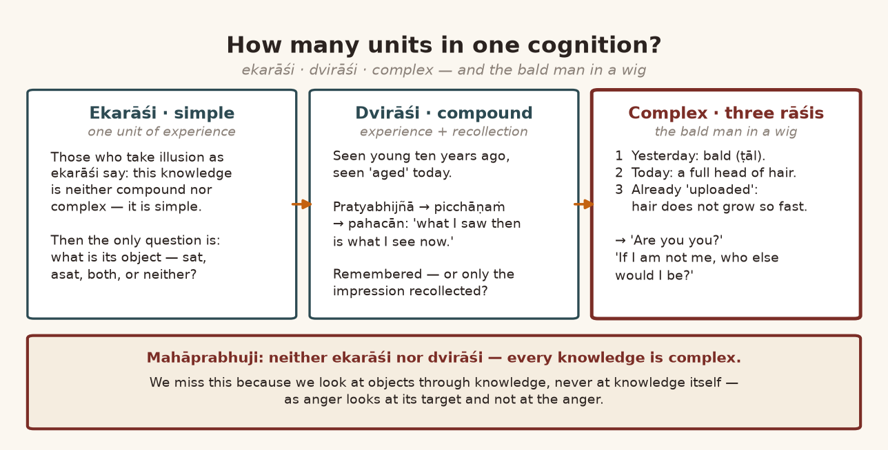
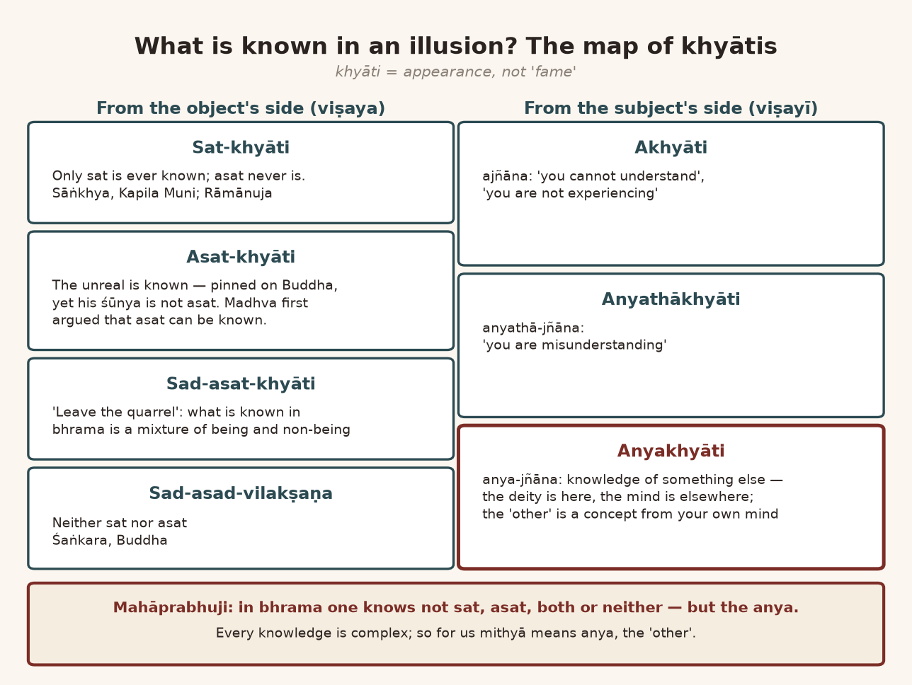
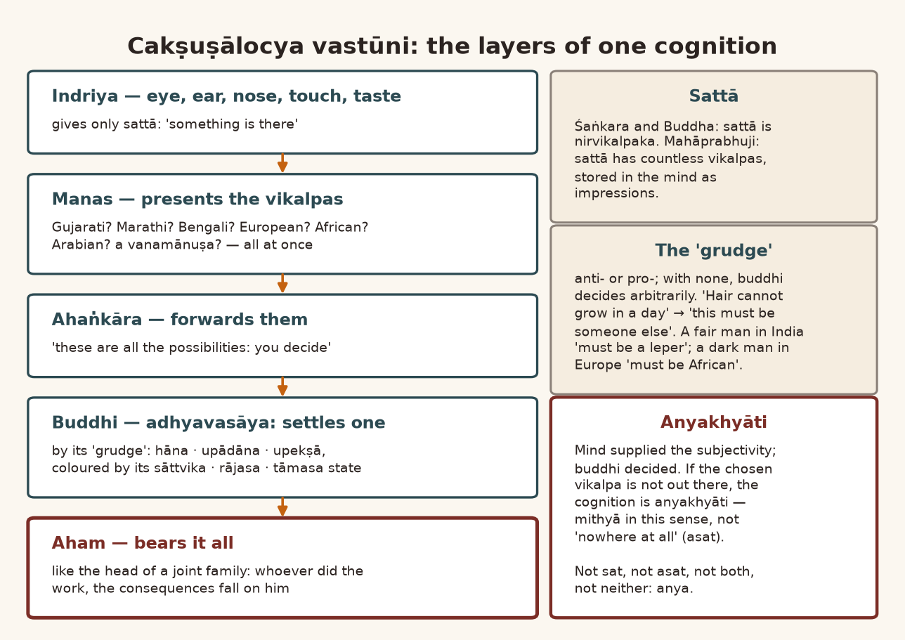
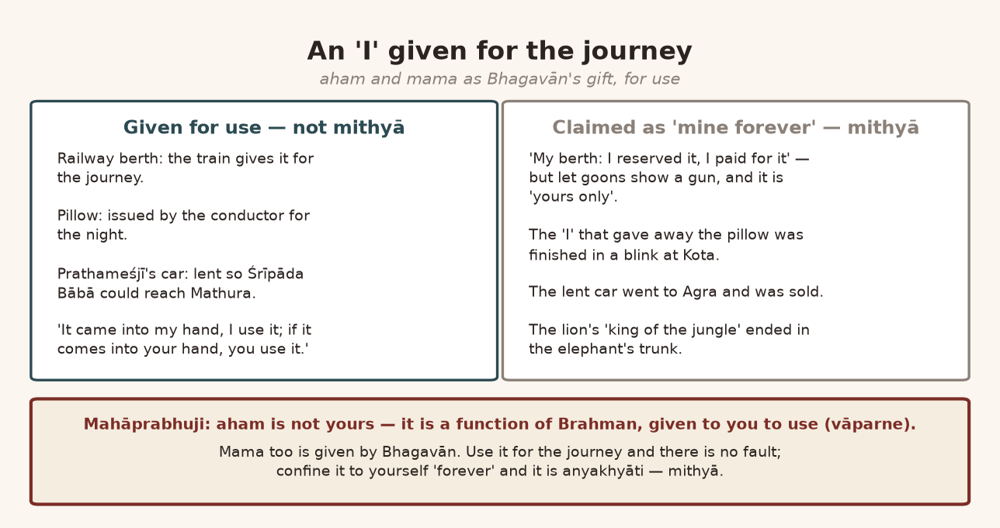
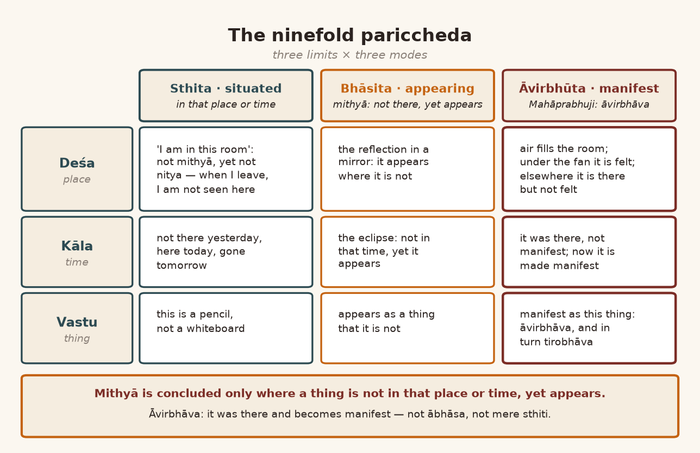
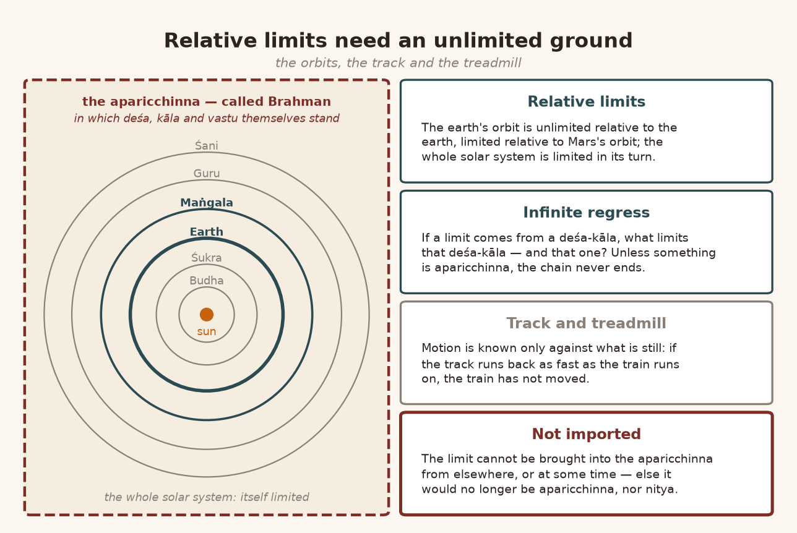
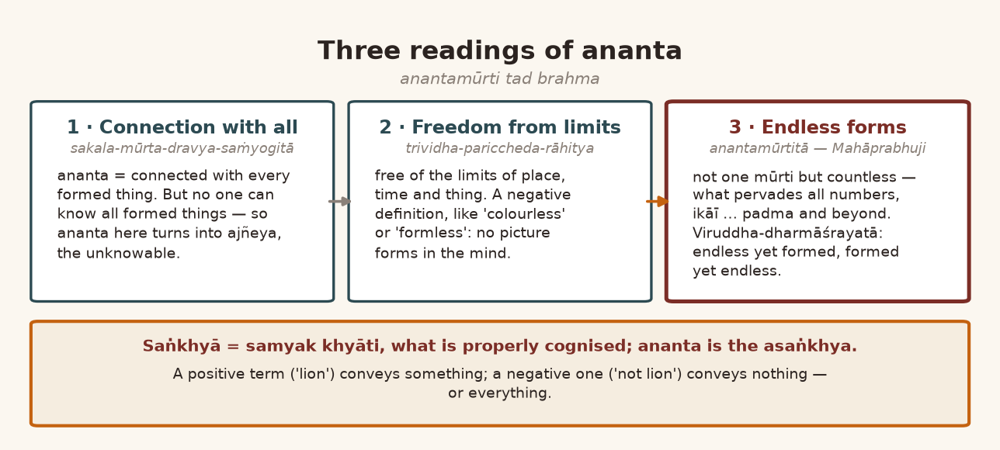
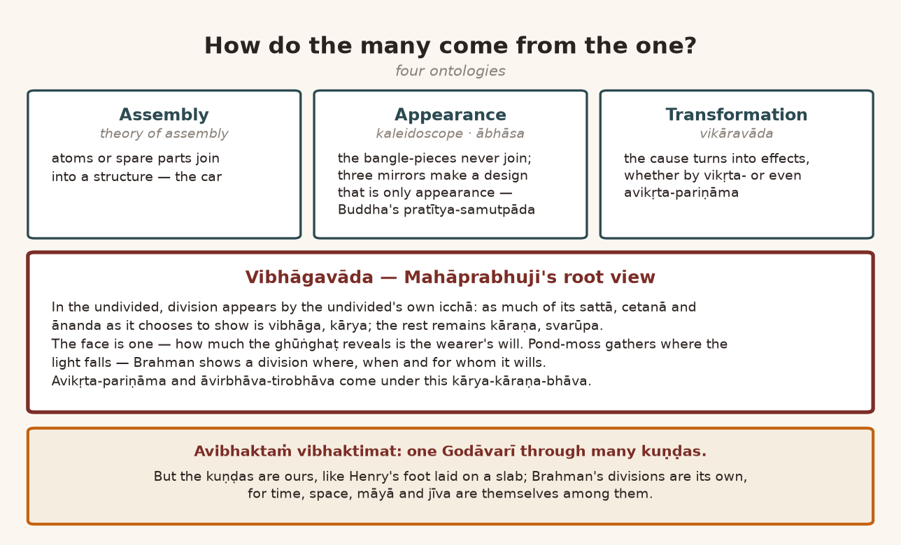

*English rendering of a spoken discourse on the Śāstrārtha Prakaraṇa of the Tattvārthadīpanibandha, translated from a Hindi ASR transcript. The speaker's conversational register, humour, digressions, code-switching, and student exchanges are preserved. Editorial flags: ‹ › conjectural restoration of a garbled reading; ‹?› uncertain reading; ‹…› inaudible or unrecoverable passage; ‹श्रवणाधारित› text given as heard, pending verification against a printed edition. Verses whose standard text is beyond doubt have been silently restored to the received editions.*

# 1. Why Call It Mithyā? Khyāti as Appearance, and the Mountain in the Painting

**Speaker:** Yes—do you want to ask something?

**A student:** Yes, ji. As you explained in the last discourse, that the saṁsāra which is made of *ahantā* and *mamatā* ‹…›—but it is arising in the jīva, isn't it? And this jīva is in fact a part of Brahman. So why is it being called *mithyā*? This much is right, that it is a defect in the jīva, that it creates an obstruction to understanding *brahmātmakatā*. But why can one say that it is mithyā? That is the question that is arising for me—it has not come into my understanding.

**Speaker:** I have understood. At the root, the solution to this has been given by Mahāprabhuji in *khyātivāda*. Just—‹*khyātivāda*› means "theory of illusion". So this "theory of illusion"—if you understand a little about it properly, the "solution" to the whole thing will come. ‹*Khyāti*› means "appearance". ‹*Khyāti*› does not mean "fame"—in Sanskrit. ‹…›

So, if we look at it, what is the difference between "appearance" and *anubhūti*? There is a very "subtle difference"—that is, between "appearance" and "experience". For every "experience" there is some corresponding "appearance". For every "appearance" there is certainly some "experience" or other. But for every "experience", the corresponding ‹"appearance"›—this is its explanation ‹…›. Because the "appearance" that is happening can be "objective", and it can also be "subjective".

As we can understand: in an "object" there are "certain qualities", "attributes", and they "appear". Many times it happens that those "attributes" are not in the "object", but in "experience" they "appear" to us. A simple example of this can be understood like this: ‹…› we have the "experience" of the "horizon", and the "horizon" also "appears". "Is there any objective ground? Where exists horizon? Nowhere." ‹…›

And this is not just one example; there are many such examples. Like—let me tell you one thing. I have drawn a painting. In this painting that I have drawn, you can see that the height of the mountain looks less and the height of the tree looks more. ‹…› "Understanding-wise" you know: from there the mountain is far, so it looks small; the tree is near, so it looks big. Now this "attribute"—that this tree is taller than the mountain "height-wise"—there is no "objective" difference of that kind here. Because if we go that close to the mountain, then in this mountain ‹four such trees would fit, ten would fit›. Because it is very far away, we don't know. So it is neither the mountain's "attribute" that the mountain is smaller than the tree, nor the tree's "attribute" that it is taller than the mountain. Even so, the ‹"appearance"› is happening, and the "experience" is happening too.

Yes, as far as "psychology" is concerned, this is also called "perspective"—"law of perspective", "law of perspective". Everyone used to talk about it every day ‹?›. There are "rules" of "perspective": when you look, what is near the eye looks bigger, and what is far from the eye looks smaller. Now this "attribute", seeing small and big, has no "objective ground". But we also cannot say that it is "totally bereft of object". Its looking small or big is a "subjective activity". But the tree's being seen and the mountain's being seen—that is not a "subjective attribute"; that is "objective". From there the quarrel starts: is the "illusion" an *ekarāśi* experience or a *dvirāśi* experience? That is, is "experience" "simple", "compound", or "complex"? Just as in a "statement" there is "simple", "compound" and "complex", in the same way in "experience" too there is "simple experience", "compound experience" ‹…›—"simplification" and "compoundedness" and "complexity". This "issue", then, depends on the "subjective" and "objective character". That is why the discussion starts from here: is it *ekarāśi* knowledge or *dvirāśi* knowledge?

All right—this is also called "condition of perception". In "psychology" there are many such "conditions" of "perception". So when "perspective" appears to us, it appears according to that very "condition". It may even be going wrong, but we take it to be right. *Astu nāma*‹?›. So if it were said—or such a picture were drawn—that the near ‹tree› is small, the tree is small, and the far mountain is also small, or that both are of "equal size", then it will not be a "realistic painting", because you have not followed the "conditions" of "perception". "Perception" has "certain rules".

# 2. The Ancestral Portrait and Yaśodharā at Ajanta: Expression Over Perspective

**Speaker:** Take out any ‹picture›. ‹…› Some thing from here—from here. No, no—there is so much lying around.

**A student:** No, no.

**Speaker:** ‹Not› the other one—the small one. Yes, look properly: look at this picture. This is ours—mine—from some seven generations back. This is of my *Tāja-jī*‹?›. Can you see the "mistake" in it? You won't see it. No, no—certainly not.

**A student:** Otherwise I can't make out anything, because the pattern of the picture is such that the *caraṇāravinda* are towards the front and the *mukhāravinda* is to the side; plus the mountain behind, and the river looks small—Gokul.

**Speaker:** Right, right—"so you got it". If it is a side face, then these knees, friend—how can they be in front? "Meaning the artist did not follow the rule of perspective." Like, if I sit like this—

**Another listener:** Right, that's right.

**Speaker:** —then both knees won't come to the front, will they? And to sit in such a "difficult pose"—even for a Yogī Mahārāj it is difficult to sit like that. *Te kāhī ārṭisṭ je āhe nā, pholo karāy parspekṭivh karūn* [Marathi: those artists, you know—following perspective ‹…›]. In our country the rule of perspective was not followed. Like—this one is fine. Understood? So, on one side only—

**A student:** Yes, yes, absolutely.

**Speaker:** —the leg position, the side position ‹?›.

So this "rule of condition of perception"—that is, it is called the "rule of perspective". That rule, perspective, they did not follow; ‹even so› the painting could turn out good ‹?›. In Ajanta there is a very beautiful painting—I like it very much—that at the time Bhagavān Buddha took sannyāsa, before that, his wife Yaśodharā used to come up to his shoulder. It is in the Ajanta painting; I will show it to you sometime. After taking sannyāsa, when he has gone to beg alms, Bhagavān Buddha's height is such that Yaśodharā comes up to his knees. Can a man become that great just by taking sannyāsa? "By breaking the rule but by expressing the emotion"—that you have become so great that your wife has become as small as your knee, she who used to come up to your shoulder. In our country the rules of perspective were not followed—in the art of our country. So whether it is a picture of Mahāprabhuji or a picture of Gosāīṁjī, you will find this "problem" in everyone's picture. "We never bother about perspective. We just wanted to express. Those who want to express, they will express." We people are the fathers of "modern art". Van Gogh and Gauguin and Cézanne got the inspiration for "modern art" after their visit to India. All right—what we have to express, we will express; "we will not follow the rule of perspective". And Europe really did spend the earlier eight hundred years discovering the rules of perspective, and gained such "mastery" that they brought more than photographic "perfection" into painting. "Perfection" in what? In terms of perspective.

And it had great importance "once upon a time", because people did not know what the rules ‹of perspective› were; and after the camera was made, in photographs all of it became "damn easy".

# 3. "Free of the Laws of Niyati": The Poet's Liberty, the Dādāgirī of the Senses, and Ice That Burns

**Speaker:** The artist used to feel, "What have we said of our own?"—and so they were restless. And here in Asia the idea was there from before, that the artist is—

> नियतिकृतनियमरहितां ह्लादैकमयीमनन्यपरतन्त्राम् ।
> नवरसरुचिरां निर्मितिमादधती भारती कवेर्जयति ॥
>
> *niyatikṛtaniyamarahitāṁ hlādaikamayīm ananyaparatantrām |*
> *navarasarucirāṁ nirmitim ādadhatī bhāratī kaver jayati ||* (Mammaṭa, Kāvyaprakāśa 1.1)
>
> [Victorious is the speech of the poet, bringing forth a creation free of the rules made by *niyati*, made of delight alone, dependent on nothing else, lovely with the nine *rasas*.]

—not himself bound by the rules of *niyati*. "Whatever we have to say, we will say." "We are not bound by the rule of nature. Because an artist has their own nature, his own nature." He should express his own nature—what is it that you want to say? Truly, we took the "utmost liberty": we destroyed all the rules of perspective. In some places, if we look, we would be amazed. But really, the question that arises out of this question is this: the "artist can break" [the rules], but ‹the senses› do not break themselves. The eye follows its own rules. That is why, when it follows those rules—whose *dādāgirī* is it? What is "objective"? Is it the *dādāgirī* [high-handedness] of the ear? Is it the *dādāgirī* of the eye? Is it the *dādāgirī* of ‹touch›?

I have tried an "experiment" with many children. Put a piece of ice in a child's hand, and they say, "It burns!" "It burns"—arre bhāī, it doesn't burn, it is cold! Their skin doesn't find it "comfortable", so to them it feels like burning. No grown-up person will say, "I took ice in my hand and it burns." Take one "cube" of ice in your hand—it doesn't burn. It stings only as much as fire stings. After a "certain degree", "heat" or "cold"—for those to whom it is not "comfortable"—stings. So this "comfortable"—the "comfort" of touch—that is the *dādāgirī* of touch, isn't it? And it can be ‹undone› with a little [test]. Like: put one hand in hot water, put the other hand in cold water, then put [both] in lukewarm (*samoya*‹?›) water. The hand that has come from the hot water will feel the lukewarm water as cold, and the one that comes from the cold water will feel the lukewarm water as warm. Where are these "attributes" coming from? Are they coming from the "object", or are they coming from the "subject"?

"There is an appearance. There is an experience, there is an appearance, but there is no object"—no "objective ground"—there is no "objective ground" in perceiving this kind of "attribute". From this, many people took a ‹high› jump—call it a "high jump" or call it a "long jump": "It will jump. Therefore, perception is an illusion."

**A student:** Second point ‹?›.

**Speaker:** It is not that [perception] has been made "totally bereft of objectivity"—it is not like that. Because of this, this "different thinking" came forward. Because of this, "different theories" came forward, that "illusion" is happening. That, first of all—

# 4. One Unit or Two? Pratyabhijñā and the Bald Man's Wig

**Speaker:** —is it *ekarāśi* knowledge or *dvirāśi* knowledge? That is: is it one "unit" of "experience", or two "units" of "experience", or "multiple units of experience"? What is happening in "illusion"? The *dvirāśika* we will take up later; it is a very "technical issue", but—

**A student:** *Viṣayataḥ*‹?›—

**Speaker:** When it is taken as *ekarāśi* knowledge, there is one "unit" of "experience", not two "units". How two "units" come in, I will tell you; for now, understand one small thing properly. One experience of ours is this: the person whom I saw ten years ago—I saw that very person "young". Today I am seeing that person a little "aged". Now this has become two "units", hasn't it? Because the one I saw "young" ten years ago, today I am seeing "aged".

**A student:** That's so.

**Speaker:** The "youngness" is also being seen, it is coming into experience—"in contrast of the agedness". There we are "recalling", "recollecting": ten years ago he didn't look like this; today he is looking so "aged". So you have had *dvirāśi* knowledge, haven't you—"recollection as well as experience". In Sanskrit it is called *pratyabhijñāna*, which is the life-breath word of "Kashmir Śaivism": *pratyabhijñā*. *Pratyabhijñāna*, that is, *picchabhiyāṇaṁ*‹?›; from *picchabhiyāṇaṁ*, *picchāṇaṁ*; from *picchāṇaṁ*, *pahacānanā* [to recognise]. So when we recognise something, that is not *ekarāśi* knowledge; it is *dvirāśi* knowledge: "Yes, yes, I had seen it before—it's the same. What I had seen, that same thing is being seen." That is what recognising means, isn't it—what was seen before is being seen today. Its name is *pahacān*. So it is not *ekarāśi* knowledge; it is *dvirāśi* knowledge.

Now the question is: we saw it at that time, and we are seeing it today. Today we are not seeing it as it was at that time; today we are seeing it as it appears today. So what we saw at that time is not visible to us today—but it is remembered, isn't it? Now the question that arises there is: is it being remembered, or is only the "impression" being "recollected"? "Do you remember him or it, or only you are collecting your experience with the impression that you carry?"

Let me tell you a very funny thing from my childhood. In our Baḍā Mandir there used to come a gentleman who was *ṭāl-vāle* [Gujarati: bald]; he would take darśana. This "hair-wig" business had only just started at that time. Suddenly one day he came wearing a ‹hair-wig›. By mistake it slipped out of my mouth: "Is it you—are you you?" So he said, "If I am not me, then who else would I be?" I said, "No, what I mean is, until yesterday you were *ṭāl* [bald]. Where did so much hair come from today?" I didn't know that hair-wigs are made. I was bewildered. I said, "Bhāī, it looks like that—until yesterday ‹…›, and suddenly today where has so much hair come from?" By mistake it slipped out of my mouth. He said, "If I'm not me, who else would be?" I said, "That is true, but until yesterday your look was not like this; today the look has changed completely." Now, who was at work in this?

Two kinds of knowledge were at work, weren't they? When I asked him, "Are you you?"—until yesterday he looked *ṭāl-vāle*; how did such big hair come suddenly today?—because if it were possible for big hair to come on the face like that, nobody would ask in that way. A third "knowledge" is also before us, "uploaded already" in the "mind": that hair does not grow so quickly. So look—it became three *rāśis*; "complexity" came in. This did not become "compound knowledge"; this became "complex knowledge". Yesterday I had seen him bald—one "unit of experience". Hair does not grow so quickly—that is one "understanding" of ours. And today the hair has become big. So it became "complex".

So knowledge is sometimes "simple"—we don't notice which knowledge it is, because we don't look at knowledge. With knowledge we look at the object; we don't look at knowledge. If a man starts looking at knowledge, all the "problems" would be "solved". Usually we look at the object with knowledge; we forget to look at knowledge. The "system" has been made like that. With anger, we look at the one at whom anger is coming; we don't look at the anger. With affection (*sneha*), we look at the one for whom affection is coming; we don't look at our affection. With dislike (*dveṣa*), we look at the one for whom dislike is coming; we cannot look at the dislike. And if we did look, a great many things would get corrected ‹…›. The trouble is ours. Like, many times, seeing an astonishing thing, we look at the thing with astonishment; we are not looking at the astonishment. If we start looking at the astonishment, the volume (*āyatana*) of the astonishment would get "diluted". Much anger too would get "diluted"—anger would get diluted, dislike too would get diluted. So we don't look, because that "force" is so strong; so we are swept away. In our mind the "system" itself is like this—the "understanding".

So knowledge is sometimes in a "simple unit", sometimes in a "double unit", and sometimes it carries "complexity" too. But *ekarāśi* knowledge—those who take it as *ekarāśi* say: no, this knowledge is not "complex", it is not "compound", it is "simple".

**A student:** It's simple.

{width=6.2in}

# 5. The Map of Khyātis: Sat, Asat, Both, Neither—and the "Other"

**Speaker:** So if it is "simple", then what is its "object"? That has to be found out. By someone's account it is true; by someone's account it is untrue; by someone's account it is ‹both *sat* and *asat*›; Buddha and Śaṅkarācārya say that it is *sad-asad-vilakṣaṇa*—it is neither *sat* nor *asat*. "From the point of view of"—

**A student:** So—

**Speaker:** "From the point of view of subject"—from the *viṣayī* angle—it is *ajñāna*, or it is *anyathā-jñāna*, or it is *anya-jñāna*. ‹…› "Ignorance means you cannot understand or you are not experiencing." *Anyathā-jñāna* means "you are misunderstanding". And *anya-jñāna* means that you have neither "understanding" nor *anyathā*, "misunderstanding", but there is in you knowledge of something else—

**A student:** And what?

**Speaker:** Like, the deity is something else and you are meditating on something else—so it went elsewhere. Thus *akhyāti*, *anyathākhyāti* and *anyakhyāti*: those are on the "subject's side".

Now understand one thing in this carefully. Śaṅkara‹?›, Sāṅkhya, Kapila Muni—all say that whatever ‹*khyāti*› there is, is ‹*sat-khyāti*›. ‹Śrī Rāmānujācārya's› doctrine too is the same: whatever ‹knowledge› is happening is happening only ‹of *sat*›; there is no ‹knowledge› of ‹*asat*›. Actually, ‹*asat-khyāti*› nobody at all has accepted—but everyone has [aimed] their gun ‹…›: "Bhagavān Buddha accepted ‹*asat*›." Look—they say *śūnya*, don't they? Their meaning of *śūnya* is not *asat*. Their meaning of ‹*śūnya*› is not *asatya*. But because their "definition" of *śūnya* is not "acceptable" to us, therefore, ‹lumping it in› as *asat*, everyone takes them as holding ‹*asat-khyāti*›—which actually is not [their] doctrine.

In my view there is a "theoretical possibility" that there can be knowledge of *asat* too. And this was said by ‹Madhvācārya›—for the first time. "Why do you hold that only *sat* can be known? Why can't *asat* be known?" It can be. What is the "argument" in this? What is the proof of *asat*? The "object"—"does not exist". "Any experience: is it possible or not? Whatever you experience—true understanding, misunderstanding, or illusion—object is always true." That is a true point. Madhvācārya says—he asks a "counter-question"—"Tell me, why can't there be knowledge of *asat*?" Some people say, "No, no, leave the quarrel: the knowledge that is happening in ‹*bhrama*› is *sat* as well as *asat*—a mixture"—of "being" and "non-being".

Mahāprabhuji has held there that it is ‹*anyakhyāti*›. Whenever there is *bhrama*, there is neither knowledge of *sat*, nor knowledge of *asat*, nor knowledge of *sad-asat*, nor knowledge of what is *sad-asad-vilakṣaṇa*: there is knowledge of the *anya*, the other. What that *anya* is, Mahāprabhuji explains. The *anya* is what is filled in your mind—the "concept". Of the thing you are seeing, its "concepts" come into your mind. And when your experience [happens]—is it *ekarāśi*, is it *dvirāśi*, or does it carry "complexity"?—Mahāprabhuji says it is neither *ekarāśi* nor *dvirāśi*; it carries "complexity". "Every knowledge is a complex knowledge." What is the reason? To understand the reason, [see] which "layers" of "knowledge" there are; according to those "layers" Mahāprabhuji explains this.

{width=6.2in}

# 6. Eye, Mind, Ego, Intellect: How a Vikalpa Is Chosen, and Why Poor Aham Pays

**Speaker:** The śloka—

> चक्षुषालोच्य वस्तूनि विकल्पं मनसा तथा ।
> अहमित्यप्यहंकारात् ‹…› ॥ ‹श्रवणाधारित›
>
> *cakṣuṣālocya vastūni vikalpaṁ manasā tathā |*
> *aham ity apy ahaṅkārāt ‹…› ||* ‹श्रवणाधारित›
>
> [Having perceived things with the eye; likewise the *vikalpa* with the mind; and "I", from *ahaṅkāra* ‹…›.]

Our senses are five: of sight, of hearing, of smelling, of touching, of tasting.

**A student:** These—

**Speaker:** —when they come into an "interactive mode" with some "object", the knowledge we get is only knowledge of *sattā*.

*Cakṣuṣālocya vastūni*: the knowledge is, "something is there". What is the *vikalpa* of that *sattā*? There are very many *vikalpas*. "Unfortunately" Śaṅkarācārya and Bhagavān Buddha have accepted a *nirvikalpaka sattā*. ‹Ours› is the doctrine: *sattā* has very many *vikalpas*. Like, we are seeing a man. So a man appeared. How many *vikalpas* of him can there be? He could be a Gujarati, he could be a Marathi, he could be a Bengali, he could be Asian, he could be European, he could be African, he could be Mongolian, he could be Arabian. He could be a *vanamānuṣa*. There are so many *vikalpas*. So when we see something—we experience a thing with the eye, with the nose, with the ear too—then the *vikalpas* that are filled in our "mind" all rise up and get ready, and the mind presents all of them: "These are the possibilities." The mind brings all those "possibilities" before you at once, because the mind has that "information" of what *vikalpas* there are. Those *vikalpas* you "assess" with your *ahaṅkāra*: *cakṣuṣālocya vastūni vikalpaṁ manasā tathā, aham ity apy ahaṅkārāt*. "All right—all these *vikalpas* came before me."

After that the *ahaṅkāra* hands that "information" over to the *buddhi*, and the *buddhi* decides according to its "mood". Among the *vikalpas* that have come, about some one *vikalpa* it has some "grudge"; according to that "grudge" the *buddhi* will decide. If the *buddhi* has no "grudge", it will decide "arbitrarily". Further, there is "anti-grudge" or "pro-grudge"—the *buddhi* can have both kinds of "grudge". So the *buddhi*, according to its *sāttvika*, *rājasa* and *tāmasa* state, decides some one *vikalpa* out of them: "All right, this is this."

Now see: the *adhyavasāya* of the *vikalpa* has been done by the *buddhi*. The experience of the thing has been done by the sense. ‹…› presented—the mind has everything, the possibility of *vikalpas*. Now, of these, the *vikalpas* the mind presented are not "objective", are they? ‹…› Out of them some one *vikalpa* will be "objective"; [not] all the *vikalpas* will be "objective". Like, you saw a man: first many *vikalpas* will come—he could be Hindustani, he could be Pakistani, he could be Afghan, he could be Burmese, he could be African, he could be European; many *vikalpas* came. A man cannot be all of these at once. Brahman can be everything; a man cannot be.

So out of the *vikalpas* the mind presented—according to the way your *buddhi* is in the habit of seeing; the "grudge" you have. That is, like, you have a "grudge". As I had a "grudge" that in one day hair cannot grow that big: "Until yesterday he was a *ṭāliyā* [Gujarati: a bald man]—how has such big hair come today? It can't happen in one day." So it slipped out of me by mistake: this must not be that man; it must be some other person. In that "confusion" it came out of my mouth, "Are you you?" ‹Or› there can be a "grudge" like this: bhāī, in Hindustan, if some person looks fair to us like a European, what will we think? "Surely he must be a ‹leper›; he must have got ‹leprosy›"—because in Hindustan nobody is that fair. And suppose in Europe some person is very dark; we will straightaway "judge" that he must be from Africa. Not necessary! Here in South India many people are dark too; they are not African.

So what the *vikalpa* ‹settled›, it presented before you—"possibility". Out of that, what your *buddhi* decides depends on the "tendency" of the *buddhi*. There it is not necessary to be only "objective"; the "subjective" is coming in there too. Who "provided" the "subjectivity"? The mind did. Who "decided"? The *buddhi* did.

**A student:** No—

**Speaker:** —and poor *aham* has to suffer it all. What—I feel that if the *aham* were not there, there would be no "problem". But if the *aham* is there, the *aham* has to suffer everything, because the *aham* carries everyone along together—that is, it is like the head of a "joint family". The younger one did the work, the elder one did the work—‹it› all falls on the head of the "joint family". In the same way the *aham* has to suffer. Now, out of this it becomes *mithyā*, doesn't it—for this reason.

How it is becoming *mithyā*—I have explained the whole "system" to you. Because it is not there outside, therefore it is *mithyā*. Somewhere or other it will be true—it may be, it may be. But out of all the *vikalpas* your mind presented, the *vikalpa* your *buddhi* has "selected"—is it there? If it is not there, then it is *anyakhyātīya*. *Anyakhyātīya* means—

**A student:** Yes.

**Speaker:** —it is not *mithyā* in this sense, that it is nowhere at all, that it is *asat*. That is why Mahāprabhuji refutes *asat-khyāti*. He refutes *sat-khyāti* too—because, no, it is not there. He refutes *sad-asat-khyāti* too, for this reason: that between *sat* and *asat* there is no "interchangeability". He rejects the *vilakṣaṇa* [view] because between *sat* and *asat* there is no third category; so what Śaṅkarācārya and Buddha have said about *sad-asad-vilakṣaṇa*—he rejects that too. So Mahāprabhuji has an altogether different doctrine of *mithyā*. It is a very "technical" doctrine; we have to understand it. Your question was very serious, so the discussion has also become a little serious. But if you keep this in mind, you will understand how *mithyā* comes about by itself.

For Śaṅkarācārya, *mithyā* means that which is *sad-asad-vilakṣaṇa*. For all the philosophers apart from Śaṅkarācārya and Buddha, *mithyā* means *asat*. For us, *mithyā* means neither *sat*, nor *asat*, nor *sad-asat*, nor *sad-asad-vilakṣaṇa*: it means *anya*.

**A student:** Ji.

{width=6.2in}

# 7. A Thousand Vikalpas of One Pen: Hāna, Upādāna, Upekṣā

**Speaker:** Something more also came to mind. Because your brain—your *buddhi*—has accepted the *vikalpa* that the mind presented; the *buddhi* is not accepting what the eye showed. If the *buddhi* were to take the *vikalpa* the eye shows—but [the eye] doesn't show *vikalpas*! The *vikalpas* are all with you, in the form of "impressions". The eye is only showing that "something is there". What are its "possibilities" of being? All those *vikalpas* are "stored" in your "mind". They are not of one time. ‹It is a full "fast load".› There is so much "burden" that we don't even know what *vikalpas* are filled in our brain.

Start thinking of the *vikalpas* of any one thing—with a pen. Take paper and pen, take one object, and start writing what *vikalpas* it can have. You don't know. You will write, won't you? However much you write, even after that some *vikalpas* will remain. Like: this is a pen. It could be made in India, it could be made in China, it could be made in Japan—that is one type of *vikalpa*. It could be of plastic, it could be of metal. It could be of *kacakaḍā* [Gujarati/Marathi: celluloid], it could be of wood—those are all *vikalpas*. Is it a pen for writing on paper, or a pen for writing on plastic, or a pen for writing on fibre? Is its *śāī* [Marathi/Gujarati: ink] wax ink, or diluted ink? Keep thinking, keep thinking—*vikalpas* will keep on arising. We don't know how many *vikalpas* there are. When we start writing we will find that after however many *vikalpas* we have written, some more *vikalpas* will still get formed. "For instance": is it my pen or your pen? Is it a stolen pen, or a bought pen? A snatched pen? How many *vikalpas* can one pen have, bhāī? Take any one thing: "thousands and thousands" of *vikalpas* it can have. They are all filled in the mind; we don't know. And the mind presents all the *vikalpas* at once: "Here—handle them. Recognise what it is. 'All these possibilities are there.'"

That "possibility" which you are deciding—your *aham* is "forwarding" it to the *buddhi*: "Bhāī, these are all the possibilities; out of them, you decide what it is." [The *buddhi* decides] by its own ‹"grudge"›. The ‹"grudges"› of the *buddhi* are of three kinds: *hāna*, *upādāna*, and *upekṣā*. *Hāna*, that is, giving it up; *upādāna*, that is, taking hold of it; ignoring it [is *upekṣā*]. On these three "principles" the *buddhi* decides something.

Now, within *hāna*—how many harmful things there can be, we can see that too. Like, within this pen, one *vikalpa* it can also give is that there may be "gelatin" in it: you start writing, and there's an "explosion". Now, if fear has got into you—

**A student:** Ho, ji.

**Speaker:** —you will do ‹*hāna*›; you won't do *upādāna*. If you have no writing work at all, you will do *upekṣā*. If you need to write, you will pick it up as a pen. With the *buddhi*, under *hāna*, *upādāna* and *upekṣā*—within each one *hāna*, each one *upādāna*, each one *upekṣā*—hundreds of "items" come again, *vikalpas*, and out of them one has to be decided.

**A student:** A very "complicated job"—a very "complicated job"!

**Speaker:** How does the *buddhi* decide? By its *hāna*-*upādāna*-*upekṣā* tendency. If there is the tendency of *upādāna*—that is, a child will put his finger in even if he gets a "current". When he gets [the shock], then he gets the sense of *hāna*. Because, as is said of a child, that stage is such that he has not known anything, so he wants to know everything by "experimenting". So wherever there can be some ‹risk›, he does the "experiment". He will put everything in his mouth. He will break everything to see. He will touch everything to see. When we get the experience that touching this causes trouble, then we ‹shrink back›. Then, instead of *upādāna*, the ‹*hāna*›-type tendency becomes strong. The tendency of *upekṣā* comes in old age: "Let it go—whatever will be, will be; what do I lose? How many days of life are left—why think in vain?"

**A student:** No—

**Speaker:** Because in old age there is neither the strength left to take—

**A student:** I see, ji.

**Speaker:** —nor the strength left to let go. So the tendency of *upekṣā* comes when one is very "mature". The "immediate" tendency is more of *hāna* and *upādāna*. Because of this, *anyakhyāti* is happening, and that *anyakhyāti* is *mithyā* in this sense: outside there is no "objective ‹ground›" of yours for it; your *buddhi* alone has "chosen" it. Has it come into your mind?

# 8. Whom Do You Call "I"? The Goons' Pistol and the Lion's Question

**A student:** Ji, ji, ji—this much has come. But how will we apply it to *aham*? Ji—*ahaṅkāra*, where it is a matter of *ahantā* and *mamatā*—how do we apply this *anyakhyātivāda* there? Because how can there be *anyakhyāti* about one's own *aham*?

**Speaker:** Ji. Now you tell me this: what you are calling your *aham*—are you calling your senses *aham*? Are you calling this body *aham*? Are you calling this soul *aham*? Or are you calling your "relation" in the "family" *aham*? Whom are you calling *aham*? What is the "object" of *aham*?

**A student:** Wouldn't we call the mixed-up state of all these *aham*? All of these.

**Speaker:** I see—so you are saying the mix of all of these. But everything doesn't get mixed together, does it? Because if you are calling the body *aham*, then you have not remained the "soul" as *aham*. And you are covering everything in *aham*—if everything starts getting covered in your *aham*, then you have become Brahman! The difference between Brahman and the jīva is only this much: in our *aham*, only what we have "selected", what we have taken up (*upādāna*), gets "coverage". What you have not taken up, what you have given up (*hāna*), will not get "coverage" in your *aham*. One's own son, one's own father: if he acts against our interest, he gets no "coverage" in our *mama*; and if he is doing work in our interest, then [he does]. It is your "arbitrary consciousness", isn't it—*aham* and *mama*. What does it have to do with the "object"?

**A student:** The point is clear, bhāī.

**Speaker:** It is said: a man was coming home from the shop with the money he had earned. Goons stopped him: "What [have you got]? Show!" ‹He› said, "What's it to you what I have?" They pulled out a pistol: "Will you show it or not?" He said, "Bhāī, it's yours only, isn't it? Why do you take it to be mine?"

**A student:** Where did the "you" go?

**Speaker:** Where did it go—that ‹"mine"› over which he was quarrelling, "What's it to you?" And when the pistol was shown, he said, "Bhāī, leave it—why quarrel? It's all yours." Just like this, it is said of the lion: the lion got the *bhramaṇā* [delusion] that "I am the king of the jungle". He went and asked the jackal, "What do you take me for?" It said, "Bhāī, you are the king of the jungle." "Yes—right, correct." He asked the rabbit; it said, "Yes, you are the king of the jungle, of course." He went and asked the elephant. The elephant was feeling angry; the elephant lifted him in its trunk and threw him. The lion said, "Bhāī, if you don't know, then ask me—who I am!" Why did it turn out like this? Where did the "you" go?

So it doesn't take us long to slip [out of it]. Only so long as a thing seems beneficial to us does it seem our own. If it is not beneficial—so many "cancer patients", so many people whose treatment is not possible and who keep on suffering—why do they commit "suicide"? Where does it go, for them? So what is it—what is the "object" of *aham*? We think that everything together is a mixed "object". But how long is it a mixed "object"? As long as nobody has pointed a gun. Let somebody just point a gun—the mixedness is finished. So what I mean is: the same is true of ‹*ahantā*›, the same is true of *mamatā*. So our "experience" is certainly there, that there is some *aham*. Our "experience" is that something is mine. But what is its "objective ground"? That is not getting "specified". That is why it is *mithyā*. It is ‹*anyakhyāti*›.

And understand one more thing according to Mahāprabhuji—very interesting. Apart from Mahāprabhuji, nobody else will explain this. Mahāprabhuji's view is also this: that in fact this *aham* is not yours at all. The *aham* is a "function" of Brahman, and it has been given to you to use (*vāparne*).

# 9. The Railway Berth, the Borrowed Pillow, and Prathameśjī's Car: An "I" Given for Use

**Speaker:** Like the berth on a train: the train gives it to you for the journey. But when we go and sit there: "It's my berth." "Arre bhāī, it's your berth? Show it—right now! Is it yours?" "No, no—it's yours, the berth."

**A student:** I see.

**Speaker:** Because the train gave us the berth, we take it that it is my berth: "We have reserved it; we have paid the money." [When] goons show a ‹gun›, automatically it is no longer "mine". *Jahāṁ tum bāparan vahāṁ merā jāt*‹?› [as heard; apparently: where it is for your use, there "mine" goes away].

I was going from Bombay to Delhi. In the compartment with me there was some lady; she was quarrelling that she wanted two pillows. The conductor was saying, "Two pillows won't be given; each passenger gets only one pillow." He gave her one pillow. I had my own air pillow, so I thought that maybe she has some other trouble as well, so I said, "You want two pillows, don't you? Then you take this pillow." I had an air pillow, so I blew it up and went to sleep. When Kota came—at two, two-thirty at night—she started getting off with my pillow. "Arre," I said, "where are you going with this?" She said ‹…› so loudly. I said [to myself], "At two in the night she is doing this—who knows what she will do." She took away my pillow—the one the conductor had given me. When I reached Delhi, I wrapped up everything—blanket and sheet, everything—made a *ḍūcā* [Gujarati: a crumpled bundle] of it and put it there. I said, "Now, before he asks me, let me get off. 'Bring the pillow'—from where?" She had hissed at me so loudly that I got scared; I said, "Who knows what she will do now." So the pillow that had been given [to me], she herself took it and got off. I am talking about an AC compartment. And she was saying—‹in that much time we were finished, weren't we›—that "it's my pillow". Do you follow? ‹…› the conductor ‹…›. I was thinking of myself as very generous—

**A student:** ‹…›

**Speaker:** —she wants two pillows, so I can give my pillow, because I have a pillow. She said it so loudly; I said, "If she hits me, then who will save me? Who knows what she will do." ‹…› Let it go. In the morning we came to Delhi. I tied my shoes and got off quickly: "Before the conductor catches me, let me get off from here." What's to be done? How long does "my pillow" last? And that which was "mine"—this *aham* that "I [gave] it to her"—that "I" of mine was also finished in ‹a blink›. So that is *anyakhyāti*. In this sense Mahāprabhuji is calling it *mithyā*.

**A student:** These—all, *aham* and *aham*—*aham* and *mama*—

**Speaker:** No—what I was telling, the point was this: the *aham* is given to us by Bhagavān. It is a "gift" to us, for use, like the railway berth; it is not ours.

**A student:** When I—

**Speaker:** But it has been given to us for use, therefore we have got the ‹grip› that "it is mine". In the same way the *mama* too is not our own *mama*; it is a *mama* given by Bhagavān. It has been given to us for use—use it. Like, with the *aham* you travel: so long as you are travelling, there is no fault. But when, instead of travelling, you are confining it to yourself—what has been given "for the journey", you are treating as yours "forever"—from there ‹…›. In this sense it is *anyakhyāti*; it is *mithyā*. Because it has been given to you for use; it has not been given to you [to keep].

In Vṛndāvana there was a Śrīpāda Bābā. And at night he came to Prathameśjī at Jatipura. There was a big discussion for a long while. Then he said, "Now all the buses to Mathura have gone too." ‹…› He got trapped just like me, poor fellow. [Prathameśjī said,] "Do one thing—you go in my car." He took that car to Agra and sold it—because ‹Prathameśjī› had said, "Take my car." See! Then: "Where did the car go?" He said, "Sold." That can happen too, can't it? He did not ‹…›.

**A student:** All right.

**Speaker:** But what can a poor fellow do? We believe, "I am, I am, it is mine." Do this much [show the pistol], and everything vanishes. So it is given by Bhagavān. It has come into my hand, so I am using it; if it comes into your hand, you use it—it is like that. In this sense, if I am taking it as mine—only as mine—then it is *mithyā*. If I have got it to use and I am using it, then it is not *mithyā*. So it is a "system" given by Bhagavān—like the railway berth, or like Prathameśjī's car, or like my pillow. Now I think it must have been fully cleared up.

**A student:** Ji, ji, ji—it has become absolutely clear, absolutely clear.

{width=6.2in}

# 10. Gosāīṁjī's Interpolation: Utpatti as Emergence, and the Three Kinds of Limit

**Speaker:** In the previous śloka one thing was told—in what is Gosāīṁjī's "interpolation". Pay attention to that: that the *jagat*, the *prapañca*, undergoes *āvirbhāva* and *tirobhāva*, and the saṁsāra is destroyed (*nāśa*). The doubt raised there was this: why don't you accept *āvirbhāva* and *pralaya* for the saṁsāra too? And if you accept the *nāśa* of the saṁsāra, then accept the *nāśa* of the *prapañca* too. *Nāśa* and *utpatti*.

**A student:** I see.

**Speaker:** The trouble is this—I had explained it to you, if you remember—that the "prejudice" we have about *nāśa* and *utpatti* is such that before *utpatti* the thing was not there, and after *nāśa* the thing does not remain. This is our "prejudice". That is not the meaning of *nāśa* and *utpatti*. I had told you that *utpatti* means ‹…›—*utpatti* means coming, emerging—

**A student:** Coming.

**Speaker:** —like a whale that emerges from the ocean and comes up. Like a lotus that emerges from the *talāī* [pond]—that is *utpatti*. *Utpatti* means ‹*udgamana*›, coming up. *Nāśa* means ‹*adarśana*›, not being seen. So these presuppose *sattā*. When we take the meaning to be that *nāśa* means not being before *utpatti*—*utpatti* means not being before *utpatti*, *utpanna* means not being before *utpatti*, *naṣṭa* means not being after *nāśa*—you take it as "not being"? Then *pariccheda* comes into it—*kālika pariccheda*. Because in time it is not "continuing" with time; in time it is "breaking"; in time it comes after a "break"; "punctuated" in time, it ends. This *pariccheda* is *kālika pariccheda*.

*Pariccheda* is of three kinds: *kālakṛta*, *deśakṛta*, and *svarūpakṛta*. ‹Just one more—› *Pariccheda* means "limitation", "limitedness". *Pariccheda*, that is, "limit"—something's having a "limit", being "limited", "limitedness".

**A student:** "Limited."

**Speaker:** It can be of *deśa*: it is "limited" in some "area". It can be *kālakṛta*: it is "limited" in some time. It was not there yesterday, it is there today, it will not be there tomorrow—this is a *kālakṛta* "limited". It is here but it is not there—that is a ‹*deśakṛta*› "limited". And there is *vastukṛta* "limitation": this is this, but it is not that. This is a pencil, but it is not a whiteboard. This is a whiteboard, but it is not a pencil. That is a ‹*vastugata* pariccheda›. These are "limits". So *pariccheda* is of three kinds—

**A student:** I see.

**Speaker:** —of *deśa*, *kāla* and *vastu*. Because of this *pariccheda*, the thing that is *paricchinna*—in *deśa*, in *kāla*, or by *vastu*—can also be ‹*utpanna*›, can also be *āvirbhūta*, can also be *naṣṭa*, and can also be *tirobhūta*. What difference will it make? Actually, let us take a little more of a ‹*siṁhāvalokana*›. I would like to explain it this way.

# 11. Situated, Appearing, Manifest: The Ninefold Pariccheda and Where Mithyā Lies

**A student:** There is the *pariccheda* of *deśa*—

**Speaker:** We can understand this *pariccheda* in three ways. What is *sthita*, situated, in a particular place is ‹*paricchinna*› by place. What is not situated, but is *bhāsita*, appearing, in a particular place—that too is ‹*paricchinna*› by place ‹…›, *mithyā*. What is neither situated nor appearing in a particular place, but is *āvirbhūta* in a particular place—that too is [*paricchinna*] in that particular place. In the same way, what is situated in a particular time is ‹*paricchinna*› by time; what appears in a particular time is also *kāla-paricchinna*; or what is *āvirbhūta* in a particular time is also *kāla-paricchinna*. Likewise, what appears or is situated as a particular thing is in *vastu-pariccheda*; what appears as *vastu-paricchinna* is also *vastu-paricchinna*; or what is *āvirbhūta* as a thing also has *vastu-paricchinnatā*. So these *paricchedas* are of nine kinds: from the *pariccheda* of *deśa*, *kāla* and *vastu*, three by three, there are nine kinds.

**A student:** Three for *vastu*—

**Speaker:** Yes. Of these nine kinds, the thing most worth understanding is this: when we say *bhāsita*, then it is *mithyā*—what is appearing is not there. How will we understand this? Like in a "mirror" our "reflection" appears. It is in the "mirror". ‹…› "Mind it carefully"—listen: being situated in a particular place—like right now I am situated in this room. I am not *bhāsita* here.

**A student:** ‹…›—so actually—

**Speaker:** Fine. In this there is no question of being *mithyā*. But there is certainly the matter of *anityatā*, isn't there? Because right now I am sitting here; when I go away, I will stop being seen.

**A student:** Ji.

**Speaker:** ‹Then I will not be seen [here]›.

**A student:** Hmm.

**Speaker:** So I am not *mithyā*, but this is not *nitya*. And being *āvirbhūta* in a particular place: like the air is filled in the whole room, but under the fan the air feels *āvirbhūta* to us; at other places, where you are not sitting under the fan, the air does not feel *āvirbhūta*. That does not mean there is no air there.

**A student:** Yes.

**Speaker:** *Pariccheda* is of three kinds; whether spatial, or temporal, or by thing, this will apply to all three. There are nine kinds of *pariccheda*, aren't there? In the ninefold *pariccheda* it will apply to all three. In that situation, where will we draw the "conclusion" *mithyā*? Where it is not in the place, but is appearing; it is not in the time, but is appearing.

**A student:** In the place—

**Speaker:** Like an ‹eclipse›‹?›: it is not in time, but it does appear, doesn't it? ‹…› It is not in time; it appears. In the same way it can also have *āvirbhāva* and *tirobhāva*. To have *āvirbhāva* and *tirobhāva* means that it is there, but earlier it was not manifest, and it became manifest—as in the example of the air. So in *deśa*, *kāla* and *vastu*, in all three, this point applies. Has it come into your understanding?

{width=6.2in}

# 12. Orbits, Rails, and the Treadmill: Why the Limited Needs an Unlimited Ground

**Speaker:** This *pariccheda*—how did it arise? ‹…› Is Brahman *paricchinna*—by *deśakṛta*, *kālakṛta*, or *svarūpa*-*pariccheda*? Then we say that Brahman is *aparicchinna*. It is neither "confined" in *deśa*, nor "confined" in *kāla*, nor "confined" in the form of any thing. Because the thing to understand in this is that all the things there are—the *paricchinna* things—are in *deśa* and *kāla*. Is that *deśa-kāla* somewhere or not?

I will tell you how philosophy moves. Philosophy has a crooked gait ‹…›; its gait is never straight—that is what philosophy is ‹?›. If *paricchinnatā* comes about from a thing's being ‹bounded› in *deśa* and *kāla*—from a thing's being *paricchinna* in the form of a particular *deśa*, *kāla*, *vastu*—then is the particular place, particular time and particular thing *paricchinna* or *aparicchinna*? If *aparicchinna*, then how will *deśa*, *kāla* and *vastu* make them *paricchinna*? If it is *paricchinna*, then by which *deśa-kāla* is it *paricchinna*? What is its *deśa-kāla*? Then what is that one's *deśa-kāla*? What is its *deśa-kāla-vastu*? It becomes an "infinite regress". That is why they say: *deśa* and *kāla* too will be situated somewhere or other, won't they? So there must be some thing that is *aparicchinna*.

As we know very well: the earth has a particular place in the "solar system". After the sun is Mercury (*Budha*). After Mercury is Venus (*Śukra*). After Venus is the earth. After the earth is Mars (*Maṅgala*). After Mars is Jupiter (*Guru*). After that, Saturn (*Śani*). In this way it belongs to a particular place—"particular, particular"—its own ‹…› orbit (*parikramā-patha*), in which it is situated. So there is *paricchinnatā* by the earth: because of the ‹earth's› *paricchinnatā*, the *aparicchinnatā* of the orbit is coming in "relatively"—isn't it? In relation to the earth, *aparicchinnatā* is coming in, isn't it? Now that [orbit] then, in relation to Mars, will become ‹*paricchinna*›. Compared with Mars's orbit the earth's orbit is smaller; it is becoming *paricchinna*, becoming "limited".

**A student:** ‹*Pariccheda*›—

**Speaker:** In this way it can just go on increasing—*pariccheda* and non-*pariccheda*. But unless you accept an *aparicchinnatā* somewhere or other, how will the explanation of all this *paricchinnatā* happen? Because something is *paricchinna*, something is *aparicchinna*; something is *paricchinna* in relation to one thing [and *aparicchinna*] in relation to another. Like, in relation to Venus the earth's orbit is *aparicchinna*; and in relation to Mars ‹…›. And in this way the whole "solar system" too has a *pariccheda*. So that *pariccheda* of the "solar system" too will be in relation to some *apariccheda*, won't it?

Like a railway is running: there must be some "track"—only then is the railway running. Now if the "track" also starts moving and the railway also starts moving, then how will you know whether the "track" is moving or not? What happens is this: at whatever "speed" the railway is running now, in whatever direction—if the railway "track" is moving in the backward direction at that same "speed", then the railway is not moving at all. Like: this is the railway "track"; it is stable. This railway is running. This railway is running—but when, from the place where it is running, it runs like this, and that too runs like this right there, then it has not moved.

**A student:** No.

**Speaker:** Like that exercise thing that comes, you know—what's it called?

**A student:** ‹Treadmill›—

**Speaker:** "Treadmill". It is moving too, and we are moving too. Everything stays just where it was. We keep moving forward; it keeps going backward. *Saravāḷe* [Gujarati: all told] we stay standing just where we were. At the same "speed" at which it is going, at that same "speed" we are running too, so we are standing just where we were.

In that way, if something is *paricchinna*, it is so in relation to something *aparicchinna*. And that *aparicchinna* has been called Brahman. *Deśa*, *kāla*, *vastu*: because what is *deśa* is not *kāla*, what is *kāla* is not *vastu*, what is *vastu* is not *deśa*—so in these three, too, we again see *pariccheda*. These by which the *pariccheda* of all things is seen—in these too a *pariccheda* is seen, isn't it? So what is that *aparicchinna* thing ‹in which *deśa*, *kāla* and *vastu* stand›? It has been called Brahman. Has the point come into your understanding properly?

Into that *aparicchinna*—where did this *pariccheda* come from? Now this "inquiry" is going on. "And"—that is, this *paricchinna*, this *pariccheda*—has it been "imported" into the *aparicchinna* from somewhere? If it has been "imported" from somewhere, then the *aparicchinna* will not remain *aparicchinna*—because ‹it was somewhere else, and [came] here›; it became *pariccheda*. [If] it was "imported" at some time, then the *aparicchinna* will not remain *aparicchinna*, because it was done at some time—it was not there before this, now it has been done—so it will not remain *nitya*. The same will hold for *vastu*.

Now Mahāprabhuji is telling us: *sarvatra paricchedasya prayojanam āha*. Look at the line—a very beautiful line. If there is any beauty in Mahāprabhuji's language, it is this: he writes very short sentences, and it is so "simple"—it seems "simple", [you think] you have understood. But how big the "backlog" behind it is—that is what I want to explain. *Sarvatra paricchedasya prayojanam āha*: this *pariccheda* that is being seen everywhere—what is its purpose? If you translate it, it is very easy. How huge the "backlog" behind this line is—that needs to be looked at carefully.

{width=6.2in}

# 13. Anantamūrti: Three Meanings of "Endless" and the Numbers Beyond Counting

> अनन्तमूर्ति तद् ब्रह्म ह्यविभक्तं विभक्तिमत् ।
> बहु स्यां प्रजायेयेति वीक्षा तस्य ह्यभूत् सती ॥
>
> *anantamūrti tad brahma hy avibhaktaṁ vibhaktimat |*
> *bahu syāṁ prajāyeyeti vīkṣā tasya hy abhūt satī ||* (Tattvārthadīpanibandha, Śāstrārtha Prakaraṇa 26cd–27ab; cf. Taittirīya Upaniṣad 2.6, Chāndogya Upaniṣad 6.2.3)
>
> [That Brahman is of endless forms; undivided, it possesses division. "May I be many, may I be born forth"—its seeing (*vīkṣā*) was true (*satī*).]

*Anantamūrti tad brahma iti*: that Brahman of which we are speaking, the *aparicchinna* principle—it is *anantamūrti*. *Anantapadasya imam evārthaṁ jñāpayituṁ hi-śabdaḥ*—*anantamūrti tad brahma hi*. *Hi* means that this alone is the true meaning. Because *ananta* can have several meanings. One meaning of *ananta* can be that Brahman has no end. So, one: *ananta*, that is, "infinite". What the "meaning" of "infinite" is—that is what he wants to explain.

One meaning of "infinite" is *sakala-mūrta-saṁyogitā*. *Sakala mūrta*—*mhaṇaje* [Marathi: that is] "formatted": things with "form", with "form". What is "connected" with all of them, its name is *ananta*. Because what is *ananta* is "connected" with everything. The second is *trividha-pariccheda-rahitatā*: freedom from ‹*deśakṛta*›, *kālakṛta* and *vastugata* *pariccheda*. One meaning of *ananta* can be this too.

Mahāprabhuji here is giving a third meaning: ‹*anantamūrtitā*›. Now the thing to understand in this is: *sakala-mūrta-dravya-saṁyogitā*. Until we have knowledge of all the *mūrta dravyas*, how did we come to know whether it is *saṁyogī* or not? ‹Of that›, no single person can have any knowledge at all. That means that there *anantatā* came to mean *ajñeyatā*. *Trividha-pariccheda-rāhityam*: so *trividha-pariccheda-rāhityam* is a "negative definition"—like if you say of someone that he is *niraṅga*—*beraṅga*, colourless—

**A student:** Then what picture will come to you in that?

**Speaker:** Of colours, pictures do come into your "mind"; of being colourless there is no picture. You say *nirākāra*. If you say *ākāra*, it will be understood, because our "mind" grasps *ākāra*; but how will it grasp what is *nirākāra*? I don't mean that both meanings are wrong. But the picture is not clear. That is why Mahāprabhuji gives a third meaning here: *anantamūrtatā* means *ananta*. *Anantamūrtatā* is actually an *anantatā* such that in it there is not one *mūrti*, there are many *mūrtis*. *Anantamūrti*—*anantatā* means this: however many *mūrtis* you may think of. Like, you started thinking from one: *ikāī* [units], *dahāī* [tens], hundred, thousand, ten thousand, lakh, ten lakh, crore, ten crore, *padma*, ten *padma*, *śaṅkha*, ten *śaṅkha*, *nīla*, ten *nīla*, *padma*, ten *padma*—keep on adding, keep on adding. What pervades all the numbers there are is *ananta*. And all the numbers there are ‹rest› in the *ananta*—however many ‹…› there may be.

**A student:** In Vallabhācārya—

**Speaker:** Ji, ji.

**A student:** —count a "trillion multiplied by trillion". ‹…› What does *ananta* mean—however many numbers there are? Look—

**Speaker:** ‹But› my "mind is musical": *saṅkhyā*. In the *-khyā*, look, the same thing has come back—the *khyāti* one: *samyaktayā khyāta*. That whose "appearance" is proper is called *saṅkhyā*. *Saṅkhyā*. ‹…› That whose *pratīti* is *samyak* is *saṅkhyā*. What you are able to cognise properly—the *pratīti* you are able to attain—that is *saṅkhyā*. Which is *ananta*? *Asaṅkhyā*.

*Asaṅkhya*. But when you say *anantamūrti*, then a kind of *viruddha-dharmāśrayatā* becomes manifest: that while being *ananta* there is *mūrtitā*, and while having *mūrtitā* there is *anantatā*. This is the true meaning of *ananta*. There are very many "negative meanings". If one "positive meaning" is understood, then the "negative meaning" is understood. So, if I say "lion", you will understand. If I say "cow", you will understand. But if I say "what is not a lion", what will you understand? The "negative term"—"it conveys nothing".

**A student:** "And it conveys all the things"—"not lion"!

**Speaker:** And everything in the world apart from the lion came in! Saying "lion and cow" did not bring in everything. That became *saṅkhyā*—it became *saṅkhyāna*: you got knowledge in the proper way. That is *saṅkhyā*. And the "negative term" is *asaṅkhyā*.

**A student:** It is *saṅkhyā*—

**Speaker:** Understand this point well.

{width=6.2in}

# 14. Avibhaktaṁ Vibhaktimat: The Kuṇḍas of the Godāvarī and Henry's Foot

**Speaker:** So—*anantamūrti tad brahma*. Because of its being *anantamūrti*, Mahāprabhuji is saying: *anantapadasya idam eva arthaḥ*—this alone is the meaning of the word *ananta*; it was told only to make this known. *Tarhi khaṇḍaśaḥ syād iti*: "then it would be in pieces?" Like in the *ananta*, in numbers, number comes piece by piece, *khaṇḍaśaḥ*, and it becomes *ananta* in the end. So he says: no, it is not in pieces. Why not? Because *avibhaktam*—*iti*.

We will have to understand the meaning of *khaṇḍaśaḥ* a little. Like the Gaṅgā, the Yamunā, the Narmadā: these are wholly flowing rivers; *kuṇḍas* have not been built on these rivers. In Nashik there is the Godāvarī; on it there are all *kuṇḍas*. From one *kuṇḍa* into a second *kuṇḍa*, from the second *kuṇḍa* into a third *kuṇḍa*—there is Rāma-kuṇḍa, Lakṣmaṇa-kuṇḍa, Sītā-kuṇḍa, Hanumān-kuṇḍa, Gāndhī-kuṇḍa, Nehrū-kuṇḍa. Like this, *kuṇḍa* after *kuṇḍa*, the Godāvarī flows in *kuṇḍas*. So in it all the pieces have come in too; divisions have happened too. Like, in Rāma-kuṇḍa *asthi-visarjana* takes place; in Lakṣmaṇa-kuṇḍa *asthi-visarjana* does not take place; in Sītā-kuṇḍa *asthi-visarjana* does not take place. In Nehrū-kuṇḍa, Nehrūjī's *asthi-visarjana* took place. There is a Gāndhī-kuṇḍa. So there are separate *kuṇḍas*. In the division of those *kuṇḍas* one Godāvarī is flowing: *avibhaktaṁ vibhaktimat*. In the division of those *kuṇḍas* the Godāvarī is *avibhakta*, and the *kuṇḍas* are all *vibhakta*. In the same way, in *ananta* numbers—in "innumerable numbers", in "uncountable numbers"—the *anantatā* is *avibhakta*. *Avibhaktaṁ vibhaktimat*: all the numbers there are, are divisions; and the "innumerability" is situated in them as ‹*avibhāga*›.

**A student:** I want to work this out for myself ‹?›.

**Speaker:** *Anantamūrtiṣv api na parasparaṁ vibhedaḥ, kevalam icchayā tāvanmātra-prakaṭanārthaṁ vibhaktimat*. Now, will there be mutual difference among the endless *mūrtis*? He says there is no need to accept difference in that either, because they have become manifest by *icchā*. On the Godāvarī, these differences—the differences of the *kuṇḍas*—we separated them; the Godāvarī did not separate them, poor thing! Because in memory of Rāma ‹…›, in memory of Sītā, in memory of Lakṣmaṇa—because Rāmacandrajī had come there. So these differences we made manifest. Like in a river we make differences of *tīrthas*: the Gaṅgā flows from Gaṅgotrī to Gaṅgāsāgara. So somewhere it is Ṛṣikeśa, somewhere Haridvāra; somewhere it is Soroṁjī; somewhere again it is Kāśī, somewhere Prayāga, somewhere Paṭnā. So all these differences we made, didn't we? ‹…› These are not divisions of the Gaṅgā; but divisions in the Gaṅgā we have made—the cities have made them. These divisions are applied by the cities, by the settlements of the Gaṅgā. The differences that Brahman itself (*brahmaṇaiva*) has made manifest, it made manifest by its own *icchā*. They are not differences imposed by someone else—"by someone else" meaning differences imposed by the imagination of "time", "space", māyā and the jīva. Why are they not imposed differences? Because "time", "space", māyā and the jīva too are not differences in Brahman; they are one among the divisions of Brahman. So how will these apply division onto Brahman?

You may or may not know—let me tell you a very interesting thing; now it has been "cancelled". When we say "foot"—this was the foot of Henry the Eighth. Twelve inches.

**A student:** Is that so?

**Speaker:** It was "standardised". F[oot]. Now we are measuring something ourselves, so that became one foot. Bring a one-foot *lādī* [Gujarati: slab ‹?›], bring a two-foot *lādī*, bring a four-foot *lādī*. When, in a four-foot *lādī*, [we mark] one foot, two feet, three feet, four feet—did we produce them, or did the *lādī* produce them? We produced them. Like this, in Brahman there is nobody to make differences, because whoever might produce [them] have all been produced in Brahman. So how will they produce difference in Brahman? According to Henry's foot we make foot-differences in the *lādī*. "You are six feet tall"—that means Henry's six feet [laid] on us. That is why it is called ‹…›. Now the "parameter" has changed. And this is why it is called "foot". Why was this "foot" produced? Because of Henry.

In the old days the *hāth* [cubit] was accepted: one *hāth* long; there is one *hāth* of water, two *hāth* of water, ten *hāth* of water. *Aṅgula*, ‹*veṁt*› [span], *hāth*, ‹*māthā*› [a man's height ‹?›]—this was our measure, of "human science"; the smallest of all, one *aṅgula*. In one *aṅgula* three ‹…›. One *aṅgula*, a ‹*veṁt*› ‹…›. In the old days: "How many *māthā* of water is there?" They'd say, "Four *māthā* of water." They used to say it like that. So [these are] different measures—these are hardly the water's measure! We imposed it, didn't we? In the same way, in Brahman there is no thing that produces division, because all divisions have been produced in Brahman. Brahman has not become divided by division; Brahman has become divided by *icchā*. And that is why he says: *avibhaktam; anantamūrtiṣv api na parasparaṁ vibhedaḥ, kevalam icchayā tāvanmātra-prakaṭanārthaṁ vibhaktimat*. Wherever, as much division as it makes manifest by *icchā*, that much division it becomes. This is the doctrine of *āvirbhāva* and *tirobhāva*. So I told you: it is not the doctrine of *ābhāsa* in a place; it is not the doctrine of *sthiti*; it is the doctrine of *āvirbhāva* and ‹*tirobhāva*›. As much of its "portion" as Brahman makes manifest—

# 15. The Veil, the Kaleidoscope, and the Pond-Moss: Vibhāgavāda as a New Ontology

**Speaker:** Again, a strange example—you will understand it. Nowadays women keep the whole head uncovered. Women of the old days would draw the *ghūṅghaṭ* [veil]—like this. Drawing the *ghūṅghaṭ*, they would then do like this. ‹…› So the whole face covered, and they would reveal this much. Muslims wore the *burqā*; in it they kept the eyes open. Now one sect among Muslims has put a mesh over the eyes too—that even the eyes should not be revealed.

**A student:** Yes.

**Speaker:** So all this—call it *burqā*, or call it *ghūṅghaṭ*, or call it whatever—we are revealing by our own will, aren't we? How much of the face to show, how much of it not to show. To show the whole face. To show it with a "beak" made like this. The women of the old days who drew the *ghūṅghaṭ*—they drew it this way.

**A student:** Right.

**Speaker:** Muslims wore that ‹garment› and kept the eyes open. Now they [said], "Isn't there some trouble even in the eyes being seen?"—and said, "Put a mesh over the eyes too." ‹the speaker's characterization› So how much to reveal and how much not to reveal—that is a matter of Brahman's *icchā*. Yes—understood? In it there is no outside pressure on Brahman. *Etat svarūpam uktvā; icchayā tāvanmātra-prakaṭanārthaṁ vibhaktimat*. Now, as much as is revealed—

**A student:** —that much became a division; what was not revealed remained undivided.

**Speaker:** *Tataḥ sṛṣṭiṁ vaktuṁ tad-icchāṁ kāraṇatvenāha*. And in these divisions he has produced creation. Here he is telling a very big doctrine in terms of "ontology". One doctrine is that by many atoms joining, a "structure" is formed—like a car is made by joining "spare parts". Now, that is called the "theory of assembly". One "theory" is like this: they do not join, but they manifest an *ābhāsa*—which is called a "kaleidoscope". In a "kaleidoscope" the bangle-pieces do not join; ‹and› because of the three glasses, the bangle-pieces, scattered in whatever way, become threefold and a "design" forms. So the "design" is only an *ābhāsa*; the "design" is not in the bangle-pieces. This is Bhagavān Buddha's *pratītya-samutpāda-vāda*. One is *vikāravāda*: whether it is *avikṛta-pariṇāma* or *vikṛta-pariṇāma*, it is *vikāravāda*. Mahāprabhuji's root view is *vibhāgavāda*: in the undivided, division becomes manifest by the undivided's own *icchā*. Division in the undivided—what I told you with the example of the *ghūṅghaṭ*: the face is one, undivided; how much of it to show is a matter of the woman's will. In the same way, how much of its own *sattā*, *cetanā* and *ānanda* to show [is its will]. As much as it is showing, that is division; what it is not showing, that is ‹undivided›. This is an "entirely new concept of ontology".

Now, where will we understand this? Look—understand carefully. Like there is a pond (*talāv*). In the pond, *kāī* [pond-moss] spreads over. For bathing, what do we do? We push that *kāī* away. As much *kāī* as we push away, that much bathing space is produced. After bathing we went away; the *kāī* is right back there.

So, as much *kāī* as you pushed away, useful for bathing—that much water you will see; where you did not push it away, the *kāī* is there anyway. So what do we do? Yes—scientists did an "experiment"—the scientists did this "experiment": where the *kāī* is, not there but on the opposite side, they put a light; then all the *kāī* went over there. Because of the light—it has no feet, it has no eyes, but where the light comes, there the *kāī* collects. Where the light does not come, the *kāī* does not collect. That is, those little things spread over the "water"—what would you call it?

**Another listener:** What would you call it? Yes?

**A student:** No, no, no—

**Speaker:** Ji. Yes, ‹"moss"›‹?›—so that collects where there is light. Now you want to bathe: you won't see the water; you will see only that. You push it away to bathe; it will move away for a little while. But light is coming, so it will become visible again. It is like that. Wherever Brahman has to make some division manifest, for that long it makes that division manifest. In whatever "area", whenever, for whomever, as much division is to be made manifest, that much division it makes manifest—of its own *sattā*, of its own *cetanā*, of its own *ānanda*. Where it does not make it manifest, that is not *kārya*; it is in the form of the *kāraṇa*, in the form of *svarūpa*. This *kārya-kāraṇa-bhāva* is the root. Under this came *avikṛta-pariṇāmavāda*; under this came *āvirbhāva-tirobhāva*. The root doctrine is this.

{width=6.2in}

# 16. A Bhāvanā That Never Misses: The Bhil Woman in Oil and the Cook Who Promised Tomorrow

**A student:** So that is what he is telling.

**Speaker:** *Tataḥ sṛṣṭiṁ vaktuṁ tad-icchāṁ kāraṇatvenāha—bahu syām iti*. *Anekatvam uccanīcatvaṁ ca*—*anekatvam uccanīcatvaṁ ca bhāvayām āsa*. *Bahu syāṁ prajāyeya*. *Prajā*—*jāyeya* means to be born; *prajāyeya* means *ucca-nīca-bhāvena jāyeya*: small and big, good and bad, of many kinds—may I be born in "multiple variety", may I spring forth. *Bhāvanā tasya satī viṣayāvyabhicāriṇī*—*bhāvanā tasya satī*. *Bhāvanā*: write down one word. In our Puṣṭimārga the word circulates like a "coin"—*bhāvanā*, *bhāva*. What its "actual meaning" is, you will understand today. *Bhavitur bhavanānukūlo bhāvakasya vyāpāraviśeṣo bhāvanā* (cf. Laugākṣi Bhāskara, Arthasaṅgraha: *bhāvanā nāma bhavitur bhavanānukūlo bhāvayitur vyāpāraviśeṣaḥ*). *Bhavitṛ* means what is going to be. So that it may come to be—the "effort" you make for that, the name of that "effort" is *bhāvanā*.

**A student:** Ho—

**Speaker:** Like, do the *bhāvanā* of Yamunājī in the *jhārījī*, so that it may become Yamunājī. So that the water filled in the *jhārī* may become Yamunājī—what work are you doing for that? While filling the *jhārī* you are saying *namāmi yamunām*. So *bhavitur bhavanānukūlo bhāvakasya*: whoever is the *bhāvaka*, the doer—his particular activity is called *bhāvanā*. Wherever you do *bhāvanā*—do *bhāvanā*, do *bhāvanā*—what did I say? *Bhavitur bhavanānukūlo bhāvakasya vyāpāraviśeṣo bhāvanā*.

So Brahman's *bhāvanā* is never *asatī*. A "road Romeo's" *bhāvanā* sometimes turns *asatī*—that is why the poor fellow gets the *chappal*! But if Brahman does *bhāvanā* in something, it is not *asatī*; it is *satī*. ‹*Satī*› means *viṣaya-avyabhicāriṇī*. When it did *bhāvanā*, that *bhāva*—the *bhavyatā*—simply comes about. When ‹Brahman›, being the *bhāvaka*, does someone's *bhāvanā*—"may this become so"—it simply becomes so. We do *bhāvanā*: sometimes it happens, sometimes it doesn't—*viṣaya-vyabhicāra* happens. That is what he is saying: *tasya satī bhāvanā*—*tasya satī viṣayāvyabhicāriṇī*. There is never any *vyabhicāra* of it from the *viṣaya*; that is, leaving the *viṣaya*, it never—it "always remains with the *viṣaya*". *Tato yaj jātam*: because of its *bhāvanā* the world was born. It was not born because of māyā; it was not born because of *pariṇāma*‹?›; it was not born because of *paramāṇu*; it was not born because of *adṛṣṭa*; it was not born because of us; it was not born because of you; it was not born because of *karma*. It was its *bhāvanā*—and its *bhāvanā* is never *vyabhicāriṇī*, *viṣaya-vyabhicāriṇī*: whatever *viṣaya* it does *bhāvanā* of, that *viṣaya* comes to be.

Let me tell you one thing—you will understand how *bhāvanā* becomes *vyabhicāriṇī*, how it becomes *vyabhicāriṇī*. When I started painting—I am telling you about when I was eighteen or nineteen years old—I had some artist friends, outside [the house] and so on. I went and asked them how I should practise sketching—because slapping on colour I could manage, but how to make a sketch? ‹They› told me, "Do one thing. Bring any book in which there are lots of photographs. Sit and sketch; by the next day the sketch will come." I said, "All right." I had a book on the Bhils of the Santhal Parganas. In it a ‹Bhil woman› was sitting to sift grain. I took a sketch of her; I traced the ‹sketch›, and I also filled in the colour. Suddenly ‹Dādājī› came to know that I was up to some such mischief. ‹Dādājī› called me: "What are you doing?" I said, "Dādājī, I am practising sketching." [He said,] "All right." But what happened—what mess happened with me? In sketching, the "control" on the pencil that should come—that wasn't fully there. And the sketch, somehow, by tra[cing]—there is that paper, isn't there, tracing paper. With that I made the sketch, all right.

First, the craze to do oil paint had got hold of me. In doing oil paint, what happened was that the brush went here and there, so it went outside the sketch. In many places I went outside the line of the sketch. Everywhere I went outside the line—and the oil then spreads, doesn't it, oil colour? It spread. So what did I do? Out of it I made an "abstract art". Bhāī asked me, "What have you made?" I said, "I have made a Bhil woman (*bhilanī*)." "Show." That was "abstract art". ‹He› said, "This is a Bhil woman? Go, marry her!" That was the scolding I got. The brush went beyond—so from where would the sketch come? If the brush had moved inside the sketch, then the ‹Bhil woman› would have been made.

At that very time there was a very big artist of Bombay named Abhay Khatau. "He was an expert" in such tribal characters of the Bhils. He wouldn't even use a brush; with the "palette knife" alone, dabbing on the colour, he would make the figure. I was very "inspired" by him too: "Come on, I too have to do work just like this—work fast." If the colour goes outside the sketch, what to do? However I had made it, in filling in the colour all the colour spread outside; I smeared it all over and made it "abstract". If anyone asked what it is, I would say, "It's a Bhil woman"—because inside, there was a Bhil woman! That kind of scam happens. The sketch you can make—that's another story; you make it *paricchinna*. But colour doesn't stay *paricchinna*, does it? Because of the brush, it spreads here and there.

**A student:** Yes.

**Speaker:** So my *bhāvanā*, instead of being *satī*, became *asatī*. It was ‹begun› with the *bhāvanā* of making a Bhil woman. ‹In the sketch› it properly remained a Bhil woman, but while applying colour with the brush, it ‹…›. Many people used to make fun of me, because the colour of a Bhil woman and the colour of a cockroach is almost the same—brown. So they would say, "Are you making a ‹*billī*› [cat], or are you making a cockroach?" My cousins would shout at me. So what I mean is: the *bhāvanā* was mine. The poor ‹Bhil woman› would have been made too—but now what to do? She got made up to the sketch. ‹…› later she vanished; she became ‹turquoise›‹?›—the colour, from the painting.

**A student:** Yes.

**Speaker:** So I gave it to my friend ‹Nandkiśorjī›—that ‹painting› of mine. Not that it was a painting! What I mean is: *bhāvanā* is *satī* and *asatī* in this way. Brahman's *bhāvanā* is not like this. What it wants to make, that simply gets made. With it this mess does not happen—that it wants to make something and something else gets made. *Viṣaya-vyabhicāra* and *viṣaya-avyabhicāra* *bhāvanā*—I am telling you about this. I don't want to make you laugh, but so that you understand clearly.

Keep this here: once, when we had gone to Vraja on Prathameśjī's *yātrā*, the cook who had come with us would spoil the cooking every day. Sometimes too much *lūṇ* [salt] went in, sometimes too little *lūṇ*; sometimes too much chilli, sometimes too little chilli; sometimes too much sugar. Every day he would give this "promise": "Today it got spoiled a bit; tomorrow it will be fine." His *bhāvanā* was never *satī*. We stayed thirty days; in thirty days, not even one day did he [cook] well. Sometimes too much water went in; sometimes the water burnt off completely. Every day he did *bhāvanā*: "Today it got spoiled a bit; tomorrow I'll set it right." Yes.

# 17. Division Before Manifestation: The Wave, the Child, and the Flower

**A student:** Look—uh—you explained this "concept" of *vibhakta* and *avibhakta*. ‹Then› towards *āvirbhāva*—

**Speaker:** All are coming in.

**A student:** And *vibhakta* and *avibhakta*—

**Speaker:** —"versus" *āvirbhāva* and *tirobhāva*: what is the "subtle difference" between them, you mean?

**A student:** After becoming *vibhakta* it is *āvirbhūta*? Is the meaning of both the "same"—"synonymous"—that *vibhakta*—

**Speaker:** But every wave that comes down in the ocean and comes towards the shore—is it getting divided (*vibhakta*) from the ocean or not?

**A student:** I see.

**Speaker:** So is it *āvirbhāva* preceded by *vibhāga*, or is it *vibhāga* preceded by *āvirbhāva*?

**A student:** Ā—

**Speaker:** Every child that is coming out of the mother's womb, that is being born—is it being born because it is coming out of the mother's womb, or is it coming out because it is being born?

**A student:** Preceded by *vibhāga*.

**Another listener:** *Āvirbhāva*—

**Speaker:** It is birth preceded by *vibhāga*.

**A student:** ‹…›

**Speaker:** Yes. So, if you know some "theory": the child, you know, kicks in the mother's womb and comes out. When it has ripened inside, it kicks and comes out. So the child is wanting to become *vibhakta*. As long as it is in the mother's womb, it is *avibhakta*; it wants to come out, and so it has come out. Until then it is in *avibhāga* ‹…›. When it becomes capable, and when it feels its own "maturity"—that now there is no need to stay in the mother's womb, [there is need] to come out—then it kicks, falls, and comes out. The child usually comes upside down, head first. What is the reason? Because it kicks upward. So it is *āvirbhāva* preceded by *vibhāga*; it is not *vibhāga* preceded by *āvirbhāva*. *Āvirbhāva* is coming under *vibhāga*. Because *brahma ātmānaṁ dvedhāpātayat* (cf. Bṛhadāraṇyaka Upaniṣad 1.4.3, *sa imam evātmānaṁ dvedhāpātayat*)—it divided itself into two. ‹…› *Āvirbhāva-tirobhāva*, *avikṛta-pariṇāma*—all these are "secondary" matters. The "primary" thing is *ātma-vibhājana*. Like the flower that is growing on the tree, and the flower is getting divided from the tree—

**A student:** Yes—towards that—

**Speaker:** The same is said of the fruit; the same is said of the leaf. ‹…› Is there any other question?

**A student:** No, ji—there is no "hand raised".

**Speaker:** ‹Then› close it.

**A student:** Ji—stop the recording.

# Brief Summary

**Philosophical Content.** A student asks why the saṁsāra of *ahantā* and *mamatā*, which arises in the jīva—itself a part of Brahman—should be called *mithyā* rather than merely a defect. The speaker answers through *khyātivāda*, the "theory of illusion", taking *khyāti* in its Sanskrit sense of appearance. Appearance and experience correspond, but an appearance may be objective or subjective: the horizon, a near tree painted taller than a far mountain, ice that "burns" a child's hand, and lukewarm water that feels cold to one hand and warm to the other all show attributes perceived without objective ground, though perception is never wholly bereft of an object—and from such cases others leapt to "perception is an illusion". The real issue is whether a cognition is *ekarāśi* (simple), *dvirāśi* (compound, as in *pratyabhijñā*, recollection plus experience) or complex; the story of the bald man in a wig shows three strands at once, and we fail to notice this because we look at objects through knowledge, never at knowledge itself. The khyātis are mapped from the object's side (*sat-khyāti* of Sāṅkhya, Kapila and Rāmānuja; *asat-khyāti*, wrongly pinned on Buddha since *śūnya* is not *asat*, but allowed as possible by Madhva; a *sad-asat* mixture; the *sad-asad-vilakṣaṇa* of Śaṅkara and Buddha) and from the subject's side (*akhyāti* as ignorance, *anyathākhyāti* as misunderstanding, *anyakhyāti* as knowledge of something else). Mahāprabhuji's *anyakhyāti* holds that in error one knows the *anya*, a concept from one's own mind, and that every knowledge is complex: the senses give only bare *sattā*, the mind presents countless *vikalpas* (against the *nirvikalpaka sattā* of Śaṅkara and Buddha), *ahaṅkāra* forwards them, *buddhi* settles one by its "grudge"—*hāna*, *upādāna* or *upekṣā*, coloured by its *sāttvika*, *rājasa* or *tāmasa* state—and *aham*, like the head of a joint family, bears the result. When the chosen *vikalpa* is not out there, the cognition is *mithyā* in this sense: not *asat*, not *sat*, not a mixture (*sat* and *asat* are not interchangeable), not *sad-asad-vilakṣaṇa* (there is no third category), but *anya*. Applied to *aham*: its object is never specified—senses, body, soul, family—its "mixed" coverage reaches only what one has taken up and collapses at gunpoint, and for Mahāprabhuji *aham* and *mama* are a function of Brahman given for use, like a railway berth, so that using them is not *mithyā* while claiming them "forever" is. Turning to the previous śloka (Gosāīṁjī's "interpolation": the *prapañca* has *āvirbhāva-tirobhāva*, the saṁsāra is destroyed), the speaker corrects the prejudice that *utpatti* and *nāśa* mean non-existence before and after: *utpatti* is emergence and *nāśa* is ceasing to be seen, both presupposing *sattā*, whereas the prejudice imports *kālika pariccheda*. *Pariccheda* is threefold (place, time, thing) and, by the modes *sthita*, *bhāsita* and *āvirbhūta*, ninefold; *mithyā* is concluded only where something appears where it is not, while being situated (the speaker in the room) is not *mithyā* though not *nitya*, and *āvirbhāva* (air felt under the fan) is the manifesting of what was there. Since every limit is relative—the earth's orbit unbounded relative to the earth, bounded relative to Mars's orbit, the solar system bounded in its turn, as track and train or treadmill and runner can be judged only against something unmoving—the regress stops only at an *aparicchinna* ground, called Brahman, into which *pariccheda* cannot be "imported" from elsewhere or at some time. Mahāprabhuji's short line *sarvatra paricchedasya prayojanam āha* opens kārikā 26cd, *anantamūrti tad brahma hy avibhaktaṁ vibhaktimat*: of three readings of *ananta*—connection with all formed substances (which makes it unknowable), freedom from the threefold limit (a negative definition that yields no picture), and *anantamūrtitā*—Mahāprabhuji takes the third, a positive infinity of forms (*saṅkhyā* being *samyak khyāti*, *ananta* the *asaṅkhya*) bearing contradictory properties. Lest Brahman then be piecemeal (*khaṇḍaśaḥ*), it is *avibhakta* yet *vibhaktimat*: its divisions are made manifest by its own *icchā*, not imposed from outside as we impose *kuṇḍas* on the Godāvarī or Henry's foot on a slab, because time, space, māyā and the jīva are themselves among its divisions. This is *vibhāgavāda*, set against the theory of assembly, kaleidoscopic appearance (Buddha's *pratītya-samutpāda*) and *vikāravāda* (whether *vikṛta-* or *avikṛta-pariṇāma*): the undivided shows as much of its *sattā*, *cetanā* and *ānanda* as it wills, the shown being *kārya* and the unshown remaining *kāraṇa*, *svarūpa*; *avikṛta-pariṇāma* and *āvirbhāva-tirobhāva* fall under this *kārya-kāraṇa-bhāva*. Brahman's *vīkṣā* is *satī*: by the definition of *bhāvanā* as the doer's activity conducive to the coming-to-be of what is to be, its *bhāvanā* never deviates from its object, so the world arises from that *bhāvanā*—not from māyā, atoms, *adṛṣṭa* or *karma*. Answering a last question, the speaker holds that *vibhāga* precedes *āvirbhāva*: the primary fact is *ātma-vibhājana*, Brahman dividing itself, with *āvirbhāva-tirobhāva* and *avikṛta-pariṇāma* secondary.

**Major Analogies and Stories.** The horizon that appears but exists nowhere; the speaker's own painting with a near tree taller than a far mountain, and the law of perspective; the family portrait from seven generations back with a side face and frontal knees, decoded by a student; the Ajanta painting in which Yaśodharā reaches Buddha's shoulder before his sannyāsa and only his knee after it; pictures of Mahāprabhuji and Gosāīṁjī that "never bother about perspective", the claim that Van Gogh, Gauguin and Cézanne drew on India, and Europe's eight hundred years of perspective made "damn easy" by the camera; the *dādāgirī* of eye, ear and touch; ice that "burns" children's hands; hot, cold and lukewarm water; the "high jump or long jump" to "perception is an illusion"; a person seen young ten years ago and aged today; the bald visitor at the Baḍā Mandir who suddenly came in a wig ("If I am not me, who else would I be?"); looking at the object of anger, affection, dislike and astonishment instead of at the emotion itself; the deity elsewhere while one meditates elsewhere; the many *vikalpas* of a man glimpsed (Gujarati, Marathi, Bengali, European, African, Mongolian, Arabian, a *vanamānuṣa*); the fair man in India taken for a leper and the dark man in Europe taken for an African; *aham* as the head of a joint family; the thousand *vikalpas* of one pen (made in India, China or Japan; plastic, metal, celluloid or wood; mine or yours; stolen, bought or snatched) and the pen that might hold "gelatin"; the child who puts a finger into the current and the old man's "let it go"; the man stopped by goons with a pistol ("Bhāī, it's yours only"); the lion who asked the jackal, the rabbit and the elephant who is king of the jungle; cancer patients and suicide; the railway berth given for the journey; the lady on the Bombay–Delhi train who took the speaker's pillow at Kota while he slept on his air pillow; Śrīpāda Bābā, who sold in Agra the car Prathameśjī lent him; the whale and the lotus emerging; the pencil and the whiteboard; the reflection in a mirror; the speaker sitting in the room; air felt under the fan; the eclipse; the nested orbits of the solar system; the railway track moving backwards and the treadmill; Mahāprabhuji's short sentences with a huge "backlog"; counting from *ikāī* to *padma*; "lion", "cow" and "not lion"; the Godāvarī flowing through the *kuṇḍas* of Nashik (Rāma, Lakṣmaṇa, Sītā, Hanumān, Gāndhī, Nehrū) and the *tīrthas* along the Gaṅgā; Henry VIII's foot and the *lādī*; the *hāth*, *aṅgula* and *māthā* of water; the *ghūṅghaṭ* and the *burqā*; the car assembled from spare parts; the kaleidoscope of bangle-pieces; pond-moss pushed aside for bathing and drawn to the light; the *jhārī* filled as Yamunājī; the road Romeo and the *chappal*; the speaker's youthful oil painting of a Bhil woman that spread into "abstract art" ("Go, marry her!"), the cockroach jibe, and Abhay Khatau's palette knife; the cook on Prathameśjī's Vraja *yātrā* who promised every day that tomorrow it would be fine; the wave dividing from the ocean, the child kicking its way out of the womb, and the flower, fruit and leaf dividing from the tree.

**Technical Frameworks and Citations.** *Khyātivāda* (*khyāti* = appearance, not fame): *sat-khyāti*, *asat-khyāti*, *sad-asat-khyāti*, *sad-asad-vilakṣaṇa*, *akhyāti*, *anyathākhyāti*, *anyakhyāti*; *ekarāśi*, *dvirāśi* and complex cognition; *pratyabhijñā(na)* and its passage into *pahacān*; *sattā*, *nirvikalpaka sattā*, *vikalpa*; *manas*, *ahaṅkāra*, *buddhi* and *adhyavasāya*; the three "grudges" *hāna*, *upādāna*, *upekṣā*; *sāttvika*, *rājasa*, *tāmasa*; *mithyā* as *sad-asad-vilakṣaṇa* (Śaṅkara), as *asat* (other schools), as *anya* (Vallabha); *aham* and *mama* as Brahman's function given for use (*vāparne*); Gosāīṁjī's "interpolation" in the previous śloka on *prapañca* and saṁsāra; *utpatti* and *nāśa*; *kālakṛta*, *deśakṛta*, *svarūpakṛta* (*vastukṛta*) *pariccheda*; *sthita*, *bhāsita*, *āvirbhūta*; the ninefold *pariccheda*; the *aparicchinna* and the "infinite regress"; *ananta* as *sakala-mūrta-dravya-saṁyogitā*, *trividha-pariccheda-rāhitya* and *anantamūrtitā*; *saṅkhyā* as *samyak khyāti*, *asaṅkhya*; *viruddha-dharmāśrayatā*; *avibhaktaṁ vibhaktimat*; *vibhāgavāda* against the "theory of assembly", *ābhāsa* (*pratītya-samutpāda*) and *vikāravāda* (*vikṛta-* and *avikṛta-pariṇāma*); *kārya-kāraṇa-bhāva*; *āvirbhāva-tirobhāva*; *bhāvanā*, *satī* and *asatī*, *viṣaya-vyabhicāra* and *viṣaya-avyabhicāra*; *ātma-vibhājana*. Verses and citations: Mammaṭa, Kāvyaprakāśa 1.1 (*niyatikṛtaniyamarahitāṁ …*), restored; *cakṣuṣālocya vastūni vikalpaṁ manasā tathā | aham ity apy ahaṅkārāt ‹…›* ‹श्रवणाधारित›, source not identified (first recitation heard as *vikalpe mānasaḥ kartā*); Tattvārthadīpanibandha, Śāstrārtha Prakaraṇa 26cd–27ab, *anantamūrti tad brahma hy avibhaktaṁ vibhaktimat | bahu syāṁ prajāyeyeti vīkṣā tasya hy abhūt satī ||* (cf. Taittirīya Upaniṣad 2.6, Chāndogya Upaniṣad 6.2.3); Prakāśa phrases quoted as from Mahāprabhuji (Prakāśa on Śāstrārtha Prakaraṇa 26): *sarvatra paricchedasya prayojanam āha*, *anantapadasya imam evārthaṁ jñāpayituṁ hi-śabdaḥ*, *tarhi khaṇḍaśaḥ syād iti*, *anantamūrtiṣv api na parasparaṁ vibhedaḥ, kevalam icchayā tāvanmātra-prakaṭanārthaṁ vibhaktimat*, *tataḥ sṛṣṭiṁ vaktuṁ tad-icchāṁ kāraṇatvenāha*, *anekatvam uccanīcatvaṁ ca bhāvayām āsa*, *bhāvanā tasya satī viṣayāvyabhicāriṇī*, *tato yaj jātam*; *bhavitur bhavanānukūlo bhāvakasya vyāpāraviśeṣo bhāvanā* (cf. Laugākṣi Bhāskara, Arthasaṅgraha, which reads *bhāvayitur*); *brahma ātmānaṁ dvedhāpātayat* (cf. Bṛhadāraṇyaka Upaniṣad 1.4.3). Kārikā numbers and the text of the Śāstrārtha Prakaraṇa and its Prakāśa follow the Bombay 1943 edition (ed. Harishankar Shastri). Flags carried over: Marathi and Gujarati words (*te kāhī ārṭisṭ …*, *mhaṇaje*, *ṭāl*, *ṭāliyā*, *kacakaḍā*, *śāī*, *ḍūcā*, *saravāḷe*, *lādī*‹?›, *māthā*); *Tāja-jī*‹?›, *samoya*‹?›, *picchabhiyāṇaṁ*‹?›, the berth saying *jahāṁ tum bāparan vahāṁ merā jāt*‹?›, the eclipse example ‹?›, and the restored names ‹Madhvācārya›, ‹Rāmānujācārya›, ‹Prathameśjī›, ‹Nandkiśorjī›; the speaker's own attributions kept as given (Madhva as the first to allow knowledge of *asat*; the foot as Henry VIII's; modern art's debt to India; the Bhils of the Santhal Parganas); the *burqā* passage marked ‹the speaker's characterization›.
