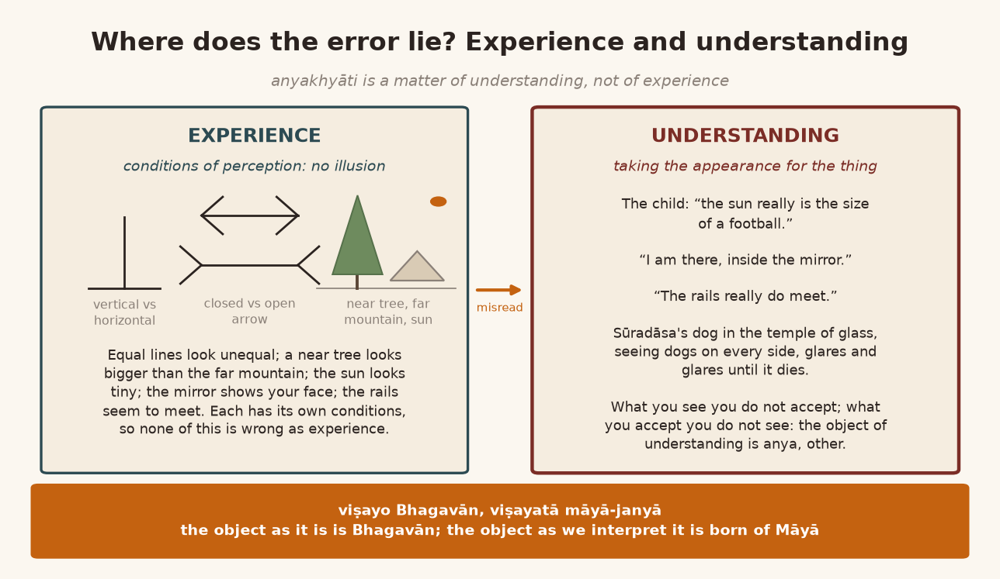
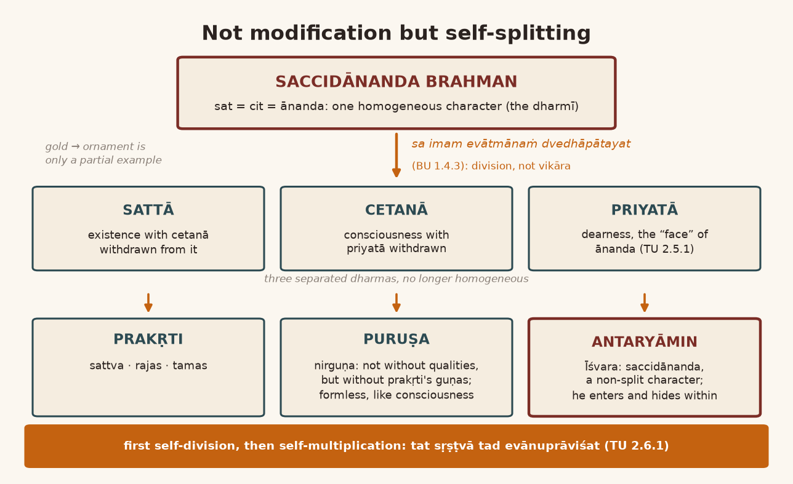
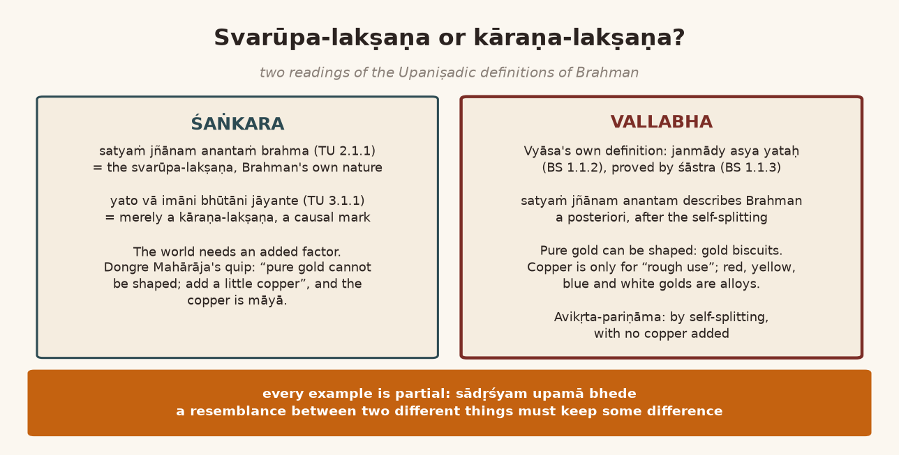
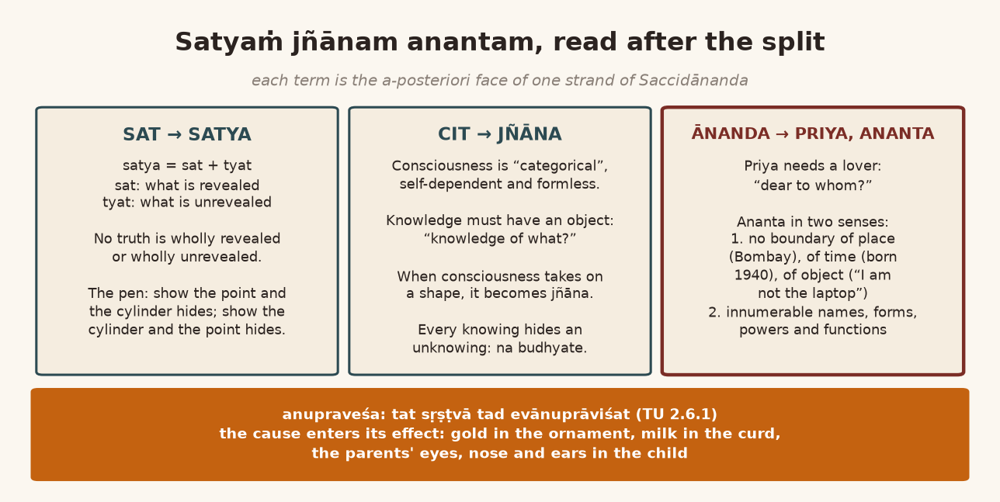
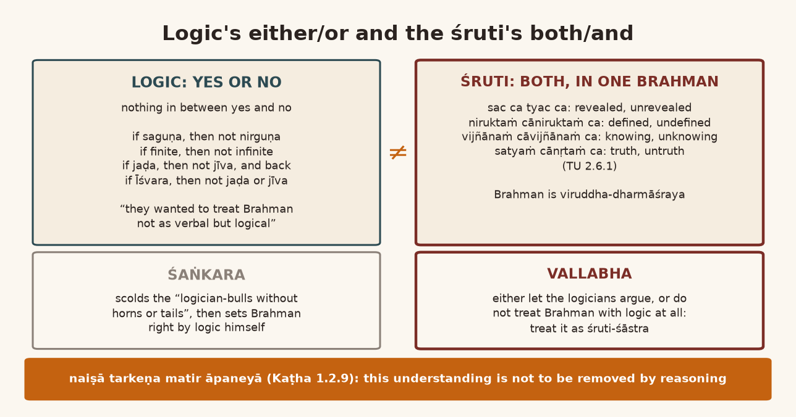
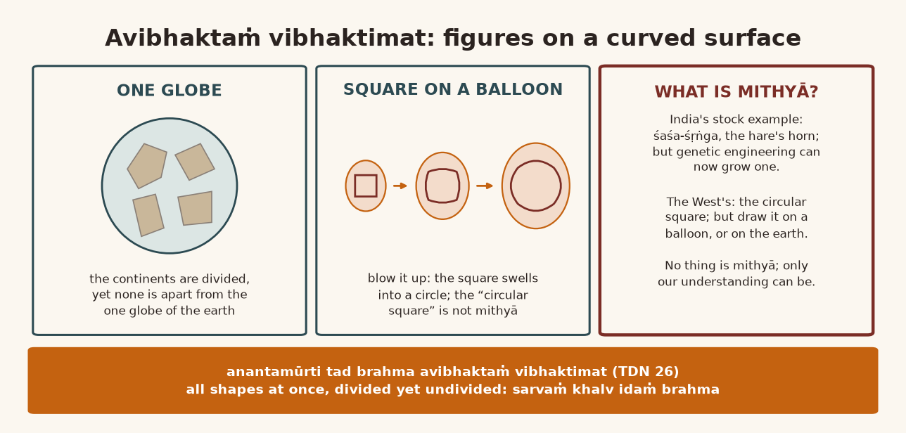
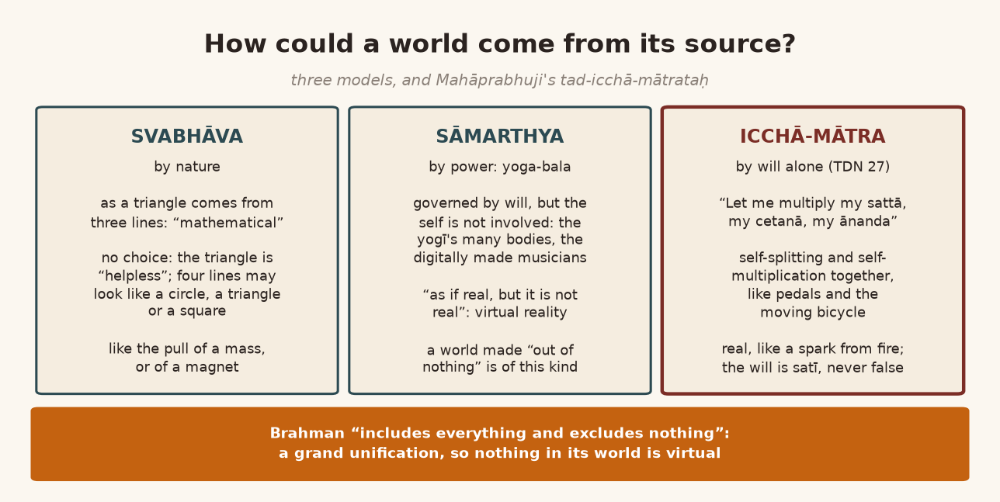
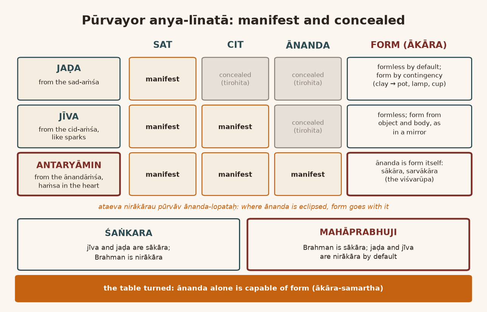

*English rendering of a spoken discourse on the Śāstrārtha Prakaraṇa of the Tattvārthadīpanibandha, translated from a Hindi ASR transcript. The speaker's conversational register, humour, digressions, code-switching, and student exchanges are preserved. Editorial flags: ‹ › conjectural restoration of a garbled reading; ‹?› uncertain reading; ‹…› inaudible or unrecoverable passage; ‹श्रवणाधारित› text given as heard, pending verification against a printed edition. Verses whose standard text is beyond doubt have been silently restored to the received editions.*

# 1. Last Week's Questions: The Bhāgavata's Great Lives and a Detachment Born of Love

**Speaker:** Let us first settle one thing in our minds. If there is any inquiry about the last class, let us deal with that first. Is there anything?

**A student:** Jejē, I had a question, please.

**Another listener:** Go ahead.

**A student:** "It was about" anyakhyāti, Jejē. That verse you explained, the Bhāgavatajī's *kathā imās te*, which says that "great souls are for the purpose of learning" vijñāna "and" vairāgya. "And then there is the other incident of" Gopeśvarajī‹?›: "when his wife passed away he stopped doing" sevā, "and then with" Harirāyajī's‹?› —

**Speaker:** "I am going to two topics. First of all," anyakhyāti "is a different topic."

**A student:** "Yep, I want to see if this is" anyakhyāti "or not," Jejē. "So you know, when you see great souls and you see them as —"

**Speaker:** "You see them as" — "that is a different topic." And *kathā imās te kathitā mahīyasām*: "I must have quoted [it] in a different context. First of all —"

**A student:** "OK."

**Speaker:** "So" anyakhyāti "means illusion, the theory of illusion."

**A student:** ‹…›

**Speaker:** But what I am saying —

**A student:** Jejē, "if you don't see somebody as immortal — if you see somebody as immortal, then it's" anyakhyāti, "right?"

**Speaker:** "Yeah, you can apply [it] here. But the context of the" *kathā imās te kathitā mahīyasām* "particularly deals with the main topic of" the Bhāgavata, "the main purpose or purport of" the Bhāgavata. "But they said the" *kathā imās te*: *kathā* "means the narration, all the narrations which are there in" the Bhāgavata; *kathitā mahīyasām*, "of the all great personalities"; *vitāya lokeṣu yaśaḥ pareyuṣām*: "they were famed, their fame got extended, and then they died." Why are they mentioned? "All these narrations of the great personalities, when they wanted to narrate the" līlā "of" Bhagavān. "And for that" the Bhāgavatakāra "says that" *vijñāna-vairāgya-vivakṣayā vibho*. "*Vibho* means *vibhu*, means the omnipresent." Prabhu. "So to make you understand the" vijñāna. "Now" vijñāna "normally means particular" jñāna, "not common sense or general knowledge; or let us say" vijñāna "means some special sort of knowledge," *viśeṣa jñāna*. "And" vairāgya "means detachment, but detachment also as a not negative, not in negative connotation, but the most positive connotation. So, negative detachment is such that you hate something, you dislike something, so you become detached with it. But the positive detachment has a different nature: you love something so much that you do not like to love others. That is" vairāgya. "That's a positive connotation of the detachment. So" *vijñāna-vairāgya-vivakṣayā vibho vaco-vibhūtīḥ*: "it's a style of the narration. Actually the purport is" vijñāna "and" vairāgya, "but to make you understand the" vijñāna, "the importance of" vijñāna "and the" vairāgya, "they have narrated all this great personality story. They mixed up, rather, the great stories of the great personality in the narration of the" līlā "of" Bhagavān. "That is what" the Bhāgavatakāra "says."

> कथा इमास्ते कथिता महीयसां विताय लोकेषु यशः परेयुषाम् ।  
> विज्ञानवैराग्यविवक्षया विभो वचोविभूतीर्न तु पारमार्थ्यम् ॥
>
> *kathā imās te kathitā mahīyasāṁ vitāya lokeṣu yaśaḥ pareyuṣām |*  
> *vijñāna-vairāgya-vivakṣayā vibho vaco-vibhūtīr na tu pāramārthyam ||* (Bhāgavata Purāṇa 12.3.14)
>
> [These narratives of the great, who spread their fame through the worlds and then departed, have been told to you with the aim of conveying vijñāna and vairāgya, O vibhu; they are a splendour of speech, not the ultimate purport.]

**A student:** "OK."

**Speaker:** Now, if we want to see anyakhyāti here: "well, you can apply, but I don't think it [is] necessary."

**A student:** "OK," Jejē. "It's because we see" saṁsāra "as" mithyā, "and then, like, we have relationships with, like, say, God-related people, right? But that's not" mithyā, "is it? That was my confusion."

**Speaker:** No, "no, no," mithyā "and reality. Wherever you have an awareness of" mithyā, "that can be treated as an" anyakhyāti. "But I have shown that, the chart also, that day, perhaps, [if] I remember correctly —"

**A student:** Yes, yes, yes.

**Speaker:** "— that there are two sides or two aspects of the understanding: the common understanding, common experience, and the understanding. So whether illusion lies in the experience or the understanding — we must distinguish between experience and understanding, first of all."

# 2. Experience and Understanding: The Football-Sized Sun and the Dog in the Glass Temple

**Speaker:** "For instance, when you experience a mirage in the desert, it is an experience. And there's nothing we can say that's wrong. Experience [is] corresponding to certain conditions; experience [has] certain conditions, which condition makes you see that or be aware of it. But when you try to understand it on the basis of your experience, you get the" anyakhyāti. "For instance, when you see your reflection in [the] mirror, it's an experience, and it has its own condition: that when [the] mirror is before you, it will reflect your image to your sight."

**Another listener:** Hmm.

**Speaker:** "I see. But if you understand it as [if] you are there in the mirror, then it is" ‹anyakhyāti›. "So the conditions of perception: perspective, for instance, is a condition of perception; you cannot treat it as an illusion. Several conditions are laid down in the visual psychology, but I am simply mentioning three conditions. First, a vertical line appears to be longer than the horizontal line. Secondly, an arrow, open and close[d]: [the] closed arrow seems to be shorter than the open. That's a condition of perception. So I have drawn the exactly equivalent line. Now here in this third picture I [have] drawn a tree: a tree is bigger than the mountain, and the sun in the corner — it is much, much shorter than our heart‹?› also. Is this an illusion or [a] condition of perception?"

**A student:** "Condition of perception."

**Speaker:** "One appears to be shorter than our heart‹?›, and the tree appears to be longer than the mountain. There is no illusion; it's a condition of perception. But [if] a child consider[s] this, understand[s] this, that really [the] sun is that much small, like a football, in [the] size of [a] football, then that misunderstanding is eliminated‹?›. That is what we call" anyakhyāti.

**A student:** "Oh, OK."

**Speaker:** "Is that clear?"

**A student:** "Yes, thank you," Jejē. "Sorry, it just wasn't sitting in my head two weeks ago."

**Speaker:** "In my head two weeks ago" — "I'm glad."

**Another listener:** "But this can be verified."

**A third student:** Then, Jejē, it's like our railway — I mean, you have told us two things, Jejē: one is understanding, and one is our experience. So the railway lines that are converging: everyone knows that they will never meet. If in their understanding they take it that they meet, then that is anyakhyāti, because in experience it is indeed happening that they meet. Is it right to understand it like this? Am I thinking right?

**Speaker:** Yes, all right. At the level of experience it is not wrong. At the level of experience it is not wrong, but if you are misinterpreting it at the level of understanding, then it is anyakhyāti. Because what you see, you do not accept; and what you accept, you do not see.

**A student:** Like, one —

**Speaker:** Like — one, one minute. Like, we see our own reflection in the mirror; suppose we really took it to be so. There is that pada of Sūradāsajī: *śvāna kāṁca-mandira meṁ bhrami bhrami bhūsa‹?› maryo* ‹श्रवणाधारित› [a dog in a temple of glass, deluded again and again, ‹…› died]. So, put a dog in a temple of glass, and it will see dogs on all four sides. One dog will not tolerate another dog, and it sees dogs all around, so it would glare and glare until it died. That understanding the dog has, that is mithyā. When we see so many reflections of ourselves, why don't we start a free-for-all? Because our understanding is perfect: "brother, this is a condition of experience."

**A third student:** The understanding is perfect, that it is just the same one.

**Speaker:** We are not misunderstanding it. So the bhrama, the error, is a viśeṣa-jñāna, a particular cognition; it is not sāmānya-jñāna, the general cognition. The general cognition will not be about the variety, the variety that is coming to us. That is why, where Mahāprabhuji propounded brahma-jñāna and anyakhyāti, there he gave one statement: *viṣayo bhagavān, viṣayatā māyā-janyā*. "Object represents divinity, but the modus of understanding it may be caused by illusion, illusory" Māyā. *Viṣayatā māyā-janyā*. "So the object as it is, and object as we interpret. As it is, all the objects are" brāhmī. "As we interpret it on the basis of our understanding," this is māyā-janya, born of Māyā. Did that register?

**A third student:** Jejē, it became clear. Where understanding and experience do not match, there it is anyakhyāti.

**Speaker:** Yes. They are not matching because the object of the experience is one thing and the object of the understanding is something else, *anya*. What is that anya? That is anyakhyāti. Yes.

**A woman student:** That is just what I was asking. If we do not know that the sun is the biggest, it looks small to us; the experience is of it being small. But if we don't know at all that it is big, then what will we take that as? We will take it as illusion only?

**Speaker:** Yes, so the misunderstanding has become illusion, hasn't it? At the level of experience it is not illusion. At the level of understanding it is illusion.

**A woman student:** So it became illusion; and when one comes to know, then it —

**Speaker:** Yes. Has this chart been conveyed to you, the one on Saccidānanda? Just project it here; then it will be easier to explain to everyone.

**A listener:** *Mokalāvī dī* [I've sent it].

**Another listener:** *Milyo* [Got it].

**A third student:** Yes, go ahead, do it.

{width=6.2in}

# 3. A Verbal Concept: Saccidānanda, the Anaesthetised Patient, and Brahman's Self-Splitting

**Speaker:** Here, you see, I have given four statements: one, two, three, four. At the root, Brahman is not an "empirical concept"; it is not a "logical concept"; it is a "verbal concept". And which verbal concept? Where has that concept been derived from? It is a śruti statement. Now the biggest thing to understand in this is that Brahman is called Saccidānanda. Saccidānanda Brahman means that there sattā, cetanā and ānanda, existence, consciousness and bliss, are a "homogeneous character". That is, the sattā is not such that it could be acit, without consciousness. The cit is not such that it could be of the nature of sorrow. That homogeneous character of Saccidānanda: now, when we say it is a homogeneous character, understand clearly what that means. There can be a sattā that is not of the nature of consciousness. There can also be a consciousness that is not free of sorrow, that is of the nature of sorrow too. We can see this in our own experience. And there can also be such an ānanda as is only "illusionary", not "real". Someone hypnotizes you, and that kind of ānanda starts happening. As when they do an "operation" they give "anaesthesia": while it is being cut there is no pain at all, and afterwards there is great pain. We get ourselves cut with great comfort; when the anaesthesia wears off, then we find out everything very quickly. So the three can also be of different natures. But in Brahman these three are not of different natures; they are of a homogeneous character. That is, whatever is sattā, that itself is cetanā; whatever is cetanā, that itself is ānanda.

Now, a second point is this. When we call Brahman the cause and the world the effect, then doctrinally it is generally said in our tradition that it is avikṛta-pariṇāma, "immaculate modification". Avikṛta-pariṇāma means immaculate modification. There is "modification", but not such that any kind of "maculation", any vikāra, comes into the "substance". The substance remains without vikāra and gets modified. For that we have given the example of "gold" and "ornament". Gold remains gold and becomes the ornament. The vikāra of milk into curd is such that the substance becomes "maculate": milk becomes curd, and after that it does not remain milk; it has become curd. In the example of gold and ornament it is not like that, that the gold becomes "maculate". "Gold remains gold and it takes the form of ornament." From that a misconception arises in the understanding, an anyakhyāti: that it is only avikṛta-pariṇāma. But the śruti says this clearly: *sa imam evātmānaṁ dvedhāpātayat* (Bṛhadāraṇyaka Upaniṣad 1.4.3). The pariṇāma of Brahman in the form of the world, the avikṛta-pariṇāma, has come about through "division", not through "modification"; it has come about through "self-splitting". Brahman split itself. That is, the sattā, cetanā and ānanda that were homogeneous, that was Saccidānanda, homogeneous: he made the sattā such that cetanā no longer remained in it. He split the cetanā out of himself in such a way that priyatā, dearness, which is the dharma of ānanda, no longer remained in it. Because in describing ānanda the Upaniṣad makes it clear: *tasya priyam eva śiraḥ* … *tasmād vā etasmād vijñānamayāt anyo 'ntara ātmānandamayaḥ … tasya priyam eva śiraḥ, modo dakṣiṇaḥ pakṣaḥ, pramoda uttaraḥ pakṣaḥ, ānanda ātmā* (Taittirīya Upaniṣad 2.5.1). That description comes there in the Upaniṣad. So that priyatā is its "face", by which we can recognize it. Wherever there is priyatā, there is ānanda; wherever there is ānanda, there is priyatā.

So this split. When they had split, then after the splitting, sattā, cetanā and priyatā appeared out of it as dharmas, as attributes, out of the Saccidānanda-Brahman-hood. Until then it was in the form of the dharmī, the bearer of attributes. Now sattā and cetanā split, and three dharmas became separate in it, such as were not of a homogeneous character. Out of that sattā, prakṛti was born, which is described as having the guṇas sattva, rajas and tamas. And out of the cetanā that was, puruṣa was born, who is nirguṇa. Nirguṇa does not mean devoid of qualities; rather, the guṇas of prakṛti, sattva, rajas and tamas, those guṇas are not in it. In that sense it is nirguṇa.

**A listener:** Ho.

**Speaker:** And out of priyatā the antaryāmin was born, whom they call Īśvara. And that Īśvara is of the nature of saccidānanda; his character is not split, not "splitted". It is a "non-split character". And he is antaryāmin, that is, he went inside it and hid.

**A listener:** Hmm.

**Speaker:** Now, in this "verbal concept", one very "remarkable" thing worth understanding is this. The first point is that the modification came about through "division", through "self-splitting": *sa … ātmānaṁ dvedhāpātayat*. After that, in the second statement, comes *satyaṁ jñānam anantaṁ brahma* (Taittirīya Upaniṣad 2.1.1).

{width=6.2in}

# 4. Dongre Mahārāja's Copper: Gold Biscuits, Blue Gold, and Why Every Example Is Partial

**Speaker:** Understand this a little carefully. In Śaṅkara's Vedānta, *satyaṁ jñānam anantaṁ brahma* is the svarūpa-lakṣaṇa of Brahman, the definition of its own nature. And *yato vā imāni bhūtāni jāyante, yena jātāni jīvanti, yat prayanty abhisaṁviśanti, tad vijijñāsasva, tad brahma* (Taittirīya Upaniṣad 3.1.1), "that from which these beings are born, by which, once born, they live, and into which they go and enter: seek to know that; that is Brahman", is not Brahman's svarūpa-lakṣaṇa; it is a kāraṇa-lakṣaṇa, a definition by causality, or a kārya-lakṣaṇa, by effect. That is, to define anything: define its "substance", or define its "causality", or define it by its "effect", by its "product", or define it by its "purpose". "There are several type[s] of definition [that] can be presented." So the Vedānta of the Śaṅkara school says that *satyaṁ jñānam anantaṁ brahma* is the svarūpa-lakṣaṇa, and the causal one, *yato vā imāni bhūtāni jāyante, yena jātāni jīvanti, yat prayanty abhisaṁviśanti, tad vijijñāsasva, tad brahma*, is not Brahman's svarūpa; that is only a kāraṇa-lakṣaṇa.

And the way this has been dealt with in the texts, in "highly technical terms": for us to get to know it, there was a famous Bhāgavata kathākāra, Dongre Mahārāja. He used to give a very "funny description" of this: *śuddha sonāno ghāṭ ghaḍāy nahīṁ; thoḍuṁk to tāṁbuṁ ‹joḍavuṁ› paḍe* [an ornament cannot be shaped from pure gold; at least a little copper has to be joined to it]. And that copper is what? Māyā. This statement of Dongre Mahārāja's was against avikṛta-pariṇāma. He held the Śaṅkara view‹?›. *To temaṇe ek bahu "funny statement" kahelu ke śuddha sonāno ghāṭ ghaḍāy nahīṁ; thoḍuṁk to tāṁbuṁ ‹umeravuṁ› paḍe to ghāṭ ghaḍāy* [So he made a very "funny statement": pure gold cannot be shaped; only when a little copper is ‹added› can it be shaped].

This is a "limitation" about gold, but it is not "necessary". To make gold strong, because gold is a "soft metal", to make it strong for an ornament, a little copper has to be put in. "That doesn't mean" that gold cannot be shaped. It cannot be done in an ornament because in an ornament we have to give it "rough use". So it is not the case that pure gold cannot be shaped. We see whether biscuits of pure gold come or not. Were they shaped or not shaped? It is pure gold, "guaranteed". That too has been shaped into a form, hasn't it? So in shaping pure gold for rough use, it is necessary to put in a little copper. Perhaps you don't know this; well, I can't say. So in this way, by combining gold with various metals, metallurgically many kinds of gold can be made. Like red-coloured gold, by mixing copper; by mixing brass, yellow-coloured gold. By mixing iron, blue-coloured gold used to be made earlier; nowadays they have stopped making it. By mixing pure iron it was made in China; in our India too blue-coloured gold used to be made. Likewise, by mixing platinum, white-coloured gold is also made, "white gold". It combines with many metals. So this much is right: if it is for rough use, a little copper has to be mixed in, because copper "is supposed to be", copper "is supposed to be [a] hard metal". Bronze can also be mixed; it can combine with many metals. But this is not necessary. It does happen; in the case of gold it happens.

That is why I told you that the example of gold and ornament which we give in ‹avikṛta›-pariṇāmavāda is a "partial example"; it is not a "complete example". And any example is always partial, because if it were complete, a hundred percent, it would not remain an example at all. *Sādṛśyam upamā bhede* (so quoted; Mammaṭa's Kāvyaprakāśa, ch. 10, reads *sādharmyam upamā bhede*).

**A student:** Then it won't remain an example at all.

**Speaker:** "Resemblance between two different phenomena is called" sādṛśya. So when you want to show ‹sādṛśya›, you will have to keep a little difference as well —

**A listener:** ‹…›

**Speaker:** — and you will have to bring in a little "resemblance" as well.

{width=6.2in}

# 5. Satya as Sat and Tyat: The Pen, Socrates' Poison, and a "Beloved" Nobody Knows

**Speaker:** So in Śaṅkarācārya's view, what is the svarūpa-lakṣaṇa is not really a svarūpa-lakṣaṇa. Because the svarūpa-lakṣaṇa is Saccidānanda. When we say Saccidānanda: the meaning of satya that the Upaniṣad has explained is that sat and tyat together make satya. The ‹…› definition is: sat is what is "revealed", ‹tyat› is what is "unrevealed". So whatever is satya has both aspects: something revealed, something unrevealed. There is no truth that is completely revealed, and there can be no truth that is completely unrevealed. "When you say truth", then it means partially revealed, partially [unrevealed].

Take the example of this pen. Now this is revealed before you. Is this unrevealed or not? If I reveal this before you, then this ‹…› got revealed. The cylindrical form: one got revealed. The pointed form got revealed. The pointed form disappeared, the cylindrical form got revealed. Any truth, "any damn truth, is partially revealed and partially unrevealed. That is true."

Vijñāna: in Saccidānanda, vijñāna was born out of cetanā. That is, "consciousness"; cetanā means consciousness. In consciousness "understanding" is born, vijñāna. That is the thing to understand, according to the Upaniṣad. And below, the second: *satyaṁ jñānam anantaṁ brahma*. Jñāna: "jñāna means understanding; jñāna does not mean" cetanā. "Because" cetanā "can be self-dependent. Knowledge can never be self-dependent. Knowledge must have some object. See, [if] objective reference is not there — consciousness merely taken by itself cannot be considered as" jñāna, "knowledge. If there is a knowledge" (jñāna means knowledge), if there is knowledge, then it will have some object or other, won't it? Knowledge of what? Cetanā is not "of" anything. Cetanā is "categorical". We cannot say "consciousness of this thing"; no sir, this is "consciousness". But when we say knowledge, there is no knowledge without an objective reference. So the cit that was in the sat became jñāna: *satyaṁ jñānam*. And the ānanda that was there became priya, the dear. And priya: it is priya if someone likes it, isn't it?

**A listener:** Hmm.

**Speaker:** Ānanda can be ānanda in itself, but priya: it is priya only if there is some lover, isn't it? Suppose I say, "I am ‹priya›." Now, ‹priya› to whom? No object can be priya without a lover. For someone who loves, the loved object is priya, isn't it? Naturally this much is true: where we feel ānanda, there love arises in us. Otherwise, where there is love, there the feeling of ānanda begins. Even if it is poison: if one comes to love even poison, then there is ānanda even in drinking poison, as Socrates had ānanda. We would weep, because we have no love. As for ‹Mīrā›, there was ānanda for her even in drinking poison. So either ānanda manifests out of love, or love manifests because of ānanda, "vice versa".

**A listener:** ‹…›

**Speaker:** ‹…› When it manifests in the form of its dharma, ānanda in the form of priyatā —

**A listener:** Yes.

**Speaker:** "It requires ‹a viewer›. By itself nothing can be ‹priya›." Now, in Gujarati, it's like this: *gāmmāṁ koī koī jāṇe nahīṁ ‹…›; koī tamane khabar nathī, paṇ huṁ priya chuṁ* [nobody at all in the village knows me ‹…›; you have no idea who I am, but "I am dear!"]. Arre bhāī, does such a thing ever happen? And still one goes and forces oneself on people: "We don't know you." "But I am a very great Śrīmān‹?›!" How can there be such a priyatā, that nobody knows about? So if there is priyatā, it comes about because of some lover. So understand this carefully: this has happened because of the splitting.

**A listener:** Hmm.

**Speaker:** This is "a posteriori"; it is not "a priori". *Satyaṁ jñānam anantam*: the ananta they speak of has come in the place of ānanda.

# 6. Ananta and Anupraveśa: Bombay, 1940, a Muted Microphone, and Gandhiji's Goat

**Speaker:** Now, ānanda: what is it? Understand this carefully. "Infinity". Infinity can be of two kinds. One infinity is paricchedarahitatā, the absence of delimitation: that is, it has no "contour line" anywhere, no "boundary line". That is called infinite. One infinity is asaṅkhyatā, countlessness, "innumerability" too.

So ānanda comes in both senses. And ananta has been taken as the "synonym" of ānanda, the synonym of the ānanda that is in Saccidānanda. So what is that ānanda? Innumerable: there must be śaktis in it, ‹innumerable› names in it; there must be innumerable forms, innumerable powers, innumerable functions. That is anantatā. If there is just one power, just one form … but if it is innumerable formally, perceptually, functionally, in every way, then it can be ānanda.

The other is the one without pariccheda. Pariccheda, delimitation, can be of two or three kinds, by nature: deśa-kṛta pariccheda, delimitation by place; kāla-kṛta pariccheda, by time; and vastu-kṛta pariccheda, by object. That is, it is confined to some area; that is delimitation by place. As I am here in Bombay, but I am not where you people are listening: that is deśa-kṛta pariccheda. Kāla-kṛta pariccheda: born in nineteen forty, and as long as I live, I am living within a bracket of time. That is kāla-kṛta pariccheda. Vastu-kṛta pariccheda: I am, but I am not the "laptop". I am, but I am not the listener; right now I am the speaker. You are the listeners, so you are not speaking; yours is "mute". "Mike". My mike is not muted. ‹It has got muted.› So this is delimitation by object. Take the definition this way too, and even then it will come to ‹immensity›. That is, that in which there is no delimitation of place, no delimitation of time, no delimitation of object: it has to be equal to all of these. In both senses, this is what ānanda means.

How does the Upaniṣad say this? *Tat sṛṣṭvā tad evānuprāviśat; tad anupraviśya*. From Brahman the world was born; after the world was born from Brahman, Brahman entered into the world. It became "inherent", after ‹entering›. *Tad anupraviśya*, *anupraviṣṭa*: anupraviṣṭa means "having created something, the creator enters into the creation". We can see that when an ornament is made out of gold, the gold comes into the ornament, character-wise, ‹substance›-wise and function-wise. When curd is made out of milk, the ‹lactose› of the milk comes into the curd as well. We know very well that when cow's milk is set into curd, it has a slightly yellow tinge too; when buffalo milk is set into curd, it is completely white. Its smell is different too. You may or may not have seen it: there is ‹sheep's› milk too, there is camel's milk too, there is goat's milk too; Gandhījī used to drink goat's milk. So they all taste different. I have not tasted them myself, never sent for them; "I presume" they will have different tastes, different colours, some different goings-on in each. So the substance that is the cause enters into the created substance, into the effect. As the eyes, nose and ears of our mother and father, of our maternal grandparents, of our paternal grandparents, enter into us: "hereditary". *Tat sṛṣṭvā tad evānuprāviśat*. After entering, what happened? *Sac ca tyac cābhavat*: it became sat and tyat.

> तत्सृष्ट्वा तदेवानुप्राविशत् । तदनुप्रविश्य सच्च त्यच्चाभवत् । निरुक्तं चानिरुक्तं च ।  
> निलयनं चानिलयनं च । विज्ञानं चाविज्ञानं च । सत्यं चानृतं च सत्यमभवत् ॥
>
> *tat sṛṣṭvā tad evānuprāviśat | tad anupraviśya sac ca tyac cābhavat | niruktaṁ cāniruktaṁ ca |*  
> *nilayanaṁ cānilayanaṁ ca | vijñānaṁ cāvijñānaṁ ca | satyaṁ cānṛtaṁ ca satyam abhavat ||* (Taittirīya Upaniṣad 2.6.1)
>
> [Having created it, he entered into it. Having entered it, he became sat and tyat, the defined and the undefined, the abode and the non-abode, knowing and unknowing, truth and untruth: he became satya.]

{width=6.2in}

# 7. A Knowing That Hides an Unknowing: Logic's Yes and No, and Bulls without Horns or Tails

**Speaker:** It became ‹sat and tyat›; it became satya: *satyaṁ jñānam anantam*. See how it came about: *sac ca tyac cābhavat; niruktaṁ cāniruktaṁ ca*. What is satya, what is revealed, of that you can give a nirukti, a definition. And what is tyat, what has not been revealed, how will you give its nirukti? "How will you define it?" Then, in the revealing, its definition: so it became nirukta too, and it became anirukta too. *Niruktaṁ cāniruktaṁ ca*. *Vijñānaṁ cāvijñānaṁ ca*: the cetanā that was became vijñāna too, and ‹avijñāna› too. Because understand this carefully: any knowledge, "any damn" jñāna, "understanding": inside every jñāna some ajñāna is hidden, and every ajñāna has the possibility, the "potentiality", of jñāna. As when you are getting the knowledge of this pen: "at the cost of not knowing so many objects" are you able to know this pen, to understand it. So no knowledge can be such that... As, if you are taking arts, will you get the knowledge of science? If you are taking science, will you get the knowledge of arts? If you are taking commerce, of science? No knowledge can come about without ignorance, and no ignorance comes about except with reference to knowledge.

In Sanskrit there is a very amusing verse: *na budhyate ity api buddhi-sādhyam* ‹श्रवणाधारित› [even "I do not understand" is an achievement of intelligence]. "It is not coming into my understanding": only an intelligent person realizes this. A fool does not realize it. *Na budhyate*: that "I am not understanding" comes only when one has a lot of intelligence; then one realizes that one does not understand. Otherwise it seems, "Yes, I've understood."

**A listener:** ‹…›

**Speaker:** So in every ajñāna‹?› there is jñāna, and in every ajñāna jñāna lies hidden. *Vijñānaṁ cāvijñānaṁ ca*. After that, *satyaṁ cānṛtaṁ ca*. The satya that we described, revealed and unrevealed: *satyaṁ cānṛtaṁ ca*, and Brahman became anṛta too. This is the darśana of its infinity. So we can see how, having entered, it multiplies; it does "self-multiplication". First it "divides", "and after division" it "self-multiplies". This "self-multiplication" and "self-division": the śruti has told this whole "process". This is the "verbal concept".

Now, about this verbal concept, we can understand that all those people, especially those who want to depend more on "logic", divide logic into "yes" and "no". Logic has one nature: yes and no. In between, between yes and no, there is nothing at all. If it is yes, it is not no; if it is no, it is not yes. Therefore, all those who wanted to make it into a "logical concept": in their minds this doubt arose, that if Brahman is saguṇa it is not nirguṇa, if it is nirguṇa it is not saguṇa; if it is "finite" it is not "infinite", if it is "infinite" it is not "finite"; if it is jaḍa it is not jīva, if it is jīva it is not jaḍa; if it is neither jaḍa nor jīva but Īśvara, then it is not jaḍa and jīva; if it is jaḍa and jīva, then it is not Īśvara.

**A listener:** ‹…›

**Speaker:** "Because they wanted to treat the concept of Brahman not as a verbal but logical." And the śruti clearly says this: *naiṣā tarkeṇa matir āpaneyā* (Kaṭha Upaniṣad 1.2.9). This concept is a verbal concept of Brahman. Don't you try to dislodge it by logical assessment; *āpaneyā*, that is, do not "remove" it. So we can see that this concept of Brahman of Mahāprabhuji's is not logical; it is a verbal concept. It is not "empirical", it is "verbal": as the śruti told it, Mahāprabhuji's interpretation of that. Now, those who want to deal with this concept of the śruti logically get a logical objection.

But Śaṅkarācārya himself has said a very amusing thing, in the Bṛhadāraṇyaka Upaniṣad Bhāṣya, "[if] I remember correctly". Some tārkikas, logicians, say, "We will prove Brahman logically. We try to prove it logically." There Śaṅkarācārya comes down to a bit of name-calling: *ke yūyaṁ tārkika-balīvardāḥ … apuccha-śṛṅgā balīvardāḥ* ‹श्रवणाधारित›. "Who are you arguers, bulls without tails and horns, to treat Īśvara logically?" *Ke yūyaṁ tārkikā apuccha-śṛṅgā balīvardāḥ*. And Śaṅkarācārya raised a very "drastic question" there: you are establishing it by reasoning, which means that you already know beforehand that there is Brahman. That you did not come to know by reasoning, and afterwards you are giving reasoning. How did you find out that there is Brahman? That is not found out by reasoning, because reasoning is divided into yes and no, and Brahman is viruddha-dharmāśraya, the substratum of contradictory attributes. These are Śaṅkarācārya's arguments, not Vallabhācārya's, mind it. After that he himself then sets it right logically too. That is a separate story. Having scolded them —

**A listener:** ‹…›

**Speaker:** — they treat it logically all the same. There Vallabhācārya has his objection: either you do not scold the tārkikas — "let them argue about the Brahman, and we'll read those arguments. If you are condemning [the] tārkika logician, then do not treat Brahman with logic. Treat it as it is": as śruti-śāstra. This is Mahāprabhuji's concept, and that is why Mahāprabhuji has introduced this concept of Brahman. How Mahāprabhuji postulates this concept in the Nibandha is what we have to see. If you want to ask anything, ask; this has opened it up conceptually.

{width=6.2in}

# 8. Anantamūrti tad Brahma: The Hare's Horn, the Square on a Balloon, and the Continents

**Speaker:** And — let's go, now let us look ahead. In the last śloka Vallabhācārya Mahārājajī said this:

> अनन्तमूर्ति तद् ब्रह्म ह्यविभक्तं विभक्तिमत् ।  
> बहु स्यां प्रजायेयेति वीक्षा तस्य ह्यभूत् सती ॥
>
> *anantamūrti tad brahma hy avibhaktaṁ vibhaktimat |*  
> *bahu syāṁ prajāyeyeti vīkṣā tasya hy abhūt satī ||* (Tattvārthadīpanibandha, Śāstrārtha Prakaraṇa 26cd–27ab)
>
> [That Brahman has endless forms; undivided, it yet possesses division. "May I become many, may I be born forth": this seeing of his was true.]

Yes: Brahman is anantamūrti, that is, Brahman does not have just one mūrti, one form.

**A listener:** One minute.

**Speaker:** I am telling you a little geometrically. All the designs there are in geometry, let us say triangle, square, oblong square, circle, rectangle ‹…›. Whatever is a single form will not be ‹aparicchinna›, because the triangle, we can see, cannot be a square; the square cannot be an oblong square; ‹…› cannot be ‹…›, and ‹…› cannot be ‹…›. But that in which all shapes are, if it is anantamūrti, then ‹…› is mithyā‹?›.

And understand one more thing carefully. This mūrtatā, mūrti, that is, "form": these are "different geometrical forms". The "limitations" they have, because each has a different geometrical definition: the definition of a triangle is different, the definition of a square is different, the definition of a circle is different. That is why people used to say — in "Western logic" there is a very amusing "argument": what is mithyā? For that, they say... As an example of mithyā, in our tradition the example given was that śaśa-śṛṅga is mithyā, the horn of a hare. Why is it not found? Because there is no horn on a hare's head. Today, when "genetic engineering" has made that possible, if you want to grow a horn on a hare's head as well, you can grow a horn genetically. Then won't it stop being mithyā, the thing you take to be mithyā? In the West this was not the point. There, as the example of mithyā, they said: "a circle cannot be [a] square, [a] square cannot be [a] circle." That was considered logically mithyā.

**A listener:** Hmm.

**Speaker:** A "circular square". But lately, not everyone had the full knowledge, so the argument did not occur to people's minds, because they were thinking only in the terminology of pariccheda, of the delimited as against the vibhu, the all-pervading. But in the West, philosophy gave a very amusing argument. If a square is made upon the earth, it will be a circle, and then a square. Its practical example is this: draw a square on any balloon and blow it up. Won't that square become a circle?

**A listener:** Hmm.

**Speaker:** On any balloon, *phugā*, draw a square. As you go on blowing it up, it will swell, and not in the form of a square. So the square will turn into a circle somewhere. A square, a circular square: that is not mithyā.

**A listener:** Hmm.

**Speaker:** Now tell me, what is mithyā? So nothing in the world is mithyā at all. Our understanding can be mithyā; no thing is mithyā.

In this sense Mahāprabhuji says that the awareness of anyakhyāti that arises is ‹…› the śakti of all things. Because the viṣaya, the object, is Bhagavān. The object is Bhagavān, like the earth: even if you draw a square on it, it will become a circle. You drew a triangle too, on the earth, didn't you? Because the surface of the earth is round. You drew a triangle too, then it —

**A listener:** ‹…›

**Speaker:** — ‹…› will remain ‹…›. That we did not see it is another matter; we see with a short vision. So nothing is mithyā at all; everything is Brahman: *sarvaṁ khalv idaṁ brahma* (Chāndogya Upaniṣad 3.14.1). This is the verbal concept of the Upaniṣad, and Mahāprabhuji accepted it. *Anantamūrti tad brahma*: it is anantamūrti. *Avibhaktam*: and it is vibhakta, divided, as well as avibhakta, undivided. "It is vibhakta and also avibhakta" does not mean that it is vibhakta and it is avibhakta; it means that even while being vibhakta it is avibhakta.

**A listener:** ‹…›

**Speaker:** And we can see this. All the continents of the earth, America, Africa, Asia, Australia and so on: while being divided, are they not undivided from the earth? "Are they not part of the one common globe of earth?"

**A listener:** Yes.

**Speaker:** So "they are" vibhakta "as well as" avibhakta. *Avibhaktatve 'pi vibhaktatvam, vibhaktatve 'pi avibhaktatvam*: this was viruddha-dharmāśraya. In division too they are undivided; *avibhaktaṁ vibhaktimat*. Because *bahu syām … vīkṣā tasya hy abhūt*: he wished to manifest himself in many forms, and from that he can manifest many forms, whatever form he wishes to manifest. The Vedastuti says *madhuni lilyur aśeṣa-rasāḥ* (Bhāgavata Purāṇa 10.87.31). The honeybee gathers the pollen from many flowers, and when it transforms it into honey, the fragrances of all the flowers come into it.

**A listener:** Hmm.

**Speaker:** In what manner? Not in a manifest manner.

**A listener:** Yes, yes.

**Speaker:** In an unmanifest form it has taken into the honey all the fragrances, all the flavours of the flowers' pollen, *aśeṣa-rasāḥ*. Just so, in Brahman are all the rasas. That is why Brahman has also been called madhu, honey. There is the Madhu-brāhmaṇa (Bṛhadāraṇyaka Upaniṣad 2.5). It is one madhu, "like honey", in which there are all the "flavours". "All the flavours are there." So Śaṅkarācārya's svarūpa-lakṣaṇa is actually not a svarūpa-lakṣaṇa by our account.

{width=6.2in}

# 9. Inquiry Needs a Definition: The Man Who Forgot His Question, the Bus to Bhuleshwar, and a Will That Is Never False

**Speaker:** And the thing to understand in this is that when Vyāsajī, Bādarāyaṇa Ṛṣi, began with *athāto brahma-jijñāsā* (Brahmasūtra 1.1.1), when he made the inquiry into Brahman, then for whatever is being inquired into, its lakṣaṇa and pramāṇa, its definition and its proof, ought to be given. Because jijñāsā means "inquiry". When we make an inquiry into something, how is the inquiry to be satisfied? "With the definition and with the proof." What is the definition of the thing we are inquiring into? Because suppose someone says, "I am making an inquiry, but I don't know its definition." What are you inquiring into, brother?

A gentleman used to come to our ‹…› *maṇḍalī*‹?›. He had a problem: he would raise a question and then forget what it was he wanted to ask. "You said that brahmatva is from dvaita, therefore…", and for five or ten minutes he would go on staring like this. I mean, what is it you want to ask? Tell me, at least! The cart would go round and round and get stuck.

**A listener:** Yes.

**Speaker:** What is the point of staring? Is it me he wants to look at, then? So I said to him, I said, "Do one thing. I allow everyone to ask whatever question they want to ask, but don't you ask here. Whatever question you want to ask, come and ask me at home; there you can get stuck on your own. If one listener takes ten minutes at a time, how am I to give answers?" While asking, he would forget what he was asking. It does happen to us: we set out to ask a question, and while asking we forget what we wanted to ask. It is nothing abnormal; it is normal.

I too, one day, got on a bus from Andheri, from the ‹Ajmār›‹?› Maṭh. The conductor asked me, "Where do you want to go?" I had forgotten where I had to go. I said, "Let me remember for a while, brother." The conductor said to me, "Have you come from your *muluk* after some schooling, or did you just come like that?" I said, "I was born right here in Bombay; where does the question of schooling come in? Let me remember for a while where I have to go, then I'll tell you. Meanwhile go and take the others'‹?› tickets; when I remember, I'll tell you." I had forgotten; what to do? I had to go somewhere; to my home. Our house was in Bhuleshwar. So I forgot; what to do? Such trouble happens; it is normal. It is not something peculiar to anyone; I have this trouble too.

But the thing to understand is that when we ask a question, it is cleared up only by a definition. And from the definition there is a "possibility", and to make that possibility "real" a "proof" has to be given. So what proof did Vyāsajī give for Brahman? *Athāto brahma-jijñāsā; janmādy asya yataḥ; śāstra-yonitvāt* (Brahmasūtra 1.1.1–3).

**A listener:** ‹…›

**Speaker:** That from which the origin, sustenance and dissolution of the world take place: that is Brahman. And from what is that established? From śāstra. So we can understand this point, that in Vyāsajī's view the main lakṣaṇa of Brahman is *janmādy asya yataḥ*. *Satyaṁ jñānam anantaṁ brahma*, which Śaṅkarācārya gave as the svarūpa-lakṣaṇa, and what they take as the kāraṇa-lakṣaṇa — "pure gold cannot be shaped, a little copper has to be mixed in" — that is not Vyāsajī's concept.

**A listener:** No.

**Speaker:** Vyāsajī does not interpret it that way. And referring to that same point, Mahāprabhuji wants to say one thing: *vīkṣā tasya hy abhūt satī*. *Bahu syāṁ prajāyeyeti vīkṣā tasya hy abhūt satī*. It was his vīkṣā, his seeing. So whatever potentiality there is in it to give forms, that potentiality he actualized.

**A student:** And there Mahāprabhuji says ‹…› *viṣaya-vyatireka*‹?› —

**Speaker:** *Satī* means — *vīkṣā tasya hy abhūt satī* — that our wish is sometimes satī and sometimes asatī. Satī here is not about the woman devoted to her husband, nor about the satī who burns herself after her husband. Satī means that his wish is never false; it is always true.

**A listener:** Yes.

**Speaker:** We make wishes. Many times we wish, and they are satī. They are about reality; sometimes there are unreal wishes too. What we wish for cannot be realized; then it was an asatī wish. Brahman can have no such wish, because Brahman is ānanda. Why does our wish become untrue? Because our wish does not have the "power" to "realize" its object. Brahman's wish has no such limitation. Therefore whatever he wishes — just as, even though the earth is round, there is no figure that cannot be made upon the earth: whether triangle or square, oblong square or circle, all figures can be drawn on the earth's round surface. So, because it is a satī potentiality. A satī potentiality.

# 10. Tad-icchā-mātrataḥ: The Digitally Created Musicians, the Hibernating Frog, and a World That Is Not Virtual

**Speaker:** All right. In this context Mahāprabhuji now implements it and shows it in the next śloka. That one we had done last time. After this he now says, *tato yaj jātaṁ tad āha*:

> तदिच्छामात्रतस्तस्माद् ब्रह्मभूतांशचेतनाः ।  
> सृष्ट्यादौ निर्गताः सर्वे निराकारास्तदिच्छया ॥
>
> *tad-icchā-mātratas tasmād brahma-bhūtāṁśa-cetanāḥ |*  
> *sṛṣṭy-ādau nirgatāḥ sarve nirākārās tad-icchayā ||* (Tattvārthadīpanibandha, Śāstrārtha Prakaraṇa 27cd–28ab)
>
> [By his mere will, from that [Brahman], the conscious beings who are portions of Brahman all went forth at the beginning of creation, made formless by his will.]

*Tad-icchā-mātrataḥ*: not by putting in copper! By mere will, out of him, are the brahma-bhūtāṁśa-cetanas, the conscious beings who are portions of Brahman. Not "a little copper will have to go in" —

**A listener:** Yes.

**Speaker:** — "a little copper will have to be mixed in". This is not that kind of gold. This is the kind of gold that, if it wills, can take on every form.

**A listener:** I see.

**Speaker:** *Tad-icchā-mātratas tasmād brahma-bhūtāṁśa-cetanāḥ; sṛṣṭy-ādau nirgatāḥ sarve nirākārās tad-icchayā*. At the beginning of creation they went forth out of Brahman and became nirākāra, formless. In what way did they become formless? By his will, because he had to multiply himself, "self-multiply". So in him — he was sarvākāra, of every form. And the puruṣa who was born: if you look at the chart, I told you that the puruṣa became nirguṇa, nirākāra. It has no form of its own, just as our "consciousness" has no form. "Understanding has a form. When you say I understand, it has to be some form. Some form. Consciousness does not have any form."

**A listener:** Hmm.

**Speaker:** ‹…› So there was a song, wasn't there, "Pānī re pānī …", about water taking on whatever it is mixed with —

**A listener:** Yes, its —

**Speaker:** — it becomes like that. In the same way, whatever "object" comes before "consciousness", consciousness takes on that shape, like a "mirror". Consciousness has no shape of its own. So when it takes on a shape, then that consciousness becomes jñāna. If consciousness has not taken on a shape, it is consciousness. And —

**A listener:** Hmm.

**Speaker:** *Sṛṣṭy-ādau nirgatāḥ sarve nirākārāḥ*: it became formless. As sparks fly off from a fire, in this way the jīva's consciousness has separated, like ‹sparks›, out of the cetanā that was Brahman's. All right, after this what does he say? This is Mahāprabhuji's kārikā. In the Prakāśa, what is Mahāprabhuji saying? Understand it carefully: *tad-icchā-mātrata iti; tasmād eva brahma-bhūtāḥ* ‹…›. By Brahman's mere will, by mere will, the cetanas, the conscious beings, have appeared; that is why the cetanā is of the nature of Brahman. *Na tu yoga-balena āvirbhūtāḥ*: they did not appear by the power of yoga. There is no need here to imagine some sāmarthya, some capability, of Bhagavān.

There was an old concept that a yogī can assume many forms. The yogī who could assume many forms by yoga-bala, the power of yoga: in those forms the yogī's own nature did not need to be present. It was the yogī's "virtual reality"; it was not the yogī. As today someone creates a "virtual reality" of us. Let me show you an example; you will understand right away.

*[A short music video is played on screen: a devotional song in Punjabi, sung by a woman and accompanied by tabla and sitar players. The lyrics, partly picked up by the recording, are not reproduced here.]*

**Speaker:** There is no woman singing and nobody playing; it is a case of virtual reality.

*[The video continues.]*

**Speaker:** It seems as if they are all ‹real› characters. ‹…› This is "digitally created": the sound too, the voice too, the fog‹?› too, the ‹…› too.

*[The video continues.]*

**Speaker:** Now, in this there is no ātma-pariṇāma, no self-transformation; it is a pariṇāma of sāmarthya, a product of capability. No "self" is involved, no self at all. The tabla player looks as if he must be her "son", and the woman playing the sitar looks as if she must be her "daughter", because all three have the same face. It is "digitally created": "virtual reality". So the yogīs could create virtual reality in this way.

**A third student:** So the yogīs, in this way —

**Speaker:** Brahman has not made the world like this, in virtual reality; he has made it in real reality.

**A third student:** Yes.

**Speaker:** Virtual, that is, its "virtues": all those elements, these are "virtual elements", put all of them into it. Then it seems to us, "Yes, this has come." Whatever the "virtues" of anything are, put them all into something, and "virtual reality" is produced. So all this has been put in virtually: the sound has been put in, the form has been put in, the expression has been put in, the music has been put in. It seems as though it is very —

**A listener:** "As if."

**Speaker:** "As if real, but it is not real. I can —"

*[The speaker repeats a line of the song, to the effect that only the Lord knows one's state (hāl).]*

**Speaker:** So this "state": only he can know it who has to differentiate between reality and virtual reality. Mahāprabhuji says that Brahman did not produce the world in some virtual reality. He produced it out of himself, as a spark is produced out of a fire. That spark is not your virtual reality; it is a real potentiality. We can see whether that spark too can take on the form of fire or not: if it falls on a bundle of grass, if it falls on some grass, if it falls on some scrap —

**A listener:** ‹…›

**Speaker:** — all at once.

**A listener:** ‹…› This virtual reality — I mean, how does it — the yogic ‹…›?

**Speaker:** In yoga, people used to believe in such a capability, earlier. ‹…› they could do it. How they did it, well, I don't know yoga, so I won't be able to tell you. Many times I feel the wish that I too should produce a virtual reality. Digitally I can do it, but I cannot produce it out of myself. The yogīs must have had such a capability. But understand one thing carefully: we don't have it. We do not have that capability. But every frog, whenever the rain does not fall, has the capability of going into "hibernation". After that only the frog's shape remains; it does not remain a frog. And when the rain falls, it wakes up out of hibernation and becomes a frog again. We do not have this power of transformation; the yogīs have it.

**A listener:** ‹…›

**Speaker:** "They could go into hibernation": "that's a clear-cut proof" that the difference between jaḍa and cetana as we have understood it, that what is jaḍa is not cetana — well, is "inter-transformation" possible there or not? In our tradition it was said that Ahalyā became stone, and out of the stone, again, Ahalyā — we made her the ṛṣi's wife again. So is transformation possible or not, within jaḍa and acetana? Transformation is possible. So the difference between jaḍa and cetana that we accepted logically, that what is jaḍa is not cetana and what is cetana is not jaḍa: we forgot this point, that every hair of ours is like jaḍa, every nail of ours is like jaḍa, and it is born out of the cetana itself. So logically some other picture comes before us, a picture of anyakhyāti; reality is something else.

On this point Mahāprabhuji is saying that Brahman has really produced the jīva like a spark. He did not do it by yoga-bala, not by sāmarthya; he produced it out of himself. Although in Mahāprabhuji's context there would be no Abrahamic religion here, that I can understand. But understand one thing: in all the Abrahamic religions, God did not produce the world out of himself. "God created this world out of nothing."

**A listener:** Hmm.

**Speaker:** He did it by sāmarthya, by capability.

**A listener:** ‹…›

**Speaker:** That is the doctrine of sāmarthya. So he did it by his capability, and so for God the world can be a virtual reality ‹the speaker's characterization›. For us, for Brahman, the world is not virtual reality. The main reason for this is that the concept of Brahman is such that "it includes everything and it excludes nothing". If anything were outside this Brahman, Brahman would not remain Brahman. So it is a "grand unification": a grand unification of every existence, of every being, of every consciousness, of every function. Because it is that grand unification, nothing in it is virtual; everything is real. ‹…›

**A listener:** This multiplicity —

**A third student:** — and self-splitting: should we take these two as the same, in the context of the jīva? That is, first it self-split, then in that it multiplied. So how should we understand that this too is just self-splitting? Both —

**Speaker:** Is the bicycle moving because of the pedalling, or can you pedal when the bicycle moves?

**A listener:** ‹…›

**Speaker:** It is "interdependent".

**A listener:** ‹…›

**Speaker:** "So, multiplicity depends on the self-splitting. Self-splitting depends on the multiplicity."

**A listener:** No chronology.

**Speaker:** ‹…› "simultaneously". As, by pedalling, you ride the bicycle —

**A listener:** The bicycle has to be moving.

# 11. Neither Nature nor Power: The Four Lines, the Pixels, and the Eight Sons of One Model

**Speaker:** ‹…› *Tad-icchā-mātratas tasmād brahma-bhūtāṁśa-cetanāḥ*; *na tu yoga-balena āvirbhūtāḥ*. It is not that there would be no yoga-bala in Bhagavān; since all powers are there, yoga-bala too would be there. But Bhagavān did not produce the world by yoga-bala; Mahāprabhuji has said this specifically. Because if I have some capability, that does not mean I use that capability all the time.

**A listener:** Yes.

**Speaker:** The capability is there. Capability all the time... Capability means — understand one thing carefully — that which is governed by one's own will. If it is not governed by will, then it is not a capability. Will means: if you want to do it, then I manifest it; if you don't, then don't manifest it. Not to manifest one capability and to manifest some other capability: that too I can do. So it is governed by will. The world was not born out of Brahman by svabhāva, by nature, because if it had been born by nature, the matter would become "mathematical". As a triangle is born from the nature of three lines; as a square is born from the nature of four lines. It is not born from capability; this is not a capability of the three lines.

**A listener:** All right.

**Speaker:** Someone makes a triangle: it is svabhāva. Look, how shall I show you? Understand it a little properly. For one thing, in the concept I have drawn neither a circle, nor a triangle, nor a square. I have made four lines. And look: because it is svabhāva —

**A student:** Square.

**Speaker:** — pay a little less attention and it looks like a circle; pay a little less attention and it looks like a triangle; pay a little less attention and it looks like a square. This is not the triangle's capability. ‹Prabhāva›, ‹prabhāva›: the triangle is helpless in this. The square too is helpless, the circle too is helpless.

**A listener:** Hmm.

**Speaker:** Three hundred and sixty points, say, you drew somewhere, connecting one to the other: "that will appear as a circle, not necessary to be [a] circle. Not necessarily is it a square, not necessarily is it a triangle. According to the definition of a triangle, it is not a triangle. It looks like a triangle." And as we understand it, three lines should join; when these three lines join, it is a triangle. This is the "weakness" of geometry, because if you magnify it and look, you will find a gap in these too.

**A listener:** ‹…›

**Speaker:** So magnify it a great deal, and in these three lines that are joined you will find a gap too; you will find a gap in the line too. As, on the mobile, we keep zooming in on some picture and it is a picture; we zoomed out, and the "pixels" come tumbling out. In the same way, the pixels of everything will show up, and you will find a gap in everything. So there is ākāśa everywhere.

**A listener:** ‹…›

**Speaker:** There is ākāśa everywhere. It is not necessary that there is only matter everywhere. There is ākāśa as well as matter, and the two work in "collaboration" with each other. We think ākāśa is outside. Not so: there is ākāśa in the ear too, ākāśa in the nose too, ākāśa in the mouth too, ākāśa in the stomach too; everywhere there is ākāśa and only ākāśa. And everywhere there is matter too. So ākāśa and matter are not two "phenomena"; each is a "complementary phenomenon" of the other.

**A listener:** Jī, you said that capability comes from will. So Brahman made the world by will itself.

**Speaker:** That is just the point I am coming to; I am coming to that very point. So what comes from svabhāva does not come from will, while capability does come from will. But here Mahāprabhuji wants to deny both capability and svabhāva; this is what I want to say. Therefore it is will: *tad-icchā-mātrataḥ*.

**A listener:** ‹…›

**Speaker:** Because his will is never asat. ‹…› It is Brahman's. He did not do it by svabhāva, because if he had done it by svabhāva, the business would have turned out like the triangle. If he had done it by capability, he could have done it even "out of the nothing"; he would have that capability. Mahāprabhuji says that the world was made neither by capability nor by svabhāva; it was made by will alone. That is why I told you to pay attention to this word *mātra*: *tad-icchā-mātratas tasmāt*. Only because of the will. What was that will? "Let me —"

**A listener:** ‹…›

**Speaker:** "— be multiplied." "My sattā, my cetanā, my ānanda: let me multiply them."

**A listener:** So the wish presupposes nothing, then.

**Speaker:** Look, we cannot multiply ourselves by ourselves.

**A listener:** Yes.

**Speaker:** We cannot multiply ourselves by ourselves. If we want to multiply, someone else is needed.

**A listener:** Hmm.

**Speaker:** We cannot add ourselves to ourselves.

**A listener:** Hmm.

**Speaker:** Brahman can add itself to itself, because it has the capability of "self-‹splitting›".

**A listener:** ‹…›

**Speaker:** Where the capability of "self-critique"‹?› comes into us, there we can do it to ourselves. Understand this point. So: *aṁśāḥ sākārāḥ sūkṣma-paricchedāḥ*. Aṁśa means that it will be sākāra, with form; and sūkṣma-pariccheda, finely delimited, means that they became condensed. These are not nirākāra, primarily. *Cetanāḥ cit-pradhānāḥ*: cetanāḥ means cit-pradhāna, predominantly consciousness. *Sarve asaṅkhyātāḥ*: sarve, all, means asaṅkhyāta, countless. *Sṛṣṭy-ādau prathama-sṛṣṭau*: "at the beginning of creation" means in the first creation. *Tataḥ sākārā bhagavad-rūpā api ucca-nīca-bhāvecchayā nirgatā iti nirākārā jātāḥ* (Prakāśa on Śāstrārtha Prakaraṇa 27) [then, although they had form and were of Bhagavān's form, they went forth through his will for higher and lower states, and therefore became formless]. Because Bhagavān thought of multiplying himself, and he did not want to multiply in just one "model", as ‹…› bottles all come out of a single mould. Not like that: "various models".

**A student:** Models.

**Speaker:** I have told a story many times. I went to Jaipur for the first time, in "sixty-six" or "fifty-seven". I was sitting at my lodging, and a gentleman came, bringing his son. He introduced himself: he had migrated from Pakistan. After a while, having sat and talked a little, they left. A little later another son of his came. I said, "Oh, you came earlier with your papa, didn't you?" He said, "No, that was my brother." It is one "model". ‹…› He had eight sons, all of one model. The eldest was forty-five, and the youngest of his sons was five years old.

**A listener:** ‹…›

**Speaker:** All one model; no difference in anyone's face. When I asked him, he said, "It is not my doing; it is Bhagavān's māyā."

It is all Bhagavān's māyā. Brother, all of one model, eight children in the gap between forty-five and five: all Bhagavān's māyā!

**A listener:** Models.

**Speaker:** It is not like that; it is not all Bhagavān's māyā. It is in various forms: everyone's face is different, from nose to nail. In that way, they were sākāra at first. Then, because Bhagavān wanted to create variety, he concealed the bhagavad-ākāra, the form of Bhagavān, that was in them; he made them nirākāra. That is why consciousness became formless. Otherwise, a spark that comes out of a fire has the shape of the fire and carries all the burning power of the fire. And when it became formless, that means the spark of the fire went out. When the spark is burning, it is as hot as the fire, it is "fiery" too; but after going out it turns black. In this way it turned black; that "fiery character" did not remain in it, that is, that character did not remain. In this way, in the jīva's consciousness that ‹dāhakatā›, that burning power, became "concealed". It did not come to an end. It became concealed.

**A listener:** It did not remain ‹…› concealed.

**A student:** What was nirākāra?

**Speaker:** *Nirgamane dṛṣṭāntam*: in what sense is this example being given? Actually not in the sense of the fire and the spark as such, but for the procedure of nirgamana, of going forth. And when they shot out, as a spark shoots out of a fire, so what shot out of Brahman: the example of fire and ‹visphuliṅga› is for that. It is not an example in every sense.

**A third student:** Yes.

{width=6.2in}

# 12. The Mother in the Child: Satkāraṇavāda, the Mango Stone, and the Cheating Taxi-Driver

**Speaker:** *Ataḥ visphuliṅgā ivāgneḥ*. So Mahāprabhuji says, like sparks; not that sparks were born. As a spark shoots out of a fire, in this way every thing of the world has shot out of Brahman, whether jaḍa, or cetana, or antaryāmin.

> विस्फुलिङ्गा इवाग्नेस्तु सदंशेन जडा अपि ।  
> आनन्दांशस्वरूपेण सर्वान्तर्यामिरूपिणः ॥
>
> *visphuliṅgā ivāgnes tu sad-aṁśena jaḍā api |*  
> *ānandāṁśa-svarūpeṇa sarvāntaryāmi-rūpiṇaḥ ||* (Tattvārthadīpanibandha, Śāstrārtha Prakaraṇa 28cd–29ab)
>
> [Like sparks from a fire; through the sat-portion the inert things too; and in the form of the ānanda-portion, those who are the antaryāmin in all.]

*Sad-aṁśena jaḍāḥ*: in the same way, out of the sad-aṁśa of Brahman, the jaḍa things were born. I explained it to you in "tabular form". *Evaṁ jīvodgamam uktvā jaḍodgamam āha sad-aṁśeneti* (Prakāśa on Śāstrārtha Prakaraṇa 28) [having thus spoken of the going-forth of the jīvas, he speaks of the going-forth of the inert: "through the sat-portion"]. After that, *ānandāṁśa-svarūpeṇa sarvāntaryāmi-rūpiṇaḥ*: out of the form of the ānanda-portion, in the form of the antaryāmin, because *tat sṛṣṭvā tad evānuprāviśat*. As the ānanda-portion he entered into it again, as every cause enters into its effect in order to produce it. That is, it does not become absent.

That is why one point has been explained in our tradition. Look, understand it carefully; understand its "philosophical implication". Of the nine main points, the "features", of Śuddhādvaita, one feature is satkāraṇavāda and satkāryavāda. Satkāraṇavāda and satkāryavāda can have two kinds of interpretation. Because some people used to hold, Buddha Bhagavān‹?› for one, that until the cause is destroyed the effect will not be produced; so call them asatkāraṇavādins. Because if the cause is there, then even after producing the effect it should go on producing effects; so until the cause is finished, the effect will not be produced at all. ‹Buddha› Bhagavān took this kind of logic to heart. Satkāryavāda in that sense means that after it is produced, it is; before production it was not. In our tradition, satkāryavāda is not the effect being sat. In our tradition, the cause being sat means that even after the effect is produced, the cause is real as the effect, *kāryātmanā*; and even before the effect is produced, it is real as the cause, *kāraṇātmanā*. That is what satkāraṇavāda and satkāryavāda mean.

If you want a perfect example of this, it is "genetic ‹programming›". As when a child is born: even before it is born it is in the mother's womb, and when it is born out of the mother's womb, it is the mother herself who has been born in that form, isn't it? So the existence of the cause in the effect, and the existence of the effect in the cause: that is called satkāraṇavāda and satkāryavāda. The cause being sat, or the effect being sat, is not satkāraṇavāda or satkāryavāda, because that is accepted otherwise too, by many people. As those who hold that the effect was not there earlier: as before the assembly of a car there were parts; there was no car in the car. By assembling, it becomes a car. So it was not there before and was made later: is that satkāraṇavāda or not? It is not satkāraṇavāda in that sense. Before being born, the child was already in the mother's womb. All that, the effect —

**A listener:** Hmm.

**Speaker:** — after it is born, the mother does not come to an end. The mother's form comes out of the mother and outside. So the mother remains present in the son: that is satkāraṇavāda. Having produced the effect, the cause does not come to an end.

So what was Bhagavān's method, the Buddha's? That until the seed bursts, the sprout is not produced; therefore the breaking of the seed is necessary.

**A listener:** The seed bursting.

**Speaker:** As, until the egg breaks, the chick does not come out of it; therefore without the destruction of the cause there is no production of the effect. "That is not always the case." Sow a mango stone and see. If you sow it, the mango sprout breaks out of the mango stone, and that seed does not break. ‹…› It is not applicable everywhere. And to see one example and apply it everywhere: what kind of humbug is that? As when we get off at the station and some taxi driver cheats us, we say, "Everyone in this city is a cheat." Not everyone is a cheat. You were a fool, that is why the taxi driver cheated you. The taxi driver can tell that you are ‹new› here. "That doesn't mean" that everyone in the city is a cheat. That is a habit we have, of "generalization", of generalizing everything. So because of this wrong habit of generalizing, we grab one example in this way. As Buddha Bhagavān, as Śaṅkarācārya grabbed this: that a dream is seen but it is not "reality"; and so they generalized that the world too is just like that.

**A student:** Yes.

**Speaker:** This "over-generalization" is a faculty of the mind, our natural faculty. But it should be used carefully, thoughtfully, not carelessly. "All that glitters is not gold." ‹…› If it is gold, it is gold. This generalization is mithyā.

# 13. Governor and President: Many Antaryāmins, Avatāra as Coming Out, and Haṁsa–So'ham

**Speaker:** What is it? *Antaryāmy-udgamam āha ānandāṁśa-svarūpeṇa*. *Yathā jīvānāṁ nānātvaṁ tathā antaryāmiṇām api. Ekasmin hṛdaye haṁsa-rūpeṇa ubhaya-praveśāt. Bhedas tu jīve 'pi nāstīti na kāpy anupapattiḥ* (Prakāśa on Śāstrārtha Prakaraṇa 28) [He speaks of the going-forth of the antaryāmin: "in the form of the ānanda-portion". As the jīvas are many, so too the antaryāmins, since both enter one heart in the form of haṁsa. But since there is no difference even in the jīva, there is no inconsistency at all]. As the jīvas are many, so the antaryāmins too are many. As the jīvas are many by being particles, so the antaryāmins too are many by being particles of ānanda. And in each body of ours our own antaryāmin is also present.

Understand one thing, about the body. The doctrine is this: "with every individual soul there is an individual" antaryāmin. "But taken as a whole", there is also a samaṣṭi antaryāmin, an antaryāmin of the aggregate. The vyaṣṭi antaryāmin, the individual one, is with the jīva; in the jaḍa there is the samaṣṭi antaryāmin. Because to control the aggregate he enters the aggregate, and to control the individual he enters the individual. Almost like the Governor and the President: the President is the governor of the whole aggregate of India, and the one who is "president" of a state is not called President; he is called Governor. In the same way, the jīva's antaryāmin is the jīva's antaryāmin, and all the jaḍa things, all the substances, have one antaryāmin, the samaṣṭi antaryāmin. In this way there are two antaryāmins.

All the avatāras of Bhagavān there are, are mostly avatāras of the antaryāmin. The Bhagavān who has entered into the world, that very one becomes manifest outside. We do not call them avatāra in the sense that... Avatāra and *utarnā*, to come down: it is one meaning, one word. Avatāra, utarnā. Between *va* and *u* there is samprasāraṇa. Because *va* too is spoken with the lips; look: va, va, ū. That is why in English too, you see, the "u" is pronounced like *va*: "quarter". Where is the "w"? So the "u" is pronounced *va*. "Our"‹?›. Now, where are we? So the "u" is pronounced *va*, and *va* is pronounced *u*; in our Sanskrit that has been called samprasāraṇa. These are sounds that extend into each other: va, u. So avatāra and *utar*, *avataranā* and *utarnā*, are one and the same word. Utarnā is not "descending" in that sense; it is in the sense of becoming manifest. What is hidden in something gets revealed. As in the ‹Arab› countries petrol comes out: it is inside, isn't it, and it comes out. In the same way, all the avatāras of Bhagavān do not descend; they are becoming manifest outside, they that are hidden inside. In the individual sense too, and in the samaṣṭi sense, the "universal sense", too.

**A listener:** ‹…›

**Speaker:** Understand the main reason why it seems to us like descending. As, if you go to the moon, it will seem to you that you came down from the earth onto the moon. Looking at the moon from the earth, you will not see the moon coming down; you will see it going. Coming from the moon to the earth, you will appear to be coming down onto the earth. So going and coming, descending and climbing: all this is relative. From where are you looking? As when someone is coming into my room, it seems to me that he is coming; but someone watching from that side will feel that he is going into the room. So going and coming are one action, not two actions. From where you are looking, that makes the difference of going and coming. In the same way, descending and climbing are not two actions; it is one action. But from where you are looking, it seems to you like descending, because you are at a lower level, so it seems to you, "Ah, he is descending." He is not descending; actually he is coming, coming out.

All the avatāras there are, whether for the individual or for the līlā, which in our tradition are called bhaktoddhāraka and sarvoddhāraka, the uplifter of the devotees and the uplifter of all: so whether it is a sarvoddhāraka svarūpa of Bhagavān or a bhaktoddhāraka svarūpa, it is an avatāra of Bhagavān. It is not descending. From our angle, because we are on the lower scale, it seems to us that they are descending. Actually they are not descending; they are all climbing. Because in the āśraya, in all things, he is there, underneath. So they are being revealed: *ekasmin hṛdaye haṁsa-rūpeṇa*.

Now look, understand why haṁsa is said. Because our breath goes on in the form of *so'ham*: so'ham, so'ham. Saying so'ham, so'ham, it becomes haṁso'ham, haṁso'ham. So'ham, so'ham, so'ham. That is why the jīvātmā has been called haṁsa. This is haṁsa: one is *so*, one is *ham*. So the reverse of so'ham is haṁsa, and the reverse of haṁsa is so'ham. So inside our body there is haṁsa as well as so'ham. If you do not understand, if you do not understand so'ham, then it is haṁsa. And if you have understood the haṁsa, then — yes. "It's a matter of recognition. Can you recognize yourself for yourself? If you can recognize yourself, then you are *so*. If you cannot recognize yourself, then" *haṁsa*. Reversed: they got turned around. That is why: *ekasmin hṛdaye haṁsa-rūpeṇa ubhaya-praveśāt*. In the form of aṁśa, both enter. So understand: you and the antaryāmin are not one, because your antaryāmin is hidden inside you, and you are the antaryāmin's body.

**A student:** Ubhaya-praveśa, the entry of both.

# 14. Mercury Drops and the Turned Table: The Fist under the Cloth and the Rabbit for the Children

**Speaker:** Two entries are taking place, so then the question comes: is there a difference between the two? Mahāprabhuji says: the jīva has no difference from Brahman, so how would there be a difference of the antaryāmin from the jīva, brother? So this is not a "substantial difference"; it is a "numerical difference". A substantial difference is one thing, and a numerical difference is another. As, take a globule of mercury and throw it on the ground. As soon as you throw it on the ground, many little globules will be produced out of that globule. No substantial difference will come into it; a numerical difference will come. The one globule that was there became many globules; all are globules of mercury. ‹…› So it is a numerical difference, not a substantial difference, because these are all multiple forms of Saccidānanda.

*Traividhye hetum āha*: why did this threefoldness come about? He is telling its cause:

> सच्चिदानन्दरूपेषु पूर्वयोरन्यलीनता ।  
> अत एव निराकारौ पूर्वावानन्दलोपतः ॥
>
> *sac-cid-ānanda-rūpeṣu pūrvayor anya-līnatā |*  
> *ataeva nirākārau pūrvāv ānanda-lopataḥ ||* (Tattvārthadīpanibandha, Śāstrārtha Prakaraṇa 29cd–30ab)
>
> [Among the forms of sat, cit and ānanda, in the first two the others lie merged; for this very reason the first two are formless, because ānanda has been eclipsed.]

How did the variety come about? How did this "triple character" come about? He is explaining its "format": *sac-cid-ānanda-rūpeṣu pūrvayor anya-līnatā*. As in sat, cit and ānanda became merged. In sat, cit and ānanda are merged; in cit, ānanda is merged. Ānanda: the reason, understand it carefully, is that sat can be of the nature of cit and can also be of the nature of acit. It can be jaḍa, and it can be jīva. Cit can be of the form of ānanda, and it can also be of the form of sorrow. It can be of the form of vijñāna, and it can be of the form of avijñāna. Ānanda can never be acit at all. The acit has no ānanda; and what does not exist at all, how would that be ānanda? In ānanda all three qualities remain "by default". And in cit, ānanda alone is tirohita, concealed, while sat and cit remain manifest. And in sat, cit and ānanda become tirohita; become tirohita means become "concealed". *Ataeva nirākārau pūrvāv ānanda-lopataḥ*: that is why sat and cit are called nirākāra, formless. And because of the lopa of ānanda: because the form that had come, where had it come from? It had come because of ānanda. That ānanda became "concealed", so the form too went.

**A listener:** All right.

**Speaker:** One "remarkable" thing to understand in this, which the attention of a great many people does not go to even if they read it ten times ‹…›: in Śaṅkara's view the jīva is sākāra, the jaḍa is sākāra, and Brahman is nirākāra. Mahāprabhuji says: the jaḍa and the jīva are nirākāra, and Brahman is sākāra.

**A third student:** Nirākāra.

**Speaker:** What they call turning the table: "he turned the table". So Mahāprabhuji has turned the table: "No, no. The Brahman you are calling nirākāra has multiple forms."

**A listener:** I see.

**Speaker:** "And the jīva and the jaḍa that you are calling sākāra: the form that is coming into them, because the form of Brahman has been ‹disfigured›, is 'artificial'. It is not 'natural'." And you can see this for every thing, jaḍa or cetana: whatever form there is, it is not "by default"; it comes because of some "contingency". As the form of a pot comes into clay: it comes because of some contingency, doesn't it? Is the form of a pot in the clay by itself? The form that comes into an ornament, a ring, a ring: does it come of itself, from the gold? It is enveloped by ākāśa‹?›. In the same way our consciousness has now become nirākāra "by default", because the form has been "concealed" inside it.

**A listener:** Hmm.

**Speaker:** This brahmatva — Brahman is sākāra. Mahāprabhuji has turned the whole table round and set it down. How he does the cancelling is worth seeing. *Ataeva nirākārau pūrvāv ānanda-lopataḥ*. *Sac-cid-ānanda-rūpeṣv iti; sati cid-ānanda-dharmayos tirobhāvaḥ*: in sat, the dharmas cit and ānanda are in tirobhāva. *Citi ānandasya*: in cit, ānanda. *Ānandāṁśa-tirobhāvasyāpi jñāpakam āha ataeva nirākārāv iti* (Prakāśa on Śāstrārtha Prakaraṇa 29) [and as an indicator of the concealment of the ānanda-portion too, he says, "for this very reason the two are formless"]. The tirobhāva of the ānanda-portion means nirākāra, because ānanda alone is sākāra. In their view ānanda is precisely nirākāra; in our view ānanda is precisely sākāra. That is why it is said that in Brahmavāda ānanda is ākāra, form.

Understand the point a little, like this ‹cloth›. Right now it is flat; there is no form in it. Now this form has come. Where did this form come into it from? It is the form of the fist that I have hidden inside. In the same way, form is hidden in ānanda, and that is what is giving you form.

**A listener:** Hmm.

**Speaker:** Draw it back into yourself, and all the forms vanish. Achhā —

**A listener:** Ananta —

**Speaker:** What is hidden inside is giving the form. *Brahmatve ānanda evākāra-samarthaḥ*‹?›: ānanda alone is capable of form. Ānanda can never be formless at all; ānanda is multiple forms. And where shall we understand this from? Look: when Bhagavān gave Arjuna divine sight, after giving him divine sight did Bhagavān appear formless, or did he appear in all forms?

**A listener:** ‹…›

**Speaker:** In the viśvarūpa-darśana, when he gave him divine sight, did he appear nirākāra or did he appear sarvākāra? He appeared sarvākāra, in all forms. That is the form of Brahman.

**A listener:** Afterwards.

**Speaker:** And when he appeared in the form of Kṛṣṇa as just one form, then Bhagavān had withdrawn all his forms. Let me tell you something amusing. I often tease children; it is fun to see the children puzzled. When children come, I say, "Look, a rabbit has come!"

**A listener:** ‹…›

**Speaker:** The children think a rabbit really has come.

**A listener:** Then?

**Speaker:** Isn't it? Now where did the form come from? Did it come in the cloth, or did it come from inside?

**A listener:** ‹…›

**Speaker:** So the hand alone is capable of form, *hasta evākāra-samarthaḥ*. In the same way ānanda alone is capable of form. The form that is coming is coming from inside, not from outside. The children start getting scared; they won't touch it. They tell Mummy, "You touch it first, then I'll come."

**A listener:** Ānanda is concealed in the jaḍa, and in the jīva too it is concealed. Even then the form comes from inside, from ānanda? Even though it is concealed —

**Speaker:** Because ānanda is threefold, ānanda's form too is threefold, isn't it? That is why the form coming into the jaḍa is not coming from svabhāva; it is coming from "contingency". If someone gives it form, form will come. As you gave form to clay and a pot was made; you gave form to clay and a lamp was made; you gave form to clay and a ‹kulhaḍ›, a clay cup, was made.

**A listener:** Yes.

**Speaker:** The jīva: when it faces an "object", form comes, as it comes in a "mirror". Is there any form of yours in the mirror? So you stood before the mirror, and a duality of you is produced, isn't it? *Ekaṁ bahu syām* happens. You can see yourself, so form came, didn't it? In the same way, when consciousness comes into contact with an object, then form comes into it. Otherwise consciousness is formless.

**A listener:** As form has been given to the jaḍa through contingency, we have made a ‹…› out of it. But how did form come into the jīva?

**Speaker:** By coming into contact with an object.

**A listener:** When the cetana joins with the body and then comes out —

**Speaker:** So it comes because of its contingency, doesn't it? Is the form you have the form of your consciousness, or the form of your body?

**A listener:** All right.

**Speaker:** And in consciousness you feel, don't you, "I am a ‹man›", "I am a woman". Where did this form come from? Because your consciousness is in contact with your body.

**A listener:** ‹…›

**Speaker:** So that is how it is.

**A listener:** Now —

**Speaker:** Now what?

**A listener:** Jī.

{width=6.2in}

# 15. Sukha, Duḥkha and Ānanda: The Mountaineer, the Horror Film, and Rāma's Picture Gallery

**A third student:** But, Jejē, ‹…› this concept seems a little difficult: that we call ānanda of the form of sukha and duḥkha, and sukha and duḥkha are our emotions, and emotions are formless; they are not in a form. Form comes only to sattā, because what we feel, we feel form only of sattā, don't we? We do not feel form of cetanā, nor of ānanda. So how do you give ānanda a form?

**Speaker:** A very good question; congratulations to you. There are two things we need to understand. Sukha and duḥkha are emotions. But understand one thing carefully: what does sukha mean? What is "palatable" is sukha, and what you eat that is not "palatable" is duḥkha. Now, ‹kha›: it will not see the formless, will it? All the senses there are, whether the form is a form of colour-and-shape, or a form of touch, or a form of taste: the senses do not deal with the formless at all. Tell me any sense that deals with the formless. So sukha: *kha* means indriya, sense. What is "palatable" to the sense is *su-kha*; what is "impalatable" to the sense is *duḥ-kha*. So sukha and duḥkha are always of the object. Sukha is produced, isn't it, in the sense; that emotion is produced; the "palatableness" there is, that is sukha.

And ānanda is neither of the nature of sukha nor of the nature of duḥkha; ānanda is something above sukha and duḥkha. Because what happens through the senses is sukha and duḥkha. Where duḥkha is happening, there too there can be ānanda; and where sukha is happening, there too there can be duḥkha. As, you are climbing a mountain. You are fond of climbing mountains. There is a "lack of oxygen", you are feeling cold, your legs are getting tired, thorns are pricking you. So if you are a "mountaineer", you are getting ānanda. You are not getting sukha. Sukha is not coming, mind it; ānanda is coming. So ānanda is not sukha or duḥkha; it goes along merging both sukha and duḥkha into itself. The more tragic the film you watch, the more you cry; you come out and say, "What fun! I had a good cry." The more horror films you watch, the more scared you get, with your heart going thump-thump; and the more horrible the film, the more ānanda you got. So ānanda is coming in duḥkha. And Buddha Bhagavān was provided with every comfort, and duḥkha arose in him.

**A listener:** He left home and went away.

**Speaker:** He left home and went away. So in sukha ‹…› it is not necessary that ānanda should come. Sukha you will get.

**A listener:** Hmm.

**Speaker:** Sukha you will get, but it is not necessary that ānanda should come there. Sukha is one thing, duḥkha is another; in ānanda both things merge, sukha and duḥkha. Understand this point, because sukha and duḥkha are aindriyaka, of the senses, and ānanda is not aindriyaka. Ānanda is about what is beyond the senses. It is not that ānanda is coming from the sukha of the senses or from the duḥkha of the senses. In colloquial language we take sukha and ānanda as synonyms, but ānanda is not like that. How much duḥkha the mother has in delivery! But does ānanda come or not?

It comes in our vārtā that Seṭh Puruṣottamadāsajī had grown old and was doing sevā. So someone‹?› said, "Brother, why do you do sevā in such old age?" And he showed his young form, because he was getting ānanda. Not sukha; would sukha come in old age?

**A listener:** Since we relate sukha and duḥkha to the senses, then to what do we relate ānanda? To the ātmā?

**Speaker:** It is the ātmā. In the ātmā, in consciousness, we experience both sukha and duḥkha. The sukha and duḥkha that are experienced in consciousness: your "witness-ness" of them is ānanda, isn't it? There is a very good verse of Bhāravi's; you will get the idea. When Rāmacandrajī returned to Ayodhyā, in the palace of Ayodhyā he thought of making his own "biopic". On all the walls he first had pictures made of the episodes of his "biography". When the painter had made the pictures of the biography, he called Rāmacandrajī and called Sītājī: "Look, I have done the 'picturization' of your whole biography on the wall." ‹…› The Daṇḍakāraṇya, where Sītājī was stolen; in the Daṇḍakāraṇya Rāvaṇa stole her and carried her off. When that picture came, Sītājī was a little startled. So there is a very beautiful line of Rāmacandrajī's:

> प्राप्तानि दुःखान्यपि दण्डकेषु ।  
> सञ्चिन्त्यमानानि सुखान्यभूवन् ॥
>
> *prāptāni duḥkhāny api daṇḍakeṣu |*  
> *sañcintyamānāni sukhāny abhūvan ||* (Kālidāsa, Raghuvaṁśa 14.25cd; the speaker attributes it to Bhāravi)
>
> [Even the sorrows met in the Daṇḍaka forest, being recalled, became joys.]

At that time there was a lot of trouble, but today how much fun it is, looking at the pictures today: what sorrows we went through, how you were carried off, how I wept. At that time they were sorrows, but today, *sañcintyamānāni*, being recalled ‹…›. *Anubhūyamānāni duḥkhāny āsan*: while they were being lived through, they were sorrows. When one contemplated the story —

**A listener:** Yes.

**Speaker:** Whenever people go through hardships and come home and tell the family, everyone has great ānanda: "Yes, such a hardship happened, this hardship happened, that hardship happened." How much fun the family has, hearing all those episodes of the hardships one went through. ‹…› What is experienced through the senses is sukha and duḥkha, and what comes through contemplation is ānanda. A very beautiful line of Bhāravi's: *prāptāni duḥkhāny api daṇḍakeṣu sañcintyamānāni*: "looking at it today, how much ānanda is coming": *sañcintyamānāni sukhāny abhūvan*. So ānanda can convert sukha into duḥkha too, and it can convert duḥkha into sukha too. Sukha and duḥkha cannot convert each other into each other. ‹…› Understand it now: any suspense film, if you find out the suspense beforehand —

**A listener:** There will be duḥkha.

**Speaker:** — there will be duḥkha: what is it, what isn't it? What fun will be left in watching the film? The suspense has already come out. So if the suspense stays, a lot of sukha comes.

**A listener:** Fun.

**Speaker:** While you are in suspense, it is duḥkha, isn't it? So, *sañcintyamānāni* ‹…›. Yes.

# 16. Is Akṣara Formless? Sunlight, Vāmana's Ghee, and the Rajdhani Express

**A listener:** No, Jī, a question. When Brahman made Akṣara, then Akṣara —

**Speaker:** "Yes, mind it"‹?›: Akṣara was not made. Akṣara is of Brahman's sattā, cetanā and ānanda.

**A listener:** It is Brahman's sattā.

**Speaker:** The infinity of Brahman's sattā and cetanā is Akṣara. The sākāra form of Akṣara is Brahman.

**A listener:** Is there ānanda in it?

**Speaker:** What? ‹…›

**A listener:** It is formless, so how will there be ānanda in it?

**Speaker:** Akṣara is not nirākāra. Akṣara is partially nirākāra, not fully nirākāra, because Akṣara has been called the feet of Bhagavān. Feet are not formless, are they?

**A listener:** Jī.

**Speaker:** Akṣara has been called Bhagavān's dhāma, his abode. Is an abode formless? Is this room of mine formless? Just as I have a form, my room too has a form. It is partially formless in this sense: because, the way it is to be used, there its formlessness comes into use.

**A listener:** As —

**Speaker:** As the sun and the sun's light: the sun is sākāra, the light is nirākāra. The flower and the flower's fragrance: the flower is sākāra, the fragrance is nirākāra. Where is the fragrance? It is in the flower. When the fragrance is in the flower, it is sākāra; when it comes out of the flower, it is nirākāra. The light, the sun's light, when it is in the sun, is sākāra, in the form of an orb, round, in the form of a "ball". When it comes out, it is nirākāra. There is no difference in it; it is only "extension". So when it extends itself it seems like nirākāra; it does not become nirākāra. So in that form it was sākāra too, wasn't it? Light is sākāra too, in the form of the sun; the sun is nirākāra too, in the form of light. Fragrance, sweet fragrance, is sākāra in the form of the flower, and when it spread outside in the form of fragrance it became ‹nirākāra›.

**A listener:** Right.

**Speaker:** The "answer" —

**A third student:** ‹…›

**Speaker:** Look at this too. Chilli, sweets, lemon: sour, sweet, pungent, yellow. In their own form they are sākāra; in the form of taste, nirākāra. It is the same with sound too. All the sound there is, all of it is sākāra and also nirākāra. In the form of "vibration" it is nirākāra; you "articulated" it, ‹and it has form›. The difference between sākāra and nirākāra, as it has been understood "logically", is not like that "actually".

**A listener:** Not actually, not actually.

**Speaker:** It is not, actually. That is why Vāmana, Vāmana, says a very good thing: *ghṛta thijale kī visarave‹?›, paṇa ghṛtapaṇa nāhīṁ na mukate* ‹श्रवणाधारित› [whether ghee congeals or melts, it does not give up being ghee].

**A third student:** Hmm.

**Speaker:** Then, whether it is congealed or melted, "in either case" it is ghee all the same; but congealed ghee comes to have form, and melted ghee is formless. *Taise parabrahma sāṁcale*‹?› ‹श्रवणाधारित› [so too did Parabrahman congeal]: saguṇa. How does Parabrahman become saguṇa? As congealed ghee is sākāra and melted ghee nirākāra.

When water is frozen it is sākāra, in the form of ice; melted, the ice becomes nirākāra. Isn't it? Everywhere it is the same principle.

**A third student:** So, Jejē, my question still hasn't settled, because we —

**Speaker:** Because we —

**A third student:** — whenever we think about form, we can relate it to sattā. But just now you gave the example of the flower and the fragrance; so will we call the fragrance sākāra and the flower nirākāra? ‹…›

**Speaker:** No. We will put it to you like this: making a "compartmentalization" between sākāra and nirākāra is wrong. They are two. But as in the Rajdhani train there are compartments, but it is not that once you are shut into one compartment you cannot go into another compartment. In the old trains there used to be, if you went into one compartment, you had gone, that is, you were a prisoner there.

In the Rajdhani there are compartments too, and there is "to and fro movement" too.

**A listener:** Movement too.

**Speaker:** Likewise between sākāra and nirākāra: in that train there is, as it were, something in between, isn't there, a "connector".

**A listener:** I see.

**Speaker:** So you and I can "move to and fro". It is not a compartment such that if you went into this one, you are gone, say, into this one; if you went into that one, you are gone into that one.

Yes. Did that register?

**A third student:** Yes, yes, yes; it's clear, bhāī.

**Speaker:** *Sac-cid-ānanda-rūpeṣu pūrvayor anya-līnatā* [the recording garbles this re-reading of the kārikā into a Marathi-looking string]. That much is done, isn't it? *Jñāpakam āha: ataeva* … *ānandāṁśa-tirobhāvasyāpi jñāpakam āha: ataeva nirākārau*. Now, the forms that are Bhagavān's are not in the jīva. *Caturbhujatvādy ākāra-śabdenocyate; lopas tirobhāvaḥ* [the word "ākāra" means four-armedness and the like; lopa is concealment]: lopa means tirobhāva. *Evaṁ svarūpe vaijātyam uktvā nāmato 'pi vaijātyam āha* [having thus stated the difference of kind in their nature, he states the difference of kind in name too]. This rūpatā: he has told one vaijātya, a difference of kind, that is, they became "different characters"; and their names too became different: *jaḍo jīvo 'ntarātmeti vyavahāras tridhā mataḥ*.

What is the portion of ‹sat› is called jaḍa; what is the portion of cit is called jīva; and what is the portion of ānanda is called antaryāmin, is called Paramātmā, is called antarātmā. Their names too became different. But these differences of name are in vyavahāra, in usage; in reality it is one and the same.

**A listener:** Yes.

**Speaker:** I have explained this point. Up to here one chapter is done. Now, after this, the second chapter begins. ‹…› If anyone wants to ask a question, you may ask.

# 17. Wanting as Gravity: The Devī's Boast, the Film Director, and Sadaika-rasa

**A listener:** Because in that śloka, the ‹…› — the ‹…›, isn't it?

**Speaker:** Yes.

**A listener:** ‹…›

**Speaker:** *Matir āpaneyā*: do not take this mati, this understanding, away by reasoning, that is, do not "expel" it. "Don't expel this concept on the basis of logic." *Apanayana*, apanayana. *Ānayana* means bringing near; *apanayana* means taking away. *Apaneya* means "removable".

**A listener:** No.

**Speaker:** "This concept is not removable on the basis of logic." Yes, is there any question?

**A third student:** No hands are raised, Jejē.

**Speaker:** All right, ‹…›.

**A listener:** Jī, jī.

**Speaker:** Yes.

**A listener:** This, we saw at the beginning, didn't we —

**A third student:** *Icchā-mātra*, will alone. Yes. That is, neither svabhāva nor sāmarthya. So icchā-mātra means that there is no presupposition of anything at all beforehand.

**Speaker:** Yes.

**A third student:** That is: should we understand that wish the way a child wishes, or should we understand wish too as a kind of capability, that being able to wish is also a capability? I mean, what kind of wish is meant?

**Speaker:** "Good question." Understand this carefully, once. According to science, every "mass" has a "character" of "gravitational pull". So when it pulls something by gravitational pull, is that its wish? It is the svabhāva of its capability, to pull.

**A listener:** Whether it wants to or not, it —

**Speaker:** Down below, too, the "magnetic" one pulls. Does it pull by wish?

‹…› Wish is its svabhāva; it is the svabhāva of cetanā. As there is gravitational pull in mass, in the same way, in consciousness, this gravitational pull is of this kind: that whatever you wish, before consciousness, it ‹comes about›‹?› —

**A listener:** — comes about.

**Speaker:** In describing the Devī, the Upaniṣad has said it very well. Write it down:

> यं कामये तं तमुग्रं कृणोमि ।  
> तं ब्रह्माणं तमृषिं तं सुमेधाम् ॥
>
> *yaṁ kāmaye taṁ tam ugraṁ kṛṇomi |*  
> *taṁ brahmāṇaṁ tam ṛṣiṁ taṁ sumedhām ||* (Ṛgveda 10.125.5cd, from the Vāk-sūkta; the speaker attributes it to the Upaniṣad)
>
> [Whomever I wish, him I make mighty, him a brahmā, him a ṛṣi, him wise.]

‹…› It is a śakti of Bhagavān. And in describing the śakti, it is said there: "Whomever I want, I make him Mahādeva; whomever I want, I make him the great Brahmājī; whomever I want, I make him ‹…›." The limitation is in ourselves. We cannot make a Mahādevajī, we cannot make a Brahmājī; if we go to make one, a mūrti will be made. Virtual reality will come; real reality will not come. In the śakti of Brahman's will there is such a capability: *yaṁ kāmaye taṁ tam ugraṁ kṛṇomi, taṁ brahmāṇaṁ tam ṛṣiṁ taṁ sumedhām*.

**A third student:** In reality ‹…›

**Speaker:** It makes someone a ṛṣi, someone something, someone something else. I said that the will is satī, not asatī.

**A student:** I see.

**Speaker:** "Exactly." You want to find a parallel, don't you? Then take the director: he may make him the "hero", he may make him the "villain", he may make him a "side character".

**A third student:** He'll make you the hero. ‹…›

**Speaker:** He may sometimes make the hero a side character, sometimes make a side character, an "extra", the hero; make the hero the villain, make the villain the hero. "Clear"? The "director" of the "drama" ‹…›.

**A listener:** All right.

**Speaker:** All right. Achhā.

**A listener:** *Ek śabdano artha hajī samajāvo; āmāṁ aghro*‹?› *artha che. Āpaṇe chavvīsmo śloka che ne, anantamūrti tad brahma … avibhaktam. To, Jejē, āmāṁ che ne, ślokamāṁ avibhaktamno artha e rīte āpyo che: ‹sadaikarasa› hovāthī. ‹Sadaikarasa› eṭale śuṁ samajavuṁ?* [Please explain the meaning of one more word; its meaning here is difficult. It is our twenty-sixth śloka, isn't it, *anantamūrti tad brahma … avibhaktam*. So, Jejē, in this śloka the meaning of *avibhaktam* has been given as "because it is ‹sadaika-rasa›". What should we understand by ‹sadaika-rasa›?]

**Speaker:** No —

**A listener:** ‹…› which we show you —

**Speaker:** Yes.

**A listener:** *Ānuṁ … nathī samajātuṁ* ‹…› [I don't understand this one ‹…›].

**Speaker:** *Ane jenuṁ "being"-māṁthī "non-being"-māṁ "conversion" na thatuṁ hoy te sadaika-rasa kahevāy, "always". Hā, "conversion" na thatuṁ hoy te sadaika-rasa kahevāy: sadā eka-rasa* [And that in which there is no "conversion" from "being" into "non-being" is called sadaika-rasa, "always". Yes: that in which no conversion takes place is called sadaika-rasa, always of one rasa].

**A listener:** I see. "Always." OK. From "being" to "no being".

**Speaker:** *"Non-being"-māṁ "conversion" na thatuṁ hoy te, avibhakta hovāne kāraṇe vibhakta paṇ hoī śake, to paṇ avibhaktatā* ‹…› *nathī* [That which does not undergo conversion into "non-being": because it is avibhakta it can also be vibhakta, and even then its avibhaktatā does not ‹go›].

**A listener:** No.

**Speaker:** *Eno ja meṁ udāharaṇ "mercury"-thī āpyo ne tamane* [I gave you the example of mercury for exactly this, didn't I?]

**A listener:** Yes, mercury ‹…›.

**A student:** Yes, Yogendra-bhāī, please end the session.

**Yogendra-bhāī:** Yes, I'm stopping the recording.

**Speaker:** *Eṭale ek vāt dhyānthī samajo, ke māmāṁthī jyāre bāḷak pedā thaī jāy ne pachī mā, mā bāḷakmāṁ nathī rahī jatī* [So understand one thing carefully: when a child is born from the mother, after that the mother, the mother does not remain in the child].

**A listener:** No. Yes.

**Speaker:** *Judī paḍī jāy che. Mā hoy che te bāḷak nathī thatuṁ, bāḷak hoy che te mā nathī rahī* ‹śakatuṁ›*, kem ke mā sadaiva*‹?› *paramātmā nathī* [She becomes separate. The one who is the mother does not become the child, and the one who is the child does not remain the mother, because the mother is not the ever-same‹?› Paramātmā].

**A listener:** Yes.

**Speaker:** *Ene "genetically" juo to banne ek ja che. Paṇ "physically" juo to mā judī che ane bāḷak juduṁ thaī jāy. Sadaiva*‹?› ‹…› *nathī maḷatuṁ* [Look at it "genetically" and both are one. But look at it "physically" and the mother is separate and the child becomes separate. ‹The ever-same› is not found there].

**A listener:** One — if ‹…› wishes, if the child wishes —

**Speaker:** *Kem ke "contingency"-thī mā banavuṁ āve che ane "contingency"-thī bāḷakpaṇuṁ āve che* [Because becoming a mother comes about by "contingency", and being a child comes about by "contingency"]. Brahman is not "contingency".

**A listener:** All right.

*[The recording ends.]*

# Brief Summary

**Philosophical Content.** The session opens with left-over questions. A student asks whether seeing great souls through the Bhāgavata's narratives is a case of anyakhyāti; the speaker separates the topics, explains that the Bhāgavata (12.3.14) tells the lives of the great only to convey vijñāna, a particular knowledge, and vairāgya, understood positively as loving one thing so much that one does not care to love others, and then restates anyakhyāti. Error lies not in experience but in understanding: the conditions of perception (a vertical line looking longer, the closed arrow looking shorter, a near tree dwarfing a mountain, the sun looking tiny, a mirror reflecting) are not illusions; taking the appearance for the thing is. Mahāprabhuji's formula *viṣayo bhagavān, viṣayatā māyā-janyā* sums it up: the object is divine; the objecthood we construct is born of Māyā. Turning to a chart of four śruti statements, he presents Brahman as a verbal concept, neither empirical nor logical. Saccidānanda means that existence, consciousness and bliss are one homogeneous character, though in our experience they come apart. Avikṛta-pariṇāma is not modification on the gold-and-ornament model alone: the śruti (*sa imam evātmānaṁ dvedhāpātayat*) says Brahman split itself, so that sattā without cetanā became prakṛti, cetanā without priyatā became the puruṣa, nirguṇa only in lacking prakṛti's guṇas, and priyatā, the "face" of ānanda, yielded the antaryāmin, Īśvara, unsplit and hidden within. Against Śaṅkara, who makes *satyaṁ jñānam anantaṁ brahma* the svarūpa-lakṣaṇa and the causal definition secondary (with Dongre Mahārāja's quip that pure gold needs the "copper" of māyā), he argues that Vyāsa's own definition is *janmādy asya yataḥ*, proved by śāstra, and that *satyaṁ jñānam anantam* describes Brahman a posteriori, after the split. Satya is sat plus tyat, the revealed plus the unrevealed; jñāna is consciousness with an object; priya needs a lover; ananta means both boundlessness (of place, time and object) and innumerability. Having created, Brahman enters its effect and becomes both members of every pair: defined and undefined, knowing and unknowing, true and untrue. Every knowing hides an unknowing. Logic's yes-or-no cannot hold a Brahman that is viruddha-dharmāśraya, and the Kaṭha's *naiṣā tarkeṇa matir āpaneyā* forbids dislodging this understanding by argument; Śaṅkara mocks the logicians and then reasons logically himself, whereas Vallabha asks for consistency: treat Brahman as śruti-śāstra. Kārikā 26 calls Brahman anantamūrti, undivided yet possessing division; nothing is mithyā, only our understanding can be, as a square drawn on a balloon or on the round earth shows. Brahman's seeing (vīkṣā) is satī, never false. Kārikā 27 says the conscious beings came forth by will alone, *tad-icchā-mātrataḥ*, not by yoga-bala, and were made formless; the speaker distinguishes creation by svabhāva (mechanical, like a triangle from three lines), by sāmarthya (which could yield a virtual reality, as with yogīs, digital videos, and creation out of nothing), and by will alone (real self-splitting and self-multiplication, interdependent like pedalling and the moving bicycle). The jīvas lost their bhagavad-ākāra as an extinguished spark loses its fire, concealed rather than destroyed; the sparks illustrate only the going-forth. The sat-portion yields the inert, the ānanda-portion the antaryāmins, many as the jīvas are many, individual and collective; avatāras are the antaryāmin coming out, not coming down. Satkāraṇavāda and satkāryavāda mean that the cause persists as the effect and the effect pre-exists as the cause, against the Buddhist claim that the cause must perish, and against over-generalizing from single examples. The difference of jīva and antaryāmin is numerical, not substantial. The kārikā *sac-cid-ānanda-rūpeṣu pūrvayor anya-līnatā* explains the threefold character: in sat, cit and ānanda are concealed; in cit, ānanda; hence jaḍa and jīva are formless "by default", their forms contingent, while Brahman, whose ānanda is form itself, is sākāra. Mahāprabhuji thus "turns the table" on Śaṅkara. Ānanda is not sukha or duḥkha, which belong to the senses; it is the witness that can turn either into the other. Akṣara is only partially formless; sākāra and nirākāra are not sealed compartments. The chapter closes with the names jaḍa, jīva and antaryāmin as differences of usage only. In the final questions, will is said to be the very nature of consciousness, as pull is of mass; Brahman's will can make anyone anything; and *avibhaktam*, glossed as sadaika-rasa, means never converting from being into non-being, unlike the contingent relation of mother and child.

**Major Analogies and Stories.** The Bhāgavata's great lives told for vijñāna and vairāgya; positive detachment as loving one thing too much to love others; the mirage, the mirror, the converging railway lines; the three drawings of visual psychology (vertical and horizontal lines, open and closed arrows, tree, mountain and corner sun); the child who thinks the sun is football-sized; Sūradāsa's dog in the glass temple; projecting the chart; anaesthesia during an operation; gold and ornament against milk and curd; Dongre Mahārāja's "pure gold needs copper"; gold biscuits, red, yellow, blue and white gold; every example is partial; the pen, revealed and unrevealed; Socrates and ‹Mīrā› drinking poison with ānanda; the Gujarati "nobody knows me, but I am dear"; Bombay, 1940, the laptop and the muted microphone; cow's, buffalo's, camel's and goat's milk, and Gandhījī's goat; the features of parents and grandparents passing to children; arts, science and commerce; "only the intelligent know they do not understand"; Śaṅkara's tailless, hornless logician-bulls; the hare's horn and genetic engineering; the circular square, the square drawn on a balloon and on the round earth; the continents of one globe; honey holding the flavours of all flowers; the gentleman who forgot his question; the speaker's bus ride from Andheri, forgetting he was going home to Bhuleshwar; satī as a will that is never false; "Pānī re pānī" and consciousness as a mirror; sparks from a fire; the digitally created music video with three identical faces; the hibernating frog; Ahalyā turned to stone and back; hair and nails as inert things born of the living; God creating out of nothing; pedalling and the bicycle; four lines that look like a circle, triangle or square; zooming into pixels; ākāśa in ear, nose, mouth and stomach; one-mould bottles; the Jaipur refugee's eight identical sons, "Bhagavān's māyā"; the extinguished spark turning black; the mother and the child in the womb; the assembled car; the seed and sprout, the egg and chick, the unbroken mango stone; the cheating taxi-driver and "everyone in this city is a cheat"; dream and world; "all that glitters is not gold"; President and Governor; petrol rising from the earth; going to the moon, entering a room; haṁsa and so'ham in the breath; mercury globules; the fist under the cloth and the "rabbit" for the children, who make their mother touch it first; Arjuna's divine sight and Kṛṣṇa's single form; the pot, lamp and clay cup; the mirror giving the face a form; the mountaineer, tragedy and horror films, the Buddha's comforts, a mother's labour; Seṭh Puruṣottamadāsa showing his young form; Rāma's painted biography in the Ayodhyā palace; families relishing tales of hardship; the suspense film; feet, abode and room; sun and sunlight, flower and fragrance, chilli, lemon and sweets, sound and vibration; Vāmana's ghee and ice and water; the Rajdhani Express against the old closed compartments; gravity and the magnet; the Devī who makes whom she wills a ṛṣi; the film director's hero, villain, side character and extra; mother and child, one genetically and two physically.

**Technical Frameworks and Citations.** Anyakhyāti; experience and understanding; conditions of perception; viśeṣa-jñāna and sāmānya-jñāna; *viṣayo bhagavān, viṣayatā māyā-janyā*; verbal, empirical and logical concepts; Saccidānanda as homogeneous character; avikṛta-pariṇāma ("immaculate modification"); self-splitting and self-multiplication; dharmī and dharma; prakṛti, puruṣa (nirguṇa), antaryāmin (Īśvara); svarūpa-lakṣaṇa and kāraṇa-lakṣaṇa; a priori and a posteriori; deśa-, kāla- and vastu-kṛta pariccheda; asaṅkhyatā; anupraveśa; viruddha-dharmāśraya; anantamūrti; vibhakta and avibhakta; vīkṣā satī; icchā, svabhāva, sāmarthya, yoga-bala; virtual and real reality; grand unification; nirgamana-dṛṣṭānta; sad-aṁśa, cid-aṁśa, ānandāṁśa; vyaṣṭi and samaṣṭi antaryāmin; avatāra and samprasāraṇa; bhaktoddhāraka and sarvoddhāraka; haṁsa and so'ham; satkāraṇavāda and satkāryavāda (*kāryātmanā*, *kāraṇātmanā*) as one of the nine features of Śuddhādvaita; asatkāraṇavāda; over-generalization; numerical and substantial difference; tirobhāva and lopa; sākāra and nirākāra; contingency; sukha, duḥkha and ānanda (aindriyaka and atīndriya); Akṣara as Bhagavān's feet and dhāma; vaijātya of form and of name; sadaika-rasa. Verses and texts: Bhāgavata Purāṇa 12.3.14 (*kathā imās te*); Bṛhadāraṇyaka Upaniṣad 1.4.3 (*sa imam evātmānaṁ dvedhāpātayat*) and 2.5 (Madhu-brāhmaṇa); Taittirīya Upaniṣad 2.1.1 (*satyaṁ jñānam anantaṁ brahma*), 2.5.1 (*tasya priyam eva śiraḥ*), 2.6.1 (*tat sṛṣṭvā tad evānuprāviśat … satyam abhavat*), 3.1.1 (*yato vā imāni bhūtāni jāyante*); Chāndogya Upaniṣad 3.14.1 (*sarvaṁ khalv idaṁ brahma*); Kaṭha Upaniṣad 1.2.9 (*naiṣā tarkeṇa matir āpaneyā*); Brahmasūtra 1.1.1–3; Bhāgavata Purāṇa 10.87.31 (*madhuni lilyur aśeṣa-rasāḥ*); Kālidāsa, Raghuvaṁśa 14.25cd (attributed by the speaker to Bhāravi); Ṛgveda 10.125.5cd (attributed by the speaker to the Upaniṣad); *sādṛśyam upamā bhede* as quoted (Mammaṭa's Kāvyaprakāśa, ch. 10, reads *sādharmyam upamā bhede*); Tattvārthadīpanibandha, Śāstrārtha Prakaraṇa 26cd–27ab (*anantamūrti tad brahma*), 27cd–28ab (*tad-icchā-mātratas tasmād*), 28cd–29ab (*visphuliṅgā ivāgnes tu*), 29cd–30ab (*sac-cid-ānanda-rūpeṣu pūrvayor anya-līnatā*) and 30cd (*jaḍo jīvo 'ntarātmeti vyavahāras tridhā mataḥ*), with passages of the Prakāśa on kārikās 26–30. Kārikā numbers and the text of the Śāstrārtha Prakaraṇa and its Prakāśa follow the Bombay 1943 edition (ed. Harishankar Shastri). Flags carried over: ‹श्रवणाधारित› on Sūradāsa's *śvāna kāṁca-mandira* line, on *na budhyate ity api buddhi-sādhyam*, on Śaṅkara's "logician-bulls" sentence (located by the speaker in the Bṛhadāraṇyaka-bhāṣya), and on Vāmana's Marathi lines on ghee; ‹?› on the names Gopeśvarajī and Harirāyajī in the opening question, on "heart" in the perception example, on the Ajmār Maṭh, and on several Gujarati words; the line at 01:48 that the recording renders as Marathi-looking text is restored as a re-reading of kārikā 29cd, *sac-cid-ānanda-rūpeṣu pūrvayor anya-līnatā*.
