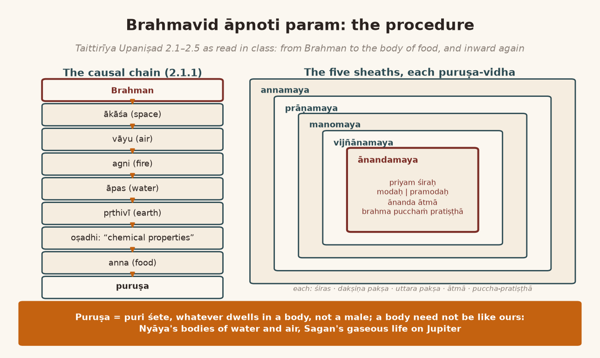
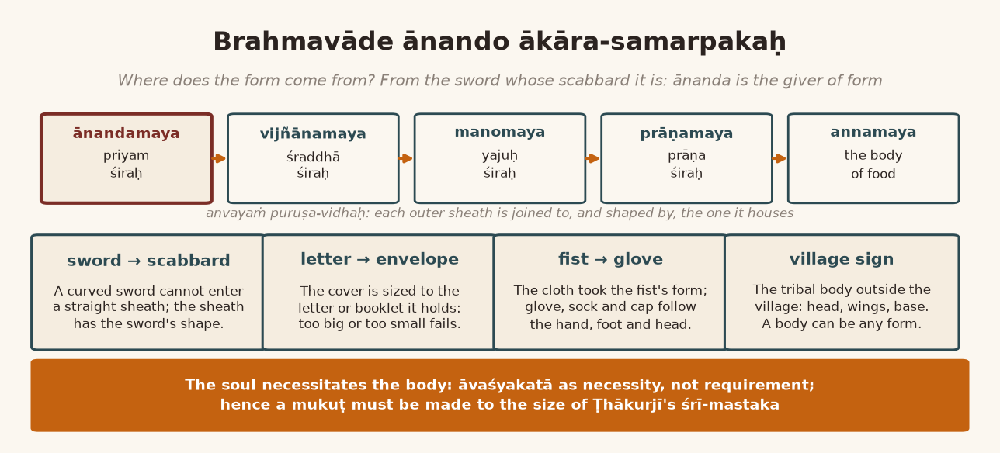

*English rendering of a spoken discourse on the Śāstrārtha Prakaraṇa of the Tattvārthadīpanibandha, translated from a Hindi ASR transcript. The speaker's conversational register, humour, digressions, code-switching, and student exchanges are preserved. Editorial flags: ‹ › conjectural restoration of a garbled reading; ‹?› uncertain reading; ‹…› inaudible or unrecoverable passage; ‹श्रवणाधारित› text given as heard, pending verification against a printed edition. Verses whose standard text is beyond doubt have been silently restored to the received editions.*

# 1. Last Week's Question: Ānanda as the Giver of Form, and the Taittirīya's Causal Chain

**Speaker:** Yes — is there any question?

**A student:** Thank you. Praṇām, Jī.

**Speaker:** Yes.

**A student:** What you said last time about ānanda being *ākāra-samarpaka*, the giver of form — I mean, one can understand it from the words, but how to "conceive" that "thought", that is what I am not able to understand.

**Speaker:** And *visṛmbhita āvirbhāva*‹?› — all right. This "concept", *brahmavāde ānando ākāra-samarpakaḥ* ‹श्रवणाधारित› [in Brahmavāda, ānanda is what confers form], is Mahāprabhuji's statement. Its root is this chapter of the Taittirīya Upaniṣad, and I will tell you its process; then it will come to your mind. Come. The very first thing it says in this — so listen carefully — is *brahmavid āpnoti param*: one who has knowledge of Brahman attains the supreme. *Tad eṣābhyuktā.* Now in this it is analysing these four words, *brahma*, *vid*, *āpnoti*, *param*. What is Brahman? *Satyaṁ jñānam anantaṁ brahma.* Brahman is satya, is jñāna, and is ananta. What is a *brahmavid*? Explaining that, the Upaniṣad says *yo veda nihitaṁ guhāyāṁ parame vyoman*: one who regards this Brahman as hidden in the cave of his own heart, "concealed", who knows it there — he is a knower of Brahman. *So 'śnute* — what is *param*? *Brahmavid āpnoti.* Now what does *āpnoti* mean? So they explain: *so 'śnute sarvān kāmān saha brahmaṇā vipaściteti*. All his desires, together with Brahman — Brahman which is *vipaścit*. One meaning of *vipaścit* is "learned". And "etymologically" its meaning has been given thus: *vividhaṁ paśyati* — ‹a cit› that sees in manifold ways, that can see everything; such a cit is *vipaścit*. And ‹omniscient› — so together with the omniscient one he can fulfil all his desires. This is the śruti's exposition.

> ब्रह्मविदाप्नोति परम् । तदेषाभ्युक्ता । सत्यं ज्ञानमनन्तं ब्रह्म ।  
> यो वेद निहितं गुहायां परमे व्योमन् । सोऽश्नुते सर्वान् कामान् सह ब्रह्मणा विपश्चितेति ॥
>
> *brahmavid āpnoti param | tad eṣābhyuktā | satyaṁ jñānam anantaṁ brahma |*  
> *yo veda nihitaṁ guhāyāṁ parame vyoman | so 'śnute sarvān kāmān saha brahmaṇā vipaściteti ||* (Taittirīya Upaniṣad 2.1.1)
>
> [The knower of Brahman attains the supreme. On this there is this verse: Brahman is truth, knowledge, infinite. He who knows it as placed in the cave, in the highest heaven, enjoys all desires together with Brahman, the all-seeing.]

And *brahmavid āpnoti param* — what is its "procedure"? Explaining that, the Upaniṣad says *tasmād vā etasmād ātmana ākāśaḥ sambhūtaḥ*: first of all, in this Brahman, ākāśa was born. After that the chain comes: from ākāśa came vāyu, from vāyu agni, from agni water, from water earth. From earth came the oṣadhis, from the oṣadhis food was born. *Oṣadhi* means "chemical properties" ‹…›; from the chemical properties food was produced, and from that food the puruṣa was born. Look, listen carefully to the "order" that has been given. Yes — this is a "causal chain". From ākāśa vāyu, from vāyu agni, from agni water, from water earth, from earth chemical properties, from chemical properties food, and from food puruṣa.

> तस्माद्वा एतस्मादात्मन आकाशः सम्भूतः । आकाशाद्वायुः । वायोरग्निः । अग्नेरापः । अद्भ्यः पृथिवी ।  
> पृथिव्या ओषधयः । ओषधीभ्योऽन्नम् । अन्नात्पुरुषः । स वा एष पुरुषोऽन्नरसमयः ।  
> तस्येदमेव शिरः । अयं दक्षिणः पक्षः । अयमुत्तरः पक्षः । अयमात्मा । इदं पुच्छं प्रतिष्ठा ॥
>
> *tasmād vā etasmād ātmana ākāśaḥ sambhūtaḥ | ākāśād vāyuḥ | vāyor agniḥ | agner āpaḥ | adbhyaḥ pṛthivī |*  
> *pṛthivyā oṣadhayaḥ | oṣadhībhyo 'nnam | annāt puruṣaḥ | sa vā eṣa puruṣo 'nnarasamayaḥ |*  
> *tasyedam eva śiraḥ | ayaṁ dakṣiṇaḥ pakṣaḥ | ayam uttaraḥ pakṣaḥ | ayam ātmā | idaṁ pucchaṁ pratiṣṭhā ||* (Taittirīya Upaniṣad 2.1.1)
>
> [From this self, verily, space came to be; from space, air; from air, fire; from fire, water; from water, earth; from earth, plants; from plants, food; from food, the puruṣa. This puruṣa is made of the essence of food. This is his head; this the right wing; this the left wing; this the self; this the tail, the base.]

And its meaning — puruṣa does not mean male. Puruṣa means "body". "Body" — ‹the body with a form›‹?› — does not mean male. *Puri śete iti puruṣaḥ*: one who dwells in some body is puruṣa. *Sa vā eṣa puruṣo 'nnarasamayaḥ* — this puruṣa ‹is made of the essence of food› ‹…›. Well, what is its form? *Tasyedam eva śiraḥ, ayaṁ dakṣiṇaḥ pakṣaḥ, ayam uttaraḥ pakṣaḥ, ayam ātmā, idaṁ pucchaṁ pratiṣṭhā.* This is the kind of puruṣa it is. Look, there is no question of a "human form" here. Here it is being shown to you in the form of a bird. ‹…› a tail, a base — they are telling you everything about it. How did this come about? They say: *annād vai prajāḥ prajāyante yāḥ kāś ca pṛthivīṁ śritāḥ*. All the creatures that live on this earth, that are born, are born from food. And ‹they live by food›, and ‹in the end they go into it› ‹…› — and in the end it becomes the cause of some other ‹…›. Born from food; it lives by eating food; and in the end it is somebody's food.

# 2. Food That Eats Food: Three Billion Humans, a Nature Without Rot, and the Breath Inside the Body of Food

**A student:** ‹…›

**Speaker:** ‹Whose› it will become — that has not been clarified in this yet. But the biggest thing to understand is this: if we take man as the "example", then man, nowadays they are saying, is three billion. But if man is three billion, then in that "ratio" all the other creatures — how many creatures, I mean from the mosquito, from the spider, up to the bullock — what will their "percentage" be? Very much more. All of them live by eating something or other, and they themselves were born from something eaten. Who is eating whom and who is not eating whom, that is a separate matter; but whoever is born is born by eating something, whoever lives, lives by eating, and in the end they become somebody's feed. Actually, they do become feed. That is its beauty. Nowhere in nature is there any rot. Otherwise, in the ratio in which the other creatures are dying — their population — if that many creatures died, how much stench would spread over the earth? Why does no stench spread? Because the "cycle" is such that everyone is eating everyone else. Therefore nowhere is there any filth at all. When we die, filth happens; otherwise so many creatures are dying — is there filth anywhere? *Adyate 'tti ca bhūtāni, tasmād annaṁ tad ucyate.* The nature of food is this. Food is a thing that is born, a production, which can be eaten and which is being fed; that which is eaten and that which is made to eat; the one who is eating and the one who is fed. ‹…›

> अन्नाद्वै प्रजाः प्रजायन्ते । याः काश्च पृथिवीं श्रिताः । अथो अन्नेनैव जीवन्ति । अथैनदपि यन्त्यन्ततः ।  
> अन्नं हि भूतानां ज्येष्ठम् । तस्मात् सर्वौषधमुच्यते । … अन्नाद्भूतानि जायन्ते । जातान्यन्नेन वर्धन्ते ।  
> अद्यतेऽत्ति च भूतानि । तस्मादन्नं तदुच्यत इति ॥
>
> *annād vai prajāḥ prajāyante | yāḥ kāś ca pṛthivīṁ śritāḥ | atho annenaiva jīvanti | athainad api yanty antataḥ |*  
> *annaṁ hi bhūtānāṁ jyeṣṭham | tasmāt sarvauṣadham ucyate | … annād bhūtāni jāyante | jātāny annena vardhante |*  
> *adyate 'tti ca bhūtāni | tasmād annaṁ tad ucyata iti ||* (Taittirīya Upaniṣad 2.2.1)
>
> [From food, verily, creatures are born, whichever dwell on the earth; then by food alone they live; then into it they pass at the end. Food is the eldest of beings; therefore it is called the medicine of all. … From food beings are born; once born, they grow by food. It is eaten and it eats beings; therefore it is called *anna*, food.]

And the rest — how it is *jyeṣṭha*, that is, the "senior-most" among beings: *annaṁ hi bhūtānāṁ jyeṣṭham*. ‹A bhūta› — what is it? It is a "being", an "independent entity". Our trouble is that we regard ourselves as the eater and do not regard ourselves as food — because of a wrong pride, or because of an "imperfect view". Otherwise "every moment", in this "body", someone or other is eating someone. *Tasmāt sarvauṣadham ucyate. Annād bhūtāni jāyante, jātāny annena vardhante, adyate 'tti ca bhūtāni, tasmād annaṁ tad ucyate.* *Tasmād vā etasmād annarasamayāt anyo 'ntara ātmā prāṇamayaḥ* (Taittirīya Upaniṣad 2.2.1): because of food, is a second form being produced? What is within the food is the *prāṇamaya*. What does *prāṇamaya* mean? That a "respiration system" is produced; and where a respiration system has been produced, that is a puruṣa staying within its own annamaya body. ‹A second› *kośa*. He too is a puruṣa — *sa vā eṣa puruṣavidha eva*; does he too have a "format"? What format are they giving? *Anvayaṁ puruṣavidhaḥ. Tasya prāṇa eva śiraḥ*: in it prāṇa is the chief, the head — as soon as you are "inhaling". ‹Vyāna› is the right wing; apāna is the left wing. Ākāśa is the self, and ‹pṛthivī the tail, the base› ‹…›. That is, in ākāśa this inhaling and exhaling is going on. And within it — because if there were no space, how would you exhale, how would you inhale? "Space allows us to inhale and" ‹exhale›.

{width=6.2in}

# 3. Bodies of Water and Air: Sagan's Jupiter, the Sword and Its Scabbard, and the Tribal Village Sign

**A student:** Please tell us that.

**Speaker:** After that, they praise it: *prāṇaṁ devā anu prāṇanti*. All the devas — here deva does not mean these devas, Brahmā, Viṣṇu, Kālī, Gaṇapati; deva means the indriyas. Those that are ‹above us›‹?› are also called deva. So *prāṇaṁ devā anu prāṇanti*: all the devas breathe after the breathing of the annamaya body — that is, by its inhaling and exhaling, in the senses too, at a "sort of micro level", this inhaling and exhaling is going on. Today the "scientist" says that an "oxygen supply" is running everywhere. Where the oxygen supply stops, in whichever organ of the body, that organ begins to die. *Tasmāt sarvāyuṣam ucyate*: therefore everyone's life-span depends on prāṇa. A very beautiful description. *Sarvam eva ta āyur yanti, ye prāṇaṁ brahmopāsate* (Taittirīya Upaniṣad 2.3.1). Don't take this prāṇa as merely prāṇa. The "ecology", the causal chain, that has started from Brahman has come down into prāṇa. How? Because Brahman first "converted" itself into ākāśa; from ākāśa vāyu, from vāyu agni. In that process, in this causal chain, this one link has appeared. A link. Understand it as Brahmic —

**A student:** Hmm.

**Speaker:** Because of Brahman's "causality" it is "functioning" like Brahman. What is Brahman's function? It is not told here; they will tell it in the next chapter: *yato vā imāni bhūtāni jāyante, yena jātāni jīvanti, yat prayanty abhisaṁviśanti* (Taittirīya Upaniṣad 3.1.1) — that from which beings are born, in which they abide, in which they merge, that is Brahman. We saw that point with food too. That point is applying to prāṇa too. *Tasmād vā etasmāt prāṇamayāt anyo 'ntara ātmā manomayaḥ* (Taittirīya Upaniṣad 2.3.1). This puruṣa-shaped prāṇa has a body too; prāṇa too has a body within itself. As the bhūta's body is annamaya, so prāṇa too has a body. "Body" — not a body of our kind; a body of another kind. As — if perhaps you have studied Nyāya — the Nyāya people say that in water there is a body of water, in air a body of air, in tejas a body of tejas. In every element a body of it is formed. "A body is formed" means a body such that someone can live in it. Very "lately" this point came to the scientists' understanding. And in *Cosmos*, in ‹Sagan's› book, he says that because we are living on the earth we have got a "prejudice" that a body is like this. Because the earth is solid, our body too seems solid to us. And as Jupiter is "gaseous", there a gaseous body too must surely exist. And it can be alive too — ‹…› a jīva-body, a living body, is possible too. Likewise in water there can be a body of water. So this principle, sir — the scientists are accepting it now; earlier it was not said ‹by them›.

**A student:** So one cannot take Brahman ‹as a form›‹?›.

**Speaker:** Don't take it ‹as a form› ‹…›. It is a "body". In it there is a "soul" — got it? It is a body, and sleeping in it [is the puruṣa]. This "body" does not mean a body like our own: any body at all. For instance, any gift that comes to you comes in some box or other, doesn't it? That is a body, a "body". In it there is a "soul" — this is the puruṣa; they call this puruṣa. It is not the sense of "male" that we take. If someone is dwelling inside something, then he is puruṣa, and there is a body, the *pur*. So there it was shown that the annamaya body is a "body", "within" which a puruṣa dwells — *puruṣavidha*. Here it is not said, but ‹it is› in the Chāndogya and the Bṛhadāraṇyaka ‹…›. As the sheath of a sword is of the shape of the sword, and the sheath of a ‹dagger›‹?› is of the shape of the dagger — then it will fit in it, won't it? Understand: if the sword is curved and the ‹sheath› is straight, how will it go in? So every body in which there is a head, a right and a left, and a trunk, and feet — or a *pratiṣṭhā*, a base, on which it stands; call it a tail or call it what you like — if there is a body, then if it is not conformable to the one within, whose body it is, how will that body be made for him? Vallabhācārya has given the example of the sword and the scabbard — ‹…›. Just a moment: there is a ‹figure›‹?› behind me here. Look.

**A student:** Yes.

**Speaker:** These tribal people make this body to say "we live here". Can you see a human being in it? There is a head, there are hands, there are feet. This is a body. They put up a symbol like this outside their village: "we are living here". ‹…› A body can be any form at all: a head, *dakṣiṇottara pakṣa*, the right and left wings, a *pratiṣṭhā*. The value of a body lies in this much. *Pratiṣṭhā.* Here is the pratiṣṭhā; here the right and left wings; and here the head. This is a body; they put it up outside the village like a symbol. So the thing to understand in this is: at the root, within the prāṇamaya there is the manomaya body. What is that manomaya body? Because the mind's function is to make saṅkalpa. *Anyo 'ntara ātmā manomayaḥ, tenaiṣa pūrṇaḥ. Tenaiṣa pūrṇaḥ* means that the manomaya is fitting exactly into the prāṇamaya body; the prāṇamaya body is fitting exactly into the annamaya body — from the angle of the sword and the scabbard. *Tasya puruṣavidhatām; sa vā eṣa puruṣavidha eva* — it too is a puruṣa. "Once again": don't take puruṣa to mean male; puruṣa means "with the body". *Sa vā eṣa puruṣavidha eva.* And why is it puruṣavidha? They say: *anvayaṁ puruṣavidhaḥ*. It is joined to the puruṣa-shaped one; therefore its puruṣavidhatā — as the scabbard is joined to the sword, ‹so it has the sword's shape›. Nowadays they don't come, but with the old guns that used to come, a body for the gun came too. Right?

**A student:** A box, a cover — like a cover to keep it in.

**Speaker:** That too became of the very same shape. And *tasya yajur eva śiraḥ*: what is its head? The head of the mind's body is ‹…› "inspiration" — "that it can be inspired to do something or not to do something. That's the Yajurveda śiras. *Ṛg dakṣiṇaḥ pakṣaḥ, sāmottaraḥ pakṣaḥ, ādeśa ātmā*." Somebody is "commanding" it; that is its "soul". After that they say that within the manomaya there is the vijñānamaya puruṣa.

# 4. Śraddhā, the Two "Rights", and the Vidyā-Line Cut with a Knife

**Speaker:** So what is the vijñānamaya puruṣa? They are telling you what the function of the vijñānamaya puruṣa is: *anyo 'ntara ātmā vijñānamayaḥ, tenaiṣa pūrṇaḥ* (Taittirīya Upaniṣad 2.4.1). By the vijñānamaya ātmā this manomaya ātmā is filled. ‹It fits the mind exactly›. *Sa vā eṣa puruṣavidha eva* — this vijñānamaya ātmā too is puruṣavidha, "with body". *Tasya puruṣavidhatām* — and the nature of its being a puruṣa: because *anvayaṁ puruṣavidhaḥ* — it is ‹joined› to a puruṣa-shaped one; because it is joined to some body, in it too there is puruṣavidhatā. What is the head of this vijñānamaya ātmā? They say the head of vijñāna is śraddhā. Śraddhā, śraddhā. When we take śraddhā to mean "faith" — ‹…› in "usage" that is a second form of ‹it›. The "actual" meaning of śraddhā is: that in which *śrat*, that is, *sat*, truth, is placed, *ādhāna*. That is, without regarding something as true, you can have no vijñāna. Whatever knowledge we have, we can proceed only by holding something or other to be true. Like — the Buddha and Śaṅkarācārya, who held everything to be untrue, even they had to accept vyāvahārika satya; they had to accept pāramārthika satya, they had to accept prātibhāsika satya. Without accepting a truth, knowledge won't happen. It is the weakness of jñāna, of vijñāna — or its "by default nature". Without accepting a truth, it does not move forward. Because we have no other "tool" at all, besides jñāna. ‹*Ṛtaṁ dakṣiṇaḥ pakṣaḥ*› ‹…›. ‹*Ṛta*› has come to have two meanings — "right": the "right" of "right and wrong", and the "right" of "right and left". So the "right" right — the "right" that stands in opposition to "wrong" — that is its dakṣiṇa pakṣa, its right wing. And satya is the uttara pakṣa, the left wing. Satya means ‹nirviśeṣa›‹?›. So ‹the one› is "revealed" and ‹the other› "unrevealed". *Yoga ātmā*: the yoga, the joining, of all these is its soul. ‹*Mahaḥ pucchaṁ pratiṣṭhā*› ‹…› its "intelligence" ‹…› so its ‹…› —

**A student:** — is the base.

**Speaker:** After this the Upaniṣad says *vijñānaṁ yajñaṁ tanute, karmāṇi tanute 'pi ca*: because of vijñāna, whatever work you do, you do. *Vijñānaṁ devāḥ sarve brahma jyeṣṭham upāsate.* Don't take vijñāna in such a way, as if it were some ‹…› of yours —

**A student:** ‹…›

**Speaker:** — it is a link that has come in Brahman's causal chain. ‹…› *Vijñānaṁ brahma ced veda*: and if you understand this vijñāna as a link of Brahman, what will the benefit be? *Tasmāc cen na pramādyati*: then you don't commit pramāda, carelessness. *Śarīre pāpmano hitvā*: whatever sins are in the body, they will go far from you. Understand vijñāna as Brahman. *Sarvān kāmān samaśnute*: all your desires can be fulfilled by vijñāna.

> विज्ञानं यज्ञं तनुते । कर्माणि तनुतेऽपि च । विज्ञानं देवाः सर्वे । ब्रह्म ज्येष्ठमुपासते ।  
> विज्ञानं ब्रह्म चेद्वेद । तस्माच्चेन्न प्रमाद्यति । शरीरे पाप्मनो हित्वा । सर्वान् कामान् समश्नुत इति ॥
>
> *vijñānaṁ yajñaṁ tanute | karmāṇi tanute 'pi ca | vijñānaṁ devāḥ sarve | brahma jyeṣṭham upāsate |*  
> *vijñānaṁ brahma ced veda | tasmāc cen na pramādyati | śarīre pāpmano hitvā | sarvān kāmān samaśnuta iti ||* (Taittirīya Upaniṣad 2.5.1)
>
> [Vijñāna extends the sacrifice; it extends the works too. All the gods worship vijñāna as the eldest Brahman. If one knows vijñāna as Brahman, and does not swerve from it, he leaves the evils behind in the body and attains all desires.]

Within this vijñānamaya ātmā the Upaniṣad is taking the "last step": *anyo 'ntara ātmānandamayaḥ* (Taittirīya Upaniṣad 2.5.1). Within it — as the sword stays in the scabbard — so an ānandamaya ātmā stays, for vijñāna. Because if vijñāna does not give you ānanda, then "you would not like to entertain" vijñāna. You make effort for vijñāna in this way precisely because, from vijñāna happening, you are getting some ānanda. So if, within, ānanda were not coming ‹…› — then vijñāna would begin to give us trouble. A big digression ‹…›; you will understand it. I often tell one thing. The Gurujī I studied with — that Gurujī said to me, "In your future there is no vidyā." ‹I said›, "Then tell me what the vidyā-line is." ‹He said›, "Your vidyā-line is above the Sun [mount]." I got very frustrated. I had to cut a line with a knife; blood came out of it; so that turned out to be the wrong, wrong method. Then, doing like this, like this, I made a vidyā-line. In my hand there is this big a vidyā-line — look: "self-made"; it is not in "destiny". Normally nobody's hand will have so big a vidyā-line. So there was a professor who did jyotiṣa work too. He had a big reputation. The two of us were sitting side by side, and he was "boasting" like that about astrology. So I said, "Brother, I have no faith in this. Because you place an "order" with me: any line that isn't there, I can make it. "I know the technique how to make lines." I can make plenty of lines right now and show you."

**A student:** And?

**Speaker:** I showed him this one. "Unfortunately", on the one I did not make there is a black ‹spot›. So that professor said to me, "All the trouble you have is because of knowledge. A black spot has come." ‹I said›, "That one I did not make. How it came, I don't know." A black spot has come on this line ‹…›. That I did not make; earlier it was not there. Now look — there is one black spot.

**A student:** So?

**Speaker:** So: "all your trouble is from your knowledge." That one had to admit. But because knowledge gives me trouble, I don't regard the trouble as trouble; I take ānanda in that too — in the trouble too. But normally what happens is that if a thing gives trouble, a man would want to give it up. For me, within vijñāna, the ānandamaya is hidden. ‹He had said› black had come on the line; it has come. Otherwise, according to ‹chemistry›‹?› there is one more principle. In a proverb it is taught: *til bhaṁvarī lahsun maso, hoy dāhine aṅg; cale jāo vanakhaṇḍ meṁ, kahāṁ lakṣmī saṅg*‹?› — a mole, a ‹cowrie›, this thing they call *lahsun*, a wart: if these be on the right side, on the right hand, on the heart, then go off even into the forest — Lakṣmī is with you. Lakṣmī is my wife, after all.

**A student:** ‹…›

**Speaker:** Now I have no problem. Well, that is a matter of life. In it dwells the ānandamaya ātmā. And that ānandamaya ātmā too is puruṣavidha — because it too is ‹…›. By *anvaya* — because of its puruṣavidhatā there is puruṣavidhatā in the vijñānamaya; because of the vijñānamaya there is puruṣavidhatā in the manomaya; because of the puruṣavidhatā in the manomaya there is puruṣavidhatā in the prāṇamaya; because of being puruṣavidha in the prāṇamaya, in this annamaya. Taking this point, Mahāprabhuji says *ānando brahmavāde ākāra-* ‹*samarpakaḥ*› — so where does the form come from? As — where did the scabbard get its form from? From the sword whose scabbard it is. Did the point come to mind?

**A student:** Yes, Jī.

# 5. Why the Scabbard Has the Sword's Shape: The Letter and Its Cover, and the Oversized Mukuṭ

**A student:** Then, if any form in this — as you gave the example of the scabbard and the sword — if we make any form according to the necessity, then all the forms there are in this world, whatever forms there are, consisting of jaḍa and jīva — according to which necessity of that ānanda —

**A student:** — are they made according to the necessity?

**Speaker:** *Āvaśyakatā* can have two meanings. One ‹…› "requirement"; and one meaning is this: that over which one has no control is *avaśya*, and what is related to *avaśya* is *āvaśyaka*. First you clarify in which sense you are saying *āvaśyakatā*.

**A student:** "Necessity" — *je*‹?›, "necessity".

**Speaker:** For "necessity". Then — "necessity": the necessity the scabbard has of the sword, that should be in the scabbard; the necessity of the scabbard should be in the sword. ‹…› "Necessitates." For this the usage was such — "necessitates": as when you are sending any letter. Just now you sent a letter to me. Its cover is its body. Inside it is the letter. So the size the letter is, the size the booklet is — there will be a cover accordingly, won't there? Understand: if the booklet is small and you send a big cover; or the booklet is big and the cover small — how will it go in? So the body — the soul necessitates it, doesn't it? In this sense, *brahmavāde ānanda ākāra-sam*‹*arpakaḥ*›; otherwise how will its puruṣa — the body — be made? Last time I explained it to you with an example like this: this form came — this form came because of my fist, didn't it? Otherwise this form was not in it, up there. And because its body is being made — the ‹glove›‹?›, the sock: the gloves will be made according to the size of our hand; the sock according to the size of the foot. And if the general form of the foot and the hand were not in it, how would the glove and the sock be made? And the cap that is made will be made to the size of our head. So wherever there is a body, the soul that is inside it, which is necessitating it — in that very manner its form will be, won't it? A big digression has started, so I am telling you: I don't know what trouble the Vaiṣṇavas have — for a small Ṭhākurjī, everybody puts on a mukuṭ this big. Brother, put on a mukuṭ of the size of Ṭhākurjī's śrī-mastaka, won't you? Because they have had a big mukuṭ made and they put it on the small Ṭhākurjī. It is a wrong method. ‹…› Don't think ‹it is nothing›: if someone puts a cauldron on my head in place of a cap — how will I feel?

**A student:** ‹…›

**Speaker:** If a cap were placed, it would feel good, wouldn't it? I don't say anything, because one should not interrupt anyone's sevā; but since the topic has come up, I am telling you. Mostly in Vaiṣṇavas' homes this trouble — I get many darśanas. When they give me darśana of their Ṭhākurjī, I bow: "Prabhu, give them good sense — that they have your mukuṭ, your cap, made to the size of your head." The śṛṅgāra which is not of Ṭhākurjī's size — to put on a śṛṅgāra that big; a cap that big, which is not the size of Ṭhākurjī's head; earrings that big, which are not the size of Ṭhākurjī's ears — what sort of principle is that, brother? *Brahmavāde ānanda ākāra-samarpakaḥ* — so there is pain; some Ṭhākurjī must be feeling pain. As if we made a small child wear grandfather's coat, which goes flapping about his feet. What is the use of putting the shirt on him? Often in baiṭhaks this is very much to be seen. They just take some ready-made śṛṅgāra: "put it on, Mahārāj." The work is to put on the śṛṅgāra, that is all — but it should be of Ṭhākurjī's size; otherwise don't put it on; putting it on is not compulsory. *Ānando brahmavāde ākāra-samarpakaḥ* — I think now you ought to understand. I am asking ‹P.›‹?›.

**A student:** Yes, Jī. And then likewise to understand that, because of the "contingency" of the ānanda's form, in the vijñānamaya kośa, in the manomaya kośa, the form is coming.

**Speaker:** Yes.

**A student:** Jī.

**Speaker:** Is there any other question?

{width=6.2in}

# 6. Satyaṁ Jñānam Anantam Is Also a Kārya-Lakṣaṇa: The Upaniṣad Audits Its Own Account

**A student:** Yes, praṇām. I want to understand this, Jejē: what is the difference between *satyaṁ jñānam anantaṁ brahma* and ‹Saccidānanda›? And related to this, you told us in the last session that Śrī Śaṅkarācārya's view is that *satyaṁ jñānam anantaṁ brahma* is the svarūpa-lakṣaṇa, and the kārya-lakṣaṇa is *yato vā imāni bhūtāni*; and in Vedavyāsajī's view you said that the śāstra — *janmādy asya yataḥ*, *śāstrayonitvāt* — so *yato vā imāni bhūtāni* is, in our Vedavyāsajī's view, the kārya-lakṣaṇa; then what should we understand the svarūpa-lakṣaṇa to be, like *satyaṁ jñānam anantaṁ brahma*? What should we understand these to be? In his view it is the svarūpa-lakṣaṇa, and in Vedavyāsajī's view it is *janmādy asya yataḥ*, *śāstrayonitvāt* — so what should we take *satyaṁ jñānam anantaṁ brahma* to be, and what *yato vā imāni bhūtāni*? That I want to understand. First I want to understand the difference between these two: Saccidānanda and *satyaṁ jñānam anantaṁ brahma*.

**A student:** Praṇām, Jī.

**Speaker:** Many, many congratulations to you. You have asked a good question. ‹…› The clarification of all this too is in this same Upaniṣad. I'll read that passage out to you. Where this point came: *ānando brahmeti vyajānāt* (Taittirīya Upaniṣad 3.6.1) — ānanda is Brahman; the ānandamaya kośa which is within everyone, which ‹gives the form›. After that the Upaniṣad has said a very enjoyable thing: *asann eva sa bhavati, asad brahmeti veda cet*. One who regards this Brahman as asat is not making Brahman asat; he is ‹falsifying›‹?› himself. *Asti brahmeti ced veda*: if someone holds that Brahman is, he is not doing Brahman a favour; he is justifying himself: "Brother, I am; Brahman is." After this: ‹*tasyaiṣa eva śārīra ātmā yaḥ pūrvasya*› — this ātmā of ours: this ātmā has a *śārīra*, ‹not merely› a śarīra. Our ātmā is a body, and it is the embodied one, and it is the "soul". After this the Upaniṣad has begun a very beautiful "inquiry": *athāto 'nupraśnāḥ*. Attached to this, as a "corollary", this question comes: ‹…› one who does not know ‹Brahman›, or does not accept it — where does he go? Tell me that. *Utāvidvān* — the puruṣa who has not been able to know it — *amuṁ lokaṁ pretya*: when he leaves this world, where does he go? *Āho vidvān amuṁ lokaṁ pretya* — and the one who knows it, where is ‹he› going? Tell me that. *Kaścit samaśnutā u* — where is he going and merging? Tell me that. The one who knows and the one who does not know — when both of them are leaving this world, where are they going? Normally the "average religion" fills an "inhibition" in us: that one who does not know Brahman, who does not know our tattva, will go to hell, will go here, will go there, this will happen, that will happen — all "condemnation" of him they do. The Upaniṣad is not doing condemnation. It says: whether you know or do not know, when you go, you are Brahman. If you know, "it's well and good": you will enjoy the going; if you don't know, unknowingly you will reach there. *Kaścit samaśnutā u.* Let me sing it a little, in its tune, to tell you how it is spoken. You will enjoy it. That is, in which "mood" they are speaking it, that you will come to know.

> असन्नेव स भवति । असद्ब्रह्मेति वेद चेत् । अस्ति ब्रह्मेति चेद्वेद । सन्तमेनं ततो विदुरिति ।  
> तस्यैष एव शारीर आत्मा यः पूर्वस्य । अथातोऽनुप्रश्नाः । उताविद्वानमुं लोकं प्रेत्य कश्चन गच्छती३ ।  
> आहो विद्वानमुं लोकं प्रेत्य कश्चित्समश्नुता३ उ । सोऽकामयत । बहु स्यां प्रजायेयेति । स तपोऽतप्यत ।  
> स तपस्तप्त्वा । इदं सर्वमसृजत । यदिदं किञ्च । तत्सृष्ट्वा । तदेवानुप्राविशत् । तदनुप्रविश्य । सच्च त्यच्चाभवत् ।  
> निरुक्तं चानिरुक्तं च । निलयनं चानिलयनं च । विज्ञानं चाविज्ञानं च । सत्यं चानृतं च सत्यमभवत् ।  
> यदिदं किञ्च । तत्सत्यमित्याचक्षते । तदप्येष श्लोको भवति ॥
>
> *asann eva sa bhavati | asad brahmeti veda cet | asti brahmeti ced veda | santam enaṁ tato vidur iti |*  
> *tasyaiṣa eva śārīra ātmā yaḥ pūrvasya | athāto 'nupraśnāḥ | utāvidvān amuṁ lokaṁ pretya kaścana gacchatī3 |*  
> *āho vidvān amuṁ lokaṁ pretya kaścit samaśnutā3 u | so 'kāmayata | bahu syāṁ prajāyeyeti | sa tapo 'tapyata |*  
> *sa tapas taptvā | idaṁ sarvam asṛjata | yad idaṁ kiñca | tat sṛṣṭvā | tad evānuprāviśat | tad anupraviśya | sac ca tyac cābhavat |*  
> *niruktaṁ cāniruktaṁ ca | nilayanaṁ cānilayanaṁ ca | vijñānaṁ cāvijñānaṁ ca | satyaṁ cānṛtaṁ ca satyam abhavat |*  
> *yad idaṁ kiñca | tat satyam ity ācakṣate | tad apy eṣa śloko bhavati ||* (Taittirīya Upaniṣad 2.6.1)
>
> [He becomes non-existent himself, if he knows Brahman as non-existent. If he knows "Brahman is", then they know him as existent. Of the former, this is the embodied self. Now, therefore, the further questions: does anyone who does not know go to that world after departing? Or does anyone who knows, after departing, attain that world? He desired: "May I become many, may I be born." He performed tapas. Having performed tapas, he created all this, whatever there is. Having created it, he entered into that very thing. Having entered it, he became the sat and the tyat, the defined and the undefined, the abode and the non-abode, the knowing and the unknowing, the true and the untrue: he became satya, whatever there is here. That they call satya. On this there is this verse.]

That is how it used to be recited; there is great fun in the recitation. And in this, the Upaniṣad has made the matter clear: because he wished to become many, your manyness is not your manyness. It is his manyness — the manyness of that One. Whether you know it or do not know it. In that One you were born, in the One you abide, in the One alone you are going to merge. If you come to know, good; if you don't know, even so. "How does it make any difference?" Because — were you there by your own wish, or not? As a poet says:

> लाई हयात आए, क़ज़ा ले चली चले ।  
> अपनी ख़ुशी न आए, न अपनी ख़ुशी चले ॥
>
> *lāī hayāt āe, qazā le calī cale |*  
> *apnī khuśī na āe, na apnī khuśī cale ||* (Zauq)
>
> [Life brought me, and I came; death leads me away, and I go. I neither came of my own pleasure nor go of my own pleasure.]

‹*Avval to hai ki duniyā meṁ dil na kahīṁ lage* … *jo sāmnā dil-lagī kare*›‹?› [Best it is that the heart attach itself nowhere in the world … ‹…›]. That situation is not there with us. "Hayāt brought you" — that is, you came by birth, you came because of birth, and you went because of death — that is what appears at "face value". You have not come because of birth; you will not go because of death. Out of that One you have become many — ‹each› one; then out of the many you will become one again. Whether you like to come or not. This is the Upaniṣad's topic: because the One wished to become many. And when the One wished to become many, what happened? Whatever there was, he created it. And after creating, he entered into the many forms. *Tad anupraviśya sac ca tyac cābhavat.* He became sat and tyat. So in *satyaṁ jñānam*, satya has come, hasn't it? *Sac ca tyac ca* — sat plus tyat equals satya. After that it says *niruktaṁ cāniruktaṁ ca*. Now what is sat, that we can speak of; what is tyat has not become manifest. Sat means manifest, "revealed"; tyat means "unrevealed". So what is unrevealed we cannot define; so ‹the definable and the undefinable›, that too it became. Nirākāra and sākāra. *Nilayanam* — where it dissolves, hides, where it hides and where it does not hide — that too it alone became. After that it says *vijñānaṁ cāvijñānaṁ ca*: after satya, has jñāna come or not? Jñāna had two forms, vijñāna and avijñāna. Sat had two forms, sat and tyat; nirukta and anirukta; nilaya and anilaya. What were the forms of ānanda? *Satyaṁ cānṛtaṁ ca satyam abhavat.* Satya and anṛta — all that he became; out of his own ānanda he became it. *Yad idaṁ kiñca* —

**A student:** ‹…› from mithyātva?

**Speaker:** Therefore whatever there is, is Brahman alone. Understand this point carefully. So how can *satyaṁ jñānam anantaṁ brahma* be a svarūpa-lakṣaṇa, my dear sir? Having "audited" the whole "account", the Upaniṣad has told us what satya, jñāna and ananta mean. Where is this a svarūpa-lakṣaṇa? It is a kārya-lakṣaṇa, isn't it? As *yato vā imāni bhūtāni jāyante* is a kārya-lakṣaṇa, so this too is a kārya-lakṣaṇa. But there it is said from the angle of birth; here it is said from the angle of tattva. Just that much difference. This thing — how did it become many? The "format" of that is told here. There it was in the language of cause and effect; it has been "extended" in that language. Here, of the One becoming many. Even to bring in birth is pointless, because if the One has become many, who is born and who is the begetter? He himself gave birth to himself. Who is the cause and who the effect? He himself is his own cause; he himself is his own effect. So this definition of Brahman, *satyaṁ jñānam anantam*, is not a svarūpa-lakṣaṇa either — according to this Upaniṣad, at least. It is not a svarūpa-lakṣaṇa; it is a kārya-lakṣaṇa. So here it is from the angle of tattva, there from the angle of "production". Did the point come to mind?

**A student:** Yes, Jī — it came through very well.

{width=6.2in}

# 7. Tanmātras, Over-Realists and "Subjecto-Objectivism": Nyāya Against Sāṅkhya

**Listener 2:** Daṇḍavat praṇām, Jejē.

**Speaker:** Yes.

**Listener 2:** My question was this, Jejē: just now you said *tasmād vā etasmād ātmana ākāśaḥ sambhūtaḥ* — so Brahman itself became that ākāśa, and then from it alone all the mahābhūtas were made. In this way — then we who [say that] from prakṛti comes the mahat-tattva, then ahaṅkāra, then the tanmātras, and from them the five mahābhūtas — that process — how the five mahābhūtas are made out of the tanmātras, that I don't quite understand. And secondly, the philosophers, the Naiyāyikas and the Sāṅkhyas and so on — what meaning do those people give to the five mahābhūtas being made out of the tanmātras? That I wanted to understand a little, Jī. Daṇḍavat praṇām.

**Speaker:** Very nice. "Actually", the five tanmātras — the Naiyāyikas do not accept them, because the Naiyāyikas are "over-realists", "extreme realists". They hold that what we call tanmātrā, they call guṇa; and they say that any "substance" — their definition of substance is very beautiful. If you pay attention it will come to your mind. "Originally" what they want to say is that substance is that in which there is an "attribute" — some attribute, some "quality" — that is a substance. Like this ‹cloth›‹?›: in it there are some qualities — how many hands long it is, how many hands wide, white in colour, with a border; these are all attributes. They say that attributes come into a substance after the substance has been produced. Therefore they do not define substance as "that in which there is an attribute". That is what they want to say, but they do not make the definition so. They say: substance is the name of that in which there is no atyantābhāva, no absolute absence, of attribute. Meaning, sometimes there is an attribute and sometimes there is not; they define it negatively like this. In the same way they define the ātmā thus: that in which there is no atyantābhāva of sukha, duḥkha, buddhi, icchā, dveṣa, dharma and adharma. Meaning, sometimes these guṇa-dharmas are in the ātmā, and sometimes they are not. If it becomes liberated, they are not; when it is bound, they are. Their trouble is that they are "substantial", "substantial realists", because of "objectivism" — over-objectivism, I hold. Sāṅkhya does not believe in objectivism, nor does it believe in subjectivism. Sāṅkhya's principle is "subjecto-objectivism". And whatever reality there is, in it "partially" it is subjective, partially it is objective. How will you understand this point? Like — you who have asked; ‹S.›‹?› asked. I presume ‹S.› is a female. Therefore ‹S.›'s being female is objective ‹…›. That female's being a mother, being a sister, being a daughter — that is not "pure objective"; it is relative. In relation to someone she is a daughter, in relation to someone a mother, in relation to someone a sister, in relation to someone a wife. So everything that is relative like that can be subjective too: those who are your friends — to them you must seem good; those who are your enemies, your rivals — to them you must seem bad. So your being good or bad —

**A student:** — no.

**Speaker:** — is not relative; it is subjective. Now, you are subjective too and objective too. Every object is subjective too and objective too — that is Sāṅkhya's principle. So Sāṅkhya says: the bhūta, what we call the "object" — what we can "grasp" — its quality, that quality of ours, is born of ahaṅkāra, of "awareness". If you have no "self-awareness", you cannot grasp that quality. For instance, I was able to hear what you said. Why could I hear it? Because I have my self-awareness: "what are you asking?" If I lose my self-awareness "for x y z" reason — someone gives me anaesthesia, someone hits me with a stick, I fall unconscious — then will I understand what you asked?

**A student:** It won't be understood.

**Speaker:** So your quality of asking depends on my self-awareness. This is Sāṅkhya's principle: the qualities of the bhūtas depend on our self-awareness; from it all the qualities are being born. And when those qualities "consolidate" outside us, they become bhūtas. The whole "table" has "turned".

**A student:** *‹…› jhāle* [Marathi: it has happened].

**Speaker:** Quality has come first. With them [the Naiyāyikas] substance comes first, quality comes after. This is the "basic difference between Sāṅkhya and Nyāya". Sāṅkhya is not a hundred percent realist; it is not a hundred percent "empiricist", "idealist". "Realist cum idealist." And therefore whatever is subject — you look at it: ‹Sāṅkhya›‹?› has given a very good example of this. One and the same woman. The woman is one. For the lustful man she is a kāminī, a desirable woman. For the lion and the leopard she is a foodstuff. For the one who is a vairāgī she is the door of hell. How can one become three? A woman is a woman. For the lustful she is a kāminī. For the lion, the leopard, who eats her — however beautiful and splendidly lovely a kāminī she is, the lion is not going to refrain from eating her. ‹He will regard her as a thing to eat›; he is not going to say "she is so beautiful, no". ‹If she comes before the lion, she gets eaten.›

# 8. One Woman, Three Beholders: Mahmud at Mathurā, Dhoklā, Kapila, and the Horizon

**Speaker:** Like — once, when Mahmud of Ghazni came to Mathurā and saw the temple of Kṛṣṇa's birthplace, Kṛṣṇa's temple, for five or ten minutes he stood stunned. He said, "No human can have built this. Some ‹parī›‹?› must have built it, so beautiful." ‹He said›: "If I, a Muslim, a staunch Muslim, find it so attractive, how will a lukewarm Muslim find it?" He said, "Demolish it." He demolished it the very first time. Then it was built; then Aurangzeb had it demolished. The people who were of the lion's nature, who were bent on destroying everything — to them the beauty of Kṛṣṇa's mūrti seemed beautiful; therefore they destroyed it ‹the speaker's characterization›.

**A student:** So?

**Speaker:** Had it seemed ugly they would not have destroyed it; it seemed beautiful, so they destroyed it. Like ‹"eye of paradigm"›‹?›: "a thing seemed good to me, therefore I am finishing it." So this ‹…› — exactly how? As, if dhoklā looks good, we say, "Come on, put it in the mouth." Fine, it looks good — that's it, the mouth waters — put it in. So that is that kind of nature. A violent, *hiṁsra* nature. If something seems good to one person, he has the wish to protect it, to "preserve" it; another has the wish to ‹destroy› it.

**Listener 2:** Yes.

**Speaker:** ‹Sāṅkhya's› principle is this: all the attributes are subjective too, and having "consolidated" they do not remain inside us as objects; they come outside. This is the Sāṅkhya principle. And in the branch of Sāṅkhya's principle — yes, Śaṅkarācārya is there too; "in a way" Rāmānujācārya too, Madhvācārya too, Vallabhācārya too, Bhāskarācārya too — all the ācāryas are there. The root reason of this is that Sāṅkhya's Kapila Ṛṣi — in the Gītā Bhagavān says of him, *siddhānāṁ kapilo muniḥ* (Bhagavadgītā 10.26): whatever siddha puruṣas there have been are my vibhūtis; among them Kapila Muni is my vibhūti. Kapila was accepted as his avatāra; therefore we too have taken the Kapila-gītā from the Bhāgavata. Although it is not a Vedic doctrine — it is Kapila's doctrine — they gave it the status of the Veda, because of his being an avatāra of Bhagavān. So to us it is acceptable; to the Gītā too it is acceptable:

> साङ्ख्ययोगौ पृथग्बालाः प्रवदन्ति न पण्डिताः ।  
> एकमप्यास्थितः सम्यगुभयोर्विन्दते फलम् ॥
>
> *sāṅkhyayogau pṛthag bālāḥ pravadanti na paṇḍitāḥ |*  
> *ekam apy āsthitaḥ samyag ubhayor vindate phalam ||* (Bhagavadgītā 5.4)
>
> [Children, not the wise, declare Sāṅkhya and Yoga to be different. One who is properly established in even one of them obtains the fruit of both.]

Further on too ‹…› there are five parvas of vidyā, and Sāṅkhya-yoga has been counted among the parvas of vidyā. Anyway, the thing to understand in this is that according to Nyāya there is one separate "scenario" of it; according to Sāṅkhya the whole "scenario" of the "external world" is different. The whole external world is not a hundred percent objective; the whole external world is not a hundred percent subjective. Subject and object. We can see this with just a little awareness. The whole horizon — "is it objective? Is it an imagination? No." If you take a photograph, the horizon will show in that too. It is not imagination either. But it is born because of the limit of our seeing — the horizon. When we rise a little higher, our limit of seeing increases; the area, the "domain" of seeing, grows, so the horizon too grows. As we come lower, the horizon shrinks; as we go up, the horizon grows. On going to a certain height the whole earth begins to be seen by us in one glance. So this quality of the horizon is neither subjective nor objective — a hundred percent — nor is it illusory. And it is a limitation of our seeing. ‹…› "and it is due to" ‹…›. Because, understand one thing carefully: the horizon of the earth depends on the size of the earth. On the moon you will not get that horizon. You will not get Jupiter's horizon, because Jupiter's horizon will be very big. That is, a circle is of three hundred and sixty degrees. The horizon is of one degree. "That one degree is a limitation that you can" ‹perceive›. That much appears to us as a straight line; after that the line bends. How it bends — ‹…› its principle has been established. Because of this, understand carefully: the quarrel of subjectivity and objectivity — Sāṅkhya has "resolved" it in a "unique fashion", which these Naiyāyikas, logicians though they were, could not do. And Kapila Ṛṣi, from his insight, ‹did› it. ‹…› This is a paradox. Is it in mind?

**Listener 2:** Yes, Jī. Now just this much remains: it says *tasmād vā etasmād ātmana ākāśaḥ sambhūtaḥ* — so there no process from prakṛti is coming. Then how do we reconcile the two?

{width=6.2in}

# 9. Why the Taittirīya Skips Prakṛti: House, Building and City as Souls

**Speaker:** Here there was no need to speak of prakṛti, because everything is to be told from Brahman — because the "link" of Brahman is to be explained to you: how Brahman's link has reached you, and how Brahman is within you — that is what is to be explained. Because what was the statement? *Satyaṁ jñānam anantaṁ brahma, yo veda nihitaṁ guhāyām.* How the satya-jñāna-ananta Brahman is hidden in your heart — that is to be explained. Therefore in the causal process it has been joined to Brahman. There was no purpose in bringing in prakṛti; because if you bring prakṛti in between, perhaps you will connect it to prakṛti. Besides, understand one thing carefully: where ākāśa came, prakṛti came too, didn't it? The five mahābhūtas are prākṛta. Annamaya, ‹anna›, ‹manas›, prāṇa, vijñāna — these are all prākṛtika tattvas, all prākṛta tattvas. The ātmā alone is an aprākṛta tattva — so there the puruṣa came. That became a second "perspective" of seeing, didn't it? That perspective didn't stay in view. And if they showed you that perspective, you would get "confused". So joining it to Brahman or joining it to prakṛti — nothing has been "dropped"‹?› in this.

**Listener 2:** Yes — as it comes to be understood ‹…›. Thank you, praṇām, Jī.

**Speaker:** Because the body is prakṛti, and the puruṣa is the "soul". So *anyo 'ntara ātmā vijñānamayaḥ*, *anyo 'ntara ātmā manomayaḥ*, *anyo 'ntara ātmā prāṇamayaḥ*, ‹*anyo 'ntara ātmā*› annamaya — at every moment the "duality" of soul and body, soul and body, that is going on is the duality of prakṛti and puruṣa going on. Prakṛti is the body; the puruṣa is the soul; the one who dwells in the *pur* in the form of prakṛti, that consciousness, is the soul. So saying "soul" and saying "body" — these are not "absolute terms". Nothing is an absolute body; nothing is absolutely a śarīra; nothing is absolutely *śārīrika*, embodied. Relatively. For instance, understand one thing: I am living in this house, so the house is a body. The house is also a soul — look at it from the point of view of the building. The building too is a soul — look from the point of view of the locality. The locality too is a soul — look from the point of view of the city; and the city too will become a soul — look from the point of view of the state. Being soul and body is a relative term, isn't it? In relation to whom who is the soul, in relation to whom who is the body. It is not an absolute term. Nor is there any absolute soul; the absolute soul is Paramātmā alone, who is within all — who is the giver of ānanda, the giver of form. This point was to be told: *brahmavāde ānando ākāra-samarpakaḥ*.

**Listener 2:** Yes, Jī — it has been understood very well. Thank you, praṇām, Jī.

**Speaker:** Many thanks, many thanks; I am glad you asked.

**Listener 2:** *Koṭi-koṭi* thanks; praṇām to you.

**Speaker:** No — not so much; don't do *koṭi-koṭi*, otherwise how will the class run?

# 10. Today's Text: The Omniscient's Power to Be Ignorant, "Just Ignore It", and Pascal's Reed

**Speaker:** After this — now, what is coming today: *evaṁ traividhyam upapādya cid-aṁśānāṁ jīvānāṁ saṁsāra-prakāram āha* (Prakāśa on Śāstrārtha Prakaraṇa 31) [having thus established the threefoldness, he states the manner of the saṁsāra of the jīvas, the portions of cit]. [The speaker reads *utpādya*, "having produced"; the 1943 edition prints *upapādya*, "having established".] Now what is being said here? One Brahman alone became jaḍa, jīva and Īśvara; it became jaḍa, it became jīva, and it became Īśvara. In becoming jaḍa, jīva and Īśvara — Brahman's own "three-fold extension": extension in the form of jaḍa, jīva and Īśvara. Among these, the jīva has saṁsāra; neither does the jaḍa have saṁsāra, nor does Īśvara have saṁsāra. What is the reason for that? First of all we must understand the difference between saṁsāra and prapañca. *Prapañca* means *prakṛṣṭa pañca* — pṛthivī, jala, tejas, vāyu, ākāśa. Mahāprabhuji has told us: *prapañco bhagavat-kāryaḥ*. The prapañca — earth, water, fire, ‹air› and ākāśa; we have just seen it. Bhagavān ‹…›. *Prapañco bhagavat-kāryas tad-rūpo māyayābhavat*: māyā, that is, the capability (*sāmarthya*) of becoming everything ‹…› — by māyā in the form of that capability it was made. *Tac-chaktyāvidyayā tv asya jīva-saṁsāra ucyate* (Tattvārthadīpanibandha, Śāstrārtha Prakaraṇa 23). And under his śakti — the śakti of ‹universal› capability — one more śakti comes, a śakti called avidyā. Now see the "paradox" of this — see the beautiful "paradoxical nature" of this "concept": that the one who is omniscient has a power: to be ignorant. ‹One who has no power at all — will he become omniscient?›‹?› But the omniscient has such a power. Now, this can be. *Tac-chaktyāvidyayā tv asya*: by one śakti of his, in the form of avidyā, he can become ignorant. That is, we now — ‹we› are not; he has become ignorant; but what śakti has he used in that? To become us, he has used his śakti of avidyā. In English there is a very good idiom for this; colloquially we use it a great deal. What you don't like, what do you say of it? "Just ignore it. Just ignore it." "In your hand": "to acknowledge it or to ignore it, it is in your head." To acknowledge someone and to ignore someone — is it in your hands or not? As it is in your hands — look, the avidyā-śakti is "partially" in your hands; the vidyā-śakti to acknowledge it is also in you. "Partially there is of course limitation, because we are limited." So Brahman too has the vidyā-śakti, has the avidyā-śakti, and has very many śaktis ‹…›, various ones. It has "multiple powers". Among them one power of his is this too: that he has the śakti of avidyā. Because of that śakti of avidyā he becomes ignorant in the form of the jīva. In the form of Īśvara he does not become ignorant. In the form of the jaḍa too he does not become ignorant, because there he has ‹concealed› jñāna itself — so how will it become ignorant? Where there is jñāna, there it will become ajña, won't it? ‹…› Because the opposite of *ajña* we have kept as ‹*jña*›. The knower, *jña*: where there is jñāna, there [the ajña] is formed, isn't it? In this [the jaḍa] there is no jñāna at all, no "consciousness" at all — how will it become ajña? ‹…› ‹Pascal› — a ‹…› — a very big, "very significant" utterance of his I have suddenly remembered: "Pascal says, Even if this universe crushes me, still I am greater. This universe can crush me many times. Still I am greater, because universe doesn't know that it is crushing me. And I am aware that I am being crushed by universe."

**A student:** ‹…›

**Speaker:** A very sweet statement.

**A student:** ‹…›

**Speaker:** "Even if universe crushes me, still I am greater, because universe doesn't know that it crushes me. And being crushed by universe I am aware of it that I am being crushed by universe. So in this sense I am greater." A very beautiful statement. ‹…› So we are ignorant; ‹the jaḍa› is not — nobody there knows at all; like that. Consciousness has been concealed. In us there is consciousness; so we know that we are ignorant. If there is consciousness, we can know what can be; we can acknowledge someone and ignore someone. So this is a power of Brahman. Mahāprabhuji will further explain this too: to this consciousness, svarūpa-lābha comes from vidyā.

# 11. The Dictated Chart, Tearful Farewells, and Śyām Bābū's Jeep in Darjeeling

**Speaker:** Write it down — let me write it out, so that you copy it properly and understand. Saccidānanda Brahman: from Brahman's Saccidānanda a "splitting" takes place — of sattā, of cetanā, of ‹priyatā›, that is, ‹…›, which is a synonym of ānanda. From sattā, prakṛti is being born, in which there is no cetanā. From cetanā, the puruṣa is being born, in which there is no ānanda. ‹…› And of that puruṣa and prakṛti — take it as pṛthivī, jala, tejas, vāyu, ākāśa — or the chronology of the earlier Sāṅkhya, which we can bring in from "metaphysics": prakṛti, ahaṅkāra, tanmātrā. I am not "introducing" it now, because we are discussing Vedānta, we are not discussing Sāṅkhya. We are not taking that now; in our "topography" it is not coming now; that angle is not coming now. Then, the Upaniṣad's [order], which is running — we take pṛthivī, jala, tejas, vāyu, ākāśa. And from cetanā the jīva is born, which is daivī, āsurī and ‹carṣaṇī›. Daivī, in which there is vidyā; āsurī, in which there is avidyā; and carṣaṇī, in which there is neither vidyā nor ‹avidyā›. So Mahāprabhuji wants to say this: the one in whom vidyā-śakti has been "installed" gets svarūpa-lābha, the gain of his own svarūpa; the jīva in whom vidyā has been installed gets svarūpa-lābha by vidyā. If avidyā too has been installed there in the jīva, then he gets janma-lābha, the gain of birth — of birth and death. Because consciousness neither is born nor dies. It enters some body; it comes out of some body. So it is not born and does not die; but because of avidyā it seems to us that we are being born and dying. Because we took being born to be entering a body, and dying to be coming out of the body. ‹…› So understand what it was. Everyone says it like this: *prāṇ aṭkī gayo, nīkaḷto nathī* [Gujarati: the prāṇa has got stuck; it does not come out]; *jīv aṭkī gayo to nīkaḷto nathī* [the jīva has got stuck, so it does not come out]. And the jīva's getting stuck is living, and the jīva's coming out is dying — we speak like that, don't we? And if it is a coming and a going, let me tell you something very amusing. When we were small — I remember exactly — when we went out of town, somewhere out of town, those who came to see us off had tears in their eyes ‹…›, because in those days there were no means [of contact]: "we are going; after that, how will they stay there, will they suffer, what will happen?" So everybody fell into agitation. Nowadays everybody goes carrying a "mobile". So on the train too conversation keeps going on; whether they have reached or not — that conversation too keeps going on. Nobody has any sorrow; they see one off laughing, "ta-ta, ta-ta". In the old days people did not see one off laughing; they saw one off crying. "Even" at a girl's wedding the parents saw her off crying. Nowadays the girl and the parents both say ta-ta laughing. Because everybody has a mobile; everybody knows what will happen after one has gone. ‹…› There is no sorrow at all, no agitation at all — because of the mobile this ‹whole thing› has changed.

**A student:** It has.

**Speaker:** Our sensitivity for seeing people off and for welcoming them — in welcoming there was that much intoxication, that much ānanda. Because even before arrival there is contact by mobile: what time will you reach, how will you reach, which terminal will you get off at, which ‹…› will you get off at, have you got off or not, has the luggage come down or not —

**A student:** All that.

**Listener 2:** All that is there.

**Speaker:** So in a way all the pulses are travelling along ‹together›, Desāī-jī. That intoxication, that "excitement" ‹is gone›‹?›. ‹…› But with the jīva there is this problem: in coming into the body there is "excitement"; in going from the body there is some trouble. The one in whom vidyā is "involved" gets svarūpa-lābha — the mobile will come along with him. The one who ‹has› not vidyā ‹…› gets janma-lābha. Mahāprabhuji tells one more thing: the one in whom ‹puṣṭi› has been installed gets bhagavad-lābha.

**A student:** I see.

**Speaker:** The one in whom Bhagavān has installed ‹puṣṭi›, that they call *bhagavallābha*. One is svarūpa-lābha, one is janma-lābha, and one is bhagavallābha. The one in whom nothing has been installed — that carṣaṇī keeps going round. As when we cannot make any contact at the place where we have to get off, and the one who is to receive us does not come — then we keep knocking about, don't we, like a carṣaṇī. Catch a taxi; catch a bus; catch a rickshaw. Then ‹…› happens. Did the point come to mind in this way? When I had ‹…›‹?› become independent, I had a great wish to ‹travel on my own›. I was in Calcutta at that time —

**A student:** Now?

**Speaker:** In Calcutta I had asked two or three people: "Brother, I have to go away for a few days. Somewhere I could get down — anything like that; if there is any reference, tell me." I told two or three people; two or three told me: "Don't worry, ours will come." But when I "actually" landed — Mā! there was nobody to receive me at all. I got frightened: "How shall we go? What shall we do?" One jeep-wallah — because I had to land at Bagdogra; from Bagdogra first Darjeeling, from Darjeeling then somewhere else to go — he was going "Śyām Bābū, Śyām Bābū". His Śyām Bābū had not come; the one for my taxi had not come either. I asked him. I said, "Brother, are you looking for Śyām Bābū? Look, I am not Śyām Bābū — but I am Śyām Bābā." He said, "‹Not Śyām?› — Śyām — sit." So I had come with the address of some house — there, at some house, I was to be put up that way. He took me to a big "five-star hotel". The manager received me with great hospitality: "Come, come, sir, come." I had never stayed in a hotel; I didn't know how much they would charge, what they would charge; I didn't even have that much money with me. I had gone with a little money; in their hotel, who knows what the charge would be. I said, "Brother, look, I am not going to stay in a hotel. I have come with the refuge of a house; I have to go there." ‹He said›, "We won't let you have any trouble." I said, "No — even if you don't let me have any trouble, I have come with the reference of a house; I will go there." With great difficulty he let me go; in the end he had that address ‹found›. The next day we had to go to Tiger Hill, so I went there. There another taxi-wallah was going about: "Śyām Bābū, Śyām Bābū." Who are you? I went and asked him: "Who are you?" He said, "I kept searching for you at the airport yesterday; you were not to be found at all." I said, "You kept searching for me and you didn't find me — what can I do?" "How does it happen like that?" He said, "You are Śyām Bābū, aren't you — hundred percent, Śyām Bābū." "I am not Śyām Bābū." He said, "All these taxi-wallahs here cheat you like that. You are my friend." I said, "Come on, brother, I'll sit in yours." Sitting in it I went off to Sikkim. Kept roaming, kept roaming, the whole [place]. Later I found out that Śyām Bābū was some astrologer who was supposed to come —

**A student:** ‹…›

**Speaker:** — he had not arrived, and I had. ‹…› "Roam for free." I kept saying to everyone, "Brother, take the money for the taxi, for the jeep." They said, "No, no, our Seṭh has said that you are to be taken around for free." So the carṣaṇī jīvas are freeloaders like that. They get around everywhere.

**A student:** Yes.

**Speaker:** They didn't take any money at all from this one.

**A student:** Took you around everywhere.

**Speaker:** So I kept saying — brother, everybody kept giving me this "warning": "Stay careful; the taxi-wallahs here cheat you." I said, "Till today nobody has cheated me at all. If someone has cheated me, I'll see later. Because otherwise the rupees I have brought will go just like that — back to Calcutta."

**Listener 2:** Back to Calcutta?

**Speaker:** ‹The carṣaṇī's› case is just like that: when no śakti has been installed, the poor fellow keeps wandering — like me. So this is Mahāprabhuji's principle: in whichever jīva — that is, in whichever portion of himself — Bhagavān has installed whichever śakti, his "mode of conduct" becomes accordingly. "Is that clear?"

{width=6.2in}

# 12. Kārikā 31: Hari's Two Powers, the Punch and the Tickle, and Mokṣa as a Creation

**Speaker:** So the point — Mahāprabhuji: *evaṁ traividhyam upapādya cid-aṁśānāṁ jīvānāṁ saṁsāra-prakāram āha*. He is explaining the manner of saṁsāra.

> विद्याऽविद्ये हरेः शक्ती माययैव विनिर्मिते ।  
> ते जीवस्यैव नान्यस्य दुःखित्वं चाप्यनीशता ॥
>
> *vidyāvidye hareḥ śaktī māyayaiva vinirmite |*  
> *te jīvasyaiva nānyasya duḥkhitvaṁ cāpy anīśatā ||* (Tattvārthadīpanibandha, Śāstrārtha Prakaraṇa 31)
>
> [Vidyā and avidyā are two powers of Hari, fashioned by māyā alone. They belong to the jīva alone and to no other; so too do being-in-sorrow and being-without-mastery.]

Vidyā and avidyā are both Hari's śaktis — which are under the ‹sway›‹?› of Bhagavān's māyā in the form of universal capability. So they do not apply to Bhagavān. Because my śakti — my śakti is my śakti to punch; so from it I won't get the punch; the other will get the punch. In the same way, if I tickle someone, he ‹laughs›‹?›; if I tickle myself, no ‹laughter› comes. ‹Why?› Because the use of my śakti is not being made on me. *Vidyāvidye hareḥ śaktī māyayaiva vinirmite, te jīvasyaiva nānyasya* ‹…›. And because of the avidyā-śakti all the sorrows are happening to us. So I told you the example of the train: because what would happen to the one who was going, after he went, could not be known, everybody became sad; they saw him off crying. Today everybody has knowledge; everybody is endowed with vidyā-śakti because of the mobile; nobody is sad, and nobody is *anīśa*, helpless, either.

**Listener 2:** Yes.

**Speaker:** Whatever thing you don't get, that too you can order by mobile. So *anīśatā*, meaning "helplessness", and *duḥkhitā* — these all come because of avidyā. After this, in the clarification, Mahāprabhuji says a very interesting thing: *vidyāvidye iti | mokṣo 'py ekaḥ sarga iti vidyāyā api nirūpaṇam* (Prakāśa on Śāstrārtha Prakaraṇa 31) [on "vidyā and avidyā": since mokṣa too is one creation, vidyā too is set forth here]. Because in creation — as with bondage and mokṣa: Brahman is not bound. There is no power to bind Brahman; there is no śakti that could bind Brahman; in Brahman all the śaktis are bound. All the śaktis there are, all are bound in Brahman. There is no śakti to bind Brahman. And when there is no bondage at all, where will mukti come from? What is mukti? The loosening of bondage. When it is not bound at all, where will it be *mukta* from? So Bhagavān has produced two kinds of creation out of himself: a liberated creation and a bound creation. *Daivī sampad vimokṣāya nibandhāyāsurī matā* (Bhagavadgītā 16.5): the daivī sampad has been made for mukti, and for *nibandha*, for bondage, the āsurī creation has been made. The one that has been made for mukti — vidyā-śakti keeps it "prominent"; there is a little avidyā, but what is prominent there is vidyā. And in the one that has been made for bondage, avidyā-śakti is prominent; vidyā there ‹is little›. ‹…› Mahāprabhuji has said another very interesting thing: *carṣaṇyo hi paribhramaṇa-śaktiḥ* ‹श्रवणाधारित› [the carṣaṇīs — the power of wandering]. One śakti is the śakti of wandering. "That is also of God. That makes you move alone, move alone."

# 13. The Wanderer's Power: Carṣaṇī, "Eklā Calo", the Gopīs in the Forest, and Rāhul Sāṅkṛtyāyan

**Speaker:** That song of Rabīndra Bābū's, no? *Jodi tor ḍāk śune keu nā āse, tobe eklā calo re* [Bengali: if no one comes at your call, then walk alone] — *eklā calo, eklā calo, eklā calo* — paribhramaṇa-śakti! In everyone the paribhramaṇa-śakti too has been placed: "brother, keep moving." ‹…› ‹Carṣaṇī› is ‹not› ‹…›; it is paribhramaṇa-śakti. The śakti of wandering is the carṣaṇī śakti. "Actually", according to the Veda — I am going to tell you a very interesting thing; it is "metaphysical" too, "religious" too, "theological" too, and "aesthetical" too — in the Veda, what is the synonym of man? Man has been called *carṣaṇi*. Because man keeps roaming. Man is an *upalakṣaṇa*, an indicator: every animal in which there is the power of movement, of walking, cannot stay still. ‹…› it keeps roaming. Even today the whole "genealogy", according to science — they are accepting it because of man's carṣaṇī-śakti: from here man went there, from there he went there, from there he went there. Like the story of ours, of our family. ‹…› what the carṣaṇī-śakti is like. In the South our surname is "the Brāhmaṇas who came from the North". In the South we were called the Brāhmaṇas from the North. In the North our ‹name› is "the Brāhmaṇas of the South" — Dākṣiṇātya Brāhmaṇas. And you will see, won't you? Tailaṅga kula, Tailaṅga kula. Dākṣiṇātya kula. What is this? Roaming, isn't it?

**A student:** Roaming.

**Speaker:** ‹This› śakti is in everyone. They keep roaming. ‹Carṣaṇī› ‹…› is the word for paribhramaṇa. So until he finds Bhagavān, he keeps roaming — so Mahāprabhuji says. And Mahāprabhuji has told this in the Rāsa-pañcādhyāyī: when Bhagavān became tirobhūta, the carṣaṇī-śakti within the gopīs became so strong that they began roaming from forest to forest. They began asking ‹the trees›‹?›: "where is he hiding, where is he hiding?" Carṣaṇī: paribhramaṇa.

**A student:** Because the mind's movement has no relation ‹to it›?

**Speaker:** Arre — before the mind's movement we have already started walking.

**A student:** ‹It› doesn't.

**Speaker:** ‹…› the mind's movement — the mind will move later; first you start walking. The mind will move later; we have already set off before. In an ‹educational›‹?› programme, no? *Sthitis teṣāṁ na kutracit* ‹श्रवणाधारित› [their staying still is nowhere], Mahāprabhuji says — ‹…› in ‹maryādā›‹?›. *Sthiti* — to keep them still, to keep them held back —

**A student:** — is very difficult.

**Speaker:** ‹…› In one moment, whatever "environment" they go into, they take on its form. Went to the Gaṅgā: Gaṅgādās; went to the Jamunā: Jamunādās; went to America: Amerikādās; came to England: Englanddās; came to Hindustān, then again ‹…› Hindustān. So that is paribhramaṇa-śakti. Within us there are very, very many śaktis. From them all the jīva's troubles, and all the means of happiness, are coming about — through these śaktis. That is what Mahāprabhuji [in the Prakāśa] explains: *vidyāyā api nirūpaṇam | ātmanaḥ svarūpa-lābho vidyayā* — the ātmā gets the gain of its own svarūpa by vidyā; *deha-lābho 'vidyayeti* (Prakāśa on Śāstrārtha Prakaraṇa 31) — the gain of the body is by avidyā.

**A student:** Yes.

**Speaker:** Why is the gain of the body by avidyā? Because the ātmā is not the body; when deha-lābha happens, the ātmā begins to regard itself as the body. That is deha-lābha. So without avidyā that won't be possible. Deha-lābha — by avidyā. Mahāprabhuji has not yet told here from where bhagavad-lābha comes, because he will tell it further on. Bhagavad-lābha comes from his [Bhagavān's] śakti, and the roamer's gain comes from the carṣaṇī-śakti. There was a very great Hindi writer, Rāhul Sāṅkṛtyāyan; as there is *athāto brahma-jijñāsā*, so he wrote a book: *athāto ghumakkaṛ-jijñāsā*.

**A student:** Right.

**Speaker:** The one they call a *ghumakkaṛ*, a wanderer.

**A student:** Yes.

**Speaker:** ‹…› he wrote the *ghumakkaṛ-jijñāsā*; a very enjoyable book; his wanderer-ness too was very great. So in English they called it the "migrating soul" — "migrating bird, migrating" ‹…›.

# 14. Whose Powers Are They? The HUF Head, Līlā's True Perspective, and the Thriller Film

**Speaker:** *Ubhayor jīva-dharmatvaṁ vyāvartayati hareḥ śaktī iti* (Prakāśa on Śāstrārtha Prakaraṇa 31) [by "Hari's powers" he excludes the two being properties of the jīva]. The most important point, worth underlining: neither is vidyā mine, nor is avidyā mine, nor is the carṣaṇī — the paribhramaṇa-śakti — mine, nor is puṣṭi mine. They are all Brahman's. Brahman has distributed its śaktis partially — as the head of an "HUF" keeps distributing to the HUF's members, no? Like that, Brahman has become the head of its own HUF and is distributing all its "assets" among all of us; and the portion that came to whom — he is enjoying with that portion. In that sense all this is līlā. "Don't take it seriously" — that is what saying so means; Mahāprabhuji is not saying it [in those words]. So if you have jñāna, don't be proud; and if there is ajñāna, don't be sad for nothing — because neither is the ajñāna yours nor is the jñāna yours; it is his līlā. ‹…› *Tayor āvirbhāva-tirobhāvayor hetutvam*: why does āvirbhāva and tirobhāva happen in this? In someone there is ‹avidyā›, in someone there is jñāna, vidyā-śakti — then why does vidyā not simply remain? Why does vidyā get concealed, why does avidyā become strong? In someone there is avidyā — then why does avidyā not simply remain? Avidyā too gets concealed, and they become ‹endowed with vidyā›. In someone there is paribhramaṇa-śakti — then why does he stop? Why does he not move all the time? Here and there he stops too, doesn't he? *Tena bhagavad-icchayaiva tayor āvirbhāva-tirobhāvayor hetutvam ity uktam | anayor māyādhīnatvam āha* (Prakāśa on Śāstrārtha Prakaraṇa 31) [thereby it is said that Bhagavān's will alone is the cause of their appearance and disappearance; he states their dependence on māyā]. *Bhagavad-icchayaiva*: by Bhagavān's will they keep becoming manifest and concealed. Neither is avidyā permanent in us, nor is vidyā permanent in us, nor is the paribhramaṇa-śakti permanent. Whichever śakti Bhagavān "instigates" at whichever time, that śakti becomes strong in us; and when he "subdues" it, that śakti gets suppressed. *Anayor māyādhīnatvam āha māyayaiva vinirmite iti* — *mām eva ye prapadyante māyām etāṁ taranti te* (Bhagavadgītā 7.14): and those who take refuge in me, they can overcome this māyā; the rest — because of this māyā ‹…› it will keep going on. *Iti vākyād bhaktau satyām avidyādi nivartate vidyāpi* (Prakāśa on Śāstrārtha Prakaraṇa 31) [from that sentence: when bhakti is present, avidyā and the rest cease, and vidyā too]. If bhakti has become manifest in you — having arisen; after you have become śaraṇāgata to Bhagavān, bhakti has become manifest — then you will be able to see vidyā, avidyā or the paribhramaṇa-śaktis as Bhagavān's līlā and be happy in that; now you will have no cause left to be sad and *anīśa*. If bhakti has not become manifest, you simply won't be able to see it as līlā. Your very first impression will be: "Why is Bhagavān doing such a thing? To enjoy himself, why is he giving us trouble? To enjoy himself, why is he giving us trouble?" This bhāva will arise — because you have not ‹surrendered›. Then every time you will regard Bhagavān as "differentiated" from yourself. If you differentiate, Bhagavān's līlā won't be understood by you at all. If you have not differentiated yourself from Bhagavān, then whatever is happening in you — if it is happening in you, it is happening in Bhagavān. ‹It is not happening to Bhagavān — then why are you Bhagavān?›‹?› This is the true "perspective" of līlā, isn't it? Taking the wrong, the "wrong perspective" of līlā, everyone keeps being sad: "the bhāva of līlā is very difficult"; "the bhāva of līlā is easy to understand but difficult to implement" — no, there is nothing like that. It is a matter of "awareness": what kind of awareness there is in you. And we can see whether this awareness — this kind of awareness — comes in us or not, towards līlā. We can understand that. Here, when we go to see a film, in a weeping film too we enjoy, don't we? In a suspense film we enjoy, don't we? ‹…› When we begin to look from the angle of līlā, then duḥkha and sukha are all līlā. When we look at līlā from the angle of sukha and duḥkha, then līlā too is a sukha or a duḥkha. If you look from the angle of līlā, sukha too is a līlā, duḥkha too is a līlā, and the absence of sukha and duḥkha too is a līlā. From which angle you look at which thing — on that it depends. Sukha and duḥkha are the "outcome" of your angle. Neither is sukha sukha nor is duḥkha duḥkha; it depends from which angle you are looking at it. So subject and object ‹…›. It is not a hundred percent objective; ‹it is not a hundred percent subjective›. *Bhaktau satyām avidyādi nivartate vidyāpi nivartate; anyathā nitya-muktatā na syāt* (Prakāśa on Śāstrārtha Prakaraṇa 31) [otherwise there could be no eternal liberatedness]: because if they are not retired, then nitya-muktatā too ‹would not be› — as the antaryāmin is nitya-mukta. Why is he nitya-mukta? Because in him there is neither vidyā nor avidyā; it is līlā alone. *Te ubhe jīvasyaivāṁśasya bhavato nānyasya* [these two belong to the portion that is the jīva alone, not to any other]: these, vidyā and avidyā, happen to the jīva alone, not to any other — not to the jaḍa portion, not to the antaryāmin. Therefore *jīvasyaiva duḥkhitatvam anīśatvaṁ ca* (Prakāśa on Śāstrārtha Prakaraṇa 31): duḥkhitā and anīśatā the jīva experiences. Now again the same point has come: when does the jīva experience it? When he is not bhagavat-prapanna — then.

**A student:** Now —

**Speaker:** Every jīva experiences it. If he is bhagavat-prapanna, it is not that he will not experience this sukha and duḥkha; he will experience sukha and duḥkha, but in sukha and duḥkha he will experience līlā — as in a "crime movie", in a "thriller movie", we experience līlā.

{width=6.2in}

# 15. Kārikā 32, the Five Limbs of Avidyā: Deep Sleep, the Mosquitoes of Gokul, and Descartes

**Speaker:** Yes — *avidyāyāḥ pañca parvāṇy āha* (Prakāśa on Śāstrārtha Prakaraṇa 32) [he states the five limbs of avidyā]. He is telling the five parvas, the five limbs, of avidyā.

> स्वरूपाज्ञानमेकं हि पर्व देहेन्द्रियासवः ।  
> अन्तःकरणमेषां हि चतुर्धाऽध्यास उच्यते ॥
>
> *svarūpājñānam ekaṁ hi parva dehendriyāsavaḥ |*  
> *antaḥkaraṇam eṣāṁ hi caturdhādhyāsa ucyate ||* (Tattvārthadīpanibandha, Śāstrārtha Prakaraṇa 32)
>
> [Not knowing one's own svarūpa is one limb; the body, the senses, the vital airs and the inner organ — the superimposition upon these is said to be fourfold.]

Avidyā has five parvas: one is svarūpājñāna, not knowing one's own svarūpa; one is *dehendriyāsavaḥ* — deha, indriya and ‹asu›, prāṇa: dehādhyāsa, indriyādhyāsa and ‹prāṇādhyāsa›; and the fourth — the fifth — antaḥkaraṇādhyāsa. *Eṣāṁ caturdhādhyāsaḥ* — the fourfold adhyāsa, superimposition, upon these. [The Prakāśa lists the five as antaḥkaraṇādhyāsa, prāṇādhyāsa, indriyādhyāsa, dehādhyāsa and svarūpa-vismaraṇa.] Now look at svarūpājñāna here —

**A student:** So look, Saccidānanda —

**Speaker:** — its cit: from that, cetanā became manifest; and with cetanā, avidyā-śakti and vidyā-śakti have been "involved", haven't they? Because of the ‹avidyā›-śakti, first "cetanā plus avidyā" happened; "cetanā plus vidyā" happened — ‹it got› knowledge of its svarūpa. ‹Here› it seems to it: "I don't know what I am." Now what has ‹gone› is jñāna — because of that ajñāna. ‹…› an "āvaraṇa", a covering: the svarūpa of cetanā is not being obtained by us. We are not able to know our own svarūpa.

**A student:** ‹…›

**Speaker:** It seems to us that we do not know — "what am I?" Just now, in ‹Puruṣottamajī's›‹?› book I read a śloka ‹…›: "I don't even know who I am; so how will I know what Paramātmā is? If I came to know who I am, then I could understand what Paramātmā is. Our condition is this: what I am, I don't know. Am I the body? Am I the senses? Am I prāṇa? What I am, I don't know. So how will it be known what Paramātmā is, when I don't know who I am?" The thing to understand is that in cetanā the svarūpa became ‹unknown›. This much ‹you must grasp› ‹…›: because cetanā is one thing and jñāna is another thing. Cetanā means being "conscious". Jñāna means to "understand". So when "consciousness" gets joined to its ajñāna — Śaṅkara has given a very good example of it, a very sweet example. A man goes to sleep; what does he say? *Gāḍhaṁ mūḍho 'ham āsaṁ, na kiñcid avediṣam* ‹श्रवणाधारित› [I was deep in stupor; I knew nothing at all] (cf. the standard Vedānta formulation *sukham aham asvāpsaṁ na kiñcid avediṣam*). "Oh, what a deep sleep came; I didn't know at all how the night passed." *Gāḍhaṁ mūḍho 'ham āsaṁ, na kiñcid avediṣam.* That much is known.

**A student:** Yes.

**Speaker:** Besides this, nothing is known. Śaṅkara has said a very beautiful thing here. If good sleep comes, one knows this much: that nothing disturbed. "A very deep sleep came." *Gāḍhaṁ mūḍho 'ham āsam, na kiñcid* ‹*avediṣam*›. ‹Once it wears off›, all the troubles arise. The ‹stupor› ends; he begins to know everything. I once went to Gokul. In Gokul, on the bank of Yamunājī, there are a great many mosquitoes. ‹…› in Sūrajbhāī's‹?› house the mosquitoes kept biting all night. And I kept listening to Sūrajbhāī's snoring. I said, "How is sleep coming to them?" *Gāḍhaṁ mūḍho* ‹…›. All night I kept thinking only this: "brother, with so many mosquitoes biting, how is he sleeping?" Well, he had the habit, you see — of getting bitten by mosquitoes daily. He was sleeping, ‹…› snoring heavily. All night I kept watching: "how are the snores coming to him?" And the mosquitoes are biting me. I was thinking too: "if ‹I› too snored a little, perhaps I wouldn't notice" — but if one snores a little, it is the one beside you who has the trouble; oneself has no trouble. ‹…› Snoring has one more speciality. When snores come, the man doesn't know it; all the neighbours round about get troubled. Our Narottamjī used to snore so loudly that everybody on the train used to raise a hue and cry.

**A student:** ‹…›

**Speaker:** Everybody ‹…› kept saying, "there he goes, there he goes"‹?›; he kept sleeping. In *gāḍhaṁ mūḍhaḥ* ‹…›. Something is known; something is not known. What I mean to say is this: because of avidyā-śakti it isn't known; because of that, when dehādhyāsa happens, indriyādhyāsa happens — because we came into a body, and we have no knowledge of our own svarūpa — we came into the body, so we take ourselves to be the body; the senses got joined, so we take ourselves to be possessed of senses; prāṇa got joined, so we take ourselves to be possessed of prāṇa; mind, buddhi, ahaṅkāra — the antaḥkaraṇa — got joined, so we take ourselves to be the antaḥkaraṇa. With these our tādātmya-adhyāsa takes place, "identification". In tādātmya-adhyāsa we "identify" ourselves with these. So, because of this "identicalization", vidyā-śakti ‹got› a little ‹ready›. Then buddhi came, didn't it? "Self-awareness" came, because of ahaṅkāra. In cetanā, self-awareness came. Because of the mind, attention got divided. We no longer remained absorbed in ourselves; attention went to the "surroundings". As long as ‹one is snoring›‹?›, there is no attention on oneself; there is no division of ‹attention›. And when attention goes to the surroundings — as my attention was on the surroundings, that so many mosquitoes are biting; my attention was on ‹the surroundings›, therefore [sleep] didn't come. Attention went to the surroundings; ‹we› "analysed" it: what is the trouble? So vidyā-śakti was a little there. Then only does the buddhi feel: "I am sad; ‹I am› not ‹…›; I cannot "overcome" this." In this way the Śvetāśvatara Upaniṣad has said a very interesting thing: this sukha and duḥkha that happens to us — are we its masters? Because we ought to be happy; we do not want sorrow; and yet we do all our work in such a way that sorrow gets produced. So why do we do that, then? That by which sorrow is produced. ‹…› the intoxication comes, we become sad — afterwards: "why, brother, do you do work that brings sorrow? Then you become sad." Why do they do it? Its root cause too has been told: ‹the powers› are ours, ‹…› not anyone else's — ‹no›: neither is vidyā-śakti ours nor is avidyā-śakti ours. If these śaktis were ours — they have been installed in us, by which we are being "driven"; we are not driving these śaktis; we are "driven" by the śaktis. We are not the "drivers" of the śaktis. The driver of the śaktis is someone else, who is working within us. ‹…›

**A student:** ‹…›

**Speaker:** "And illusion of identicality" — "an illusion of identity" ‹…›. Do we feel it or not? Does our power of seeing seem separate to us from our "consciousness"?

**A student:** ‹…›

**Speaker:** It doesn't. Does our power of thinking seem separate from our consciousness? If it seemed separate, why would Descartes say, "I think, therefore I am"? ‹…› What does he say? "I think, therefore I am. Cogito ergo sum. What does that mean? Because I think, therefore I am. What is the — your, your, your — what is the relation you have with your thinking? Thinking is a function of intellect. Not consciousness." The function of consciousness is not "thought". Thought belongs to the intellect. But we feel identical, don't we? So we "identify" it: "I think, therefore I" ‹am›.

**A student:** ‹…›

**Listener 2:** ‹…› Did it come clear?

**Speaker:** If it has come clear — then this is the whole "script" of the līlā.

**A student:** Maybe I haven't understood, or ‹…›. Because —

**Speaker:** Because in us vidyā-śakti too has been installed and avidyā-śakti too has been installed; and when which śakti is to be used — as in a car there is a gear, there is a brake, and there is an accelerator too; now it is in the driver's hands when to change gear, when to take reverse, when to go forward, when to stop, when to accelerate the speed — in the car it is in the driver's hands, isn't it?

**A student:** So vidyā is what —

**Speaker:** Vidyā is "exciting" it, accelerating; avidyā is applying the brake. ‹You› are not able to understand. In the car all three are "functions", aren't they? The brake has a function too, acceleration has a function too, and the gear has a function too. "You can move forward, you can go backward also."

**A student:** ‹The function› ‹…›.

**Speaker:** So our role — our role: is it the driver's role? That is how we are taking it.

**Listener 2:** ‹The second› problem.

**Speaker:** We take our role to be the driver's — that is our tādātmya-adhyāsa, isn't it?

**A student:** We take ourselves to be the driver, but we are not the driver at all.

# 16. The Stuck Accelerator at King's Circle: Who Is Driving, and Puṣṭi Beyond Vidyā

**Speaker:** Let me tell you my own story. I used to go to King's Circle to study. Our grandfather had a '47 ‹…›‹?›. Grandfather's driver would sit with me too. After the study — from King's Circle — I used to go to the Śaṅkar Maṭh there to study; the Śaṅkar Maṭh is at King's Circle. My Gurujī Mahārāj was there, Dīkṣitjī; I used to go to study with him. One day ‹…›: I get the car ‹…›, so I should drive the car a little. I started the car. Started the car — the accelerator got stuck. The car began running at speed. I said, "Brother, I am not pressing it, and the car is running on the accelerator." The "philosopher" in me woke up. I said, "Today seems to be the day to die." I said, "Come on, get ready to die." That driver says to me, "Why are you racing it so much?" I said, "I am not racing it at all."

> यस्य नाहङ्कृतो भावो बुद्धिर्यस्य न लिप्यते ।  
> हत्वापि स इमाँल्लोकान्न हन्ति न निबध्यते ॥
>
> *yasya nāhaṅkṛto bhāvo buddhir yasya na lipyate |*  
> *hatvāpi sa imāṁl lokān na hanti na nibadhyate ||* (Bhagavadgītā 18.17)
>
> [He who has no sense of "I am the doer", whose understanding is not tainted — even if he kills these worlds, he does not kill, nor is he bound.]

One who has no ahaṅkāra at all that "I am driving" — how will he die? So then that driver understood; then he switched it off. To me it was nothing — the philosophy had woken up in me: "what can you say of me? The car is running on its own; we aren't driving it at all; we aren't pressing the regulator; the car is running" — and it began to go wild, "out of control". So I said, "Today not only my death — some others' death too will come; it won't be my death alone in this." When the car was running, the philosopher in me had woken up; that trouble did not touch me at all. Now how to stop it? I said, "Come, whatever is going to happen — get ready, everyone." So the driver said, "Brother, why are you racing it?" "Actually, I am not racing it; it is racing by itself, for me." So then he switched it off, and the car stopped. The accelerator had got stuck. Just as our accelerator gets stuck sometimes, sometimes the gear gets stuck, sometimes the brake gets stuck, fails — so there are "multiple possibilities".

**A student:** Multiple possibilities — *bahuvacana sambhāvanā*!

**Speaker:** And I took the whole circle, of King's Circle. And came onto the straight road at such a fast speed, a "tremendous speed". For me — what: "today not only I will go; I'll take several other people along too."

**A student:** It is a road with a lot of traffic.

**Speaker:** Yes, bābā — ‹then› there wasn't that much traffic; we're talking of a very old time, nineteen —

**A student:** — sixty-six‹?›.

**Speaker:** ‹…› The "philosopher" woke up — so what was I to do? The vidyā-śakti woke up; I said, "Then we shall get svarūpa-lābha." When we are not driving, and the car is running this much, what is to be done about it? [He repeats the verse in Gujarati pronunciation:] *yasya nāhaṅkṛto bhāvo buddhir yasya na lipyate, hatvāpi sa imāṁl lokān na hanti na nibadhyate* ‹…›. *"Kem āṭlī doḍāve che?" "Huṁ doḍāvto ja nathī; potānī meḷe doḍī rahī che"* [Gujarati: "Why are you making it run so fast?" "I am not running it at all; it is running by itself"]. That is how it happens. All the systems fail — of vidyā-śakti, of avidyā-śakti, or of carṣaṇī-śakti. That had increased there — carṣaṇī-śakti.

**A student:** So does puṣṭi-śakti come under vidyā-śakti? ‹Or› vidyā-śakti —

**Speaker:** ‹Puṣṭi›-śakti does not come under vidyā-śakti. In ‹puṣṭi›, vidyā-śakti is sometimes revealed —

**A student:** — and sometimes not?

**Speaker:** Its śakti is not in vidyā.

**A student:** That is a ‹separate› topic.

**Speaker:** Yes, sir.

**A student:** And when that, in you —

**Speaker:** It is neither related to vidyā nor related to avidyā. Because what does puṣṭi mean? That we — bhagavad-lābha. Bhagavad-lābha means that you are able to "attach" yourself to your "prime and primordial originality". When you are able to attach yourself to that, in that there is no need of jñāna, nor any need of ajñāna.

**A student:** So ‹…›

**Speaker:** You will feel "your-ownness". Then the experience of ‹everything together› will happen. From vidyā you will get svarūpa-lābha. From avidyā you will get deha-lābha. From the Puṣṭimārga you will get bhagavat-lābha.

{width=6.2in}

# 17. From Not-Knowing to Forgetting: Ghālib, Vṛtra's Prayer, and Sunlight against Moonlight

**Speaker:** In its mūla kārikā there is this beautiful point. Mahāprabhuji has said svarūpājñāna first. That svarūpājñāna — first there is ‹not-knowing, then› the adhyāsa. But when adhyāsa has taken place — dehādhyāsa, indriyādhyāsa, ‹prāṇādhyāsa›, antaḥkaraṇādhyāsa — after that, svarūpājñāna "converts" into svarūpa-vismṛti. So this is a very "technical" point. Svarūpa-vismṛti and svarūpājñāna — understand carefully: ajñāna is one thing, jñāna is another thing, and smṛti is another thing. Smṛti means "recollection"; vismṛti means "non-recollection"; ajñāna means "ignorance". You cannot call that smṛti ‹…›. If I have forgotten some matter, I am not ignorant of that matter. If you remind me, it will come back — and I am a knower of it. And "I am a knower" doesn't mean that I have forgotten; ‹and if I don't know a thing› — since I don't know it at all, from where shall I forget it? Vismṛti is one thing and ajñāna is another thing. At the root, in the kārikā, Mahāprabhuji said svarūpājñāna; and when the four kinds of adhyāsa have happened to us, after that that ajñāna "culminates" in vismṛti, in forgetting it. "First of all we do not know our nature; and in the final end we forget about it." This is the topic of svarūpa-lābha — although it is not said here. But understand one thing carefully: our aṣṭākṣara and Brahmasambandha — ‹…› the Brahmasambandha is to remind us of the svarūpa. The smṛti of the svarūpa is given to us — "what your original svarūpa is" — which is the "diametrical opposite" of vismṛti. And from where has Mahāprabhuji derived this point?

> आहारशुद्धौ सत्त्वशुद्धिः । सत्त्वशुद्धौ ध्रुवा स्मृतिः ।  
> स्मृतिलम्भे सर्वग्रन्थीनां विप्रमोक्षः ॥
>
> *āhāra-śuddhau sattva-śuddhiḥ | sattva-śuddhau dhruvā smṛtiḥ |*  
> *smṛti-lambhe sarva-granthīnāṁ vipramokṣaḥ ||* (Chāndogya Upaniṣad 7.26.2)
>
> [When what is taken in is pure, the inner being becomes pure; when the inner being is pure, remembrance becomes steady; on gaining remembrance, there is release from all the knots.]

If our āhāra is right, our mind becomes pure. ‹…› *Āhṛta* means what we are "installing" in our consciousness. If we keep that pure, then sattva-śuddhi — our antaḥkaraṇa becomes pure. Because by what we install — by that the antaḥkaraṇa — the antaḥkaraṇa in itself is neither pure nor impure. The antaḥkaraṇa is like water. Whatever colour you mix into it, that colour will come into it. If you mixed a good colour into it, a good colour will come; if you mixed a dirty colour, a dirty colour will come. *Āhāra-śuddhau sattva-śuddhiḥ. Sattva-śuddhau dhruvā smṛtiḥ.* If the sattva is pure — if the antaḥkaraṇa is pure — then our smṛti stays "permanent". And *smṛti-lambhe* — and we have got the smṛti of who I am — *sarva-granthīnāṁ vipramokṣaḥ*: all the "complexes" there are now in our heart, they will all "dissolve". We do not get the smṛti of what we are. I remembered a couplet of Ghālib:

> न था कुछ तो ख़ुदा था, कुछ न होता तो ख़ुदा होता ।  
> डुबोया मुझको होने ने, न होता मैं तो क्या होता ॥
>
> *na thā kuch to khudā thā, kuch na hotā to khudā hotā |*  
> *ḍuboyā mujhko hone ne, na hotā maiṁ to kyā hotā ||* (Ghālib)
>
> [When there was nothing, there was God; had there been nothing, God would have been. Being has drowned me: had I not been, what would I have been?]

Svarūpa-vismṛti ‹…›. *Na thā kuch to khudā thā, kuch na hotā to khudā hotā; ḍuboyā mujhko hone ne, na hotā maiṁ to kyā hotā.* In this there is a pun. *Na hotā maiṁ to kyā hotā* — "had I not been, what would I have been" — is there too, and *na hotā maiṁ to kyā hotā* — "had I not been, what would it have mattered". Both meanings are there. In Ghālib both meanings stay. And the thing to understand in this is that such a "negative approach" is not Mahāprabhuji's. Bhagavān is playing līlā with me. What I have become, I have become in Bhagavān's līlā. So if the experience of līlā begins to happen, then we will not have this sorrow that "had I not been, what would I have been". ‹Otherwise› we would be taking birth again. ‹Vṛtra›‹?› says this:

> ममोत्तमश्लोकजनेषु सख्यं संसारचक्रे भ्रमतः स्वकर्मभिः ।  
> त्वन्माययात्मात्मजदारगेहेष्वासक्तचित्तस्य न नाथ भूयात् ॥
>
> *mamottamaśloka-janeṣu sakhyaṁ saṁsāra-cakre bhramataḥ sva-karmabhiḥ |*  
> *tvan-māyayātmātmaja-dāra-geheṣv āsakta-cittasya na nātha bhūyāt ||* (Bhāgavata Purāṇa 6.11.27)
>
> [As I wander in the wheel of saṁsāra by my own karma, O Lord, let there be for me friendship with the people devoted to you of excellent fame; but let my mind not be attached, through your māyā, to body, children, wife and home.]

"According to my karma I shall keep going round in the world. I kept going round in the world. But one small 'guarantee' you give me. I mean, the one who makes me go round is you, isn't it? I am ready. I shall go round according to my own karma. I have no need of your doing [anything about] it. *Mamottamaśloka-janeṣu* — but whenever I keep going round, let my friendship at all times be with your bhaktas. I shall go round according to my karma. I shall wander. So my ‹wish›: *mamottamaśloka-janeṣu sakhyaṁ saṁsāra-cakre bhramataḥ sva-karmabhiḥ.* ‹*Tvan-māyayātmātmaja-dāra-geheṣu*› ‹…›. So because of ‹your› māyā — not among those whom I regard as mine because of *ahantā* and *mamatā*, but with your bhaktas let me get friendship. In every birth let me get the company of your bhaktas — such a birth I want, 'again, again'." So this is līlā-bhāva. Because of this līlā-bhāva ‹…›.

**Listener 2:** I see.

**Speaker:** Because of this līlā-bhāva —

**A student:** — there is the wish.

**Speaker:** Because of this līlā-bhāva, the Catuḥślokī that Mahāprabhuji has composed is one ‹…›‹?›. And Mahāprabhuji commands even to this extent: *evam indr*‹*e*› *mahā-puṣṭiḥ sarva-bādhā-nirūpitā*‹?› *| sarva-bādhaka-rūpā hi daitya-puṣṭir ucyate* ‹श्रवणाधारित› [thus Indra's great puṣṭi has been shown as ‹…› all obstruction; but the puṣṭi of the daityas is said to be of the form of what obstructs all] (the speaker attributes the lines to Mahāprabhuji; source not identified). See the beauty of how Mahāprabhuji speaks. "Arre, on Indra there is Bhagavān's great grace: Vṛtrāsura came to kill Indra, and Bhagavān saved Indra." He says, "What is Vṛtra?" He says, "On Vṛtra there is such a puṣṭi that he is not even afraid of dying, and even while dying he is saying this very thing to Bhagavān: 'Brother, I am dying; in my next birth let there be my meeting with your bhaktas.'" *Sarva-bādhaka-rūpā hi daitya-puṣṭiḥ.* What did Indra ask for — what did Indra ask Bhagavān for? *Harir vidadhyān mama sarva-rakṣāṁ nyastāṅghri-padmaḥ patagendra-pṛṣṭhe* (cf. Bhāgavata Purāṇa 6.8.12) ‹…› — "protect me in the water, protect me on land, protect me by day, protect me by night" — this is what he is asking; Bhagavān graciously protected him. But ‹Vṛtra›: "I have asked for nothing at all. I just have one līlā-bhāva." There is no ‹"I"›-bhāva. "In this manner, wherever I keep being born by my own karma — my friendship with your bhaktas."

**A student:** So —

**Speaker:** ‹Otherwise› Mahāprabhuji has said in his ‹…›: "This is of the Puṣṭimārga; this is from the Puṣṭimārga." If you want to ask something, you may ask.

**A student:** Jejē, I wanted to know this — my question was the same one, about the knowledge and the ignorance of the svarūpa. So as you said, by puṣṭi, or ‹through› the tādātmya-adhyāsa, this [removal] of the knowledge and ignorance of the svarūpa happens — by bhakti. So does it happen by bhakti alone, or is there also kṛpā in it — is the force of Ṭhākurjī's kṛpā also in it?

**Speaker:** Look, it is like this. When sunshine comes from the sun — when the sun's light comes, it comes as sunshine; and when it falls on the earth or on the moon and is reflected, then moonlight —

**A student:** ‹…›

**Speaker:** — or ‹earthshine›‹?› — it becomes. Moonlight is very cool. Kṛpā — that is a very intense form. When ‹its› form is being "reflected", that is bhakti. Kṛpā is falling on our heart — so that is sunshine. And the bhakti that is becoming manifest — that is moonlight, which is being reflected ‹back towards› Bhagavān. ‹…› Only the direction of the coming and going has changed. Coming from there, it is kṛpā; going from here, it is bhakti.

**A student:** Yes, Jejē — it has become clear.

**Speaker:** Thank you.

**A listener:** ‹…›, end the session; please end the session.

**Speaker:** Hm — yes; so that's ‹it›.

**Listener 2:** Yes, I am stopping the recording.

{width=6.2in}

# Brief Summary

**Philosophical Content.** The session opens with three left-over questions. To the first, how to conceive Mahāprabhuji's statement that in Brahmavāda ānanda is the giver of form, the speaker answers by walking through the Brahmānanda-vallī of the Taittirīya Upaniṣad: *brahmavid āpnoti param* is unpacked word by word, and the "procedure" of reaching Brahman is the causal chain from Brahman through space, air, fire, water, earth and plants ("chemical properties") to food and the puruṣa. Puruṣa means not a male but whatever dwells in a body (*puri śete*), and each puruṣa is described as a bird-shaped body: head, right and left wings, self, and tail as base. Food is the eldest of beings because everything is born of food, lives by food and ends as somebody's food; nature has no rot because the cycle eats everything. Inside the annamaya is the prāṇamaya, inside it the manomaya, the vijñānamaya and finally the ānandamaya, each *puruṣa-vidha* because it is joined (*anvaya*) to the one it houses. Nyāya's bodies of water and air and Sagan's gaseous Jovian life illustrate that "body" need not mean a body like ours. Vallabhācārya's sword and scabbard, a tribal village sign, a gun case, a letter and its envelope, the fist in a glove, and a cap sized to the head show that the outer takes its shape from the inner: the soul "necessitates" the body, and *āvaśyakatā* must be read as necessity, not requirement. Śraddhā, the head of vijñāna, is where truth is placed; even the Buddha and Śaṅkara had to grant some truth. Since form passes from the ānandamaya outward, ānanda is what confers form, which is why an oversized mukuṭ on a small Ṭhākurjī offends the principle. To the second question, the difference between *satyaṁ jñānam anantaṁ brahma* and Saccidānanda, and whether the former is a svarūpa-lakṣaṇa, he recites Taittirīya 2.6: Brahman desired to be many, created, entered, and became both members of every pair, sat and tyat, defined and undefined, abode and non-abode, knowing and unknowing, true and untrue; the Upaniṣad has thus audited its own account, and *satyaṁ jñānam anantam* is a kārya-lakṣaṇa from the angle of tattva as *yato vā imāni* is from the angle of birth; the One who becomes many is his own cause and effect. To the third, on tanmātras, he contrasts the over-realist Nyāya, whose negative definitions put substance before quality, with Sāṅkhya's "subjecto-objectivism", in which qualities born of self-awareness consolidate outside into objects; the one woman who is desirable, edible and a door to hell, Mahmud's demolition of what he found beautiful, and the horizon, which is neither subjective nor objective nor illusory but a limit of seeing, illustrate it; all the ācāryas stand in Sāṅkhya's line because Kapila is an avatāra. The Taittirīya skips prakṛti because it is showing Brahman's link to the heart; prakṛti arrived with ākāśa anyway, and soul and body are relative terms, the only absolute soul being Paramātmā. The day's text, kārikā 31 with its Prakāśa, then explains the jīva's saṁsāra: prapañca is Bhagavān's work through māyā, saṁsāra belongs to the jīva through the avidyā-śakti, the paradoxical power of the omniscient to be ignorant, as one can "just ignore" a thing. A chart is dictated: Saccidānanda splits into sattā, cetanā and priyatā; from cetanā come daivī, āsurī and carṣaṇī jīvas; vidyā installed yields svarūpa-lābha, avidyā janma- or deha-lābha, puṣṭi bhagavallābha, and the jīva with nothing installed wanders. Vidyā and avidyā are Hari's powers made by māyā and act on the jīva only, as a punch or a tickle does not act on its author; mokṣa too is a creation, since Brahman is never bound, and the two creations follow *daivī sampad vimokṣāya*. The carṣaṇī power of wandering, the Veda's own word for man, drove the gopīs through the forest and drives families across India. None of these powers is ours; Brahman distributes them like the head of an HUF, so jñāna is no ground for pride nor ajñāna for grief; their appearance and disappearance follow Bhagavān's will; when bhakti is present both retire, which alone makes eternal liberatedness possible; only the jīva, not the jaḍa or the antaryāmin, suffers and is helpless, and only until he surrenders, after which sukha and duḥkha are experienced as līlā, as one enjoys a thriller. Kārikā 32 gives avidyā's five limbs: not knowing one's svarūpa and the fourfold superimposition on body, senses, breath and inner organ; consciousness differs from knowledge, as deep sleep shows; the superimpositions awaken a little vidyā and the sense of being sad; we are driven by the powers, not their drivers, and Descartes confused thinking, a function of intellect, with consciousness. Puṣṭi is neither vidyā nor avidyā but attachment to one's primordial originality. Not-knowing culminates in forgetting, and Brahmasambandha is a reminder, following the Chāndogya's chain from pure intake to steady remembrance. Ghālib's negative "had I not been" is not Mahāprabhuji's approach; Vṛtra, whose puṣṭi obstructs everything, asks only for the friendship of Bhagavān's devotees. Finally kṛpā and bhakti are one light in two directions: direct sunshine falling on the heart and cool moonlight reflected back.

**Major Analogies and Stories.** The three billion humans and the far larger population of mosquitoes, spiders and bullocks; nature without stench because everyone eats everyone; the oxygen supply that keeps each organ alive; Brahman converting itself into space as a link in the chain; Nyāya's bodies of water, air and fire; Sagan's *Cosmos* and gaseous life on Jupiter; the gift that comes in a box; the sword and its scabbard, the curved sword that will not enter a straight sheath, the dagger's sheath; the tribal body-sign outside the village, with head, hands and feet; the old gun's case; the cover sized to the letter and the booklet; the fist giving shape to the cloth, the glove, the sock and the cap; the cauldron placed on the speaker's head instead of a cap; the oversized mukuṭ, cap and earrings on small Ṭhākurjīs, and the child in grandfather's flapping coat; the vidyā-line cut with a knife, then drawn by hand, the boasting astrologer-professor, the black spot that explains all the speaker's trouble, and the proverb of the mole, cowrie and wart on the right side; the Buddha and Śaṅkara forced to grant three kinds of truth; "right" against wrong and "right" against left; chanting the Taittirīya in its tune; average religion's condemnation to hell against the Upaniṣad's "you are Brahman either way"; Zauq's couplet on coming and going without one's own pleasure; the audited account; the self-begotten One; the bordered white cloth as a substance; the student presumed to be female, who is daughter, mother, sister and wife by relation and good or bad by subjectivity; the anaesthetised or clubbed listener who cannot grasp a question; the one woman as kāminī, as food for the lion and as hell's door for the ascetic; Mahmud of Ghazni stunned by Mathurā's temple and ordering its demolition, and Aurangzeb after him; the dhoklā put into the mouth because it looks good; the horizon in a photograph, widening with height, one degree of a circle, different on the moon and on Jupiter; the house, building, locality, city and state as souls; "just ignore it"; Pascal's reed that knows it is being crushed; the dictated chart; the Gujarati "the prāṇa got stuck"; tearful farewells and weddings before the mobile phone, and laughing "ta-ta" after it; Desāī-jī and the pulses travelling together; the traveller whom nobody receives, bumping between taxi, bus and rickshaw; the Calcutta trip, Bagdogra, the jeep-driver calling "Śyām Bābū", the five-star hotel, Tiger Hill, the second taxi, Sikkim, the free rides and the astrologer who never came; the punch that does not hit its own fist and the tickle that does not tickle oneself; the mobile as vidyā-śakti; Tagore's "eklā calo"; the Vedic *carṣaṇi*; the speaker's family, northern Brāhmaṇas in the South and Dākṣiṇātya Tailaṅgas in the North; the gopīs roaming the forest asking where Kṛṣṇa hid; Gaṅgādās, Jamunādās, Amerikādās; Rāhul Sāṅkṛtyāyan's "athāto ghumakkaṛ-jijñāsā" and migrating birds; the HUF head distributing assets; the weeping film, the suspense film, the crime and thriller movies; Śaṅkara's sleeper who knew nothing; the mosquitoes on the Yamunā bank at Gokul, Sūrajbhāī's snoring, and Narottamjī's snores that roused the whole train; Descartes' cogito; the car's gear, brake and accelerator, and the jīva who thinks he is the driver; the grandfather's '47 car with the stuck accelerator racing round King's Circle on the way to Dīkṣitjī's Śaṅkar Maṭh, and the Gujarati exchange with the driver; the water that takes whatever colour is mixed in; Ghālib's "had I not been"; Vṛtra's prayer for the friendship of devotees against Indra's prayer for protection in water and on land; sunshine and moonlight as kṛpā and bhakti.

**Technical Frameworks and Citations.** Ānanda as ākāra-samarpaka; the five kośas (annamaya, prāṇamaya, manomaya, vijñānamaya, ānandamaya) and their bird-shaped format (śiras, dakṣiṇa and uttara pakṣa, ātmā, puccha-pratiṣṭhā); puruṣa as *puri śete*; *anvayaṁ puruṣa-vidhaḥ* and *tenaiṣa pūrṇaḥ*; śraddhā as *śrat-dhā*; vyāvahārika, pāramārthika and prātibhāsika satya; āvaśyakatā as requirement or as necessity; svarūpa-lakṣaṇa and kārya-lakṣaṇa; sat and tyat, nirukta and anirukta, nilayana and anilayana, vijñāna and avijñāna, satya and anṛta; the angle of tattva against the angle of birth; tanmātrā; Nyāya's negative definition of dravya and of ātmā (no atyantābhāva of guṇa, of sukha, duḥkha, buddhi, icchā, dveṣa, dharma, adharma); objectivism, subjectivism and "subjecto-objectivism"; ahaṅkāra as self-awareness; prākṛta and aprākṛta tattvas; soul and body as relative terms; prapañca (*prakṛṣṭa pañca*) against saṁsāra; māyā as sāmarthya; avidyā-śakti and vidyā-śakti; sattā, cetanā, priyatā; daivī, āsurī and carṣaṇī jīvas; svarūpa-lābha, janma-lābha, deha-lābha, bhagavallābha; paribhramaṇa-śakti; mokṣa as a sarga; daivī and āsurī sṛṣṭi; āvirbhāva and tirobhāva by bhagavad-icchā; bhakti retiring both vidyā and avidyā; nitya-muktatā; duḥkhitva and anīśatā; līlā-bhāva and perspective; the five parvas of avidyā, svarūpājñāna and the fourfold adhyāsa (deha, indriya, prāṇa, antaḥkaraṇa); tādātmya-adhyāsa; cetanā against jñāna; ajñāna, vismṛti and smṛti; svarūpa-vismṛti; Brahmasambandha and aṣṭākṣara as reminder; puṣṭi as "prime and primordial originality"; kṛpā and bhakti as one light in two directions. Verses and texts: Taittirīya Upaniṣad 2.1.1 (*brahmavid āpnoti param*; *satyaṁ jñānam anantaṁ brahma*; *tasmād vā etasmād ātmana ākāśaḥ sambhūtaḥ*), 2.2.1 (*annād vai prajāḥ prajāyante*; *anyo 'ntara ātmā prāṇamayaḥ*), 2.3.1 (*prāṇaṁ devā anu prāṇanti*; *anyo 'ntara ātmā manomayaḥ*), 2.4.1 (*anyo 'ntara ātmā vijñānamayaḥ*; *śraddhaiva śiraḥ*), 2.5.1 (*vijñānaṁ yajñaṁ tanute*; *anyo 'ntara ātmānandamayaḥ*), 2.6.1 (*asann eva sa bhavati* … *satyam abhavat*), 3.1.1 (*yato vā imāni bhūtāni jāyante*), 3.6.1 (*ānando brahmeti vyajānāt*); Chāndogya Upaniṣad 7.26.2 (*āhāra-śuddhau sattva-śuddhiḥ*); Brahmasūtra 1.1.1–3 (*athāto brahma-jijñāsā*, *janmādy asya yataḥ*, *śāstrayonitvāt*); Bhagavadgītā 5.4 (*sāṅkhyayogau pṛthag bālāḥ*), 7.14 (*mām eva ye prapadyante*), 10.26 (*siddhānāṁ kapilo muniḥ*), 16.5 (*daivī sampad vimokṣāya*), 18.17 (*yasya nāhaṅkṛto bhāvaḥ*); Bhāgavata Purāṇa 6.11.27 (Vṛtra's *mamottamaśloka-janeṣu sakhyam*) and cf. 6.8.12 (*harir vidadhyān mama sarva-rakṣām*); Zauq's *lāī hayāt āe* and Ghālib's *na thā kuch to khudā thā*; Tagore's *eklā calo re*; Pascal on the thinking reed and Descartes' *cogito ergo sum*; Rāhul Sāṅkṛtyāyan's *ghumakkaṛ-jijñāsā*; Tattvārthadīpanibandha, Śāstrārtha Prakaraṇa 23 (*prapañco bhagavat-kāryaḥ*), 31 (*vidyāvidye hareḥ śaktī*) and 32 (*svarūpājñānam ekaṁ hi parva*), with the Prakāśa on kārikās 31 and 32 (*evaṁ traividhyam upapādya*, *mokṣo 'py ekaḥ sargaḥ*, *ātmanaḥ svarūpa-lābho vidyayā, deha-lābho 'vidyayā*, *ubhayor jīva-dharmatvaṁ vyāvartayati*, *bhagavad-icchayaiva*, *anayor māyādhīnatvam*, *bhaktau satyām avidyādi nivartate vidyāpi*, *anyathā nitya-muktatā na syāt*, *te ubhe jīvasyaivāṁśasya*, *jīvasyaiva duḥkhitatvam anīśatvaṁ ca*, *avidyāyāḥ pañca parvāṇy āha*). Kārikā numbers and the text of the Śāstrārtha Prakaraṇa and its Prakāśa follow the Bombay 1943 edition (ed. Harishankar Shastri). Flags carried over: ‹श्रवणाधारित› on Mahāprabhuji's *brahmavāde ānando ākāra-samarpakaḥ*, on *carṣaṇyo hi paribhramaṇa-śaktiḥ* and *sthitis teṣāṁ na kutracit* (both attributed by the speaker to Mahāprabhuji), on Śaṅkara's deep-sleep sentence *gāḍhaṁ mūḍho 'ham āsam* (cf. *sukham aham asvāpsam*), and on the *daitya-puṣṭi* lines (source not identified); ‹?› on *visṛmbhita āvirbhāva* in the opening question, on Zauq's second couplet, on the student initials P. and S., on "eye of paradigm", on the fairy (*parī*) in Mahmud's words, on Sūrajbhāī, on the grandfather's car and the year of the King's Circle incident, and on the Catuḥślokī remark; the Prakāśa's *upapādya* is noted against the speaker's *utpādya*, and the Prakāśa's own list of the five limbs is given in a bracket.
